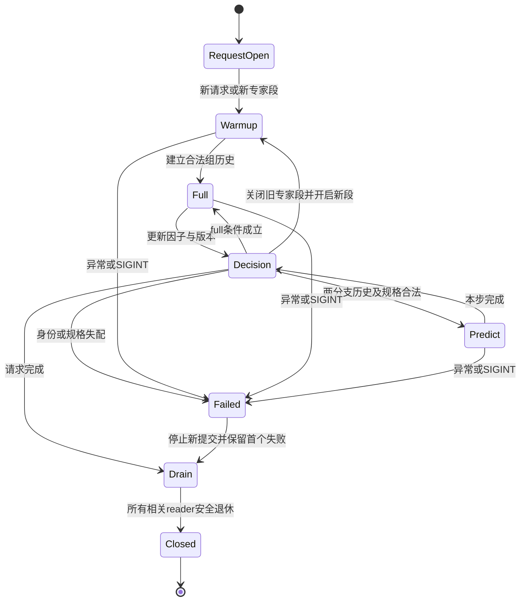
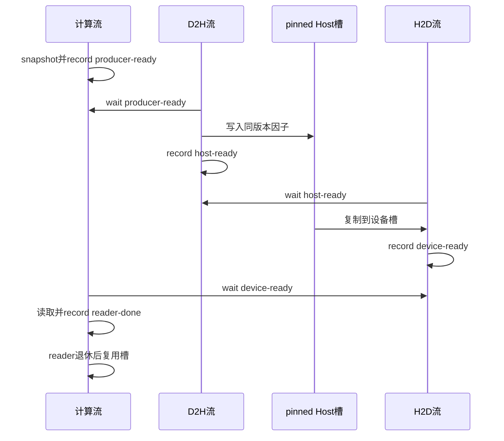

# Wan2.2-I2V TaylorSeer、Offload 与 Prefetch 设计文档

| 项目 | 内容 |
| --- | --- |
| 社区任务 | 10月社区任务-Wan2.2-I2V TaylorSeer、Offload 与 Prefetch（A3） |
| 任务入口 | [昇腾社区任务](https://www.hiascend.com/activities/task-center/details/787db3a044464e709f3788099e95cd84) |
| 团队 / 联系邮箱 | `gca_u2401_85399545` / `3649218972@qq.com` |
| 开发平台（申报字段） | Kimi Code |
| 方案讨论 | [RFC #496](https://gitcode.com/cann/cann-recipes-infer/issues/496) |
| 实现目标 | `cann/cann-recipes-infer`；[实现 PR #1210](https://gitcode.com/cann/cann-recipes-infer/pull/1210) |

## 1. 需求背景（required）

### 1.1 需求来源与现状

任务要求在 Atlas A3 上为 Wan2.2-I2V A14B 接入仓内已有 TaylorSeer 算法，结合 Host Offload 与异步 Prefetch，使同规格端到端平均时延较 NoCache 降低至少 50%，同时保持主观语义质量和运行稳定性。

现有 `module/dit_cache/` 已提供 Taylor 数学方法，Wan 模型路径只接入 NoCache、FBCache 和 TeaCache。Wan 的 high/low-noise 双专家、CFG 两分支和实际 scheduler 顺序，需要单独定义历史隔离与生命周期。直接复用其他模型的 double-stream/single-stream 编号会造成错误历史引用。

本方案以连续 block 的组残差为预测单元，模型适配层管理请求、专家段、CFG 和缓存版本；公共层只复用 Taylor 数学。异步预取的对象是 Taylor 历史/导数缓存，原双专家权重迁移保持串行策略。

### 1.2 范围与边界

本任务是模型缓存及 Host/NPU 流水适配，不新增独立 kernel/aclnn 工程，不引入量化、FlashAttention 替换或并行策略变化凑性能。`torch_npu.npu_prefetch` 权重预取默认关闭，不计入本方案的缓存 Prefetch。

## 2. 需求分析（required）

### 2.1 需求拆解

| 要求 | 设计方法 | 验证重点 |
| --- | --- | --- |
| TaylorSeer 接入 | 组残差 full/predict；调用已有导数更新与预测方法 | 完整步、预测步、warmup/cutoff 及统计一致 |
| 状态隔离 | 请求 generation、专家段、CFG 分支、group 和版本联合校验 | 专家切换、两分支交替及连续请求无错误复用 |
| Offload | 有上限的 pinned Host 池与设备槽 | 数据就绪、引用有效期、容量等待及回收 |
| Prefetch | 独立 H2D 流、显式事件与 reader lease | 搬运和计算重叠；消费前等待；完成前禁止覆盖 |
| 性能与质量 | 四档同规格消融、固定视频样本 | 最终三次均值 ≤ NoCache 三次均值的 0.5；无稳定可辨质量退化 |
| 兼容与回退 | Wan 私有逻辑留在模型目录；关闭功能恢复原入口 | Wan/Hunyuan 现有缓存路径回归与异常清理 |

### 2.2 输入、输出与支持范围

| 对象 | 接口与约束 |
| --- | --- |
| 用户输入 | 原 `WanI2V.generate` 的文本 prompt、`PIL.Image.Image`、负面 prompt、seed 及生成配置；不新增外部 Tensor/ACLNN 接口 |
| 正式生成配置 | `i2v-A14B`，BF16 模型，`640*360` 最大面积，61 帧，40 steps，seed 100 |
| 硬件 / 并行 | Atlas A3 单 rank；CFG/ulysses/ring/TP size 均为 1；同一 pipeline 由单一 owner 串行执行请求 |
| 组历史 | 残差及实际已有导数因子；shape/dtype/device 由真实 full 输出建立并校验，不从权重 BF16 推断特征 dtype |
| 输出 | 原视频 Tensor `(3, 61, H', W')` 及原保存流程；`H'/W'` 由输入纵横比、最大面积与模型对齐要求决定 |
| 首版限制 | 其他生成规格及 FSDP、VAE parallel 等不支持组合启动失败；不声明任意输入、多卡或无保护多线程支持 |

### 2.3 配置合同

配置位于 `models/wan2.2-i2v/config/`，`dit_cache.method` 选择 TaylorSeer，参数位于 `dit_cache.params`。

| 参数 | 推荐值 / 合法域 | 含义及校验 |
| --- | --- | --- |
| `n_derivatives` | 1；合法 1～3 | 最大导数阶数；不保证启动时所有阶数均已存在 |
| `group_size` | 5；合法 1/5/40 | 每组连续 block 数，40 个 block 推荐分为 8 组 |
| `skip_interval_steps` | 4 | 正整数，不能大于采样步数 |
| `warmup` / `cutoff_steps` | 2 / 1 | 按专家段局部步定义；warmup 至少 1，cutoff 可为 0，均不能超过采样步数 |
| `offload` / `prefetch` | 最终档均为 true | 必须为布尔值；prefetch 要求 offload 开启 |
| `prefetch_distance` | 1 | block 前瞻距离，启用时小于 block 数；适配器向上换算为 group 距离，推荐值预取下一组 |
| `max_pending_reads` | 公共默认 2；最终档 4 | 正整数；限制未退休的读取，最终档显式覆盖默认值 |
| `transport_limits` | 显式字节、槽、inflight 和 reader 上限 | 检查类型、范围及组合；预算是硬上限，不是实际峰值或任意 shape 容纳保证 |

未知参数、非法类型或不支持组合返回失败，不静默修改配置。参数通过校验不等于其全部组合已有正式质量和性能保证，实测结论仅适用于本文固定配置。

## 3. 详细设计（required）

### 3.1 模块与职责

| 模块 | 职责 |
| --- | --- |
| `wan/cache/taylor_entry.py` | 启动校验、真实 scheduler、专家/CFG scope、请求生命周期 |
| `wan/cache/taylor_adapter.py` | block 包装、组 full/predict、公共 Taylor 数学桥接及统计 |
| `wan/cache/taylor_state.py` | 请求、步、分支、group、版本与 lease 合同 |
| `wan/cache/taylor_transport.py` | pinned Host/设备池、copy 流、事件、reader 和容量管理 |
| `wan/image2video.py` 等入口 | 原模型计算、双专家选择与迁移、关闭回退、`finally` 清理 |
| 公共 `module/dit_cache/` | 复用 `BaseCache.derivative_approximation` 与 `BaseCache.taylor_formula`，不写入 Wan 专家私有逻辑 |

以上 `wan/` 路径均位于 `models/wan2.2-i2v/`。`WanTaylorFacade` 保持管理器名称及统计接口兼容。Python Host 侧组织状态与异步依赖；NPU 侧执行原 block、已有 Tensor 运算和搬运，不新增 tiling、分核或 UB 参数。

### 3.2 缓存单元与计算公式

令 `F_g` 为第 g 组原 block 的复合函数，在 full 步 q 保存组残差：

```text
r_g(q) = F_g(x(q)) - x(q)
```

full 路径直接返回原 `F_g(x(q))`，不通过相减再相加重建原输出。首个合法 full 记录保存零阶残差；后续复用公共 helper，按已有旧阶数逐阶更新。令 p 为同一历史键前一次 full 位置，Δ = q-p > 0：

```text
a_0(q)     = r_g(q)
a_(k+1)(q) = (a_k(q) - a_k(p)) / Δ
```

预测步 s 使用最近 full 位置 q 的实际已有因子：

```text
r_hat_g(s) = Σ_k a_k(q) * (s-q)^k / k!
y_g(s)    = x(s) + r_hat_g(s)
```

因子阶数受现有历史及公共 helper 的 warmup 条件限制，不能把 `n_derivatives=1` 误解为第一个 full 步已有一阶因子。预测组的入口包装器返回 `x+r_hat`，其余组内包装器透传。

### 3.3 full/predict 调度及隔离

全局 scheduler 步只推进一次；q 是当前专家段内从 0 开始的局部步，L 是该专家段长度。对每个 group，full 判定为：

```text
q < warmup
OR (q - warmup) % skip_interval_steps == 0
OR L - q <= cutoff_steps
OR 任一 CFG 分支缺少合法零阶历史/对应 Host ticket
```

cond/uncond 共享该步的调度决定，但各自保存历史。不能因第二个 CFG forward 再推进采样步。历史键包含请求 generation、专家段、CFG 分支和 group，版本另行管理；专家切换关闭旧段，新段重新 warmup。

预测前校验真实组规格、请求身份和版本。当前请求发生身份或规格失配时进入 FAILED 并清理，不能伪装成成功重置后继续运行。



### 3.4 Offload、Prefetch 与资源所有权

full 路径在计算流生成 snapshot，记录 producer-ready。D2H 流等待后写入 pinned Host 槽并记录 host-ready；H2D 流等待数据就绪，把将要消费的同版本因子搬入设备槽并记录 device-ready。消费者等待 device-ready，读取完成后记录 reader-done。



ticket 绑定版本与 lease；copy 完成前保留源 snapshot，reader 完成前禁止覆盖设备槽或释放旧历史。容量不足时只等待相关事件。可选预取未命中时可合法 JIT 搬运，不改变 full/predict 的数学决定。

| 档位 | 并发读取上限 | 设备槽 | 资源策略 |
| --- | ---: | ---: | --- |
| Taylor-only | 不创建 Host transport | 不适用 | 不分配 Host 搬运池 |
| Offload-only | 2 | 4 | 显式配置预算，消费时搬入 |
| 最终 Prefetch | 4 | 6 | Host 16 GiB/32 槽，device 2 GiB，inflight 4；提前搬入 |

Offload-only 与最终档的资源配置不同，二者端到端差值不能全部归因于 Prefetch；另用相同 read4/device6、仅切换 Prefetch 的诊断对照分析等待时间。

### 3.5 异常清理与回退

正常结束、异常和 SIGINT 均经请求 `finally` 停止新提交，收齐相关 copy/reader 后释放事件、槽及历史。清理未完成时保留所有权与失败状态以供显式重试，不提前摘除仍被使用的包装器，也不把未完成清理报告成成功。首个失败原因不得被清理异常覆盖。

NoCache 关闭适配器与 transport；Taylor-only 不创建 Host 池。既有 FBCache/TeaCache 保持原入口。计时结束前同步计算及 copy 流。

### 3.6 启用方法

在实现分支准备同一权重、固定图片与 prompt，四份 YAML 保持生成规格一致，从模型目录分别执行：

```bash
cd models/wan2.2-i2v
YAML_FILE_NAME=14b_single.yaml bash infer.sh
YAML_FILE_NAME=14b_taylorseer.yaml bash infer.sh
YAML_FILE_NAME=14b_taylorseer_offload.yaml bash infer.sh
YAML_FILE_NAME=14b_taylorseer_prefetch.yaml bash infer.sh
```

保留脚本内置预热、实际生效配置及完整原始日志。权重、图片、视频和大型 trace 通过材料索引获取，不加入本设计 PR。

## 4. 可维可测分析

### 4.1 自验设计与判据

| 验证项 | 方法 | 预期与判据 |
| --- | --- | --- |
| 配置与支持域 | 合法/非法类型、未知参数、功能组合及并行配置 | 合法值可启动；非法配置失败且返回非零，不静默回退 |
| 数学与调度 | full/predict、初始历史、warmup/cutoff、两分支交替 | full 返回原输出；预测符合公共公式；同一采样步只推进一次 |
| 隔离与所有权 | 专家切换、连续请求、版本/规格失配、槽复用 | 不跨域复用；失配失败；reader 退休前不覆盖或释放 |
| 异步依赖 | 原生 profiler 的 H2D/D2H、event 与实际消费者 | 至少一个关键 H2D 与计算重叠，消费前依赖正确 |
| 稳定性与内存 | 连续 5 次生成、真实 SIGINT、同 pipeline 恢复 | 无脏历史/OOM/持续泄漏；占用增长可解释，失败可清理 |
| 视频质量 | 至少 5 组固定图片/prompt/seed 四档对照 | 主体、语义、动作、时序、伪影无稳定可辨退化；允许像素变化 |
| 正式性能 | 原 `bash infer.sh`；四档各 3 次，保留内置预热 | 最终档三次均值 ≤ NoCache 三次均值的 0.5，不用重试替换慢值 |
| 公共回归 | Wan/Hunyuan 现有 NoCache/FBCache/TeaCache 直接调用方 | 默认行为及功能/精度不受影响，报告代表性性能与波动 |

source/CPU 合同只验证其相应层，不替代 NPU 数值、视频质量或时间线。公共调用方性能暂按事前本地规则 `mean(after3) <= max(before3)` 记录，旧失败与受控 ABBA 结果均保留；任务书“基线波动下界”的官方统计公式尚待确认。

### 4.2 已有自验结果

整树性能对应提交 `cec0829b6b57aa52f1934b4be3d6923228b928d1`。环境为 Python 3.12.13、PyTorch 2.7.1（安装标识 `2.7.1+cpu`）、torch_npu 2.7.1.post2、CANN 9.1.0，实际使用原生 Atlas A3。权重 revision 为 `1403ba3af7b31b33bd6ef3465e9f159ff4976a07`；各档共用模型迁移/RoPE 生命周期修复，不将其收益单独计为 TaylorSeer 收益。

同机、同环境、同输入完成三轮，每轮四档各 3 次，共 36 个正式结果。保留原同步计时和预热：NoCache 预热 2 步，Taylor 三档预热 40 步；正式生成均为 40 步。每轮独立判定，不跨轮混合或替换慢值。

| 轮次 | NoCache 均值/s | Taylor-only 均值/s | Offload 均值/s | 最终组合均值/s | 最终/基线 |
| --- | ---: | ---: | ---: | ---: | ---: |
| 1 | 278.132667 | 125.258233 | 112.376767 | 111.359400 | 0.400382312 |
| 2 | 243.919600 | 123.420067 | 105.062300 | 108.652367 | 0.445443362 |
| 3 | 232.766133 | 101.079633 | 103.969533 | 109.354100 | 0.469802451 |

三轮分别通过任务均值比率 ≤0.5，也通过提交者附加的 5% 均值余量目标 ≤0.475。第 3 轮的 118.8488 s 慢值保留；上述结论针对三次均值，不扩张为每个单次或任意输入保证。

| 其他证据 | 已有结果与适用边界 |
| --- | --- |
| 实现合同 | 当前集成同 tree 的公共 bridge 12 项、projection 3 项及全文件 pre-commit 已执行，均退出 0 |
| 原生计算与异步 | 既有原候选 `44115b16` / tree `f539ddc4` 的完整 block 计算 3200→1200；关键 H2D 与计算交集 633.666 µs，含事件链及实际消费者；不代表模型权重异步预取 |
| Prefetch 诊断 | 相同 read4/device6 单次对照，请求内 `aclrtSynchronize*` CPU 区间并集 75.209076180→74.934890320 s；含容量等待，不是纯 cache/device wait 或稳定统计保证，Memcpy/提交耗时也未同时下降 |
| 内存 | 既有同批 profile 的 allocated peak：baseline 33,112,287,744 B，最终档 35,864,154,112 B；Host `ru_maxrss` 分别 91,498,975,232 / 91,543,658,496 B。前者不是整卡 HBM，后者是进程累计峰；原 allocator 记录告警保留，D2D snapshot 严格分类值为 N/A |
| 质量与稳定性 | 既有五输入质量、连续五次、SIGINT/恢复及回归报告保留各自源码、主机与协议；新 36 次仅补测整树标准性能，不冒充新的质量、内存或 profiling 测量 |

### 4.3 交付与评审状态

原始命令、配置、计时与七件自验报告见[私有材料仓固定提交 ae90be13](https://gitcode.com/gca_u2401_85399545/wan22-a3-task-submission/tree/ae90be13ff2c205a7312c1edcbb89808d3aca6ed) 的 `task_submission/`。大型对照视频和 profiling 另附获取索引及校验信息，不加入目标代码仓。

本 PR 申请设计评审；实现 PR #1210 仍为 Draft，SCA 待确认事项及公共改动范围单独由实现评审处理，不能用设计 PR 的 CI 代替实现 CI。RFC 实际在本地开发启动后公开，未宣称此前已达成社区共识。社区设计批准、私仓实际访问、代码合入和正式验收结论均以实际平台记录为准。
