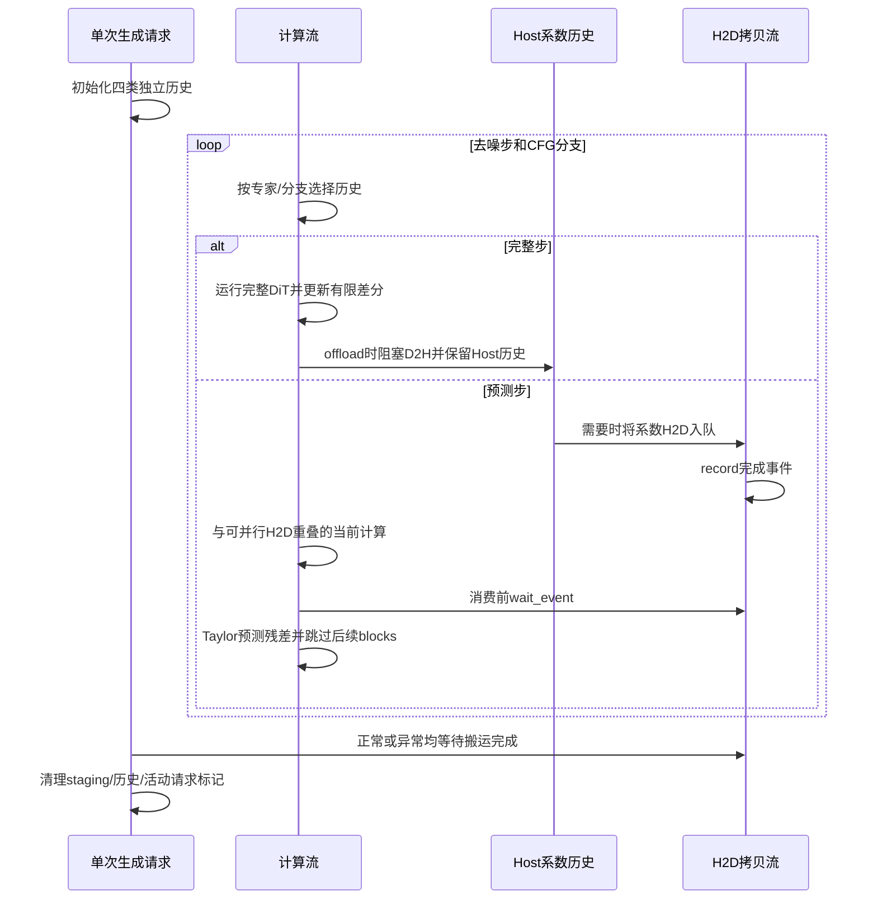

# 需求背景（required）

## 需求来源

10月社区任务第6项：Wan2.2-I2V TaylorSeer、Offload与Prefetch（Atlas A3）。提交人GitCode：hao9619。关联RFC：https://gitcode.com/cann/cann-recipes-infer/issues/464 。个人代码Fork：https://gitcode.com/hao9619/cann-recipes-infer 。当前实现尚未推送，完整提交SHA待用户提交后补充。

本设计按社区design_template.md保留需求背景、需求分析、详细设计、可维可测分析四个章节，内容按模型缓存任务调整；本任务不开发Ascend C算子，因此不虚构TilingKey、op_host或op_kernel实现。

## 背景介绍

Wan2.2-I2V A14B以high/low-noise两套DiT和顺序CFG完成视频生成，既有Wan路径仅接入NoCache/FBCache/TeaCache。目标是接入Taylor残差预测、缓存Host卸载和独立流H2D预取，在相同A3环境与输入配置下，将正式生成均值降低至少50%，并满足质量、生命周期和回归要求。

# 需求分析（required）

| 范围 | 设计要求 |
|---|---|
| 输入/输出 | 单卡BF16 I2V，图片与prompt输入、61帧视频输出；size640*360表示最大面积，实测对齐输出640×352 |
| 参数 | 导数阶数0..3、正整数interval/warmup、非负cutoff；offload/prefetch布尔值，prefetch_distance为1 |
| 状态 | high/low专家、cond/uncond分支、生成请求分别隔离 |
| 卸载 | CPU历史所有权明确；非活动模型使用原整模型卸载策略 |
| 预取 | copy stream提前搬运下一CFG历史，消费前event wait，结束前同步 |
| 异常 | 非法组合加载前失败；实际H2D未完成时中断亦清理、可恢复 |
| 回退 | NoCache及旧缓存默认行为保持，公共模块直接调用方回归 |
| 不在范围内 | 不引入量化、FA替换、多卡策略或自定义Ascend C算子 |

# 详细设计（required）

## 实现边界与算法

适配实现位于`models/wan2.2-i2v/wan/cache/taylorseer.py`。现有公共TaylorSeer面向Hunyuan双流结构，无法直接承担Wan双专家/CFG状态。因此保留其有限差分递推思路，在Wan内实现整段block-stack residual适配。公共CacheManager只增加可选`taylor_factory`参数；未传参数的调用方继续使用原实现，该接口已完成实际Hunyuan/Wan调用方回归，范围见最终机器自测报告。

每条历史以`(high|low, cond|uncond)`为键，共最多四条；请求边界建立并销毁全部历史。每次forward上下文显式提供真实去噪步、专家、CFG分支和模型实际device。缓存覆盖完整block-stack，而不是逐层attention/FFN特征：
- 完整步在首block保存输入，在末block取得最终输出，以二者差值更新历史。
- 预测步在首block计算预测残差并返回，后续blocks直接跳过；embedding与head等路径仍执行。
- full观察位置为s、前次full为p时，`factor[0]=final_output-initial_input`，`factor[k+1]=(new_factor[k]-old_factor[k])/(s-p)`。
- 当前步t预测`sum(factor[k]*(t-s)^k/k!)`。这里是有限差分近似，不宣称为精确高阶多项式插值。

当前候选参数为n_derivatives=3、skip_interval_steps=4、warmup=3、cutoff_steps=1。真实去噪步从0计数，cond/uncond不额外推进步数。全局前warmup步、每条专家/CFG历史前warmup次访问、空历史、shape/dtype变化、最后cutoff步以及`(step-warmup)%interval==0`时强制完整执行；专家切换后独立预热。当前40步实验记录30次完整与50次预测CFG forwards；该比例不是每种输入/配置的保证。

每次generate通过请求装饰器初始化，结束或异常时finally清理copy stream、staging和历史；2步预热不会污染后续请求。同一缓存实例的并发或嵌套generate明确拒绝。不同shape/dtype历史不得直接命中。

## 内存、卸载与同步

系数统一FP32，即使模型输入为BF16。K条历史、D阶、B×L×C形状的稳态系数为`K*(D+1)*B*L*C*4`字节。当前横屏形状下每个系数275MiB，四条三阶历史约4.297GiB；临时张量、staging、激活和分配器另计。全层缓存的早期方案不适合64GiB设备，当前四档均使用同一整段残差粒度。

offload=false时历史驻留计算设备；offload=true时历史存入CPU。D2H使用阻塞复制，确保Host数据完整后才供读取；当前不声称D2H异步重叠。prefetch=true另将CPU历史固定为pinned memory，使用独立H2D流和完成event：
1. set_context时启动当前历史拷贝；cond上下文同时提前拷贝同专家uncond历史。
2. 拷贝可与当前embedding或cond计算并行，实际msprof已观测到系数H2D与异流计算重叠。
3. 消费前计算流等待完成event，并记录张量所在流；immutable Host源保留到搬运完成。
4. stage释放和请求清理等待相关搬运完成，避免DMA尚未完成就释放源缓冲。

prefetch_distance严格为整数1，表示下一CFG分支提前取整段历史，不是模型权重逐层预取。offload与prefetch只控制新增系数历史。既有offload_model四档保持一致；单卡默认仍卸载非活动模型。该消融定义需维护者确认。

## 配置与错误语义

四档模板为`14b_single_nocache.yaml`、`14b_single_taylorseer.yaml`、`14b_single_taylorseer_offload.yaml`与`14b_single_taylorseer_prefetch.yaml`。

阶数为整数0..3，warmup/interval为正整数，cutoff为非负整数；布尔值不能冒充整数。prefetch必须同时启用offload，distance只接受整数1；Taylor不支持多卡或共享CFG历史，非法组合在加载模型前非零失败。关闭新增缓存选项保留原整模型卸载行为。启动器使用pipefail保留子进程失败状态。

## 计时、资源与验收

端到端范围为条件编码、去噪、VAE，排除模型加载和MP4保存。原2步短预热保留，正式采样另用一次完整40步预热，再在同一进程执行三次完整正式生成。YAML可设置`benchmark_full_warmups: 1`、`benchmark_runs: 3`及唯一`benchmark_jsonl`路径。采样使用perf_counter，起止全NPU同步；每次记录原始值并刷新到独占创建的JSONL，拒绝覆盖旧样本。

逐次另存NPU allocator峰值allocated/reserved及结束占用、Linux进程生命周期峰值RSS、视频有限值、请求编号、full/predict计数与逐步缓存audit。allocator峰值不包含驱动开销；RSS为进程累计峰值，不能标成可重置的逐请求Host峰值。串行调度器每15秒记录设备健康、HBM与频率快照，采样峰值需明确离散采样口径。

msprof单独归档设备计算、搬运与时间线。正式无profiler时延与带profiler结果分开，不将Host时间称为设备时间。AGENTS默认10次预热、60次采样去掉最大10次的代表性计算/搬运附加自测已完成，详见最终机器报告；它与任务1+3整模统计分别报告。

验收公式为`speedup=baseline_mean/final_mean`，`reduction=1-final_mean/baseline_mean`，须reduction>=0.5且质量、稳定性通过。正式四档在当前同一环境测量；asys频率字段800MHz与msprof计数1800MHz口径尚未对齐，不能据此断言发生降频或将其作为耗时差异根因。

## 状态机与时序

Host源张量持续存活至对应DMA完成。最多暂存两条CFG历史，每条历史由独立专家/分支键标识。不能把其他请求或其他shape/dtype的历史当作命中。异常清理在finally执行；同一缓存实例的并发/嵌套请求拒绝。

## 支持硬件与约束

实测A3 Ascend910_9382 V1单逻辑设备64GiB HBM，CANN9.1.0、Python3.12.11、torch2.7.1、torch_npu2.7.1.post2。未验证其他硬件，不以A3名称推导UB容量。固件版本及UB容量尚未确认。整模型权重卸载与新增系数卸载分别定义；不把系数开关声称为模型权重逐层异步预取。

# 可维可测分析

## 标准与验证

| 项目 | 已有验证 | 判据及边界 |
|---|---|---|
| 正式性能 | 四档1完整预热+3次正式 | 最终reduction=1-final_mean/baseline_mean≥50%；实际52.6261%，计时范围待任务方认可 |
| 生成质量 | 两名开发方提名人员各五组修订表 | 均报告无明显差异；人员及GitCode免签名方式待认可 |
| 连续/中断 | 四档各5次，H2D未完成时异常注入与恢复 | finite、完整解码、缓存清理；不宣称无限时长无泄漏 |
| 专项源码包 | 72/72方法通过，0跳过 | Host45、CPU12、NPU12、实际Wan集成3；发布后仅文档更新 |
| 公共模块 | Hunyuan/Wan输出逐位一致，代表性10+60设备性能 | 完整视频配对与代表性调用分开，不混为全模型统计置信结论 |
| 时间线 | 39组实际H2D与异流计算重叠，76组等待API关联 | event ID查询507000，设备缓存等待阻塞耗时未归因 |
| 内存 | allocator、Host RSS与对象逻辑账本分别记录 | 最终组合独立Host采样缺失；线程采样间隙约4.94秒，非瞬时精确峰值 |
| 工程 | 24个实际文件pre-commit和diff检查通过 | 官方CI未运行，全仓既有告警单列；不宣称已通过官方验收 |

## 结果摘要

| 模式 | 正式三次均值秒 |
|---|---:|
| NoCache | 864.5302 |
| TaylorSeer | 370.1345 |
| TaylorSeer＋Offload | 388.5541 |
| TaylorSeer＋Offload＋Prefetch | 409.5617 |

最终组合较NoCache耗时降低52.6261%，但比Taylor-only慢，不宣称卸载/预取各自带来整模提速。生成计时包含条件编码、去噪和VAE，排除加载/保存，起止NPU同步；原始慢样本全部保留。msprof设备计时单独报告。

## 兼容性、复现与交付

公共CacheManager仅增加可选taylor_factory，默认仍走原构造路径。模型专属逻辑位于models/wan2.2-i2v；依赖按官方README固定上游源码和权重来源，视频/权重/profiler大件不进入代码PR。

模型README、配置README、专项tests/、七件task_submission、最终机器报告、匿名材料及两份人工修订表均已准备。部分材料已由用户报告上传至Issue464，附件网页尚未独立复核。正式代码提交SHA、代码PR、设计PR链接和正式验收申请号尚未产生，后续按实际记录补齐。

当前提交的是待评审设计，不倒填开发前已获批准。请维护者评审模型适配方案与参数，并确认人员指定、输出对齐、计时范围和正式验收入口。是否需先创建代码PR号码才能提交正式验收，以本专项系统/负责人要求为准；不以其他算子任务的规则替代。
