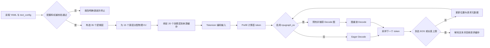
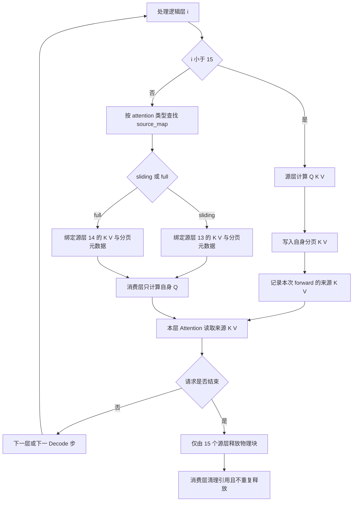

# Gemma-4-E2B 纯文本推理接入设计文档

## 需求背景（required）

### 需求来源

本需求来源于 HiAscend 社区任务 [Gemma-4-E2B 推理样例](https://www.hiascend.com/activities/task-center/details/69423188360d481bab8669b7b9f817e6)，目标是在 `cann/cann-recipes-infer` 统一执行器中提供 Atlas A3 单卡 BF16 纯文本 Offline 推理。

### 背景介绍

#### 对标模型与计算语义

Gemma-4-E2B 的纯文本路径除了混合滑窗/全局注意力，还包含逐层输入、跨层 KV 共享、分层双宽 MLP。仅替换旧模型的 YAML 不能满足这些语义。

设计以 Gemma-4-E2B 的 `text_config` 为模型配置输入，并以 Transformers Gemma4 的纯文本计算语义作为对齐目标。权重、tokenizer、依赖版本与生成参数应在开发前固定并经维护者确认。

| 配置项 | 当前配置及设计含义 |
| --- | --- |
| Decoder 层数 L / hidden size H | 35 / 1536 |
| Attention 类型 | 每 5 层为 4 个 sliding + 1 个 full；由 `layer_types` 读取 |
| Q heads / KV heads | 8 / 1 |
| Sliding / full head dimension | 256 / 512 |
| Sliding window W | 512 token |
| 逐层输入维度 d | 256；专用 embedding 词表 262144 |
| 共享层数 | 最后 20 层，即零基索引 15～34 |
| KV 来源 | 共享区之前最后一个同类型层，当前 sliding 为 13，full 为 14 |
| MLP | 0～14 层 intermediate=6144；15～34 层=12288；GELU 门控 dense，无 MoE |
| RoPE | sliding 默认 RoPE、theta=10000；full proportional RoPE、theta=1000000、partial factor=0.25 |
| 输出 | embedding/lm-head 权重绑定；final logit softcap=30 |

以上数值来自固定配置，不作为绕开配置解析的硬编码常量。配置声明的最大位置 131072 不等于本任务已验证的上下文容量。

#### 仓库实现现状

实现应基于 Recipes 仓库当前统一执行器和 Gemma 模型协议开展。

| 现有能力或限制 | 本次处理 |
| --- | --- |
| `models/gemma_4` 有混合 attention、RoPE、分页缓存、layer_scalar 与加载路径 | 复用适用协议，逐项验证 E2B 的形状和数值语义 |
| 旧 Decoder 缺少 E2B 逐层输入链路 | 新增模型级逐层输入和层内 gate/projection/residual |
| 旧 Attention 按层声明独立 KV | 区分源层与消费者，避免重复计算、分配、写入和释放 |
| `validate_cache_info` 要求逻辑层数匹配，且每层缓存项非空 | 不能用 35 个逻辑层加 20 个空缓存列表接入 |
| 分配器、预算及 manager 创建路径跳过 `needs_block=False` 项 | 可研究消费者非分配描述与源层绑定回调；这并非现成共享缓存 API |
| Gemma README 声明 Python 3.11；现有 requirements 固定 Transformers 5.0.0 | 单独核验 NPU 环境与 v5.5.0 参考环境；不把旧 requirements 当作 E2B 官方实现可运行证据 |

### 任务材料差异与设计假设

| 编号 | 差异或未决口径 | 当前设计处理；正式编码前确认 |
| --- | --- | --- |
| Q01 | 主任务书建议复用 `models/gemma_4`；附件要求独立 `models/gemma_4_e2b` 和对应入口，禁止旧入口 | 本文按附件提出独立目录方案，降低旧 26B-A4B 影响；最终路径由 RFC/发布方确认 |
| Q02 | 模块误差允许约定阈值；附件要求 eager/图模式输出一致 | 分开定义参考端张量容差与两模式 token 一致性；拟以确定性贪心生成比较完整 token 序列，需确认 |
| Q03 | 正文性能矩阵可讨论调整；附件规定最低矩阵 | 准备完整 8 组，不自行删减 |
| Q04 | 正文允许协商图模式例外；附件要求图模式验证 | 按必做设计；失败需证据及明确豁免，不自行降级验收 |
| Q05 | 数据集全量评测的集合、版本、指标和容差未固定 | RFC 锁定至少一个完整评测集，不能用抽样代替全量 |
| Q06 | 共享 KV 的框架接入尚未验证 | 先验证模型内别名原型；若需大幅公共重构，按任务书拆分、重新评估 |

## 需求分析（required）

### 需求描述

在统一模型协议下实现完整语言路径，覆盖模型构造、权重加载、Prefill、Decode、EOS、输出上限和请求清理。支持 A3 单逻辑设备、1TP、BF16、Offline、batch=1，以及 eager 和 `npugraph_ex` Decode。

首期不包含视觉/音频、量化、MoE、MTP、Online PD、多卡优化、极限长上下文或同批次变长 Prefill。通用新模型 Checklist 的额外能力逐项标注不适用原因，不自动扩大任务范围。

### 接口与参数分析

| 接口或配置 | 契约 |
| --- | --- |
| 构造函数 `(config, infer_config, comm_manager, prefix)` | 使用统一配置及通信对象；模型自定义选项归入已有 `custom_params` |
| `forward` | 遵循执行器 packed 输入、位置与缓存元数据和输出契约；不另设调度器 |
| `load_weights` | 加载必要语言参数与 buffer；明确记录已加载、绑定、跳过及异常项 |
| `get_cache_info` | 返回逻辑层、物理源缓存及消费者描述；缓存管理仍由框架负责 |
| `model_name` / 注册 | 拟采用 `gemma_4_e2b`；配套注册、YAML、脚本及文档一致，受 Q01 约束 |
| 执行选项 | BF16、1TP、batch=1；分别验证 eager 与 `npugraph_ex` |

### YAML 与启动约定

下面给出拟议的最小配置。独立目录方案尚待维护者确认，公开示例的 `model_path` 由使用者替换为固定 revision 的本地权重目录。

```yaml
model_config:
  model_name: "gemma_4_e2b"
  model_path: "/data/models/gemma-4-E2B"
  exe_mode: "eager"
  with_ckpt: true
  enable_profiler: false
  enable_cache_compile: false
  enable_static_kernel: false
data_config:
  dataset: "default"
  input_truncated_len: 2048
parallel_config:
  world_size: 1
  attn_tp_size: 1
  moe_tp_size: 1
  embed_tp_size: 1
  lmhead_tp_size: 1
  dense_tp_size: 1
scheduler_config:
  max_new_tokens: 128
  batch_size: 1
```

在代码仓根目录拟执行：

```bash
bash executor/scripts/infer.sh --model gemma_4_e2b --mode offline \
  --yaml gemma_4_e2b_bf16_1tp.yaml
```

`--model` 用于定位模型目录，YAML `model_name` 用于模型注册，两者不能混为一项。图模式仅将对应 YAML 的 `exe_mode` 改为 `npugraph_ex`；测量配置另行启用 Profiler，保存最终完整 YAML。并行配置保留 `moe_tp_size: 1` 是附件的统一字段要求，不表示 E2B 包含 MoE。

### 需求拆解

| 工作项 | 实现边界 | 完成判据 |
| --- | --- | --- |
| 配置及注册 | text_config、层类型、逐层维度、RoPE、YAML | 合法配置可构造；非法配置明确失败；统一入口可发现模型 |
| 逐层输入 | embedding、模型投影、层内 gate 和 norm | 中间张量、残差位置及缩放与固定参考一致 |
| KV 共享 | 来源推导、缓存别名、读写所有权 | 消费层仅算自身 Q；只有源层分配和写入；生命周期测试通过 |
| 双宽 MLP | 按共享区边界选择中间维度 | 14/15 层边界、完整参数及模块数值通过 |
| 加载与输出 | 语言权重、buffer、绑定和 softcap | 无未解释缺失；logits 与生成对齐 |
| 图模式 | 稳定缓存地址、固定结构、Decode replay | 精度通过；稳态无反复编译；连续请求无污染 |
| 自验与文档 | 固定样本、全量集、8 组性能、内存、兼容性 | 可复现命令和原始证据完整；报告与实际运行对应 |

### 交付件与证据规划

拟议代码目录如下，文件名为方案规划，最终遵循仓库现有组织和 Q01 结论：

```text
executor/core/support_models.py                 # 注册入口
models/gemma_4_e2b/
├── models/                                    # 配置、语言模型和缓存绑定
├── config/gemma_4_e2b_bf16_1tp.yaml
├── config/gemma_4_e2b_bf16_1tp_npugraph.yaml
├── tests/reference_hf.py
├── tests/data/prompts.json
├── tests/                                     # 模块、边界、生命周期和性能测试
├── requirements.txt
└── README.md                                  # 用户操作指南
docs/models/gemma_4_e2b/
├── gemma_4_e2b_optimization.md                # 技术优化说明
└── gemma_4_e2b_validation.md                  # 自验报告
```

设计文档单独交付到社区任务设计仓。RFC、实现代码、使用说明、技术设计、自验报告分别记录状态。原始证据关联代码提交、权重/数据集 revision、输入哈希、完整命令、退出码、环境版本及日志哈希；权重、数据集、二进制和大日志不加入 Git。

## 详细设计（required）

### 算子分析

#### 数学公式

以下用行向量说明，线性层权重的存储转置遵循 PyTorch；`Norm` 表示官方对应位置的 RMSNorm，其计算精度、参数语义、eps 与转型顺序均需保留，不用普通 LayerNorm 替代。

**归一化。** 固定参考实现用 FP32 求均方和缩放，最后转换回输入 dtype：

```text
u = FP32(x)
r = u * pow(mean(u * u, axis=-1, keepdim=True) + eps, -0.5)
y = cast(r * FP32(weight), dtype(x))        # with_scale=True
v = cast(r, dtype(x))                      # with_scale=False
```

这里 scale 参数直接使用 `weight`，不加 1；VNorm 为无可学习 scale 的 RMSNorm。复用 `npu_rms_norm` 或融合 add/norm 时，分别验证累加精度、乘权重和残差舍入次序的误差，不能仅按算子名称判定等价。

**逐层输入。** 对 token id 序列 t，设主 embedding 为 E、逐层 embedding 为 E_layer，模型投影为 P：

```text
h0 = E(t) * sqrt(H)
e_layer = reshape(E_layer(t) * sqrt(d), [T, L, d])
p = reshape(Linear_P(h0) * H^(-1/2), [T, L, d])
I = (Norm_projection(p) + e_layer) * 2^(-1/2)
```

embedding 缩放遵循官方 buffer 的 dtype 转换，不能只因实数公式等价而改变 BF16 舍入。Prefill 为 T 个输入 token，Decode 通常 T=1；每层消费 `I[:, i, :]`。

**Decoder。** 第 i 层将输入 h 依次变换为：

```text
a = h + Norm_post_attn(Attention_i(Norm_input(h)))
b = a + Norm_post_ffn(MLP_i(Norm_pre_ffn(a)))
z = GELU_tanh(Linear_gate_i(b)) * I[:, i, :]
c = b + Norm_post_layer_input(Linear_projection_i(z))
h_next = c * layer_scalar_i

MLP_i(x) = Linear_down_i(GELU_tanh(Linear_gate_mlp_i(x)) * Linear_up_i(x))
```

MLP intermediate 由 `use_double_wide_mlp` 和共享区边界决定。本配置前 15 层为 6144，后 20 层为 12288，不复用 MoE 路由。

**Attention 与来源。** 定义 `S = L - num_kv_shared_layers`，并校验来源存在且类型相同：

```text
source(i) = i                                      , i < S
source(i) = max{j < S | type(j) == type(i)}           , i >= S
Q_i = RoPE_type(QNorm_i(Linear_Q_i(x)))
K_s = RoPE_type(KNorm_s(Linear_K_s(x_s)))
V_s = VNorm_s(Linear_V_s(x_s))
A_i = Linear_O_i(softmax(Q_i * K_source(i)^T + mask_type) * V_source(i))
```

上式广播 1 个 KV head 到 8 个 Q heads；官方 attention scale 为 1.0，应显式匹配算子接口，不能套用默认 `1/sqrt(head_dim)`。消费层不再计算自己的 K/V，也不再次对来源 K/V 做 norm 或 RoPE。位置、mask、RoPE 的维度和局部旋转比例按对应 attention 类型生成。

full mask 保留因果关系；sliding mask 还约束查询位置 q 只能读取窗口内的历史位置。边界以固定参考源码为准，用 511/512/513 token 及跨窗口 Decode 测试排除一位偏移。

**输出。** 最终层归一化后通过绑定的语言输出头得到 logits，再执行：

```text
logits = 30 * tanh(raw_logits / 30)
```

softcap 从配置读取，不能在采样后补做。EOS、chat template 和特殊 token 处理与参考端一致。

#### 支持数据类型与形状

| 张量 | 逻辑形状 | 类型或说明 |
| --- | --- | --- |
| packed token ids / positions | `[T]` 或框架约定形状 | 保持执行器整数类型，不任意转成 BF16 |
| hidden states | `[T, H]` | 主要计算 BF16，Norm 等按官方精度语义 |
| per-layer inputs | `[T, L, d]` | BF16 主路径 |
| Q | `[T, 8, D_type]` | sliding D=256，full D=512 |
| 来源 K/V | 各 `[T, 1, D_type]` | norm/RoPE 后复用 |
| 分页 K/V | 各 `[N_blocks, block_size, 1, D_type]` | 以实际 `cache_layout` 为准，不能混用布局 |
| MLP 中间张量 | `[T, M_i]` | M_i=6144 或 12288 |
| 输出 logits | `[T_out, vocab_size]` | 是否仅返回末 token 遵循执行器契约 |

首期 batch=1。性能输入 128/512/1024/2048，最大输出 128；合法最大容量结合实际 HBM、框架配置和位置限制确认，不从模型配置推断已支持极限长度。

### 算子实现

#### 实现方案

执行流程：配置校验 → 分层模块构造 → 权重审计 → 缓存元数据与别名绑定 → Prefill → Decode → 框架请求回收。模型层仅处理模型语义，调度、分页分配、长度与请求状态由执行器维护。

##### 整体推理流程图



配置、权重和缓存关系在首个推理请求前完成校验。Prefill 与 Decode 共用同一份不可变 `source_map`；图模式只捕获形状稳定的 Decode 路径，采样、终止判断和请求状态继续由执行器控制。

#### Host 侧设计

##### 配置与权重加载

解析 `text_config`，验证层数、`layer_types` 长度、共享层范围、每类来源、Q/KV head 比例、head dim、逐层输入和 MLP 维度、RoPE 及输出头绑定。非目标能力不能静默降级。

加载器处理 `language_model` 前缀映射及 checkpoint 分片，不假定旧 MoE 权重命名可直接使用。建立逐项映射表，覆盖主 embedding、35 层 norm/attention/MLP、逐层 embedding、模型级 projection/norm、每层 gate/projection/norm、`layer_scalar`、最终 norm 与 lm-head。固定参考源码在共享层也构造了 k_proj、k_norm、v_proj，但启用缓存共享时 forward 跳过该层 K/V 计算。加载审计必须区分“运行时不使用”和“checkpoint 不含该键”：不得因跳过计算就静默丢弃仍存在的语言参数；最终以固定权重索引逐项核验，结构裁剪需要单独记录和约定。

主 embedding 与 lm-head 共用存储；checkpoint 仅保存一份时不能报错或复制成额外常驻权重。视觉/音频参数用明确前缀白名单跳过并统计；未知语言键、形状不匹配或必要参数缺失均应失败。buffer 与生成配置单独核验，不能用 `strict=False` 隐藏问题。

##### 共享 KV 与缓存所有权

当前缓存框架要求每个逻辑层至少一个 CacheEntry，因此旧草案的“消费者空缓存列表”不可直接实施。首选原型方案如下：

1. 保持 35 个 LayerCacheInfo 和匹配的 `num_layers`。源层 0～14 上报真实 K/V 项，`needs_block=True`；消费层 15～34 保留非空的 K/V 描述，拟用 `needs_block=False` 表示不参与物理分配、预算和 manager 创建。
2. 该标志本身不建立别名。模型初始化时生成不可变 `source_map`；源层 tensor_setter 绑定物理张量后，同时绑定所有消费者的模型字段及需要读取的描述引用。消费者不依赖分配器调用自己的 setter，因为非分配项会被跳过。
3. 验证全部元数据调用方如何读取非分配项，明确每个消费层读取来源 manager 的 block table、slot mapping 和有效长度。仅绑定张量而仍访问消费者自身的分页表会导致错误，不能作为接入完成。
4. 只有源层计算和写入 K/V；消费者只计算自身 Q，并读来源存储。源缓存的请求块由框架一次分配、一次回收；消费者不得重复申请、scatter、清理或释放。
5. 初始化和图捕获前完成地址绑定；Decode replay 不改变别名结构。通过指针、分配/写入计数和输出对齐证明实际共享，不能以节省内存的估计代替验证。

`needs_block=False` 方案需要通过真实分配、二次绑定、指针、分页执行和连续请求回收验证，并获得维护者设计批准。若评审认定该契约不适用，再比较显式 alias 元数据的最小公共扩展；先列出调用方、回归范围和 RFC，再决定是否需要拆分任务，不直接放宽框架校验。

##### 共享 KV Cache 生命周期流程图



源层 0～14 拥有物理缓存，其中共享区最后一个 sliding 层 13 和最后一个 full 层 14 分别作为后 20 层同类型 attention 的来源。消费层保留逻辑层元数据，但不申请、写入或释放物理 K/V；请求结束时只释放源层块，从而避免重复回收和悬空别名。

##### 缓存接入的静态依据与原型通过条件

| 调用点 | 当前代码事实 | 模型接入责任 |
| --- | --- | --- |
| `ExecutionEngine._init_cache_manager` | 校验 → 预算 → 分配 → 创建 manager → 聚合管理器 | 完成来源映射后再进入分配；不依赖尚未建立的 manager 完成 tensor_setter |
| `validate_cache_info` | 逻辑层数一致、缓存项非空；非分配项跳过分页参数校验 | 消费层保留完整、正确的描述；模型自己验证类型、维度和来源，不能利用跳过校验掩盖错误 |
| 预算、分配及 manager 创建 | `needs_block=False` 项均跳过 | 只统计 15 个源层、30 个真实 K/V 项；20 个消费者、40 个描述项不新增物理缓存 |
| `KVCacheManager.get_contiguous_buf_infos` | 只枚举 block-managed 物理项 | 非分配项不自动获得分页块或传输能力；本任务不据此承诺 Online PD |
| 旧 Gemma `_attn_tnd_sliding` / `_attn_bnsd_full` | Prefill、Decode 分支内部调用 `_update_cache` | 拆开计算与写入职责；消费者不能直接调用会写入的完整旧路径 |

消费者通过来源 CacheEntry 的 `group_key` 读取对应 `slot_mapping`、`block_table` 与长度元数据，不能假定 manager 永远以 attention 类型命名。当前旧 Gemma 用 `self.attn_type` 索引，独立模型需显式保持二者一致或按实际 group_key 访问。

原型至少满足以下断言，才能把候选升级为确定方案：

- 校验保留 35 个逻辑层；只有 30 个真实 K/V 项进入预算和分配。初始绑定后，每个消费者 K、V 的 data_ptr 分别等于相应源层，不出现额外物理副本。
- 每个非共享层每步各执行一次 K/V 更新；20 个共享消费者每步更新次数为零。比较写入前后来源缓存，防止消费层副作用。
- Prefill 和 Decode 中，消费者的 manager key、物理页和有效长度都对应本请求来源；滑窗回收与 full 长度增长各自正确。
- 源层绑定不依赖消费者构造顺序；重新初始化或重新分配时所有引用一致刷新，不留下旧地址。
- eager、图重放和请求异常恢复均对齐参考；指针正确但输出错误仍视为原型失败。

若任何断言失败，记录触发用例和实际调用栈，再决定模型内修正或通用 alias 扩展；不能仅以元数据通过校验判定成功。

##### Prefill 与 Decode 的区别

当 Prefill 长度超过 512，滑窗缓存尾部不包含早期 query 所需的全部 K/V。来源层必须为本次 forward 保留完整的当前输入 K/V，让共享消费者按照每个 query 的窗口和因果 mask 读取；不能把滑窗尾部直接当作所有 query 的完整上下文。

拟使用 forward 范围内的来源 K/V 张量引用传递，不建立跨请求的可变全局字典。跨 Decode 步的历史状态仍存于框架分页缓存；首期不另行引入分块 Prefill，若执行器必经此路径，必须先确认历史与当前 KV 的拼接协议及新增验证范围。Prefill 完成后释放临时引用，避免完整长序列 KV 常驻。

Decode 由每个源层先更新本步 K/V，同一 forward 的后续消费者读取更新后内容；位置和长度使用本请求元数据，不能读取其他请求留下的槽位。测试覆盖滑窗滚动、页边界、请求取消、异常退出后再次请求，以及不同长度请求交替。

##### 图模式与异常处理

先通过 eager 模块与端到端精度，再接入 `npugraph_ex` Decode。固定 shape 的 warmup、编译和 replay 分开记录。缓存地址、别名、来源映射和控制结构在捕获前固定；依赖 token/位置的变化通过框架张量输入传递，避免 `.item()` 或数据相关 Python 分支进入 captured 路径。

非法共享配置、权重缺失、长度超限、空输入或不支持模式通过现有异常和日志返回清晰原因；应由 tokenizer/框架接受的输入不在模型层重复改变语义。无效请求不能占用后续请求的缓存块。错误行为和退出码纳入测试，不承诺未验证的自动回退。

#### Kernel 侧设计

复用仓内线性层、RMSNorm、RoPE、attention 和缓存更新能力，不新增自定义 Kernel、tiling、分核或 UB 策略。分别验证 sliding/full 的 D、GQA、布局、scale、mask 及 Prefill/Decode 路径；来源完整 KV Prefill 的接口形状可能不同于旧模型，应单独证明支持。

算子调用不匹配时先保存最小复现、版本、形状及错误，再确认现有 API 能力或拆分算子需求，不在模型适配中引入未经评审的大型算子工程。

### 复杂度与内存分析

非共享层执行 Q/K/V 投影，共享层仅执行自身 Q 投影；35 层仍各自执行 attention、输出投影及 MLP。共享减少 K/V 投影和物理缓存副本，不减少消费层 attention 的计算次数。双宽 MLP 增加后 20 层的中间激活及 GEMM 开销，不能沿用旧模型容量估算。

逐层输入表包含 `262144 × 35 × 256` 个元素，纯 BF16 权重约 4.375 GiB；模型级投影包含 `1536 × 8960` 个元素，约 26.25 MiB。输入 T=2048 时，单份 `[T,35,256]` BF16 张量约 35 MiB。这些是形状估算，不包含其他权重、临时张量、allocator 对齐或算子 workspace。

物理 KV 预算仅统计源层，并区分 sliding/full：

```text
KV_bytes = sum_over_source_layers(
    2 * physical_blocks(type) * storage_block_size * kv_heads * head_dim(type) * dtype_bytes
)
```

当前 15 个源层为 12 sliding、3 full。实际预算还包括块对齐、框架保留、长 Prefill 临时完整 KV、图池及算子 workspace，须用内存 Profiler 测量。官方任务书给出的约 5.1B 参数、BF16 约 10.2 GB 仅是静态量级；其中已包含 embedding，不能再叠加上述逐层输入表。加载时还可能同时持有 CPU 分片、转换临时副本和 NPU 参数，需单独测加载峰值。不要把 `20/35` 直接当作整体显存下降比例，也不要将 Host 内存当作 HBM。

### 支持硬件

| 平台与依赖 | 本任务设计范围 |
| --- | --- |
| Atlas A3 单卡/单逻辑设备 | 必验目标；真实型号、HBM、驱动/固件以运行清单为准 |
| CANN | 9.0.0；记录实际完整版本与路径 |
| PyTorch / torch_npu | 按仓内 Gemma 依赖核验 2.8.0 / 2.8.0.post4（v26.0.0）组合 |
| Python | 优先验证仓库声明的 3.11；镜像 3.12 需独立兼容性证据 |
| 参考端 | 单独锁定 Transformers、PyTorch、权重和 tokenizer；必要时与 NPU 端分环境 |

A2/A5、多卡和其他 CANN 版本不在首期支持承诺中。单卡容量不足时记录实际峰值和 OOM，再确认替代方案，不能静默缩小最低矩阵。

### 算子约束限制

仅提供 BF16 纯文本 Offline 路径；不加载视觉/音频计算模块，但必须完整加载语言部分。统一分页缓存不能替换为 HF Cache，不能私建 scheduler。模型配置的理论能力、文档设计目标和真机验证范围在报告中分开列出。

## 可维可测分析

### 精度标准/性能标准

#### 精度标准

固定参考端与 NPU 端的权重 revision、tokenizer、chat template、特殊 token、输入截断、EOS、seed、生成参数和最大输出长度。显式记录 thinking 开关及模板参数映射，防止一端使用 reasoning 模板、另一端使用普通模板；确定性生成固定采样开关及相关参数，不能只设置 seed。参考脚本保存输入 token、输出 token、文本和所需中间张量/logits。

| 比较层级 | 观测内容 | 判据 |
| --- | --- | --- |
| 模块 | embedding 缩放、逐层投影/I、Q/K norm/RoPE、共享 KV、MLP、layer_scalar、softcap | 候选阈值：小模型 `atol=0.05, rtol=0.03`；完整权重逐步 cosine≥0.999、relative L2≤0.05、max abs≤0.5，且无 NaN/Inf；经维护者批准后执行 |
| 单步 logits | Prefill 末 token、多个 Decode 步 | 同一 token 上下文作 teacher-forced 比较，避免生成分歧污染后续对齐 |
| 固定生成 | 10 个固定 prompt，中文、英文、知识问答、摘要/改写、简单推理五类各至少 2 个 | 保存完整 token 序列及文本；两模式一致性按 Q02 确认的判据 |
| 全量评测 | MATH-500 test 全 500 条候选协议 | 固定 revision、2-shot 短答案、boxed 字符串 exact match；候选两端绝对分差≤1.0个百分点，待批准后重跑 |

固定样本计划覆盖中文、英文、知识问答、摘要/改写、简单推理5类，各2个。官方端使用`AutoProcessor + AutoModelForMultimodalLM`完整自动入口，两端都处理相同base completion文本，不应用chat template、不插入角色、不启用thinking；生成参数拟采用greedy、temperature=0、seed=1234、输入上限2048、输出128。任务未给出统一数值容差，表中数值仅为候选方案；经维护者批准后执行。全量候选集拟采用MATH-500 test，并记录revision、题目数、2-shot模板、截断、停止token 1/107/108、评分脚本和参考端得分。

#### 性能测试设计

| 输入 token 数 | 最大输出 token 数 | batch | 执行模式 | 每模式运行次数 |
| --- | --- | --- | --- | --- |
| 128 | 128 | 1 | eager、npugraph_ex | 预热≥1，正式≥3 |
| 512 | 128 | 1 | eager、npugraph_ex | 预热≥1，正式≥3 |
| 1024 | 128 | 1 | eager、npugraph_ex | 预热≥1，正式≥3 |
| 2048 | 128 | 1 | eager、npugraph_ex | 预热≥1，正式≥3 |

共 8 组、至少 24 次正式运行；预热不计入正式统计。输入以实际 token 数核验，输出记录实际生成量，不把提前 EOS 的请求当作已生成 128 token。端到端时延和设备阶段时延注明计时边界、同步点和是否包含采样；Prefill、Decode、模型加载、编译/预热分开。

记录每次 Prefill/Decode 时延、实际 token 数、吞吐及组内均值/中位数；Decode 吞吐的分子、分母按统一计时定义，不把 Prefill 生成的首 token 混入未覆盖的 Decode 时段。保存 Profiler 与原始结果，确认固定 shape 的图模式稳态无反复编译。首次测试用于建立基线，不设未经任务书要求的加速倍数。候选波动规则为三次正式运行 `(max-min)/median≤20%`，超过10%标记解释，超过20%整组重跑且不选择性删除慢样本。

#### 内存与生命周期测试

最大用例不 OOM；启用 `profile_memory`，分别记录加载后、Prefill 峰值、Decode 峰值、请求回收后以及连续至少 20 个请求后的 Host/NPU allocated、reserved 与实际可用统计。候选稳定门禁为 warmup 后 allocated/reserved 不持续单调增长、每请求缓存块预算恢复，后18请求 Host RSS 范围不超过其中位数5%。图池/allocator 的合理常驻增长与泄漏区分说明，不要求所有保留内存回到进程启动值。

检查源/消费层 data_ptr 别名、缓存物理字节和写入计数；消费者不重复写入，框架不重复释放，异常后请求仍能正确运行。交替使用不同长度、不同内容请求，并与新进程结果对比，检测跨请求状态污染。

#### 边界与异常用例细化

| 用例 | 检查内容 |
| --- | --- |
| 滑窗边缘 | 除输入长度 511/512/513 外，直接构造 query-key 距离 W-1/W/W+1，比较官方 mask 的可见性；在非零绝对位置重复，排除 `pre_tokens` 与 window 定义差一位 |
| 分页边缘 | 按实际 block_size 构造 B-1/B/B+1 的历史长度，检查 slot mapping、尾块和滑窗滚动；不得假定固定页大小 |
| 共享边缘 | 14 层 full 来源，15 层首次 sliding 消费，19/34 层 full 消费；不同类型 KV 不交叉别名 |
| RoPE | sliding 全维旋转与 full 部分旋转分别比较；full 未旋转分量保持原值，Decode 使用实际绝对位置 |
| 权重异常 | 缺必要语言键、shape 不匹配、未知语言前缀失败；已声明多模态前缀可跳过；无持久化 buffer 按官方构造规则生成 |
| 生成边界 | 首步 EOS、Decode 中途 EOS、达到输出上限，核验停止后的 token 数及块回收 |
| 输入与容量异常 | 非法 token ID、共享配置非法、超容量、非目标 batch/模式，验证错误原因及后续合法请求 |
| 请求隔离 | 两条不同长度/内容请求交替，再重复首条请求；对比新进程基线，检测历史槽位与临时完整 KV 泄漏 |

### 分层验证计划

| 阶段 | 重点用例 | 进入下一阶段的条件 |
| --- | --- | --- |
| V0 静态与依赖 | 配置、注册、权重映射、依赖锁定、缓存调用方审查 | 版本与接口明确；Q01/Q02/Q05/Q06 达成必要约定 |
| V1 模块 | 三项 E2B 特有结构，norm/RoPE、logits | 固定阈值内对齐，权重无未解释遗漏 |
| V2 缓存原型 | 来源 13/14、边界 14/15、消费者 15/19/34、源写/消费只读 | 真实分配/指针/分页表/计数和数值证明共享 |
| V3 eager | 511/512/513、长 Prefill、页边界 Decode、EOS/输出上限、异常恢复 | 10 样本及生命周期通过 |
| V4 图模式 | 两模式同输入、捕获/重放、不同请求、20 请求稳定性 | 精度与 Q02 一致性通过，稳态无反复编译 |
| V5 交付验证 | 全量评测、8 组性能、内存、直接调用方回归 | A3 原始证据完整，报告可复现 |
| V6 工程检查 | pre-commit、仓库 CI、文档/脚本/提交包检查 | 各检查独立记录，不用静态通过代替真机通过 |

### 兼容性分析

优先将模型语义限制在独立 E2B 路径和必要注册内。复用旧 Gemma 私有组件时，不改变 26B-A4B 默认配置和权重语义；修改共享模块或公共缓存/执行器前，先枚举直接调用方并采集原始 dtype 的功能、精度和代表性 Prefill/Decode 性能基线。

公共路径改动需回归全部直接调用方，性能不能超出约定的基线波动下界。记录调用方、运行矩阵、修改前后结果和原因；没有硬件或模型证据的组合明确标记未验证，不据此声称兼容。

使用文档应覆盖版本、权重获取、独立依赖环境、启动/清理、支持矩阵和限制；技术文档说明逐层输入、KV 共享、双宽 MLP 及缓存所有权。设计评审前需补齐 Q01～Q06 的决定、参考与运行依赖锁定、精度阈值、全量集口径、共享缓存原型结论和实施排期。
