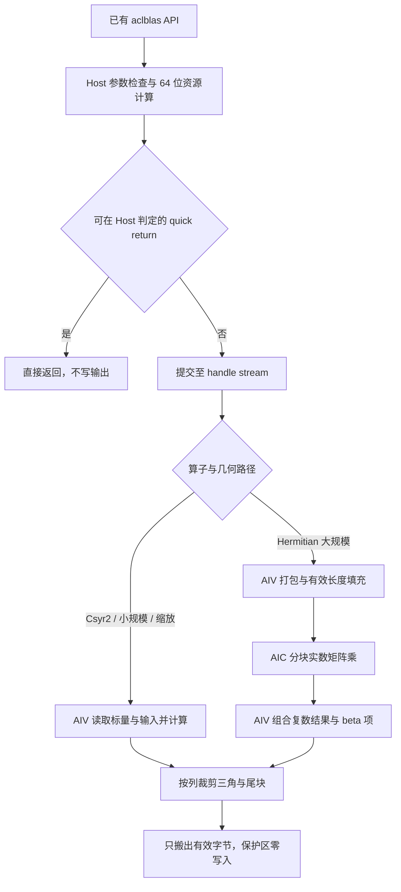

# 需求背景（required）

## 需求来源

本设计对应“10月社区任务-Csyr2/Cher2k/Cherk算子精度修复（A2/A3）”，依据任务附件《aclblasCsyr2/aclblasCher2k/aclblasCherk精度修复-A2/A3》及配套 `test_cases/`，在 ops-blas 已有 `arch22` 实现内修复三个算子的三角写回与精度问题。

| 项目 | 内容 |
| --- | --- |
| 设计名称 | aclblasCsyr2 / aclblasCher2k / aclblasCherk 精度修复设计 |
| 作者 | wangyuyan_44 |
| 联系邮箱 | 2137553008@qq.com |
| 版本与日期 | v1.1，2026-10-28 |
| 实现语言与调用方式 | Ascend C；沿用 ops-blas 句柄式 C++ API、Kernel 直调 |
| 软件基线 | CANN 9.1.0，Netlib BLAS 3.10.0 |
| 实现仓库 | https://gitcode.com/cann/ops-blas |

三个算子作为同一个修复任务交付。本文描述实现设计和验证方法，设备实测结果由自验证报告记录。

## 背景介绍

### 已有算子修复范围

Csyr2 是复数对称秩 2 更新；Cher2k 和 Cherk 是 Hermitian 秩更新。三者均原地更新列主序矩阵的指定三角。矩阵另一三角由数学性质隐含，不属于输出写回范围，前导维带来的 padding 也不是计算元素。

任务要求解决的故障类型是：完整矩形 tile、跨对角 tile 或按对齐长度搬出时，将另一三角或 padding 一并写回。即使写回值数值上相等，也可能改变 NaN payload、负零或非规范数的位模式。因此必须在最终写回地址和字节数上保证保护区零写入，不能依赖浮点掩码合并后整块写回。

### 已有实现与修改位置

沿用 `include/cann_ops_blas.h`、`include/cann_ops_blas_common.h` 的公开声明和类型。当前代码按算子族组织，修改范围如下；Cher2k 的实际族目录是 `her2k`。

| 算子 | Host / Tiling / Kernel 所在目录 | C++ 测试目录 |
| --- | --- | --- |
| Csyr2 | `blas/syr2/arch22/` | `test/syr2/csyr2/arch22/` |
| Cher2k | `blas/her2k/arch22/` | `test/her2k/cher2k/arch22/` |
| Cherk | `blas/herk/arch22/` | `test/herk/cherk/arch22/` |

不新增平行 API，不修改公开头文件签名，不改变 `arch35` Kernel。三角裁剪、列主序地址计算和 bit 检查在上述实现与测试内完成。

### 功能与存储现状分析

| 类别 | 已有能力与修复时须保持的语义 |
| --- | --- |
| 数据类型 | 矩阵和向量为 complex64，实部、虚部各为 float32 |
| 布局 | 列主序，`M(i,j)=M[i+j*ld]`；支持合法前导维及 padding |
| 三角选择 | UPPER / LOWER，只有指定三角及对角可更新 |
| Csyr2 | 普通转置、不共轭；支持正负非零 incx / incy |
| Hermitian 族 | 支持 N / C；计算路径对角虚部置零，quick return 保持整块原样 |
| 执行 | 使用 handle 绑定的 stream，计算在 NPU 执行，保持异步调用 |

# 需求分析（required）

## 需求描述

在不改变公开接口及 BLAS 数学语义的前提下，修复三个算子的 Host/Tiling 和 Kernel 写回，使操作区满足混合容差、非操作三角及 padding 与调用前逐 bit 一致，并保持任务规定的性能。

设原地输出矩阵物理存储为 `ld*n` 个 complex64 元素，逻辑矩阵为 `n*n`，`0<=j<n`：

| 区域 | UPPER | LOWER | 验证方式 |
| --- | --- | --- | --- |
| 操作区，含对角 | `0<=i<=j<n` | `0<=j<=i<n` | 实部、虚部分别混合容差 |
| 非操作三角 | `j<i<n` | `0<=i<j<n` | 调用前后原始字节 memcmp |
| padding | `n<=i<ld` | `n<=i<ld` | 调用前后原始字节 memcmp |

合法 quick return 时整个输出缓冲区保持原样。Hermitian 对角虚部清零只属于实际计算或缩放路径，不覆盖 quick return。

## 需求拆解

| 需求 | 实现措施 | 对应验证 |
| --- | --- | --- |
| 三角保护 | 完整 tile 快速路径与跨对角逐列裁剪，搬出字节数只含有效段 | UPPER/LOWER、对角、尾块、全部 TC_BIT |
| padding 保护 | 逻辑阶数与物理 ld 分离，终止行始终不超过 n | 紧凑 ld、n+8、n+32、非对齐 ld |
| Csyr2 语义 | 不共轭，负步长用 64 位起点与偏移，FP32 复数运算 | 正负步长、纯虚 alpha、复数对角 |
| Hermitian 语义 | N/C 地址映射、实 beta、对角专门处理 | uplo×trans、alpha/beta 边界、特殊值 |
| 生命周期与异步 | stream 有序提交、局部流水同步、workspace 有效期保护 | 非默认 stream、连续调用、输入只读 |
| 性能保护 | 向量复用、分块乘加、独立受限写回 | 九个主场景及每算子 200 条 TC_PF |
| 可维护性 | 封装地址/三角段计算、资源计算与写回函数 | 纯逻辑 UT、C++ GTest、完整精度和 bit 回归 |

# 详细设计（required）

## 算子分析

### 数学公式

**Csyr2：**

```text
A = alpha*x*y^T + alpha*y*x^T + A
A(i,j) = A(i,j) + x(i)*(alpha*y(j)) + y(i)*(alpha*x(j))
```

只更新所选三角，不含共轭。保留 Netlib syr2 的零乘子分支语义，避免把原本跳过的更新改成 `0*Inf` 或 `0*NaN`。

**Cher2k：**

```text
trans=N: C = alpha*A*B^H + conj(alpha)*B*A^H + beta*C
trans=C: C = alpha*A^H*B + conj(alpha)*B^H*A + beta*C
```

令 `U=op(A)`、`V=op(B)` 均为 `[n,k]`，N 对应原矩阵，C 对应共轭转置。统一计算 `P=U*V^H`、`Q=alpha*P`，在操作区写入 `Q(i,j)+conj(Q(j,i))+beta*C(i,j)`。完整 P 只存在于计算 workspace，不写入用户 C 的另一三角。

**Cherk：**

```text
trans=N: C = alpha*A*A^H + beta*C
trans=C: C = alpha*A^H*A + beta*C
```

令 `U=op(A)`，计算 `alpha*U*U^H+beta*C`。两个 Hermitian 算子对角只更新实部，虚部写入 0；不通过读取旧对角虚部计算新实部。

### 支持数据类型

| 算子 | alpha | beta | 输入 / 原地输出 | 计算与累加 |
| --- | --- | --- | --- | --- |
| Csyr2 | complex64 | 不适用 | x/y/A 为 complex64 | FP32 实、虚运算 |
| Cher2k | complex64 | float32 | A/B/C 为 complex64 | FP32 乘加、归约和后处理 |
| Cherk | float32 | float32 | A/C 为 complex64 | FP32 乘加、归约和后处理 |

复数乘法按 `(ar*br-ai*bi, ar*bi+ai*br)` 展开。通用精度路径采用四个实乘积组合，不将三乘法重构或低精度累加作为所有输入的默认路径。优化路径须满足同一精度及非有限值规则。

### 支持形状

| 参数 | 形状与限制 |
| --- | --- |
| Csyr2 的 x/y | 逻辑长度 n，n>0 时物理长度至少 `1+(n-1)*abs(inc)` |
| Csyr2 的 A | 逻辑 `[n,n]`，物理 `[lda,n]`，`lda>=max(1,n)` |
| Cher2k 的 A/B | N：逻辑 `[n,k]`、物理 `[lda,k]` / `[ldb,k]`；C：逻辑 `[k,n]`、物理 `[lda,n]` / `[ldb,n]` |
| Cherk 的 A | 同 Cher2k 的 A |
| Hermitian 输出 C | 逻辑 `[n,n]`，物理 `[ldc,n]`，`ldc>=max(1,n)` |
| n/k | 非负；零维单独处理，不创建零长度计算任务 |

不存在广播或任意高维 stride。除 Csyr2 向量步长外，存储步长由列主序前导维给出。

## 算子实现

### 实现方案

总体分为参数检查、资源与任务切分、NPU 计算、受限写回四部分。Csyr2 使用 AIV；Cher2k/Cherk 对小规模和退化情况使用 AIV，对计算密集的有限值输入使用 AIV 打包、AIC 实数矩阵乘、AIV 后处理。两类路径共享三角写回规则。



#### 3.2.1 host侧设计：

**接口与校验。** 沿用以下函数及参数顺序，不新增 workspace 查询接口或 pointer-mode API：

```cpp
aclblasStatus_t aclblasCsyr2(
    aclblasHandle_t handle, aclblasFillMode_t uplo, int n,
    const aclblasComplex* alpha, const aclblasComplex* x, int incx,
    const aclblasComplex* y, int incy, aclblasComplex* A, int lda);

aclblasStatus_t aclblasCher2k(
    aclblasHandle_t handle, aclblasFillMode_t uplo, aclblasOperation_t trans,
    int n, int k, const aclblasComplex* alpha,
    const aclblasComplex* A, int lda, const aclblasComplex* B, int ldb,
    const float* beta, aclblasComplex* C, int ldc);

aclblasStatus_t aclblasCherk(
    aclblasHandle_t handle, aclblasFillMode_t uplo, aclblasOperation_t trans,
    int n, int k, const float* alpha, const aclblasComplex* A, int lda,
    const float* beta, aclblasComplex* C, int ldc);
```

| 检查 | 处理 |
| --- | --- |
| 空 handle | 返回 `ACLBLAS_STATUS_HANDLE_IS_NULLPTR` |
| uplo / trans | UPPER/LOWER、N/C；非法枚举返回 INVALID_ENUM，不支持的 T 返回 INVALID_VALUE |
| 维度与前导维 | n/k>=0；输出 ld>=max(1,n)；N 输入 ld>=max(1,n)，C 输入 ld>=max(1,k) |
| 向量步长 | incx/incy 非零；负步长不转换成无符号乘法 |
| 指针 | 按已有接口及 quick return 合同校验；正常写回必须有有效输出地址 |
| 资源溢出 | `ld*n`、`n*k`、对齐和字节数先在 uint64_t / size_t 内检查 |
| 资源与下发失败 | 保留现有状态码并记录错误，不将失败返回为 SUCCESS |

Csyr2 的 Host alpha 读取后写入 Tiling。Cher2k/Cherk 的 Device alpha/beta 由设备任务在同一 stream 上读取，每次调用重新读取数值；Host 不通过同步 D2H 决定计算分支，也不缓存 Device 标量值。已有接口允许的其他标量存储路径继续沿用原约定，不新增对调用方的要求。

Csyr2：n=0 或 alpha=0 直接返回。Hermitian 族：n=0 在 Host 返回；`(alpha=0 或 k=0)且 beta=1` 由设备判定后跳过全部用户输出写入；其余无乘积情况进入三角缩放路径。校验先后关系保持公开接口合同，不以修复写回为由改变非法参数处理。

##### 1. 分核策略：

Csyr2 以连续列组为任务单位，每列由唯一核负责。列 j 的有效行区间为 UPPER `[0,j+1)`、LOWER `[j,n)`，总元素数 `n*(n+1)/2`。按累计三角元素量分配列组：UPPER 前 j 列工作量为 `j*(j+1)/2`，LOWER 为 `j*(2*n-j+1)/2`。通过整数二分选择接近每核目标量的边界，减轻按列数均分的负载偏斜。

Hermitian 族以 B×B 输出 tile 为后处理任务，`q=ceil(n/B)`，只调度命中指定三角的 `q*(q+1)/2` 个任务。各核轮转领取 `task=blockIdx+t*usedCoreNum`，同一输出 tile 只有一个写回拥有者。乘积阶段根据数据复用需要计算内部矩形 workspace，后处理只发布指定三角。

核数从平台查询，不超过可用 AIV/AIC 数及有效任务数。小规模减核；空核不访问 GM。分流只依据合法参数、几何形状和资源预算，不依据测试编号或 CSV 行号。

##### 2. 数据分块和内存优化策略：

**Csyr2。** 每列有效段按 L 个复数切分，缓存当前行段 x/y，复用列系数。设 `I(L)=align32(8*L)`、`P(L)=align32(4*L)`，基础预算如下：

| 缓冲 | 预算 | 用途 |
| --- | --- | --- |
| x/y 交织输入，各双缓冲 | `4*I(L)` | GM 搬入及跨列复用 |
| 原 A 与新 A，各双缓冲 | `4*I(L)` | 原地更新的读、算、写解耦 |
| x/y 实虚平面 | `4*P(L)` | 复数向量运算 |
| 乘加临时平面 | `4*P(L)` | 生命周期错开并复用 |
| 索引与步长暂存 | `2*I(L)` | 非单位步长输入重排 |

该表为已紧凑化输入的基础上界 `10*I(L)+8*P(L)+H`，H 为实际 Tiling/标量/事件开销。若一般步长先搬入物理窗口，则定义 `V(L,inc)=align32(8*((L-1)*abs(inc)+1))`，用 `2*V(L,incx)+2*V(L,incy)` 替换表中的 `4*I(L)`，再求能放入 UB 的 L。步长很大时缩短窗口直至 L=1，不申请随步长无界增长的 UB。

Host 查询 UB 容量后选取满足预算的 L；单位步长可省索引暂存，但仍核对真实 InitBuffer 总量。UB 搬运起址按 32B 对齐，计算平面按指令要求对齐，不将对齐长度当作 GM 有效长度。

**Cher2k/Cherk。** 输入打包为实虚 FP32 平面，令 `Np=align(n,Bn)`、`Kp=align(k,Bk)`，基础路径规模相关 workspace 为：

| 算子 | 布局与基础字节数 |
| --- | --- |
| Cher2k | 四个输入平面、四个实数乘积平面：`4*(4*Np*Kp+4*Np*Np)` |
| Cherk | 两个输入平面、两个组合结果平面，乘积依次累加：`4*(2*Np*Kp+2*Np*Np)` |

实际分配还加当前路径临时区与状态头，并按路径对齐。纯缩放和直接 AIV 路径不申请大矩阵 workspace；workspace 不存用户 C 备份，不用于恢复另一三角。复用 handle 已有 workspace 管理，不新增与规模无关的持久 Device 缓存。

Cube 的 baseM/baseN/baseK、L1/L0 双缓冲按平台能力与 Matmul Tiling 结果选择。以单个 FP32 实乘积块 `(bm,bn,bk)` 为例，双缓冲输入的 L1 基础量为 `2*4*(bm*bk+bk*bn)`，L0A/B 分别为 `2*4*bm*bk`、`2*4*bk*bn`，单份 FP32 L0C 为 `4*bm*bn`；再计入实际 NZ/对齐和 API 临时开销，与平台各级容量逐项核对，不能只核算 UB。

AIV 后处理按有效列段分块；TQue 管理搬运流水，TBuf 复用不重叠生命周期的临时量。临时资源在 stream 消费完成前不得释放或跨 stream 复用。

##### 3. tilingkey规划策略：

沿用各算子内部 Tiling 结构和编译入口，不增加公开 ABI。逻辑分支如下，具体枚举值在各算子内部定义：

| 分支维度 | 路径 | 下发信息 |
| --- | --- | --- |
| Csyr2 uplo×步长 | UPPER/LOWER × 单位/一般步长 | n、lda、incx/incy、alpha、列区间、L、核数 |
| Hermitian 无乘积 | 设备判定 quick return / beta 缩放 | n、ldc、uplo、Device 标量地址 |
| Hermitian 小规模 | 直接 AIV 归约与写回 | n/k、ld、N/C、行列块、归约块长 |
| Hermitian 大规模 | 打包 → Cube 实乘积 → AIV 后处理 | Np/Kp、Cube Tiling、workspace 偏移、尾块 |

Device 标量尚未读取时，Host 只按几何选择支持任意标量的入口，不假定 alpha=1/beta=0。物理跨度和尾块有效长度显式传递，内部对齐域不扩大外部输出域。

#### 3.2.2 kernel侧设计：

**1. Init、输入与步长。** 读取 Tiling，建立 GM/UB 视图和队列。Csyr2 用 64 位计算起点 `start=(inc<0)?(1LL-n)*inc:0`，元素 i 的偏移为 `start+int64_t(i)*inc`。单位步长批量搬入；一般步长搬入合法窗口后在 UB 重排，不读取向量分配范围外的对齐填充。

Hermitian 输入按 N/C 映射为 U/V；C 分支在打包时完成转置与共轭，不原地修改输入。K 尾部仅在内部缓冲补零，输入 padding 不参与有效乘积。

**2. Compute 与退化语义。**

- Csyr2 在 FP32 平面计算两次复乘及 A 的累加，普通对角不清虚部。保留参考的零乘子分支，避免将跳过更新改成无条件乘加。
- Cher2k 组合 P，再计算 `alpha*P(i,j)+conj(alpha*P(j,i))`。对角实部为 `2*Re(alpha*P(i,i))` 加 beta 项，虚部直接置零。
- Cherk 组合实乘积与交叉乘积；对角实部对应平方模归约，虚部直接置零。K 分块累加保持固定次序，尾块仅累计真实 K。
- alpha=0 或 k=0 时跳过乘积输入；beta=0 不读取旧操作区 C，防止 `0*NaN` 污染。无乘积且 beta=1 时不读写用户输出，保留对角虚部和全部位模式。
- 特殊值路径保持参考的分支和非有限值传播；有限值 Cube 算法的代数重构不适用时，使用 NPU 直接 FP32 路径。设备侧分类信息通过同一 stream 传递，不回退 CPU 或增加 Host 等待。

大规模路径的设备状态头记录 `quickReturn`、`skipProduct`、`betaZero` 和特殊值分类。首阶段读取标量；需要乘积时，打包任务为各自输入块写入独立分类项，再由设备归约汇总。后续 Cube/后处理读取汇总状态：quick return 不写用户输出，特殊值路径跳过 Cube 结果发布并由直接 AIV 按参考顺序计算，其余使用有限值路径。状态头和分类数组计入本次 workspace，每次调用重新初始化，不沿用上一次数据分类。

**3. CopyOut：三角与尾块裁剪。** 对 tile 行区间 `[r0,r1)` 与有效列 j，计算：

```text
UPPER: begin=r0,       end=min(r1,j+1,n)
LOWER: begin=max(r0,j), end=min(r1,n)
valid=max(0,end-begin)
GM 起始元素 = int64_t(j)*ld+begin
实际搬出字节 = valid*sizeof(aclblasComplex)
```

valid=0 直接跳过。完整位于操作区的 tile 批量搬运；跨对角与 M/N 尾块按列生成有效段。先将段内容重排到 UB 中 32B 对齐的 staging 起点，再用 `DataCopyPad` 按有效字节长度搬出；不向上取整 GM 段长度，不把 UB 补齐字节搬回 GM。仅当起址与长度均满足要求时用普通 `DataCopy`。

同一列段不被两个核写入。非对齐列边界按列组安排写回所有权，避免不同核以整块读改写争用相邻边界。另一三角和 `i>=n` 的地址不进入任何 CopyOut 请求，因此原始位模式不受浮点计算或 NaN 规范化影响。

**4. 同步与流水。** CopyIn → Compute → CopyOut 用队列及相应流水事件建立依赖，MTE3 完成后才复用输出 staging。打包、Cube、后处理按 handle stream 顺序提交；融合实现建立生产者完成、消费者读取及缓冲复用的事件，不以无条件全流水屏障替代依赖设计。API 不插入 `aclrtSynchronizeStream`，测试在取回结果前同步。

**5. 性能设计。** Csyr2 复用 x/y 行段和列系数，合并完整列段搬运，仅对角与非对齐尾段细粒度裁剪。Hermitian 族保持大矩阵 Cube 吞吐，裁剪集中在 epilogue；小规模和无乘积场景避免打包及多次 launch。优化同时回归精度、bit 保护和端到端性能，不采用全矩阵写回后恢复。

## 支持硬件

| 支持的芯片版本 | 设计支持范围 | 验证职责 |
| --- | --- | --- |
| Atlas A2 系列，arch22 | 支持 | 功能、精度、bit 检查；910B3 执行主性能门禁 |
| Atlas A3 系列，arch22 | 支持 | 功能、精度、bit 检查和性能记录 |

核数与片上内存从平台查询，不将 B3 核数写为所有设备常量。CANN 固定为 9.1.0，Golden 固定为 Netlib BLAS 3.10.0。

## 算子约束限制

1. 矩阵/向量保持现有 complex64 接口，Hermitian beta 为实数、Cherk alpha 为实数。
2. 不支持广播、批处理扩展或任意高维 stride；Hermitian 族只支持 N/C。
3. Csyr2 支持正负非零步长，矩阵按列主序及各自 ld 解释。
4. 输出原地更新，只读输入不得改写；不新增任意输入/输出重叠的支持保证。
5. Device 输入、标量及 workspace 生命周期覆盖 stream 消费，调用方读取输出前同步；原 handle/stream 并发约束保持不变。
6. 不新增 CPU fallback、Host 全局同步、整矩阵备份恢复或公开接口；错误路径不访问无效地址。

# 可维可测分析

## 精度标准/性能标准

| 验收标准 | 描述 | 标准来源 |
| --- | --- | --- |
| 操作区精度 | 实/虚分别 rtol=atol=`2^-13`，matched ratio>=0.99，且 `max_abs_error<=max(1e-2,32*ULP(g_low))` | 任务书 §3.2，混合容差标准 |
| 非操作区 | 原始字节 memcmp，100% 一致，任意 bit 不同即失败 | 任务书 §2.0、§3.2.2 |
| quick return | 整块输出 bit-exact，不执行 Hermitian 对角清零 | 任务书 §2.1 |
| 主性能 | 910B3，warmup 后有效采样>50 次，平均耗时不高于下表 | 任务书 §3.3 |
| 扩展性能 | 每算子完整 200 条 TC_PF，与附件 gpu_baseline.csv 对应，GPU/NPU>=0.8；按原 gpu_ms 单位换算 | 任务附件 verify_performance.py |
| 内存 | 无独立数值门禁；检查规模相关 workspace 与生命周期，无额外持久保护缓存 | 任务书 §3.4 |

混合容差标准：https://gitcode.com/cann/opbase/blob/master/docs/zh/ops_precision_standard/mixed_tolerance_standard.md 。`g_low` 按标准取最大有限绝对误差点的输出精度 Golden；NaN/Inf 按标准分类，不套用普通有限值减法。

| 算子 | uplo / trans | n / k | 平均耗时上限（μs） |
| --- | --- | --- | --- |
| Csyr2 | UPPER | n=512，incx=incy=1，lda=512，alpha=(1,0) | 7.54 |
| Csyr2 | LOWER | n=1024，incx=incy=1，lda=1024，alpha=(1,0) | 9.72 |
| Csyr2 | UPPER | n=2048，incx=incy=1，lda=2048，alpha=(1,0) | 19.05 |
| Cher2k | UPPER / N | n=k=1024 | 1458.91 |
| Cher2k | UPPER / N | n=k=2048 | 5240.68 |
| Cher2k | LOWER / C | n=k=1024 | 1081.90 |
| Cherk | UPPER / N | n=k=1024 | 738.09 |
| Cherk | UPPER / N | n=k=2048 | 2616.28 |
| Cherk | LOWER / C | n=k=1024 | 485.94 |

**验证入口与完整性。** 保留任务原 CSV 和基线，不重生成覆盖发布用例。C++ GTest 加载 CSV，Python `verify_accuracy.py`、`verify_performance.py` 为官方入口，保留 stdout、GTest XML 和脚本原始结果。发布 CSV 已含 TC_BIT 时不重复追加。

| 算子 | 官方精度及负向条目，含 BIT | 其中新增 BIT | 官方性能条目 | 总数 |
| --- | --- | --- | --- | --- |
| Csyr2 | 1022 | 22 | 200 | 1222 |
| Cher2k | 1024 | 24 | 200 | 1224 |
| Cherk | 1024 | 24 | 200 | 1224 |
| 合计 | 3070 | 70 | 600 | 3670 |

Csyr2 Golden 按 Netlib ssyr2 的不共轭语义构造复数参考；Cher2k/Cherk 使用 Netlib BLAS 3.10.0 复数 CBLAS。Golden 只在测试端执行，生产算子不依赖 Host BLAS。

**专项测试设计。**

| 层次 | 场景与断言 |
| --- | --- |
| Host/Tiling UT | 参数返回码、非法枚举、前导维、步长零、64 位偏移与溢出；任务无遗漏/重叠/空核访问 |
| 写回专项 UT | UPPER/LOWER×紧凑/padding×对角/内部/尾块；有效段不越过 n 及三角边界 |
| C++ 精度 ST | 全部官方非 PF 条目；实/虚混合容差、Hermitian 对角、输入只读和原地输出 |
| bit 专项 | 所有 SUCCESS 相应用例接入完整缓冲快照及 check_untouched_bitwise.h；覆盖 NaN payload、±0、±Inf、非规范数和有限哨兵 |
| 边界与特殊值 | n/k=0/1、7/8/16/63/64/128、质数、2 的幂±1、尾块；alpha/beta=0/1、纯虚、大值、Inf/NaN、零乘子 |
| 异步与重复调用 | 非默认 stream 上 H2D→算子→D2H 有序；同地址标量改值；连续原地调用；临时区生命周期 |
| 性能回归 | 九个主场景、600 条 TC_PF；记录预热、采样、调用范围与各子 Kernel 时间 |

普通数据按附件均匀分布 `[-5,5]` 与正态分布各 50%，正态参数 `mu∈[-5,5]`、`sigma∈[0.1,2]`，实/虚独立采样。生成后按原始位模式覆盖非操作区哨兵，禁止通过对称补全重写该区。快照前完成输入准备，同步算子 stream 后 D2H，操作区与保护区分别判定。

**计时与可观测性。** 设备计时覆盖单次调用关联的打包、乘积、后处理等全部 Kernel；同时记录 API 提交至 stream 完成的端到端耗时。Profiler 保留 Host 下发、Kernel 名称/耗时、stream 和 workspace 规模。GTest 整项时间包含准备与 Golden，单独标记来源，不作为纯 Kernel 耗时；不以最快子 Kernel 替代完整调用。

同时核对进程退出码、XML 实际条数与失败/跳过数量，超时、零解析、NO_REF 和缺失条目不计为通过。精度报告分别记录数值与 bit 结论，性能报告记录完整 200 条参数、耗时与基线映射。报告、日志随实现仓验收材料交付，设计文档仓只保留本设计。

## 兼容性分析

本任务属于已有算子修复，按接口、数学语义、错误行为及执行顺序约束兼容性：

1. 公共头文件、参数类型与顺序、符号名及状态码不变，不引入第二套接口。
2. 保持 Csyr2 不共轭和负步长、Hermitian N/C/实 beta/对角规则；quick return 不写输出。
3. 仅修改三个算子 arch22 实现及测试，默认不修改公共 handle、调度和 arch35；确需改共享 helper 时，补充其他调用方构建及功能回归。
4. 保持 handle stream 异步顺序与资源生命周期，不用 Host 阻塞或提前释放 workspace 改变合同。
5. A2/A3 分别执行功能、精度和 bit 检查，不互相替代设备结论；B3 为主性能环境。

语义参考：

- cuBLAS syr2：https://docs.nvidia.com/cuda/cublas/index.html#cublas-t-syr2
- cuBLAS her2k：https://docs.nvidia.com/cuda/cublas/index.html#cublas-t-her2k
- cuBLAS herk：https://docs.nvidia.com/cuda/cublas/index.html#cublas-t-herk
- Netlib ssyr2：https://www.netlib.org/blas/ssyr2.f
- Netlib cher2k：https://www.netlib.org/blas/cher2k.f
- Netlib cherk：https://www.netlib.org/blas/cherk.f
