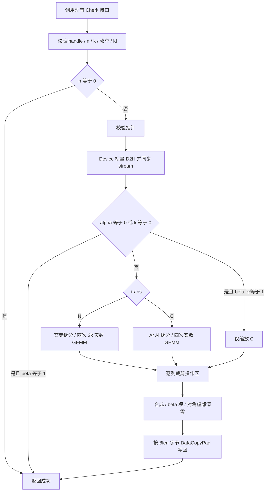
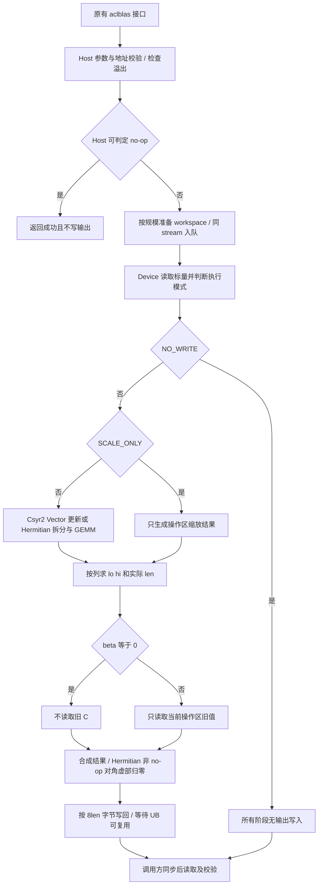

# 【社区任务】aclblasCsyr2/aclblasCher2k/aclblasCherk 精度修复（A2/A3）算子设计文档

- 文档类型：开发方案／设计评审稿，2026-10-28。
- 目标：CANN 9.1.0，Atlas A2 / Atlas A3，ops-blas `arch22`。
- 状态：已完成任务材料、现有本地 Cherk 源码和测试脚本静态分析；尚未实施代码修复、编译或上板验证。文中参数为设计值时均明确标记，不代表性能结果。
- 任务材料根目录：`/Users/swen/Documents/Code/cann/operator_development_workspace/Csyr2Cher2kCherkA2A3_wsp/10月社区任务-Csyr2_cher2k_cherk算子精度修复（A2A3）/`，下称 `<任务包>`。
- 任务书：`<任务包>/aclblasCsyr2_Cher2k_Cherk精度修复_A2A3_task_doc.md`。
- 审核依据：`/Users/swen/Documents/Code/cann/asctool/docs/official/设计文档CheckList.md`，行 2～24，完整映射见第七章。

## 一、需求背景

### 1.1 需求来源

社区任务要求对已有 Csyr2、Cher2k、Cherk 的 A2/A3 实现进行联合精度修复。三个算子作为一个任务交付，不能只修复其中一个。核心问题是更新指定三角时可能改写未引用三角或前导维 padding；操作区数值正确不能替代非操作区二进制一致。

本次用户请求是编制开发方案并保存到指定文档目录。任务书中的 PR、CLA、上板、自验和验收提交要求是后续工程交付条件，本文将其纳入实施计划；本次不执行这些外部操作。任务包中的环境申请、图片和示例命令属于参考材料，不是额外执行授权。

### 1.2 背景介绍

#### 1.2.1 实现路径、接口路径与基线边界

| 对象 | 文件／路径 | 核实情况 |
| --- | --- | --- |
| 开源实现仓 | https://gitcode.com/cann/ops-blas | 任务书指定；实施前固定目标提交号 |
| 本地参考快照 | `/Users/swen/Documents/Code/cann/ops-blas-sz`，HEAD `fe54d86f00a4d449f55da1e8d144b898953d97c5` | 本机静态核实；不等同于任务书所指最新上游 |
| 公共接口 | `include/cann_ops_blas.h`、`include/cann_ops_blas_common.h` | 本地已找到 Cherk 声明；未找到 Csyr2/Cher2k 声明，不能按此旧快照新增公开 API |
| Csyr2 修复位置 | `blas/syr2/arch22/` | 本地仅有 `ssyr2_host.cpp`、`ssyr2_kernel.cpp`，不可冒充复数 Csyr2 实现 |
| Cher2k 修复位置 | `blas/herk/arch22/` | 本地未找到 Cher2k 源文件；须取得已合入版本后登记实际文件名 |
| Cherk 实现 | `blas/herk/arch22/cherk_host.cpp`、`cherk_kernel.cpp`、`cherk_kernel.h`、`cherk_tiling_data.h` | 已阅读 Host 调度、combine 写回及 tiling 定义 |
| Cherk 公共辅助实现 | `blas/common/helper/complex_blas3_host_utils.h`、`complex_blas3_arch22.h` | 前者标量读取已核实；共享计算体需在实施时结合目标版本继续审计 |
| 测试实现 | `test/herk/cherk/arch22/cherk_test.cpp`、`cherk_npu_wrapper.h`、`cherk_test.csv`；`test/herk/cherk/cherk_golden.h` | 本地可用参考；以任务包 CSV 为交付用例基线 |
| TBE 算子源码、算子信息库 | 不适用 | 本任务是 ops-blas 句柄式 Ascend C kernel 直调修复，任务书未提供 TBE 实现和 op-info JSON；不得虚构 `tbe/impl/*.py` 或信息库文件名 |
| ACLNN 接口 | 不适用 | 对应公开入口为 `aclblasCsyr2`、`aclblasCher2k`、`aclblasCherk`，不是 `aclnn*` 两段式接口 |

CheckList 行 5～8 原为 TBE 迁移模板。这里保留“源路径、支持能力、旧实现描述、旧实现流程图”四项核查内容，映射到真实 ops-blas Ascend C 基线；TBE 专属字段明确不适用。Csyr2/Cher2k 的完整旧实现流程分析属于取得目标源码后的进入条件，本文不声称已经完成。

#### 1.2.2 当前实现现状分析

##### 1.2.2.1 数据类型和数据格式

三个算子的矩阵及向量均为 COMPLEX64，实部和虚部各 FLOAT32，以 `aclblasComplex` 的仓内定义为准，预期每元素 8 字节；实施时用类型布局断言核实。物理矩阵为 ND 列主序，通过前导维描述 padding，而非连续行主序或特殊分形格式。

Csyr2：alpha 为 Host 复数标量；x/y/A 为 Device 数据，x/y 支持正负步长。Cher2k：alpha 为 Device 复数标量，beta 为 Device FLOAT32；Cherk：alpha/beta 均为 Device FLOAT32。参数位置不能因优化而改变。

##### 1.2.2.2 已核实 Cherk 逻辑和问题边界

本地 Cherk 的实际流程：Host 校验 → 从 Device 读 alpha/beta → 根据 trans 拆分输入 → 多次实数 GEMM → Vector 合成 → 指定三角写回。

- `trans=N`：把 K 维交错为两个实数操作数，运行两次长度 2k 的实数 GEMM，分别得到完整实部和虚部。交错符号累加旨在缓解极值场景下分开累加再相减的问题。
- `trans=C`：拆成 Ar/Ai，执行四次实数 GEMM；combine 接收 t3/t4 时交换指针，补偿中间结果的布局转换。不能仅根据变量名修改虚部符号。
- `cherk_combine_kernel` 按列轮转分核。UPPER 的行范围为 `[0,col]`，LOWER 为 `[col,n-1]`；每次处理至多 `COMBINE_CHUNK=1024` 个复数元素。
- `CombineOneChunk` 用 `DataCopyPad` 按 `8*len` 字节读取／写回 C；对角虚部通过局部掩码清零。已有代码包含 MTE2→V、V→MTE3 以及缓冲复用前的 MTE3→V/MTE2 事件。

因此，本地 Cherk 已有按三角裁剪的精确长度写回，不能将“整块覆盖另一三角”认定为该快照已证实的根因。应先在指定任务版本复现，记录失败坐标、旧值和新值的 uint32 位模式，再判断是另一版本写回越界、stride、尾块、共享辅助逻辑还是事件依赖问题。正确路径优先保留，避免无证据重写计算内核。

同时静态发现两个接口风险：`ValidateCherkEnumsAndDims` 把 `OP_T` 与非法枚举一起返回 INVALID_ENUM，而任务书要求 OP_T 返回 INVALID_VALUE；`CBlas3ReadScalarsFromDevice` 使用 D2H 后 `aclrtSynchronizeStream`，与任务书 Host 不同步的要求有差距。它们作为修复项单独登记，不能因本任务聚焦 bit-exact 而遗漏。

##### 1.2.2.3 基线实现流程图（替代 TBE 流程图）



图描述已读本地 Cherk 的成功路径，非法参数分支均按实际检查返回错误。Csyr2/Cher2k 的旧实现图须在取得真实源码后补入评审版本；数学语义见第二章，不用拟议算法冒充旧实现。

## 二、需求分析

### 2.1 外部组件依赖

| 组件 | 用途与版本约束 |
| --- | --- |
| CANN 9.1.0 / Ascend C 编译工具链 / AscendCL | kernel 编译、设备内存、句柄绑定 stream 和异步执行；记录精确版本及驱动版本 |
| Atlas A2 / Atlas A3 | 两类设备均需功能、精度、bit-exact 证据；主性能门禁设备为 Atlas 800I A2 910B3 |
| Netlib BLAS 3.10.0 CBLAS | Cher2k/Cherk golden；开发和验收版本一致，不以系统其他 BLAS 随意替换 |
| C++ GTest、Python 3、仓内构建工具 | 使用 ops-blas `test/` 框架、CSV 和任务包 Python 驱动；版本随环境记录 |
| cuBLAS / Netlib 文档 | 语义依据；不要求 NPU 生产运行依赖 GPU 或 CPU BLAS |

Csyr2 golden 需按 Netlib ssyr2 的普通转置和步长语义实现复数参考，不能调用实数 ssyr2 代替复数计算。Netlib 在线参考为语义核对来源；正式 golden 固定 3.10.0。

### 2.2 内部适配模块

保持公共头文件和句柄接口冻结。适配 arch22 Host 校验、tiling、Kernel 入口、写回以及三个 arch22 GTest wrapper/golden 对接。复用句柄的 stream 和现有按规模管理的 workspace；禁止 CPU 回退、公开平行接口、平行实现目录。

共享 helper 若需调整，优先在现有 arch22 调用路径内实现条件化修复，避免影响 arch35。必须改共享代码时，先列出所有调用方和回归范围，并取得 arch35 不受影响的验证证据；在此之前不把共享改动纳入默认范围。

### 2.3 需求模块设计

#### 2.3.1 Ascend C 算子原型

以下为任务书声明摘录，不是新增接口。取得目标分支后与该分支 `include/cann_ops_blas.h` 逐参数核对。

```cpp
aclblasStatus_t aclblasCsyr2(
    aclblasHandle_t handle, aclblasFillMode_t uplo, int n,
    const aclblasComplex* alpha, const aclblasComplex* x, int incx,
    const aclblasComplex* y, int incy, aclblasComplex* A, int lda);
aclblasStatus_t aclblasCher2k(
    aclblasHandle_t handle, aclblasFillMode_t uplo, aclblasOperation_t trans,
    int n, int k, const aclblasComplex* alpha, const aclblasComplex* A, int lda,
    const aclblasComplex* B, int ldb, const float* beta, aclblasComplex* C, int ldc);
aclblasStatus_t aclblasCherk(
    aclblasHandle_t handle, aclblasFillMode_t uplo, aclblasOperation_t trans,
    int n, int k, const float* alpha, const aclblasComplex* A, int lda,
    const float* beta, aclblasComplex* C, int ldc);
```

| 算子 | 数学定义 | 标量／矩阵语义 |
| --- | --- | --- |
| Csyr2 | `A += alpha*x*y^T + alpha*y*x^T` | 普通转置，不共轭；对角虚部按复数运算正常更新 |
| Cher2k N | `C = alpha*A*B^H + conj(alpha)*B*A^H + beta*C` | A/B 逻辑 n×k |
| Cher2k C | `C = alpha*A^H*B + conj(alpha)*B^H*A + beta*C` | A/B 逻辑 k×n |
| Cherk N | `C = alpha*A*A^H + beta*C` | A 逻辑 n×k |
| Cherk C | `C = alpha*A^H*A + beta*C` | A 逻辑 k×n |

Cher2k/Cherk 只存储和更新一个三角，对角输入虚部不参与有效数学计算，非 quick return 路径输出对角虚部置 0。Hermitian 性质是逻辑隐含关系，不是将共轭结果写入另一三角。

#### 2.3.2 参数、shape、值域和异常约束

| 参数组 | 支持范围／shape | 校验及处理 |
| --- | --- | --- |
| handle | 有效 Host 句柄，绑定 stream | nullptr → HANDLE_IS_NULLPTR |
| uplo | UPPER(121)、LOWER(122) | 非法枚举 → INVALID_ENUM |
| trans（Hermitian 族） | N(111)、C(113) | OP_T(112) → INVALID_VALUE；非法枚举 → INVALID_ENUM |
| n / k | Host int，n≥0、k≥0；Csyr2 无 k | 负值 → INVALID_VALUE；n=0 不计算 |
| incx / incy | 非零正负整数 | 0 → INVALID_VALUE；x/y 物理长度 `1+(n-1)*abs(inc)` |
| Csyr2 lda | `lda≥max(1,n)` | A 物理 `lda*n` 个复数；不足 → INVALID_VALUE |
| Hermitian lda / ldb | N：≥max(1,n)；C：≥max(1,k) | A/B 物理 N：ld*k；C：ld*n；Cherk 无 B/ldb |
| ldc | ≥max(1,n) | C 物理 `ldc*n` 个复数；不足 → INVALID_VALUE |
| alpha / beta | float32 分量全集，含特殊值；指针归属见 1.2.2.1 | 标量指针非空；不能在 Host 解引用 Device 标量 |
| x/y/A/B/C | Device 数据；输出原地覆写 | 按任务书各参数表校验，见下述空指针歧义处理 |

不要求广播、batch、高维 ND、不由步长／ld 描述的任意非连续视图，也不扩展 dtype。n/k 是运行时标量，不引入图模式动态 shape 接口；不额外要求确定性算法。没有任务要求的功能缺项；与 TBE 的缺失功能比较不适用。

任务书存在两处必须在接口评审中固化的边界，不能静默放宽：

1. `beta=0` 的“C 不必是有效输入”应理解为旧数值无需有效，不能等同于需要写结果时允许空输出地址。任务参数表只明确 beta 非零时空 C 报错，未完整说明 beta=0 且 C=null 的返回规则。拟议行为是实际写结果时要求输出地址有效，并在实施前对齐任务方及冻结 API 契约；保留原 CSV 所有相关负向 case，禁止跳过冲突。
2. 标量指针“不可 nullptr”与 n=0 quick return 的检查顺序，需要结合冻结版本确认。本文拟定 handle、枚举、维度、ld 和强制非空标量地址校验在 quick return 前；不做标量值 D2H。若目标 API 对 n=0 允许空标量，须先形成明确契约与用例结论，不自行改变异常行为。

矩阵输入指针规则按任务书：Csyr2 在 n>0 且 alpha≠0 时要求 x/y/A 非空；Hermitian 在 n>0 且 k>0 时要求 A（Cher2k 还有 B）非空，即使 alpha=0 也不默认放宽。Device alpha 决定的指针条件不能通过增加 Host 同步实现，见 3.2.1。

#### 2.3.3 区域定义与不可破坏条件

令输出矩阵 M 的物理索引为 `i+j*ld`，`0≤j<n`、`0≤i<ld`。

- UPPER 操作区：`0≤i≤j<n`；LOWER 操作区：`0≤j≤i<n`。
- 非操作区：严格另一三角，以及每列 `[n,ld)` 的 padding；不读后重写，不参与浮点计算。
- 常规计算只写操作区；quick return 不写整个矩阵。对角属于操作区，不能从对角虚部置零规则推出 quick return 也要清零。
- 验证：操作区混合容差；非操作区将 real/imag 视为 uint32，逐 bit 相等，匹配率必须 1.0。

## 三、需求详细设计

### 3.1 使能方式

维持 ops-blas 句柄式接口和 Ascend C kernel 直调，不引入 ACLNN OpDef、aclnn workspace 查询或新 API。调用方创建句柄、设置 stream、准备数据、调用原有三个接口，再在读取结果前同步 stream。

Host 仅完成参数检查、按规模分配／取得 workspace、生成 tiling 和异步入队；设备标量值依赖的 quick return 在 Device 执行。允许 launch 一个最终不写数据的 kernel，不代表 Host 必须知道 Device 标量值。Host 返回状态表示参数检查／入队状态，异步运行错误通过现有 stream 错误机制报告。

### 3.2 需求总体设计

采用“保留已验证计算主体，收紧最终读写边界”的方案。Csyr2 为 Vector 列分段更新；Cher2k/Cherk 保留现有 Cube／Vector 数学主体，中间结果仅落 workspace，最终输出只能经统一的三角片段提交逻辑写回。取得源代码后优先复用已有正确路径，只有复现证据证明需要时才替换 Kernel 或 Tiling。

#### 3.2.1 Host 侧设计

##### 3.2.1.1 分核策略

Csyr2 和最终 combine／scale kernel 的独立任务是“某列中的连续操作区行段”。初始方案使用按列轮转：`j=coreId+t*P`，`P=min(n,平台可用AIV核数)`；UPPER 列长度 `L(j)=j+1`，LOWER 为 `L(j)=n-j`。总操作元素 `Ntri=n*(n+1)/2`，单核负载 `Wc=sum L(c+tP)`。轮转使长短列分散，并保证同列只有一个写回 owner，减少尾块交叉覆盖风险。n=0 不 launch，n=1 至少一个核处理；超大列可在 profiling 后按不重叠片段进一步拆分。

Cube 继续采用二维 tile：`Nm=ceil(n/Bm)`、`Nn=ceil(n/Bn)`，每个核处理一组线性 tile id。完全位于非操作区的 tile 跳过；对角相交 tile 可在 workspace 中完整计算，最终由 Vector 裁剪写 C。`Pcube=min(有效tile数,可用AIC核数)`，不在方案里固定 A2/A3 核数。K 维逐 `Bk` 累加，尾 K 用真实长度；保持既有 K 分段上限，不能把运行时 K 直接传给不足以覆盖它的静态 tiling。

##### 3.2.1.2 数据分块和内存优化策略

定义 `align32(x)=32*ceil(x/32)`，Q 为每片复数元素数，所有 UB 缓冲基址 32 字节对齐。Q 初始从 256/512/1024 中选择，是待测候选，不是固定最优值。

Csyr2 的一个易审核预算模型为四段 x/y 实际行列片段 `4*align32(8Q)`、旧 A 与新 A 两段 `2*align32(8Q)`，再加复数拆解／乘加临时区 `Tvec`、索引和事件空间 `Taux`。若全部双缓冲，保守上界为：

`UBsyr2 ≤ 2*[6*align32(8Q)+Tvec] + Taux + Treserve ≤ UBavailable`。

列标量 xj/yj 可单独驻留，实际复用后预算可下降；不能先把 Q 固定为 1024 再假定缓冲一定能装下。输入步长为 ±1 优先连续搬运；其他步长按现有 Gather／合法步长搬运或逐段打包复用路径实现，不能直接对负 inc 做 unsigned 地址运算。

本地 Cherk combine 的实际缓冲可据 `InitCombineCtx` 逐项计数：cr/ci 共 8Q，tmpA/tmpB 共 8Q，stage 为 8Q，idx/aux0/aux1 共 24Q，lane 为 4Q，mask 为约 Q/8+256 字节。因此：

`UBcombine(Q) = 52Q + align32(Q/8+256)`，各项还需分别向 32B 对齐；Q=1024 时约 53,632 字节。此为单缓冲源码预算，不含新设备标量局部区和额外 reserve。拟议方案先保留单缓冲及明确事件；若双缓冲，只翻倍实际跨迭代存活的数据区，重新证明生命周期和容量。

Cube tile 的基础预算分别为 `L0A≥sA*Bm*Bk`、`L0B≥sB*Bk*Bn`、`L0C≥4*Bm*Bn`；输入 FP32 时 sA/sB=4，实际打包和 Matmul 内部辅助区按所用 API 的 tiling 结果加入。双缓冲、L1 和编译器要求均须在目标平台工具链中核对，不能用 UB 预算代替 Cube 内存预算。

Cherk 的现有 workspace 近似量级：N 路径打包 `16*n*k` 字节、两个实数结果 `8*nt*nt` 字节；C 路径打包 `8*n*k`、四个实数结果 `16*nt*nt` 字节，nt 代表实际对齐结果范围，准确值以目标 helper 的 tempLdc、对齐和生命周期为准。Cher2k 若采用完整双乘积的四实 GEMM 分解，初始保守上界为四个实数输入平面 `16*n*k` 加八个结果平面 `32*nt*nt` 字节；实施时优先复用目标实现的较少中间量方案，不能为本次修复直接强加该上界分配。

所有 workspace 随 n/k 增长，乘法和偏移以 checked uint64_t／size_t 计算，溢出和分配失败返回既有错误码。禁止另建整矩阵保护副本、先写满再恢复另一三角、与问题规模无关的持久 Device 缓存。任务不设置单独内存测试门禁；内存安全及生命周期通过代码检视和常规测试验证。

##### 3.2.1.3 tilingKey 规划策略

直调工程不强加图模式 tilingKey 注册。以下是逻辑 dispatch key，映射到目标版本既有 launch 函数／tiling 字段；不改公开接口。

| 维度 | 条件 | 拟议执行路径 |
| --- | --- | --- |
| op | Csyr2 / Cher2k / Cherk | 复用各自入口和数学计算 |
| uplo | UPPER / LOWER | 决定列片段边界 |
| trans | N / C，仅 Hermitian 族 | 决定输入索引和 Cube 转置方向 |
| strideMode | Csyr2 incx/incy 均为 1 / 其他非零值 | 连续路径／通用步长路径，负步长保留符号 |
| shapeMode | n=0 / 非零 | Host 无工作返回／异步 launch |
| scalarMode | Device alpha/beta 值依赖，仅 Device 判定 | FULL / SCALE_ONLY / NO_WRITE；beta=0 不读取旧 C |

设备标量不能在 Host tilingKey 中按值分支。tiling 建议保存 n/k、各 ld、uplo/trans、Q、coreNum、K 分段参数和必要 workspace 偏移；偏移用 uint64_t，尺寸字段按接口上界选择。新增字段必须同步更新 Host/Kernel 定义和大小，避免 ABI 错位。

##### 3.2.1.4 异步、标量与错误处理

Csyr2 的 Host alpha 可在合法性检查后直接判断零值；Hermitian 标量必须由 Device kernel 读取。移除本地 Cherk 的 D2H+同步依赖：每一阶段从原 Device 标量读取同一次调用的稳定值，alpha=0 或 k=0 时直接跳过输入／GEMM；combine 负责 NO_WRITE、SCALE_ONLY 或 FULL。Host 无法按 Device alpha 决定 workspace 大小时，可先按 n/k 取得正常路径所需 workspace，k=0 则无需乘积 workspace。该分配仍与问题规模相关，不以 Host 同步换取缩减空间。

同 stream 各阶段按序入队；workspace 在最后消费者完成前保持有效，遵循现有句柄生命周期，不能以一次同步来提前释放。标量缓冲也需由调用方保持到 stream 工作完成。参数表要求的同步返回错误应由 Host 对地址和形状完成；涉及 Device 值条件且输出为空的歧义必须在 2.3.2 的契约核对中解决，不假装 Device kernel 可以回写同步 API 返回码。

#### 3.2.2 Kernel 侧设计

##### 3.2.2.1 实现描述

**通用列片段写回**：使用半开区间。对列 j，UPPER `lo=0, hi=j+1`，LOWER `lo=j, hi=n`。每次 `r=lo+off`、`len=min(Q,hi-r)`，偏移 `byteOffset=8*(uint64(j)*ld+r)`，只向 `[byteOffset,byteOffset+8*len)` 写入。禁止将 `len` 向 32B 或 tile 长度上取整后写 GM；UB 中的计算范围可以对齐，但仅实际 len 允许提交。

```text
for j owned by this core:
    [lo, hi) = upper ? [0,j+1) : [j,n)
    for r in [lo,hi) step Q:
        len = min(Q, hi-r)
        result = compute_active_segment(j,r,len)
        if hermitian and segment contains (j,j): imag(diag) = 0
        submit_exact_bytes(M + (uint64(j)*ld+r), result, 8*len)
```

该伪代码描述边界，不是可直接编译的 Ascend C 实现。

**Csyr2**：零基负步长起点 `sx=(incx<0)?(1-n)*int64(incx):0`，`sy` 同理；第 i 个向量元素索引为 `sx+i*incx`。对每列先获得 xj/yj，再按片段加载 xi/yi 和旧 A，计算 `Aij + xi*(alpha*yj) + yi*(alpha*xj)`。complex 乘法 `(a+ib)(c+id)=(ac-bd)+i(ad+bc)`，无共轭。浮点运算次序若发生变化需按混合容差验证，不要求与 golden 位相同。n=0 或 alpha=(0,0) 不读写 A，也不做对角清理。

**Cherk**：使用现有实数拆解计算两种 trans 的乘积，并保留交错 K 抑制极值相消风险的已知设计。最终 combine 按上述片段取乘积、乘 alpha，并在 beta≠0 时读取旧操作区；对角只取旧实部。beta=0 分支不能通过 `0*C_old` 实现，避免 NaN 污染。非操作三角的 C 从不搬入。

**Cher2k**：保留两个乘积 `P` 和 `Q` 的既有 Cube／Vector 实现，combine 计算 `alpha*P + conj(alpha)*Q + beta*C`。N 模式 `Pij=sum A(i,l)*conj(B(j,l))`、`Qij=sum B(i,l)*conj(A(j,l))`；C 模式 `Pij=sum conj(A(l,i))*B(l,j)`、`Qij=sum conj(B(l,i))*A(l,j)`。不把 Q 当作当前输出另一三角的共轭读取；输出另一侧并不提供合法输入。对角可用成对贡献实部公式减少无意义虚部计算，须经过与 Netlib 的精度回归。

**退化分支**：Hermitian 中 n=0 或 `(alpha=0 或 k=0)且beta=1` 为 NO_WRITE，整个实际输出缓冲保持不变，含原对角虚部。`alpha=0 或 k=0` 且 beta≠1 时仅缩放操作区；beta=0 直接置操作区零，对角虚部也置零，不读旧 C、不读取无贡献的输入矩阵。Csyr2 没有 Hermitian 的对角置零分支。

**同步依赖**：MTE2→V 保证 CopyIn 完成；V→MTE3 保证计算完成；下一次复用输出 UB 前等待 MTE3→V；若同一 stage 还会用于下一轮 CopyIn，则增加 MTE3→MTE2。即使 alpha 和 beta 都不参与、没有 MTE2 指令，也不能依赖不存在的间接事件。跨 Kernel 阶段依赖由同 stream 顺序提供。

##### 3.2.2.2 Ascend C 修复后实现流程图



图中的 beta 判断仅适用于 Hermitian 族，Csyr2 在 J 中已读取旧 A。Host 入队后返回，不等待图中 Device 计算及调用方同步。

##### 3.2.2.3 与基线／TBE 流程的差异及原因

| 差异 | 原因与验证 |
| --- | --- |
| TBE 与 ACLNN 专属流程不适用 | 本任务工程为 ops-blas 直调，不能套用迁移模板虚构 TBE 代码 |
| Device 标量判断留在 Device | 去掉本地 Cherk 的 D2H 和 Host 同步，维持标量归属及异步语义；增加同 stream 依赖测试 |
| 所有输出路径使用实际字节数裁剪 | 严格另一三角与 padding 必须零写；对 FULL / SCALE_ONLY / 对角 tile / 尾块统一核对 |
| 保留已有合法 Cherk 按列写回 | 本地源码已裁剪，需依据真实失败证据定位；不能为了文档提出无必要重写 |
| OP_T 单独分类为 INVALID_VALUE | 对齐任务书，区别于非法枚举 |
| 测试拆成数值与位模式两层 | 浮点等价无法检测 NaN payload、±0 或非规范数损坏 |

##### 3.2.2.4 Ascend C API 合法性与边界证明

参考本地 `/Users/swen/Documents/Code/cann/docs/ascendc_api_ref_9_1_0_beta_1_01_ai/api_constraints.jsonl` 及原始手册。当前为 9.1.0-beta.1 文档，正式编译时还须与任务要求 CANN 9.1.0 的安装头文件核对。

- `DataCopyPad(ISASI)`，§2.3.1.2，p238～248：索引明确支持 A2/A3；LocalTensor 起始地址要求 32B 对齐，GlobalTensor 起始地址无对齐要求。使用 UB→GM 的 `DataCopyExtParams` 重载，`blockCount=1`、`blockLen=8*len` 字节、stride=0；该扩展结构 blockLen 范围为 `[1,2097151]`。Q≤1024 时最多 8192 字节，len=0 不调用。不同结构的长度／stride 单位不混用。
- DataCopyPad 是 ISASI API，需锁定 A2/A3 对应工具链，不外推到其他架构。float 路径已在本地 Cherk 代码中使用；实施时逐个核对实际签名、位置与数据类型限制。
- 向量计算掩码只约束计算，不自动约束后续 DMA 写回；不能把 `Select` 保留旧数据后整块写出当成零写。
- 不以 `GlobalTensor::SetValue` 作为边界尾元素的默认替代。该接口使用 DCache，文档 p133～134 指出 Cache Line 写出与多核一致性风险；按元素赋值不能直接证明相邻非操作区零写。优先使用精确字节 DMA。
- 索引／Gather／GatherMask／ZeroDiagonalImag 的 repeat、mask 和对齐沿用已验证 arch22 用法；新增长度范围或 API 前必须重新查约束，不能把本方案当作所有算术 API 已完成编译合法性验证。

正确性证明：每次提交满足 `lo≤r<r+len≤hi≤n≤ld`，j<n，因此所有写地址均属于选中三角且低于本列 padding；同一列片段不重叠、不同列物理元素不重叠。该证明针对软件提交区间；仍需在 A2/A3 用紧凑 ld、奇数 n、邻列共享传输边界的哨兵用例验证实际 DMA 行为。数值或 bit-exact 测试通过本身不能证明“零写”，还需要审计所有 store／DMA 目的地址和长度。

### 3.3 支持硬件

| 平台 | 功能／精度／bit-exact | 性能 |
| --- | --- | --- |
| Atlas A2 | 必须全量验证 | Atlas 800I A2 910B3 为主门禁 |
| Atlas A3 | 必须全量验证 | 跑通并记录结果，不用 A2 结果代替 |
| arch35 / 950PR | 本任务不修改 | 若共享代码发生变化，额外回归，不扩大本任务适配声明 |

### 3.4 算子约束限制

只支持表 2.3.2 的 dtype、列主序、步长和前导维；不增删公开签名、枚举值或 Host/Device 参数归属。不支持 Hermitian OP_T；不支持通用任意 stride 视图、广播和高维批量接口。不 CPU 回退、不在 Host 同步读取设备标量、不用整矩阵回滚保护非操作区。实际可执行规模由 checked 地址计算、工具链 tiling 限制和设备可用 workspace 共同约束，不凭测试 n≤4096 宣称 API 最大 n=4096。

## 四、特性交叉分析

| 交叉特性 | 风险 | 设计与验证 |
| --- | --- | --- |
| uplo × 对角 tile × 尾块 | 对齐写跨入另一三角 | 每列裁剪实际字节；n=1/7/8/16/63/64/128、幂±1及奇数 ld |
| padding × 列主序 | 把 n 当 ld，或写入列尾 padding | 所有 GM 偏移采用真实 ld；测试 n+8、n+32及其他已有 LD/EX |
| Csyr2 × 负步长 | 起点／符号溢出、错误共轭 | int64 起点和索引，±1/±2/±3；对角虚部参与数值检查 |
| Hermitian × trans=N/C | 虚部符号／布局反转 | 依据分量公式和既有 temp 布局，uplo×trans 正交回归 |
| quick return × 对角虚部 | no-op 仍清理对角 | 全缓冲 memcmp；非零对角虚部哨兵必须保留 |
| beta=0 × NaN 旧 C | 乘零仍传播 NaN | 完全不读旧 C；操作区旧值设 NaN 检查结果 |
| alpha=0/k=0 × 非有限输入 | 无贡献乘积仍读取并传播异常 | 设备端 skip 路径跳过输入及 GEMM |
| 多阶段 × 异步 stream | 标量未就绪、workspace 早释放 | 同 stream 生产标量后调用；多次调用和多 stream 独立句柄回归 |
| 混合容差 × 非操作区 | 数值通过掩盖 payload 损坏 | 数值检查与 uint32/memcmp 分开，任一失败即失败 |
| 性能 × 精确写回 | 小 DMA 次数过多 | 对角边界精确 DMA，内部大段批量；不增加恢复拷贝 |
| 共享 helper × arch35 | 修复波及非目标架构 | 优先 arch22 局部修改；共享变更单独列调用方并回归 |

## 五、可维可测分析

### 5.1 精度标准／性能标准

#### 5.1.1 操作区数值门禁

按任务书 §3.2，COMPLEX64 的实部、虚部分别执行 FLOAT32 混合容差：

`abs(actual-golden) ≤ atol + rtol*abs(golden)`，`rtol=atol=2^-13=0.0001220703125`。

整体匹配率≥0.99，同时最大绝对误差≤`max(1e-2,32*ULP(g_low))`。g_low 的定义、ULP 计算及 NaN/±Inf 收窄规则以正式标准为准，不能自行选取输出最大值放宽阈值：
https://gitcode.com/cann/opbase/blob/master/docs/zh/ops_precision_standard/mixed_tolerance_standard.md

该在线页面本次抓取未成功，以上阈值来自本地任务书；实现检查器前须取得标准正文或仓内版本并锁定提交号。原 CSV 中的 `mere_threshold` / `mare_multiplier` 字段保留，但不能以旧 MERE/MARE 判断替代任务要求的 matched_ratio 和最大误差联合条件。

对角虚部单独检查：非 no-op 的 Hermitian 结果必须为 0；Csyr2 不适用此要求。特殊值不使用普通误差减法直接处理，按标准分类判定，不能对任何 NaN 都自动放行。

#### 5.1.2 非操作区位模式门禁

调用前完成 H2D 和同 stream 依赖，在 Host 保存完整 `ld*n` 输入快照；调用后由测试代码同步、D2H。对 `IsUntouchedIndex` 判定的位置调用 `memcmp` 或 real/imag uint32 比较。沿用任务包 `check_untouched_bitwise.h/.py`，并确认类型布局无额外 padding；所有 SUCCESS 的计算 case 都执行，不仅 TC_BIT。

哨兵在原始数据生成后以 uint32 位模式覆盖：有限随机值、+0/-0、不同 payload 的 NaN、±Inf、正负非规范数。不要先转 Python 浮点再构造 payload，不用对称／Hermitian 填充覆盖未引用三角。失败日志记录 `(case,seed,uplo,trans,n,k,ld,i,j,real/imag,before_hex,after_hex)` 和首次失败字节偏移。

quick return 需额外对完整矩阵 memcmp，普通 untouched helper 只检查另一三角和 padding，不足以验证操作区也没有改写。n=0 的逻辑矩阵字节数为零，不对空快照指针调用会先校验非空的 helper；若测试额外分配 guard 区则另行比较 guard。无非操作元素的 n=1 紧凑矩阵，报告 count=0 的检查通过，不能虚构非零比较数量。

#### 5.1.3 用例基线与补足计划

静态清点任务包 CSV（不改写源文件）：

| 算子 | 文件 | 原始功能／精度 | TC_BIT | TC_PF | 总条数 |
| --- | --- | --- | --- | --- | --- |
| Csyr2 | `test_cases/csyr2/syr2_test.csv` | 1000 | 22 | 200 | 1222 |
| Cher2k | `test_cases/cher2k/cher2k_test.csv` | 1000 | 24 | 200 | 1224 |
| Cherk | `test_cases/cherk/cherk_test.csv` | 1000 | 24 | 200 | 1224 |

总计 3670 条，其中 TC_BIT 已存在，不能无检查地再次运行 append 脚本造成重复。全部原 case 保留并按 case_name/seed/参数建立清单，新增覆盖只追加。安装到 `test/syr2/csyr2/arch22/`、`test/herk/cher2k/arch22/`、`test/herk/cherk/arch22/`，配套交付 gen_csv、verify_accuracy、verify_performance、README、gpu_baseline 和 bit checker。

还需核对并补足：task 要求 n=1/7/8/16/63/64/128 的哨兵覆盖；Hermitian 当前 README 的 TC_BIT 只列 1/8/16/64，不能仅凭 24 条断言所有要求已覆盖。覆盖 UPPER/LOWER、N/C、紧凑 ld/n+8/n+32、非规范数和 NaN payload，以及 quick return 整缓冲、beta=0 旧 C 为 NaN、负步长和 OP_T 返回码。数据值域按任务书均匀分布[-5,5]与正态分布各 50%，实虚独立，加入纯实／纯虚／大值／0／1及 Inf/NaN；固定随机种子。

使用完整原 CSV 矩阵的原因是任务书明确要求复用全部用例；不另外建立无任务依据的大规模 `ut/` 测试套件。

#### 5.1.4 性能门禁与采样

A2 910B3 每条指定 case 的平均单次耗时不得超过下表；warmup 后有效采样次数 >50，建议固定 100 次并记录实际次数。仅性能计时区域包含原公开 API 的必要执行链，不含测试数据生成、H2D 初始准备、Netlib golden、D2H 或精度比较。Host API 提交耗时另外记录，用于检测隐式同步；设备耗时采用同 stream ACL event 或 msprof 的等价完整算子链统计，不挑选单个最快子 kernel。

| 算子 | uplo | trans | n | k | 其他参数 | 上限 us |
| --- | --- | --- | --- | --- | --- | --- |
| Csyr2 | UPPER | — | 512 | — | alpha=(1,0), incx=incy=1, lda=512 | 7.54 |
| Csyr2 | LOWER | — | 1024 | — | alpha=(1,0), incx=incy=1, lda=1024 | 9.72 |
| Csyr2 | UPPER | — | 2048 | — | alpha=(1,0), incx=incy=1, lda=2048 | 19.05 |
| Cher2k | UPPER | N | 1024 | 1024 | 采用任务包匹配 case 的标量与 ld | 1458.91 |
| Cher2k | UPPER | N | 2048 | 2048 | 同上 | 5240.68 |
| Cher2k | LOWER | C | 1024 | 1024 | 同上 | 1081.90 |
| Cherk | UPPER | N | 1024 | 1024 | 同上 | 738.09 |
| Cherk | UPPER | N | 2048 | 2048 | 同上 | 2616.28 |
| Cherk | LOWER | C | 1024 | 1024 | 同上 | 485.94 |

原 `verify_performance.py` 解析 GTest `[OK] (... ms)` 的整条测试时间，精度仅整数 ms，包含准备、golden 和比对，不能用于微秒级门禁。实施时新增明确的 `case_name,avg_us,warmup_count,sample_count` 设备计时输出并让脚本解析；禁止把 0ms、NO_REF 或未执行标记为通过。

本地 Cherk `gpu_baseline.csv` 已有非空值，例如 0.590475ms；脚本阈值 `PERF_THRESHOLD=0.8`，换算 `0.590475*1000/0.8≈738.09us`，与任务书表对应。不能按 README 的“基线全占位”描述直接当空，也不能把任务书已经折算的上限再除以 0.8。九个指定 case 以本表为权威上限；其余 TC_PF 使用与参数完全匹配的原始基线和一次明确换算，缺失基线记录待补，不能宣称全量性能通过。

原地更新重复运行会改变数据，性能测试选择数值稳定的初值并检查不会在重复中溢出；如需重置缓冲，放在每次计时区域外且保留正确 stream 依赖。性能 PF case 也必须另做至少一次完整正确性与 bit-exact 验证，不能因为计时排除校验而免检。

#### 5.1.5 可复现执行与日志设计

在具备 NPU 的环境执行，以下命令是任务包当前脚本入口示例，尚未在本机运行：

```bash
python <任务包>/test_cases/csyr2/verify_accuracy.py --repo <目标ops-blas> --soc ascend910b3 --csv <任务包>/test_cases/csyr2/syr2_test.csv
python <任务包>/test_cases/cher2k/verify_accuracy.py --repo <目标ops-blas> --soc ascend910b3 --csv <任务包>/test_cases/cher2k/cher2k_test.csv
python <任务包>/test_cases/cherk/verify_accuracy.py --repo <目标ops-blas> --soc ascend910b3 --csv <任务包>/test_cases/cherk/cherk_test.csv
```

脚本入口及安装／构建选项先与目标分支 build.sh 对齐；A3 的 `--soc` 取真实设备及仓内支持项，不能照抄 A2 型号。初步 L0、TC_BIT、LD、ED 定位后，再执行完整 CSV。性能命令使用相应 `verify_performance.py --repo <目标ops-blas> --soc <实际soc>`，前提是已按上节修正采样与解析。

检查器须同时验证：构建成功、进程退出码为 0、预期 case 名集合无遗漏／重复、每条状态正确、数值和 bit-exact 两层均有有效统计。现有 accuracy 脚本解析到部分 PASS 不代表全量覆盖。报告区分 expected negative、quick return、计算、性能，记录 executed/expected、skipped、失败和 NO_REF，不能靠“ALL PASS”字符串替代证据。

归档环境版本、目标提交／diff、CSV 和脚本 hash、原始 stdout/stderr、逐 case 结果、误差与位模式失败明细、warmup／sample count、计时原始样本和性能对比截图；A2/A3 独立目录。证据保存到后续交付位置，当前仅生成方案，不创建虚构测试报告。

### 5.2 兼容性分析

保持既有 C ABI、枚举值、参数顺序、标量类型、Host/Device 归属、列主序、原地输出、负步长、handle stream 语义。目标版本已有功能全量回归，无新增公开入口或强制调用方迁移。no-op 不应改变任意输出位模式，正常 Hermitian 运算不再读取无效对角虚部。

公共头文件原则上零 diff；如果本地参考缺声明，应取得正确源分支，不补公开函数规避问题。OP_T 返回码、n=0 指针校验次序等按冻结契约解决并写入报告。性能要求以任务书的设备和逐 case 标杆为准；通用 Checklist 的“不低于 TBE”在本工程中对应已指定的 BLAS 基线，不能凭空生成 TBE 对比值。

## 六、实施步骤、风险与交付计划

### 6.1 实施顺序与阶段完成条件

| 阶段 | 工作 | 完成条件 |
| --- | --- | --- |
| P0 基线冻结 | 取得含三个已合入 API 的目标代码，登记提交号、真实文件名和调用关系；核对 2.3.2 歧义 | 三个公开声明一致，Csyr2/Cher2k 旧实现分析及图补齐，异常规则有依据 |
| P1 复现 | 原 CSV 全量清单，接入 bit checker；记录修复前两平台失败／通过情况 | 能定位失败坐标、位模式和写回路径，不把理论风险当已证实缺陷 |
| P2 核心修复 | 逐算子检查所有输出路径，修复越界／裁剪／尾块／事件；设备标量留 Device | 操作区数值及非操作区两层通过，quick return 整缓冲通过 |
| P3 测试工程修复 | 混合容差检查、严格覆盖统计、精确计时、基线单位与一次倍率换算 | 不存在部分 PASS、整数 ms、NO_REF 冒充门禁通过 |
| P4 两平台回归 | A2/A3 全量功能精度位检查；A2 九项及其余 PF，A3 记录性能 | 各任务门禁均有同一候选提交的原始证据 |
| P5 评审交付 | 设计 PR、代码 PR、自测用例与报告、目录和 README | 三算子联合交付、接口零 diff、CLA及构建流程完成 |

不预设上板耗时或性能收益；P0 源码与契约问题解决前，方案可以评审，但不进入“最终实现已验证”状态。

### 6.2 主要风险和处置

| 风险 | 处置 |
| --- | --- |
| 本地分支落后，缺两个算子实现 | 获取任务指定版本并固定提交；不新建平行 API，也不照实数 syr2 直接推断复数旧逻辑 |
| 某版本已部分修复 | 用修复前回归与地址审计确认增量，只改有证据的缺陷 |
| 设备标量异步与条件空指针语义冲突 | 在 P0 明确规则；正常地址路径 Device 判定，不通过隐式同步解决 |
| 非有限值与大 k 相消 | 保留已验证累加结构，对有限／非有限结果分别遵循标准，不随意降精度换性能 |
| 精确写回性能下降 | profile 拆分搬运、GEMM、combine 时间，内部连续段批量化；禁止用全矩阵恢复换速度 |
| 测试工具给出假通过 | 修正覆盖集合、进程状态、混合容差和计时；失败、漏测和无基线分别记录 |
| API beta 文档与正式头文件不一致 | 在 CANN 9.1.0 目标环境核对 DataCopyPad 等实际重载，A2/A3 均验证 |

### 6.3 修改范围与交付件

默认代码范围：`blas/syr2/arch22/`、`blas/herk/arch22/`；测试范围：`test/syr2/csyr2/arch22/`、`test/herk/cher2k/arch22/`、`test/herk/cherk/arch22/` 和必要的既有 golden／wrapper／构建接入。Csyr2/Cher2k 的实际文件名在 P0 核定后补登记，不在本文捏造。通用位检查 helper 按仓内测试共享规范安置，并列入 diff 清单。

最终交付四类材料：设计文档及其 cann-competitions PR；完整原 CSV 与追加用例、检查器和复现 README；A2/A3 自测报告（操作区精度、100% 非操作区 bit-exact、A2 性能截图）；个人 fork、分支、提交号及三个算子路径。随后按任务书要求向 ops-blas 提交三个算子的同一 PR 或关联 PR 组；不能缺少任一算子。

## 七、设计文档 CheckList 完整对照

以下“已覆盖”指文档有对应设计，不代表代码、测试或 PR 已完成。“不适用”带原因；“待实施”不冒充通过。

| 原行号 | 审核项 | 本文定位 | 状态及处理 |
| --- | --- | --- | --- |
| 2 | PR、对应位置、CLA、构建及 `/compile` | 6.3、本章提交说明 | 已列入交付条件；本次仅本地文档，PR/CLA/构建待实施 |
| 3 | PR 标题格式 | 文档标题、本章提交说明 | 已提供正式格式；待创建 PR |
| 4 | 1.1 需求来源 | 1.1 | 已覆盖社区联合修复来源及用户请求范围 |
| 5 | TBE 源码和信息库具体文件、接口核对 | 1.2.1 | TBE/op-info 不适用，已列真实 Host/Kernel/接口文件；Csyr2/Cher2k 目标源码待 P0 获取 |
| 6 | 基线 dtype/format | 1.2.2.1、2.3.2 | 已覆盖 COMPLEX64/FLOAT32、列主序和标量归属 |
| 7 | 基线实现描述 | 1.2.2.2 | 已覆盖已核实 Cherk；另外两个源码分析为 P0 进入条件，未虚构 |
| 8 | 基线实现流程图 | 1.2.2.3 | Cherk 图与已读源码对应；TBE 不适用，另两个旧实现图待真实源码 |
| 9 | 2.1 外部组件依赖 | 2.1 | 已覆盖 CANN、两平台、Netlib 3.10.0、GTest/Python |
| 10 | 2.2 内部适配模块 | 2.2、6.3 | 已覆盖 Host/Tiling/Kernel/测试/共享 helper 边界 |
| 11 | 2.3 算子原型 | 2.3.1 | 已列任务书三套完整签名，目标头文件一致性待 P0 复核 |
| 12 | Ascend C 相对缺失功能／约束 | 2.3.2、3.4 | 已覆盖；TBE 对比不适用，不扩展任务范围 |
| 13 | 3.1 使能／框架 | 3.1 | 已说明真实 BLAS 直调而非 ACLNN |
| 14 | Host 分核 | 3.2.1.1 | 已给列轮转、负载公式、Cube tile 分核 |
| 15 | 分块／LocalMemory 公式 | 3.2.1.2 | 已给 Q、UB、Cube、workspace 及溢出约束 |
| 16 | tilingKey 条件 | 3.2.1.3 | 已给逻辑分支映射；不从 Device 标量生成 Host key |
| 17 | Kernel 实现 | 3.2.2.1 | 已覆盖三个公式路径、负步长、退化和精确写回 |
| 18 | Ascend C 流程图 | 3.2.2.2 | 已给修改后流程和异步边界 |
| 19 | 新旧流程差异与原因 | 3.2.2.3 | 已覆盖；TBE 流程不适用，使用真实旧实现对照 |
| 20 | 支持硬件 | 3.3 | 已明确 A2/A3、A2 910B3 主性能门禁 |
| 21 | 约束限制 | 2.3.2、3.4 | 已覆盖枚举、shape、ld、dtype、异步与接口冻结 |
| 22 | 特性交叉 | 第四章 | 已覆盖三角／尾块／padding／步长／标量／异步等 |
| 23 | 精度与性能标准 | 5.1 | 已覆盖混合容差、bit-exact、九个性能上限、采样和计时问题；实测待实施 |
| 24 | 兼容性 | 5.2 | 已覆盖 ABI、语义、平台、回归和源码版本差异 |

后续设计文档 PR 提交到：
https://gitcode.com/cann/cann-competitions/tree/master/04_tasks/01_community-task-2026/tasklist

标题建议：`【社区任务】aclblasCsyr2/aclblasCher2k/aclblasCherk 精度修复（A2/A3）算子设计文档`。实际任务子目录及个人目录依据任务系统和仓内贡献要求确定；不编造目录。PR 前完成 CLA，创建后按仓内要求评论 `/compile` 并留存构建结果。仅 issue 或本地文档不能替代正式设计 PR。

## 八、参考资料及证据边界

1. 本地任务书及 `test_cases/{csyr2,cher2k,cherk}/` 全部 CSV、README、verify 脚本，`check_untouched_bitwise.h/.py`、`append_bit_cases.py`，路径见文首。
2. 本地源码：`/Users/swen/Documents/Code/cann/ops-blas-sz/blas/herk/arch22/cherk_host.cpp`、`cherk_kernel.cpp`、`cherk_kernel.h`、`cherk_tiling_data.h`，以及 `blas/common/helper/complex_blas3_host_utils.h`。
3. 本地模板：`/Users/swen/Documents/Code/cann/cann-ops-competitions/04_tasks/01_community-task-2026/resources/design_template.md`；模板中的 Addcdiv/TBE/广播示例不作为本任务事实。
4. 混合容差标准：https://gitcode.com/cann/opbase/blob/master/docs/zh/ops_precision_standard/mixed_tolerance_standard.md （本次在线读取失败，数值阈值据任务书，标准正文核对为实施前条件）。
5. Netlib ssyr2 语义参考：https://www.netlib.org/blas/ssyr2.f
6. Netlib Cher2k 语义参考：https://www.netlib.org/blas/cher2k.f
7. Netlib Cherk 语义参考：https://www.netlib.org/blas/cherk.f
8. 正式 golden 版本：https://github.com/Reference-LAPACK/lapack/releases/tag/v3.10.0
9. cuBLAS 对应入口：https://docs.nvidia.com/cuda/cublas/index.html#cublas-t-syr2 、https://docs.nvidia.com/cuda/cublas/index.html#cublas-t-her2k 、https://docs.nvidia.com/cuda/cublas/index.html#cublas-t-herk
10. 设计模板上游：https://gitcode.com/cann/cann-competitions/blob/master/04_tasks/01_community-task-2026/resources/design_template.md

本文没有 NPU 精度、性能或构建成功结论。方案覆盖 Checklist 全部审核项，并显式标注不适用项、缺少源码的分析项和后续验证条件；正式设计提交前须关闭 P0 源码／接口契约及标准正文核对项。
