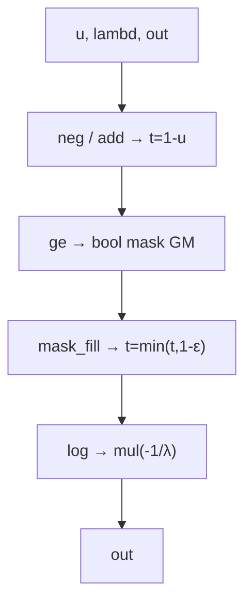

# FusedExponential 算子设计文档

## 1 需求背景

### 1.1 需求来源

昇腾社区 10 月任务「指数分布后处理融合算子开发」（FusedExponential）。参考 PyTorch `torch.Tensor.exponential_` 行为与 op-plugin 26.1.0 `ExponentialKernelNpuOpApi.cpp` 的融合变换算法，基于 Ascend C 实现 `aclnnFusedExponential`，消除 bool mask 中间 GM 张量，降低内存与启动开销，验收通过后贡献至 `cann/ops-math`。

- 讨论帖：https://gitcode.com/cann/ops-math/discussions/8
- 任务页：https://www.hiascend.com/activities/task-center/details/e179b493000a43378f416316cb544264

### 1.2 背景介绍

指数分布采样常用路径为：先采均匀分布 $u \sim \mathrm{Uniform}(0,1)$，再做逆变换：

$$\mathrm{out}_i = -\frac{\log_e\left(\min(1-u_i,\ 1-\varepsilon)\right)}{\lambda}$$

其中 $\varepsilon = \mathrm{dtype.eps}/2$，$\lambda > 0$ 为率参数。

**参考实现（op-plugin 26.1.0）调用链**：

1. `neg_()` → `add_(1.0)` 得到 $t = 1-u$
2. `mask = (t >= 1-\varepsilon)`（等价于 $u \le \varepsilon$ 一侧）
3. `mask_fill_(mask, 1-\varepsilon)` → `log_()` → `mul_(-1/\lambda)`

**核心问题**：步骤 2 产生 **bool mask 中间 GM 张量**（大小 numel×1B），并拆成 5~6 个独立设备算子（多次 kernel 启动 + 多次 GM↔UB 往返）。当 $u$ 为大张量时，mask 占用与 numel 线性相关的 GM 内存，是本任务要消除的内存膨胀根因。

**融合目标**：将 `neg + add + ge + mask_fill + log + mul` 压缩为**单次 Ascend C kernel 下发**，在 UB 内用向量 `Mins` 完成封顶，**不产生 bool mask GM 张量**，用户侧 workspace 压到框架对齐粒度（tiling 声明 0）。

### 1.3 参考实现现状分析

| 项 | 拼接链（融合前） | 融合（本算子） |
| --- | --- | --- |
| 设备算子数 | ≥5（含 mask） | 1 |
| bool mask GM | 有（numel×1B） | 无 |
| 中间 GM 张量 | t、mask | 无 |
| 用户 workspace（连续） | 随中间结果增大 | tiling=0，实测 512B 对齐 |



---

## 2 需求分析

### 2.1 需求描述

使用 Ascend C 编程语言实现 `FusedExponential` 算子，提供 aclnn 两段式接口，完成「neg + add + 边界封顶 + log + mul」五算子融合的指数分布采样后处理。融合后应：

1. 精度对齐 CPU 五算子链标杆；
2. 性能相对 NPU 拼接链不劣化（拼接/融合耗时比值 ≥ 1.0）；
3. 连续场景无 numel 相关的用户 workspace 申请。

### 2.2 需求拆解

1. **Host 侧**：InferShape（out.shape = u.shape，dtype 一致）、Tiling（分核/分 tile、$\varepsilon$ 与 $-1/\lambda$ 常量、infλ 标记）、workspace = 0。
2. **Kernel 侧**：fp16/bf16 先 `Cast` 到 fp32 计算，再 `Cast` 回原 dtype；fp32 直接计算。
3. **L0/L2 层**：L0 直接写用户 out，非连续输入输出走 Contiguous / ViewCopy。
4. **自验**：精度 1000 条、性能 200 条、内存探针。

### 2.3 外部组件依赖

不涉及外部组件依赖，不依赖第三方库参与计算路径。

### 2.4 内部适配模块

适配 aclnn 两段式接口：

```cpp
aclnnStatus aclnnFusedExponentialGetWorkspaceSize(
    const aclTensor  *u,
    const aclScalar  *lambd,
    aclTensor        *out,
    uint64_t         *workspaceSize,
    aclOpExecutor   **executor);

aclnnStatus aclnnFusedExponential(
    void          *workspace,
    uint64_t       workspaceSize,
    aclOpExecutor *executor,
    aclrtStream    stream);
```

### 2.5 接口参数说明

| 参数 | 方向 | 类型 | dtype | 描述 |
| --- | --- | --- | --- | --- |
| u | 输入 | tensor | FLOAT16 / BFLOAT16 / FLOAT32 | 均匀样本，Device 只读，可与 out 同址 |
| lambd | 输入 | scalar | DOUBLE | 率参数 λ>0，host 侧按 u dtype 转 tensor |
| out | 输出 | tensor | 同 u | 指数样本，Device，支持原地 |

**返回值**：`ACLNN_SUCCESS` / `ACLNN_ERR_PARAM_INVALID`（out dtype 非法等）。

---

## 3 算子分析

### 3.1 数学公式

$$\mathrm{out} = -\frac{\log\left(\min(1-u,\ 1-\varepsilon)\right)}{\lambda}, \quad \varepsilon = \mathrm{dtype.eps}/2$$

**ε 的物理意义**：

- 仅钳制 $\log$ 自变量的**上限**：$t = \min(1-u, 1-\varepsilon)$，即仅 $u \le \varepsilon$ 一侧生效。
- 避免 $u$ 极小时 $1-u$ 在低精度下舍入为 1.0，导致 $\log(1)=0$、输出 0。钳制后输出 $\ge \varepsilon/\lambda > 0$。
- $u \to 1$ 重尾侧不钳制，输出取大正值（合法重尾行为）。

### 3.2 算子特性

- **逐元素**：无跨元素依赖。
- **多核并行**：按元素切分，多 AICore 并行。
- **确定性**：同输入两次执行逐位一致。
- **支持数据类型**：FLOAT16 / BFLOAT16 / FLOAT32。
- **支持形状**：ND，秩 1–8，无广播。

### 3.3 支持硬件

| 芯片版本 | 支持 |
| --- | --- |
| Atlas A2（ascend910b）| √ |
| Atlas A3 | √ |

自验覆盖 A2 910B 系列即可。

### 3.4 算子约束

| 约束项 | 内容 |
| --- | --- |
| 参数合法性 | out dtype ∈ {FLOAT16, BFLOAT16, FLOAT32}，否则 `ACLNN_ERR_PARAM_INVALID`；u 无校验；λ≤0 / NaN 由 torch 适配层 `TORCH_CHECK` 拒绝 |
| 非连续 Tensor | 支持（L2 Contiguous / ViewCopy） |
| broadcast | 不支持（单输入逐元素算子） |
| dynamic shape | 不要求（静态 shape 满足） |
| 原地语义 | out 可与 u 同址（对应 torch.exponential_ 语义） |
| 确定性计算 | 要求（逐元素计算，天然满足） |
| 空 Tensor / 0 维 | 合法，输出同 shape 空张量 |
| 异步执行 | 依赖 stream 异步执行；读回 Device 结果前须同步 stream |

---

## 4 Host 侧设计

### 4.1 整体流程

```
aclnnFusedExponentialGetWorkspaceSize(u, lambd, out, &ws, &executor)
  ├── 校验 handle / u / lambd / out 非空
  ├── 校验 out dtype ∈ {F16, BF16, F32}，否则 ACLNN_ERR_PARAM_INVALID
  ├── 校验 u.shape == out.shape
  ├── 空张量早退：m=0 → workspaceSize = 0，返回 SUCCESS
  ├── InferShape: out.shape = u.shape, out.dtype = u.dtype
  ├── Tiling: 按 UB 容量分核分 tile，写 ε、-1/λ、infλ 标记
  ├── GetWorkspaceSizes(1)[0] = 0   # 不叠加 GetLibApiWorkSpaceSize()
  └── 返回 executor

aclnnFusedExponential(workspace, workspaceSize, executor, stream)
  └── ADD_TO_LAUNCHER_LIST_AICORE 下发 kernel，异步执行
```

### 4.2 InferShape

```cpp
// out.shape = u.shape
// out.dtype = u.dtype
```

### 4.3 OpDef

| 项 | 值 |
| --- | --- |
| 输入 | u（tensor），lambd（与 u 成对 dtype 的 1 元素 tensor） |
| 输出 | out（tensor） |
| 平台 | A2 / A3 |
| aclnn 类型 | `ACLNNTYPE aclnn_exclude`（用于 aclnn 接口直调） |

### 4.4 L2 / L0 层设计

**L2 层（aclnn 接口层）**：

1. 空张量早退：m=0 或 n=0 → 返回 SUCCESS。
2. `Contiguous(u)`：非连续 u 转为连续。
3. 非连续 out → `Alloc` 连续 buffer + `ViewCopy` 回写。
4. `ConvertToTensor(lambd)`：scalar → 1 元素 tensor。
5. 调用 L0 下发。

**L0 层**：

1. `ADD_TO_LAUNCHER_LIST_AICORE` 直接写用户 out，避免中间 Alloc 撑大 workspace。
2. Kernel 入参：u（GM）、lambd（GM，1 元素）、out（GM）、tiling。

---

## 5 Tiling 设计

### 5.1 Tiling 参数

| 字段 | 说明 |
| --- | --- |
| `totalNum` | 总元素数 = numel(u) |
| `tileDataNum` | 单次 UB 处理元素数（按 UB 容量 / buffer 数计算） |
| `invNegLambd` | $-1/\lambda$，host 侧按 u dtype 计算 |
| `oneMinusEps` | $1 - \varepsilon$，host 侧按 u dtype 计算 |
| `isInfLambd` | λ == +inf 标记（true 时 kernel 直接 `Duplicate(0)`） |
| `blockDim` | 核数（A2 典型 40） |

### 5.2 分核策略

- 元素总量 $N = \text{numel}(u)$。
- 每核处理 $\lceil N / \text{blockDim} \rceil$ 个元素，块内再按 `tileDataNum` 切 tile。
- 支持大小核（tail core 分配剩余元素）。
- 空张量直接跳过 kernel。

### 5.3 Workspace

```cpp
size_t *sizes = context->GetWorkspaceSizes(1);
sizes[0] = 0;   // 不叠加 GetLibApiWorkSpaceSize()
```

**关键**：不叠加库 API 默认的 ~16 MiB workspace，保证「连续场景 workspace ≤ 512B」自验通过。框架对声明 0 尺寸槽按 512B 对齐粒度补出实际占用。

### 5.4 UB 容量计算

| dtype | UB 字节 | 单 buffer 元素数 | 双 buffer 元素数 |
| --- | --- | --- | --- |
| fp32 | 192 KiB | 49152 | 24576 |
| fp16 / bf16 | 192 KiB | 98304 | 49152 |

实际使用 `tileDataNum` 需向下取整到 32B 对齐。

---

## 6 Kernel 设计

### 6.1 整体流程

模板类 `FusedExponential<T, BUFFER_NUM>`，每个核处理分配到的元素区间：

```
for each block assigned to this core:
  for each tile in block:
    DataCopy u_tile (GM → UB)
    if dtype != fp32:
      Cast u_fp32 ← u_tile (fp16/bf16 → fp32)
    # 计算 t = 1 - u
    Muls(u_fp32, -1.0)
    Adds(u_fp32, 1.0)
    # 封顶 t = min(t, 1-ε)
    Mins(u_fp32, 1-ε)
    # out = -log(t)/λ
    Log(u_fp32)
    Muls(u_fp32, -1/λ)
    if dtype != fp32:
      Cast out_tile ← u_fp32 (fp32 → fp16/bf16)
    DataCopy out (UB → GM)
```

**infλ 路径**：`isInfLambd == true` 时，直接用 `Duplicate(0)` 输出全 0，跳过 log 计算。

### 6.2 关键实现点

1. **不产生 bool mask GM**：`ge + mask_fill` 用 `Mins(t, 1-ε)` 替代，比较结果保留在 UB。
2. **fp16/bf16 精度**：cast 到 fp32 计算，避免低精度下 $\log$ 的误差放大。
3. **原地支持**：out 与 u 同址时，DataCopy 到 UB 后再计算，避免读写冲突。
4. **infλ 优化**：host 侧标记，kernel 直接 `Duplicate(0)`，避免除 0 与 log 计算。
5. **向量化**：所有算子用 Ascend C 向量指令（`Muls` / `Adds` / `Mins` / `Log` / `Cast` / `Duplicate`），一次处理 `tileDataNum` 个元素。

### 6.3 边界处理

| 场景 | 行为 |
| --- | --- |
| 空张量（numel=0） | Host 侧早退，不进入 kernel |
| 0 维张量 | 视为 1 元素处理 |
| λ = +inf | `isInfLambd` 标记，kernel 输出全 0 |
| 非连续输入 | L2 层 Contiguous 后传连续 buffer |
| 非连续输出 | L2 层 Alloc 连续 buffer + ViewCopy 回写 |
| 尾核元素不足一个 tile | 按实际元素数处理 |

---

## 7 硬件与约束

### 7.1 硬件适配

| 芯片 | 架构目录 | 支持 |
| --- | --- | --- |
| Atlas A2（ascend910b）| arch22 | √ |
| Atlas A3 | arch22 | √ |

### 7.2 软件版本

| 组件 | 版本要求 |
| --- | --- |
| CANN | ≥ 9.1.0 |
| torch / torch_npu | ≥ 2.7.1 |
| ATK | 26.9.8 |

### 7.3 内存约束

- **输入/输出**：u、out 为 Device ND 内存，列主序隐含，无广播。
- **workspace**：连续场景恒为 512B（框架对齐粒度）；非连续场景框架物化连续副本，属通用行为，不视为算子附加开销。
- **bool mask 消除**：融合后不再产生 numel×1B 的 bool mask 中间 GM 张量。

### 7.4 性能约束

- 相对 NPU 拼接链（neg → add → ge → masked_fill → log → mul，共 6 kernel）耗时比值 ≥ 1.0。
- 采样口径：预热 10 次（Profiler 窗口外）+ 采集 60 次（Profiler Level1 内）。

---

## 8 可维可测

### 8.1 精度验收标准

遵循生态算子开源精度标准（COMPLEX64/FLOAT32 档）：

| dtype | rtol | atol | matched_ratio | max_abs_error_limit |
| --- | --- | --- | --- | --- |
| FLOAT16 | 2⁻¹⁰ (1e-3) | 2⁻¹⁰ (1e-3) | 0.99 | 1e-1 或 32×ULP |
| BFLOAT16 | 2⁻⁷ (7.8e-3) | 2⁻⁷ (7.8e-3) | 0.99 | 1e-1 或 32×ULP |
| FLOAT32 | 2⁻¹³ (1.2e-4) | 2⁻¹³ (1.2e-4) | 0.99 | 1e-2 或 32×ULP |

逐元素：$|\mathrm{actual} - \mathrm{golden}| \le \mathrm{atol} + \mathrm{rtol} \cdot |\mathrm{golden}|$

**golden 生成**：CPU torch 五算子链（float64 计算，按输出 dtype 收窄）。

### 8.2 性能验收标准

- **判据**：$\mathrm{ratio} = \dfrac{\text{融合前 NPU 拼接链耗时}}{\text{融合实现耗时}} \ge 1.0$（越大越快）。
- **拼接链标杆**：neg → add(1.0) → ge → masked_fill → log → mul，共 6 kernel，Profiler Level1 `op_statistic.csv` 全表 Total Time 之和 ÷ 采样次数。
- **融合实现耗时**：ATK `performance_device` 采 Device 耗时。
- **采样**：预热 10 次 + 采集 60 次。

### 8.3 内存验收标准

- **口径**：输入 tensor 大小 + 输出 tensor 大小 + workspaceSize。
- **判据**：
  - 融合 kernel 无中间 GM 张量（尤其不产生 bool mask）；
  - 连续场景 workspace 与 numel/dtype 无关，恒为 512B。

### 8.4 自验用例覆盖

| 类别 | 条数 | 说明 |
| --- | --- | --- |
| L0 基础 | — | dtype × 枚举组合全覆盖 |
| L1 尺寸 | — | 尺寸池（1→2048，含奇数/边界/2 的幂 ±1）|
| L2 标量 | — | λ 特殊值（小值/中值/大值/+inf）|
| L3 非方阵 | — | fat / thin |
| L4 前导维 | — | 紧凑 + padding |
| L5 填充 | — | 均匀/交替/极端/Inf/NaN |
| L6 边界 | — | 空张量 / 0 维 / 负向 / λ≤0 |
| EX 扩展 | — | 尺寸池 × 枚举确定性采样 |
| PF 性能 | 200 | 5 条任务书典型 + 小尺寸 + 规模对数扫描 |

**总计**：精度 1000 条 + 性能 200 条。

### 8.5 自验工具与脚本

- `scripts/run_all.sh`：一键精度 → 性能 → 内存 → 报告。
- `scripts/run_accuracy.sh`：ATK 精度（含非连续 `--slice_input_ratio 0.4`）。
- `scripts/run_performance.sh`：ATK 融合 Device 耗时 + Profiler 拼接链 Kernel 耗时对账。
- `scripts/run_memory.sh`：workspace 探针 + 汇总。
- `scripts/make_reports.py`：填 xlsx 报告模板，产出 `task_submission/` 7 文件。

### 8.6 已知工具缺陷

ATK 对「非连续空张量切片」用例在归一化时调 `aclnnInplaceCopy` 报 161002（param invalid），算子实际未被调用。全部空张量用例登记于 `test_cases/known_tool_defects.json`，报告生成器自动标注为工具缺陷，不计入算子实现失败。

### 8.7 可维护性

- **代码结构**：Host / Tiling / Kernel 分层，模板类按 dtype 实例化。
- **目录规范**：算子实现位于 `experimental/math/fused_exponential/`，测试工程位于 `test/trmm/ctrmm/arch22/`。
- **文档**：本设计文档 + `README.md` 算子说明 + `LOG.md` 实跑归档。
- **接口声明**：`aclnn_fused_exponential.h` 对外暴露，内部头文件不导出。

### 8.8 交付件清单

| 序号 | 交付件 | 路径 |
| --- | --- | --- |
| 1 | 算子设计文档 | `tasklist/{任务目录}/{用户名}/docs/design.md` |
| 2 | 算子实现代码 | `experimental/math/fused_exponential/` |
| 3 | 测试用例包 | `test_cases/`（cases.json + perf + gen） |
| 4 | 自测报告 | `task_submission/`（7 文件：步骤说明 + 精度/性能/内存 xlsx+log） |

---

## 9 参考资料

- 参考实现：https://gitcode.com/Ascend/op-plugin/blob/26.1.0/op_plugin/ops/opapi/ExponentialKernelNpuOpApi.cpp
- 生态精度标准：https://gitcode.com/cann/opbase/blob/master/docs/zh/ops_precision_standard/mixed_tolerance_standard.md
- ATK 工具：https://gitcode.com/Ascend/ATK
- 合入仓：https://gitcode.com/cann/ops-math/tree/master/experimental/math/FusedExponential
- 任务讨论帖：https://gitcode.com/cann/ops-math/discussions/8
