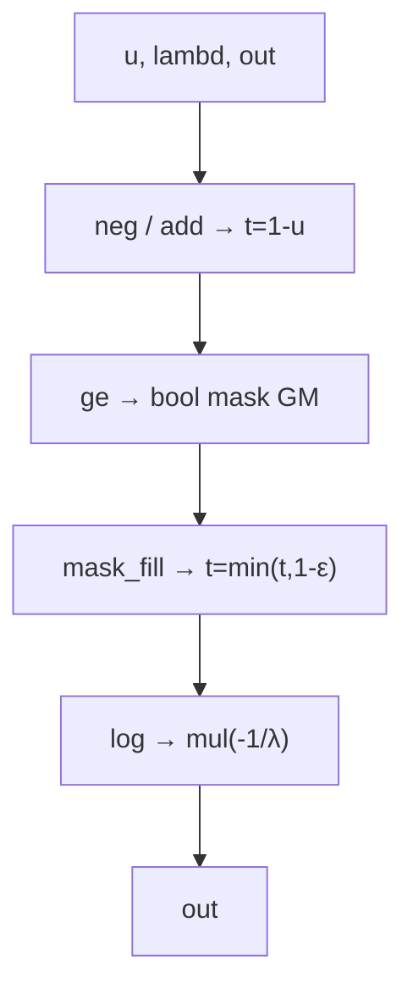
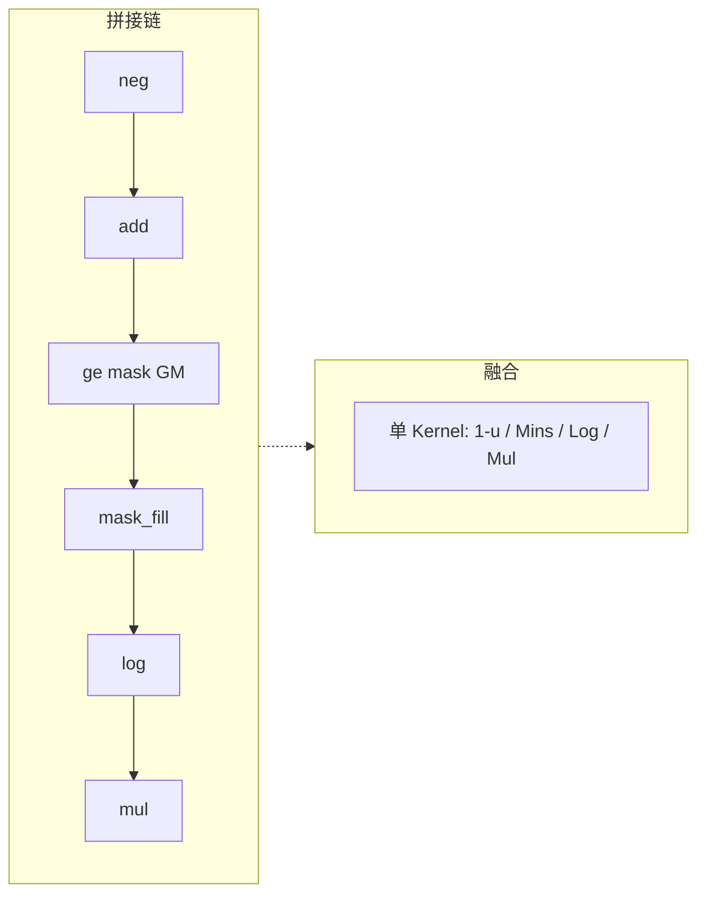

# 需求背景（required）

## 需求来源

昇腾社区 10 月任务「指数分布后处理融合算子开发」（FusedExponential）：参考 PyTorch `torch.Tensor.exponential_` 行为与 op-plugin 26.1.0 `ExponentialKernelNpuOpApi.cpp` 的融合变换算法，基于 Ascend C 实现 `aclnnFusedExponential`，消除 bool mask 中间 GM 张量，降低内存与启动开销，验收通过后贡献至 `cann/ops-math`。

讨论帖：https://gitcode.com/cann/ops-math/discussions/8  
任务页：https://www.hiascend.com/activities/task-center/details/e179b493000a43378f416316cb544264

## 背景介绍

指数分布采样常用路径为：先采均匀分布 \(u\sim\mathrm{Uniform}(0,1)\)，再做逆变换：

\[
\mathrm{out}_i=-\frac{\log_e\big(\min(1-u_i,\ 1-\varepsilon)\big)}{\lambda}
\]

其中 \(\varepsilon=\mathrm{dtype.eps}/2\)，\(\lambda>0\) 为率参数。

### 参考（op-plugin）实现现状分析

参考源码：https://gitcode.com/Ascend/op-plugin/blob/26.1.0/op_plugin/ops/opapi/ExponentialKernelNpuOpApi.cpp

调用序列（原地链）：

1. `neg_` → `add_(1.0)` 得到 \(t=1-u\)
2. `mask = (t >= 1-\varepsilon)`（等价于 \(u\le\varepsilon\) 一侧）
3. `mask_fill_(mask, 1-\varepsilon)` → `log_` → `mul_(-1/\lambda)`

| 参数 | 含义 | dtype | 约束 |
| --- | --- | --- | --- |
| u | 均匀样本 | fp16/bf16/fp32 | 与 out 同 dtype、同 shape，秩 1–8 |
| λ | 率参数 | scalar（接口侧 DOUBLE 等） | λ>0；+inf→全 0 |
| out | 指数样本 | 同 u | 可与 u 同地址（原地） |

**核心问题**：步骤 2 产生 **bool mask 中间 GM 张量**，并拆成多个独立设备算子（多次 kernel 启动 + 多次 GM↔UB 往返）。本任务目标是：在 **单 Ascend C kernel** 内用向量 `Mins` 完成封顶，**不产生 bool mask GM**，并将用户侧 workspace 压到框架对齐粒度（tiling 声明 0）。

**参考拼接流程图**：

### 算子功能规格与原型

| 名称 | 类别 | dtype | format | 介绍 |
|------|------|-------|--------|------|
| u | 输入 | FLOAT16 / BFLOAT16 / FLOAT32 | ND | 均匀分布样本，Device，只读（可与 out 同址） |
| lambd | 输入（标量） | DOUBLE（接口）；host 侧按 u dtype 转 tensor | - | 率参数 λ>0 |
| out | 输出 | 同 u | ND | 指数分布样本；支持原地 |

数学公式见上；无 attr。不支持 broadcast（单输入逐元素）。

### 相关约束

- 硬件：Atlas A2（ascend910b）/ Atlas A3；自验覆盖 A2 910B 系列即可
- CANN ≥ 9.1.0；torch / torch_npu ≥ 2.7.1
- 支持非连续输入/输出（L2 Contiguous / ViewCopy）
- 空张量合法；λ=+inf → 输出全 0；λ≤0 / NaN 由适配层/校验拒绝

---

# 需求分析（required）

## 外部组件依赖

不涉及外部组件依赖（不依赖第三方库参与计算路径）。

## 内部适配模块

适配 aclnn 两段式接口：

- `aclnnFusedExponentialGetWorkspaceSize(u, lambd, out, *workspaceSize, **executor)`
- `aclnnFusedExponential(workspace, workspaceSize, executor, stream)`

## 需求描述

将 `neg+add+边界封顶+log+mul` 融为单 AICore 向量 kernel：用 `Mins` 替代 `ge+mask_fill` 的 bool 中间结果，消除 mask GM，减少启动与搬运；精度对齐 CPU 五算子链标杆，性能相对 NPU 拼接链不劣化，连续场景无 numel 相关用户 workspace。

## 需求拆解

1. Host：InferShape（out=u）、Tiling（分核/分 tile、ε 与 \(1/\lambda\) 常量）、workspace=0
2. Kernel：fp32 计算路径；fp16/bf16 cast 到 fp32 再算再写回
3. L0/L2：直接写用户 out；非连续走 Contiguous/ViewCopy
4. 自验：精度 1000 / 性能 200 / 内存探针

## AscendC 算子原型

| 名称 | 类别 | dtype | shape | 介绍 |
| --- | --- | --- | --- | --- |
| u | 输入 | fp16/bf16/fp32 | 与 out 相同，≤8 维 | 均匀样本 |
| lambd | 输入 | 标量→与 u 同 dtype 的 1 元素 tensor | - | 率参数 |
| out | 输出 | 同 u | 同 u | 指数样本 |

## AscendC 算子相关约束（相对参考）

相对 op-plugin 拼接链：**去掉 bool mask GM**；其余语义对齐（含 ε 封顶仅作用于 \(u\le\varepsilon\) 一侧，\(u\to1\) 重尾不钳制）。

---

# 详细设计（required）

## 算子分析

**数学公式**：\(\mathrm{out}=-\log(\min(1-u,1-\varepsilon))/\lambda\)，\(\varepsilon=\mathrm{dtype.eps}/2\)。

**算子特性**：逐元素、无跨元素依赖；多核按元素切分；确定性（同输入两次结果一致）。

**支持数据类型**：FLOAT16 / BFLOAT16 / FLOAT32。

**支持形状**：ND，秩 1–8；无广播。

## 算子实现

总体思路：L2 负责校验与连续化；L0 启动单 AICORE 算子；Kernel 在 UB 内完成 \(t=1-u\)、`Mins` 封顶、`Log`、`Muls(-1/\lambda)`。

### Host 侧设计

**InferShape**：`out.shape = u.shape`，dtype 与 u 一致。

**Tiling**：

- 按 UB 容量与 buffer 数（单/双缓冲）计算 `tileDataNum`、大小核数据量
- 将 \(\varepsilon/2\)、\(\mathrm{invNegLambd}=-1/\lambda\)、`isInfLambd` 写入 tiling
- `GetWorkspaceSizes(1)[0] = 0`（**不叠加** `GetLibApiWorkSpaceSize()`，避免 ~16MiB 撑破「连续 ≤512B」自验）

**OpDef**：输入 u + lambd（成对 dtype）；输出 out；平台 A2/A3；`ACLNNTYPE aclnn_exclude`。

### Kernel 侧设计

模板类 `FusedExponential<T, BUFFER_NUM>`：

1. `DataCopy` 搬入 tile
2. fp16/bf16：`Cast`→fp32 工作区
3. `Muls(-1)` + `Adds(1)` 得 \(t\)
4. `Mins(t, 1-\varepsilon)`
5. `Log` → `Muls(invNegLambd)` 写回 out（infλ 路径直接 `Duplicate(0)`）

### aclnn（L2/L0）设计

- L2：空张量早退；`Contiguous(u)`；非连续 out 则 Alloc + `ViewCopy`；`ConvertToTensor(lambd)`；调用 L0
- L0：`ADD_TO_LAUNCHER_LIST_AICORE`，**直接写用户 out**，避免中间 Alloc 撑大 workspace

### 融合前后对比

| 项 | 拼接 | 融合 |
| --- | --- | --- |
| 设备算子数 | ≥5（含 mask） | 1 |
| bool mask GM | 有 | 无 |
| 用户 workspace（连续） | 随中间结果增大 | tiling=0，实测 512B 对齐 |

## 边界与异常

| 场景 | 行为 |
| --- | --- |
| λ = +inf | 输出全 0 |
| λ ≤ 0 / NaN | 接口/适配层报错 |
| u 空张量 | 成功，out 空 |
| 非连续 | Contiguous / ViewCopy |
| ATK 非连续空切片 | 工具侧 `aclnnInplaceCopy` 161002（已知缺陷，非算子路径） |

## 自验证摘要（实跑）

| 维度 | 结论 |
| --- | --- |
| 精度 | 1000 条；996 通过；4 条为空张量非连续 ATK 缺陷；精度不符 0 |
| 性能 | 200/200；拼接/融合倍率中位数 ≈ 5.07（min≈2.83） |
| 内存 | 连续 workspace 恒 512B |

私仓实现目录：`experimental/math/fused_exponential`（本 PR **仅提交设计文档**，不含算子代码）。

---

# 参考资料

- op-plugin ExponentialKernelNpuOpApi.cpp（26.1.0）
- 任务书：FusedExponential（neg+add+mask_fill+log+mul 融合）
- 精度标准：cann/opbase mixed_tolerance_standard
- ATK：https://gitcode.com/Ascend/ATK
