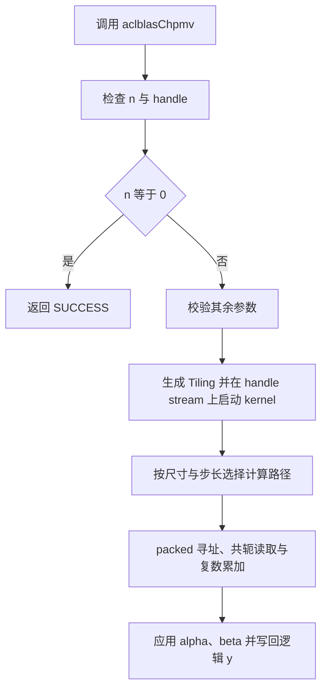

# aclblasChpmv 算子设计文档（Ascend 950PR）

开发者：photon1；更新日期：2026-10-29。

# 需求背景（required）

## 需求来源

本设计对应 2026 年社区任务“aclblasChpmv 算子开发（Atlas 950PR）”。目标仓库为 [ops-blas](https://gitcode.com/cann/ops-blas)，实现目录为 `blas/spmv/arch35/`，测试目录为 `test/spmv/chpmv/arch35/`。

## 背景介绍

现有 Spmv 家族提供实数对称压缩矩阵乘向量接口 `aclblasSspmv`。本任务补充单精度复数 Hermitian packed 矩阵乘向量接口，与 cuBLAS `cublasChpmv` 和 Netlib `chpmv` 的参数顺序、packed 布局和复数标量语义保持一致。

文档按[社区设计模板](https://gitcode.com/cann/cann-ops-competitions/blob/master/04_tasks/01_community-task-2026/resources/design_template.md)组织，并参考同任务已合入的 [PR #2414](https://gitcode.com/cann/cann-ops-competitions/merge_requests/2414) 核对章节和评审约定。

# 需求分析（required）

## 需求描述与拆解

1. 使用 Ascend C kernel 直调方式补齐公共 `aclblasChpmv` API。
2. 支持 COMPLEX64、上下三角 packed、Hermitian 共轭、正负步长及 y 原地更新。
3. 按任务书处理参数校验、n=0、beta=0、对角虚部和异步 stream。
4. 按尺寸和步长选择计算路径，完成 Netlib 精度比对及 GPU 基线性能比对。

## 功能与接口

算子计算式为

$$
y = \alpha A x + \beta y
$$

公开接口声明为：

```cpp
aclblasStatus_t aclblasChpmv(
    aclblasHandle_t handle, aclblasFillMode_t uplo, int n,
    const aclblasComplex* alpha, const aclblasComplex* AP,
    const aclblasComplex* x, int incx, const aclblasComplex* beta,
    aclblasComplex* y, int incy);
```

`aclblasComplex` 是 `{float real; float imag;}` 的 COMPLEX64 类型。`alpha`、`beta` 位于 Host；`AP`、`x`、`y` 位于 Device；`y` 原地更新。

| 参数 | 位置与类型 | 约束 |
| --- | --- | --- |
| handle | Host 句柄 | 非空，携带执行 stream |
| uplo | Host 枚举 | ACLBLAS_UPPER / ACLBLAS_LOWER |
| n | Host int | 非负矩阵阶数 |
| alpha、beta | Host COMPLEX64 指针 | n>0 时非空 |
| AP | Device COMPLEX64 向量 | n>0 时非空，至少 n(n+1)/2 个元素 |
| x、y | Device COMPLEX64 向量 | n>0 时非空，物理长度至少 1+(n-1)*abs(inc) |
| incx、incy | Host int | 非零，支持正负步长 |

## 数据布局

`AP` 长度为 \(n(n+1)/2\)，不含 `lda` 或其他前导维度。对于零基下标 \(i,j\)：

- `ACLBLAS_UPPER` 只存储 \(i\le j\)，地址为 `AP[i + j*(j+1)/2]`。
- `ACLBLAS_LOWER` 只存储 \(i\ge j\)，地址为 `AP[j*(2*n-j+1)/2 + (i-j)]`。

未存储的三角通过 \(A_{rj}=\operatorname{conj}(A_{jr})\) 引用。对角虚部强制按零处理，只使用其实部。

向量逻辑下标按 BLAS 规则映射：正步长使用 `k*inc`，负步长使用 `(n-1-k)*abs(inc)`。因此物理缓冲区可包含步长产生的间隙。

## 边界和错误行为

校验顺序固定为：

1. `n < 0` 返回 `ACLBLAS_STATUS_INVALID_VALUE`。
2. `handle == nullptr` 返回 `ACLBLAS_STATUS_HANDLE_IS_NULLPTR`。
3. `n == 0` 直接返回 `ACLBLAS_STATUS_SUCCESS`，不引用其他参数指向的内存。
4. 检查 `uplo`、`incx`、`incy`、`alpha`、`beta`、`AP`、`x`、`y`，不满足条件返回 `ACLBLAS_STATUS_INVALID_VALUE`。

`incx`、`incy` 必须非零。`beta=(0,0)` 时 kernel 不读取 `y` 的旧值。`alpha=(0,0)` 时跳过矩阵点积，按 beta 分支处理；非有限 AP/x 用例按任务书与非零 alpha 组合。所有 kernel 在 `handle` 绑定的 stream 上异步启动，调用者在读取 Device 输出前同步该 stream。

# 详细设计（required）

## 算子分析

数学公式、packed 索引和步长映射见上文。支持数据类型为 COMPLEX64，实部/虚部使用 FLOAT32 运算；AP 长度为 \(n(n+1)/2\)，x/y 逻辑长度为 \(n\)，向量非连续访问通过 incx/incy 表达。

## 算子实现

### 整体执行流程



### Host 侧设计

Host 复用 `aclblasSspmv` 的句柄和 stream 获取方式。校验通过后调用 `GetAivCoreCount()` 获取核数，核数为 0 时返回 `ACLBLAS_STATUS_EXECUTION_FAILED`。Tiling 传递 `nthreads`、`n`、`uplo`、`alpha.real/imag`、`beta.real/imag` 和 64 位 `incx/incy`。Host 将 alpha/beta 按值复制到 Tiling，AP/x/y 以 Device 地址传入。每次有效计算启动一个 kernel，额外 Device workspace 为 0。

#### 分核策略

记 AIV 核数为 C，按以下优先级分派：

| 路径 | 条件 | 启动配置 |
| --- | --- | --- |
| 通用逐行 | 任一步长不为 1，或 n<9 | 单线程计算一行；block 数 min(ceil(n/128), C)，线程数将 ceil(n/block数) 向 128 对齐，最大 2048 |
| 中小尺寸协作 | incx=incy=1，9≤n<4096 | 每 32 线程计算一行；每 block 128 线程，block 数 min(ceil(n/4), C) |
| 大尺寸协作 | incx=incy=1，n≥4096 | 每 4 线程计算一行；每 block 1024 线程，block 数 min(ceil(n/16), C) |

通用路径按线程做 grid-stride 行遍历，中小尺寸按线程组做 grid-stride 行遍历。大尺寸先按 ceil(n/block数) 分配连续行段，再由核内线程组循环处理；启动公式中的 16 用于选择 block 数。

#### 数据分块和内存优化策略

直接按 packed 公式访问 AP。协作路径使用 `float2` 读取非对角复数和连续向量，对角单独读取实部。每线程使用寄存器保存索引和累加器，组内使用 shuffle 交换局部结果。当前方案无共享 UB tile、TQue/TBuf 或 double buffer。

#### Tilingkey 规划策略

kernel 根据 n、incx、incy 分派三条路径，UPPER/LOWER 使用模板特化；协作组大小为 32 或 4，直调入口无独立数值 tilingkey 字段。

### Kernel 侧设计

小尺寸或非单位步长采用单线程逐行计算。连续向量在 \(9\le n<4096\) 时每 32 个线程计算一行，使用组内归约；\(n\ge4096\) 时每 4 个线程并行加载列并按列顺序累加，1024 线程 block 按连续行段均衡分配到 AIV 核。LOWER 的直接段和共轭段分别累加，以减小与 Netlib 的舍入差异。组内 lane 0 写回结果。线程根据 `uplo` 选择直接 packed 地址或镜像 packed 地址：

```text
upper: direct(row <= col) -> col*(col+1)/2 + row
       mirror(row > col)  -> row*(row+1)/2 + col, imag 取负
lower: direct(row >= col) -> col*(2*n-col+1)/2 + row-col
       mirror(row < col)  -> row*(2*n-row+1)/2 + col-row, imag 取负
```

对角项不使用 AP 的虚部。复数乘法使用

$$
(a_r+i a_i)(x_r+i x_i)=(a_rx_r-a_ix_i)+i(a_rx_i+a_ix_r)
$$

累积结束后再计算 alpha 与矩阵乘积、beta 与旧 y 的复数乘法并写回。`beta=0` 分支跳过 y 旧值读取；负步长通过 `int64_t` 地址计算避免中间溢出。每个输出逻辑元素只由一个线程写入，满足原地更新的无竞争要求。

### 精度和特殊值

大尺寸按列顺序累加，中小尺寸使用组内归约；协作函数关闭融合乘加收缩。测试分别比较输出实部和虚部，使用 FLOAT32 的 \(rtol=atol=2^{-13}\)、\(matched\_ratio\ge0.99\) 及最大有限误差限制。非有限值按下文任务书特殊值规则单独判定。对角虚部测试填入非零值，Golden 和 kernel 均只采用对角实部。

### 数据检测与边界处理

行尾和列尾检查有效范围，packed 乘法及步长寻址先提升到 64 位再计算。对角只取实部，镜像位置对非对角元素取共轭。每个逻辑 y 由唯一线程写回，保留步长间隙；各行独立，无跨核归约。beta=0 在读取旧 y 前分支，n=0 在 Host 提前返回。

### 资源与性能

实现采用 AIV SIMT 路径，计算复杂度为 \(O(n^2)\)，矩阵按 packed 索引直接读取，每个非对角元素用于两个对称位置。block 数不超过 AIV core 数；线程按行分配，适合连续输出和大阶数输入。性能测试先预热 5 次，再采集 11 次 msprof 设备 `Task Duration(us)`，与 GPU 的 `gpu_ms*1000/0.4` 微秒阈值比较。op replay 通道不可用时保留故障日志，采用 msprof task trace 的原始 op_summary 任务耗时，并记录采集模式。

## 支持硬件

目标产品为 Atlas 950PR，CANN 9.1.0，代码位于 `arch35`。已在实际 Ascend950PR、CANN 9.1.0 环境执行编译和实机验证；设备信息、精度结果和 profiler 原始输出记录于自测报告。

## 算子约束限制

- 仅支持 COMPLEX64；AP/x/y 使用 Device 内存，alpha/beta 使用 Host 内存。
- AP 必须满足 Hermitian packed 布局；对角虚部不参与计算。
- 向量非连续访问通过 `incx`/`incy` 表达；AP/x/y 按任务约定为独立张量。
- `n=0` 是合法 no-op；不读取 AP、x、y。
- n 为运行时非负 int，本任务无广播或额外 Tensor stride 要求。

# 可维可测分析

## 精度标准/性能标准

### 精度标准

使用 Netlib CBLAS `cblas_chpmv(CblasColMajor, ...)` 生成 Golden，按实部、虚部分量分别执行任务书 FLOAT32 混合容差。测试覆盖 UPPER/LOWER、零和负步长、尺寸扫描、alpha/beta 特殊值、对角虚部、Inf/NaN、空指针、非法枚举、负 n 和 n=0。

有限值逐元素条件为 \(|actual-golden|\le2^{-13}+2^{-13}|golden|\)，匹配比例至少 0.99。分量最大绝对误差上限取 `max(1e-2, 32*ULP)`，ULP 采用最大有限绝对误差位置对应 Golden 的 FLOAT32 间距；日志记录该位置和 Golden 值。回归测试验证其他位置的大数不会放宽此处上限。非有限值单独统计：同为 NaN、同号 Inf、NaN 与任意符号 Inf 等效；有限/非有限或反号 Inf 不匹配。非有限值全部匹配且有限值满足上述条件时，该分量通过。

### 测试规划

保留任务原始 CSV 的 1000 条精度和 200 条性能用例，完整 GTest 中性能尺寸也执行 Golden 比较。按精度测试的分布要求，为原精度 CSV 的随机输入增加 973 条正态对应测试，复用尺寸、uplo、步长及固定标量，种子增加 1000000。另有 32 条分布专项（均匀/正态各 16 条）、4 条接口与语义、3 条比较器测试，共 2212 条。精度套件普通均匀输入 983 条、正态输入 989 条，比例约各 50%；特殊值、结构随机和边界测试另计。200 条性能用例采用任务提供的参数。

补充用例的各输入及实部/虚部使用独立种子；均匀分布为 [-5,5]，正态均值在 [-1,1]、标准差在 [0.1,0.2] 内采样。随机 alpha/beta 由均匀/正态各 16 条专项测试覆盖，固定标量组合保持原 CSV。运行日志展开补充用例的实际标量、尺寸、步长、种子和分布配置。

### 性能标准

性能输入为 COMPLEX64，使用任务书提供的 `gpu_baseline.csv`。每个 case 先预热 5 次，再有效采样 11 次；以 msprof 单算子 Task Duration 的平均值作为 NPU 时间，要求 NPU 平均时间不超过 GPU 标杆的 2.5 倍。

逐 case 判断 `GPU_ms*1000/NPU_us >= 0.4`。采集前后保存设备利用率和进程记录，在设备空闲时测试。当前 950PR 环境 `msprof op` 返回 `StartFFTSTask: Profiling channel start failed`，实际采用 `msprof --task-time=on --ai-core=off`，从原始 `op_summary_*.csv` 读取 `Task Duration(us)`。每条启动 16 次 kernel，排除前 5 次并统计后 11 次，保存样本与用例映射；采集方式差异在自测报告中说明。

## 兼容性分析

API 统一声明于 `include/cann_ops_blas.h`，复用 `aclblasComplex` 和 `aclblasHandle_t` 公共类型，不新增产品私有接口。`arch35` 源文件通过 ops-blas 的目录扫描自动加入构建；测试 CSV 和 GTest 目标位于 `test/spmv/chpmv/arch35/`。

## 实测记录

Ascend950PR、CANN 9.1.0 实机完整 GTest 2212/2212 通过，性能 200/200 达到 0.4 倍 GPU 门槛。当前源码提交为 `37859d10797fc818dfe03a71213a86dddb324225`，含最大误差点 ULP 修正和精度分布扩展。性能沿用 `8bcded3c4b41644933fa6f8f36ddffe51f26206f` 的采集结果，host/kernel/tiling 与当前版本一致；使用 msprof task trace 原始设备任务时间，每条 5 次预热、11 次有效采样。详细记录见自测报告。


Host、Kernel、Tiling 分别由 `chpmv_host.cpp`、`chpmv_kernel.cpp`、`chpmv_tiling_data.h` 实现，复现步骤见 `test/spmv/chpmv/README.md`。保留构建日志、GTest XML、实部/虚部结果和 profiler 原始数据，并记录源码提交及软硬件版本。
