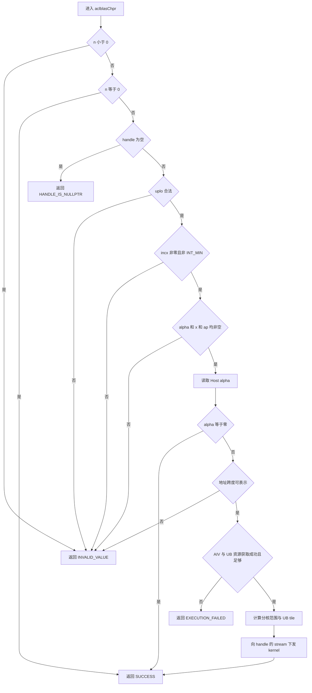
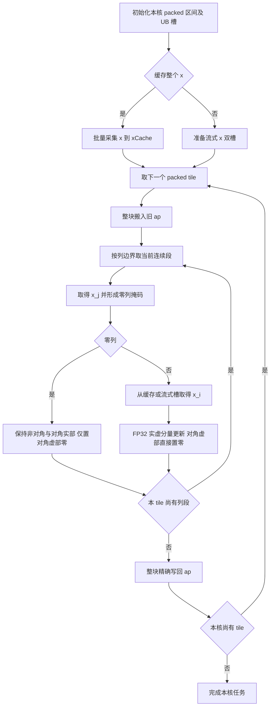

# aclblasChpr 算子设计文档

# 需求背景（required）

## 需求来源

本设计对应《10月社区任务-aclblasChpr算子开发（950）》，目标是在 Ascend 950PR 上，使用 Ascend C kernel 直调方式补齐 `aclblasChpr` 的 arch35 实现。

本文按社区提供的[设计文档模板](https://gitcode.com/cann/cann-competitions/blob/master/04_tasks/01_community-task-2026/resources/design_template.md)组织。交付范围为设计方案；验证章节描述后续实施方法，不包含编译、精度或性能实验结果。

## 背景介绍

`Chpr` 是 BLAS Level 2 的单精度复数 Hermitian 压缩存储秩 1 更新。向量外积只更新矩阵的一个三角，矩阵以 packed 格式保存，可省去完整方阵及其未使用三角的存储和访存。

`ops-blas` 的 `include/cann_ops_blas.h` 已有公共接口声明，复数类型定义在 `include/cann_ops_blas_common.h`。现有 `blas/hpr/arch22/` 属于同一 Hpr 算子族，可核对句柄和工程接入方式；本任务的实现目录是 `blas/hpr/arch35/`，不创建新的公共 API，也不放入 Spr 算子族。现有实现的校验顺序不直接作为本任务契约，本设计以任务书为准。

### 算子功能分析

设 `x` 为长度 `n` 的复数向量，`alpha` 为实数：

```text
A_new = A_old + alpha * x * xᴴ
xᴴ = conj(xᵀ)
```

`ACLBLAS_UPPER` 存储上三角，`ACLBLAS_LOWER` 存储下三角；另一半由共轭对称性隐含。输出原地写入 `ap`。除快速返回路径外，输出对角元素虚部为零，输入对角虚部不参与计算。

# 需求分析（required）

## 需求描述

复用已有的 `aclblasChpr` 句柄式 API，支持 COMPLEX64 的 `x/ap`、FLOAT32 的 Host 标量 `alpha`、上下三角 packed 存储及任意合法正负 `incx`。通过 handle 绑定的 stream 异步下发 AIV kernel，Host 不读取 Device 向量或矩阵，不在接口内部同步 stream。

### 算子原型

以下为已有公共接口的引用，不是新增声明要求。参数名及顺序与 `cublasChpr` 对应。

```cpp
aclblasStatus_t aclblasChpr(
    aclblasHandle_t handle,
    aclblasFillMode_t uplo,
    const int n,
    const float* alpha,
    const aclblasComplex* x,
    const int incx,
    aclblasComplex* ap);
```

```cpp
// 类型以 include/cann_ops_blas_common.h 的现有定义为准。
typedef struct aclblasComplex {
    float real;
    float imag;
} aclblasComplex;
```

### 参数与返回值

| 参数 | 位置、方向 | 类型与形状 | 约束及处理 |
| --- | --- | --- | --- |
| handle | Host，输入 | `aclblasHandle_t` | 有效句柄，提供 stream；需检查时为空返回 `ACLBLAS_STATUS_HANDLE_IS_NULLPTR` |
| uplo | Host，输入 | `aclblasFillMode_t` | 仅 `ACLBLAS_UPPER`、`ACLBLAS_LOWER` |
| n | Host，输入 | `int` | `n >= 0`；零阶直接成功 |
| alpha | Host，只读 | `const float*`，实数标量 | `n > 0` 时非空；不扩展 Device pointer mode |
| x | Device，只读 | `aclblasComplex`，物理长度至少 `1+(n-1)*abs(incx)` | `n > 0` 时非空；逻辑长度 `n` |
| incx | Host，输入 | `int`，以复数元素计 | 不为零、不为 `INT_MIN`；支持负值 |
| ap | Device，输入及原地输出 | `aclblasComplex`，长度 `M=n*(n+1)/2` | `n > 0` 时非空；连续 packed 存储，无 lda |

正常下发及合法 no-op 返回 `ACLBLAS_STATUS_SUCCESS`；非法维度、枚举、步长或应检查的空数据指针返回 `ACLBLAS_STATUS_INVALID_VALUE`。平台资源获取失败等无法下发的情况返回仓内相应错误码，例如 `ACLBLAS_STATUS_EXECUTION_FAILED`，不伪装为成功。异步设备错误仍由调用方通过 stream 同步等运行时接口观察，API 返回成功不代表 Device 已执行结束。

## 需求拆解

| 需求 | 设计承接 |
| --- | --- |
| 实数 alpha、复数输入输出 | FP32 实虚分量运算，保留既有结构体布局 |
| 上下三角按列 packed | 用列基址函数和列内偏移访问，不展开方阵 |
| 正负步长 | 64 位物理索引、正向批量采集与 UB 内反向索引 |
| n=0、alpha=0 快速返回 | Host 分层校验，满足条件时不下发 kernel |
| 对角虚部为零 | 有效更新路径直接写零，不累加输入虚部 |
| Inf/NaN 与零向量语义 | 保留 Netlib 的零列短路和运算次序 |
| 多核负载均衡 | 按 packed 元素数切分，每个元素有唯一写入核 |
| 精度及性能验收 | 预留 CSV/GTest、CBLAS golden 及 msprof 验证计划 |

# 详细设计（required）

## 算子分析

### 数学公式与运算顺序

对于所存三角中的 `A(i,j)`，令逻辑向量元素 `x_i = a + ib`、`x_j = c + id`：

```text
t_r = alpha * c
t_i = alpha * (-d)
delta_r = a * t_r - b * t_i
delta_i = a * t_i + b * t_r

i != j:
    ap_new.real = ap_old.real + delta_r
    ap_new.imag = ap_old.imag + delta_i
i == j:
    ap_new.real = ap_old.real + delta_r
    ap_new.imag = +0.0f
```

这一顺序对应先计算 `alpha*conj(x_j)` 再做复数乘法。所有分量及中间运算保持 FP32，不转为 FP16/BF16，不先计算 `|x_j|²` 再乘 alpha，避免引入不同的中间溢出。例如小 alpha 与大 x 的组合可能在“先平方”的路径溢出，而上述路径仍得到有限结果。

保留 [Netlib CHPR](https://www.netlib.org/blas/chpr.f) 的下列分支语义：

1. `alpha == +0.0f` 或 `-0.0f`：必要参数校验通过后直接返回，整个 `ap` 保持原样，包括对角虚部。
2. `alpha != 0` 且 `x_j.real == 0 && x_j.imag == 0`：该列非对角元素保持原样，对角实部保持原样、虚部置零；不计算该列的 `alpha*conj(x_j)`。这可防止 `0*Inf/NaN` 将应保持有限的元素污染为非有限值。
3. NaN 不满足复数零判断，进入正常更新路径。`x_i==0` 不能作为额外的逐元素跳过条件。
4. 对角虚部直接由常量零生成，不通过浮点抵消得到。默认采用独立乘、加、减；禁止会改变特殊值传播的 fast-math、任意重关联及未经验证的乘加融合，不承诺 bit-exact。

### 支持数据类型与形状

`alpha` 为 FLOAT32，`x/ap` 为 COMPLEX64，外部复数以 `[real, imag]` 交织存储。Kernel 用两个 FP32 分量表达复数运算，无张量广播、无额外前导维度、无超出 `incx` 的步长描述。`n` 为运行时参数；不以测试用例的最大 n 作为接口上限。

### packed 索引

以下全部采用零基索引，`0 <= j < n`：

```text
M = n*(n+1)/2

UPPER:
    C(j) = j*(j+1)/2
    0 <= i <= j
    p(i,j) = C(j) + i
    diagonal(j) = C(j) + j

LOWER:
    C(j) = j*(2*n-j+1)/2
    j <= i < n
    p(i,j) = C(j) + (i-j)
    diagonal(j) = C(j)

两种模式均定义 C(n)=M。
```

例如 `n=3` 时，UPPER 的元素顺序为 `(0,0),(0,1),(1,1),(0,2),(1,2),(2,2)`；LOWER 为 `(0,0),(1,0),(2,0),(1,1),(2,1),(2,2)`。两种模式均覆盖恰好 M 个元素。

### 正负步长与整数安全

```text
s = int64(incx)
d = abs(s)                       // 已排除 INT_MIN
start = s > 0 ? 0 : (int64(n)-1)*d
physical(k) = start + int64(k)*s
logical_x[k] = x[physical(k)]
```

调用方始终传入物理缓冲区首地址，负步长时不要求调用方提前偏移。`M`、列基址、packed 偏移、x 起点及跨度计算均在乘法前提升到 64 位。元素数转换为字节数时另外检查 `sizeof(aclblasComplex)` 的乘法及地址加法是否可表示；对非零更新中无法表示的地址跨度返回 `ACLBLAS_STATUS_INVALID_VALUE`，不以截断方式下发。Host 无法从裸指针推断实际分配长度，足量分配由调用方保证。

## 算子实现

### 实现方案

采用 **AIV SIMD regbase + packed 连续 tile**。每核负责 packed 向量的一段，整块 `ap` 搬入 UB 后，按列边界拆成连续段计算，再整块原地搬出。选择 SIMD 是因为列内元素彼此独立，且复数更新可由 FP32 向量乘加减表达；无需 Cube、矩阵展开、归约或原子操作。

| 内核路径 | 选择条件 | 策略 |
| --- | --- | --- |
| CACHE_X | 全 x 缓存加至少一个最小 ap tile 可放入 UB | 每核预取 x 一次，多列和多个 ap tile 复用 |
| STREAM_X | 全 x 缓存不满足上述预算 | 按当前列段采集 x，使用两个 x 槽分块复用 |

`uplo` 以两个模板分支固化列公式；路径和步长符号作为内部派发信息。不存在新的公共 tiling API，也不套用图模式 `aclnn` 两阶段接口。

#### Host 侧设计

校验和快速返回顺序明确为：



此顺序将任务书“`n=0` 不校验其余参数”解释为包含 handle：`n=0, handle=nullptr` 也直接成功；`n<0` 优先返回维度错误。任务书另外规定了 handle 的专用错误码，但没有单列这些叠加情形，且现有 arch22 代码先检查 handle。上述为本设计明确选择的优先级，实施前须与接口评审确认，不能直接复制 arch22 的优先级。`n>0` 时保留 `uplo → incx → alpha/x/ap` 的相对顺序；全部必要检查通过后才判断 alpha 是否为零。

Host 入口负责 n 的判定及句柄检查，参数检查与下发拆为 `ValidateChprParams` 和 `LaunchChprKernel`。使用仓内日志设施记录错误和 tiling 信息。alpha 在调用时读取为值，随 tiling 按值传入 kernel；不把 Host alpha 指针传给 Device。同步可检测的下发错误按仓内启动封装传递；若启动封装不返回错误状态，不在 Host 伪造设备完成检查，异步错误由调用方同步 stream 观察。

##### 分核策略

通过仓内 `GetAivCoreCount()` 获取当前 AIV 数 `P`，通过平台接口获取可用 UB 字节数 `U`，不硬编码设备核数。资源为零或不可取得时返回执行错误。

以 `Q=16` 个复数，即 128B，作为分核粒度，设 `G=ceil(M/Q)`。首版以 `T=4096` 个 packed 元素作为估计核数的目标工作量：

```text
K = min(P, G, max(1, ceil(M/T)))
若 ap 实际首地址不满足 128B 对齐，则 K=1。

q = G / K
r = G % K
groupBegin(b) = b*q + min(b,r)
groupCount(b) = q + (b < r ? 1 : 0)
begin(b) = Q * groupBegin(b)
end(b) = min(M, Q*(groupBegin(b)+groupCount(b)))
```

所有除法为整数除法。这样各核相差最多一个 128B 分组，区间连续、互不重叠，最后一核截断到 M。对于对齐 ap，核间边界也在实际 128B 边界上；非对齐 ap 仍然支持，通过单核路径避免跨核非对齐写入的共享边界问题。`T` 是待后续调优的调度参数，不是输入限制或实测结论。

核内用列基址函数进行整数二分，找到包含 `begin(b)` 的列，此后顺序推进列号。每个 tile 内只在列边界拆段，不对每个 packed 元素开平方求列号。一个长列允许跨 tile、跨核切分，但任何元素仍只有一个所有者。Tiling 只传公共标量，不传逐核范围数组。

##### UB 分块与生命周期

记 `A(z)=align_up(8*z,32)`，`B` 为一个 ap tile 的最大复数元素数。`B` 向下取 64 个复数的倍数，首版上限为 8192。若整个核区间小于 B，仅处理其有效长度，不访问补齐区。

| UB 对象 | CACHE_X | STREAM_X | 生命周期与复用 |
| --- | --- | --- | --- |
| xCache | `A(n)` | 0 | 核启动时采集，供该核所有 tile 读取 |
| apSlot0、apSlot1 | `2*A(B)` | `2*A(B)` | 两个原地计算槽；同槽输入旧 ap 和输出新 ap 复用 |
| xSlot0、xSlot1 | 0 | `2*A(B)` | 按列段采集，交替供搬运和计算使用 |
| 列标量槽及预留 H | 512B | 512B | 含两个 32B 的 x_j 槽，其余 448B 为对齐和实现预留 |
| 索引、实虚分量、算术临时值 | 寄存器 | 寄存器 | 不额外分配 UB 索引数组或展开矩阵 |
| 合计 | `A(n)+2*A(B)+H` | `4*A(B)+H` | 始终不大于 U |

Host 先尝试 CACHE_X，要求 `A(n)+2*A(64)+H <= U`；该路径取：

```text
B = 64 * floor(min(8192, floor((U-A(n)-H)/16)) / 64)
```

不满足缓存条件时采用 STREAM_X：

```text
B = 64 * floor(min(8192, floor((U-H)/32)) / 64)
```

按预算取得的 B 不得为零；实际申请以对齐后的对象尺寸复核。TPipe 在 kernel 入口创建并传入，避免作为计算类成员；不另申请 GM workspace。

若以 `U=248KiB` 作预算演算，`n=4096` 的缓存路径取 `B=8192`，总量为 `32768+131072+512=164352B`；流式路径取 `B=7872`，总量为 `252416B`。这些数字是容量计算示例，运行时仍使用查询值。缓存路径保留空余 UB，以减少 x 的重复 GM 访问；不会为了填满 UB 额外展开矩阵或申请无用缓冲。

##### 内部派发数据

| 字段 | 类型建议 | 含义 |
| --- | --- | --- |
| n、packedCount | `uint64_t` | 矩阵阶数和 M |
| incx、xStart | `int64_t` | 有符号步长及逻辑首元素物理索引 |
| alpha | `float` | Host 实数标量值 |
| uplo、path | 枚举或 `uint32_t` | 三角模式与 CACHE_X/STREAM_X |
| useCoreNum、tileElements | `uint32_t` | K 和 B |

分核分组数和列基址由公共标量推导。所有 UB 局部索引可在核验范围后使用 `uint32_t`，GM 偏移不得缩窄为 32 位。

#### Kernel 侧设计



流程中的零列分支可用列级控制或寄存器 mask 表达。即使用 mask，也必须使零列的非对角输出保留原始位模式，不能先计算无条件结果再与旧值做浮点加减。

##### CopyIn：连续和跨步向量

ap tile 使用一段连续 GM→UB 搬运，长度为 `8*validTileElements` 字节。x 的 `incx=1` 路径同样连续搬运；其他步长使用 950PR 支持的 `DataCopyPad<float, PaddingMode::Compact>` 形式采集：

```text
blockLen = 8                         // 一个复数，两项 float
srcStride = 8*(abs(int64(incx))-1)    // 相邻块之间的字节间隔
dstStride = 0
blockCount = 本批复数元素数
```

Compact 模式将多个 8B 块紧凑放入 UB，仅在总块末尾补到 32B；不能使用 Normal 模式却按 8B 一个复数计算 UB 容量。UB 槽首地址保持 32B 对齐。首版将有跳步的搬运拆成每批至多 32 个复数，完整批次的 UB 偏移为 256B 整数倍；这是保守的实现粒度，不能解释为官方 blockCount 上限，后续以目标环境核验后再调优。

950PR 文档的 GM `srcStride` 为 64 位参数，正间隔上限为 `2^40-1` 字节；合法 int 步长对应的上述间隔小于 `2^34`，无需截断步长或逐元素 GM 读取。非连续访问只采集所需复数，不把步长间的空洞整体搬入 UB。

负步长时，从所需逻辑片段的物理最低地址正向采集，DMA 不传入反向步长：

- 全 x 缓存按物理升序保存，逻辑元素 k 的缓存索引为 `n-1-k`；正步长为 k。
- 流式读取逻辑片段 `[i0,i0+L)` 时，负步长从 `physical(i0+L-1)` 开始正向采集 L 项；列段逻辑偏移 `t∈[0,L)` 的槽内索引为 `L-1-t`。
- 未缓存时，`x_j` 每次列切换按一个复数载入独立 32B 对齐槽，供整个列段复用；不在矩阵元素循环中逐点读取 GM。

##### Compute：带 mask 的寄存器 Gather/Scatter

ap tile 内的列段起点不一定满足寄存器连续载入的对齐条件，而且短列段不能通过整寄存器读写越过边界。采用 950PR 的寄存器 `Gather`/`Scatter`：

```text
baseAddr = 32B 对齐的 apSlot 首地址
L = 当前列段的复数元素数
VL = 一个 FP32 寄存器可处理的 lane 数
v = 0, VL, 2*VL, ...，且 v < L
lane = 当前向量内的元素编号
validMask = lane < min(VL, L-v)
tSafe = validMask ? v+lane : 0
realIndex = 2*(segmentOffsetInTile + tSafe)
imagIndex = realIndex + 1
```

索引单位为 float 元素，数据为 FP32，索引寄存器为 `uint32_t`。若列段逻辑起点为 i0，缓存路径的 x 索引由 `i0+tSafe` 按步长符号映射；流式路径正步长取 `tSafe`，负步长取 `L-1-tSafe`，再分别构造实虚分量索引。`x_j` 的重复索引用于列标量广播。Gather 允许重复索引，Scatter 的有效索引必须唯一。对于尾向量，所有 lane 的索引均先钳到合法 UB 位置；Scatter 仅使能有效且唯一的写入 lane。

先形成非零列 mask 与对角 mask：非零列执行前述实虚部公式；对角虚部用零覆盖；零列保留原 ap，并仅对所属对角虚部写零。寄存器处理完成后更新原 apSlot；不另分配实部、虚部 UB 数组。

##### CopyOut 与流水线同步

UB→GM 每个 ap tile 使用 `blockCount=1`、`blockLen=8*validTileElements`、两侧 stride 为零的精确长度搬运。dummy padding 不写入 GM，不向上取整扩大写回范围。即使 n=1 或核区间尾部不足一个对齐块，也只写合法 packed 元素。

两个 apSlot 在 `MTE2 读入 → Vector 计算 → MTE3 写回 → 可复用` 状态之间交替。利用队列或仓内对应事件同步实现：计算前等待该槽读入完成，写回前等待向量结果就绪，再次复用前等待写回完成；禁止给仍被 MTE3 读取的同槽下发下一次 MTE2。缓存 x 在首次计算前完成一次就绪同步；流式 x 双槽在消费前等待采集完成、覆盖前等待消费结束。TPipe 和事件在单次 kernel 内管理，各核无需互相等待或原子归约。

##### 工程接入

后续实现仅需要下列主体文件，复用仓内构建与测试框架：

```text
ops-blas/
├── blas/hpr/
│   ├── README.md                    # 补充 950PR 支持与约束
│   └── arch35/
│       ├── chpr_host.cpp
│       ├── chpr_kernel.cpp
│       ├── chpr_kernel.h
│       └── chpr_tiling_data.h
└── test/hpr/chpr/arch35/             # 实施阶段的 CSV、wrapper 与 GTest 接入
```

共用 `include/cann_ops_blas.h`、`include/cann_ops_blas_common.h` 与 handle/stream 基础设施。由架构构建选择 arch35 实现，避免同一目标同时链接两个 `aclblasChpr` 定义。不修改 arch22 算法，不创建独立 950PR API，不引入与本次实现无关的第三方源码、完整样例工程或重复构建文件。

### 性能优化方案

| 关注点 | 设计措施 | 后续验证重点 |
| --- | --- | --- |
| 三角列长差异 | 按 M 个 packed 元素均分，不按列号平均分核 | UPPER/LOWER 的核间工作量 |
| x 重复读取 | CACHE_X 在每核内复用整个向量 | 缓存代价与大 n 的带宽收益 |
| ap 带宽 | 一次连续 tile 读写，原槽更新，避免矩阵展开 | 相邻 tile 带宽和搬运次数 |
| 尾段及非对齐 | UB 内 Gather/Scatter，GM 精确长度写回 | 小质数、列边界、核边界无越界 |
| 数据搬运等待 | ap 与流式 x 双槽流水 | 同槽生命周期和事件依赖 |
| 小规模 | 按工作量减少 K，单次调用最多一个计算 kernel | Host 下发及过多核调度开销 |

算法更新工作量为 `O(M)`，不含矩阵归约。普通非零列场景下，ap 的必要 GM 流量约为 `16*M` 字节（读写各一次）；缓存路径的 x 采集额外流量约为 `8*n*K` 字节。此为逻辑流量模型，不含缓存命中、事务放大和指令开销，不能据此宣称已达到性能指标。

## 支持硬件

| 目标硬件 | 架构 | 设计支持 |
| --- | --- | --- |
| Ascend 950PR | arch35 | 是，使用 AIV SIMD；待实现与实机验证 |

API 选型已对照官方开发资料的 950PR 支持矩阵及仓内 Host 公共设施进行静态核对：

| 能力 | 资料位置（相对官方 asc-devkit 根目录） | 关键约束 |
| --- | --- | --- |
| AIV 数及 UB 容量 | `docs/zh/api/Utils-API/platform_info/PlatformAscendC/` 的 `GetCoreNumAiv.md`、`GetCoreMemSize.md` | 动态查询；单位分别为核数、字节 |
| GM→UB 非对齐/跨步采集 | `docs/zh/api/SIMD-API/basic_api/memory_vector_compute/data_move/DataCopyPad_GMToUB.md` | 选含 PaddingMode 的 950PR 重载，Compact 紧凑落 UB |
| UB→GM 精确写回 | 同目录 `DataCopyPad_UBToGM.md` | UB 起点 32B 对齐；blockLen 为字节数 |
| UB→寄存器 Gather | `docs/zh/api/SIMD-API/basic_api/reg_vector_compute/reg_data_load/Gather_discrete.md` | float 数据、uint32 索引；索引单位为元素 |
| 寄存器→UB Scatter | `docs/zh/api/SIMD-API/basic_api/reg_vector_compute/reg_data_store/Scatter_discrete.md` | UB 基址 32B 对齐；有效写索引唯一 |

资料入口为[官方 asc-devkit](https://gitcode.com/cann/asc-devkit)。这些核对说明接口选型有资料依据；任务指定软件环境中的重载、命名空间和编译兼容性仍需实施阶段确认，不等同于已完成编译验证。

## 算子约束限制

1. 仅支持单精度复数 Hermitian packed 秩 1 更新；alpha 必须是 Host 实数 float 指针。
2. `n>=0`；有效更新要求 incx 非零且不为 `INT_MIN`。n=0 跳过其余参数；alpha=0 仍需先通过必要校验。
3. ap 物理存储连续，无 lda；只引用存储的一个三角，不重建另一半。除 no-op 外，对角虚部输出为零。
4. ap 为原地输入输出，x 只读。x 与 ap 的有效存储区域应独立；本设计不承诺重叠存储的读写结果，不额外添加未定义的别名检测错误码。
5. 调用方保证 Device 指针、分配长度、所属设备和异步执行期间的生命周期有效；使用结果或释放缓冲前同步对应 stream。
6. 不保证浮点 bit-exact，不以有效用例集合代替整个参数域；整数安全检查和流式路径覆盖无法完整缓存的情况。

# 可维可测分析

## 精度标准/性能标准

| 验收项目 | 计划与判据 | 来源 |
| --- | --- | --- |
| 精度 golden | CBLAS/Netlib `cblas_chpr`，全量比较 M 个 packed 复数，实虚部分别统计 | 任务书 §3.2、§3.5 |
| 有限值容差 | `atol=rtol=2^-13`；逐元素 `abs(actual-golden)<=atol+rtol*abs(golden)`；匹配率至少 0.99，最大绝对误差不超过 `1e-2` 或按统一的 32 ULP 口径 | 任务书 §3.2 及[生态精度标准](https://gitcode.com/cann/opbase/blob/28a1ce52ae856353589841226a0002af73314a6b/docs/zh/ops_precision_standard/mixed_tolerance_standard.md) |
| 非有限值 | 同为 NaN、同号 Inf、NaN 与任意符号 Inf 按任务书判等；有限与非有限不等，异号 Inf 不等。非有限项单独计数并要求全部通过 | 任务书 §3.2 |
| 对角及 no-op | 正常更新逐项检查对角虚部为零；n=0 和 alpha=±0 检查整个 ap 原样保留 | 任务书 §2.1、§2.5 |
| 性能 | 每个性能 case 的 `NPU_avg_us <= 1000*gpu_ms/0.4`，以单算子 task duration 计时 | 任务书 §3.3、随附 `gpu_baseline.csv` |

只对双方均为有限值的元素计算容差、匹配率及最大绝对误差。若没有有限元素，有限值统计记为“不适用”，不做除零计算；用非有限项规则及结构性检查决定该部分是否通过。CSV 的 MERE/MARE 配置不能替代任务书的混合容差判定。

### 验证场景设计

| 场景 | 覆盖内容与检查点 |
| --- | --- |
| 基础与索引 | uplo 两种模式；n=1、3、4、8；手工核对 packed 顺序及对角位置 |
| 规模与切分 | 任务 CSV 的尺寸扫描、幂及幂附近值、33/65/127/1025；补充 K、B、CACHE_X/STREAM_X 边界，检查范围无重叠及遗漏 |
| 步长 | incx=±1/±2/±3；n=1 的大合法步长；大跨度的 Host 计算边界；负步长使用物理首地址 |
| alpha | ±0、±1、一般正负值、极小/极大值、Inf/NaN；包含先乘 alpha 可避免中间平方溢出的组合 |
| 零列与特殊值 | 某个 x_j 为复数零，同时 alpha 或其他 x_i 为 Inf/NaN；仅跳过该列非对角，验证与 Netlib 一致 |
| 对角虚部 | 正常 Hermitian 输入；另设输入对角虚部非零/NaN 的语义检查，验证非 no-op 路径忽略旧虚部并输出零 |
| no-op 组合 | n=0 叠加非法枚举、零/INT_MIN 步长、空指针；alpha=0 叠加非法参数仍返回相应错误；补充 handle 叠加优先级。有效哨兵缓冲检查 ap 原样保留，空指针组合只检查状态码及不访问内存 |
| 负向输入 | n<0、非法 uplo、incx=0/INT_MIN、alpha/x/ap 为空、handle 为空 |
| 内存安全 | 尾 tile、短列跨 tile、跨核列、负步长端点；ap 前后保护区，非对齐 ap 单核路径，x 不被修改 |
| 数据分布 | 实虚部独立，均匀/正态各 50%，并覆盖全零、交替、极端值及 Inf/NaN |

随附 CSV 共 1200 条，包含精度和性能类别；其指导材料注明当前生成器的正态分布尚待测试工程扩展，不能据此声称已有用例满足 50% 正态分布。本次不修改生成器、不执行用例，实施阶段再补齐分布及上述结构边界。接入仓内测试框架时核对 `x_fill/ap_fill` 与原框架字段的映射，避免实际读取了错误列。

### 性能验证计划

在 950PR 上使用仓内 CSV 驱动 GTest，通过 msprof op 采集本算子 task duration，以任务提供的 H100 baseline 为对照。基线 `gpu_ms` 单位为毫秒，比较前换算为微秒；不能直接与 `Task Duration(us)` 的数值相比。性能不以包含 Host 准备、golden 计算和同步开销的 GTest 总时间替代。

任务书正文规定 warmup 5 次、有效采样 10 次，特别注意事项写为大于 10 次，附带指导又要求大于 50 次。实施时需要统一该口径；建议保留 warmup 后至少 51 次成功调用的原始 task 记录，同时给出前 10 次和全部有效样本的均值，验收采用评审确认的统计口径。明确区分 msprof 自动 warmup 与测试程序 warmup，避免重复计入有效样本。失败调用和 profiling 失败不计为有效样本，不填写推测的耗时或性能倍率。

## 兼容性分析

公共 API、参数顺序和 `aclblasComplex` ABI 保持现有定义；只增加 arch35 实现，并沿用句柄和 stream 的生命周期。上下三角 packed 语义与 [cuBLAS hpr](https://docs.nvidia.com/cuda/cublas/index.html#cublas-t-hpr) 和 Netlib 对齐，任务书明确的参数校验与 no-op 规则优先。

文档提交使用 `cann-competitions` 对应任务目录下的团队 `docs/design.md`；算子实现及测试的最终提交位置分别为 `ops-blas/blas/hpr/arch35/` 和 `ops-blas/test/hpr/chpr/arch35/`。两类交付件不混淆。本文的分核阈值、双缓冲及 API 选型为设计方案，后续实现须通过编译、语义与精度验证后再评价性能。

## 参考资料

- 用户提供的《aclblasChpr 算子开发任务书》及 `test_cases/README.md`、`chpr_test.csv`、`gpu_baseline.csv`。
- [CANN 社区任务提交规范](https://gitcode.com/cann/cann-competitions/blob/master/04_tasks/01_community-task-2026/README.md)。
- [ops-blas 公共 API](https://gitcode.com/cann/ops-blas/blob/master/include/cann_ops_blas.h)、[公共类型](https://gitcode.com/cann/ops-blas/blob/master/include/cann_ops_blas_common.h)、[Hpr 算子族](https://gitcode.com/cann/ops-blas/tree/master/blas/hpr)。
- [Netlib CHPR 参考实现](https://www.netlib.org/blas/chpr.f)、[NVIDIA cuBLAS hpr 文档](https://docs.nvidia.com/cuda/cublas/index.html#cublas-t-hpr)。
- [CANNBot Tiling 设计指南](https://gitcode.com/cann/cannbot-skills/blob/master/ops/ascendc-tiling-design/SKILL.md)，用于多核切分、UB 预算与分支覆盖的静态复核。
- [Ascend C 官方开发资料](https://gitcode.com/cann/asc-devkit)，API 资料路径见“支持硬件”章节。
