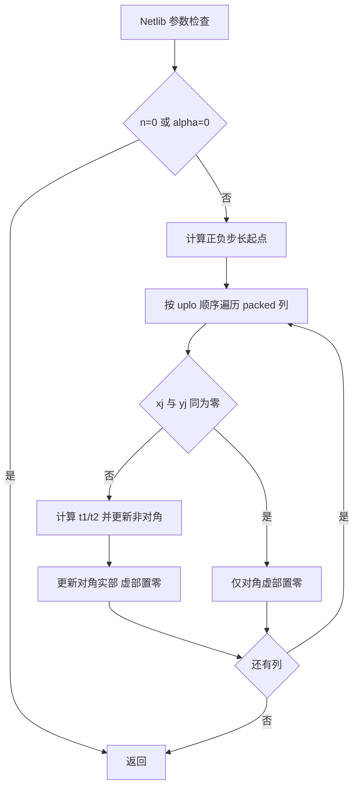
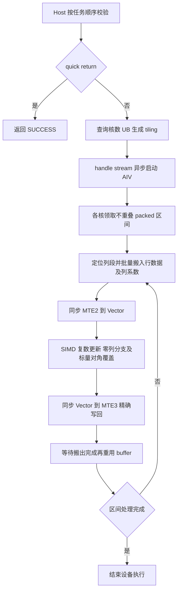

# aclblasChpr2（Ascend 950PR）算子设计

## 需求背景（required）

### 需求来源

- 社区任务：[10月社区任务-aclblasChpr2算子开发（950）](https://www.hiascend.com/activities/task-center/details/8e6e450ec9a44869a4956675200cc05b?menu=trends)。开发者：rjckkkkk。
- [任务书及原始测试附件](https://www.hiascend.com/p/resource/202610/6933b64564804b64902e0b26ec9fc2a9.zip)，2026-10-28 发布，截止 2026-11-15。
- [社区任务 SOP](https://gitcode.com/org/cann/discussions/39)、[设计模板](https://gitcode.com/cann/cann-competitions/blob/master/04_tasks/01_community-task-2026/resources/design_template.md)。
- 源码分析基线：ops-blas `05b96ea22cea926ecfd43fc7ac691a795522bd61`。本提交为设计评审；设备自验结果另附证据，不等同于社区验收通过。

### 背景介绍与现状

补齐 complex64 Hermitian packed rank-2 更新能力。仓内已有 `blas/spr2/arch35/sspr2_*`，其 Host 校验顺序可作参考，但实数对称更新不包含共轭、复数运算或对角虚部语义，不能通过重命名直接复用。现有公共头文件没有 `aclblasChpr2` 声明。

实现沿用句柄式 BLAS 工程，在 `blas/spr2/arch35/` 新增代码，在 `include/cann_ops_blas.h` 新增所有产品线共用的唯一 API，不使用 ACLNN 自定义算子工程，也不引入 950 专用平行接口。

## 需求分析（required）

### 功能与接口

```cpp
aclblasStatus_t aclblasChpr2(
    aclblasHandle_t handle, aclblasFillMode_t uplo, const int n,
    const aclblasComplex* alpha,
    const aclblasComplex* x, const int incx,
    const aclblasComplex* y, const int incy,
    aclblasComplex* ap);
```

`A ← A + alpha*x*yᴴ + conj(alpha)*y*xᴴ`。

| 参数 | 类型、存放位置 | 含义与限制 |
| --- | --- | --- |
| handle | Host 句柄 | 已创建的句柄，使用其绑定 stream |
| uplo | Host 枚举 | ACLBLAS_UPPER / ACLBLAS_LOWER |
| n | Host int | n≥0，运行时维度 |
| alpha | Host complex64 指针 | 实、虚部均为 float32，按值写入 tiling；不增加 Device 标量支持 |
| x/y | Device complex64，只读 | 物理元素数至少 1+(n−1)×abs(inc)，与 ap 为独立操作数 |
| incx/incy | Host int | 任意非零步长，INT_MIN 非法；负步长按 Netlib 起点逆序 |
| ap | Device complex64，输入输出 | n(n+1)/2 个复数，按列 packed，原地更新，无 lda |

复数布局以 `cann_ops_blas_common.h` 中 `aclblasComplex` 为准。不要求额外广播、视图、超出 incx/incy 的非连续布局或跨次 bit-exact 确定性。

### Host 合法性与 quick return

严格按以下顺序执行，不把后面的检查提前：

| 顺序 | 条件 | 结果 |
| --- | --- | --- |
| 1 | handle==nullptr | HANDLE_IS_NULLPTR |
| 2 | n<0 | INVALID_VALUE |
| 3 | n==0 | SUCCESS，不访问其余参数，不启动 kernel |
| 4 | alpha==nullptr | INVALID_VALUE |
| 5 | uplo 非 UPPER/LOWER | INVALID_VALUE（不是 INVALID_ENUM） |
| 6 | incx/incy 为 0 或 INT_MIN | INVALID_VALUE |
| 7 | x/y/ap 任一 nullptr | INVALID_VALUE，即使 alpha 为零 |
| 8 | alpha 实虚部同时为零（含正负零） | SUCCESS，不访问 x/y/ap，不启动 kernel |
| 9 | 其他合法输入 | 在 handle stream 上异步启动 kernel |

表中状态码均带 `ACLBLAS_STATUS_` 前缀。正常更新把对角虚部写成 0；quick return 保留 ap 全部原始字节，即使输入对角虚部非零/NaN，也不能清零。handle 空、n<0、n==0 与非法后续参数的组合由接口单测验证。

## 详细设计（required）

### 数学公式、索引与数值语义

对 0≤i,j<n：

- UPPER（i≤j）：`p=i+j*(j+1)/2`，列首 `bU(j)=j*(j+1)/2`，列长 j+1。
- LOWER（i≥j）：`p=i+(2*n-j-1)*j/2`；等价列首 `bL(j)=j*(2*n-j+1)/2`，`p=bL(j)+(i-j)`，列长 n-j。
- 向量逻辑位置 k 对应 `offset(k,inc)=inc>0 ? int64(k)*inc : int64(n-1-k)*(-int64(inc))`。
- 所有 packed 乘法、累计元素数、字节偏移及带步长寻址使用 64 位；先提升再乘，避免 int 溢出。单次搬运长度受 UB 和 API 字段范围限制，分块而非截断。

每列先求 `t1=alpha*conj(y[j])`，`t2=conj(alpha*x[j])`，非对角计算 `(A(i,j)+x[i]*t1)+y[i]*t2`。复数乘法按实虚分量展开，float32 计算，不降到 FP16/BF16。对角计算 `real(A(j,j))+real(x[j]*t1+y[j]*t2)`，不把输入对角虚部纳入算式，输出虚部显式为 0。

遵循 Netlib 的零列分支：当 x[j]、y[j] 均为复数零时，不更新该列非对角，正常调用仍清零该列对角虚部。这样避免无必要的 0×Inf 改变原本有限的元素。对于其他 NaN/Inf 输入不擅自化简复数公式；验证按任务书特殊值等效规则执行。

### Host 设计与工程结构

新增 `chpr2_host.cpp`、`chpr2_kernel.h`、`chpr2_kernel.cpp`、`chpr2_tiling_data.h`。Host 分为 `ValidateChpr2Params`、`LaunchChpr2Kernel` 和公共入口；公共 kernel 声明由头文件共享。使用仓内 dlog，失败返回真实错误；不在算子内调用 stream synchronize。

通过平台接口动态取得 AIV 核数及可用 UB 大小。tiling 为固定大小、无指针/数组的结构，含 n、uplo、alphaReal/Imag、int64 步长、uint64 packedElements、tileElements、vectorCapacity、columnCapacity、usedCoreNum。禁止硬编码物理核数；小工作量减少启动核数。正常路径使用 AIV，不需要 Cube 计算。

源码目录由 `blas/CMakeLists.txt` 自动收集，不另建无用源码 CMake。测试在 `test/spr2/chpr2/arch35/`，接口族测试目录内提供 CMake、param、golden、wrapper 与 GTest，并接入现有 test/spr2 构建。更新 `blas/spr2/README.md` 的 API、约束、RAII 示例与产品支持表。

### Kernel 设计

优先采用 arch35 SIMD RegBase。packed 是连续输出，可按 packed 范围分核、在核内分解为列段，再用 SIMD 并行计算每个列段；无需展开 n×n 全矩阵，不需要全局 workspace 或原子累加。

1. 把 packed 元素划为 32 字节边界对齐的连续核区间，末核截到真实尾部。按 packed 元素与逐列处理的固定开销加权分配，避免短列密集的核承担过多串行准备工作。每个元素只有一个写入核；跨列段共享同一核边界内的尾部，避免不同核写同一对齐块。
2. 用整数二分定位每个核首元素所属列，随后按列首递推推进；无逐元素浮点 sqrt 索引，也不需要 O(n) Host 数组。跨核列边界只覆盖各自合法子区间。
3. CopyIn 以精确字节长度将 ap 列段及 x/y 行段搬入 UB；正单位步长直接批量搬运。可放入 UB 的向量窗口复用缓存，复数交错数据在寄存器中拆为实虚向量。列系数使用覆盖列号 j 的独立批量缓存，再广播到 SIMD lanes；核首或分块行段未包含 j 时不得从行段缓存越界读取。避免逐元素 GM→UB DMA。
4. 非单位步长以每块 8 字节的 compact 跨步 DMA 搬入紧凑 UB；CANN 9.1.0 arch35 的 srcStride 为 int64，合法范围上限为 2^40−1。`8*(abs(inc)-1)` 对全部合法 int 步长可表达，无需 SIMT 兜底。单批最多 4092 个复数，后续 UB 目的地址保持 32 字节对齐。负步长从所需物理区间低地址搬入，再用寄存器 Gather 逆序读取；UB 预算取逻辑元素数，不分配跨步间隙。
5. Compute 使用 float32 RegTensor 的 Mul/Add/Sub，尾部 mask 只开放有效元素。实虚分离后重新交错；对角实部按 Netlib 顺序单独计算，通过 V→S、S→MTE3 依赖覆盖对角并写零虚部，避免输入脏虚部参与结果。零列保留非对角原值；仅当列段含对角时搬入并清零其虚部。
6. CopyOut 只写本核负责的真实 packed 字节范围。TPipe 放在 kernel 入口局部并传给对象，buffer 用 TBuf/TQue 管理；MTE2→V、V→MTE3 及 buffer 重用前的完成依赖显式配对，不以发出异步搬运等同搬运已完成。

UB 仅累计 x/y 行缓存、x/y 列缓存、ap 原位 tile 与保留空间，具体预算见下文。初版采用单缓冲确保同步清晰，tile 大小从预算向下对齐；只有 profiling 显示搬运瓶颈且预算满足时才引入双缓冲。小 n 也按列数量限制单核串行开销，n≤8 使用单核，其余按列开销和元素量选择核数；大 n 采用多核和较长连续列段。调优仅按合法形状/步长，不根据用例 ID 或输入值硬编码输出。

### 分核公式、UB 预算与路径选择

设 P=n(n+1)/2、Q=ceil(P/4)，一个对齐单元为 4 个 complex64（32 字节）。实际核数 `B=min(平台 AIV 核数, Q, max(ceil(P/256),ceil(n/8)))`，正常计算 B 至少为 1。元素工作量和每列固定准备开销共同限制单核负载，物理核数始终动态查询。

设列首函数为 b(j)，列长为 L(j)，列固定权重 W=1024，总权重 `F=P+W*n`。第 k 个边界的目标权重是 `t=floor(F*k/B)`，用商与余数分开计算，避免直接乘 F*k 溢出；二分找到 `b(j)+W*j≤t<b(j+1)+W*(j+1)`。列内偏移 `d=floor((t-b(j)-W*j)*L(j)/(L(j)+W))`，packed 边界为 `4*floor((b(j)+d)/4)`，末边界直接为 P。核 k 处理相邻边界之间的半开区间。边界单调连续、不重叠，只有末边界可能不对齐；相邻核不会写同一个 32 字节 GM 块。64 位计算覆盖合法 n；极小区间可以为空，循环安全退出。

单缓冲实际预算是 `16*V + 8*T + 16*C + R ≤ U`：V 是 x/y 行缓存容量（最大 8192），T 是 ap 原位 tile（最大 4096），C=64 是 x/y 独立列缓存，R=4096 为保留空间。实虚计算临时值在寄存器，不另占 UB。T/V 均向下对齐到 64 个复数，先在剩余预算中分配 T，再分配 V，各自不超过 n 向上对齐的容量；预算不足 64 个复数所需最小空间则返回执行失败。五个 TBuf 与上述预算逐项一致，读取可填充的 UB 尾部，CopyOut 仅搬真实字节。

步长绝对值为 1 时连续搬运，其他合法步长用 compact 跨步 DMA；两者共享同一 SIMD 计算逻辑，不增加 Host 路径字段或额外 kernel。所有地址先提升为 64 位再相乘，DMA 字段不做窄化截断；UPPER/LOWER 独立决定列首与列长。

### 标杆与实现流程

本任务是新增 BLAS 接口，没有 TBE/ACLNN 历史实现可移植。功能标杆为 Netlib `chpr2.f`，性能标杆为附件 cuBLAS/H100 数据；不声称掌握 cuBLAS 闭源 kernel 实现。





主要差异：Host 错误码和校验顺序按任务书固定，区别于 Fortran XERBLA；设备按 packed 区间并行，区别于 Netlib 逐列串行；SIMD 复数分量运算存在舍入差异，以任务混合容差验证。连续与跨步搬运保持相同数值及写范围语义。

### 特性交叉分析

UPPER/LOWER 与正负步长、n=0、alpha=0、非有限输入交叉验证。正常更新的对角清零与 quick return 的原字节保持分别检查；负步长改变向量读取起点，不改变 packed 排布；stream 隔离与多次调用不共享可变缓存。Host 标量模式是本次范围，Device pointer mode、其他精度类型和其他硬件均不在本任务新增支持内。

### 支持硬件与约束

| 产品 | 本次支持 |
| --- | --- |
| Ascend 950PR（arch35） | 支持目标，需设备实测 |
| Atlas A2/A3、310P | 本任务不实现，不修改其既有行为 |

环境为 CANN 9.1.0、Ascend C、匹配驱动/固件，精度标杆使用 Netlib BLAS 3.10.0 `cblas_chpr2`。Host API 不限制 n 到测试上限 4096，也不限制步长到 ±3；实际分配由调用者保证。小规模超大步长的边界寻址检查不分配不可行的巨大测试内存。

## 可维可测分析

### 精度与功能验证

完整保留附件 1200 条 CSV（1000 精度、200 性能）及 200 条 H100 基线，不重生成覆盖原文件。CSV SHA-256 为 `2b6b0a4bc94bdf62485a102b1ffc4234d63aecd6b85a92cefa685b5969d20852`；基线 SHA-256 为 `e8fb3ee8980a4f9e26c5ff96b481b75c6f5fba8e16a09ab1c43e55435448ecb0`。

| 验证项 | 方法与通过条件 |
| --- | --- |
| golden | 显式链接 Netlib BLAS 3.10.0 cblas_chpr2，记录源码/库哈希和实际动态链接路径，禁止误用其他 BLAS |
| 全量输出 | 全 packed 向量实虚分别检查，有限值满足 abs(actual−golden)≤2^-13+2^-13×abs(golden)，匹配比例≥0.99 且最大绝对误差≤1e-2；初版采用严格 1e-2 分支，不依赖 ULP 放宽 |
| 特殊值 | 同为 NaN、同号 Inf、NaN 与任意符号 Inf 配对通过；有限/非有限不匹配、异号 Inf 不通过；非有限值另计总数及通过数，不并入有限值分母，全部非有限时有限集合规则记为不适用 |
| 对角线 | 正常更新实际/标杆对角虚部均为 0；quick return 另做原始字节快照，不执行强制清零预处理 |
| 输入只读和边界 | x/y 前后快照一致；ap 两侧保护区不变；长度非对齐、跨核/跨列边界专测 |
| 参数与顺序 | 原 28 条 TC_ED，加空 handle 与所有顺序组合、n=0 带真实 ap、alpha=0 带非零/NaN 对角虚部、负步长非对称向量 |
| 分布补充 | 原始 CSV 语义保持；新增独立扩展套件对 alpha/x/y/ap 做成对均匀与正态测试（50%/50%），实虚独立；记录种子、μ∈[-5,5]、σ∈[0.1,2]，并保留原有特殊值专测 |
| 非有限零列 | x[j]=y[j]=0 且 alpha/其他行含 Inf/NaN，验证 Netlib 零列跳过语义 |
| 覆盖完整性 | 精确核对期望 case 集、返回码、GTest XML，遗漏、skip、超时、崩溃、缺 golden 均使验收运行失败 |

CSV 的 MERE/MARE 列可作为附加诊断，不替代任务书 FLOAT32 混合容差标准。附件生成器未实现的正态分布由本次新增测试覆盖，不把 `--dist mixed` 占位当作已完成能力。

### 性能验证与记录

逐条满足 `NPU_Avg_us ≤ gpu_ms × 1000 / 0.4`，即至少 H100 的 0.4 倍性能。四个固定 case 的上限分别为 UPPER n=512：33.85 us，UPPER n=1024：84.7875 us，LOWER n=2048：247.795 us，LOWER n=4096：1480.7525 us。其余以原始 CSV 逐行对应判定，不允许仅验四条。

使用 `msprof op` 或独立 `msopprof` 的 `OpBasicInfo.csv` 中 task duration；不使用 GTest 整体毫秒值作为 kernel 时间。性能 200 行中只有 198 个唯一形状键，故保留 case ID→baseline ID 的逐行映射并核对 uplo/n/incx/incy，禁止用 dict 覆盖相同形状导致基线丢失。零/负耗时、缺样本、缺基线和未知 kernel 均不允许标记 PASS。

任务书 §3.3 指定 warmup 后 10 个有效样本，§7 要求 >10，测试 README 要求 >50。设计采取两份可追溯结果：保留 §3.3 的首 10 个有效样本均值，同时采集至少 60 个有效样本计算扩展均值，两项均逐 case 达标；warmup 5 次明确排除。设计评审请确认最终验收采用口径，原始样本全部保留，不挑选最快 10 次。

每个性能 case 先通过精度检查；采样前恢复初始 ap，恢复操作不进入被统计 kernel 时长，防止重复原地更新导致溢出或改变输入分布。每批最多 15 个 case，按官方 CSV 顺序隔离每个 case 的 65 个 launch，逐次 application replay 校验相同的顺序和调用数；原始文件、全局 launch 与 case 内 launch 的映射全部保留，记录 kernel 名、stream/task 标识、执行次数与采样归属；若一个 API 调用有多个 kernel，统计完整调用的设备任务耗时总和，不只选最快子核。SUCCESS、运行完成且数据有效才计入样本，失败调用记录原因并使该次验收运行失败。

CANN 9.1.0 原配 msopprof 26.1.0 在当前容器出现官方 issue #158 的逻辑/物理设备映射错误，原始失败证据保留。当前独立解包官方 msopprof 26.2.0 采样，算子编译和运行仍使用 CANN 9.1.0；26.2 工具发布要求 CANN 9.2.0 或以上，这一工具兼容性差异需社区确认，报告不得隐去。

### 交付与阶段门槛

1. 设计 PR 按官方模板送审，处理评审意见并等待审核/合入；评审期间准备测试与本地原型，不提交验收。
2. 在独立实现分支开发 API、kernel、原始全量测试、扩展测试、文档和可复现脚本，完成 Host 逻辑验证与代码检视。
3. 950PR 上核验环境并编译，运行所有精度/边界用例及 200 条性能，失败则修复并重跑受影响全集。未实测项明确 NOT_RUN。
4. 设计通过且设备自验达标后，准备个人仓 commit、可复现 README、自测报告、实虚结果截图、性能截图与完整原始日志，按任务系统要求提交验收。个人仓的 Ascend-CANN 开发者访问按任务书办理。
5. 社区测试通过后，向 ops-blas 提交正式代码 PR 和关联需求 Issue，遵守社区审核、CI 与合入流程。最终以社区审核和合入结果为准。

## 兼容性分析

新增唯一公共 API，现有 Sspr2 与其他架构实现不改。实现文件、测试 fixture 和可执行文件使用 chpr2 命名，避免与同族实数冲突。句柄、stream、错误码、复数 ABI 与公共头文件一致；不引入可变全局状态，也不在 Host 保留调用者 alpha 指针。设计期阈值与性能目标只是验收条件，不代表已取得结果。

## 参考资料

- [Netlib CHPR2](https://www.netlib.org/blas/chpr2.f)，用于 packed、负步长、对角与零列语义。
- [cuBLAS hpr2](https://docs.nvidia.com/cuda/cublas/index.html#cublas-t-hpr2)，用于公共接口语义。
- [指定精度标准](https://gitcode.com/cann/opbase/blob/28a1ce52ae856353589841226a0002af73314a6b/docs/zh/ops_precision_standard/mixed_tolerance_standard.md)。
- [ops-blas 贡献指南](https://gitcode.com/cann/ops-blas/blob/master/CONTRIBUTING.md)。
