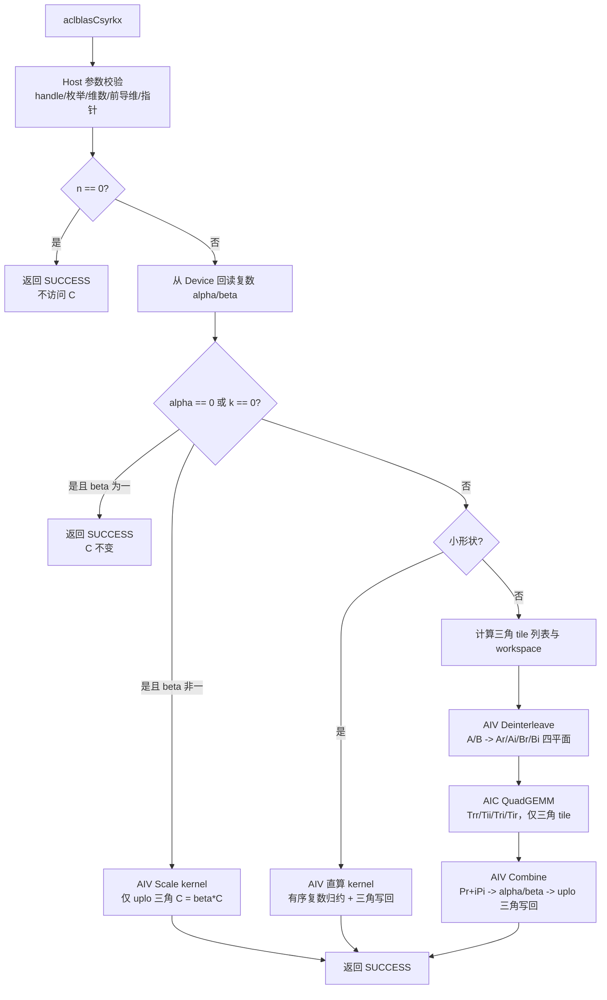

# aclblasCsyrkx 算子设计文档

> 文档状态：设计方案（待评审）
> 目标平台：Ascend 950PR（arch35）
> 目标软件版本：CANN 9.1.0，asc-devkit ≥ 9.1
> 数据类型：COMPLEX64（`aclblasComplex`，实部/虚部各 FP32）
> 对标接口：cuBLAS `cublasCsyrkx`（legacy）
> 目标仓与目录：`cann/ops-blas`，`blas/syrkx/arch35/`，测试工程 `test/syrkx/csyrkx/arch35/`

# 1 需求背景（required）

## 1.1 需求来源

本需求来源于“10月社区任务-aclblasCsyrkx算子开发（950）”任务书，要求在 Ascend 950PR 上用 Ascend C 编程语言开发单精度复数（COMPLEX64）扩展对称秩 k 更新算子 `aclblasCsyrkx`，基于 `ops-blas` 开源仓的 kernel 直调工程框架实现句柄式 BLAS 接口，通过 handle 绑定的 stream 直调 NPU kernel，完成设计、开发、精度与性能验证，最终合入 `cann/ops-blas` 仓。

本任务补齐 `ops-blas` 的 Level-3 对称秩 k 更新族能力：仓内现有 `aclblasSsyrkx`（实数单精度）与 `aclblasCsyr2k`/`aclblasCherk`/`aclblasCherkx`（复数族），缺少与 cuBLAS `cublasCsyrkx` 对标的复数单精度实现 `aclblasCsyrkx`。

参考资料：

- [ops-blas 开源仓](https://gitcode.com/cann/ops-blas)
- [cuBLAS syrkx 接口说明](https://docs.nvidia.com/cuda/cublas/index.html#cublas-t-syrkx)
- [Netlib CSYRKX 参考实现](https://www.netlib.org/blas/csyrkx.f)
- [生态算子开源精度标准](https://gitcode.com/cann/opbase/blob/master/docs/zh/ops_precision_standard/mixed_tolerance_standard.md)
- [Ascend C 算子开发文档](https://www.hiascend.com/document/detail/zh/CANNCommunityEdition/850/opdevg/Ascendcopdevg/atlas_ascendc_map_10_0002.html)

## 1.2 背景介绍

`aclblasCsyrkx` 计算复数对称矩阵的扩展秩 k 更新：

```text
C = alpha * op(A) * op(B)^T + beta * C
```

其中：

- `trans = ACLBLAS_OP_N` 时 `op(A) = A`、`op(B) = B`，A/B 的物理形状为 `n x k`，即 `C = alpha*A*B^T + beta*C`；
- `trans = ACLBLAS_OP_T` 时 `op(A) = A^T`、`op(B) = B^T`，A/B 的物理形状为 `k x n`，即 `C = alpha*A^T*B + beta*C`；
- `trans = ACLBLAS_OP_C` 与 `ACLBLAS_OP_T` **完全等价**，按普通转置执行、**不取共轭**：syrkx 的结果矩阵是对称（非 Hermitian）矩阵，共轭转置会破坏对称性；cuBLAS `cublasCsyrkx` 对 `CUBLAS_OP_C` 同样按 `CUBLAS_OP_T` 执行；
- 所有矩阵按列主序存储，`lda`、`ldb`、`ldc` 以复数元素为单位计数；
- C 为 `n x n` 复数对称矩阵（不是 Hermitian 矩阵），只引用并更新 `uplo` 指定的三角，对角元素虚部不做置零；
- `alpha`、`beta` 为复数标量指针，作用于结果。

`aclblasComplex` 已在 `include/cann_ops_blas_common.h` 中定义为两个连续 FP32 分量：

```cpp
typedef struct aclblasComplex {
    float real;
    float imag;
} aclblasComplex;
```

因此 COMPLEX64 在 Device 上等价于“交错存放的 FP32 元素对”，复数乘加可完全拆解为实数运算，精度判定按 FLOAT32 分量执行。

## 1.3 当前代码基线分析

截至本文档生成时，`ops-blas` 基线的相关现状如下：

| 位置 | 现状 | 对本设计的作用 |
| --- | --- | --- |
| `include/cann_ops_blas.h` | 已声明 `aclblasSsyrkx`、`aclblasCsyrk`、`aclblasCherk`、`aclblasCher2k`、`aclblasCherkx`、`aclblasCsymm`，**无 `aclblasCsyrkx`** | 需新增公共声明 |
| `blas/syrkx/arch35/` | 仅有实数版本 `ssyrkx_{host,kernel,tiling_data}.{cpp,h}`：AIC GEMM 生成 `n x n` FP32 临时矩阵，AIV scale kernel 按 uplo 掩码做 `alpha/beta` 更新 | 直接复用其三阶段骨架、workspace 机制与 tiling 风格 |
| `blas/herkx/arch35/` | `cherkx_*` 为共轭版本（`alpha` 复数、`beta` 实数） | 提供复数三角更新的写回与掩码实践 |
| `blas/syrk/arch35/`、`blas/syr2k/arch35/` | 已上库 `csyrk_*`、`csyr2k_*`：交错复数拆分（deinterleave）、4M 实数分解、三角 tile 裁剪、严格 FP32 累加 | 本设计的复数拆解与精度策略沿用其已验证结论 |
| `blas/common/helper/syrk_host_utils.h` | `PrepareSyrkLaunch` / `ReadAlphaBetaFromDevice` / `CalScaleTilingData` 只处理**实数** `alpha/beta`，且 `OP_C` 已在其中归一化为 `OP_T` | 需扩展复数标量读取与多平面 workspace 计算 |
| `cmake/asc_devkit_version.cmake` | `TENSOR_API_OPS` 列表含 `SSYRKX`，**无 `CSYRKX`** | 需追加门控项 |
| `test/syrkx/` | 仅有 `ssyrkx` 测试工程（`ssyrkx_param.h`、`ssyrkx_golden.h`、`arch35/ssyrkx_test.cpp`、CSV） | 需按同一结构新增 `csyrkx` 测试工程 |

# 2 需求分析（required）

## 2.1 需求描述

在 Ascend 950PR 上提供与 cuBLAS `cublasCsyrkx` 参数序列一致的公共接口：

```cpp
aclblasStatus_t aclblasCsyrkx(
    aclblasHandle_t handle,
    aclblasFillMode_t uplo,     // ACLBLAS_UPPER / ACLBLAS_LOWER
    aclblasOperation_t trans,   // ACLBLAS_OP_N / OP_T / OP_C（OP_C 等价 OP_T，不共轭）
    int n, int k,
    const aclblasComplex* alpha,
    const aclblasComplex* A, int lda,
    const aclblasComplex* B, int ldb,
    const aclblasComplex* beta,
    aclblasComplex* C, int ldc);
```

接口通过 `handle` 中绑定的 stream 下发计算，返回 `aclblasStatus_t`；禁止定义 950PR 私有平行接口，声明加入统一头文件 `include/cann_ops_blas.h`。调用方读取 C 前须同步该 stream。

## 2.2 参数与约束

| 参数 | 存储位置 | 类型 | 语义与约束 | 非法行为 |
| --- | --- | --- | --- | --- |
| `handle` | Host | `aclblasHandle_t` | 已创建且有效，携带 stream | `nullptr` 返回 `ACLBLAS_STATUS_HANDLE_IS_NULLPTR` |
| `uplo` | Host | 枚举 | `ACLBLAS_UPPER`（只更新 `i <= j`）或 `ACLBLAS_LOWER`（只更新 `i >= j`） | 其他值返回 `INVALID_VALUE` |
| `trans` | Host | 枚举 | `OP_N`、`OP_T`、`OP_C`；`OP_C` 按无共轭 `OP_T` 执行 | 其他值返回 `INVALID_VALUE` |
| `n` | Host | `int` | `n >= 0`，C 的阶数 | `n < 0` 返回 `INVALID_VALUE` |
| `k` | Host | `int` | `k >= 0`，缩并维 | `k < 0` 返回 `INVALID_VALUE` |
| `alpha` | Device | `COMPLEX64` 标量指针 | 实部/虚部各 FP32；不可为空 | `nullptr` 返回 `INVALID_VALUE` |
| `A` | Device | `COMPLEX64` 矩阵 | `n > 0 且 k > 0` 时不可为空；列主序 | 不满足时返回 `INVALID_VALUE` |
| `lda` | Host | `int` | N：`lda >= max(1, n)`；T/C：`lda >= max(1, k)` | 不满足时返回 `INVALID_VALUE` |
| `B` | Device | `COMPLEX64` 矩阵 | `n > 0 且 k > 0` 时不可为空；列主序 | 不满足时返回 `INVALID_VALUE` |
| `ldb` | Host | `int` | N：`ldb >= max(1, n)`；T/C：`ldb >= max(1, k)` | 不满足时返回 `INVALID_VALUE` |
| `beta` | Device | `COMPLEX64` 标量指针 | 不可为空；`beta = (0,0)` 时不读取 uplo 三角的 C 旧值 | `nullptr` 返回 `INVALID_VALUE` |
| `C` | Device | `COMPLEX64` 矩阵 | `n > 0` 时不可为空；列主序；仅指定三角原地更新 | 不满足时返回 `INVALID_VALUE` |
| `ldc` | Host | `int` | `ldc >= max(1, n)` | 不满足时返回 `INVALID_VALUE` |

按任务书显式约束，**参数合法性检查先于 no-op 判定**：即使 `n = 0`，`alpha`、`beta`、`lda/ldb/ldc` 等仍须满足约束；A/B 是否可空只由 `n > 0 且 k > 0` 决定，C 是否可空只由 `n > 0` 决定。

## 2.3 功能语义

### 2.3.1 对称（非 Hermitian）语义

对任意复数矩阵 X，本算子使用普通转置 `X^T`，不使用共轭转置 `X^H`。因此：

- 非对角元素不做共轭，`P = op(A) * op(B)^T` 中 `P(i,j)` 与 `P(j,i)` 一般互为镜像而非共轭；
- 对角元素保留非零虚部，不执行 HERK 中的“对角虚部置零”步骤；
- `trans = OP_C` 与 `trans = OP_T` 的计算路径完全一致，实现中不设置任何 conjugate 标志。

### 2.3.2 三角引用与更新语义

- `UPPER`：只读取并写回 `i <= j` 的 C 元素；
- `LOWER`：只读取并写回 `i >= j` 的 C 元素；
- 未指定三角不参与 `beta` 缩放，**不被搬入片上，也绝不被写回**，调用前后逐位保持不变；
- `beta = (0,0)` 时，被更新三角的旧 C 值不应被读取，避免无效值、NaN、Inf 通过 `0 * NaN` 传播；
- 由于只更新一个三角，结果矩阵在语义上是对称算子的“半个”结果，另一三角仍是调用前的旧值（与 cuBLAS/cblas 语义一致）。

### 2.3.3 no-op 与退化路径

复数零值要求实部、虚部同时为 0；复数一要求 `(1,0)`。

| 条件 | 行为 | A/B 是否参与 | C 行为 |
| --- | --- | --- | --- |
| `n == 0` | 合法 no-op，返回 `SUCCESS` | 否 | 不访问、不修改 |
| `(alpha == 0 \|\| k == 0) && beta == (1,0)` | quick return，返回 `SUCCESS` | 否 | 不访问、不修改 |
| `(alpha == 0 \|\| k == 0) && beta == (0,0)` | 退化路径 | 否 | 指定三角置 `(0,0)`，另一三角不变 |
| `(alpha == 0 \|\| k == 0) && beta != 0/1` | 退化路径 | 否 | 指定三角执行复数 `beta * C` |
| 其他 | 完整路径 | 是 | 指定三角执行完整公式 |

### 2.3.4 确定性要求

任务书要求确定性计算：相同输入多次执行结果逐位一致。本设计通过“固定 tile 列表顺序 + 固定核间划分 + 固定 K 方向升序累加 + 每个输出元素单写者”满足该要求，全流程不使用原子累加、不做跨核归约（详见 §3.4.6）。唯一的 Host 行为差异来源是复数 `alpha/beta` 的 D2H 回读，其结果由输入决定，不影响可复现性。

## 2.4 复数乘法拆解

定义 `X = op(A) = Xr + i·Xi`、`Y = op(B) = Yr + i·Yi`，目标矩阵 `P = X * Y^T`（`n x n`）：

```text
P(i,j) = sum_l X(i,l) * Y(j,l)
```

按复数乘法展开，`P = Pr + i·Pi`：

```text
Pr = Xr*Yr^T - Xi*Yi^T
Pi = Xr*Yi^T + Xi*Yr^T
```

故需要 4 个实数 GEMM：

| 中间矩阵 | 左矩阵 | 右矩阵 |
| --- | --- | --- |
| `Trr` | `Xr` | `Yr` |
| `Tii` | `Xi` | `Yi` |
| `Tri` | `Xr` | `Yi` |
| `Tir` | `Xi` | `Yr` |

```text
Pr = Trr - Tii
Pi = Tri + Tir
```

若 `alpha = ar + i·ai`、`beta = br + i·bi`、旧 C 为 `Cr + i·Ci`，则输出为：

```text
outReal = ar*Pr - ai*Pi + br*Cr - bi*Ci
outImag = ar*Pi + ai*Pr + br*Ci + bi*Cr
```

本方案采用 **4M 分解（4 个实数 GEMM）** 而不是 3M（用 `(Xr+Xi)`、`(Yr+Yi)` 构造第三路乘积并相减还原）。原因：4M 与仓内 `aclblasCsyr2k`、`aclblasCherk` 的严格 FP32 路径一致，不需要额外构造和差矩阵，也没有 `Tsum - Trr - Tii` 的额外相消放大，精度更容易按 FLOAT32 分量标准控制；3M 作为可选加速路径保留（§3.6）。

## 2.5 需求拆解

1. 在 `include/cann_ops_blas.h` 新增 `aclblasCsyrkx` 公共声明；在 `cmake/asc_devkit_version.cmake` 的 `TENSOR_API_OPS` 增加 `CSYRKX` 门控项，使 `blas/CMakeLists.txt`、`cmake/test.cmake`、`test/CMakeLists.txt` 的 foreach 自动带出编译与测试目标。
2. 完成全部参数校验、状态码映射与 `OP_C -> OP_T` 归一化。
3. 读取 Device 侧复数 `alpha/beta`，正确选择 quick return、仅缩放、小形状直算或完整三阶段路径。
4. 将 A/B 的 interleaved COMPLEX64 数据拆成 FP32 实部/虚部平面（紧凑存储，去掉 leading-dimension padding）。
5. 用 AIC Cube 以三角 tile 列表调度计算 `Trr/Tii/Tri/Tir`，仅覆盖 uplo 三角所需的 tile。
6. 在 AIV 上完成复数 `alpha/beta` 合并、三角列跨度写回，保证未引用三角与 padding 逐位不变。
7. 覆盖 `trans ∈ {N,T,C}`、`uplo ∈ {UPPER,LOWER}`、前导维 padding、零维、空指针、非法枚举、Inf/NaN 与性能场景。
8. 在 Ascend 950PR + CANN 9.1.0 环境完成精度、性能与 msprof 路由验证，并输出自测报告。

# 3 详细设计（required）

## 3.1 总体架构



正常路径包含 1 个 AIV 反交错 kernel、1 个 AIC 四路 GEMM kernel 和 1 个 AIV 合并 kernel，全部下发到 `handle->stream`，依赖同一 stream 的顺序语义，中间不做 Host 同步。退化路径只下发 1 个 AIV scale kernel；小形状路径只下发 1 个 AIV 直算 kernel。

设计复用 `blas/common/helper/syrk_host_utils.h` 的既有机制（`OP_C -> OP_T` 归一化、AIC/AIV 核数选择、默认 workspace 申请），并新增复数版本：

- `ReadComplexAlphaBetaFromDevice`：两次 8 字节 D2H copy 后只同步一次，回读实部/虚部；
- `PrepareCsyrkxLaunch`：在图 3.1 的判定与分核基础上，额外给出 4 个临时平面的 workspace 需求；
- 现有实数接口 `ReadAlphaBetaFromDevice`/`PrepareSyrkLaunch` 保持不变，避免影响 `aclblasSsyrkx` 等已上库算子。

## 3.2 文件与模块设计

| 文件 | 设计内容 |
| --- | --- |
| `include/cann_ops_blas.h` | 新增 `aclblasCsyrkx` 公共声明（含参数注释与约束说明） |
| `blas/syrkx/arch35/csyrkx_host.cpp` | 参数校验、复数标量回读、分支选择、tiling 计算、workspace 申请、3 个 kernel 的调度 |
| `blas/syrkx/arch35/csyrkx_tiling_data.h` | 反交错 / 四路 GEMM / 合并 / 直算 4 组 tiling 结构，Cube 与 AIV 常量，host/kernel 共用 |
| `blas/syrkx/arch35/csyrkx_kernel.h` | `csyrkx_deinterleave_kernel_do`、`csyrkx_quad_gemm_kernel_do`、`csyrkx_combine_kernel_do`、`csyrkx_direct_kernel_do` 的 launcher 声明 |
| `blas/syrkx/arch35/csyrkx_kernel.cpp` | 上述 4 个 kernel 的 Ascend C 实现（AIV SIMT/SIMD 与 AIC Tensor API 路径） |
| `blas/common/helper/syrk_host_utils.h` | 增加复数标量回读与 `PrepareCsyrkxLaunch`（仅新增，不改实数接口行为） |
| `blas/syrkx/README.md` | 增加 `aclblasCsyrkx` 的功能、接口、产品支持、约束、workspace 与精度说明 |
| `cmake/asc_devkit_version.cmake` | `TENSOR_API_OPS` 追加 `"CSYRKX\|/syrkx/arch35/csyrkx\|csyrkx"` |
| `test/syrkx/csyrkx/csyrkx_param.h` | CSV 参数模型（复数 `alpha/beta` 实虚部、`a_fill/b_fill/c_fill`、空指针、非法枚举） |
| `test/syrkx/csyrkx/csyrkx_golden.h` | 基于 `cblas_cgemm` 的 golden、参数合法性镜像、非 uplo 三角回填 |
| `test/syrkx/csyrkx/arch35/csyrkx_test.cpp` | GTest 驱动：CSV 加载、NPU/CPU 双跑、精度判定 |
| `test/syrkx/csyrkx/arch35/csyrkx_npu_wrapper.h` | 950PR NPU 侧内存管理与调用封装 |
| `test/syrkx/csyrkx/arch35/csyrkx_test.csv` | 1200 条用例（1000 精度 + 200 性能） |
| `test/syrkx/csyrkx/CMakeLists.txt` | `ops_blas_add_gtest_tests(${OPS_BLAS} csyrkx_test)` |

说明：`blas/CMakeLists.txt` 通过 `file(GLOB)` 自动收集 `blas/*/arch35/*.cpp`，新增源文件无需改动构建脚本；`TENSOR_API_OPS` 追加一行后，四份 CMake 文件的 foreach 会自动处理编译门控与测试目标注册（与 `SSYRKX` 现有做法一致）。

## 3.3 Host 侧设计

### 3.3.1 参数校验顺序

为保证状态码稳定、可预期，按以下顺序校验：

1. `handle` 是否为空（`ACLBLAS_STATUS_HANDLE_IS_NULLPTR`）；
2. `n >= 0`、`k >= 0`；
3. `uplo`、`trans` 枚举合法性；
4. `lda`、`ldb`（依赖 `trans` 归一化后的 `n/k`）、`ldc`；
5. `alpha`、`beta`、`C` 非空；
6. `n > 0 且 k > 0` 时 `A`、`B` 非空；
7. 全部合法后进入 `n == 0` no-op 判定。

所有字节数计算使用 `size_t` 并在申请 workspace 前做溢出检查；乘法溢出或 workspace 不足时返回仓内既有错误码，不截断为 32 位。

### 3.3.2 复数标量回读与路径分派

复数 `alpha/beta` 位于 Device，Host 需要其值判定 quick return 与分支。设计新增：

```text
alphaR/alphaI, betaR/betaI <- 各 8 字节 D2H（同一 stream 提交 2 次，仅同步 1 次）
isAlphaZero = (alphaR == 0 && alphaI == 0)
isBetaZero  = (betaR  == 0 && betaI  == 0)
isBetaOne   = (betaR  == 1 && betaI  == 0)
skipGemm    = isAlphaZero || k == 0
```

- `n == 0` 在回读之前返回，避免无意义的 D2H 与同步；
- `skipGemm && isBetaOne`：不申请 workspace、不下发任何 kernel；
- `skipGemm && !isBetaOne`：只下发 scale kernel；
- 其余进入小形状或完整路径。

### 3.3.3 trans 归一化与 GEMM 参数映射

`trans == ACLBLAS_OP_C` 在构造 tiling 之前统一改写为 `ACLBLAS_OP_T`，全流程不设置 conjugate 标志。反交错后 4 个 FP32 平面保持原物理形状与列主序：

```text
rows = (trans == N) ? n : k          // A/B 物理行数，也是平面 leading dimension
cols = (trans == N) ? k : n          // A/B 物理列数
planeElems = rows * cols = n * k
```

四路 GEMM 的逻辑转置组合（列主序 BLAS 语义，`T = op(A) * op(B)^T`）：

| 原接口 trans | 左矩阵 | 右矩阵 | GEMM transA | GEMM transB |
| --- | --- | --- | --- | --- |
| `OP_N` | `Ar/Ai`（`n x k`，ld = n） | `Br/Bi`（`n x k`，ld = n） | N | T |
| `OP_T` / `OP_C` | `Ar/Ai`（`k x n`，ld = k） | `Br/Bi`（`k x n`，ld = k） | T | N |

四路乘积的左/右组合为：`Trr = Ar*Br^T`、`Tii = Ai*Bi^T`、`Tri = Ar*Bi^T`、`Tir = Ai*Br^T`。由于四路共享同一 `(tileM, tileN)` 输出坐标与同一 K 切分，可在一个 AIC kernel 内一次载入 `Ar/Ai/Br/Bi` 的 K 片段并做 4 次 Mmad，A/B 平面的 GM 读带宽相对“4 个独立 GEMM”方案减半（详见 §3.4.2）。

### 3.3.4 三角 tile 列表与分核

C 只更新 uplo 三角，因此 `P` 也只需要三角部分。Host 以 `tileM x tileN` 网格枚举 `n x n` 的 tile，保留与 uplo 三角相交的 tile，形成**紧凑的三角 tile 列表**：

```text
UPPER: 保留满足 (r0 <= c0 + tileN - 1) 的 tile      // 存在 i <= j
LOWER: 保留满足 (r0 + tileM - 1 >= c0) 的 tile      // 存在 i >= j
```

- 完全落在未引用三角的 tile **不计算、不写回**，GEMM 计算量按三角占比从 `n²` 降到约 `n²/2`（大 shape 近似减半）；
- 列表在 Host 按行优先（`r0` 升序、`c0` 升序）生成，保证顺序完全确定；
- 核间划分采用连续区间：核 `c` 处理列表下标 `[c*T/C, (c+1)*T/C)`，`T` 为 tile 总数、`C = min(T, usedAicCoreNum)`；
- 每个 tile 的 K 方向按 `0 -> k` 升序、以 `tileKChunk` 为单位推进，尾块按实际长度处理；
- 对角 tile 内部由 AIV 合并阶段做元素级 `i <= j` / `i >= j` 掩码，因此 GEMM 只需按 tile 粒度裁剪即可（对角 tile 的最坏浪费不超过半个对角 tile）。

该策略同时改善负载均衡：核间按 tile 数均分，而不是按 `n` 均分的二维网格，避免三角区域在常规二维分核下出现“上三角核空闲、下三角核满载”。

### 3.3.5 Tiling 数据结构

```cpp
// Phase 0：A/B 反交错（AIV）
struct CsyrkxDeinterleaveTilingData {
    uint32_t rows;        // 物理行数：trans=N 时为 n，否则为 k
    uint32_t cols;        // 物理列数：trans=N 时为 k，否则为 n
    uint32_t lda;
    uint32_t ldb;
    uint32_t blockCount;  // 参与本次 kernel 的 AIV block 数
};

// Phase 1：四路 GEMM（AIC）
struct CsyrkxQuadGemmTilingData {
    uint32_t n;
    uint32_t k;
    uint32_t planeLd;     // 反交错平面的 leading dimension = rows
    uint32_t tempLd;      // 临时平面 leading dimension = CeilAlign(n, 16)
    uint32_t tileCount;   // 三角 tile 总数
    uint32_t tilePerCore; // 每核 tile 数上界
    uint32_t tileM;
    uint32_t tileN;
    uint32_t tileKChunk;
    uint32_t coreNum;
    uint8_t  isTransN;
    uint8_t  uploMode;
    uint8_t  reserved[6];
};

// Phase 2：复数合并与三角写回（AIV）
struct CsyrkxCombineTilingData {
    uint32_t n;
    uint32_t k;
    uint32_t ldc;
    uint32_t tempLd;
    uint32_t colsPerCore;   // 每核负责的 C 列数
    float    alphaReal;
    float    alphaImag;
    float    betaReal;
    float    betaImag;
    uint8_t  uploMode;
    uint8_t  isAlphaZero;
    uint8_t  isKZero;
    uint8_t  isBetaZero;
};

// 小形状直算（AIV，单 kernel 完成反交错+归约+写回）
struct CsyrkxDirectTilingData {
    uint32_t n;
    uint32_t k;
    uint32_t lda;
    uint32_t ldb;
    uint32_t ldc;
    float    alphaReal;
    float    alphaImag;
    float    betaReal;
    float    betaImag;
    uint8_t  isTransN;
    uint8_t  uploMode;
    uint8_t  isBetaZero;
};
```

Cube 侧常量沿用 `syrkx` 家族已上库取值并针对“4 累加器”调整：`BASE_M = BASE_N = 16`、`BASE_K = 8`、`FIXPIPE_N_ALIGN = 16`、默认 `tileM = 128`、`tileN = 64`、`tileKChunk = 128`（上限 256），L1 = 512 KiB、L1 双 buffer、使用率 9/10，L0C = 256 KiB。`tileKChunk` 的实际取值由 L1 预算反推并向下对齐到 `BASE_K`：

```text
kChunk = floor( 0.9 * L1 / (L1_BUF_NUM * 4 * (tileM + tileN) ) )   // 对齐到 BASE_K，裁剪到 [BASE_K, 256]
```

AIV 侧沿用 `SCALE_BLOCK = 64`、`ELEMENTS_PER_BLOCK = 8`（32 B / sizeof(float)），GM 对齐 512 B。

### 3.3.6 Workspace 设计

反交错平面（4 个 FP32 平面）与临时乘积平面（4 个 FP32 平面）分别按下式计算，各平面起始地址按 512 B 对齐：

```text
planeBytes     = Align512( rows * cols * sizeof(float) )            // n*k*4 字节
tempLd         = CeilAlign(n, 16)
tempPlaneBytes = Align512( tempLd * n * sizeof(float) )             // 约 n*n*4 字节
workspaceBytes = 4 * planeBytes + 4 * tempPlaneBytes
```

布局：

```text
| Ar | Ai | Br | Bi | Trr | Tii | Tri | Tir |
```

以 `n = k = 4096` 为例，`workspaceBytes ≈ 4*64 MiB + 4*64 MiB = 512 MiB`，低于 `ACLBLAS_MAX_WORKSPACE_SIZE`（2 GiB），但属于大 workspace 场景，设计上保留两条降容路径（按实测决定是否启用）：

1. **两轮复用**：先算 `Trr/Tii` 得 `Pr`，再复算 `Tri/Tir` 得 `Pi`，把临时平面从 4 块降到 2 块（节省 `2*n²*4 B`），代价是多一轮 GEMM 与合并往返；
2. **3M 快路**：用 `(Ar+Ai)`、`(Br+Bi)` 构造第三路乘积，把临时平面降到 3 块（§3.6）。

退化路径与小形状路径不需要临时平面：前者 `workspaceBytes = 0`，后者只需 `O(1)` 的片上空间。

## 3.4 Kernel 侧设计

### 3.4.1 Phase 0：A/B 复数反交错（AIV）

单个 AIV kernel 同时处理 A 和 B，减少一次 kernel launch。SIMT 线程以 `index = row + col*rows` 遍历逻辑矩阵：

1. 由 `row = index % rows`、`col = index / rows` 还原列主序坐标；
2. 按 `(col*lda + row)*2`、`(col*ldb + row)*2` 读取 `float2` 交错数据，拆成实部/虚部；
3. 写入紧凑 FP32 平面 `Ar/Ai/Br/Bi`（leading dimension = `rows`），彻底去掉 `lda/ldb` padding；
4. 网格 stride 循环覆盖尾部元素，只访问逻辑矩阵区域，**不读取 leading-dimension padding**；
5. 以 `32 B` 对齐的 `float` 向量做批量搬入搬出，按 block 数均分元素。

`skipGemm = true` 时该 kernel 不下发，因此 `alpha = 0` 或 `k = 0` 时 A/B 内容完全不参与计算（即使指针非空且内容为 NaN/Inf）。

### 3.4.2 Phase 1：四路 GEMM（AIC）

复用 `syrkx` 家族的 L1/L0 Tensor API 流水：

```text
GM(Ar/Ai/Br/Bi) -> L1 -> L0A/L0B -> Mmad(FP32 累加) -> Fixpipe -> GM(Trr/Tii/Tri/Tir)
```

关键策略：

- **单 kernel 四累加器**：每个输出 tile 分配 4 块 L0C 累加器（`tileM=128`、`tileN=64` 时每块 32 KiB，共 128 KiB），同一 K 片段只载入一次 `Ar/Ai/Br/Bi`，做 4 次 Mmad；相对“4 个独立 GEMM”把 A/B 平面 GM 读流量降到 1/4；
- **三角 tile 驱动**：kernel 从 §3.3.4 的三角 tile 列表按核内连续区间取 tile，跳过未引用三角，GEMM 计算量近似减半；
- **K 方向分块**：按 `tileKChunk` 切分，L1 ping-pong + 事件同步，尾块按实际长度处理；`BASE_K = 8`，用 FP32 累加；
- **布局直通**：`trans=N` 用 `transA=N/transB=T`，`trans=T/C` 用 `transA=T/transB=N`，由 Host 的 `isTransN` 选择 L1->L0 的载入转置配置，不增加独立 transpose kernel；
- **尾块处理**：M/N/K 三个方向都按实际长度计算，Fixpipe 的 N 方向按 16 元素对齐写回，越界部分不落 GM；
- **确定性**：tile 与 K 的遍历顺序在 kernel 内由 tiling 字段唯一确定，不使用原子累加。

设计将“4 累加器单 kernel”作为主方案，同时在 `csyrkx_kernel.cpp` 内保留“4 次独立 GEMM（复用同一 tiling）”的等价实现作为回退开关：若在大 `tileM` 或 L0C 紧张场景下 4 累加器版本受限，可切换为顺序 4 次 GEMM，功能与精度不变，仅牺牲 A/B 读带宽复用。

### 3.4.3 Phase 2：复数合并与三角写回（AIV）

按列划分：`colsPerCore = CeilDiv(n, usedAivCoreNum)`，核 `c` 处理列区间 `[c*colsPerCore, min(n, (c+1)*colsPerCore))`。对每一列 `j`，只遍历该列在 uplo 三角内的行跨度：

```text
UPPER: i ∈ [0, j]
LOWER: i ∈ [j, n-1]
```

跨度内元素在 `tempLd` 与 `ldc` 两个维度上都连续，可直接用 8 元素（32 B）向量做 SIMD 处理，尾部按元素收敛。每个目标元素：

1. 读 `Trr/Tii/Tri/Tir` 的 `(i,j)`，按 §2.4 得到 `Pr = Trr - Tii`、`Pi = Tri + Tir`；
2. `isAlphaZero || isKZero` 时跳过第 1 步（不访问临时平面）；
3. `beta != 0` 时读取 C 的目标元素，执行复数 `beta * C_old` 累加；`beta == 0` 时不读取 C；
4. 执行复数 `alpha` 缩放并写回实部/虚部。

由于遍历只覆盖 `i <= j`（或 `i >= j`）的跨度，**未引用三角既不被读取也不被写入**，天然满足“另一三角逐位不变”，不采用“整块写入后恢复”的做法。该 kernel 同时承担退化路径（`isAlphaZero || isKZero`）的 `C = beta * C` 计算。

### 3.4.4 小形状单 kernel 直算路径

3 次 kernel 下发的固定开销对极小 shape 不可忽略（`n = k <= 64` 时实际计算量只有几十万次乘加，而标杆 GPU 耗时已在 3 us 量级）。设计对

```text
n * n * k <= 65536  且  n <= 64
```

的极小 shape 走单 kernel 直算路径（阈值作为可调常量，按 profiling 校准）：

- 单个 AIV kernel 内完成交错读取、复数有序归约、`alpha/beta` 合并与三角写回；
- 每个输出元素 `(i,j)` 由单一线程按 `l = 0..k-1` 升序做复数乘加，归约顺序固定，天然确定性；
- 不做 4M 分解，避免小 k 场景 4 次 Mmad 的固定开销，同时在小 k 下精度优于 4M（无 `Trr - Tii` 相消）；
- 由于只处理极小 shape，单核或少量核即可满足时延要求，仍按列跨度分给多个 block。

### 3.4.5 退化路径 Kernel

`skipGemm = true` 且 `beta != (1,0)` 时，只下发 §3.4.3 的合并 kernel（`isAlphaZero = 1` 或 `isKZero = 1`）：

- `beta == 0`：只向目标三角写复数零，不读取 C 旧值；
- 其他 `beta`：读取目标三角 C，执行复数乘法后原地写回；
- `beta == (1,0)` 已由 Host quick return，不下发 kernel。

### 3.4.6 确定性保证

| 环节 | 保证手段 |
| --- | --- |
| tile 顺序 | Host 生成固定行优先列表，tiling 中带 `tileCount/tilePerCore`，kernel 不做动态抓取 |
| 核间划分 | 连续区间静态划分，无 work-stealing、无原子计数 |
| K 方向归约 | 每核按 `0 -> k` 升序切块累加，累加顺序与核数无关 |
| 输出写者 | 每个 C 元素仅由 Phase 2 的一个线程写一次，无跨核累加 |
| 直算路径 | 单线程有序归约，顺序由 `k` 唯一确定 |
| Host 分支 | 仅依赖 `alpha/beta/k` 的数值判定，同输入判定结果相同 |

因此相同输入多次执行、不同核数配置下结果均逐位一致，满足任务书 §2.5 的确定性要求。

## 3.5 数据流与内存访问

```text
A(COMPLEX64, 列主序) --反交错--> Ar(FP32) --+
                        \--> Ai(FP32) --+--+--> Trr, Tii, Tri, Tir --合并--> C(uplo 三角)
B(COMPLEX64, 列主序) --反交错--> Br(FP32) --+  （仅三角 tile）
                        \--> Bi(FP32) --+
```

偏移均以复数元素为逻辑单位，实际字节偏移乘以 `sizeof(aclblasComplex) = 8`：

```text
A(i,j) 地址 = A + (i + j*lda)
B(i,j) 地址 = B + (i + j*ldb)
C(i,j) 地址 = C + (i + j*ldc)
Ar(i,j) 地址 = Ar + (i + j*rows)     // rows = 物理行数
Trr(i,j) 地址 = Trr + (i + j*tempLd)
```

约束：

- 输入读取严格限制在逻辑矩阵 `rows x cols` 内，`lda/ldb` padding 不参与反交错；
- 临时平面按 `tempLd = CeilAlign(n, 16)` 分配，写回只覆盖 `[0, n)` 列与行区间，padding 不参与合并；
- C 的写回限定在 uplo 三角，`ldc` padding 不写入；
- 各平面起始按 512 B 对齐，便于 DMA 与 Fixpipe 的整块搬出。

## 3.6 性能优化方案

1. **三角裁剪**：GEMM 只计算与 uplo 三角相交的 tile，计算量从 `n²` 降到约 `n²/2`，同时让分核按 tile 数均衡（§3.3.4）。
2. **四路共 K 片段**：一个 AIC kernel 内 4 累加器复用同一 `Ar/Ai/Br/Bi` K 片段，A/B 平面 GM 读流量降到 1/4，并省去 3 次 kernel launch。
3. **反交错去 padding**：把 `lda/ldb` 交错数据压成紧凑 FP32 平面，后续 GEMM 与合并都按 `rows` 连续访问，减少无效搬运。
4. **退化路径裁剪**：`alpha = 0`、`k = 0`、`beta = 0/1` 时跳过反交错、GEMM 或 C 读取，最小路径只有 1 个 AIV kernel 或 0 个 kernel。
5. **小形状单 kernel**：极小 shape 用有序归约直算，规避 3 次 launch 与 Cube 固定开销（§3.4.4），保证小尺寸性能 case 的倍率不拖累平均值。
6. **严格 FP32 累加**：默认路径不做 HF32/FP16 近似，避免为追性能牺牲 `matched_ratio`；性能缺口优先通过 3M 快路（下表）而非降低累加精度来补。
7. **可选 3M 快路**（仅在全量精度回归通过后启用）：用 `Tsum = (Ar+Ai)*(Br+Bi)^T` 替代 `Tri/Tir` 两路，GEMM 数量 4 -> 3，临时平面 4 -> 3，代价是 `Pi = Tsum - Trr - Tii` 的额外相消放大。
8. **热点调优计划**：以任务书 4 个典型性能 case 为主，用 `msprof op` 分别观察反交错、QuadGEMM、合并三段的耗时与带宽，据此调整 `tileM/tileN/tileKChunk`、AIC/AIV 核数与三角 tile 粒度；不在缺少实测证据时承诺固定加速比。

最终性能结论以 Ascend 950PR、warmup 5 次后有效采样 10 次（`msprof op` 的 task duration）的算术平均为准。

## 3.7 支持硬件

| 支持的芯片版本 | 支持情况 | 说明 |
| --- | --- | --- |
| Ascend 950PR | 支持 | arch35，CANN 9.1.0 / asc-devkit ≥ 9.1，FP32 Cube + AIV |
| Atlas A2 / A3 系列 | 不支持 | 本算子按任务书目标平台实现 arch35 kernel，A2/A3 需另立 arch22 实现 |

## 3.8 算子约束限制

- 仅支持 `aclblasComplex`/COMPLEX64，不支持 COMPLEX128（`aclblasDoubleComplex`）。
- 矩阵为列主序，只支持 `lda/ldb/ldc` 表达的二维 padding；不支持任意非连续 Tensor 视图。
- 不支持 broadcast；不要求 dynamic shape（`n/k` 在编译期为已知静态值）。
- C 为输入/输出，原地更新且只更新 `uplo` 指定三角；另一三角不引用、不修改、不返回视图。
- `n`、`k` 为运行时参数，维数类型固定为 `int`。
- `OP_C` 按任务书约定等价 `OP_T`（不共轭）；若后续口径变更，需同步接口文档、golden 与用例。
- 确定性计算：固定调度与固定归约顺序，同输入多次执行逐位一致。
- workspace 由 handle 的默认 workspace 机制管理；`n`、`k` 很大时占用约 `4*n*k*4 B + 4*n²*4 B`，超出 `ACLBLAS_MAX_WORKSPACE_SIZE`（2 GiB）时返回 `ACLBLAS_STATUS_ALLOC_FAILED`。
- 不支持 `alpha/beta` 位于 Host 内存的调用方式：标量按仓内既有约定从 Device 回读。

# 4 可维可测分析

## 4.1 精度标准/性能标准

| 验收标准 | 描述 | 标准来源 |
| --- | --- | --- |
| 精度标准 | COMPLEX64 的实部/虚部分别按 FLOAT32 判定：`rtol = atol = 2^-13 (1.22e-4)`，`required_matched_ratio >= 0.99`，且 `max_abs_error <= 1e-2 或 32*ULP`；逐元素条件 `\|actual - golden\| <= atol + rtol*\|golden\|` | 任务书 §3.2 与生态算子开源精度标准 |
| 功能标准 | uplo 三角与 `cblas_cgemm` golden 比对（实部/虚部单标杆）；非 uplo 三角与调用前逐位一致 | 任务书 §3.2 |
| 性能标准 | 单 case 平均单次耗时 ≤ GPU 标杆的 2.5 倍（即达到 0.4× GPU）；全部性能 case 的倍率算术平均 ≥ 0.5× | 任务书 §3.3 |

精度计量的两个补充口径：

- **Inf/NaN**：golden 与 actual 同为 NaN、同为同号 Inf，或一方 NaN 一方 Inf，视为等效；一方有限一方 Inf/NaN 判不通过；非有限值不计入 `matched_ratio`/`max_abs_error`，单独统计并通过规则判定。
- **非 uplo 三角**：必须与调用前逐位一致（bitwise），不参与阈值放宽。

性能基线（`test_cases/gpu_baseline.csv`，NVIDIA H100 + CUDA 12.4，`cublasCsyrkx`；采样为 `msprof op` task duration，warmup 5 次后 10 次有效样本）：

| case | n | k | uplo | trans | lda/ldb/ldc | GPU 标杆 | NPU 目标（≤2.5×） |
| --- | ---: | ---: | --- | --- | --- | ---: | ---: |
| csyrkx-base-000 | 256 | 256 | UPPER | N | 256/256/256 | 0.013094 ms (13.09 us) | ≤ 32.74 us |
| csyrkx-base-001 | 1024 | 1024 | LOWER | N | 1024/1024/1024 | 0.168113 ms (168.11 us) | ≤ 420.28 us |
| csyrkx-base-002 | 2048 | 1024 | UPPER | T | 1024/1024/2048 | 0.471258 ms (471.26 us) | ≤ 1178.15 us |
| csyrkx-base-003 | 4096 | 2048 | LOWER | T | 2048/2048/4096 | 2.744080 ms (2744.08 us) | ≤ 6860.20 us |

除逐 case 的 0.4× 判据外，200 条性能 case 的倍率算术平均须 ≥ 0.5×，因此极小 shape（`n = 1 ~ 64`，GPU 3 us 量级）的时延由 §3.4.4 的单 kernel 直算路径保障。

## 4.2 测试设计

使用任务随附的 1200 条 CSV 用例（`csyrkx_test.csv`，固定随机种子 `20261028` 可逐字节复现）：1000 条精度/功能用例 + 200 条性能用例。GTest 读取 CSV，调用 `aclblasCsyrkx`，golden 由 `cblas_cgemm` 生成：

- `trans = N`：`opA = CblasNoTrans`、`opB = CblasTrans`，计算 `alpha*A*B^T + beta*C`；
- `trans = T` 或 `C`：`opA = CblasTrans`、`opB = CblasNoTrans`，计算 `alpha*A^T*B + beta*C`（**不取共轭**）；
- 计算后把非 uplo 三角恢复为调用前的原值，再做三角比对。

| 测试类别 | 前缀 | 条数 | 覆盖内容与关键检查 |
| --- | --- | ---: | --- |
| L0 基础 | `TC_L0` | 12 | uplo × trans(N/T) × 尺寸 (4,8)，公式与三角语义 |
| L1 方阵尺寸 | `TC_SQ` | 162 | 27 种尺寸 × trans(N/T/C) × uplo，尾块与分核边界 |
| L1 矩形形状 | `TC_MN` | 60 | 10 组 `n != k`（含 1000×999、2048×1024）× trans × uplo，物理 shape 与 leading dimension |
| L2 标量 | `TC_AB` | 48 | 8 组复数 `alpha/beta`（0、1、-1、纯虚、一般复数）× trans × uplo |
| L4 前导维 | `TC_LD` | 24 | lda/ldb/ldc padding（+4/+8）× 4 种尺寸 × trans × uplo，padding 不被改写 |
| L5 填充 | `TC_FL` | 18 | 均匀随机 / 全零 / 交替 / 极端值 / Inf / NaN（A、B、C 分别） |
| L5b 覆盖 | `TC_CV` | 32 | 中等尺寸 10~400 × uplo × trans(N/T) |
| L6 边界 | `TC_ED` | 31 | `n = 0` quick return、`k = 0` 仅 uplo 三角 `beta*C`、条件空指针叠加、非法枚举、非法前导维、负维度、特殊标量 |
| EX 扩展 | `TC_EX` | 613 | 尺寸池 × uplo × trans × 标量 × padding 确定性采样 |
| PF 性能 | `TC_PF` | 200 | 4 条典型 case + 小尺寸 + 规模对数扫描（n 256→4096，k=n 或 n/2）+ 预算内随机组合 |

补充校验点：

1. **未引用三角**：调用前把非 uplo 三角填成哨兵值，调用后逐位比对；`lda/ldb/ldc` padding 同样用哨兵校验不被改写。
2. **`beta = 0`**：把 uplo 三角的 C 预置为 NaN/Inf，验证 kernel 不读取旧 C（输出应为有限值）。
3. **`k = 0`**：`beta = 0` 期望三角清零、`beta = 1` 期望三角不变、其他 `beta` 期望复数缩放，另一三角始终不变。
4. **`n = 0`**：返回 `SUCCESS` 且 C 缓冲逐字节不变；`n0_a_b_null`、`k0_a_b_null`、`alpha0_a_null` 等条件空指针组合期望 `SUCCESS`。
5. **`OP_C` 与 `OP_T`**：同一组输入下 `trans = C` 与 `trans = T` 的输出逐位相同（本任务的口径验证）。
6. **确定性**：同输入连续执行 10 次，结果逐位一致；换不同核数配置（如限制 AIC/AIV 核数）结果仍逐位一致。

测试执行方式（与 `ssyrkx` 工程一致）：

```bash
# 精度
python3 verify_accuracy.py --repo /path/to/ops-blas --soc ascend950 --csv ./csyrkx_test.csv
# 性能（msprof op 采集 kernel task duration）
msprof op --application="./build/test/syrkx/csyrkx/csyrkx_test --gtest_filter=*TC_PF*" --output=./prof_csyrkx
```

## 4.3 可观测性与问题定位

Host 日志（`OP_LOGD`/`OP_LOGI`，`opTag = "aclblasCsyrkx"`）至少输出：

- 接口入参与非法参数原因（含 `uplo/trans/n/k/lda/ldb/ldc`）；
- `alpha/beta` 回读值及 `isAlphaZero/isKZero/isBetaZero` 分支标记；
- `rows/cols/planeBytes/tempLd/tempPlaneBytes/workspaceBytes`；
- 三角 tile 数 `tileCount`、AIC/AIV 使用核数、`tileM/tileN/tileKChunk/tilePerCore`；
- kernel 下发顺序与每次下发的失败码；runtime D2H copy 与 workspace 申请的返回码。

`msprof op` 侧应能观察到完整路径的 3 个 kernel（反交错 AIV、QuadGEMM AIC、合并 AIV），或小形状路径的 1 个 AIV kernel；退化路径不应出现 GEMM kernel。性能统计需区分首次加载、Host 复数标量回读、三个 kernel 各自耗时与 ACLBLAS 端到端耗时，便于定位是“固定开销”还是“搬运/计算”瓶颈。

## 4.4 兼容性分析

`aclblasCsyrkx` 是新增公共符号，不改变 `aclblasSsyrkx`、`aclblasCherkx`、`aclblasCsyr2k` 等既有接口行为；`syrk_host_utils.h` 只新增复数辅助函数，不改动实数接口语义（`OP_C -> OP_T` 归一化沿用既有实现），ABI 风险低。声明加入统一头文件 `include/cann_ops_blas.h`，保证不同产品线共用同一 API 名称，不引入 950PR 私有平行接口。新增 `TENSOR_API_OPS` 门控项在 asc-devkit < 9.1 时自动关闭，不影响低版本环境构建。

## 4.5 风险与待确认项

| 风险/待确认项 | 影响 | 处理方案 |
| --- | --- | --- |
| `OP_C` 语义在随附测试材料中存在两种描述：任务书 §2.1 明确“与 `OP_T` 等价、不取共轭”，而 `test_cases/README.md` §精度验收仍写“`trans=C` 时按共轭”并标注待研发确认 | golden 与用例口径不一致会导致 `TC_ED`/`TC_EX` 中 `OP_C` 用例误判 | 实现与设计严格按任务书执行（无共轭）；合入前对齐 golden：把 `OP_C` 用例的 golden 改为 `CblasTrans` 非共轭，并在用例说明中记录口径 |
| 4M 分解的 `Trr - Tii` 在强相消场景（大 k、随机 ±5 输入）放大相对误差 | `matched_ratio` 可能跌破 0.99 | 默认严格 FP32 累加、固定升序归约；对小形状走有序复数归约直算（无相消）；如仍有个别用例越界，评估对角块补偿或对冲突例降级为直算路径，并在自测报告中记录 |
| 复数 4 路 GEMM 的等效算力是实数 syrkx 的 4 倍，而性能判据为 0.4×/0.5× GPU | 大 shape case 存在性能验收风险 | 三角裁剪近似减半 + 四路共 K 片段（A/B 读流量 1/4）+ 退化路径裁剪；若仍有缺口，启用 3M 快路（GEMM 3 次、临时平面 3 块），并以全量精度回归作为启用门槛 |
| 大 shape workspace 约 512 MiB（`n = k = 4096`） | 可能触发 `ALLOC_FAILED` 或挤占同进程其他 workspace | 分阶段复用（两轮 2 平面）作为降容备选；申请前做 `size_t` 溢出检查，失败返回明确错误码并在 README 记录上限 |
| 极小 shape 下 3 次 kernel 的固定开销（GPU 3 us 量级） | 小尺寸性能 case 倍率偏低，拉低平均值 | §3.4.4 单 kernel 直算路径，阈值（`n*n*k <= 65536 && n <= 64`）按 profiling 校准 |
| 4 累加器占用 128 KiB L0C，限制 `tileM/tileN` 上限 | 大 shape 的 Cube 单核吞吐可能受限 | 保留“4 次独立 GEMM”回退开关；按 `msprof` 实测在 `tileM/tileN` 与累加器数量之间取优 |
| 三角 tile 列表使分核与 `n` 不再线性对应 | 极扁形状（`n` 小、`k` 大）可能出现核间不均 | 按 tile 数而非 `n` 划分 + 尾核补偿；`TC_MN` 用例覆盖 `n=1000,k=999` 与 `2048x1024` 验证 |
| 对角 tile 内元素级掩码正确性 | 三角边界越界写会破坏另一三角 | 合并阶段按列跨度遍历，越界元素不进入循环；`TC_ED`/`TC_LD` 用哨兵逐位校验 |
| 测试工程需新增 `test/syrkx/csyrkx` | 交付件完整性 | 按 `ssyrkx` 工程结构新增参数模型、golden（`cblas_cgemm`）、驱动、CSV 与 CMake |
