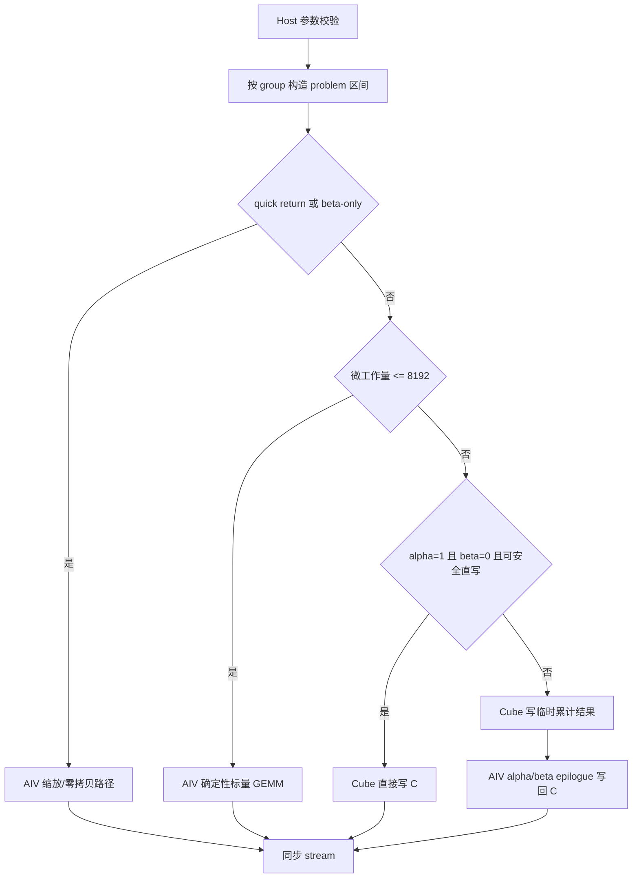

# aclblasGemmGroupedBatchedEx 算子设计文档

# 需求背景

## 需求来源

[10月社区任务-aclblasGemmGroupedBatchedEx算子开发（A2A3）](https://www.hiascend.com/activities/task-center)要求在 Atlas A2/A3 系列产品上，基于 [ops-blas](https://gitcode.com/cann/ops-blas) 开源仓工程框架，使用 Ascend C 编程语言实现扩展版分组批量通用矩阵乘法算子 `aclblasGemmGroupedBatchedEx`。接口语义、精度标准和性能判据以任务书为依据，对标 cuBLAS `cublasGemmBatchedEx` 的分组扩展能力。

## 背景介绍

`aclblasGemmGroupedBatchedEx` 支持 `groupCount` 个分组，第 `g` 组包含 `groupSize[g]` 个独立 GEMM。每个分组拥有独立的 `m/n/k`、转置方式、leading dimension、`alpha` 和 `beta`，组内各批次共享这些属性。该接口补齐了 ops-blas 仓从普通批量 GEMM 到异构分组 GEMM 的能力，可用于混合专家、分组专家投影和动态分组计算等场景。

公共接口复用 `include/cann_ops_blas.h` 中的既有声明，与现网及 950PR 共用，不定义产品私有平行接口。实现采用句柄式 BLAS 接口，通过 `aclblasSetStream` 绑定 stream，异步下发 Ascend C kernel。

# 需求分析

## 算子功能

对分组 `g = 0..groupCount-1` 和组内批次 `i = 0..groupSize[g]-1`，计算：

```text
C[g,i] = alpha[g] * op(A[g,i]) * op(B[g,i]) + beta[g] * C[g,i]
```

定义全局 problem 索引：

```text
problemIndex(g,i) = prefixGroupSize[g] + i
prefixGroupSize[g] = Σ(h=0..g-1) groupSize[h]
problemCount = Σ(g=0..groupCount-1) groupSize[g]
```

第 `g` 组中：

- `op(A[g,i])` 为 `m[g] × k[g]`；
- `op(B[g,i])` 为 `k[g] × n[g]`；
- `C[g,i]` 为 `m[g] × n[g]`；
- A、B、C 均为列主序；
- `Aarray/Barray/Carray` 按上述 problem 索引排列。

转置语义如下：

- `ACLBLAS_OP_N`：取原矩阵；
- `ACLBLAS_OP_T`：取转置；
- `ACLBLAS_OP_C`：取共轭转置；FLOAT32 实数路径下与 `ACLBLAS_OP_T` 等价。

leading dimension 约束为：

```text
transa == N: lda[g] >= max(1, m[g])
transa != N: lda[g] >= max(1, k[g])
transb == N: ldb[g] >= max(1, k[g])
transb != N: ldb[g] >= max(1, n[g])
ldc[g] >= max(1, m[g])
```

边界行为：

- `groupCount == 0` 为合法全局 no-op，直接返回 `ACLBLAS_STATUS_SUCCESS`，不访问其它数组；
- 某组 `m[g] == 0`、`n[g] == 0` 或 `groupSize[g] == 0` 为合法 no-op；
- `k[g] == 0` 时不读取 A/B，只计算 `C = beta[g] * C`；
- `alpha[g] == 0` 时跳过矩阵乘，只计算 `C = beta[g] * C`；
- `beta[g] == 0` 时不读取 C 旧值；
- `alpha[g] == 0 && beta[g] == 1` 时 C 保持不变；
- `alpha[g] == 0` 的缩放路径要求位精确，满足 EXACT 校验；
- Inf/NaN 按任务书的非有限值等价规则判定，不将有限值和 Inf/NaN 混为通过。

## 公开接口与范围

接口沿用 `include/cann_ops_blas.h` 中已有声明：

```cpp
aclblasStatus_t aclblasGemmGroupedBatchedEx(
    aclblasHandle_t handle,
    const aclblasOperation_t transaArray[], const aclblasOperation_t transbArray[],
    const int mArray[], const int nArray[], const int kArray[],
    const void* alphaArray,
    const void* const Aarray[], aclDataType Atype, const int ldaArray[],
    const void* const Barray[], aclDataType Btype, const int ldbArray[],
    const void* betaArray,
    void* const Carray[], aclDataType Ctype, const int ldcArray[],
    int groupCount, const int groupSize[],
    aclblasComputeType_t computeType);
```

接口参数如下：

| 参数 | 方向/属性 | 类型 | 说明 |
| --- | --- | --- | --- |
| `handle` | 输入 | `aclblasHandle_t` | 携带 Device 上下文和 stream；有效调用必须绑定 stream |
| `transaArray` | 输入 | Host 属性数组 | 每组 A 的 N/T/C 操作，长度 `groupCount` |
| `transbArray` | 输入 | Host 属性数组 | 每组 B 的 N/T/C 操作，长度 `groupCount` |
| `mArray` | 输入 | Host int 数组 | 每组 `op(A)` 的行数和 C 的行数 |
| `nArray` | 输入 | Host int 数组 | 每组 `op(B)` 的列数和 C 的列数 |
| `kArray` | 输入 | Host int 数组 | 每组归约维长度 |
| `alphaArray` | 输入 | 逐组 FLOAT32 标量 | 第 g 组的线性缩放系数 |
| `Aarray` | 输入 | Device 指针数组 | 按 problem 顺序排列的 A 矩阵 |
| `Atype` | 输入 | `aclDataType` | 当前仅支持 `ACL_FLOAT` |
| `ldaArray` | 输入 | Host int 数组 | 每组 A 的列主序 leading dimension |
| `Barray` | 输入 | Device 指针数组 | 按 problem 顺序排列的 B 矩阵 |
| `Btype` | 输入 | `aclDataType` | 当前仅支持 `ACL_FLOAT` |
| `ldbArray` | 输入 | Host int 数组 | 每组 B 的列主序 leading dimension |
| `betaArray` | 输入 | 逐组 FLOAT32 标量 | 第 g 组 C 的累加系数 |
| `Carray` | 输入/原地输出 | Device 指针数组 | 按 problem 顺序排列的 C 矩阵 |
| `Ctype` | 输入 | `aclDataType` | 当前仅支持 `ACL_FLOAT` |
| `ldcArray` | 输入 | Host int 数组 | 每组 C 的列主序 leading dimension |
| `groupCount` | 输入 | `int` | 分组数；0 为合法 no-op |
| `groupSize` | 输入 | Host int 数组 | 每组包含的 problem 数 |
| `computeType` | 输入 | `aclblasComputeType_t` | 当前仅支持 `ACLBLAS_COMPUTE_32F` |

当前实现的数据类型范围为：

| 项目 | 支持值 |
| --- | --- |
| Atype | `ACL_FLOAT` |
| Btype | `ACL_FLOAT` |
| Ctype | `ACL_FLOAT` |
| computeType | `ACLBLAS_COMPUTE_32F` |

FP16、BF16、FP8、INT8 以及其它混合精度组合不在当前实现的支持范围内，host 校验阶段返回 `ACLBLAS_STATUS_NOT_SUPPORTED`。

`groupCount`、`groupSize` 和各组维度均为运行时参数。`Carray`原地覆写，各 problem 的 C 区域不得重叠。调用方依赖句柄绑定的 stream；读取 Device 结果前应自行同步 stream。

接口使用以下状态码：

| 状态码 | 触发条件 |
| --- | --- |
| `ACLBLAS_STATUS_SUCCESS` | 正常完成、合法 no-op 或 beta-only 快速返回 |
| `ACLBLAS_STATUS_NOT_INITIALIZED` | handle 或底层运行时尚未初始化 |
| `ACLBLAS_STATUS_HANDLE_IS_NULLPTR` | 非零调用中 handle 为空 |
| `ACLBLAS_STATUS_INVALID_VALUE` | 负维度、负 groupCount/groupSize、非法 LD、空 host 数组或空矩阵指针数组 |
| `ACLBLAS_STATUS_INVALID_ENUM` | transa/transb 不属于 N/T/C |
| `ACLBLAS_STATUS_NOT_SUPPORTED` | dtype/computeType 组合未实现 |
| `ACLBLAS_STATUS_EXECUTION_FAILED` | tiling、workspace 或 kernel 下发失败 |

# 详细设计

## 算子分析

### 数学公式

对组 `g`、批次 `i` 和输出元素 `(r,c)`：

```text
C[g,i](r,c) =
    alpha[g] * Σ(p=0..k[g]-1) op(A[g,i])(r,p) * op(B[g,i])(p,c)
    + beta[g] * C[g,i](r,c)
```

其中 `0 <= r < m[g]`，`0 <= c < n[g]`。

FLOAT32 主路径使用 FP32 乘加。AIV 小尺寸确定性路径先执行 FP32 乘法，再执行 FP32 加法，避免 FMA 舍入方式在长 K 和非对齐尾块上引入稳定的尾数偏差。Cube 路径使用矩阵乘硬件完成 K 维累加；浮点累加顺序与 cblas 参考实现不同，结果不要求 bit-exact，`alpha=0` 的纯缩放路径除外。

### 支持数据类型

| Atype | Btype | Ctype | computeType | 支持情况 |
| --- | --- | --- | --- | --- |
| `ACL_FLOAT` | `ACL_FLOAT` | `ACL_FLOAT` | `ACLBLAS_COMPUTE_32F` | 支持 |
| 其它 | 其它 | 其它 | 其它 | `ACLBLAS_STATUS_NOT_SUPPORTED` |

`alphaArray` 和 `betaArray` 中的逐组标量按 FLOAT32 解释。A/B/C 的矩阵指针数组按 task 书契约传入，实际矩阵数据驻留 Device 内存。

### 支持形状

- `groupCount >= 0`；
- `groupSize[g] >= 0`；
- `m[g] >= 0`、`n[g] >= 0`、`k[g] >= 0`；
- 各组可具有不同 m/n/k、转置和 leading dimension；
- 组内各 batch 共享该组的 m/n/k、转置、ld、alpha 和 beta；
- 支持紧凑 leading dimension 及合法 padding；
- 不要求 m/n/k 为 16 的整数倍；
- 支持 `m=0`、`n=0`、`k=0`、`groupSize=0` 和 `groupCount=0`。

### 数据布局与索引

A、B、C 都使用列主序。若某组 `transa=N`，A 的实际物理矩阵为 `m×k`，元素 `(r,p)` 的地址为：

```text
A + r + p * lda
```

若 `transa=T` 或 `C`，A 的物理矩阵为 `k×m`，`op(A)` 的元素 `(r,p)` 取自物理元素 `(p,r)`：

```text
A + p + r * lda
```

同理，`transb=N` 时 B 的物理矩阵为 `k×n`：

```text
B + p + c * ldb
```

`transb=T/C` 时 B 的物理矩阵为 `n×k`，`op(B)` 的元素 `(p,c)` 取自：

```text
B + c + p * ldb
```

C 元素地址固定为：

```text
C + r + c * ldc
```

leading dimension 允许大于当前维度的最小值。host tiling 和 kernel 地址生成必须使用传入的 lda/ldb/ldc，不能把矩阵视为紧密连续的二维数组。写回只覆盖逻辑上的 `[0,m) × [0,n)` 区域。

所有矩阵指针都先按 group/batch 展开为：

```text
A_{g,i} = Aarray[prefixGroupSize[g] + i]
B_{g,i} = Barray[prefixGroupSize[g] + i]
C_{g,i} = Carray[prefixGroupSize[g] + i]
```

因此，group 内 batch 可以共享 m/n/k、转置、LD 和标量，但 A/B/C 的实际 Device 地址相互独立。不同 group 可以使用完全不同的形状和内存跨度。

## 算子实现

总体架构为“Host 分组展开与路径选择 + AIC Cube 主计算 + AIV 小尺寸/尾处理”的分层实现。



### Host 侧设计

**参数校验**

host 按以下顺序完成防御性校验：

1. 校验 Atype/Btype/Ctype/computeType 组合；不支持时返回 `ACLBLAS_STATUS_NOT_SUPPORTED`；
2. `groupCount < 0` 返回 `ACLBLAS_STATUS_INVALID_VALUE`；
3. `groupCount == 0` 直接返回 `ACLBLAS_STATUS_SUCCESS`，不再解引用其它参数；
4. `groupCount > 0` 时检查 handle；空 handle 返回 `ACLBLAS_STATUS_HANDLE_IS_NULLPTR`；
5. 检查各 host 属性数组非空；
6. `transaArray/transbArray` 不合法时返回 `ACLBLAS_STATUS_INVALID_ENUM`；
7. m/n/k/groupSize 为负、leading dimension 不满足约束时返回 `ACLBLAS_STATUS_INVALID_VALUE`；
8. `alphaArray`、`betaArray` 为空返回 `ACLBLAS_STATUS_INVALID_VALUE`；
9. `problemCount == 0` 时返回成功；否则 `Aarray/Barray/Carray` 为空返回 `ACLBLAS_STATUS_INVALID_VALUE`；
10. 计算 `problemCount` 和 workspace 大小时执行整数溢出检查。

C/C++ 接口无法从裸数组指针推断数组实际长度，因此调用方必须保证 `transaArray/transbArray/mArray/nArray/kArray/alphaArray/ldaArray/ldbArray/betaArray/ldcArray/groupSize` 的长度为 `groupCount`。CSV 测试框架在调用 API 前执行长度一致性校验，不做单元素广播。

Host 主流程可概括为：

```text
status = CheckSupportedTypesAndComputeType()
if status != SUCCESS: return status
if groupCount < 0: return INVALID_VALUE
if groupCount == 0: return SUCCESS

status = CheckHandleAndArrayPointers()
if status != SUCCESS: return status

for g in [0, groupCount):
    CheckTranspose(transaArray[g], transbArray[g])
    CheckNonNegative(mArray[g], nArray[g], kArray[g], groupSize[g])
    CheckLeadingDimensions(...)
    if groupSize[g] > 0:
        AddToCheckedProblemCount(groupSize[g])
    BuildPerGroupTilingAndScalarMetadata(...)

if alphaArray == nullptr or betaArray == nullptr:
    return INVALID_VALUE
if problemCount > 0 and Aarray/Barray/Carray == nullptr:
    return INVALID_VALUE
if problemCount == 0:
    return SUCCESS

BuildProblemRanges()
ChooseExecutionPaths()
AcquireOrReuseStreamOrderedWorkspace()
LaunchCubeOrAivKernelsOnHandleStream()
return launchStatus
```

**分组展开与 problem 映射**

host 为每组计算连续 problem 区间：

```text
[prefixGroupSize[g], prefixGroupSize[g] + groupSize[g])
```

problem `p` 通过二分查找或边界游标定位到组号 `g`，再由 `i = p - prefixGroupSize[g]` 取得该 problem 的 A/B/C 指针。组内任务连续排列，使同一组共享 m/n/k、转置和标量，降低 kernel 内重复元数据读取和跨组跳转。

host 为每组生成一段 `GroupTiling` 元数据，至少包含：

```text
groupIndex
problemBegin, problemEnd
m, n, k
transa, transb
lda, ldb, ldc
alpha, beta
pathKind
workspaceOffset
```

`pathKind` 可以取 `QUICK_RETURN`、`BETA_ONLY`、`AIV_SMALL`、`CUBE_DIRECT` 或 `CUBE_TEMP_EPILOGUE`。当同组内所有 problem 具有相同属性时只保存一次组元数据，kernel 根据 problem 索引定位所属区间，避免复制 `groupSize[g]` 份相同维度信息。

**列主序到 Cube 视角转换**

Cube 主路径采用行主矩阵乘的自然数据方向。由于列主序 `C(m×n, ldc)` 与行主序 `C^T(n×m, ldc)` 具有相同内存布局，host 按转置组合交换 M/N、A/B 与 lda/ldb，将问题转换为：

```text
C^T = op(B)^T * op(A)^T
```

转换后仍使用用户 C 缓冲区，不引入结果重排；A/B 的转置组合和 leading dimension 均在加载阶段处理。

**执行路径选择**

1. `m=0`、`n=0`、`groupSize=0` 或 `problemCount=0`：直接 quick return。
2. `k=0` 或 `alpha=0`：AIV 执行 `C = beta * C`。`beta=0` 时直接写零，不读取 C；`beta=1` 时不访问 C，直接完成。
3. `m × n × k <= 8192`：进入 AIV 确定性微形状路径。该阈值避免 256³、1024³ 和矩形矩阵被误送入低效逐元素路径；16³ 极值用例通过此路径匹配 cblas 的有限/非有限值传播语义。
4. Cube direct 路径：当 `alpha=1 && beta=0` 且输出写粒度满足安全直写条件时，Cube 结果直接写 C，省去临时 workspace 和 epilogue。200 条性能用例均满足该条件，因此不再为所有用例固定支付 workspace 与 epilogue 开销。
5. Cube general 路径：其它 alpha/beta 或不能安全直写的情况，Cube 先将原始乘积写入 FP32 临时缓冲区，再由 AIV epilogue 计算 `C = alpha * temp + beta * C`。

路径选择矩阵如下：

| 条件 | 执行路径 | 是否读取 A/B | 是否读取 C | 是否使用 temp |
| --- | --- | --- | --- | --- |
| `groupCount=0` | 全局 quick return | 否 | 否 | 否 |
| `groupSize=0`、`m=0` 或 `n=0` | 组级 quick return | 否 | 否 | 否 |
| `alpha=0, beta=1` | 纯 no-op | 否 | 否 | 否 |
| `k=0` 或 `alpha=0`，`beta!=1` | AIV beta 缩放 | 否 | `beta!=0` 时读取 C | 否 |
| `m*n*k <= 8192` | AIV 确定性 GEMM | 是 | `beta!=0` 时读取 C | 否 |
| `alpha=1, beta=0` 且可安全直写 | Cube 直写 | 是 | 否 | 否 |
| 其它完整计算 | Cube + AIV epilogue | 是 | `beta!=0` 时读取 C | 是 |

`m*n*k` 阈值用于区分微工作量和大工作量。它不是支持形状上限，只控制实现路径；更大的问题继续由 Cube 计算。阈值按数学工作量而非单维长度判断，避免“某二维很小、单维很长”的矩形问题误入 AIV 路径。

**异步 workspace**

workspace 包括 A/B staging、Cube 临时累计结果和必要元数据，生命周期与 handle 绑定 stream 一致。host 按本次调用所需大小申请或复用缓冲区，在 stream 上按序使用，不在接口内部执行无必要的全局同步。不同组或 problem 的 workspace 基址按平台对齐要求划分，防止互相覆盖。

设计采用保守的 64-bit 容量计算：

```text
stagingBytes = Σ(g) groupSize[g] * alignBytes(stagingPerProblem[g])
tempBytes    = Σ(g) groupSize[g] * alignBytes(tempPerProblem[g])
metadataBytes = groupCount * sizeof(GroupTiling)
workspaceBytes = checkedAdd(stagingBytes, tempBytes, metadataBytes)
```

其中 `stagingPerProblem` 只在转置或 Cube 装载确实需要重排时计入，`tempPerProblem` 只在 non-direct 路径计入。任何乘法或累加溢出都返回 `INVALID_VALUE` 或 `EXECUTION_FAILED`，不能截断成 32 位长度。direct、beta-only 和 quick-return 路径不申请不必要的 temp。

workspace 的复用必须满足 stream 顺序：只有当前 stream 已完成上一消费者的 kernel 后，地址才可安全复用；实现通过同一个 handle stream 上的 kernel 顺序和必要的完成查询保证这一点，不在每次 API 调用返回前执行阻塞式全局同步。

**任务分解与负载均衡**

host 沿连续 problem 区间遍历，而不是为每个 tile 重复扫描整个 group 元数据。大问题按输出块和 batch/group 展平为若干 Cube task，再按 block 分配均衡的连续区间。连续分配使同一 block 尽量处理相邻 problem，改善 A/B/C 的 L2 命中率。

### Kernel 侧设计

**AIC Cube 主 kernel**

Cube kernel 以一个或多个输出 tile、一个 problem 为基本任务。每个 block 针对同一转置组合只初始化一次 MatmulImpl/tiling，避免在 tile 循环内重复预留 L1、L0C 和 UB 资源。此前重复初始化在 1024³ 多 batch 场景中会触发 aicore exception，当前设计已消除该问题。

单个 Cube task 的伪代码如下：

```text
decode task -> problem p, output tile (tileM, tileN)
g = FindGroupByProblem(p)
if g.path != CUBE_DIRECT/CUBE_TEMP_EPILOGUE: return

matmul = GetBlockLocalMatmul(g.transa, g.transb)
if not initialized:
    InitMatmul(tileM, tileN, k, g.lda, g.ldb, outputLayout)

acc = InitL0C()
for kTile in [0, k, tileK):
    LoadA(GM + AOffset(p, g, kTile), L1)
    LoadB(GM + BOffset(p, g, kTile), L1)
    if transpose/staging required:
        TransformOrUseStagedOperand()
    CopyL1ToL0AAndL0B()
    Mmad(acc, A0, B0)

if g.path == CUBE_DIRECT:
    Fixpipe(acc -> C[p])
else:
    Fixpipe(acc -> temp[p])
```

每个 problem 的 A/B/C 基址都通过其 `problemIndex(g,i)` 选择，tile 只改变矩阵内部的 row/column 偏移。host tiling 保证任何 block 上单个 problem 不重复计算；当 group/batch 数超过 block 数时，一个 block 顺序处理多个连续 problem。

每个输出 tile 的主流程为：

1. 根据当前 group 的转置、lda/ldb/ldc 生成 A/B 搬运地址；
2. 将 GM 中的有效分块搬入 L1；
3. 将 L1 分块装载到 L0A/L0B；
4. 在 L0C 上沿 K 维累加；
5. 通过 Fixpipe 写出结果；
6. direct 路径直接写 C，general 路径写 FP32 temp。

K 维尾块只装载有效元素；矩阵尾块写回时只覆盖 `[0,m) × [0,n)` 逻辑区域。转置路径在 L1 或 staging 阶段完成数据方向转换，不改变用户 A/B 的列主序布局。

**Tiling 原则**

- 输出 tile 大小受 L0C 容量、有效 m/n 和 block 数共同约束；
- K tile 受 L1/L0 装载容量约束，并保证每次 Mmad 输入分形合法；
- 非 16 对齐的尾块只对有效元素做矩阵乘和写回；
- 小 m/n 不强行使用大 tile，避免大量线程块处理空输出；
- tile 配置由 host 依据当前 group 生成；不同 group 使用各自维度，不能用第一组 tiling 计算后续异构 group；
- direct/general 共用 Cube 主计算，差异只体现在 Fixpipe 目的地址和后续 epilogue；
- 每个 block 内复用同一转置组合的 MatmulImpl，初始化次数从“每输出 tile 一次”降为“每 block 每组合一次”。

**AIV 确定性微形状 kernel**

对于工作量不超过 8192 的问题，AIV 路径按输出平面和 K 分块计算。乘法和加法分别舍入，alpha/beta 合成避免合并为会改变舍入位置的 FMA 表达式。该路径承担：

- 16³ 极值和 Inf/NaN 用例；
- 小矩阵、小 groupSize 场景；
- Cube tile 利用率过低的微工作量；
- 作为非 direct 尾块时可复用的确定性兜底。

AIV 微形状路径按输出元素或输出平面划分任务。每个任务固定覆盖本 problem 的一个有效输出块，独立沿 K 维累加：

```text
for outputBlock in AssignedBlocks(problem):
    acc[outputBlock] = 0
    for kBlock in [0, k):
        load effective op(A) tile
        load effective op(B) tile
        for each product:
            product = a * b          // FP32 multiply
            acc = acc + product      // separate FP32 add
    for each valid output element:
        value = alpha * acc + beta * C
        write only valid m/n range
```

对于 16³ 的极值数据，A/B 中的 Inf/NaN 可能使参考实现在不同累加位置上产生 NaN 或 Inf。AIV 路径采用与 golden 一致的确定性乘加顺序，避免 Cube 大规模规约改变非有限值形态。该路径在 TC_FL_124 上通过，是 TC_PF_1006 仍保留 AIV 的直接原因。

**AIV 缩放和 early-exit kernel**

`k=0`、`alpha=0` 或 `beta-only` 路径由 AIV 直接处理：

```text
beta == 0: C = 0
beta == 1: C 保持不变
其它:      C = beta * C
```

该路径只访问有效输出区域，不读取 A/B。`alpha=0 && beta=1` 为纯 no-op。

缩放 kernel 以连续输出块为单位并行。`beta=0` 和 `beta!=0` 使用不同的数据流，避免 `0 * Inf` 产生不符合参考语义的 NaN：

```text
if beta == 0:
    write 0 without loading C
else:
    tmp = load C
    write beta * tmp
```

**AIV epilogue kernel**

general Cube 路径的 temp 为 FP32 原始乘积。epilogue 在向量域计算：

```text
C = alpha * temp + beta * C
```

`beta=0` 时不加载 C 旧值。epilogue 与 Cube 使用同一 stream，并受 kernel 依赖关系保护。每次调用的 epilogue 只处理本次 temp 对应的 problem 区间，避免使用上一个异步 kernel 的残留数据。

epilogue 的每一步在 FLOAT32 域完成：

```text
product = Load(temp)
if beta == 0:
    result = alpha * product
else:
    original = Load(C)
    result = alpha * product + beta * original
Store(C, result)
```

只有末尾 Store 改变用户 C。中间乘积和缩放保持 FP32，不按输入 tile 或 group 再次量化。`beta=0` 分支不读取 C，因此 C 的旧值可为未初始化数据。

**同步与异步语义**

- AIC/AIV 之间的数据和资源依赖由 Ascend C 事件及 kernel 级依赖保证；
- temp 和 staging 在同一 stream 中按 Cube、Epilogue 顺序使用；
- 接口返回不代表 Device 计算已完成，调用方读取结果前必须同步 handle stream；
- workspace 在 stream 完成相应消费者后才可复用。

Kernel 级依赖关系如下：

| 前序操作 | 后序操作 | 依赖目的 |
| --- | --- | --- |
| A/B staging | Cube 装载 | 保证 staging 写完成 |
| Cube | temp epilogue | 保证 FP32 累计结果可读 |
| beta 缩放 | 同 stream 后续消费者 | 保证 C 写回顺序 |
| 上一 block 的 L0C 使用 | 当前 block 的 L0C 复用 | 防止累加器覆盖 |
| workspace 上一消费者 | workspace 下一次复用 | 防止跨调用数据竞争 |

同一 block 内使用 Ascend C 事件和 barrier 保护 L1、L0A、L0B、L0C 和 UB 的复用；不同 block 之间通过输出地址不重叠和 workspace 分区保证无数据冲突。接口返回时只表示 host 完成参数校验和 kernel 下发，不表示 Device 计算完成。

### 资源与调度

Cube 主路径使用 L1 保存 A/B tile，使用 L0A/L0B 保存矩阵乘输入分形，使用 L0C 保存 FP32 累计结果。AIV 路径主要使用 UB 保存输入 tile、临时乘积和 epilogue 数据块。

主要资源量级：

- staging workspace：与 `problemCount`、组内 K/M 对齐尺寸和输入类型相关；
- temp workspace：仅 general Cube 路径使用，大小与有效 `m×n` 输出及 `problemCount` 相关；
- direct 路径不申请 temp；
- quick-return 和缩放路径不申请矩阵乘 workspace。

调度策略：

- Cube task 按 block 均衡分配；
- 同一 block 处理连续 problem 区间；
- 组间异构尺寸通过 problem 元数据切换，不要求统一 m/n/k；
- AIV 小尺寸和 epilogue 按 block 数、输出块数及 UB 容量切分；
- 所有 kernel 在 `aclblasSetStream` 绑定的 stream 上执行。

对于总 task 数 `T` 和可用 block 数 `B`，第 `b` 个 block 处理近似区间：

```text
begin = floor(b * T / B)
end   = floor((b + 1) * T / B)
```

每个 block 内的 task 数量之差不超过 1。task 到 problem 的映射按 group 区间完成，host 不会为每个 task 重新扫描所有 group。该策略同时满足：

- group 元数据读取次数接近 `T + groupCount`，而不是 `T × groupCount`；
- 相邻输出 tile 尽量落在同一 block 或相邻 block；
- 多 batch 的大矩阵不会因 stride 过大的轮询分配破坏 L2 局部性；
- 异构 group 的形状切换次数与 group 边界数一致。

若某个 group 的 `groupSize=0`，该 group 不产生 task；若某组 `m=0` 或 `n=0`，host 将该组标记为 quick return。`problemCount>0` 时仍按 API 契约检查 A/B/C 指针数组非空，但不能访问被标记为 no-op 的具体矩阵指针。

**资源预算**

| 资源 | 使用者 | 设计控制 |
| --- | --- | --- |
| L1 | Cube A/B tile、staging | 按 M/N/K tile 控制，循环复用 |
| L0A/L0B | Cube 输入分形 | 随 K tile 装载，Mmad 前完成 |
| L0C | Cube FP32 累计 | 每个输出 tile 一份，task 完成后 Fixpipe |
| UB | AIV 输入、临时向量、epilogue | 按输出块和 K 尾块分片 |
| GM workspace | staging/temp/元数据 | 仅必要路径申请，按 stream 复用 |
| Host metadata | GroupTiling、problem range | 与 problemCount/groupCount 线性相关 |

资源分配不依赖固定最大 m/n/k；`groupCount`、`groupSize` 和所有维度均来自运行时参数。任何资源需求超过可用 workspace 或引起整数溢出时，host 在下发前返回错误，不能由 kernel 越界访问。

## 支持硬件

| 支持的芯片版本 | 涉及勾选 |
| --- | --- |
| Atlas 800I/T A2 | √ |
| Atlas 800I/T A3 | √ |

算子位于 `blas/gemm_grouped_batched_ex/arch22`，面向 Atlas A2/A3 的 arch22 架构。

本轮功能、精度和性能自验证在 Atlas 910C 上完成，实际环境为 CANN 9.1.0、驱动 25.5.5、msprof/msopprof 26.1.0；按任务方确认的口径，将该环境视为与 Atlas 800T A2 (910B3) 性能等价。

## 算子约束限制

- 当前只支持 `ACL_FLOAT/ACL_FLOAT/ACL_FLOAT + ACLBLAS_COMPUTE_32F`；
- 不支持 FP16、BF16、FP8、INT8 及其它未列出的混合精度组合；
- 仅支持列主序及 lda/ldb/ldc 语义内的访问，不支持超出 leading dimension 语义的非连续 Tensor；
- Aarray/Barray/Carray 按 task 书规定的 problem 顺序排列；
- C 原地覆写，各 problem 的 C 区域不得重叠；
- `beta != 0` 时 C 必须为有效输入；
- 不提供广播语义；组内 batch 共享本组参数，不同 group 使用各自参数；
- 浮点累加顺序与 Netlib cblas 不同，结果不要求 bit-exact；`alpha=0` 的纯缩放路径除外；
- 接口异步执行，调用方读取结果前必须同步 handle stream；
- 任务书 §3.4 不涉及内存专项要求，本轮不虚构内存性能指标。

# 可维可测分析

## 模块划分与可维护性

| 文件 | 职责 |
| --- | --- |
| `blas/gemm_grouped_batched_ex/arch22/gemm_grouped_batched_ex_host.cpp` | 公共 API 实现、参数校验、group/problem 展开、路径选择、tiling 生成、workspace 和 kernel 下发 |
| `blas/gemm_grouped_batched_ex/arch22/gemm_grouped_batched_ex_kernel.cpp` | AIC Cube、AIV 微形状、beta-only 和 epilogue kernel |
| `blas/gemm_grouped_batched_ex/arch22/gemm_grouped_batched_ex_tiling_data.h` | host 与 kernel 共用的 tiling、group 元数据和路径数据结构 |
| `blas/gemm_grouped_batched_ex/README.md` | 接口、支持范围、构建、测试和限制说明 |
| `test/gemm_grouped_batched_ex/gemm_grouped_batched_ex_param.h` | CSV 参数解析和 groupCount 长度校验 |
| `test/gemm_grouped_batched_ex/gemm_grouped_batched_ex_golden.h` | cblas golden 和逐 group/batch 比对 |
| `test/gemm_grouped_batched_ex/arch22/gemm_grouped_batched_ex_test.cpp` | API、边界、精度和性能测试入口 |
| `test/gemm_grouped_batched_ex/arch22/gemm_grouped_batched_ex_npu_wrapper.h` | 测试侧资源管理、NPU 调用与 stream 同步 |

host 与 kernel 通过 plain-data tiling 结构通信，避免在 kernel 内重新解析 JSON、CSV 或动态字符串。公共接口、执行路径和数值规则分别位于 host、kernel 和测试层，便于独立修改。

调试环境变量：

```text
GEMM_GROUPED_BATCHED_EX_DEBUG=1
```

开启后可输出 problem 数、路径选择、group 区间、实际 kernel launch 数、workspace 大小和必要的首个失败坐标。调试输出默认关闭，不影响正式性能采样和提交日志。

## 构建与复现验证

推荐验证流程：

```bash
source /home/developer/Ascend/cann-9.1.0/set_env.sh

export REFBLAS_INCLUDE_DIR=/tmp/ops_blas_netlib/include
export REFBLAS_LIB=/tmp/ops_blas_netlib/usr/lib/aarch64-linux-gnu/blas/libblas.so
export REFLAPACK_LIB=/tmp/ops_blas_netlib/usr/lib/aarch64-linux-gnu/lapack/liblapack.so

bash build.sh --soc=ascend910b3 --ops=gemm_grouped_batched_ex
```

最终验证的 `.so` md5 为：

```text
56c8146564b5a1d3ca995b770fbfa710
```

精度验证应使用正式 CSV 和真实 Netlib CBLAS，不允许用 Numpy 或手写实现替代 golden。性能验证应使用 `msprof task_time`，每个 case 5 次 warmup 加 10 次有效采样。构建或设备环境变化后，必须生成新的 `.so` md5 和性能数据，不能沿用旧环境结果。

提交前检查：

1. `git diff --check` 通过；
2. `bash -n build.sh` 通过；
3. Python 测试脚本通过语法检查；
4. 精度 CSV、性能 CSV 和 baseline 的数量与 key 匹配；
5. 200 个性能 case 均有 5 warmup + 10 有效样本；
6. 不保留 `build/`、`out/`、profiler 原始目录、runner 二进制和临时日志进入提交包；
7. 设计文档、算子 README 和测试 README 中的接口、dtype、设备、判据保持一致。

## 精度标准与验证

golden 使用 Netlib BLAS `cblas_sgemm`，按 group 和 batch 逐矩阵、列主序生成。FLOAT32 精度标准为：

```text
atol = 2^-13
rtol = 2^-13
matched_ratio >= 0.99
max_abs_error <= 1e-2 或 32 × ULP
```

逐元素有限值判定：

```text
|actual - golden| <= atol + rtol * |golden|
```

Inf/NaN 不参与有限值 matched_ratio 和 max_abs_error 的统计，但必须满足任务书等价规则：

- NaN 与 NaN 等同；
- 同号 Inf 等同；
- 一侧 NaN、另一侧 ±Inf 等同；
- 一侧有限值、另一侧 Inf/NaN 判定失败。

比较器按如下顺序执行：

```text
for group g:
    for batch i in groupSize[g]:
        build golden C[g,i] with cblas_sgemm
        synchronize handle stream
        for each valid output element:
            if both finite:
                finiteCount += 1
                if abs(actual-golden) <= atol + rtol*abs(golden):
                    matchedCount += 1
                update maxAbsError
            else:
                nonFiniteCount += 1
                evaluate task-specific Inf/NaN equivalence
        require finiteMatchedRatio >= 0.99
        require maxAbsError <= 1e-2 or 32 ULP
        require all nonFinite elements equivalent
```

negative case 只比较接口返回码和 `expect_result`，不进入数值比较。`beta=0` 的 golden 不读取 C 旧值；`k=0` 只计算 `C=beta*C`；`alpha=0` 跳过矩阵乘，`beta=1` 时要求 C 位精确不变。

测试工程位于 `test/gemm_grouped_batched_ex/`，CSV 驱动 GTest 覆盖：

| 类别 | 覆盖内容 |
| --- | --- |
| TC_L0 | N/T/C 转置组合和组内混合转置 |
| TC_MN | 小尺寸、质数、2 的幂及 ±1、非对齐和矩形 shape |
| TC_AB | 组内共享及组间差异化 alpha/beta |
| TC_LD | lda/ldb/ldc 紧凑和 padding |
| TC_FL | 全零、交替、极值和 Inf/NaN |
| TC_CV | 中等尺寸、多组合和多转置 |
| TC_GRP | groupCount、groupSize 和组内异构批数 |
| TC_ED | 零维、零组、零批、beta-only、空指针、非法枚举/dtype/LD 和负向状态码 |
| TC_EX | 组数、形状、转置、batch、标量和 padding 的确定性采样 |

验证结果：

- CSV 精度与边界用例：1000/1000 PASS；
- 其中 TC_ED：42/42 PASS；
- API/边界校验：31/31 PASS；
- 精度合计：1031/1031 PASS；
- TC_FL 极值和 Inf/NaN：12/12 PASS；
- 历史 364 个外观差异经逐元素审计后，确认由旧比较器 MERE/MARE 口径引起；按任务书 FLOAT32 和 Inf/NaN 规则重算后全部通过。

审计重点：

- Netlib cblas 3.12 重放与 C++ golden 的 trans、lda/ldb/ldc、padding、alpha/beta 和列主序索引一致；
- 抽查 TC_MN_080、TC_MN_067、TC_EX_196、TC_CV_137、TC_FL_124，CBLAS 与 C++ golden 的矩阵尺寸和数值均一致；
- 原比较器的近零跳过、MERE/MARE 倍率和 Inf/NaN 规则与任务书不一致；
- 按任务书规则重算后，历史 364 个失败 case 全部通过；
- 全局 finite matched ratio 为 0.999994539；
- 1,024 个非有限元素全部满足等价规则。

精度验证结论不依赖模板数值或人工挑选样本。正式 golden 来自真实 CBLAS，失败和通过 case 都由 CSV 生成，不允许修改阈值或按 case 关闭检查。

## 性能标准与验证

性能时间为 msprof task_time 中的 kernel `Task Duration(us)`。计时流程：

1. 每条 TC_PF 用例先 warmup 5 次；
2. 连续采集 10 个有效样本；
3. 按一次接口调用边界分组；
4. 同一次调用产生的多个 Cube task 只合计一次；
5. 失败、零耗时或样本不足的结果不进入有效均值。

一次调用的 kernel 时间按接口调用边界分组：

```text
sampleTime(k) = Σ(TaskDuration of kernels whose interval belongs to call k)

validSamples = records[5:15]
npuAverageUs = mean(validSamples[0..9].sampleTime)
taskRatio = gpuBaselineUs / npuAverageUs
```

对同一调用产生多个 Cube task 的情况，不能把每个 task 当成独立样本，也不能把不同调用的 kernel 串接到同一个样本。采样记录必须同时保存原始 task_time 明细和分组后的 call 级结果，以便审计。

性能判据：

```text
task_ratio = GPU baseline / NPU average
task_ratio >= 0.8
```

等价于：

```text
NPU average <= GPU baseline / 0.8
```

测试用例为 TC_PF_1001 至 TC_PF_1200，共 200 条，覆盖：

- 任务书典型立方体和多组 case；
- 小尺寸、小 batch；
- 组内多 batch 和 groupCount 扫描；
- 异构 group；
- N/T/C 转置组合；
- 矩形 shape；
- 大尺寸混合。

最终结果：

- PASS：200；
- FAIL：0；
- BLOCKED：0；
- 最低 `task_ratio`：TC_PF_1006 = 0.8667；
- 其它用例的最小 `task_ratio` 不低于 1.08；
- 200 个性能 case 的性能 baseline key 全部匹配。

性能 case 与 baseline 的匹配键为：

```text
(groupCount, transaArray, transbArray, mArray, nArray, kArray, groupSize)
```

匹配后必须保证 case 名、基线和参数一一对应。没有一个 baseline 被多个 case 复用，也没有 case 因缺少 baseline 被静默跳过。

关键性能设计取舍：

- 将 Cube/AIV 判定阈值修正为 `m×n×k <= 8192`，避免中等和大尺寸矩阵进入低效逐元素 AIV 路径；
- 同一 block 的同一转置组合只构造一次 MatmulImpl，避免重复资源初始化和多 batch aicore exception；
- 对 `alpha=1 && beta=0` 的常见路径直接写 C，省去 workspace 和 epilogue；
- group 元数据按区间遍历，task 按 block 均衡划分连续 problem 区间，改善 L2 局部性；
- TC_PF_1006 的 16³ 用例保留 AIV 确定性路径，牺牲少量性能以满足 TC_FL_124 的 Inf/NaN 精度；实际 `task_ratio=0.8667`，仍满足 ≥0.8 的要求。

**性能测试设备说明**

任务书的目标性能设备是 Atlas 800T A2 (910B3)。本轮实际执行设备为 Atlas 910C；用户已确认按 910B3 性能等价口径验收。设计文档和提交报告必须保留实际设备、CANN、驱动和 profiler 版本，不能把目标设备名称覆盖成实际设备名称。

**维护约束**

- 调整 Cube/AIV 阈值后必须同时回归 TC_FL 极值用例和失败过的 shape；
- 开启 direct 写回的条件必须同时验证 alpha/beta 语义、输出尾块和 leading dimension；
- 每次修改 group 调度必须重跑多 group、异构尺寸和多 batch case；
- 每次 workspace 改动必须检查 64-bit 容量、对齐和 stream 生命周期；
- 调试计时和日志不能进入正式性能平均值；
- 精度阈值、golden 和 Inf/NaN 规则变化必须有任务书依据，不能以优化为由降低标准。
