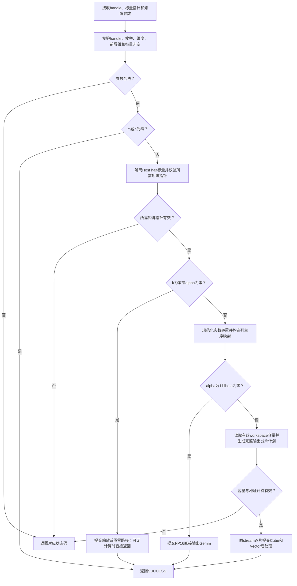
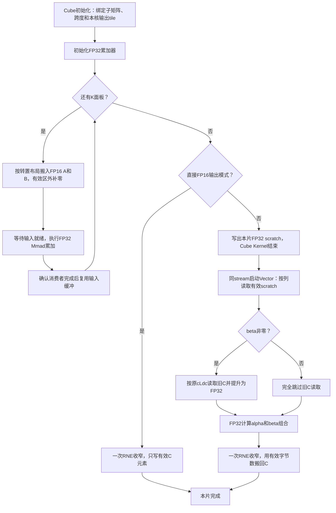

# aclblasHgemm 算子设计文档

## 需求背景（required）

### 需求来源

本需求来源于[10月社区任务 aclblasHgemm算子开发（950）](https://www.hiascend.com/activities/task-center/details/f0160348759e46018f2609cfb2b7f9df)。拟在 `cann/ops-blas` 中新增半精度通用矩阵乘接口，使用 Ascend C kernel 直调方式，适配 Ascend 950PR 和 CANN 9.1.0。

设计依据为任务书 `aclblasHgemm_Atlas950PR_task_doc.md`、附件 `test_cases/README.md`、`hgemm_test.csv`、`gpu_baseline.csv`、用例生成器及精度和性能验证脚本。接口与数学语义以任务书为准；性能采用任务书§3.3、测试说明和脚本一致的要求：每个case的GPU/NPU耗时倍率不低于0.4，全部性能case倍率的算术平均不低于0.5，两项同时满足。

### 背景介绍

#### 现有实现及复用边界

源码分析基线为 `ops-blas` 提交 `05b96ea22cea926ecfd43fc7ac691a795522bd61`。`blas/gemm/arch35/` 提供950的Gemm数据流、分核、转置及后处理组织，但输入、C0和部分缓冲区仍固定为FP32。`blas/gemm_ex/arch35/` 提供FP16输入、FP32累加、FP16输出的参考路径。

拟以Gemm模板为实现主体，泛化输入、累加及输出类型，并参考GemmEx的半精度处理。不会通过包装公开GemmEx接口代替本任务要求的Gemm族实现，也不会增加950专有的平行API。

| 现有模块 | 拟复用内容 | 拟新增或调整内容 |
| --- | --- | --- |
| `include/cann_ops_blas.h`及公共类型头 | 公共接口与状态码组织 | 共用`aclblasHgemm`声明及半精度存储类型 |
| `blas/gemm/arch35/` | Host调度、tensor_api计算、布局与同步流水 | FP16模板特化、退化分支、受容量约束的后处理 |
| `blas/common/helper/` | half位转换、handle、stream及workspace管理 | 复用现有契约，不增加新的资源所有权模式 |
| `test/frame/`、`test/gemm/` | GTest、CSV驱动及公共验证框架 | Hgemm参数适配、FP16 golden及任务指定的严格比较 |

#### 任务包与验证范围

附件包含1000条精度case、200条性能case及200条非空GPU基线。性能参数有重复组合，验收仍将按200条case逐行统计。拟保持官方CSV、种子和基线原件，另行标识分布、特殊值及大尺寸补充用例。C++测试程序、golden、构建接入和可复现测试步骤将作为本任务的交付内容。

## 需求分析（required）

### 需求描述

拟实现列主序FP16矩阵的原地更新：

\[
C_{ij}\leftarrow\alpha\sum_{p=0}^{k-1}\operatorname{op}(A)_{ip}\operatorname{op}(B)_{pj}+\beta C_{ij}.
\]

`op`支持N、T、C；实数FP16下C与T等价。A、B、C位于Device，alpha、beta为Host上的FP16标量指针。m、n、k为运行时参数，接口维数类型为`int`。设计不引入广播、任意stride或Device标量pointer mode，不将测试规模上限16384硬编码为接口拒绝条件。

### 接口与参数分析

接口声明拟加入公共头文件，参数名称、顺序及类型保持任务书定义：

```cpp
aclblasStatus_t aclblasHgemm(
    aclblasHandle_t handle,
    aclblasOperation_t transa, aclblasOperation_t transb,
    int m, int n, int k,
    const aclblasHalf* alpha,
    const aclblasHalf* A, int lda,
    const aclblasHalf* B, int ldb,
    const aclblasHalf* beta,
    aclblasHalf* C, int ldc);
```

当前公共头尚无`aclblasHalf`。拟显式引入ACL公开类型定义，在公共类型头中声明 `typedef aclFloat16 aclblasHalf;`。CANN的`aclFloat16`是承载IEEE binary16位型的16位存储类型；拟验证大小和自然对齐均为2字节、与Device `half`的位型一致。Host将通过现有`blas_common::HalfToFloat`解码标量，不将16位编码按整数转换为float。公共头将检查独立包含、C/C++编译及现有接口ABI。

| 参数 | 内存位置与类型 | 契约 |
| --- | --- | --- |
| handle | Host句柄 | 有效上下文，提供stream及workspace；空句柄返回`ACLBLAS_STATUS_HANDLE_IS_NULLPTR` |
| transa/transb | Host枚举 | N/T/C；非法值返回`ACLBLAS_STATUS_INVALID_ENUM` |
| m/n/k | Host int | 非负；负值返回`ACLBLAS_STATUS_INVALID_VALUE` |
| alpha/beta | Host `const aclblasHalf*` | 均不可为空，包括m或n为零时；允许FP16全集 |
| A | Device FP16，只读 | N时物理形状m×k，T/C时k×m；m/n/k均正且alpha非零时必须非空 |
| B | Device FP16，只读 | N时物理形状k×n，T/C时n×k；非空条件同A |
| C | Device FP16，原地输入输出 | m×n；m>0且n>0且(k>0或beta≠0)时必须非空；beta为零时不读取旧C |
| lda | Host int，单位为FP16元素 | N时至少max(1,m)，T/C时至少max(1,k) |
| ldb | Host int，单位为FP16元素 | N时至少max(1,k)，T/C时至少max(1,n) |
| ldc | Host int，单位为FP16元素 | 至少max(1,m)，允许padding |

调用方应保证Device指针有效、分配容量满足物理布局，并维持矩阵和用户workspace直到stream相关工作结束。C仅原地覆写自身；不增加A/B与C重叠的支持承诺。

### 需求拆解

| 工作项 | 实现边界 | 拟验证的完成判据 |
| --- | --- | --- |
| 公共接口与半精度类型 | 公共头、导出符号、Host标量解码 | 参数序列一致，binary16位型正确，原有ABI保持 |
| 参数与quick return | handle、枚举、维度、ld、指针及溢出校验 | 错误码符合任务；零维和退化路径不访问不需要的矩阵 |
| FP16 GEMM | `blas/gemm/arch35/`的模板派发与计算 | 九种转置组合、矩形、padding、尾块及FP32累加正确 |
| 缩放与后处理 | alpha/beta分支、一次FP16收窄 | beta为零不读旧C，alpha为零不读A/B |
| 资源与异步执行 | handle绑定stream，容量内scratch复用 | 无活跃workspace提前释放，无跨片数据竞争 |
| 测试与精度 | `test/gemm/hgemm/arch35/`及公共测试适配 | 全部1000精度case执行，符合固定混合容差和特殊值规则 |
| 性能 | 全部200性能case及官方GPU基线 | 逐例倍率≥0.4且200例倍率算术平均≥0.5 |
| 交付与兼容性 | 设计、自测、README、源码及评审 | 测试可复现，950PR支持表明确，原Gemm及handle路径回归 |

## 详细设计（required）

### 算子分析

#### 数学公式与地址映射

以元素为单位，列主序寻址拟统一定义为：

```text
Aop(i,p) = A[i + p*lda]        transa=N
           A[p + i*lda]        transa=T/C
Bop(p,j) = B[p + j*ldb]        transb=N
           B[j + p*ldb]        transb=T/C
C(i,j)   = C[i + j*ldc]
```

一般路径拟将FP16输入和标量提升至FP32，在FP32中累加并计算alpha/beta，最终一次RNE收窄为FP16。归约次序不要求bit-exact，但必须满足任务精度标准。padding不参与数学运算，A/B只读、C的padding保持不变。

#### 支持数据类型与分支

| 场景 | 输入/累加/输出 | 拟采用路径 |
| --- | --- | --- |
| m=0或n=0 | 无矩阵访问 | 合法参数校验后返回SUCCESS，不启动计算 |
| k=0或alpha=±0 | C为FP16，缩放为FP32 | 仅处理有效C；不引用A/B |
| alpha=1且beta=±0 | FP16 / FP32 / FP16 | Cube直接收窄输出，避免FP32 scratch及后处理 |
| 一般alpha/beta | FP16 / FP32 / FP32 scratch→FP16 | Cube完整K累加，再由Vector进行FP32缩放和RNE收窄 |

beta为±0时将采用无旧C读取分支，不通过`beta*C`实现跳过，以避免旧C为NaN时产生污染。缩放路径中beta=1可在校验后直接返回；beta=±0时直接写零。

#### 支持形状

拟覆盖任务要求的零维、1、小质数、2的幂及其相邻值、非对齐矩形和大规模矩阵。正式附件最大维度8192；补充用例拟覆盖到16384维度的代表性方阵或矩形组合，规模选择同时考虑实际HBM和Host golden容量。补充用例与官方1200例分开记录，不替代官方完整执行。

### 算子实现

#### 实现方案

##### 整体架构与Host流程

拟保留handle式BLAS接口及kernel直调模式。Host负责参数、路径、输出分片和资源预算；Cube负责FP32矩阵乘累加，Vector负责必要的alpha/beta后处理和退化缩放。Hgemm不在CPU执行矩阵运算，也不引入ACLNN平行入口。

下图说明Host从校验到异步提交的顺序。所有矩阵访问均发生在quick return和必要指针校验之后；workspace仅在一般后处理路径使用。



##### Host侧设计

**参数校验与退化行为**

校验拟按handle、枚举、维度、leading dimensions、alpha/beta非空、m/n quick return、标量读取及矩阵必要性判断的顺序组织。字节数、偏移、对齐和workspace乘加使用64位检查，溢出返回INVALID_VALUE；资源不足沿用库定义的分配失败状态，启动错误沿用现有错误传播链路。

| 条件 | 拟采用行为 |
| --- | --- |
| m/n=0且alpha或beta为空 | INVALID_VALUE，标量判空不被quick return跳过 |
| m/n=0且A/B/C为空 | 其他参数合法则SUCCESS，不访问矩阵 |
| m/n=0且枚举非法 | INVALID_ENUM，匹配附件零维非法枚举case |
| k=0 | 不读A/B；有效C执行beta缩放，beta=0时直接置零 |
| alpha=0且k>0 | A/B可为空；仍要求C非空，再执行beta缩放 |
| m/n>0且k>0、C为空 | INVALID_VALUE，包括alpha=beta=0 |
| m/n>0、k=0、beta=0且C为空 | 按任务参数表及附件`k0_beta0_C_null`的SUCCESS期望直接返回，不访问A/B/C |

最后一项是对任务书“有效输出置零”与空C参数特例的显式解释：C有效时置零，C为空的附件特例不执行写入。该解释应在设计评审中确认，不通过修改官方case期望或访问空地址实现。

**类型、列主序与模板派发**

Gemm模板拟区分`InputT`、`AccT`和`OutputT`。Hgemm分别使用half、float、half或float scratch；输入C0按FP16设为16，原FP32特化保持C0=8。L1/L0A/L0B容量以输入类型计算，L0C和后处理scratch以float计算，所有固定`sizeof(float)`用途按实际缓冲职责拆分。

列主序问题拟映射为原Gemm内部的交换问题：M/N交换，A/B及其转置、lda/ldb成对交换。N/T/C的输入契约始终以原接口定义校验；T/C仅在实数内核派发中归并。

**Tiling与分核**

拟按输出二维tile分配Cube核，每个输出tile由唯一核负责并在本核完成完整K循环。实际核数、L1/L0/UB容量从目标平台或现有框架配置取得，不按case编号或固定机器核数特判。调优候选可在Gemm支持的基本块与双缓冲组合中选择，但不得改变合法维度、转置或尾块语义。

小矩阵将优先减少启动与分片数；大矩阵将平衡输出tile并行度、K面板复用和GM流量。首版不引入跨核split-K，避免额外全局归约、workspace和多次FP16舍入。

**workspace与输出分片**

现有handle默认workspace为32MiB。一般alpha/beta路径不能默认分配整个m×n的FP32结果：8192²将需要256MiB。拟使用当前有效workspace容量内的输出分片，不在Hgemm调用中扩容、malloc/free或同步stream。

设当前片的逻辑输出为 `I=[m0,m0+Mt)`、`J=[n0,n0+Nt)`，拟令：

\[
ld_s=\operatorname{AlignUp}(M_t,16),\qquad
W_{tile}=4\,ld_s\,\operatorname{AlignUp}(N_t,16)\le W_{usable}.
\]

`Wusable`将扣除实际首地址对齐损失及框架要求的保留空间。Host拟优先保留完整M方向条带，容量不足时继续缩小Mt，至少能够容纳一个合法基本块；若最小分片也无法容纳，则在下发任何计算前返回资源错误。每片完整遍历K，不在K分片间反复写回FP16。

子矩阵指针偏移以原列主序定义计算：

```text
Aoff = m0              transa=N
       m0*lda          transa=T/C
Boff = n0*ldb          transb=N
       n0              transb=T/C
Coff = m0 + n0*ldc
```

lda、ldb及原C的ldc保持原值。子指针偏移后Kernel使用局部坐标，不再重复叠加m0/n0。拟复用现有tiling的`ldc`表示scratch行跨度、`cLdc`表示原C跨度，防止紧凑中间结果步长污染带padding的C寻址。

| Tiling信息 | 拟表达内容 |
| --- | --- |
| 当前m/n/k | 当前片有效尺寸及完整K；Cube副本执行M/N交换 |
| lda/ldb、转置标志 | 原输入物理跨度及规范化模式 |
| ldc/cLdc | scratch跨度与原C跨度，分别使用 |
| alphaReal/betaReal/hasBeta | FP32标量及是否读取旧C的分支 |
| 基本块和核数 | 平台容量与输出tile数共同决定的调度参数 |
| 模板派发信息 | 输入、累加、输出类型和直接输出/后处理模式 |

**资源所有权与异步生命周期**

拟复用`GetEffectiveWorkspace()`及容量查询获得库或调用方持有的有效空间。每片在同一handle stream上依次提交“Cube写scratch→Vector读scratch并更新C→下一片Cube复用scratch”，由stream执行顺序建立跨Kernel依赖。

Host临时tiling对象按现有kernel直调的参数传递方式提交，不将API返回后失效的Host地址留给Device。Hgemm返回SUCCESS表示异步提交成功；Device输出是否完成由调用方按stream契约同步。用户workspace须保持到相关工作完成，库不释放用户持有内存。同handle的提交和配置变更遵循现有串行使用约定，并行stream使用独立handle及workspace。

##### Kernel侧设计

下图说明单片计算和后处理职责。K面板循环只在FP32累加器内归约；一般路径先完成该片Cube Kernel，再由同stream的Vector Kernel读取scratch。



**Cube计算及流水**

拟沿用Gemm的GM→L1→L0A/L0B数据流与Mmad同步关系。FP16输入和float累加分别核算缓冲字节数。K尾面板仅搬入有效元素，填充区置零；M/N尾tile按有效范围输出。双缓冲仅在容量允许且producer/consumer事件配对完整时启用，不能在计算或搬出尚未消费数据时复用缓冲。

直接输出路径拟使用目标版本支持的FP32→FP16转换，显式核对其RNE语义。一般路径将完整K结果写入FP32 scratch，Vector在FP32中完成alpha缩放和可选beta*C；最终只进行一次FP16收窄，不在中间归约阶段降精度。

**Vector、UB与尾部**

Vector拟按输出列中的有效行段分核，各核独占对应C元素。UB按FP32 scratch输入、可选FP16旧C、FP32计算临时、FP16输出和队列开销共同计算，不把不同dtype的元素数误作相同字节数。beta=0模式不分配或读取旧C输入队列。

非32字节对齐的FP16尾部拟使用适配目标SDK的`DataCopyPad`或等效有效字节搬运：FP16为`2*count`字节，FP32 scratch为`4*count`字节。只回写有效m行，不以`ldc*n`整段清零，不覆盖列间padding或相邻片。

退化缩放拟使用独立轻量Vector路径：k=0或alpha=0时不绑定、搬入A/B；beta=0直接写零，beta=1不下发计算，其他beta将有效C提升至FP32缩放后RNE回写。

##### 复杂度与数据量

一般GEMM的计算复杂度为O(mnk)，有效主数据的最少流量为 `2mk+2kn+2mn` 字节；beta非零时再增加`2mn`字节旧C读取，实际A/B流量取决于tile复用。一般后处理比直接输出额外产生约`8mn`字节FP32 scratch写入和读取，因此性能用例中的alpha=1、beta=0将优先使用直接输出路径。

额外scratch峰值受当前workspace容量约束，不随整个m×n输出无界增长。分片之间可能增加A/B重复读取和Kernel提交次数，拟通过在容量内增大片段并复用现有Gemm调度降低开销，所有必要Kernel均计入性能采样。

### 支持硬件

| 目标产品 | 构建与运行环境 | 拟支持范围 |
| --- | --- | --- |
| Ascend 950PR | CANN 9.1.0，`--soc=ascend950`，asc-devkit至少9.1 | 本任务FP16 Hgemm、九种转置组合及leading dimension |

### 算子约束限制

- A/B/C为FP16、ND、列主序；仅支持lda/ldb/ldc定义的leading dimension，不支持广播或额外stride描述。
- alpha/beta固定为Host标量指针，矩阵固定为Device指针；Host不扫描矩阵内容，不拒绝合法的NaN/Inf输入。
- C原地输出，A/B只读；调用方保证有效分配容量和stream生命周期。
- 不额外要求确定性或bit-exact，归约及转换必须符合任务数值标准。
- 不扩展其他产品线的Hgemm支持声明；公共API名称和ABI为产品线共用，原有算子行为需回归。

## 可维可测分析

### 精度标准/性能标准

| 验收项 | 拟采用标准 | 来源 |
| --- | --- | --- |
| golden | Netlib BLAS 3.10.0 `cblas_sgemm`按FP32计算，最后RNE收窄为FP16 | 任务书§3.1、§3.2、§3.5 |
| 有限值精度 | rtol=atol=2^-10，matched ratio≥0.99，同时满足动态最大绝对误差硬限 | 任务书§3.2及固定opbase标准 |
| NaN/Inf | 非有限点按任务专门规则逐点验证并全部通过 | 任务书§3.2.5 |
| 单例性能 | 每条性能case的GPU/NPU耗时倍率≥0.4 | 任务书§3.3、附件README和性能脚本 |
| 全量性能 | 全部200条倍率的算术平均≥0.5；与单例要求同时满足 | 同上 |
| 内存专项 | 任务无独立量化性能指标；仍验证边界、所有权和生命周期正确性 | 任务书§3.4及库资源契约 |

#### 精度判定公式

令G32为FP32 golden，G为其RNE收窄至FP16的结果，Y为被测FP16输出。比较器将G和Y提升后计算误差，避免误差计算自身发生FP16溢出。对二者均有限的元素集合F：

\[
e_i=|Y_i-G_i|,\qquad
R=\frac{|\{i\in F:e_i\le 2^{-10}+2^{-10}|G_i|\}|}{|F|}.
\]

当F非空时，令j为最大有限绝对误差点，同时要求：

\[
R\ge0.99,\qquad E_{max}=e_j\le\max(0.1,32\operatorname{ULP}_{FP16}(G_j)).
\]

ULP以最大误差点的golden收窄值为锚点，依[任务引用的固定标准](https://gitcode.com/cann/opbase/blob/28a1ce52ae856353589841226a0002af73314a6b/docs/zh/ops_precision_standard/mixed_tolerance_standard.md)实现；不替换为逐元素ULP上限、MERE/MARE或固定相对误差阈值。zero/subnormal的FP16 ULP为2^-24，正常有限值按其指数确定；最大有限值不能通过向上nextafter得到无穷大的ULP。

非有限点将单独统计：NaN/NaN、同号Inf/Inf以及NaN/任意符号Inf按任务规则通过；异号Inf或有限值与非有限值的组合不通过。判定以收窄后的G为准；若G32有限而收窄后溢出为Inf，将按该Inf分类。F为空时不计算0/0，有限值条件记为不适用，仅在非有限点全部符合规则时通过。

长K误差或FP16溢出将保留同输入CPU参考、逐点误差、随K增长曲线和累加档位说明，不自动放宽阈值。

#### 正式用例与性能目标

拟完整运行官方1000条精度case和200条性能case。对性能case i，先将GPU基线从ms换算为us，定义：

\[
r_i=\frac{1000T_{GPU,i}^{ms}}{T_{NPU,i}^{us}},\qquad
\forall i,\ r_i\ge0.4,\qquad
\frac{1}{200}\sum_{i=1}^{200}r_i\ge0.5.
\]

以下仅列代表性目标，完整判定覆盖全部200条，重复参数不去重：

| m/n/k与转置 | GPU基线 us | 单例NPU上限 us |
| --- | ---: | ---: |
| 512/512/512，NN | 9.054 | 22.635 |
| 1024/1024/1024，NN | 15.077 | 37.6925 |
| 2048/2048/2048，TN | 28.199 | 70.4975 |
| 4096/4096/4096，NT | 182.406 | 456.015 |
| 8192/8192/8192，NN | 1446.190 | 3615.475 |

#### 精度测试设计

1. CSV驱动拟准确接入alpha/beta、NULLPTR、null、handle_null、非法枚举与空leading dimension推导。负维度和空指针用例先确定预期API行为，再决定是否分配数据，不让测试准备阶段掩盖算子参数校验。
2. golden拟将输入FP16及标量按位解码为FP32，按列主序和真实leading dimensions执行Netlib计算后RNE收窄。quick return、k=0、alpha=0和beta=0独立建模，避免参考端读取本应忽略的矩阵或旧C。
3. 拟覆盖九种转置组合、小尺寸、矩形、瘦长、质数、幂及相邻值、非对齐、单独和联合padding；用哨兵验证A/B只读、C逻辑区外不变。
4. 拟按任务要求为alpha/beta和A/B/C补充均匀[-5,5]与正态各50%的生成覆盖，正态参数μ∈[-5,5]、σ∈[0.1,2]，保存seed、分布及参数；覆盖0、±1、65504附近、subnormal、Inf/NaN和beta=-1。官方生成与填充规则将原样保留，新增生成能力和补充case单独标识。
5. 转换和比较器拟单独覆盖tie-to-even、符号零、次正规、溢出、99%匹配率边界、最大误差点ULP、全非有限输出及NaN/Inf组合。现有公共比较器的2^-9默认值不直接沿用，CSV中的MERE/MARE字段不替代本任务判据。
6. runner及汇总拟核对case名和完整执行数，保留子进程返回码、原始日志、误差指标及失败位置。超时、少跑、零case或进程异常均不能记为精度通过。

#### 性能测试设计

拟在950PR和CANN9.1.0上按任务书§3.3采用msprof op，5次warmup不计入样本，之后连续采集10次有效执行并取算术平均。测试工程与工具的热身职责将统一，避免重复叠加或混入准备工作。

每条case拟绑定源码、构建配置、加载库、CSV与输入、SoC和工具链版本。必要的Cube、缩放、分片及Vector后处理均归属于同一次公开API调用；顺序多Kernel将完整归并，不仅记录最快的Matmul。MIX或多核记录将按工具的task粒度识别，避免对子核/重复行重复计时。输入准备、Host golden和结果比对不使用GTest总耗时替代设备计算耗时。

拟逐次保存原始us样本、kernel归属、有效采样数、case均值及倍率。若需要恢复旧C，将在规定计时边界外使用相同初始输入。执行失败、缺基线、无有效样本、异常零耗时或未完成全部200条时不能给出全量性能PASS；异常样本将保留原因并在报告中说明。

附件关于>10、>50次及GTest耗时的说明将作为测试接入差异记录，正式方案采用任务书§3.3的设备耗时和10次有效均值；不更改0.4/0.5门槛，不把脚本退出码等同于精度或性能达标。

### 分层验证计划

| 层次 | 拟验证内容 | 预期证据 |
| --- | --- | --- |
| 公共头与ABI | half大小/对齐/编码，C/C++编译，函数签名与符号 | 编译命令、符号结果、类型及转换UT |
| Host | 枚举、维度、ld、指针、quick return、地址和容量溢出 | 参数UT及预期状态码逐项结果 |
| 950目标构建 | FP16输入、FP32累加、直接输出及后处理各模板实例 | 工具链版本、目标配置、构建日志 |
| 950PR功能与精度 | 官方1000例、分布及数值边界补充、padding哨兵 | 逐case指标、原始日志、必要截图 |
| 资源与生命周期 | 默认及用户workspace、最小容量、多片、连续调用、不同stream独立handle | 资源UT、同步完成后的完整结果及越界检查 |
| 950PR性能 | 官方200例，单例0.4及全量平均0.5双条件 | msprof原始结果、完整API样本、倍率表和截图 |
| 兼容性回归 | 原Sgemm/Cgemm、受影响GemmEx调用者、handle创建/配置/销毁 | 原dtype正确性和同口径性能对比 |

上述计划将分别记录目标构建、CPU/ICPU或Simulator检查、真实NPU执行及正式验收状态，不以任一层结果替代另一层。

### 兼容性分析

拟新增共用Hgemm API与半精度类型，不改变现有公开函数参数或状态码。Gemm模板泛化将保留原FP32和复数路径的特化、调度与转换语义；共享头及helper变更将核查所有调用者，按受影响范围进行原平台构建和回归。

实现README将明确标注950PR支持，测试README将提供CSV接入、Netlib依赖、构建、运行及采样步骤。设计评审、算子实现、代码PR、自测报告与任务中心验收分别推进；本设计不包含实现完成、真机通过或性能达标结论。
