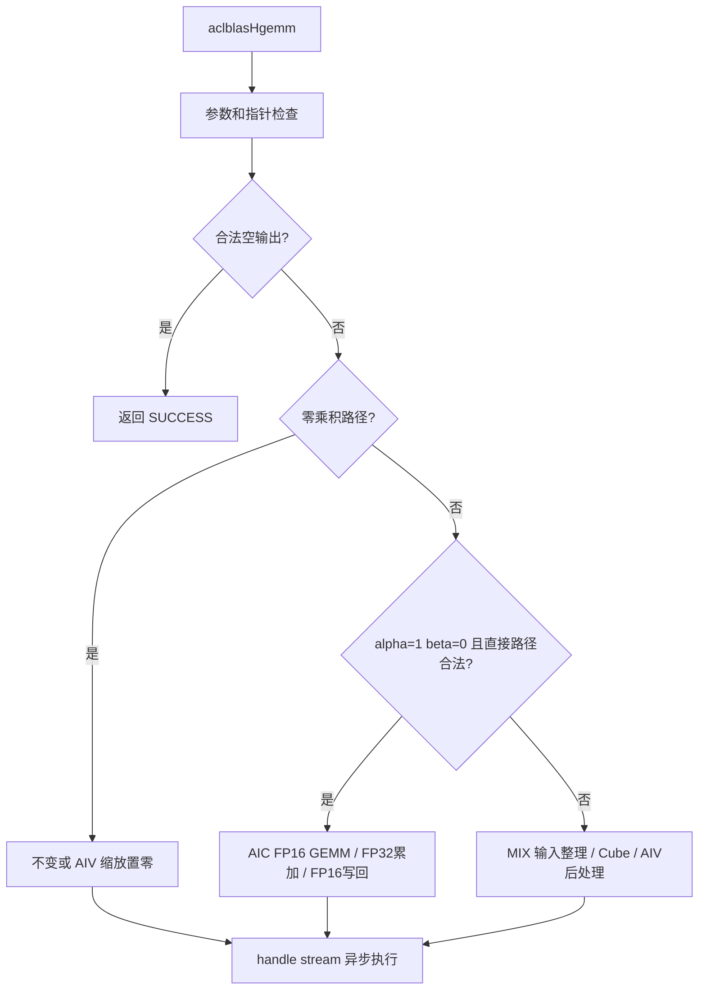

# aclblasHgemm 算子（Ascend 950PR）详细设计文档

| 项目 | 内容 |
| --- | --- |
| 完整任务名称 | 10月社区任务-aclblasHgemm算子开发(950) |
| 任务 ID | `f0160348759e46018f2609cfb2b7f9df` |
| 开发者 / GitCode 账号 | `monoid1014` |
| 个人代码仓 | https://gitcode.com/monoid1014/ops-blas |
| 代码合入目标 | https://gitcode.com/cann/ops-blas |
| 设计文档合入目标 | https://gitcode.com/cann/cann-ops-competitions |
| 目标硬件 / 架构 | Ascend 950PR / DAV_3510 / arch35 |
| 工程模式 | C++、Ascend C；ops-blas 句柄式 Kernel 直调 |
| 计划开发环境 | CANN 9.1.0、openEuler，配套驱动及固件 |
| 输入 / 累加 / 输出 | FLOAT16 / FLOAT32 / FLOAT16 |
| 文档版本 | v1.0，2026-10-28，设计送审稿 |
| 验证状态 | 尚未进行本任务的 SDK 编译、NPU 精度或性能验证 |

本文参考既往社区任务设计文档，按“需求背景—需求分析—详细设计—可维可测分析”组织。需求来自本批 Hgemm 任务书，仓库现状来自个人 fork 的实际源码。基块是实施起点，不是已测最优值；源码核对和 CPU 方程检查不等同于上板通过。

任务详情：https://www.hiascend.com/activities/task-center/details/f0160348759e46018f2609cfb2b7f9df

## 一、需求背景（required）

### 1.1 需求来源与价值

本任务来自 CANN 社区 2026 年 10 月批次，要求在 Ascend 950PR 补齐半精度 BLAS Level 3 矩阵乘接口 `aclblasHgemm`，完成设计、实现、测试和社区交付。

$$
C\leftarrow\alpha\operatorname{op}(A)\operatorname{op}(B)+\beta C.
$$

A、B、C 及 alpha、beta 均按 IEEE 754 binary16 表示。接口采用 BLAS 列主序和 leading dimension 约定，面向半精度线性代数及矩阵计算，保持 FP16 存储并利用 Cube 运算，减少调用方显式转换与数据带宽。

### 1.2 代码和依赖基线

本次已核对的个人 fork 版本：

```text
monoid1014/ops-blas
05b96ea22cea926ecfd43fc7ac691a795522bd61
```

| 核对对象 | 实际状态 | 本任务处理 |
| --- | --- | --- |
| `include/cann_ops_blas.h` | 有 Sgemm/Cgemm，未找到 Hgemm | 新增任务书规定的公共声明 |
| `include/cann_ops_blas_common.h` | 未找到 aclblasHalf | 增加公共半精度存储类型，验证 C/C++ 兼容性 |
| `blas/gemm/arch35/gemm_host.cpp` | 有 FP32 参数校验、操作数交换和调度 | 参考工程与语义，不用 FP32 API 冒充 Hgemm |
| `blas/gemm/arch35/gemm_kernel.cpp` | tensor_api FP32 Cube 与后处理 | 参考流水；FP16 布局和粒度重新核对 |
| `blas/gemm/arch35/cgemm_compute_kernel.cpp`、`cgemm_onchip_kernel.h` | 已有 MIX 1:2、L0C→UB、片上 panel 整理与握手组织 | 参考同仓真实同步链路，适配 FP16 |
| `test/gemm/`、`test/frame/` | CSV、GTest、CBLAS 和 dtype 工具 | 新建 Hgemm 专项，复用公共设施 |
| `blas/common/helper/dtype_cast.h` | binary16/FP32 转换 | 复用并验证解码、舍入及特殊值 |
| `cmake/asc_devkit_version.cmake` | tensor_api 算子的能力门控列表 | 独立注册 Hgemm，避免静默跳过 |

依赖由 `cmake/third_party/ops-tensor.cmake` 固定，本次核对到：

```text
ops-tensor: c1326e7a7fb30536dc3517ac40e06935aba5e88d
include/tensor_api: ad3d3bf04dddfb94370c534c39bdd305d8e38d88
```

实施时保留配套基线，不自动切换依赖。更新源码前重新检查公共类型/API 是否已被其他贡献引入，并重做受影响验证。

### 1.3 范围与排除项

本任务只新增 950PR/arch35 的单矩阵 Hgemm：FLOAT16，列主序，N/T/C 转置，leading dimension padding，Host 标量，handle stream 异步调用。不扩展 Batched/StridedBatched/Ex、BF16/FP32 API，不创建 ACLNN/GE 注册工程，也不承诺其他架构支持。

## 二、需求分析（required）

### 2.1 公共类型和接口

在公共头统一新增一次半精度存储表示：

```cpp
typedef uint16_t aclblasHalf;
```

该类型保存 binary16 编码，不是整数数值。例如 1.0 对应 `0x3c00`。要求 `sizeof(aclblasHalf)==2`；公共头补齐固定宽度整数依赖，能够被 C 和 C++ 独立包含。公共 API 不暴露 Device `half` 或编译器私有浮点类型。

接口放入 `include/cann_ops_blas.h`：

```cpp
aclblasStatus_t aclblasHgemm(
    aclblasHandle_t handle,
    aclblasOperation_t transa, aclblasOperation_t transb,
    int m, int n, int k,
    const aclblasHalf* alpha,
    const aclblasHalf* A, int lda,
    const aclblasHalf* B, int ldb,
    const aclblasHalf* beta,
    aclblasHalf* C, int ldc);
```

Host 用 `blas_common::HalfToFloat` 解码 alpha/beta，禁止普通整数到 float 强转；Device 将相同存储按 half 访问。测试用独立已知编码和 RNE 边界验证转换工具。已有 API、枚举数值和结构体布局不变。

### 2.2 参数合同

| 参数 | 位置 / 角色 | 要求 |
| --- | --- | --- |
| handle | Host 上下文 | 有效句柄，提供 stream |
| transa/transb | Host 属性 | N、T、C；实数 C 与 T 等价 |
| m/n/k | Host int | 均≥0，运行时确定 |
| alpha/beta | Host，只读 FP16 指针 | 非空，按编码解码后精确提升 FP32 |
| A/B | Device，只读 | 列主序；是否引用由退化分支决定 |
| C | Device，输入输出 | 逻辑 m×n 原地更新；beta=0 不读旧值 |
| lda | Host int | transa=N 时≥max(1,m)，否则≥max(1,k) |
| ldb | Host int | transb=N 时≥max(1,k)，否则≥max(1,n) |
| ldc | Host int | ≥max(1,m) |

API 不携带真实 dtype、分配长度、任意 stride 元数据，调用方保证这些前置条件。A/B 的有效区域不得与输出 C 重叠。矩阵和句柄须存活至相关 stream 计算完成；alpha/beta 在返回前已按值复制进调度参数。

### 2.3 校验顺序、错误码及 quick return

所有失败在启动 Kernel 之前返回，不写 C：

1. handle 判空：`ACLBLAS_STATUS_HANDLE_IS_NULLPTR`。
2. transa/transb 不属于 N/T/C：`ACLBLAS_STATUS_INVALID_ENUM`。
3. m/n/k 为负或 leading dimension 非法：`ACLBLAS_STATUS_INVALID_VALUE`。
4. alpha/beta 为空：`ACLBLAS_STATUS_INVALID_VALUE`。
5. m=0 或 n=0：返回 SUCCESS，不访问 A/B/C，也不必解码标量值。
6. 解码标量，在非空输出场景按下表检查矩阵指针。
7. 核对地址跨度及调度运算可表示性，计算 tiling，异步下发。

| 条件（结构参数校验之后） | A/B | C 和行为 |
| --- | --- | --- |
| m=0 或 n=0 | 可以为空，不读 | 可以为空，不写 |
| k>0 且 alpha≠0 | 均须非空 | 须非空，执行一般 GEMM |
| k>0 且 alpha=0 | 可以为空，不读 | 仍须非空，beta 缩放或不变 |
| k=0 且 beta≠0 | 可以为空，不读 | 须非空；beta=1 不变，否则缩放 |
| k=0、beta=0、C 非空 | 不读 | 只把逻辑区域置零，不改 padding |
| k=0、beta=0、C 为空 | 不读 | 按随包 k0_beta0_C_null 用例返回 SUCCESS，无访存 |
| 正常 GEMM 且 beta=0 | 正常读取 | 不读 C 旧值，直接覆写逻辑区域 |

C 在 k>0 时非空，与 beta 是否为零无关。“不需要有效旧值”不等于“可以没有输出地址”。正负零均进入零分支，NaN 不识别为零；k=0 优先决定不引用 A/B。合法零乘积且 beta=1 时不启动内核，保留 C 的全部比特。

### 2.4 非功能需求

| 项目 | 要求 |
| --- | --- |
| 精度 | 全矩阵满足 FLOAT16 混合容差，边界和特殊值符合任务书 |
| 性能 | 固定 200 条逐例倍率≥0.4，全部倍率算术平均≥0.5 |
| 异步 | handle stream 下发，不做 Host 数据回拷或无必要同步 |
| 内存 | 任务书不设独立内存门槛；本方案新增 GM workspace=0 |
| 确定性 | 不要求 bit-exact；初版仍固定核内 K 顺序和唯一写者 |
| 维护 | 保持共享 FP32 tiling ABI，复用目标仓构建和工具 |

## 三、详细设计（required）

### 3.1 数学定义与公开存储寻址

0-based 索引；下标均为 FP16 元素数：

$$
A_{op}(i,p)=\begin{cases}A[i+p\,lda],&transa=N,\\A[p+i\,lda],&transa\in\{T,C\}.\end{cases}
$$

$$
B_{op}(p,j)=\begin{cases}B[p+j\,ldb],&transb=N,\\B[j+p\,ldb],&transb\in\{T,C\}.\end{cases}
$$

$$
C[i+j\,ldc]\leftarrow\mathrm{RNE}_{16}\left(\alpha_{32}\sum_{p=0}^{k-1}A_{32}(i,p)B_{32}(p,j)+\beta_{32}C^{old}_{32}(i,j)\right).
$$

beta=0 时执行上完全跳过旧 C 项。FP16 输入与标量精确提升 FP32；乘积在 FP32 累加，alpha/beta 后处理后只做一次 FP16 收窄。实际累加顺序可与 CPU BLAS 不同，按混合容差验收。

保守物理存储字节跨度：

```text
A: 2 * lda * (transa == N ? k : m)
B: 2 * ldb * (transb == N ? n : k)
C: 2 * ldc * n
```

跨度用于测试分配、保护区与溢出检查；内核只读有效逻辑元素。所有乘法、字节偏移和 tile 总数使用经检查的 64 位计算，不能先在 int32 中相乘再强转。

### 3.2 列主序到内部行主序的等价映射

利用

$$C^T=\alpha\operatorname{op}(B)^T\operatorname{op}(A)^T+\beta C^T$$

交换操作数，避免整矩阵转置临时区：

| 内部参数 | 来源 |
| --- | --- |
| M/N/K | 原 n / 原 m / 原 k |
| 左操作数 X、lda、transA | 原 B、原 ldb、原 transb |
| 右操作数 Y、ldb、transB | 原 A、原 lda、原 transa |
| 输出 D、ldc | 原 C，按行主序 n×m 解释；行 stride 仍为原 ldc |

公开 column-major 缓冲重新解释成 row-major 后，转置标志交换而不取反。内部 r=j、c=i，其地址 `r*ldc+c=j*ldc+i` 与公开输出一致。

设计阶段对 5 组形状、9 组转置的 12,033 个输出索引完成独立 CPU 等价检查，仅证明寻址方程，不证明 NPU 搬运或计算。实施继续用非方阵、独立 padding 覆盖全部组合。

### 3.3 总体架构和路径分发



| 路径 | 条件 | 执行形态 | 结果与 workspace |
| --- | --- | --- | --- |
| P0 | 空输出；或合法零乘积且 beta=1；或 k=0/beta=0/C为空 | Host quick return | 无 Kernel，无 C 写入 |
| P1 | k=0 或 alpha=0，且确需置零/缩放 | AIV-only | 一个 Kernel，原地更新，新增 GM workspace=0 |
| P2 | 非退化，alpha=1、beta=0，满足直接搬运约束 | AIC-only | 一个 Kernel，FP32 L0C 收窄到 FP16 C |
| P3 | 其余非退化合法输入，含 tail、非对齐、一般标量 | MIX AIC:AIV=1:2 | 一个混合 Kernel，片上 FP32 epilogue，新增 GM workspace=0 |

P2 初始保守判据：m/n/k、lda/ldb/ldc 按 16 个 FP16 元素对齐，A/B/C 基址按 32B 对齐，且满足 Copy/Fixpipe 的 stride 表示约束。不满足者进入 P3，不收紧公开 API。只有独立能力验证通过后才扩大 P2 支持域。

P3 不在 Host 执行矩阵计算，不把整矩阵转为 FP32，不将乘积先写成 FP16，也不以第二个全矩阵后处理 Kernel 代替本方案的一般路径。

### 3.4 模块与工程组织

```text
include/
  cann_ops_blas_common.h             # 公共 aclblasHalf
  cann_ops_blas.h                    # 公共 Hgemm 声明
blas/gemm/
  README.md                         # 接口、示例、产品支持
  arch35/
    hgemm_host.cpp                  # 检查、分发、tiling、launch
    hgemm_kernel.cpp                # AIC/AIV/MIX 入口及启动器
    hgemm_kernel.h                  # 启动接口
    hgemm_tiling_data.h             # 独立 POD、块参数、路径枚举
    hgemm_cube.h                    # FP16 搬运与 FP32 累加
    hgemm_epilogue.h                # 输入整理、缩放及写回
test/gemm/hgemm/
  CMakeLists.txt                    # 注册 hgemm_test
  hgemm_param.h                     # CSV 与参数合同
  hgemm_golden.h                    # Netlib FP32 参考与 FP16 转换
  arch35/
    hgemm_npu_wrapper.h             # Device 内存、真实 API 调用
    hgemm_test.cpp                  # GTest 与专项计时
    hgemm_test.csv                  # 原始 1200 条用例
cmake/asc_devkit_version.cmake      # 工具链能力门控
```

以上按职责划分，短头文件可合并。算子源码由 `blas/CMakeLists.txt` 自动收集，不新增重复构建工程；测试注册 `ops_blas_add_gtest_tests(${OPS_BLAS} hgemm_test)`。能力门控增加 Hgemm 独立条目，过滤 `blas/gemm/arch35/hgemm_`，测试名为 hgemm。

内部符号使用 Hgemm 前缀或命名空间，保留共享 GemmTilingData 原布局和已有 Sgemm/Cgemm 行为。

### 3.5 Host 侧设计

Host 按 §2.3 检查；解码 Host binary16 标量；将 C 归一为 T 并交换内部操作数；查询目标 AIC/AIV 核数与资源；计算 tiling；在 handle stream 下发对应入口。

查询失败不使用猜测核数。接口不调用 stream/device synchronize，不回拷 Device 数据。返回可观察到的启动错误；异步执行错误由调用者在同步时检查。测试同时检查 API 返回码与同步返回码，不能将下发 SUCCESS 当成设备完成。

### 3.6 TilingData 与 ABI

Hgemm 独立 POD 的字段合同如下：

```cpp
struct HgemmTilingData {
    uint64_t m, n, k;         // 内部 M=公开 n，N=公开 m
    uint64_t lda, ldb, ldc;   // 内部 X/Y/D 的元素 stride
    uint64_t tileCount;
    uint32_t baseM, baseN, baseK, kL1;
    uint32_t usedAicCores, usedAivCores;
    uint32_t transA, transB;  // 归一化后的内部标志
    uint32_t route, loadOldC;
    float alpha, beta;       // FP16 原值精确提升
};
```

| ABI 对象 | 单位与消费者 |
| --- | --- |
| X/Y/D GM 参数 | 字节地址；实际元素 half，由 Cube 或 AIV 访问 |
| m/n/k、leading dimensions | 元素数；调度、地址映射和搬运消费 |
| baseM/baseN/baseK/kL1 | 元素数；片上形状与 K 循环 |
| tileCount | 逻辑输出 tile 数，AIC 与对应 AIV 共同消费 |
| usedAicCores | 逻辑 AIC block 数；Wrapper grid 和 MIX owner |
| alpha/beta | FP32 数值；AIV epilogue |
| loadOldC | 仅 beta≠0 为真；控制是否存在旧 C 搬入 |

使用固定宽度字段和同一个共享定义，检查 standard-layout/trivially-copyable。按值传参，不额外分配 GM tiling。AIC-only 与 MIX 有明确且分开的 Kernel task type，不临时改变同一入口的 ratio。

### 3.7 多核切分与唯一写者

内部 M×N 分块，K 由同一 Cube 顺序完成：

$$T_M=\lceil M/B_M\rceil,\quad T_N=\lceil N/B_N\rceil,\quad T=T_MT_N,\quad P=\min(\mathrm{AICCoreNum},T).$$

核 p 处理 `q=p,p+P,p+2P,...<T`：

```text
row0 = floor(q / TN) * BM
col0 = (q % TN) * BN
curM = min(BM, M - row0)
curN = min(BN, N - col0)
```

初版不 Split-K、不原子累加，无跨核结果合并。P2 一个 AIC 写一个 tile；P3 一个 AIC 配两个 AIV，按对齐后的内部行范围分成不重叠的两个区间，所有公开输出元素仍只有一个 writer。

MIX 物理 AIV block 到逻辑 AIC owner 的关系参考同仓 1:2 witness，并通过最小 probe 核对。usedAicCores 显式由 Host 传入，不把未核实的 AIV GetBlockNum 或物理索引当成逻辑核数。

### 3.8 基块与资源预算

| 配置 | BM×BN×BK | K_L1 | 初始用途 |
| --- | --- | ---: | --- |
| F128 | 128×128×64 | 128 | P2 对齐中大矩阵 |
| F64 | 64×64×64 | 64 | P2 大块数量不足时增加并行度 |
| G64 | 64×64×64 | 64 | P3 一般标量、padding 和 tail |

硬件 base 保持合法粒度，逻辑 tail 单独表达，不能把 base 直接缩成 7/17 等非法形状。FP16 fractal 粒度由 `te::C0_ELEMENT<half>` 和匹配 layout 推导，不沿用 FP32 的 C0=8。

$$B_{L1}=2(B_MK_{L1}+K_{L1}B_N)\times2,$$

$$B_{L0A}=2B_MB_K\times2,\quad B_{L0B}=2B_KB_N\times2,\quad B_{L0C}=B_MB_N\times4.$$

| 资源 | F128 | G64 | 说明 |
| --- | ---: | ---: | --- |
| L1 | 128 KiB | 32 KiB | A/B 两槽 |
| L0A | 32 KiB | 16 KiB | FP16 双缓冲 |
| L0B | 32 KiB | 16 KiB | FP16 双缓冲 |
| L0C | 64 KiB | 16 KiB | FP32 单输出 tile |
| UB | AIC-only 不申请 | 每 AIV 基础 64 KiB | 另预算至多 8 KiB 辅助空间 |
| 新增 GM workspace | 0 | 0 | 无全矩阵中间结果 |

G64 每个 AIV 保守分配：

| UB 区域 | 大小计算 | 字节 |
| --- | --- | ---: |
| 两个 FP32 接收槽 | 2×64×64×4 | 32768 |
| 输入 raw 与 packed | 2×64×64×2 | 16384 |
| 所属半 tile 的旧 C16 | 32×64×2 | 4096 |
| C 提升及后处理 FP32 | 32×64×4 | 8192 |
| 输出 FP16 | 32×64×2 | 4096 |
| 基础合计 |  | 65536 |

接收槽按完整 tile 上限预留，实际仅处理对应分区。所有分配以实际 layout span 和对齐重新核算，不能仅看逻辑元素数。编译期按硬件资源定义检查，Host 核对实际平台；候选超容量则选更小的合法块，不假定所有 950 配置相同。输入整理结束后可复用 scratch，但初版不依赖复用才能满足容量。


### 3.9 P2：对齐 AIC 计算路径

1. 使用实际 leading dimension 的 tensor_api GM 布局，调用方不需要创建 NZ 矩阵。
2. GM→L1 按 K_L1 分段搬运 A/B，维护两槽输入生命周期。
3. L1→L0A/L0B 按 BK 迭代，FP16×FP16 在 FP32 L0C 累加。
4. 首个 K 子块初始化累加器，后续子块累加，全部 K 完成后才发布结果。
5. alpha=1、beta=0，无旧 C 搬入与一般标量处理。Fixpipe 按 RNE 把 FP32 收窄为 FP16，直接写逻辑输出范围。
6. 发布前等待计算完成；下一 tile 重用 L0C 前等待上次写回结束。

参考 tensor_api 的 CopyGM2L1、CopyL12L0A/B、Mmad、CopyL0C2GM 数据通路。FP32→FP16 的量化模式由目标类型和输出实现决定，通过半 ULP 临界值验证 RNE；不能仅因枚举名为 DEFAULT 就认定舍入已得到证明。

### 3.10 P3：通用混合路径

全部计算在同一个 MIX Kernel 中完成，包含以下职责。

**输入整理：**两个 AIV 分工处理 X/Y 当前 panel，按实际转置和 leading dimension 读取有效 FP16 元素，在 UB 补齐硬件对齐范围，再按匹配 tensor layout 重排并写 L1。只改变布局，不将 A/B 转成 FP32。packed offset 必须由同一布局规则推导并做独立检查，不能把 ND 缓冲简单 reinterpret 成 NZ/ZN。

**Cube：**等待两路 input ready，把 L1 数据搬到 L0A/L0B 并做 FP16×FP16→FP32。一整个输出 tile 的 K 循环结束后，把 FP32 L0C 发布至相应 AIV 的 UB 槽。双目的行分区沿用同仓 witness 的组织，两个 AIV 分别拥有不重叠的逻辑行区间。

**Epilogue：**

```text
product32 = 最终 FP32 累加结果
if beta != 0:
    old16 = 本 AIV 拥有的 C 逻辑区域
    old32 = 精确提升 old16
    output32 = alpha * product32 + beta * old32
else:
    output32 = alpha * product32
output16 = RNE_FP16(output32)
只写回本 AIV 的有效行列
```

beta=0 的分支或模板中不发起旧 C 搬入，不能用乘零替代“不读取”。旧 C 在该区写回前读取，tile 和两个 AIV 之间互不重叠，无需 GM 快照。

输入 tail 在片上补零，输出只处理 curM/curN；leading-dimension padding 的 NaN/Inf 不参与运算、不被回写。输出使用精确字节长度和 stride；不足 32B 的 FP16 行也不能扩大 GM 写入范围，避免覆盖 padding 或相邻 tile。

### 3.11 同步、槽位和生命周期

| 对象 | 生产者→消费者 | 使用前等待 | 复用前等待 |
| --- | --- | --- | --- |
| P2 L1 输入槽 | MTE2→MTE1 | GM 搬入完成 | MTE1 不再读取 |
| L0A/L0B | MTE1→Cube | L0 搬入完成 | 上轮 Cube 不再使用 |
| L0C | Cube→FIX | 最后一次累加完成 | FIX 不再读取 |
| P3 L1 输入槽 | AIV MTE3→AIC MTE1 | 两个输入 owner 均 ready | AIC 分别归还 free |
| P3 UB 结果槽 | AIC FIX→两个 AIV | 各 AIV 收到 ready | AIC 收齐两个 free |
| AIV UB | MTE2、Vector、MTE3 | 前生产阶段完成 | 后消费者不再引用 |

两个输入槽和两个输出槽使用独立编号与握手：

1. AIC 初始化 input free；两个 AIV 各初始化 output free。
2. AIV 等待 input free，补零、读入、整理并写 L1，发布 input ready。
3. AIC 等待两路 ready，消费对应输入后分别归还 input free。
4. AIC 完成最终 K 后，等待两个 output free，发布 FP32 结果及 output ready。
5. AIV 等待 ready，处理自己的逻辑区；GM 写出完成后归还 output free。
6. 退出前 drain 已使用事件和输出槽，确保没有尚未消费或完成的写回。

第二个 AIV 在 tail 中可能没有有效行，仍要 wait/ack，不能跳过握手。未激活核必须在双方一致条件下退出，不能只有一方 return。事件 ID、peer offset 按已核对 SDK 和同仓 witness 设置，不混用不同算子的常量。

初版先实现保守正确的槽位闭环，再重叠相邻 panel 和 tile；任何重叠优化都维持同一 owner 与反向释放依赖，不以“同一 Kernel”代替显式同步。

### 3.12 P1：置零与缩放路径

从内部行主序 M×N 视角分配独立 C 元素给 AIV，使用有界 UB 分块：

- beta=0：不读旧值，只写 FP16 正零。禁止对整个 ldc×n 做 memset，以免改写 padding。
- beta=1：按规定完成指针校验后不变返回，无任何数据转换。
- 其余 beta：C16 提升 FP32，与 beta32 相乘，RNE 转回 FP16。

多行可合为一个逻辑 tile，但有 padding 时仍按真实行 stride 搬运，不能把 padding 当连续有效元素。NaN/Inf 按任务规则单独比较。

### 3.13 API 依据与能力验证边界

本方案沿用目标仓 tensor_api 工程与真实 MIX 组织，不套用 A2/A3 MatmulImpl/MatmulApiTiling，也不按 Blaze 类名拼接未经证明的 GEMM。依赖中存在 Basic GEMM 或 Epilogue，不等于其默认组装覆盖任意 leading dimension 和 alpha/beta。

| 能力 | 可核对的源码 | 本任务仍需的验证 |
| --- | --- | --- |
| FP16 typed tensor 与 Mmad | pinned tensor_api、ops-tensor MatMul block | SDK 9.1 实编；粒度、尾块、转置及累加 |
| FP32 L0C→FP16 GM | tensor_api l0c_to_gm 类型检查和量化分发 | RNE 临界值、stride、tail、特殊值 |
| L0C→UB、MIX 1:2 | 同仓 cgemm fused/onchip 的 Fixpipe、CrossCore、task type | Hgemm POD、block 映射、双目的布局和同步 |
| 非对齐访问 | 同仓 DataCopyPad 和 panel 整理模式 | FP16 字节 stride、最小行、padding 和保护区 |
| binary16 标量解码 | dtype_cast.h::HalfToFloat | ±0、次正规、最大有限、Inf/NaN |

状态是“源码可核对”，不是“本任务设备通过”。D1 能力测试失败时修正对应边界并更新设计，不静默升级 CANN、更改 dtype、添加 CPU fallback 或放宽精度。超出既定版本的能力变更需明确提出。

## 四、可维可测分析

### 4.1 验证环境与记录

| 项目 | 配置及记录 |
| --- | --- |
| 硬件 | 950PR；实际完整 SoC、设备 ID、可用 AIC/AIV 数和资源 |
| 系统、CANN | openEuler、CANN 9.1.0；实际版本及环境脚本路径 |
| 编译依赖 | ops-blas 基线及固定 ops-tensor/tensor_api、编译器与能力门控 |
| Golden | Netlib BLAS 3.10.0 cblas_sgemm，实际加载库路径 |
| NPU 调用 | 真实 aclblasHgemm，handle 绑定 stream |
| 工具 | GTest、任务脚本、msprof；参数、逐例结果、退出码、原始采集 |

通过编译日志和实际链接信息核实依赖，不仅记录环境名。Windows 文档与 CPU 检查不代替 Linux/950 真机结果。

### 4.2 Golden 的完整 dtype 链

1. 先把生成的 A/B/C/alpha/beta 量化成真正送入接口的 FP16 编码。
2. 从这些最终 FP16 字节解码到 FP32，保持公开列主序、转置和 leading dimension。不能用量化前随机数算 Golden。
3. 调用 Netlib BLAS 3.10.0 `cblas_sgemm(CblasColMajor, ...)`，在 FP32 域计算完整公式；OP_C 以实数转置处理。
4. beta=0 的参考不能依赖旧 C；空输出、退化分支和非法参数另按合同判断，不让 BLAS 替本接口决定状态码。
5. FP32 结果按 IEEE 754 round-to-nearest-even 转成 FP16，无额外 clamp/saturation。
6. 两侧最终 FP16 解码后按任务标准比较整个逻辑 m×n。

输入 FP16→FP32 累加及一般标量处理→最终一次 FP16 收窄的顺序在需求、Golden 和 Device 中一致。FMA/归约顺序差异按混合容差处理，不要求与 CPU 位精确。

### 4.3 精度与非有限值判据

| 指标 | FLOAT16 要求 |
| --- | --- |
| rtol / atol | 均为 2^-10 = 0.0009765625 |
| required_matched_ratio | ≥0.99 |
| 最大有限绝对误差 | ≤max(1e-1,32×ULP(g_low)) |

有限值逐元素条件是 `abs(actual-golden) <= atol + rtol*abs(golden)`，比例与最大误差两项同时满足。g_low 为最大有限绝对误差点的 Golden 按实际输出 dtype 收窄后的值，不在失败后选择更有利的锚点。

本任务书的补充特殊值规则为：双方 NaN、双方同号 Inf，或一方 NaN 而另一方 Inf，该位置视为等效；有限与非有限、反号 Inf 不等效。非有限点单独计数，不纳入有限最大误差；所有此类位置均须通过，不能把全 NaN 记成普通数值匹配率 100%。任务方变更补充规则时单独版本化，不混用其他任务口径。

k 大、极端值或溢出导致超差，先区分输入/Golden 错误、实现错误和 FP16 表示限制，保存误差随 k 的证据，不放宽阈值。padding 和保护区按 bit 比较。

### 4.4 原始用例和补充覆盖

保留任务原始 CSV 与种子，额外场景独立追加，不覆盖原包。

| 分组 | 原始条数 | 重点 |
| --- | ---: | --- |
| TC_L0 | 18 | 9 转置组合×两种小尺寸 |
| TC_MN | 47 | 方阵、矩形、质数、非对齐 |
| TC_AB | 10 | 标量组合 |
| TC_LD | 15 | leading dimension padding |
| TC_FL | 18 | 填充、极端值、Inf/NaN |
| TC_CV | 16 | 中等尺寸组合 |
| TC_ED | 37 | 零维、空指针、错误码、极端标量 |
| TC_EX | 839 | 扩展精度 |
| 精度/功能合计 | 1000 | 逐条检查预期行为 |
| TC_PF | 200 | 固定性能全集 |

必须补充或核对：

| 维度 | 覆盖点 |
| --- | --- |
| 路径 | P0/P1/P2/P3 直接命中证据，P2 对齐边界两侧 |
| 公开转置 | N/T/C×N/T/C，非方阵，lda/ldb/ldc 独立 padding |
| 粒度与 tail | 各轴 1、7、15/16/17、31/32/33、63/64/65、127/128/129、多 tile |
| 标量 | ±0、±1、最小次正规、65504、Inf/NaN、RNE 临界值，均实际以 FP16 传入 |
| beta=0 | 旧 C 全 NaN/Inf，验证完全不参与结果 |
| alpha=0 / k=0 | A/B=NULL 或包含非有限值，不得读取；C 指针规则分别验证 |
| 校验顺序 | invalid trans+m=0、null alpha+m=0、null beta+n=0 |
| 内存保护 | A/B 只读；C padding、前后保护区用 NaN payload、±0、随机 bit 填充 |
| 同步 | 多 tile、连续 launch、两个槽多轮复用、第二 AIV 极少或零有效行 |
| 分布 | 均匀 [-5,5] 与正态各 50%；mu∈[-5,5]、sigma∈[0.1,2]，固定种子可复现 |
| 大尺寸 | 补充任务要求的 16384 级别，不把 8192 当 API 上限 |
| 异步 | 独立 handle/stream、非默认 stream、同步后释放、下发失败无数据写入 |

实际附件最大 m/n/k 为 8192，README 明示 512MB 级测试预算，这不是公开规格上限。16384 方阵三块 FP16 设备数据约 1.5 GiB，CPU Golden/快照另计；按资源分批执行，不能将 OOM 或未执行项记 PASS。

### 4.5 测试工程的实际缺口

1. 附件 README 说明尚缺任务要求的 50% 正态分布。补齐生成和实际填充，不能只增加不被消费的 CSV token。
2. 公共 verify.h 的 FLOAT16 mixed tolerance 可能仍为旧 `2^-9`。Hgemm 专项明确使用 `2^-10`；优先用已有参数机制，公共修改需回归受影响算子。
3. mere_threshold / mare_multiplier 属另一组工程指标，其 PASS 不能替代任务 mixed tolerance；两组分别列示。
4. 非法 trans=999 不得被解析器回落为 N；handle_null、null 标量必须真实传入空指针。
5. 编译但目标 skipped、过滤器匹配 0 条、NO_REF、仅 CPU 自检，都不是设备通过。

### 4.6 性能基线与计算方法

固定使用任务提供的 H100 gpu_baseline.csv，单位转换后：

$$R_i=\frac{1000\times GPU\_ms_i}{NPU\_us_i}.$$

两道门槛同时满足：

$$\forall i\in[1,200],\ R_i\ge0.4,\qquad\frac{1}{200}\sum_{i=1}^{200}R_i\ge0.5.$$

平均倍率不是总 GPU 时间除以总 NPU 时间，也不是要求每条都≥0.5。200 条必须全部测得并关联基线，不能把缺失项从分母移除。

以下为现有 GPU 数据推导的单例门槛，不是 NPU 实测：

| 基线 | m×n×k | transA/transB | H100（us） | NPU 单例上限（us，GPU/0.4） |
| --- | --- | --- | ---: | ---: |
| hgemm-base-000 | 512³ | N/N | 9.054 | 22.635 |
| hgemm-base-001 | 1024³ | N/N | 15.077 | 37.6925 |
| hgemm-base-002 | 2048³ | T/N | 28.199 | 70.4975 |
| hgemm-base-003 | 4096³ | N/T | 182.406 | 456.015 |

全部 200 条 PF 均为 alpha=1、beta=0，P2 是主要吞吐目标；其余路径仍独立完成正确性验收，不能只实现性能用例的参数。

优化顺序：正确性→启动/调度成本→AIC 占用→搬运及转置/tail→块形状、K_L1 与流水重叠。参数仅依赖形状、布局和硬件，不依赖 case ID、种子或结果内容。小 M/N、大 K 不启用未经验证的 Split-K，出现性能不足时单独评估并更新设计。

### 4.7 计时范围与数据恢复

1. 编译、上下文、handle/stream、内存分配、H2D 和 Golden 均在计时外完成。
2. 预热不少于 5 次；开发保存 60 个有效样本及异常记录，不挑最快结果。
3. 主口径按任务书 §3.3 的 10 个有效样本算术平均，另保留完整 60 次及固定顺序分组均值，对照 README 的 >50 次说明。两者分列、不择优；设计评审统一后冻结正式采样配置。
4. 使用 msprof 设备 task duration 对应本次真实接口调用。P2/P3 正常调用各一个 Kernel；若后续改成多 Kernel，须计完整调用范围并更新设计，不能只取其中一段。
5. GTest 的 Host 准备、CPU Golden、比对耗时不能当 Kernel 时间。Event 仅辅助诊断，与 profiler 分列。
6. beta≠0 的扩展性能场景每次恢复原始 C，恢复不计时；固定 PF 虽不依赖旧 C，也保持输入与配置一致。
7. gpu_ms 乘 1000 后才与 us 比较。记录设备、编译配置、频率状态、预热/有效次数及失败样本。

采样冲突未统一前可以开发并保留完整证据，不把不一致的统计混成正式通过结论。

### 4.8 构建、运行和证据

专项接入后的远程计划命令：

```bash
bash build.sh --ops=hgemm --soc=ascend950
bash build.sh --ops=hgemm --soc=ascend950 --run
```

任务 test_cases 目录内：

```bash
python3 verify_accuracy.py --repo /path/to/ops-blas --soc ascend950 --csv ./hgemm_test.csv
python3 verify_performance.py --repo /path/to/ops-blas --soc ascend950
```

`/path/to/ops-blas` 替换为远程实际路径。以上是实施阶段命令，不是已经执行的日志。正式 profiling 由独立 runner 固定恢复、预热和采样范围，不直接拿 GTest 总时间申报。

保留源码、依赖、CSV/基线版本、构建选项、实际库加载路径、完整命令、退出码、逐例日志、统计与 profiler 原文件。实现或依赖改变后重做受影响证据，不重复抄写通过自述。

### 4.9 排障与回归

- 先用 1×1、矩形、9 转置排布局，再测粒度边界及跨 tile。
- 精度失败先查实际 FP16 输入、Golden 版本、C 恢复、收窄次数和 mask。
- 挂起先查 free/ready owner、零行 AIV ack、尾轮 drain 和 task ratio。
- 每 case 有限超时，保留已完成结果；未完成全集不报全量通过。
- 修改公共头或工具后回归 Sgemm/Cgemm，并检查 C/C++ 公共头和已有接口链接。

## 五、兼容性与维护性

1. 新增统一公共类型与 Hgemm API，既有接口签名、枚举和结构布局不变。
2. arch35 使用独立 Hgemm POD 和符号，不改变 FP32 GEMM 的设备 ABI，不扩展 A2/A3 声明。
3. README 只在本任务真机验证通过后标注 950PR 支持，不据此宣称其他 950 型号均已验证。
4. 本任务仅 Host FP16 标量，不引入设备标量识别或 D2H 同步。
5. 不新增全矩阵转换/乘积 GM 缓冲；handle 既有默认 workspace 属库行为，不能把“本任务新增为0”写成“整个库完全不占 workspace”。
6. 不保留调试打印、无用路径、重复构建工程或按个别用例特判的代码。
7. 类型转换、寻址、调度与 epilogue 各司其职，共享语义和专项测试，避免复制不一致实现。

## 六、交付件与实施计划

### 6.1 阶段计划

| 阶段 | 交付 | 完成条件 |
| --- | --- | --- |
| D0 | 设计、需求/源码/依赖基线、差异表 | 范围和合同可核对 |
| D1 | FP16 Cube、RNE、MIX 1:2、L0C→UB、padding 最小能力测试 | CANN 9.1.0/950PR 实编与设备证据闭环 |
| D2 | 公共类型/API、Host、P0/P1/P2/P3、GTest 接入 | 小尺寸、9 转置、标量、错误码通过 |
| D3 | 原始 1000 条功能精度及补充项 | 无未解释失败，内存保护及同步通过 |
| D4 | 200 条 PF 与逐例倍率 | 全部≥0.4，算术平均≥0.5 |
| D5 | 既有接口回归、README、报告 | 当前提交的证据可复现 |
| D6 | 设计文档 PR、个人仓验收、代码 PR | 评审、验收与合入闭环 |

设计评审与不依赖未决合同的编码可并行；正式交付先自验，再按任务要求提交验收和代码 PR。新增类型/API 根据 CONTRIBUTING 以需求 Issue 对齐，创建后再关联真实链接，不预填不存在的 PR。

### 6.2 最终交付清单

- 公共 aclblasHalf、aclblasHgemm，Host/Tiling/Kernel 实现。
- Hgemm GTest、独立 CPU Golden、原始 1200 条 CSV、附加用例及性能 runner。
- README、调用示例、产品范围、编译和复现步骤。
- 设计文档与评审记录。
- 精度/性能报告、逐例明细、真实截图、原始 profiler 和版本记录。
- 按官方模板组织 task_submission，验收大文件和编译产物不强行合入主仓。
- 个人仓向任务书指定账号授予验收访问权限，正式代码通过 PR 合入官方仓。

## 七、风险与需统一的口径

| 风险或差异 | 影响 | 处理 |
| --- | --- | --- |
| CANN 标注9.1但 tensor_api/Reg 能力不配套 | 编译或 MIX 不可用 | D1 实编、设备验证，记录实际依赖 |
| 公共 aclblasHalf 缺失 | 仅加函数会类型错误 | 新增存储类型、C/C++/ABI 检查及接口评审 |
| 中途把乘积收窄FP16 | 一般标量及消减精度失败 | L0C/UB 保持FP32，最终一次RNE |
| 非对齐写回扩大范围 | 改写padding/邻块 | 精确长度、唯一writer、保护区bit检查 |
| MIX 事件/索引错误 | 死锁或偶发错 | 同仓witness、双owner ack、drain、连续launch |
| PF全是alpha1/beta0 | 优化路径通过而功能不全 | 独立验证P1/P3和一般标量 |
| 原包分布/默认精度/尺寸不足 | 附件跑完仍覆盖不足 | 按§4.4/4.5补齐并保留原包 |
| §3.3为单例0.4、平均0.5，§7却写“≥GPU” | 门槛歧义 | 工作基线采用§3.3及脚本常量，设计评审请任务方明确 |
| §3.3采样10次、README要求>50次 | 统计不可混用 | 保存60次及固定分组，按书面评审冻结正式口径 |
| 极端值/大k溢出 | 非有限值或超差 | 按任务举证流程，不放宽阈值 |
| fork或依赖更新 | 设计与源码不一致 | 固定版本，变更后重核受影响合同 |

这些是实施/评审检查点，不是已发生的设备故障。本文未填任何虚构的 NPU 性能、精度通过率或验收状态。

## 八、参考资料与来源

1. 任务详情：https://www.hiascend.com/activities/task-center/details/f0160348759e46018f2609cfb2b7f9df
2. 原始任务包：https://www.hiascend.com/p/resource/202610/160a8d320b4a416584a74e12630bd93c.zip
3. 个人仓：https://gitcode.com/monoid1014/ops-blas
4. 核对基线：https://gitcode.com/monoid1014/ops-blas/tree/05b96ea22cea926ecfd43fc7ac691a795522bd61
5. GEMM Host：https://gitcode.com/monoid1014/ops-blas/blob/05b96ea22cea926ecfd43fc7ac691a795522bd61/blas/gemm/arch35/gemm_host.cpp
6. Cube 数据通路：https://gitcode.com/monoid1014/ops-blas/blob/05b96ea22cea926ecfd43fc7ac691a795522bd61/blas/gemm/arch35/gemm_kernel.cpp
7. MIX 同步 witness：https://gitcode.com/monoid1014/ops-blas/blob/05b96ea22cea926ecfd43fc7ac691a795522bd61/blas/gemm/arch35/cgemm_compute_kernel.cpp
8. 片上 panel 整理：https://gitcode.com/monoid1014/ops-blas/blob/05b96ea22cea926ecfd43fc7ac691a795522bd61/blas/gemm/arch35/cgemm_onchip_kernel.h
9. 依赖锁定：https://gitcode.com/monoid1014/ops-blas/blob/05b96ea22cea926ecfd43fc7ac691a795522bd61/cmake/third_party/ops-tensor.cmake
10. ops-tensor：https://gitcode.com/cann/ops-tensor/tree/c1326e7a7fb30536dc3517ac40e06935aba5e88d
11. tensor_api：https://gitcode.com/cann/asc-devkit/tree/ad3d3bf04dddfb94370c534c39bdd305d8e38d88
12. binary16转换：https://gitcode.com/monoid1014/ops-blas/blob/05b96ea22cea926ecfd43fc7ac691a795522bd61/blas/common/helper/dtype_cast.h
13. 贡献指南：https://gitcode.com/monoid1014/ops-blas/blob/05b96ea22cea926ecfd43fc7ac691a795522bd61/CONTRIBUTING.md
14. Netlib 3.10.0：https://github.com/Reference-LAPACK/lapack/releases/tag/v3.10.0
15. cuBLAS GEMM：https://docs.nvidia.com/cuda/cublas/index.html#cublas-gemm
16. 精度标准：https://gitcode.com/cann/opbase/blob/master/docs/zh/ops_precision_standard/mixed_tolerance_standard.md
17. 社区流程：https://gitcode.com/org/cann/discussions/39
18. 设计模板（任务书旧仓名 cann-competitions，当前仓名 cann-ops-competitions）：https://gitcode.com/cann/cann-ops-competitions/blob/master/04_tasks/01_community-task-2026/resources/design_template.md

## 九、评审检查项与修订记录

### 9.1 评审检查项

- [ ] 公共 Hgemm 签名和 aclblasHalf 存储表示获得认可。
- [ ] 结构校验先于空输出，A/B/C空指针规则与原包一致。
- [ ] 列主序交换与FP16→FP32→FP16链路完整。
- [ ] P2条件不收紧P3支持域，全部路径有覆盖。
- [ ] 实际buffer span、同步owner、空分区ack与drain可核对。
- [ ] Golden确认为Netlib 3.10.0 FP32 GEMM后RNE到FP16。
- [ ] 原始1000+200、分布、大尺寸和内存保护安排完整。
- [ ] 性能平均算法明确，10/>50次及§7泛化文字向任务方统一。
- [ ] 无将设计、源码或CPU检查表述为设备达标的内容。

### 9.2 修订记录

| 版本 | 日期 | 修改者 | 内容 |
| --- | --- | --- | --- |
| v1.0 | 2026-10-28 | monoid1014 | 初始详细设计；核对个人fork、固定依赖、任务CSV与基线，明确接口、布局、切分、资源、同步及验收方案 |
