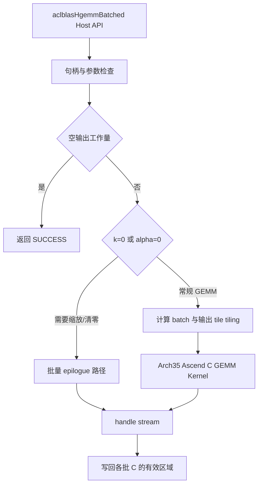

# aclblasHgemmBatched 算子设计文档（Ascend 950PR）

| 项目 | 内容 |
| --- | --- |
| 任务名称 | 10月社区任务-aclblasHgemmBatched算子开发（950） |
| 开发者 / GitCode 账号 | 2401_87475822 |
| 个人代码仓 | https://gitcode.com/2401_87475822/ops-blas |
| 代码合入目标 | https://gitcode.com/cann/ops-blas |
| 设计文档目标 | https://gitcode.com/cann/cann-ops-competitions |
| 目标硬件 / 架构 | Ascend 950PR / arch35 |
| 软件环境 | CANN 9.1.0；实际构建环境以自测报告记录为准 |
| 接口 | `aclblasHgemmBatched` |
| 支持数据类型 | A、B、C、alpha、beta 均为 FLOAT16；内部累加策略以实现及验证结果为准 |
| 支持形状 | 运行时 m、n、k、batchCount；每批逻辑 A(m×k)、B(k×n)、C(m×n)，物理存储尺寸依转置和 leading dimension 确定 |
| 文档状态 | 设计稿；尚未完成 SDK 构建、NPU 精度和性能验证 |

本文依据本任务《aclblasHgemmBatched Atlas950PR 算子开发任务书》编写，并参考社区任务设计模板和 ops-blas 现有 Arch35 GEMM / GEMM Batched 工程。本文中的实现路线和调优参数是开发计划；未经目标环境验证的内容不视为已实现或已达标。

# 需求背景（required）

## 需求来源

本任务要求在 Ascend 950PR 上使用 Ascend C，为 ops-blas 增加半精度批量通用矩阵乘接口 `aclblasHgemmBatched`，并完成接口、算子实现、测试和社区交付。算子归属 BLAS Level-3 GEMM 家族，按任务书放入 `blas/gemm/arch35/`，测试放入 `test/gemm/hgemmBatched/arch35/`。

## 背景介绍

对每个批次 `q` 执行：

```text
Cq = alpha * op(Aq) * op(Bq) + beta * Cq
```

API 使用 BLAS 列主序和 leading dimension 语义。矩阵地址通过设备侧指针数组提供，alpha、beta 是 Host 侧 FLOAT16 标量指针。此接口面向多个独立矩阵乘问题，避免调用方逐批发起单矩阵 GEMM；接口行为与 cuBLAS `cublasHgemmBatched` 参数顺序对齐。

## 背景功能分析

| 项目 | 本任务要求 |
| --- | --- |
| A、B、C | FLOAT16 实数；每批各自独立；C 原地更新 |
| alpha、beta | Host 内存中的 FLOAT16 标量指针，所有批次共用 |
| 转置 | `ACLBLAS_OP_N`、`ACLBLAS_OP_T`、`ACLBLAS_OP_C`；实数下 T 与 C 等价 |
| 布局 | 列主序；支持各矩阵通过 lda/ldb/ldc 表示的行间 padding |
| Batch | `Aarray`、`Barray`、`Carray` 为设备内存中的指针数组；不支持广播 |
| 输出形状 | 每批逻辑矩阵为 m×n |
| 边界 | m、n、batchCount 为 0 时合法 no-op；k 为 0 时逐批缩放 C |
| 平台 | 本任务只要求 Ascend 950PR / arch35 |

输入分布要求均匀分布 `[-5,5]` 与正态分布（均值 `[-5,5]`、标准差 `[0.1,2]`）各占约 50%，并另含特殊值。任务包 README 指出现有生成器尚未实现混合分布；接入时须补齐生成能力或提供等价测试数据，不能把当前只支持均匀分布描述成已覆盖任务要求。

# 需求分析（required）

## 需求描述

在 ops-blas 公共头文件声明 cuBLAS 参数序列兼容的 `aclblasHgemmBatched`，并通过句柄携带的 stream 异步调度 Ascend 950PR kernel。输入指针数组由设备访问；Host 入口负责参数校验、工作量计算、tiling 和 kernel launch。实现遵循 ops-blas 已有 GEMM / batch GEMM 工程组织，优先复用同族 GEMM Batched kernel 能力，避免为本算子另造独立的 950PR 私有 API。

## 公共接口

在 `include/cann_ops_blas.h` 声明：

```cpp
aclblasStatus_t aclblasHgemmBatched(
    aclblasHandle_t handle,
    aclblasOperation_t transa, aclblasOperation_t transb,
    int m, int n, int k,
    const aclblasHalf* alpha,
    const aclblasHalf* const* Aarray, int lda,
    const aclblasHalf* const* Barray, int ldb,
    const aclblasHalf* beta,
    aclblasHalf* const* Carray, int ldc,
    int batchCount);
```

`aclblasHalf` 的定义及既有半精度公共类型应先检查目标仓现状；若已定义则复用，不重复定义。不得在仅 arch35 的私有头文件中另建对外函数原型。

## 参数约束与物理寻址

下标从 0 开始，leading dimension 单位为 FLOAT16 元素。物理矩阵按列主序存储：

| 操作数 | `op=N` 时原矩阵尺寸 / lda 约束 | `op=T/C` 时原矩阵尺寸 / lda 约束 |
| --- | --- | --- |
| A | m×k，`lda >= max(1,m)` | k×m，`lda >= max(1,k)` |
| B | k×n，`ldb >= max(1,k)` | n×k，`ldb >= max(1,n)` |
| C | m×n，`ldc >= max(1,m)` | 同左 |

对应的逻辑元素地址（以元素计）为：

```text
opA(i,p) = transa == N ? Aarray[q][i + p*lda] : Aarray[q][p + i*lda]
opB(p,j) = transb == N ? Barray[q][p + j*ldb] : Barray[q][j + p*ldb]
C(i,j)   = Carray[q][i + j*ldc]
```

每个批次的 A/B/C 是独立矩阵，不支持跨批广播、任意 batch stride 或非连续矩阵视图。调用方负责保证指针数组及其各元素指向有效设备内存，矩阵容量足以覆盖由维度和 leading dimension 确定的物理范围；数组中不同批次的存储不得造成不受支持的重叠写入。

## 参数校验与边界行为

所有合法性检查应在 kernel launch 前完成。尤其 no-op 短路前仍须检查 alpha/beta 非空，并在 batchCount>0 时检查 Aarray/Barray/Carray 非空；不得因 m=0、n=0 或 alpha=0 提前绕开这些合同。按任务书定义实现以下行为：

1. 空 handle 返回 `ACLBLAS_STATUS_HANDLE_IS_NULLPTR`；不支持的 transa/transb 返回 `ACLBLAS_STATUS_INVALID_ENUM`。
2. alpha 或 beta 为 nullptr 返回 `ACLBLAS_STATUS_INVALID_VALUE`，即使 m、n 或 batchCount 将触发 no-op 也要检查。
3. `batchCount > 0` 时 Aarray/Barray/Carray 均不得为空；即使 m=0 或 n=0 也校验数组指针。`batchCount=0` 时不校验数组指针。
4. 负 m/n/k/batchCount、非法 leading dimension 返回 `ACLBLAS_STATUS_INVALID_VALUE`。负 batchCount 不会因数组判空条件跳过而被接受。
5. 参数检查完成后，m=0、n=0 或 batchCount=0 返回 SUCCESS，不访问矩阵指针数组中的元素或矩阵数据，不发起 kernel。
6. k=0 时每批只执行 `Cq = beta*Cq`，不解引用 Aarray/Barray 中的矩阵地址；beta=0 时写零且不得读取 C 旧值。batchCount>0 时三个数组指针仍须非空。
7. 一般 GEMM 的 beta=0 路径不读取 C 旧值；输出仍必须有有效 C 地址。alpha=0 可选择退化为 beta 缩放，但不能改变参数校验和异步语义。

错误检查与短路次序要与任务书 §2.5 对齐；若仓库公共接口已有一致校验助手，优先复用并补测试，不自行引入与其他 BLAS API 冲突的状态语义。

## 需求拆解

1. 在公共头文件添加 API，并检查 `aclblasHalf` 与操作枚举的公共定义。
2. 在 Arch35 Host 端校验参数、确定批处理和 GEMM tiling，并在 handle stream 上发起 kernel。
3. 在 Ascend C Kernel 端读取设备侧指针数组，按批次执行 GEMM，支持 N/T/C、leading dimension padding 和尾块。
4. 正确实现 beta=0、alpha=0、k=0 及空工作量路径；不触碰无须读取的矩阵数据。
5. 将任务提供的 CSV 用例接入 ops-blas GTest 测试结构，补足 golden、错误码、精度统计与性能采集。
6. 在 Ascend 950PR / CANN 9.1.0 上完成全量自验，满足精度和性能门槛后准备两类 PR 与验收资料。

## 支持数据类型与支持形状

- 数据类型固定为 FLOAT16，不扩展 BFLOAT16、FLOAT32 或混合 dtype API。
- `m,n,k,batchCount` 为运行时参数，合法范围均从 0 起；任务用例上限按任务书为 m/n/k=16384、batchCount=65536，单用例仍须遵守测试包的 512MB Host 内存预算。
- N 模式下 A 的物理矩阵为 m×k、B 为 k×n；T/C 模式下 A 为 k×m、B 为 n×k；C 始终为 m×n。矩阵采用列主序。

# 详细设计（required）

## 算子分析

### 支持数据类型

输入矩阵、输出矩阵和 alpha/beta 标量均为 FLOAT16。接口不带 dtype 参数，也不支持其他数据类型组合。

### 支持形状

支持运行时 m、n、k、batchCount。A/B/C 的逻辑形状及转置后的物理形状见“参数约束与物理寻址”；支持非方阵、尾块和 leading dimension padding，不支持 batch 广播或任意 stride。m/n/batchCount 为 0 时 no-op，k=0 时缩放 C。

### 数学公式

对 `q ∈ [0,batchCount)`、`i ∈ [0,m)`、`j ∈ [0,n)`：

```text
Cq(i,j) = alpha * sum(p=0..k-1, opAq(i,p) * opBq(p,j)) + beta * Cq_old(i,j)
```

API 存储输入输出为 FLOAT16。精度验证 golden 按任务书使用 FP32 Netlib `cblas_sgemm` 逐批计算，再按 IEEE 754 round-to-nearest-even 转为 FLOAT16。实现内部的乘加累加精度和输出转换路径应以目标 kernel 的实测及代码为准；设计验证时重点检查累加、alpha/beta 融合和最终收窄是否满足给定混合容差。不能以本设计文档预设计算精度替代实现核对。

### 计算量与访存

主计算量约为 `2 * batchCount * m * n * k` 浮点操作。批次间相互独立，天然可作为并行维度；每批输出块由一个逻辑工作单元负责，避免多核写同一 C 元素。块内循环沿 K 维迭代，按设备资源限制搬运 A/B 分块，完成乘加后应用 alpha/beta 并写回有效 C 区域。尾块需屏蔽越界加载和存储；padding 元素不参加计算，也不得被输出覆盖。

### 实现方案

以 ops-blas 中 `blas/gemm_batched/arch35/` 与 `blas/gemm_batched_ex/arch35/` 的 Host 调度、设备侧 batch 地址处理、GEMM kernel 和 tiling 组织为代码参考；具体复用点以当前分支源码和 CANN 9.1.0 编译结果确认。新实现放在任务要求的 `blas/gemm/arch35/` 下，采用 GEMM 计算模板，增加必要的 FP16 Batched 参数适配和指针数组解引用。

初版采用规则块 GEMM：将 batch 维与 M/N 输出 tile 共同映射到逻辑任务 ID，K 维按固定块序迭代；Host 计算安全的任务数、tile 参数和必要的标量元数据，设备端从指针数组取得当前 batch 的 A/B/C 地址。alpha/beta 尽可能融合在输出 epilogue，避免将完整的乘积矩阵额外写入全局临时区。是否能在单 kernel 完成 GEMM 和 epilogue、是否需仓库现有的多 kernel 路径，由相邻模板的实现约束及资源验证决定；若需要临时空间，须在设计与报告中列出大小、生命周期和分批策略。



## 算子实现

### Host 侧设计

Host API 执行以下流程：

1. 验证 handle、transa/transb、alpha/beta、维度、batchCount、leading dimension 和指针数组；错误码与检查顺序遵循本任务参数合同。
2. 处理合法 no-op，不读取矩阵指针数组内容，不 launch kernel。
3. 对需执行的任务计算物理行数、输出元素数和 tile 数，使用 64 位中间量检查乘法与地址/调度范围，避免 int 溢出；确认 batchCount × tileCount 可由 kernel 索引类型表示。
4. 读取 Host 标量并准备 kernel 参数。数组本身位于设备内存，Host 不将每批 A/B/C 地址逐个拷回，也不对每批逐次发起单独 Host API 调用。
5. 根据工作规模和有效输出 tile 数确定 launch block 数，避免零 block 和明显欠占用；查询失败或尺寸超限时按仓库惯例返回错误，不猜测硬件参数。
6. 使用句柄绑定的 stream launch，对外保持异步调用；不为性能计时在公共 API 内隐式同步。

### Kernel 侧设计

Kernel 逻辑分为 batch/tile 定位、操作数搬运、乘加累积、epilogue、边界写回：

1. 由逻辑任务 ID 求 batch 序号和输出 tile 坐标，再从设备侧 Aarray/Barray/Carray 读取该批地址。
2. 根据 N/T/C 和 leading dimension 计算输入地址；C 转置模式按 T 处理。
3. 对 K 分块循环搬运 A/B 至片上可用存储，使用 Arch35 GEMM/Cube 路径完成乘加。M/N/K 尾块通过掩码或符合仓库规范的 padding 处理。
4. 乘加结束后融合 alpha/beta。beta=0 时不加载 C 旧值；k=0 时走仅 beta 缩放或清零的路径，完全不读 A/B。
5. 只写 C 的逻辑 m×n 区域，保留 ldc padding 内容和相邻批次内存。
6. 每个 C 输出元素有唯一写者。除非仓库 GEMM 模板要求并且性能/精度测试证明必要，初版不采用原子累加或跨核 Split-K 归并。

K=0 的缩放可复用轻量逐元素 kernel；若 alpha=0 可在 Host 侧选择相同缩放路径，但必须保留任务要求的指针校验规则。空输出场景直接 Host 返回，不产生设备访问。缩放 kernel 的具体块长和向量化方式按 Arch35 资源、对齐要求及实测确定。

### Tiling 与并行策略

批次之间无数据依赖，输出 tile 任务 ID 可按如下逻辑映射：

```text
tilesPerBatch = ceil(m / BM) * ceil(n / BN)
taskId        = batchId * tilesPerBatch + tileId
batchId       = taskId / tilesPerBatch
tileId        = taskId % tilesPerBatch
```

`BM`、`BN`、`BK` 的初始值不在设计阶段固定为已验证配置。开发时从同仓 FP16 GEMM Batched 实现与模板允许的合法块形状开始，结合 L1/L0/UB 占用、K 循环次数、尾块比例和核利用率筛选；通过 950PR 编译及精度测试后再开展性能调优。对小矩阵大 batch，优先保证 batch 维并行；对大矩阵小 batch，使用 M/N 多 tile 保持 Cube 并行度。必要时按形状选取不同 tiling key/配置，但不得改变接口语义。

分块计算和地址跨度应使用安全整数类型。物理跨度（元素数）为：

```text
A: lda * (transa == N ? k : m)
B: ldb * (transb == N ? n : k)
C: ldc * n
```

乘 batchCount 和每元素字节数时进行溢出检查。指针数组的设备布局、对齐以及读取方式必须与测试 wrapper 的真实分配方式一致。

### 文件与工程集成

目标文件应保持精简并遵循 ops-blas 实际命名和收集规则，计划覆盖：

| 位置 | 内容 |
| --- | --- |
| `include/cann_ops_blas.h` | 公共 `aclblasHgemmBatched` 声明 |
| `blas/gemm/arch35/` | Host 参数检查、tiling、kernel 声明与 Ascend C GEMM 实现 |
| `blas/gemm/README.md` 或仓库要求的算子 README | 接口说明、约束、950PR 支持情况和调用/构建信息 |
| `test/gemm/hgemmBatched/` | CSV 参数、FP32 CBLAS golden、GTest wrapper、测试说明及 Arch35 调用实现 |
| 相关 CMake / 能力门控文件 | 将算子源文件和测试注册到仓库现有构建流程 |

最终文件拆分遵循同仓相邻 Batched GEMM 的惯例，合并过细文件，删除未使用代码和临时构建产物。产品支持表明确标注 Ascend 950PR 支持；不宣称未验收平台支持。

## 支持硬件

| 芯片/架构 | 本任务支持状态 |
| --- | --- |
| Ascend 950PR / arch35 | 目标平台；完成 CANN 9.1.0 构建和硬件自验后标记支持 |
| 其他平台 | 不在本任务验收范围；未实现或未验证前不标记支持 |

## 算子约束限制

- 仅 FLOAT16 实数，列主序；转置属性只支持 N/T/C。
- 每批矩阵独立，不支持广播和任意 batch stride。
- m、n、k、batchCount 为运行时参数；不依赖编译期固定 shape。
- C 原地输出；padding 不属于逻辑输出，不应被修改。
- alpha/beta 是 Host 标量指针；Aarray/Barray/Carray 是设备侧指针数组。
- handle 与设备内存须在关联 stream 操作完成前保持有效。
- 不要求 bit-exact；不承诺特定累加顺序或跨版本完全一致结果。
- 任务书 §3.4 未规定独立内存验收门槛；实现应报告实际 workspace，避免引入没有必要的整矩阵临时结果。
- 设计不预设最终 block 参数、kernel 数量和性能数据；这些由仓库实现、工具链与 NPU 实测确定。

# 可维可测分析

## 精度标准 / 性能标准

| 验收标准 | 本任务判据 | 验证方法 |
| --- | --- | --- |
| 功能与状态码 | N/T/C、尺寸、batch、padding、退化路径及非法参数符合任务书 | CSV GTest；检查 API 返回码、同步后的执行结果及 padding |
| golden | 每批以 FP32 Netlib `cblas_sgemm` 计算，再 RNE 转 FLOAT16 | 测试工程逐批全矩阵对比 |
| FLOAT16 混合容差 | `rtol=atol=2^-10`；matched ratio ≥0.99；max absolute error ≤ `max(1e-1, 32×ULP)` | 按任务书生态 mixed tolerance 逐元素统计；非有限值按专门规则记录 |
| 单 case 性能 | GPU/NPU 耗时倍率 ≥0.4 | 950PR 上采集 `TC_PF_` 用例，关联 `gpu_baseline.csv` |
| 平均性能 | 所有性能 case 倍率算术平均 ≥0.5 | 汇总全部性能 case 倍率 |
| 性能采样 | 950PR；warmup 5 次；任务书 §3.3 的 msprof op 口径为 10 个有效样本，同时 §7 要求有效样本 >10 次 | 建议采集 50 次以上并说明实际样本数；若工具支持，分别报告前 10 次平均和全部有效样本平均，以显式处理口径差异 |

FP16 golden 输入按任务书所述先提升至 FP32 参与 Netlib 计算，再使用 round-to-nearest-even 转回 FLOAT16。有限值逐元素条件为 `|actual-golden| <= 2^-10 + 2^-10*|golden|`；用例还须满足 matched ratio ≥0.99 和任务书规定的最大绝对误差上限（1e-1 或 32×ULP）。逐批全矩阵参与比较。非有限值按任务书规则单独统计：NaN 与 NaN、同号 Inf 与 Inf、或 NaN 与 ±Inf 视为等效；有限值与 Inf/NaN 不等效。非有限值不计入有限值误差统计，但须全部按规则判定通过。若大 K 累加场景未达阈值，应提供 CPU 参考对比、误差随 K 变化以及累加路径说明，不放宽验收阈值。

## 测试覆盖计划

以任务包 `test_cases/hgemm_batched_test.csv`（1000 条精度 + 200 条性能）、`gpu_baseline.csv`、`gen_csv.py` 及两个 verify 脚本为输入，接入 ops-blas CSV 驱动 GTest。覆盖至少包括：

1. N/T/C × N/T/C 全组合，小尺寸与非方阵。
2. m/n/k 尺寸扫描、K=0、不同 batchCount（1、多批及大 batch）。
3. alpha/beta 的 0、±1、常规随机和大值；beta=0 且 C 含 NaN 时验证不读取旧 C。
4. lda/ldb/ldc 紧凑与 padding，确认 padding sentinel 不变。
5. m=0、n=0、batchCount=0 no-op；空标量、空数组、非法枚举、非法 leading dimension、负维度及负 batchCount 的错误码。
6. Inf/NaN、极端值与累加溢出相关 case，分开记录有限值和非有限值判定。
7. 输入值域覆盖 50% 均匀分布和 50% 正态分布，并覆盖任务包规定的 0、±1、大值、Inf/NaN 特殊值；当前生成器未实现的混合分布功能在接入前补齐。
8. 全部性能用例与任务包中的 H100 GPU 基线关联；记录每 case 倍率及全部性能 case 倍率算术平均。

测试 README 应包含源码版本、设备/CANN 版本、构建命令、精度及性能命令、设备号选择方法、CSV 来源和结果解释，使验收者可复现。正式测试前检查脚本会将 CSV 安装到仓库测试路径；在个人 fork 工作树运行并核对 git diff，避免覆盖已有测试数据。生态 mixed tolerance 判定与测试框架的 MERE/MARE 统计配置应分别记录，不能将 CSV 阈值列或旧默认值直接当作生态标准本身。

## 兼容性分析

新增符号与现有 `aclblasSgemm`、`aclblasCgemm` 及其他 BLAS API 并列，参数顺序对齐 cuBLAS。公共声明只增加新 API，不改写既有函数签名、枚举和公共结构布局。若公共头缺少 `aclblasHalf`，按仓库公共类型策略新增一次并验证 C/C++ 包含兼容性；若已存在则直接复用。新增测试及 CMake 注册不得改变现有算子的默认测试阈值或执行路径。

## 风险与验证计划

| 风险 | 处理计划 |
| --- | --- |
| 设备侧指针数组 ABI/地址空间与 wrapper 不一致 | 对照同仓 batched wrapper 和 kernel 参数，使用单批及多批用例验证 |
| FP16 Cube layout、尾块、非对齐 leading dimension | 复用已验证的 Arch35 GEMM 搬运模板；以转置、padding、非方阵用例验证 |
| beta=0 错误读取 NaN C 或覆盖 padding | kernel 分支避免旧 C load；初始化 padding sentinel 并检查不变 |
| 超大 batch/尺寸导致乘法溢出或索引越界 | Host 侧 64 位检查，边界用例覆盖工作量计算 |
| 小矩阵大 batch 和大矩阵少 batch 的性能差异 | 联合 batch 与 M/N tile 映射，按任务提供全部性能 case 测量优化 |
| 不同测试材料的采样口径文字不一致 | 以任务书验收条款为基线，记录脚本实际采样次数并在报告中澄清 |

在 Ascend 950PR / CANN 9.1.0 完成构建、全部精度用例和性能验收前，本设计中的功能路线不代表实现已通过验收。提交代码 PR 前将实际源码文件、构建/运行命令、用例统计、精度结果、性能数据和已知限制同步更新到算子 README 与自测报告。
