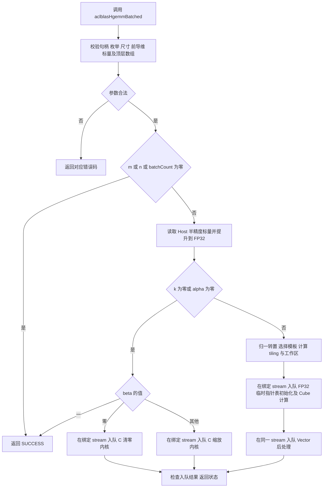
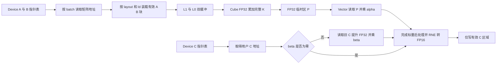

# aclblasHgemmBatched 算子设计

# 需求背景

## 需求来源

本设计对应《10月社区任务—aclblasHgemmBatched 算子开发（950）》，为 ops-blas 补充 Ascend 950PR 上的半精度实数批量通用矩阵乘能力。文档按社区[设计模板](https://gitcode.com/cann/cann-ops-competitions/blob/master/04_tasks/01_community-task-2026/resources/design_template.md)组织，交付范围为接口、计算路径、资源规划和后续验证方案；本文未包含实现或实测结果。

## 背景介绍

对于使用相同尺寸、前导维和转置模式的一组矩阵，一次批量调用可以复用参数处理和内核调度，适用于多组小矩阵以及多批中大矩阵计算。各 batch 的矩阵地址由 Device 指针数组给出，矩阵之间不要求等距分配。

公开接口对齐 cuBLAS `cublasHgemmBatched` 的参数序列，遵循任务书规定的 Host 标量、列主序、错误码和边界语义。实现采用 handle 绑定 stream 的 Ascend C kernel 直调方式，复用 ops-blas 同族 GEMM 模板，不增加其他产品线无法共用的私有接口。

## 现有能力分析

对 ops-blas 公共头文件、`blas/gemm/arch35/` 和 `blas/gemm_batched/arch35/` 的静态核查表明：

| 项目 | 已有能力 | 本算子需要的补充 |
| --- | --- | --- |
| 公共接口 | 公共头尚无 `aclblasHgemmBatched`，公共类型尚无 `aclblasHalf` | 在共用头中补充类型和唯一的公开声明 |
| GEMM 主计算 | 同族批量内核已有 FP16 输入、FP32 L0C 累加及四种实数转置分派 | 将该能力接入任务要求的前端，保留共用模板 |
| 数据布局 | 同族 Host 已通过交换操作数及 m/n 等参数适配列主序 | 明确原接口坐标与内部坐标的对应关系 |
| 标量后处理 | 已有 FP32 临时结果、FP32 标量运算和 FP16 输出转换 | 修正最终舍入，保证 RNE；保留 `beta=0` 不读旧 C 的分支 |
| 提前返回 | 已有退化计算路径 | 修正清零路径读取旧 C 的问题，并落实本任务规定的判空顺序和错误码 |

现有模板提供实现基础，但不能将已有前端和提前返回路径原样套用。例如，非法转置须返回 `ACLBLAS_STATUS_INVALID_ENUM`；FP16 最终转换不能直接继承已有的 `CAST_ROUND` 配置；清零时不能先读取旧 C 再乘零。

# 需求分析

## 需求描述

对每个 batch `b`，计算：

```text
C_b = alpha * op(A_b) * op(B_b) + beta * C_b
b = 0, ..., batchCount - 1
```

输入矩阵、输出矩阵和 Host 标量均使用 IEEE 754 binary16。`op(A_b)` 的逻辑形状为 `m×k`，`op(B_b)` 为 `k×n`，`C_b` 为 `m×n`。外部转置枚举支持 N、T、C；实数的 C 与 T 等价。

## 需求拆解

| 类别 | 设计要求 |
| --- | --- |
| 接口 | 与任务书原型一致，维数及 batchCount 为 `int`，标量与指针数组的 const 属性保持不变 |
| 内存 | alpha/beta 位于 Host；三组指针数组及其所指矩阵位于 Device |
| 布局 | 列主序，支持前导维 padding，不能假定 `lda=m`、`ldb=k` 或固定 batch stride |
| 计算 | FP16 输入、FP32 累加和后处理、最终一次 RNE 转 FP16 |
| 边界 | 支持零输出规模、k=0、alpha=0、beta=0/1 和负向参数校验 |
| 工程 | 公共 API 共用；实现放入 `blas/gemm/arch35/`，复用同族批量模板 |
| 验证 | 后续逐 batch 全矩阵精度比对，并分别验证单 case 与平均性能要求 |

不支持维度广播、超出前导维语义的任意 stride、输出视图或多个 batch 输出重叠。形状是运行时参数，不要求图模式动态 shape 推导。任务书中的 16384 尺寸和 65536 batchCount 是验证覆盖目标，不将其硬编码为公共 API 的取值上限。

# 详细设计

## 算子分析

### 数学公式与地址映射

使用 `b` 表示 batch，`r` 表示输出行，`c` 表示输出列，`p` 表示归约坐标，避免 batch 下标和矩阵行下标混用。

```text
P_b(r,c) = sum(p=0..k-1, opA_b(r,p) * opB_b(p,c))
C_b(r,c) = RNE_FP16(FP32(alpha) * P_b(r,c)
                    + FP32(beta) * FP32(C_b_old(r,c)))
```

上式的旧 C 项仅在 `beta != 0` 时读取。`k=0` 或 `alpha=0` 时按后文退化语义直接处理，不执行无效的乘加。

| 对象 | 模式 | 物理形状 | 元素偏移 | 前导维要求 |
| --- | --- | --- | --- | --- |
| A_b | N | `m×k` | `r + p*lda` | `lda >= max(1,m)` |
| A_b | T/C | `k×m` | `p + r*lda` | `lda >= max(1,k)` |
| B_b | N | `k×n` | `p + c*ldb` | `ldb >= max(1,k)` |
| B_b | T/C | `n×k` | `c + p*ldb` | `ldb >= max(1,n)` |
| C_b | 全部 | `m×n` | `r + c*ldc` | `ldc >= max(1,m)` |

偏移单位均为元素，转为字节时乘以 2。前导维中的填充行不属于输出，不参与精度统计且不得被覆盖。各 batch 的地址必须由相应指针数组元素读取。

### 公共算子原型

在 `include/cann_ops_blas.h` 新增以下声明，沿用该头文件现有的导出及 C 链接规范：

```cpp
aclblasStatus_t aclblasHgemmBatched(
    aclblasHandle_t handle,
    aclblasOperation_t transa, aclblasOperation_t transb,
    int m, int n, int k,
    const aclblasHalf* alpha,
    const aclblasHalf* const* Aarray, int lda,
    const aclblasHalf* const* Barray, int ldb,
    const aclblasHalf* beta,
    aclblasHalf* const* Carray, int ldc,
    int batchCount);
```

`aclblasHalf` 的定义放入共用 `include/cann_ops_blas_common.h`，与其他产品线保持统一，采用 `typedef aclFloat16 aclblasHalf;`。已核对目标工具链的 ACL 头文件：`aclFloat16` 是 16 位存储类型，并提供 `aclFloat16ToFloat` / `aclFloatToFloat16`。Host 用 `aclFloat16ToFloat` 解码标量，不能把 16 位编码当作普通整数数值转换。Device 侧按相同 binary16 位表示接入 `half` 模板，并通过大小、对齐和编码的静态/接口验证保证兼容。新增类型只表达半精度位存储，不引入另一种数值编码。

### 参数与内存约定

| 参数 | 位置与方向 | 说明 |
| --- | --- | --- |
| handle | Host，输入 | 有效库句柄；从中取得执行 stream 和库内资源 |
| transa / transb | Host，输入 | 取 `ACLBLAS_OP_N/T/C`，内部将 C 归一为 T |
| m / n / k | Host，输入 | 非负，含义及物理形状见地址映射表 |
| alpha / beta | Host，输入 | 非空 FP16 标量指针，全 batch 共用；入栈后按需读取 |
| Aarray / Barray | Device，输入 | 各含 batchCount 个只读矩阵的 Device 地址 |
| Carray | Device，输入/输出 | 含 batchCount 个可写矩阵的 Device 地址，原地覆写 |
| lda / ldb / ldc | Host，输入 | 以元素为单位，满足前导维要求 |
| batchCount | Host，输入 | 非负，三组指针数组的元素数 |

Host 只校验顶层数组指针，不解引用 Device 指针表，也不为逐项检查而将其复制回 Host。调用方保证实际被访问的数组元素及矩阵区域有效，C 的不同 batch 互不重叠，C 与 A/B 不重叠。指针表与矩阵的存储生命周期应覆盖绑定 stream 中本次操作的完成；不能将异步入队成功当作可以立即释放 Device 内存的依据。

### 校验顺序与错误处理

统一采用以下顺序，同次调用存在多个非法参数时返回首先检测到的错误：

1. handle 为空：返回 `ACLBLAS_STATUS_HANDLE_IS_NULLPTR`。
2. transa/transb 非 N/T/C：返回 `ACLBLAS_STATUS_INVALID_ENUM`。
3. m/n/k/batchCount 为负，或 lda/ldb/ldc 不满足表中要求：返回 `ACLBLAS_STATUS_INVALID_VALUE`。
4. alpha/beta 为空：返回 `ACLBLAS_STATUS_INVALID_VALUE`。
5. `batchCount>0` 且任一顶层 Aarray/Barray/Carray 为空：返回 `ACLBLAS_STATUS_INVALID_VALUE`。
6. 校验通过后，才判断零输出规模及标量退化。

`m=0` 或 `n=0` 且 `batchCount>0` 时仍执行第 5 项；`batchCount=0` 时跳过第 5 项。no-op 的“不访问数组”指不读取数组元素、不访问矩阵，仍允许对顶层指针本身判空。尺寸乘法、ceil-div、对齐和字节数计算在运算前提升为足够位宽，并检查溢出；不能先用 `int` 相乘再转换。工作区申请失败、运行时查询或 kernel 启动失败须返回公共头中对应的现有状态码，不吞掉错误或统一返回成功。

### 边界与标量分支

以下各分支均在参数校验完成后执行；`==0` 包括正负零，NaN 不与 0 或 1 相等。

| 条件 | 动作 | 不访问的数据 |
| --- | --- | --- |
| `m=0`、`n=0` 或 `batchCount=0` | 返回 SUCCESS，不申请工作区、不启动内核 | 全部指针表元素和矩阵；无需读取标量值 |
| `k=0` | 仅执行 `C=beta*C`，不使用 alpha 的值 | A/B 指针表元素及矩阵 |
| `k>0 && alpha=0` | 按 BLAS 标量退化语义执行 `C=beta*C` | A/B 指针表元素及矩阵 |
| 退化分支且 `beta=0` | 仅对有效 C 区域写零 | 旧 C；不能通过读取 NaN 再乘零实现 |
| 退化分支且 `beta=1` | 直接返回 SUCCESS | 所有矩阵和指针表元素 |
| 退化分支且 beta 为其他值 | FP32 缩放旧 C，RNE 转 FP16 | A/B 数据 |
| 正常 GEMM 且 `beta=0` | 只计算并写入 `alpha*P` | 旧 C，含旧 C 为 NaN 的情况 |
| 正常 GEMM 且 `beta!=0` | 计算 `alpha*P+beta*C_old` | 无额外省略 |

`k=0` 即使 alpha 为 NaN/Inf 也只做 C 缩放。`beta=0` 不意味着 C 的输出地址可为空，顶层判空和有效写入区域要求仍成立。alpha=0 分支与 Netlib SGEMM 的标量退化行为一致，避免读取无用 A/B 后由 `0*Inf` 引入 NaN。

## 算子实现

### 总体实现方案

主方案采用同一 stream 上的两阶段计算：Cube 模板将 FP32 累加结果写入库内临时区；Vector 后处理读取临时结果，完成标量运算和最终 FP16 存储。该方案与现有同族数据通路一致，所需改动和资源边界清晰。退化分支只需 Vector 缩放/清零内核或直接返回。

以下流程图使用 Markdown Mermaid 代码块，无外部图像依赖。



图中“指针表初始化及 Cube 计算”是一个逻辑阶段，具体沿用同族入口的组织方式；若由独立内核初始化临时指针表，该内核也必须在 Cube 消费前于相同 stream 完成。每个运行时操作都检查返回值，失败后停止后续入队。

### Host 侧设计

#### 列主序适配

优先复用同族 `ApplyColumnMajorSwap` 的映射思路，将列主序输出视为行主序的转置：

```text
C_b^T = alpha * op(B_b)^T * op(A_b)^T + beta * C_b^T
M_internal = n, N_internal = m, K_internal = k
leftArray = Barray, rightArray = Aarray
leftLd = ldb, rightLd = lda
leftTrans = normalize(transb), rightTrans = normalize(transa)
```

原物理列主序缓冲按行主序解释后，矩阵本身已被转置，因此交换操作数时转置标志跟随原操作数交换，不再额外翻转 N/T。C/T 的归一发生在此之前。内部逻辑输出 `(c,r)` 对应用户 C 的 `(r,c)`；原始 ldc 继续作为用户输出的列间距，不能被紧凑临时区步长覆盖。

对 NN、NT、TN、TT 四种内部模板分别核对物理维数、leading dimension 和尾块。保持不同布局的模板分派，不先在 Host 或 Device 构造全量转置副本。

#### 分块与分核

在原接口坐标中，令输出行块、列块大小为 `B_r/B_c`：

```text
T_r = ceil_div(m, B_r)
T_c = ceil_div(n, B_c)
Q = batchCount * T_r * T_c
P = min(可用 Cube 核数, Q)

q = coreId; q < Q; q += P
b = q / (T_r*T_c)
u = q % (T_r*T_c)
tileRow = u % T_r
tileCol = u / T_r
r0 = tileRow * B_r
c0 = tileCol * B_c
```

内部交换坐标后将原行块、列块同步交换，再传给相应模板调度器。每个输出 tile 只由一个 Cube 工作单元负责，覆盖完整 k；不默认使用 split-K 或对 C 做跨核原子累加。小矩阵通过跨 batch 展开任务获得并行度，大矩阵通过输出 tile 展开任务；核数不能随 batchCount 无界增长。

同族已有 `128×128` 输出块、K 搬运块 128 和 FP16 L0 K 块 64，可作为首个复用配置。这里的硬件基块不随小尾块缩为非法尺寸；当前 tile 的有效 m/n/k 单独传递。模板选择及双缓冲配置必须满足目标平台 L1/L0/UB 容量和指令对齐约束，不能照搬其他产品线的容量或 API。

Host tiling 信息包括归一后的转置类别、原始及内部 m/n/k、原始 lda/ldb/ldc、batchCount、输出及 K 块大小、任务数、核数、临时区步长/偏移、后处理分块长度和 beta 分支。各字段的元素/字节单位明确区分，沿用共用结构的字段不改变已有调用者的含义。

#### 临时工作区

正常计算采用每 batch 一块 FP32 临时矩阵 P。用原接口维数定义：

```text
s = align_up(m, 16)                    // FP32 临时矩阵列间距，元素
pointerBytes = align_up(8*batchCount, 64)
matrixBytes  = 4*batchCount*n*s
workspaceBytes = pointerBytes + matrixBytes

P_b(r,c) 的元素偏移 = b*n*s + c*s + r
```

上述 16 元素与 64 字节对齐来自当前同族临时区组织，不是用户矩阵的额外对齐限制。指针表按 Device 64 位地址组织，实际实现以目标地址类型大小计算并静态核对。内部交换坐标后临时 tensor 为行主序 `(n,m)`，行距为 s，故不能误写成 `batchCount*m*align(n,16)`。

以 `m=n=256、batchCount=16` 为例，矩阵临时区为 4 MiB，指针表为 128 B；这只是公式计算，不是设备测量。工作区开销随有效输出总量增长，约为用户 FP16 输出的两倍，另有对齐开销。该基线不申请 A/B 全矩阵副本，不申请跨核 split-K 归并区。

工作区由库内资源管理提供，生命周期覆盖最后一个后处理任务。优先复用句柄现有的 stream 安全管理机制；不能在异步消费者完成前释放或让并发调用覆盖同一工作区。若现有分配/释放会引入同步，需在后续性能分析中计入，不以提前释放或增加隐式全局同步规避生命周期问题。no-op 和纯 C 退化路径不申请该 GEMM 工作区。

### Kernel 侧设计

#### Device 指针数组与主计算

每个工作单元从 Device 数组中获取当前 batch 的 A/B 地址，按模板的 layout 和 leading dimension 装载数据；不能用 `base + b*matrixSize` 替代查表。完成一个输出 tile 所有 K 分块的乘加后，将 FP32 结果写入 P_b 的有效区域。



`beta=0` 分支在地址计算之外禁止读取旧 C 数据。FP32 临时区只保存乘积累加，不在每个 K 块结束后转为 FP16，也不先将 `alpha*A` 舍入为 FP16。

#### Vector 后处理与退化路径

以用户列主序坐标划分互不重叠的 C 片段：临时读取偏移使用 `b*n*s+c*s+r`，用户读写偏移使用 `r+c*ldc`。输入 FP16 标量和旧 C 在参与标量算术前转换为 FP32，最后只做一次 FP32 到 FP16 的 RNE 转换。后处理在同一 stream 的 Cube 任务之后执行，依靠 stream 顺序保证 P 完整可读。

已有 FP16 路径中的 `CAST_ROUND` 不能直接视作 round-to-nearest-even。新增路径采用 `CAST_RINT`；已静态核对目标 dav_3510 SDK 的 float→half 转换支持该模式。后续用恰位于两个 FP16 数之间的中点、负中点、最大有限值、次正规数及溢出值验证实际输出。转换不得饱和到 65504，溢出按 IEEE 754 形成 Inf。公共类型的 Host 转换与 Device 输出转换遵守同一编码及舍入契约。

退化路径单独分派：清零只写有效 FP16 输出；缩放先读取旧 C、提升 FP32、乘 beta 后 RNE 写回；恒等分支不启动内核。它们不创建临时 P，也不读取 A/B 指针表元素。

#### 缓存与同步规划

以下资源公式采用交换后的内部坐标：`B_M=B_c`、`B_N=B_r`、`B_K=B_k`，首个 FP16 配置的 `K0=64`。它们是硬件基块尺寸，当前有效尾块另行传递。

| 区域 | 用途与容量表达式 |
| --- | --- |
| L1 | FP16 A/B 搬运块；双缓冲时约 `2*2*(B_M*B_K+B_K*B_N)` 字节，另计模板内部开销 |
| L0A/L0B | Cube 片段；分别按双缓冲 `2*2*B_M*K0`、`2*2*K0*B_N` 字节预算 |
| L0C | FP32 输出累加块；每槽 `4*B_M*B_N` 字节，槽数按所选模板配置计入 |
| UB | P 的 FP32 输入、可选旧 C 的 FP16 输入、FP32 算术暂存及 FP16 输出 |
| GM | 调用方矩阵/地址表，以及上一节给出的库内 FP32 临时区 |

Vector 首个配置可复用同族长度 `T=256` 的分块。按现有队列组织，beta 非零时六个双缓冲队列合计 `40*T+384` 字节，beta 为零时四个双缓冲队列合计 `24*T+256` 字节；该预算包含各队列的对齐余量。实现应跳过 beta=0 时无用的旧 C 数据通路，并在生命周期不重叠时复用 FP32 暂存。增加 T 或调整队列必须重新计算预算，并以平台可用 UB 容量核验，不能只按输入输出字节数估计。

异步搬运的生产者完成后才允许 Cube/Vector 消费；消费者完成后才可覆盖同一双缓冲槽。复用同族模板的事件配对和最终 drain，避免只等待 CopyIn 却未保护下一轮覆盖。FP32 P 的阶段间依赖由同一 stream 上的任务顺序保证，不引入没有消费方的跨核事件或无必要的全局屏障。

#### 尾块与 padding 安全

```text
mEff = min(B_r, m-r0)
nEff = min(B_c, n-c0)
kEff = min(B_k, k-p0)
```

只从 GM 读取有效矩形。模板需要对齐基块时在片上补齐；无效 K 区域的 A 和 B 均填零，不能让一侧残留 Inf/NaN 后与另一侧的零相乘。M/N 尾块仅写有效输出，所有用户 ld padding 保持不变。合法的奇数前导维、非 32 字节对齐的行列长度以及极小矩阵不能因 DMA 便利性被拒绝，也不能按对齐长度越界读写。若当前模板某条搬运路径不能表达该边界，新增安全尾块搬运分支，并在后续设备验证完成前保留为待验证能力。

### 工程集成

| 位置 | 职责 |
| --- | --- |
| `include/cann_ops_blas_common.h` | 共用半精度类型及必要的公共类型契约 |
| `include/cann_ops_blas.h` | 新增唯一的 `aclblasHgemmBatched` 声明 |
| `blas/gemm/arch35/` | 按任务书放置本算子 Host 包装、模板接线及必要的边界/后处理实现 |
| `blas/gemm_batched/arch35/` | 复用已有同族参数映射、FP16 Cube 主计算及批量寻址能力，必要时提取共用实现 |
| 测试集成位置 | 任务书要求 `test/gemm/hgemmBatched/arch35/`；与当前同族 `test/gemm_batched/...` 结构在实现阶段核对后接入构建 |

不复制完整 GEMM 家族，不修改已有 Sgemm/Cgemm 的公开语义。对公共模板的任何改动都需验证原调用方；新接口的严格校验和半精度 RNE 规则可由独立包装/模板参数接入。新增实现文件由现有构建入口注册，并检查导出符号，避免有声明而无可链接实现。

设计文档提交至社区任务仓，而不是上述实现目录，路径为：

```text
04_tasks/01_community-task-2026/tasklist/
└── 10-aclblasHgemmBatched-950/
    └── Ethan_Zou/
        └── docs/
            └── design.md
```

### 性能优化方案

先复用有明确数值路径的两阶段主方案，后续按测量结果开展以下优化：

1. 小矩阵将多个 batch/tile 分配给同一核连续处理，减少空核和重复调度；保持一次批量调用，不在 Host 对每个 batch 单独 launch GEMM。
2. 中大矩阵复用 L1/L0 双缓冲，按长宽比、转置和 K 长度选择已有合法模板配置；改善数据复用与核间负载均衡。
3. beta=0 后处理去掉旧 C 搬运和相关算术；alpha=0/k=0 去掉 Cube 与 P；beta=1 的恒等退化直接返回。
4. 在 stream 生命周期安全的前提下复用工作区，避免重复申请造成额外同步；保留所有内部 task 的完整性能统计。
5. 两阶段路径的主要代价是 FP32 P 的一次写入、一次读取及额外任务启动。若后续证据表明它是瓶颈，再评估 tile 后处理融合；融合须重新证明输出唯一写者、FP32 保留、尾块及 Cube/Vector 同步，不将其当作本方案已经具备的能力。

性能目标是验收条件，不由静态设计直接推断达标。本文没有测量数据，也不将现有模板的性能外推为本接口的性能。

## 支持硬件

| 硬件 | 本设计范围 |
| --- | --- |
| Ascend 950PR（arch35） | 支持目标；采用任务书指定的工具链环境实现和验证 |

## 算子约束限制

各 batch 统一使用尺寸、转置、前导维和标量，不支持按 batch 变化的形状或标量。只支持 FP16 实数、列主序及合法 ld padding；输出原地写回 C，不创建视图，不提供广播或任意 stride。实际内存区域必须足够，异步生命周期由调用方及库内资源管理共同保证。确定性逐位一致不是任务要求，不通过改变验收阈值来掩盖累加或转换误差。

# 可维可测分析

## 精度标准与验证计划

### Golden 与数值顺序

后续使用任务书指定的 Netlib `cblas_sgemm` 逐 batch 生成参考结果：将最终送入 Device 的 FP16 A/B/C 和标量按实际位表示提升到 FP32；按列主序、转置及 leading dimension 计算；最终按 RNE 收窄至 FP16。beta=0 时不能读取旧 C，k=0/alpha=0 时按对应退化分支处理。逐 batch 对有效 `m×n` 区域做全矩阵验证，不仅抽样首行或首 batch。

正常路径的 FP32 累加顺序可能与 CPU 不同，因此使用混合容差，不要求 bit-exact。舍入、清零、padding 和错误码则按各自明确的契约检查。

### 精度判据

有限值逐元素条件为：

```text
abs(actual-golden) <= 2^-10 + 2^-10*abs(golden)
```

有限值匹配比例须至少为 0.99，且最大绝对误差不超过 `max(0.1, 32*ULP(g_low))`。其中 `g_low` 是最大绝对误差点的 golden 按实际输出 FP16 收窄后的值；“0.1 或 32 ULP”表示取较大者，不能选取无关位置的大数来抬高上限。MERE/MARE 可作为诊断指标，不能替代任务书的混合容差双条件。

非有限值依任务书单独判定：双方均 NaN、同号 Inf，或一方 NaN 而另一方为 Inf，视作等效；异号 Inf 不等效；有限值与非有限值不等效。这些位置不进入有限值 matched_ratio/max_abs_error 统计，记录总数与通过数并要求全部通过。若没有有限值位置，将有限值统计标记为不适用，不能产生 0/0 后误判；该用例仍须满足全部非有限值及边界检查。

若大 k 场景精度不满足要求，应保留实际输入、CPU golden、最大误差位置、误差随 k 变化和累加精度分析；本设计采用 FP32 累加，不能在没有证据时直接归因于 FP16 累加或放宽阈值。

### 后续覆盖矩阵

| 分类 | 计划覆盖与检查点 |
| --- | --- |
| 基础功能 | transa/transb 的 3×3 全组合、矩形与方阵、batchCount=1/多 batch；T/C 等价 |
| 尺寸与尾块 | 0/1、小质数、2 的幂及其前后值；小于基块、恰等于基块、基块+1、多 tile；分别跨 M/N/K 边界 |
| 地址表 | 各 batch 独立分配、非等距地址、指针表置于 Device，确保未误用 strided batched |
| 前导维 | 最小合法 ld、独立及组合 padding、奇数 ld；输出周边哨兵与 padding 不变 |
| 标量 | 0、负零、±1、接近 65504 的大值；beta=0 且旧 C=NaN；k=0 且 alpha=NaN/Inf |
| 退化与判空 | no-op、k=0、alpha=0、beta=0/1/其他；no-op 下空标量仍报错；batchCount>0 时空数组仍报错；batchCount=0 时可为空数组 |
| 参数负向 | 空 handle、非法转置、负 m/n/k/batchCount、非法 ld，检查准确错误码及不启动计算 |
| 数值 | 50% 均匀分布与 50% 正态分布；0/±1、正负大值、次正规数、RNE 中点、NaN/±Inf |
| 规模覆盖 | 以可分配组合覆盖维数 16384、batchCount 65536，不要求二者与所有最大维同时组合 |
| 生命周期 | 连续调用、不同 stream 的独立输出与工作区，验证资源未提前复用；共同模板变更需回归原接口 |

以随附 1000 条精度与 200 条性能用例为起点补齐覆盖，不将用例条数直接等同于覆盖完整。测试内存预算按物理行列和 ld 计算，至少包含 `2*b*(lda*A物理列数 + ldb*B物理列数 + ldc*n)` 字节，并另计指针表、golden、工作区和测试副本；512 MiB 是随附测试包的选择，不是 API 或硬件的固定限制。

## 性能标准与验证计划

以任务书 §3.3 的明确判据为设计目标：使用 msprof op 的 task duration，5 次 warmup 后取 10 个有效样本的算术平均，单位为 us。多内核实现应对一次调用关联的指针表准备、Cube、Vector 等内部计算 task 求和后形成该次样本，不能只截取 Cube task；同时保留原始 task 明细及额外 Host/分配同步开销的诊断记录。异常调用不作为有效样本，但必须记录并补足采样，不能静默跳过失败 case。

对所有性能 case，令 `R_i=GPU基线耗时/NPU平均耗时`，要求同时满足：

```text
每个 case: R_i >= 0.4
全部性能 case: arithmetic_mean(R_i) >= 0.5
```

GPU 基线文件中的 `gpu_ms` 乘以 1000 后与 us 比较。按完整用例参数及标识核对参考值；重复的尺寸组合不能误关联。缺基线、零样本、超时、执行失败或不完整 case 集都不能记作验收通过。GTest 总运行时间含 Host、golden 与比对，不能替代 kernel task duration；单个 case 达到目标也不能替代全部 case 的算术平均要求。

## 材料差异与实现前检查

| 材料差异 | 本设计处理 |
| --- | --- |
| 测试 README 存在“数组判空后于 no-op”的文字，CSV `TC_ED_138` 在 k=0 时将顶层 A/B 置空却期望 SUCCESS | 按任务书 §2.5，batchCount>0 的顶层判空先于 no-op/退化；后续修正该用例，仍保证 k=0 不解引用 A/B |
| 性能附注及测试 README 的采样数、目标与 §3.3 不同 | 本设计按 §3.3 的 task duration、5+10、逐 case 0.4×及平均 0.5×规划；正式性能验收前核对材料冲突 |
| 测试脚本使用 GTest 总耗时，且缺样本/缺参考等情况可能未按失败处理 | 后续改为完整 msprof 数据与覆盖检查，不以脚本退出码单独证明通过 |
| 测试包的分布及大规模覆盖未完全达到任务书目标 | 补充正态分布、16384 规模及 65536 batch 的可行组合 |
| 任务书测试目录与当前同族/脚本目录不同 | 实现阶段核对仓库构建规则，保持本设计 PR 在上述任务目录，不混淆设计与代码提交路径 |

以上为静态核查发现的待处理项，不代表已执行测试或已取得验收结论。

## 兼容性与可维护性

公共 API 的名称、参数序列和半精度表示在产品线间共用；内部转置归一、tiling 和工作区属于实现细节。对已有同族模板优先做最小扩展，以独立分支或模板参数接入新的校验、RNE 和清零语义，减少对既有接口的影响。文档与后续实现都保留原接口坐标到内部布局的对应关系，便于定位 ld、尾块和 batch 地址问题。

## 参考资料

- 本任务书及随附 `test_cases` 材料：接口、边界、验收目标的直接依据。
- [社区任务提交规范](https://gitcode.com/cann/cann-ops-competitions/blob/master/04_tasks/01_community-task-2026/README.md)及[设计模板](https://gitcode.com/cann/cann-ops-competitions/blob/master/04_tasks/01_community-task-2026/resources/design_template.md)。
- [ops-blas 公共接口](https://gitcode.com/cann/ops-blas/blob/master/include/cann_ops_blas.h)、[公共类型](https://gitcode.com/cann/ops-blas/blob/master/include/cann_ops_blas_common.h)、[GEMM 实现](https://gitcode.com/cann/ops-blas/tree/master/blas/gemm/arch35)及[同族批量实现](https://gitcode.com/cann/ops-blas/tree/master/blas/gemm_batched/arch35)。
- [cuBLAS GEMM Batched](https://docs.nvidia.com/cuda/cublas/index.html#cublas-t-gemmbatched)：原型、列主序、Device 指针数组和输出不重叠语义。
- [Netlib SGEMM](https://www.netlib.org/blas/sgemm.f)：标量退化及参考运算语义。
- [任务书指定的混合容差标准](https://gitcode.com/cann/opbase/blob/28a1ce52ae856353589841226a0002af73314a6b/docs/zh/ops_precision_standard/mixed_tolerance_standard.md)：FP16 阈值及最大误差点的 ULP 规则；非有限值以本任务书的具体规则为准。
- [CANNBot Tiling 设计指南](https://gitcode.com/cann/cannbot-skills/blob/master/ops/ascendc-tiling-design/SKILL.md)：用于静态检查分核、资源预算及分支覆盖；具体实现能力以 ops-blas 源码及目标平台接口为准。
- [Ascend C RoundMode](https://www.hiascend.com/doc_center/source/en/CANNCommunityEdition/900/API/ascendcopapi/atlasascendc_api_07_00241.html)：`CAST_RINT` 的中点取偶数语义；类型与目标转换支持另以实际 SDK 头文件核对。
