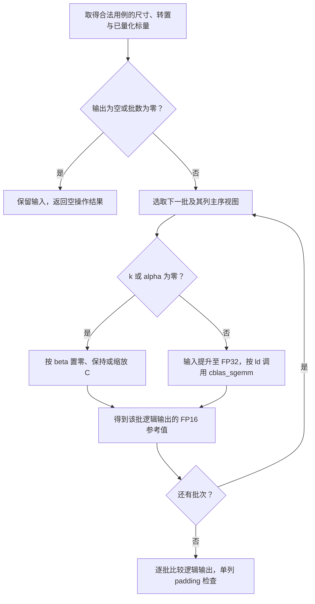
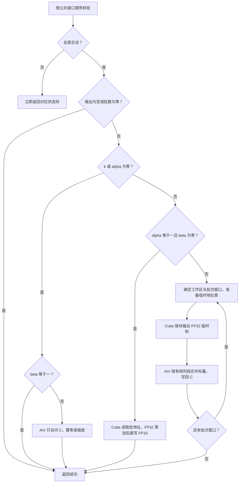

# 一、需求背景

## 1.1 需求来源

10 月社区任务要求在 Atlas 950PR 上用 Ascend C 实现 Level-3 BLAS 接口 `aclblasHgemmBatched`。同一调用处理一组同形状、可分别分配的半精度矩阵，结果写回各自的 C。设计范围是一个公共入口、九种转置组合和一套精度与性能验收方案。[任务详情](https://www.hiascend.com/activities/task-center/details/fe48759fdaaf4afb80ecbf5a758a1123) · [正式任务书与附件](https://www.hiascend.com/p/resource/202610/135324b6762b4fa6bc20cf26b23ebad6.zip)

本文以 `aclblasHgemmBatched_Atlas950PR_task_doc.md` 为契约，任务包 SHA-256 为 `b74ffb82fa5c86217a52148311c9223c4a5b145a4e0af407ab31972e1de43278`。以下“现有”均指 ops-blas 提交 `b0193c1ac9ed0d5d94c265f9519ff4eb90665492`。

## 1.2 背景介绍

### 1.2.1 aclblasHgemmBatched 实现优化

任务书 §2.2、§2.3 与 §5 写成在 `blas/gemm/arch35/` 开发、在公共头文件补声明。固定提交已导出同签名，并在 `blas/gemm_batched/arch35/hgemmBatched_host.cpp` 接入同族 Cube 和 Vector 内核。构建表 `_GEMM_BATCHED_FAMILY_OPS` 已登记 `hgemmBatched`。设计沿用此入口与发射路径，拟改进通用路径临时空间的分批复用、极端尺寸的算术检查，并补齐任务包与仓内测试的差异记录。目录归属差异须在交付时说明，避免在两个目录定义同一符号。[公共头文件](https://gitcode.com/cann/ops-blas/blob/b0193c1ac9ed0d5d94c265f9519ff4eb90665492/include/cann_ops_blas.h) · [现有 Host 实现](https://gitcode.com/cann/ops-blas/blob/b0193c1ac9ed0d5d94c265f9519ff4eb90665492/blas/gemm_batched/arch35/hgemmBatched_host.cpp) · [构建选择](https://gitcode.com/cann/ops-blas/blob/b0193c1ac9ed0d5d94c265f9519ff4eb90665492/blas/CMakeLists.txt)

### 1.2.2 标杆算子现状分析

cuBLAS 的 `cublasHgemmBatched` 给出公共行为，任务包给出 H100 耗时。CPU 数值基准单独按 Netlib BLAS 3.10.0 构造。TBE 源码及算子信息库在此调用链中不适用。

#### 1.2.2.1 标杆算子支持的数据类型和数据格式

| 参数 | cuBLAS 半精度入口 | 本任务约定 |
| --- | --- | --- |
| Aarray、Barray | Device 指针表，表项指向只读列主序 half 矩阵 | 两级地址均在 Device，ND，同列的行下标每增加 1，地址前进一个元素 |
| Carray | Device 指针表，输出矩阵之间不得重叠 | 表只读，各表项指向可写的 FLOAT16 矩阵 |
| alpha、beta | half 标量指针，位置依指针模式而定 | Host 上各一个 `aclblasHalf` 值，由整批共享 |
| transa、transb、尺寸、前导维、批数 | 两个操作枚举，整型尺寸参数 | 参数顺序逐一对应；本任务使用 `int` 签名 |

同一次调用在各批间共享 m、n、k、三个前导维和转置标志。实数共轭保持数值，C 与 T 的索引一致。[cuBLAS 12.6.3 批量 GEMM](https://docs.nvidia.com/cuda/archive/12.6.3/cublas/index.html#cublas-t-gemmbatched)

#### 1.2.2.2 标杆算子实现描述

以 b 表示批号，r、j、p 分别表示 C 的行、列和归约下标。每个逻辑输出为 `C新[b,r,j] = alpha × Σ_p(op(A_b)[r,p] × op(B_b)[p,j]) + beta × C旧[b,r,j]`。下表给出相对各自表项的**元素偏移**；一个元素占 2 字节。

| 矩阵 | N 时的物理形状与偏移 | T 或 C 时的物理形状与偏移 |
| --- | --- | --- |
| A | m × k，`r + p*lda` | k × m，`p + r*lda` |
| B | k × n，`p + j*ldb` | n × k，`j + p*ldb` |
| C | m × n，`r + j*ldc` | C 的寻址与两个转置标志无关 |

cuBLAS 公开文档描述接口及内存语义。可逐步复核的数值路径来自任务书 §3.2 与仓内 `HgemmBatchedCpuReference`：取得实际传入的 FP16 位型（包括标量），精确扩展为 FP32；非退化批次按列主序调用 `cblas_sgemm`，使用原 ld；把逻辑输出按最近偶数舍入为 FP16。退化路径在参考侧单独处理，避免无效运算传播 NaN。下图描述这一参考计算，GPU 内部的分块方式没有公开依据。[仓内 golden](https://gitcode.com/cann/ops-blas/blob/b0193c1ac9ed0d5d94c265f9519ff4eb90665492/test/gemm/hgemmBatched/hgemmBatched_golden.h) · [Netlib SGEMM 3.10.0](https://github.com/Reference-LAPACK/lapack/blob/aa631b4b4bd13f6ae2dbab9ae9da209e1e05b0fc/BLAS/SRC/sgemm.f)

#### 1.2.2.3 标杆算子实现流程图



# 二、需求分析

## 2.1 外部组件依赖

目标软件栈为 CANN 9.1.0，运行时提供 Device 内存、stream 及 kernel 发射，Ascend C 提供 Cube 计算和 Vector 后处理。自验使用 ops-blas C++ GTest、Netlib BLAS 3.10.0 的 CBLAS 接口和 msprof op；H100 基线取任务包 `test_cases/gpu_baseline.csv`，应用侧无 GPU 依赖。

## 2.2 内部适配模块

| 模块（ops-blas 固定提交内路径） | 职责 |
| --- | --- |
| `include/cann_ops_blas_common.h`、`include/cann_ops_blas.h` | 前者定义状态码、操作枚举及承载 binary16 位型的 `uint16_t` 别名 `aclblasHalf`；后者声明唯一公共入口 |
| `blas/common/helper/aclblas_handle_internal.h` | 提供句柄绑定的 stream、有效 workspace 和所有权管理 |
| `blas/gemm_batched/arch35/hgemmBatched_host.cpp`、同目录 `gemm_batched_host_common.h` | 校验、读取 Host 标量、选择路径、估算工作区并提交 kernel |
| 同目录 `gemm_batched_tiling_data.h`、`gemm_batched_cube_impl.h`、`gemm_batched_kernel.cpp` | 保存切分参数、按批解引用指针、执行 Cube 内积、处理缩放与类型转换 |
| `test/gemm/hgemmBatched/` 及其 `arch35/` | 已有参数读取、golden、设备包装、测试与 CSV；设计复用此处作为测试入口 |

## 2.3 需求模块设计

### 2.3.1 Ascend C 算子原型

```cpp
aclblasStatus_t aclblasHgemmBatched(
    aclblasHandle_t handle,
    aclblasOperation_t transa, aclblasOperation_t transb,
    int m, int n, int k,
    const aclblasHalf* alpha,
    const aclblasHalf* const* Aarray, int lda,
    const aclblasHalf* const* Barray, int ldb,
    const aclblasHalf* beta,
    aclblasHalf* const* Carray, int ldc,
    int batchCount);
```

Host 传递句柄、枚举和整型值。三个外层指针传递 Device 表的地址，各表有 `batchCount` 项。每批实际使用的矩阵存储必须覆盖逻辑跨度。状态由 `aclblasStatus_t` 返回，输出存入原 C 矩阵。[公共类型和状态码](https://gitcode.com/cann/ops-blas/blob/b0193c1ac9ed0d5d94c265f9519ff4eb90665492/include/cann_ops_blas_common.h)

### 2.3.2 Ascend C 算子相关约束

`m,n,k,batchCount ≥ 0`；两个枚举各取 `ACLBLAS_OP_N/T/C` 中对应的常量。九种外部组合 NN、NT、NC、TN、TT、TC、CN、CT、CC 归并成四种取址模板。令 `rowsA = N时m，否则k`，`rowsB = N时k，否则n`，则 `lda ≥ max(1,rowsA)`、`ldb ≥ max(1,rowsB)`、`ldc ≥ max(1,m)`。允许列间 padding；不支持任意张量 stride、负 inc、批广播或每批不同尺寸。接口没有 inc 或批间 element-stride 参数，不可由第一个矩阵地址推算下一批。

# 三、需求详细设计

## 3.1 调用方式

调用者准备公共 handle 和 stream，将三张地址表及其指向的缓冲放在同一设备，并保证表的初始化对该 stream 可见。Host 通过公共原型提交一次整批计算；现有 Cube 发射器用 `aclrtGetFuncBySymbol` 取对应布局内核，将三张表的地址及 tiling 值一起交给 `aclrtLaunchKernelWithHostArgs`。返回 `ACLBLAS_STATUS_SUCCESS` 表示参数检查及所需提交成功；消费输出或回收缓冲前应等待对应 stream 完成。此路径采用 kernel 直调，无 ACLNN executor、GE 图编译或 TBE 注册环节。

## 3.2 需求总体设计

### 3.2.1 Host 侧设计

沿用现有入口的检查顺序。第一个失败项确定返回码，错误返回前不提交计算。

1. 空 handle 返回 `ACLBLAS_STATUS_HANDLE_IS_NULLPTR`。依次检查 alpha、beta 的 Host 指针，任一为空返回 `ACLBLAS_STATUS_INVALID_VALUE`，包括所有空操作。
2. m、n、k、batchCount 任一为负返回 `ACLBLAS_STATUS_INVALID_VALUE`。校验两个转置枚举，非法返回 `ACLBLAS_STATUS_INVALID_ENUM`。依物理行数检查 lda、ldb、ldc，非法返回 `ACLBLAS_STATUS_INVALID_VALUE`。
3. 仅在 `batchCount > 0` 时检查 Aarray、Barray、Carray 三个表地址，任一为空返回 `ACLBLAS_STATUS_INVALID_VALUE`。这里只比较地址值，不在 Host 读取表项。随后若 m、n 或 batchCount 为零则返回成功，不访问矩阵或表项。
4. 将标量按 half 位型解码为 float。若 `k=0` 或 `alpha=±0`，仅处理 C：`beta=1` 原样返回；`beta=±0` 写零且不读旧 C；其余 beta 在 FP32 中缩放。其余情况选择直写或带后处理的 GEMM。表地址判空先于所有这些分支。

#### 3.2.1.1 分核策略

Cube 只切批、M、N；一个输出块的完整 K 归约由一个核承担。现有 `GemmBatchedCalcMnBlockSplit` 读取可用 Cube 核数 P。批数小于 P 时，利用 `P/gcd(P,batchCount)` 作为空间分核目标，枚举 M/N 块数，兼顾块数利用率与每核子块循环次数；批数达到 P 时优先按批，必要时在列数足够时沿 N 再切，使最后一波空闲核更少。设空间块数为 u、v，总任务数为 `T=batchCount*u*v`，发射 `min(P,T)` 核。各核从自身编号起按发射核数递增取任务，任务号唯一映射到批号与空间块；奇数块行可倒序走列，最后一块裁到真实边界。

Vector 后处理独立使用 AIV 核数，以 `globalCol=b*n+j` 为任务轴，按连续列区间均分，各列再按行分段；同一 C 元素只有一个写者。拟保留小矩阵大批次的一次发射，比较按批排列与空间排列对尾波和取表次数的影响。以 8³ 多批、1024³ 转置组合和 8192³ 单批分别观察发射开销、访存与 Cube 利用率。[分核与发射参数](https://gitcode.com/cann/ops-blas/blob/b0193c1ac9ed0d5d94c265f9519ff4eb90665492/blas/gemm_batched/arch35/gemm_batched_host_common.h)

#### 3.2.1.2 数据分块和内存优化策略

列主序映射用 `Cᵀ = op(B)ᵀ × op(A)ᵀ` 的乘积项计算。Host 交换 A/B 表、m/n、lda/ldb、对应转置标志及两轴分块参数；交换后的 Cube 按输出的行主序视图写回，同一地址仍是调用者的 `r+j*ldc`。无整矩阵转置拷贝。

以 Mₜ、Nₜ、K₁ 表示对齐后的输出块和 L1 的 K 分段，K₀ 为 L0 的 K 步长。片上选择须逐级满足下列**字节**预算。每个区域单独向上对齐，扣除该模板的固定预留；容量取目标架构支持值。基线默认候选为 `128×128` 输出块、`K₁=128`、FP16 的 `K₀=64`，大块候选可到 `256×256`。均为算法参数。[切分常量](https://gitcode.com/cann/ops-blas/blob/b0193c1ac9ed0d5d94c265f9519ff4eb90665492/blas/gemm_batched/arch35/gemm_batched_tiling_data.h)

| 层级 | 预算与选择 |
| --- | --- |
| L1 | 两级流水槽约需 `2 × (2*Mₜ*K₁ + 2*K₁*Nₜ)`；每槽按实际布局为 A、B 分别检查边界 |
| L0A、L0B | 双槽分别需 `2 × 2*Mₜ*K₀` 和 `2 × 2*K₀*Nₜ`，两侧独立满足容量 |
| L0C | 一个累加区需 `4*Mₜ*Nₜ`；单区超过半个 L0C 时整块使用一个 bank，只有两个区都容得下才交替写 |
| AIV 的 UB | 每个队列按 `深度 × 对齐后的(行段长度 × 元素字节数 + 预留)` 求和。通用 FP16 路径含 FP32 乘积、结果与 FP16 旧 C、输出队列；beta 非零时另需 FP32 旧 C 转换和缩放队列。现有行段 256 元素、深度 2，按实际分配而非仅按有效数据计 |

一般标量路径需要 FP32 临时积。设 `R=alignUp(m,16)`，当前一次处理 q 批，`H=alignUp(q*sizeof(void*),64)`；workspace 需 `W(q)=H+4*q*n*R` 字节。前 H 字节存临时矩阵地址表，第 t 批积从 `H+4*t*n*R` 开始。现有实现取 q=batchCount，Host 构表并用 `aclrtMemcpy` 上传；直写、置零、缩放和空操作均无需这块临时积。附带 GTest 的 512 MiB 是输入生成预算，任务书 §3.4 未规定设备容量。

拟在全批临时积超出可用空间时，选择满足预算的最大 q，按表项偏移推进批次，预先验证所有块均能执行。同一 stream 上按“准备表、Cube 写积、AIV 消费、下一批复用”排序；表更新也须有序，可在同 stream 生成临时表，或在上次消费结束后再更新。禁止用无序 Host 拷贝改写在途表。一个批次都放不下则在首个计算发射前返回 `ACLBLAS_STATUS_ALLOC_FAILED`。库拥有的缓冲按句柄机制扩容和释放，扩容前等待旧使用结束；用户提供的缓冲遵守其大小与生命周期。不同 stream 并发调用用独立 handle 和 workspace。[句柄工作区管理](https://gitcode.com/cann/ops-blas/blob/b0193c1ac9ed0d5d94c265f9519ff4eb90665492/blas/common/helper/aclblas_handle_internal.h)

#### 3.2.1.3 tilingKey 规划策略

直调 ABI 通过 tiling 结构与 launcher 选择模板。`dtypeCase=GEMM_BATCHED_DTYPE_FP16` 固定；两个实数转置位选 NN、NT、TN、TT，保存真实尺寸、ld、批数、核数、空间分块及 K 步长。标量决策先排除退化分支；`alpha=1 且 beta=0` 选择 halfout 发射器，其余选 FP32 积和 AIV 后处理，`hasBeta` 决定是否读旧 C。无图模式 tilingKey 编号。

### 3.2.2 Kernel 侧设计

#### 3.2.2.1 Kernel 实现描述

Cube 核按任务号在 GM 取所需批的三个表项，按布局搬入 A/B 面板至 L1，再以 NZ/ZN 形状进入 L0A/L0B。`Mmad` 以 FP32 L0C 初始化首个 K 段、累加后续段，最后才搬出；有效 M/N/K 由真实剩余长度裁定，对齐补位在片上处理。L1 生产/消费用 MTE2↔MTE1 事件，L0 输入复用用 MTE1↔矩阵单元事件，L0C 搬出用 M↔FIX 事件。单、双 bank 模式在同一次内核内保持一致，防止覆盖尚未搬出的累加值。[Cube 取址与流水](https://gitcode.com/cann/ops-blas/blob/b0193c1ac9ed0d5d94c265f9519ff4eb90665492/blas/gemm_batched/arch35/gemm_batched_cube_impl.h)

直写分支在最终搬出时一次转为 FP16。其他标量先写 FP32 积，由同 stream 后续 AIV 读取，按需将旧 C 扩展至 FP32，执行乘、加并一次收窄。前一发射失败时不提交依赖阶段；各发射即时错误按 `ACLBLAS_STATUS_EXECUTION_FAILED` 返回，异步错误由 stream 完成状态检测。后处理若发射失败，报告失败及已提交阶段；分批路径不得假定旧 C 可回滚后原地重试。Vector 搬出只覆盖有效行段，beta 为零的路径始终只写 C。[发射与后处理](https://gitcode.com/cann/ops-blas/blob/b0193c1ac9ed0d5d94c265f9519ff4eb90665492/blas/gemm_batched/arch35/gemm_batched_kernel.cpp)

#### 3.2.2.2 Ascend C 实现流程图



图中计算边以准备和发射均成功为条件。任一准备或发射失败即返回该阶段错误，后继工作停止提交；批次窗口是拟增加的空间受限路径。

#### 3.2.2.3 与标杆流程的差异及原因

CPU golden 逐批调用 SGEMM 并显式舍入，便于定位首个出错的批、行、列。Device 侧把多个批和空间块合到同一次发射，用 Cube 完成 K 归约；普通标量用 AIV 合并，常见的 `1,0` 组合可省去 FP32 积的 GM 往返。对每个 m×n 输出，直写可少搬运至少 `8*m*n` 字节的 FP32 临时积（一次写、一次读）；代价是仅适用于规定的标量组合。两条路径都以量化后的标量和输入为起点，分块与累加次序可能产生尾数差异，按 §5.1 判定。拟用半值舍入边界、次正规数、消去和溢出样例分别检验直写与 Vector 收窄。

## 3.3 支持硬件

目标是 Ascend 950PR（Atlas 950PR、arch35），软件基线 CANN 9.1.0。核数按当前平台查询，现有实现对所需核数为零返回 `ACLBLAS_STATUS_INTERNAL_ERROR`。产品支持表与测试日志均应标明该型号。

## 3.4 算子约束限制

对非空物理矩阵，最大元素偏移为 `(cols-1)*ld+rows-1`。以宽整数先检查乘、加、对齐、字节换算及 tiling 字段可表示性，再转换到目标字段；拟将 ceil 除改为商加余数判定，避免 `int` 上界加法回绕。设备端对所需表项使用有效且足够长的分配，调用者保证生命周期。Host 无法从表地址验证各分配长度。A/B 和三张表只读，C 的逻辑区可原地更新，批间 C 不得重叠，输出不得破坏任何仍需读取的 A/B 或表。各列 padding、守卫区和空操作内存均应逐位保持。

# 四、特性交叉分析

| 交叉条件 | 可观察结果与验证方式 |
| --- | --- |
| 空尺寸 × 判空 | `batchCount=0` 仍校验标量与 ld，可传空表；m 或 n 为零且批数为正仍要求三张表非空。以空表或不可解引用的表项验证短路，另用哨兵检查无写入 |
| 退化 × 非有限值 | `k=0` 忽略 A/B 数据，即使 alpha 为 NaN；`alpha=0` 同样走缩放。`beta=0` 且旧 C 全 NaN 时必须得到置零或纯乘积，`beta=1` 的退化路径逐位保持 C |
| 物理布局 × 并发 | 以不同分配、乱序表项、非方阵、互异 ld 和奇数尾长构造多批；九种转置组合逐一核对，单独比较 padding 与表字节 |
| 标量 × workspace | 通用路径检验空间恰足、少一字节、同 stream 背靠背两次不同形状、独立 stream 并发。首个发射失败时确认无后处理；销毁或更换工作区前处理在途操作 |
| 大 K × 精度 | FP32 保留部分和，末端仅舍入一次；比较不同 K 的最大误差、失败位置及非有限值类型。任务无确定性要求，输入随机分布只用于自验 |

# 五、可维可测分析

## 5.1 精度标准/性能标准

**用例清单。** 附件 `hgemm_batched_test.csv` 实有 1,200 条数据（另有表头），其中 1,000 条精度、功能及状态码用例，200 条 `TC_PF_` 性能用例。前者按 L0、MN、AB、LD、FL、CV、ED、EX 分类分别是 18、47、10、15、18、21、37、834 条。交付时用 case_name、输入种子和批号关联期望与实测；非法枚举 `999` 必须传为非法值，`null` 和 `NULLPTR` 分别构造空标量和空表，`handle_null` 触发空句柄。附件的 1,000 条中有 976 条期望成功、21 条期望非法值、2 条期望非法枚举、1 条期望空句柄。每个负向用例同时检查 C 未改写。

**精度判据。** 每批以 §1.2.2.2 的 FP16 golden 比较 m×n 全部逻辑元素，padding 另验。对双方均有限的点，令 `d=abs(actual-golden)`，逐点条件为 `d ≤ 2⁻¹⁰ + 2⁻¹⁰ × abs(golden)`。每批要求匹配率 ≥0.99，且最大绝对误差 ≤`max(0.1,32*ULP(g*))`；g* 为最大绝对误差处已收窄的 golden，FP16 的零及次正规数处 ULP 为 2⁻²⁴。所有批分别满足才算该用例通过。[任务书引用的固定版混合容差标准](https://gitcode.com/cann/opbase/blob/28a1ce52ae856353589841226a0002af73314a6b/docs/zh/ops_precision_standard/mixed_tolerance_standard.md)

遇任一侧非有限时按任务书 §3.2 单列总数和通过数。两 NaN、同号 Inf、NaN 对任一符号 Inf 均通过；异号 Inf、有限对非有限均失败。此组必须全部通过；无有限点时记录有限指标不适用。大 K 未达标须附 CPU 单标杆、误差随 K 的曲线、输入位型和各阶段累加精度定位，保留原阈值。

**性能判据。** 附件 `gpu_baseline.csv` 有 200 条正值 `gpu_ms`，对应 200 个紧凑 ld、`alpha=1,beta=0` 的 PF。逐行核对两转置、m/n/k、batchCount、实际 ld，记录 case_name 与基线 id。六元组仅 198 个唯一键：PF 1002/1020、1151/1194 分别同键同耗时，统计时仍按 200 个用例计。首例为 NN、256³、批数 16，基线 0.007249 ms 即 7.249 µs，§3.3 的本例耗时上界为 18.1225 µs。

| 依据 | 采集与判定 |
| --- | --- |
| 任务书 §3.3 | 用 msprof op 采集设备 task duration，5 次 warmup 后连续 10 次成功执行的算术平均为 `t_i`（µs）。异常样本留记录并重采完整有效组。每例 `r_i=1000*gpu_ms_i/t_i ≥ 0.4`，且 200 个未舍入倍率的算术平均 ≥0.5，两项同时满足 |
| 任务书 §7.4 | 同时写有 warmup 5 次、有效采样 >10、性能 ≥GPU。按更严格的逐例 ≥1.0× 另列达标表，保留 §3.3 的 10 次窗口；两套判定有分歧时列为待验收方确认 |
| 附件 README 与仓内 GTest | README 要求有效样本 >50；拟预先指定预热后连续 60 次、保留前 10 次与完整 60 次的原始记录。固定提交 GTest 的 5+60 计时包含 Host 提交与 stream 同步，附录单列；设备判据取 msprof 的对应任务。若一个调用产生多段，按调用归集完整有序计算链，保留逐段时长 |

**附件与测试工程差异。**

- 正式任务书 §2.5 明定表地址判空在短路前。附件 README 写有相反顺序，而 `TC_ED_134/135` 期望非法。`TC_ED_138` 在批数 2、k=0、beta=0 时传 A/B 空表却期望成功。保留原行及差异，按原输入验 `INVALID_VALUE`，再用有效 A/B 表验无需读取表项、逻辑 C 清零。固定提交的同号行已改成非空 A/B 表。
- 包内 1,200 行与仓内 `test/gemm/hgemmBatched/arch35/hgemmBatched_test.csv` 的 1,227 行均须标明版本。后者包含全部原 case_name，修订上述 1 行并新增 27 行。附件两个校验脚本假设 `test/gemm_batched/hgemm_batched/arch35/` 与小写可执行文件；测试时按仓内实际目标装载并按清单核对数量。[仓内测试入口](https://gitcode.com/cann/ops-blas/blob/b0193c1ac9ed0d5d94c265f9519ff4eb90665492/test/gemm/hgemmBatched/arch35/hgemmBatched_test.cpp)
- §3.5 要求 alpha、beta 与矩阵常规输入各覆盖 50% 的 [-5,5] 均匀分布及 50% 的正态分布（μ∈[-5,5]，σ∈[0.1,2]）。附件生成器的 `--dist mixed` 仍回落到均匀分布，CSV 标量为给定值。拟在测试驱动补足两类分布，记录随机种子、量化后的样本和参数；另外覆盖 0、±1、接近 65504、次正规数、Inf/NaN。附件实际 m/n/k 各最大 8192，批数最大 1024；补测 `(m,n,k)=(16384,1,1)、(1,16384,1)、(1,1,16384)` 和 `1³×65536`，分别覆盖任务书上限。矩形含 padding 的存储按各自 ld 乘物理列数计，预算不能套用方阵简式。
- `verify_accuracy.py` 标题仍写 `2^-9`，脚本只解析 GTest 状态，超时或未解析用例时可能零失败退出。README 的 MERE/MARE（阈值 2⁻¹⁰、倍率 32）单独记录；生态判据使用上述逐批混合容差。固定提交的 `VerifyBatch` 将 `ldc*n` 个元素交给公共比较器，`test/frame/verify.h` 逐点检查 32 ULP 上限，并将 NaN 对 Inf 判失败。测试驱动须另外按本任务计算逻辑区的匹配率、最大误差点上限和非有限值通过数，逐位核验 padding，分别保存两种结果。[仓内比较器](https://gitcode.com/cann/ops-blas/blob/b0193c1ac9ed0d5d94c265f9519ff4eb90665492/test/frame/verify.h)
- `verify_performance.py` 取 GTest 整数毫秒，包含准备、参考计算或其他测试开销，零毫秒或缺基线可记 `NO_REF`，且用舍入到三位的倍率求均值。正式统计使用 200 条齐全的正基线和对应设备样本；缺项、运行失败、零时长须定位重采。生成器重建的基线是空占位，使用随包带数值的版本。README 提到 §3.3 的前四条典型表，正式任务书实际指向 CSV，取值以该附件为准。

后续自验报告应给出代码版本、环境、可复现测试步骤、按名对应的输入、状态码、精度与性能记录、截图及原始日志，附算子 README 的产品支持表。这里给出的是验证设计，板上数值及性能结论待实测。

## 5.2 兼容性分析

公共声明的数组形参写法与 §2.3.1 的二级指针类型等价。保持现有符号、参数顺序、状态码和句柄 stream 语义；所有候选优化仅发生在 arch35 的分派、工作区或测试驱动。回归以同一公共头文件编译调用方，分别验证九种转置组合、通用标量、退化及错误返回；同族 SgemmBatched 等共享模板的既有路径需独立回归。其他产品线及其他精度的接口不属于本任务交付范围。
