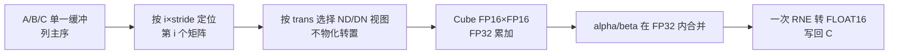

# aclblasHgemmStridedBatched（Ascend 950PR）设计文档

## 1 需求背景

### 1.1 需求来源

本设计对应 10 月社区任务《aclblasHgemmStridedBatched 算子开发（950）》，任务书为随任务下发的 `aclblasHgemmStridedBatched_Atlas950PR_task_doc.md`（下称任务书），并以其随附的 `test_cases/`（1200 条 CSV、200 条 GPU 基线、生成/校验脚本）为评测输入。

事实依据仅取以下材料：任务书 §2.1、§2.3、§2.4、§2.5、§3.2、§3.3、§3.5；`ops-blas` 仓工作区 `/workspace/ops-blas-hgemm`（分支 `feat/hgemm-strided-batched-arch35`，基线 `origin/master 4b51e14`）的既有代码；仓内 `include/cann_ops_blas.h`、`include/cann_ops_blas_common.h` 与 `blas/gemm/arch35/` 下的本算子实现。格式参照社区任务设计模板 `resources/design_template.md`；精度口径引用任务书指定的 opbase `mixed_tolerance_standard`（commit `28a1ce52…`）。

### 1.2 背景与目标

固定步长批量 GEMM 处理一组尺寸和布局相同、彼此独立的矩阵乘。所有矩阵共享一块设备缓冲，第 i 个矩阵由 `i * stride` 的元素偏移定位，因此调用方无需构造设备指针数组。该形态在推理的批量线性层、分组权重和参数扫描中很常见，关键成本有两块：单矩阵的 Cube 效率，以及“每个 batch 发射一次 kernel”带来的固定开销。

仓内已有 `aclblasSgemmStridedBatched` 与 `GemmStridedBatchedEx`，但前者只支持 FP32 且按 batch 循环发射，后者带有 dtype/algo 分派和更严格的 stride 限制；`include/cann_ops_blas.h` 中没有 FP16 接口，也没有 `aclblasHalf` 类型。本任务的目标是补齐半精度接口，并把 batch 维并入任务空间，使一次 launch 覆盖全部 batch。

具体目标：

- 新增唯一公共接口 `aclblasHgemmStridedBatched`，与其它产品线共用，不设 950PR 私有 API；
- 输入/输出/标量均为 FLOAT16，乘加在 FP32 内完成，只在最终写回时做一次 IEEE 754 就近舍入；
- 单次 AIC launch 覆盖 `batchCount × iBlocks × jBlocks` 个 tile，支撑 1024/65536 级 batch；
- 200 条性能用例逐条不低于 0.4× GPU 基线，倍率平均值不低于 0.5×。

### 1.3 标杆能力与计算流程

对标接口为 cuBLAS `cublasHgemmStridedBatched`：参数序列、列主序布局、N/T/C 语义和“单一缓冲 + 固定步长”的寻址方式一致。cuBLAS 的设备侧实现未公开，本设计只对齐公开接口的数学结果与参数行为，不假设其内部 kernel 结构。



实数域下 `ACLBLAS_OP_T` 与 `ACLBLAS_OP_C` 等价，因此实现内部只区分“转置/不转置”两种布局，四种转置结构组合（N/N、N/T、T/N、T/T）在 kernel 入口派发。

## 2 需求分析

### 2.1 公共接口与数据布局

接口签名逐字采用任务书 §2.3，参数序列与 cuBLAS 一一对应；`alpha/beta` 为 Host 端 FLOAT16 标量指针，`lda/ldb/ldc` 为 `int`，三个 stride 为 `long long`，`batchCount` 为 `int`：

```cpp
aclblasStatus_t aclblasHgemmStridedBatched(
    aclblasHandle_t handle,
    aclblasOperation_t transa, aclblasOperation_t transb,
    int m, int n, int k,
    const aclblasHalf* alpha,
    const aclblasHalf* A, int lda, long long strideA,
    const aclblasHalf* B, int ldb, long long strideB,
    const aclblasHalf* beta,
    aclblasHalf* C, int ldc, long long strideC,
    int batchCount);
```

`aclblasHalf` 在 `include/cann_ops_blas_common.h` 中定义为 `typedef uint16_t aclblasHalf;`，承载 16 bit IEEE 754 binary16 位模式，主机侧不做算术，与仓内 FP16 张量一律用 `uint16_t` 表出的约定一致。声明只写入 `include/cann_ops_blas.h`（紧跟 `aclblasSgemmStridedBatched`），全仓只有这一个入口。句柄携带 stream，调用异步提交，由调用方同步并检查执行错误。

设 batch 为 `b`、逻辑行列下标为 `r,c`、约简下标为 `p`，地址以元素计：

| 数据 | 元素地址 | 前导维约束 |
| --- | --- | --- |
| op(A)，N | `b*strideA + r + p*lda` | `lda >= max(1,m)` |
| op(A)，T/C | `b*strideA + p + r*lda` | `lda >= max(1,k)` |
| op(B)，N | `b*strideB + p + c*ldb` | `ldb >= max(1,k)` |
| op(B)，T/C | `b*strideB + c + p*ldb` | `ldb >= max(1,n)` |
| C | `b*strideC + r + c*ldc` | `ldc >= max(1,m)` |

三个 stride 非负且以元素为单位，允许小于紧凑宽度（A/B 的只读跨 batch 重叠）、等于紧凑宽度或带 padding；`stride=0` 表示所有 batch 复用同一矩阵。`strideC=0` 且 `batchCount>1` 属写重叠，任务书不构造该用例，实现按顺序写、最后写者生效，结果不作承诺。

### 2.2 参数校验与边界分支

校验顺序按任务书 §2.5 实现为 V1~V10。关键点是：**尺寸、前导维、stride 与 alpha/beta 判空全部先于 no-op 短路**，因此 `batchCount=0` 且 `strideA<0` 仍返回 `INVALID_VALUE`；**A/B/C 缓冲判空后于短路**，因此合法 no-op 允许三者皆空。

| 序 | 校验项 | 失败返回 | 相对短路的位次 |
| --- | --- | --- | --- |
| V1 | `handle != nullptr` | `HANDLE_IS_NULLPTR` | 前 |
| V2 | `transa/transb ∈ {N,T,C}` | `INVALID_ENUM` | 前 |
| V3 | `m,n,k >= 0` | `INVALID_VALUE` | 前 |
| V4 | `batchCount >= 0` | `INVALID_VALUE` | 前 |
| V5 | `lda/ldb/ldc` 下界（依赖 V2 的转置标志） | `INVALID_VALUE` | 前 |
| V6 | `strideA/B/C >= 0` | `INVALID_VALUE` | 前 |
| V7 | `alpha != nullptr && beta != nullptr` | `INVALID_VALUE` | 前 |
| V8 | `m==0` 或 `n==0` 或 `batchCount==0` → SUCCESS | — | 短路点 |
| V9 | `k>0` 时 A/B 非空 | `INVALID_VALUE` | 后 |
| V10 | `k>0` 或 `beta!=0` 时 C 非空 | `INVALID_VALUE` | 后 |

| 边界条件 | 行为 | 是否访问 A/B/C |
| --- | --- | --- |
| `m=0` 或 `n=0` 或 `batchCount=0` | 直接 SUCCESS，不发射 kernel | 否 |
| `k=0`（其余维度 >0） | 逐 batch `C_i = beta·C_i`，`beta=0` 置零 | 否（不读 A/B；`beta=0` 也不读 C） |
| `k>0` 且 `alpha=0` | 与 `k=0` 同路径，逐 batch `C_i = beta·C_i` | A/B 仍必须非空，但不读取 |
| `k=0`、`beta=0`、`C=nullptr` | SUCCESS（无数据可写） | 否 |
| `beta=1` 的 only-scale | 不发射 kernel，C 保持不变 | 否 |

与仓内同族实现的语义差异必须显式处理，不能直接复用其入口：

- `aclblasSgemmStridedBatched` 对非法枚举返回 `INVALID_VALUE`，本算子按任务书 §2.4 返回 `INVALID_ENUM`；
- `GemmStridedBatchedEx` 禁止多 batch 下 `strideA/strideB=0`、禁止 `strideC=0`，C 非空要求更严（仅 no-op 可绕过）、A/B 是否必需还受 `alpha` 影响；本算子要求 stride 仅为非负、C 仅在 `(k>0 || beta!=0)` 时必需、A/B 仅由 `k>0` 决定；
- Ex 的 dtype/algo/splitK 分派与 14 种 dtype case 不适用于单 dtype 的 Hgemm，本算子使用独立的 `HgemmSb*` tiling 结构，不复用 Ex 结构体。

only-scale 分派固定在 GEMM 之前（`k==0 || alpha==0`），避免 `0 × NaN` 泄漏进结果；`alpha=0` 的判空约束不受该优化影响。

### 2.3 精度与性能目标

精度按任务书 §3.2 的半精度档：golden 为 FP32 参考实现（Netlib BLAS 3.10.0 `cblas_sgemm`，逐 batch、列主序），再按 IEEE 754 就近舍入为 FLOAT16，逐 batch 对 `m×n` 逻辑区域全矩阵比对；判据为逐元素 `|actual-golden| <= atol + rtol·|golden|`，`atol=rtol=2^-10`，`matched_ratio >= 0.99`，且逐元素最大绝对误差不超过 `max(1e-1, 32·ULP(|golden|))`。Inf/NaN 按任务书 §3.2 第 5 条的等价类单独统计，不计入有限值比例。

性能按任务书 §3.3：`msprof op` 采集单算子 Task Duration，预热 5 次不计入，有效样本不少于 10 次取算术平均；逐条 `GPU_us / NPU_us >= 0.4`，全部 200 条倍率的算术平均 `>= 0.5`，两项同时满足。

## 3 详细设计

### 3.1 算子分析

每个 batch 计算：

```text
C_b[r,c] = alpha * sum_{p=0}^{k-1} op(A_b)[r,p] * op(B_b)[p,c] + beta * C_b[r,c]
A_b = A + b*strideA,  B_b = B + b*strideB,  C_b = C + b*strideC
```

主计算量约 `2*batchCount*m*n*k` FLOPs。A/B/C 与 alpha/beta 全部为 FLOAT16，仅 alpha/beta 在 Host 端经位模式精确提升为 FP32；形状由运行时入参决定，无编译期 shape、无广播、无动态 shape 特化要求。

| 维度 | 任务书覆盖范围 | 随附 CSV 实际覆盖 |
| --- | --- | --- |
| m/n/k | 0、1、质数、2 的幂 ±1，直至 16384 | 最大各 4096 |
| batchCount | 0、1、2、质数、2 的幂，直至 65536 | 最大 1024 |
| transa/transb | N/T/C 全组合 | N/T/C 全组合 |
| stride | 紧凑、padding、小于紧凑、0 | 同左 |

### 3.2 实现架构与文件落位

采用 handle/stream 绑定的 Ascend C kernel 直调，不引入 ACLNN 或框架层。三层职责固定：

| 层 | 载体 | 职责 |
| --- | --- | --- |
| 启动层 | `hgemm_strided_batched_host.cpp` | 参数校验、tiling、workspace、按路径发射 kernel |
| Cube 计算 | AIC，`KERNEL_TYPE_AIC_ONLY` | GM→L1→L0A/L0B→Mmad→L0C→Fixpipe |
| Vector 后处理 | AIV，`KERNEL_TYPE_AIV_ONLY` | `alpha·temp + beta·C`、`beta·C`、置零 |

| 文件 | 职责 |
| --- | --- |
| `include/cann_ops_blas_common.h` | 新增 `aclblasHalf` 类型 |
| `include/cann_ops_blas.h` | 新增唯一公共声明 |
| `blas/gemm/arch35/hgemm_strided_batched_tiling_data.h` | `HgemmSbGemmTilingData` / `HgemmSbCombineTilingData`，POD、按值传参 |
| `blas/gemm/arch35/hgemm_strided_batched_kernel.h` | 四个 launcher：GEMM / combine / beta-scale / zero |
| `blas/gemm/arch35/hgemm_strided_batched_kernel.cpp` | AIC GEMM 与三个 AIV kernel |
| `blas/gemm/arch35/hgemm_strided_batched_host.cpp` | 公共入口、V1~V10、tiling、launch 编排 |

发射路径：no-op 不发射；`k==0 || alpha==0` 时 `beta=0` 发 1 次 zero、`beta=1` 不发射、其余发 1 次 beta-scale；`alpha==1 && beta==0` 发 1 次 AIC GEMM 并用 Fixpipe 直写 C；其余每组发 1 次 GEMM（写 FP32 temp）+ 1 次 combine。所有路径的 launch 数都与 `batchCount` 无关（一般路径只与 workspace 分组数有关）。

### 3.3 Host/Tiling 设计

行主序的 Blaze 引擎计算 `C^T = op(B)^T · op(A)^T`，因此把列主序问题换序后交给引擎，不物化任何转置矩阵：

| 量 | 取值 | 说明 |
| --- | --- | --- |
| `mEff / nEff / kEff` | `n / m / k` | 引擎坐标 |
| left / right | 原 B / 原 A | 引擎 left = `op(B)^T`，right = `op(A)^T` |
| `ldLeft / transLeft` | `ldb / (transb != N)` | 0→NDExt，1→DNExt |
| `ldRight / transRight` | `lda / (transa != N)` | 0→NDExt，1→DNExt |
| 输出 `ldC` | 快速路径 `ldc`；一般路径 `align16(m)` | 输出布局为 NDExt(mEff, ldC) |

tile 预设按引擎坐标选择，全部 16 对齐（FP16 分形为 16 元素 = 32B），`baseK=16` 固定为 FP16 MMAD 的 K 分形：

| 预设 | 触发条件 | baseM | baseN | kL1 | 定位 |
| --- | --- | --- | --- | --- | --- |
| P0 小型 | `mEff·nEff <= 64·64` | `align16(min(mEff,64))` | `align16(min(nEff,64))` | `align16(min(max(k,16),128))` | 小矩阵不浪费 Mmad |
| P1 默认 | 其余 | 128 | 128 | 256 | 通用 |
| P2 中大 | `mEff,nEff >= 256` | 128 | 256 | 128 | 降低单 tile 搬出量 |
| P3 大型 | `mEff,nEff >= 256` 且 256 网格任务数 ≥ 2 波，且覆盖面积填充率 ≥ 0.6 | 256 | 256 | 128 | 吃满 L0C，提升复用 |

P3 是性能迭代新增项：`256×256` 的 FP32 累加器正好占满 256KB L0C，把每个 flop 的 `(baseM+baseN)` 操作数重填量降低约 1/3；但边缘 tile 填充率低时会被“占满任务槽却只算一小块”拖慢，实测 268³×143 在无门限时从 61.6us 劣化到 94.5us（+53%），因此保留“至少两波任务 + 填充率 ≥ 0.6”的门限（3×3 网格放宽到 0.5）。

任务空间把 batch 也扁平化，Host 填充 `totalTasks`，kernel 内按固定步长游走：

```text
totalTasks = batchCount * iBlocks * jBlocks      // i 对应引擎 M(=原 n)，j 对应引擎 N(=原 m)
grid       = min(GetAicCoreCount(), totalTasks)
decode(t)  : batch = t / (iBlocks*jBlocks)
             rem   = t % (iBlocks*jBlocks)
             i     = rem / jBlocks;  j = rem % jBlocks
             if (i & 1) j = jBlocks - 1 - j        // O5 蛇形序
loop       : for (t = blockIdx; t < totalTasks; t += grid)
```

每个 GM 基址在 kernel 内按 `base + (int64)batch * stride` 计算，`stride=0` 自然退化为广播；`int64` 保证 65536 batch 的偏移精确。Host 侧断言 `batchCount·iBlocks·jBlocks <= UINT32_MAX`，超出返回 `INVALID_VALUE` 而不是截断。核数由 `GetAicCoreCount()/GetAivCoreCount()` 运行时查询，代码不写死：设计参考配置 `Ascend950PR_9579.ini` 为 AIC 28 / AIV 56，本任务实测设备 `Ascend950PR_9589` 返回 AIC 32 / AIV 64。

一般路径的 workspace 按 batch 分组复用：`tempRowStride = align16(m)`，`tempBatchStride = n·tempRowStride`，单批 FP32 字节数为 `n·align16(m)·4`；`g = max(可用 workspace / 单批字节, 1)`，`groups = ceil(batchCount/g)`，每组发射 1 次 GEMM（写 temp）和 1 次 combine。库自有 workspace 默认 32MiB、可按需增长至 2GiB；增长失败或用户注入的 workspace 不足时返回 `EXECUTION_FAILED`，不做无界分配。

AIV 侧任务空间为 `(batch, column)` 扁平化：`totalColTasks = batchCount·n`，`grid = min(AIV 核数, totalColTasks)`，每个任务处理 C 的一列（长度 m），UB 内按 `tileLen=2048` 分块，尾块用 `DataCopyPad` 处理。

### 3.4 Kernel 设计

#### 3.4.1 GEMM 主路径

```text
A/B(GM, FLOAT16, 列主序)
  │ MTE2：CopyGM2L1，ND2NZ / DN2NZ / ND2Zn / DN2Zn 按 trans 自动派发
  ▼
L1（left 为 NZ，right 为 ZN；多 chunk 形状 4 bank，单 chunk 形状 2 个半 L1 bank）
  │ MTE1：按 baseK=16 切片搬入 L0A/L0B（双缓冲）
  ▼
L0A/L0B → Mmad(FP16×FP16 → FP32) → L0C（256KB）
  │ Fixpipe：F322F16（CAST_RINT）
  ▼
C(GM, FLOAT16)  [快速路径]     或     temp(GM, FP32)  [一般路径 → AIV combine]
```

关键设计：

- 四种 `(transLeft, transRight)` 组合在 kernel 入口按 tiling 标志派发到四个模板实例，转置只体现为 GM Layout 选择，不做数据重排；
- `kL1=128/256` 的连续 K chunk 流：多 chunk 形状最多 4 个 L1 bank、预取深度 2，chunk c+1 的 GM→L1 在 chunk c 消费前发出，任务边界也保持流水；单 chunk 形状退化为“任务 t+1 的搬运先于任务 t 消费”的两 bank 形式；
- L0C 双缓冲：`baseM·baseN·4·2 <= 256KB` 时开两个累加槽，任务 t 的 Fixpipe 可推迟到任务 t+1 的 K 循环期间完成；`256×256` 占满 L0C，保持单槽串行；
- Mmad 用 `unitFlag=2`（非末块）与 `unitFlag=3`（末块）区分 FIX 时机，首块以 `cmatrixInitVal` 清零累加器，事件按 `MTE1_MTE2 / MTE1_M / M_MTE1 / M_FIX / FIX_M` 成对出现；
- 蛇形序让同一 `i` 下的 `j` 连续执行，左侧操作数（原 B 的一个 `baseM×kEff` 块）在工作集中复用；8192³ 时该块为 `256×8192×2B = 4MB`，可驻 L2。

#### 3.4.2 超小矩阵批量分组

8³/16³/18³/32³ 且 batch 为 1024 量级的用例中，Cube 占比不足 2%，瓶颈是 AIC 标量（0.91~0.97）与每次 512B~2KB 小拷贝的 MTE2 描述符开销（0.86~0.92）。快速路径为此增加分组分支，适用条件完全是结构判定：`outHalf`、`iBlocks==jBlocks==1`、单 K chunk、`mEff,nEff<=32`、`kEff<=128`、`batchCount>=2`、两个输入 stride 恰好等于各自布局容量、输出 stride 等于 `mEff·ldC`。

满足时，每核处理一段连续 batch，每组最多 `S=16` 个 batch：一次 3D GM→L1 拷贝搬入整组（`ndNum=S`），一次 5D-NZ→3D-NDExt 批量 Fixpipe 写出整组，两组 L1 bank 与两组 L0C 槽交替预取。`kEff>16` 时该分支内部用 `baseK=32` 合并两次 Mmad，属唯一改变数值分组顺序的优化，已由全量精度回归覆盖。

#### 3.4.3 combine 与 only-scale

combine 在原始（未换序）坐标上工作：任务 `(batch, col)` 读取 temp 中连续的 m 个 FP32 值，`Muls(alpha)`；`hasBeta=1` 时再读 C 的同一列、`Cast(CAST_NONE)` 提升后 `Muls(beta)` 并 `Add`，最后一次 `Cast(CAST_RINT)` 写回 FLOAT16。`beta=0` 时 `hasBeta=0`，**不建立对旧 C 的读依赖**，因此旧 C 为 NaN 也不会泄漏。

only-scale 路径覆盖 `k=0` 与 `alpha=0`：`beta=0` 走 zero kernel，用 `Duplicate` 写 0 且不读 C；其余走 beta-scale kernel，按 `Cast→Muls(beta)→Cast(CAST_RINT)` 原地缩放；`beta=1` 不发射。三者都是单次 launch 覆盖全部 `(batch, column)`，与 Sgemm 的逐 batch host 循环不同。

### 3.5 边界与非对齐处理

| 情形 | 处理 |
| --- | --- |
| `ldc` 任意（奇数、非 16 倍数、`ldc>m`、`ldc<n`） | 快速路径 Fixpipe 按 NDExt(mEff, ldc) 写，`dstStride` 以元素计；奇/非 16 倍数 `ldc` 的直写由 200 条性能用例与 L0 小尺寸用例（`ldc=4/8`）覆盖；只承诺 `m×n` 逻辑区域，ld padding 不参与精度判定 |
| `n` 非 16 倍数 | 尾块 `curN = min(baseN, nEff-nOff)`，Fixpipe `nSize` 用实际值 |
| `m` 非 16 倍数 | 尾块 `curM` 截断，Mmad/Fixpipe 均使用实际尺寸 |
| `k` 非 16 倍数、`k<16` | 最后一个 K chunk / L0 片分别截断；Mmad 的 k 允许非 16 倍数 |
| `stride=0` 或小于紧凑宽度 | `batch*stride` 为 0 时广播；小于紧凑宽度时只改基址，允许 A/B 只读重叠 |
| `batchCount = 65536` | 任务空间与 int64 基址覆盖，不按 batch 发射 |
| no-op 下空指针 | 校验顺序保证不解引用 |
| `alpha/beta` 为 Host 指针 | 直接解引用，不调用设备指针位置检查 |

### 3.6 硬件与资源约束

目标硬件仅 Ascend 950PR（DAV_3510 / arch35），编译由 `build.sh --soc=ascend950` 选择架构，代码以 `ASC_DEVKIT_GE_9_1` 保护，CANN 9.1.0 以下不参与编译。

| 资源 | 预算约束 | 最坏实例 |
| --- | --- | --- |
| L1（512KB） | `4 × (align16(baseM)+align16(baseN)) × align16(kL1) × 2B` | `256×256, kL1=128` → 4×512×128×2 = 512KB |
| L0A（64KB） | `2 × baseM × baseK × 2B` | `256×16×2×2 = 16KB` |
| L0B（64KB） | `2 × baseK × baseN × 2B` | 同左 |
| L0C（256KB） | `baseM·baseN·4`；双缓冲要求 `2×` 仍 ≤ 256KB | `256×256×4 = 256KB`（单槽） |
| UB（≤232KB 预算） | combine 5 组双缓冲 × `tileLen` | `tileLen=2048` → 64KB |
| GM workspace | `g·n·align16(m)·4`，≤ 2GiB | 65536×8³ 可分组 |

Host 在发射前用 `CheckTileBudget` 复核 L1/L0C，失败返回 `EXECUTION_FAILED`；L2（百 MB 级）用于跨 tile 操作数复用，不作为显式分配资源。AIC/AIV 核数通过平台接口查询；L1/L0C/UB 容量按 arch35 平台常量固化在算子内，并在发射前复核 tile 预算，不把其它产品线的容量值当作本机保证。

### 3.7 工程集成与兼容性

- 源码目录按任务书放在 `blas/gemm/arch35/`；文件名统一以 `hgemm_strided_batched_` 开头，才能通过 `build.sh --ops=hgemm_strided_batched` 的前缀过滤；`CMakeLists.txt` 未做任何修改，`arch35/*.cpp` 由既有 GLOB 纳入；
- 全仓 `arch35/*.cpp` 链入同一库，`extern "C" __global__` 符号全局可见，因此 kernel 符号加 `hgemm_sb_` 前缀、tiling 结构体用 `HgemmSb*`，避免与 Sgemm/Ex 的 `gemm_sb_*`、`GemmStridedBatchedExTilingData` 重名；
- 接口声明进公共头，不新增产品线私有头或平行 API；新类型 `aclblasHalf` 放公共 common 头，避免调用方各自定义；
- 不改动 SgemmStridedBatched、GemmStridedBatchedEx 的代码路径，新增实现与它们只在公共头文件中并存；
- 测试目录落在 `test/gemm_strided_batched/hgemm_strided_batched/arch35/` 以匹配仓内 `test/<family>/<op>` 解析与 `verify_accuracy.py` 的路径假设；PR 阶段按任务书 §5 的 `test/gemm/hgemmStridedBatched/arch35` 目录归档，差异在 PR 说明中标注。

## 4 可维可测分析

### 4.1 功能、精度与边界验证

CSV 驱动 C++ GTest，共 1000 条精度用例 + 200 条性能用例；精度用例按类别覆盖：

| 类别 | 条数 | 覆盖内容 |
| --- | --- | --- |
| L0 | 18 | 9 种 trans 组合 × {4,8} 基础用例 |
| MN | 47 | m/n/k 从 1 到 4096 的方阵/矩形扫描与尾块 |
| CV | 21 | batchCount 0/1/2/3/5/8/…/1024 与 stride 组合 |
| AB | 10 | alpha/beta ∈ {0,1,-1,0.5,1.5,2.5,65504} 等组合 |
| LD | 22 | ld padding、单维 padding、stride 紧凑/加 padding/偏小/0 |
| ED | 41 | no-op、k=0、alpha=0、空指针、非法枚举/维度/ld/stride/batch |
| FL | 18 | Inf/NaN 注入、0/1 矩阵、极端值溢出 |
| EX | 823 | 补充尺寸、转置、批数与随机分布（含 ldc=12< n=15 等非对齐组合） |
| PF | 200 | 性能用例，形状覆盖 8³~8192³ 与 batch 1~1024 |

golden 按任务书口径实现：把实际 FP16 输入逐 batch 提升到 FP32，用 Netlib `cblas_sgemm` 列主序计算，再把 `m×n` 逻辑区域按 RNE 收窄回 FLOAT16；ld padding 只做信息性统计，不参与判定。测试额外用 `GoldenBackendContract` 自检参考 BLAS 的三条语义：`beta=0` 不读 C、`alpha=0` 不读 A/B、`beta!=0` 读 C，防止 golden 自身把负向用例判错。

精度判据在测试内固定为：`|a-g| <= 2^-10 + 2^-10·|g|`；有限元素 `matched_ratio >= 0.99`；每个有限元素满足 `|a-g| <= max(1e-1, 32·ULP(|g|))`；非有限元素按“同 NaN / 同号 Inf / NaN 与 ±Inf 互为等价”逐元素判定，不满足即失败。负向用例按 CSV 的 `expect_result` 校验返回码，非法枚举必须保持非法，不回落 N。

最终实测（`tmp/final_verify/`，设备 950PR_9589 独占）：**1000/1000 PASS**（含 `GoldenBackendContract` 共 1001 个测试）；`matched_ratio` 最低 0.9998667；`max_abs_error` 最大 2.0（该元素 `|golden|=2178`，逐元素上限 64，超限元素 0）；9 条用例含非有限值共 4242 个，等价类判定全部通过；位模式不完全一致的元素约 127 万（FP32 累加顺序差异，均在容差内）。padding 变化为信息项：有逐 case 统计的 969 条中仅 TC_EX_0628（`ldc=12 < n=15`）报告 1920 个 padding 元素被改写，其逻辑区域仍 100% 匹配，其余 968 条为 0。

### 4.2 性能验证

200 条 `TC_PF_*` 全部是 `alpha=1, beta=0`、紧凑 ld/stride，因而全部走快速路径；输入分配、golden 与校验在计时区间外。测试框架默认 warmup 5 次、20 个有效样本（`HGMM_SB_PERF_SAMPLES` 可调，下限 10），以 `aclrtEvent` 的 device 区间作为 `device_event` 口径；同时记录 host 墙钟，用于拆分提交开销。

最终结果：**200/200 PASS**，平均倍率 **1.1269**，最低 **0.4318**（TC_PF_1010），最高 2.5740；四条典型用例 TC_PF_1001/1002/1003/1004 分别为 **0.5677 / 0.6782 / 0.8539 / 0.6248**。收敛后 9 条原不达标用例（8³/16³/18³/32³ 大 batch、744³/704³、8192³）全部 ≥0.4。

任务书判据以 `msprof op` 的 Task Duration 为准，测试框架的 `device_event` 只作为回归护栏。两者差异经 12 条实测校准：

| case | Task Duration(us) | device_event(us) | 差值 | msprof 倍率 | event 倍率 |
| --- | --- | --- | --- | --- | --- |
| TC_PF_1009（16³×256） | 3.014 | 7.262 | +4.25 | 1.4315 | 0.594 |
| TC_PF_1010（16³×1024） | 4.456 | 8.007 | +3.55 | 0.9753 | 0.543 |
| TC_PF_1019（256³×32） | 8.612 | 21.302 | +12.69 | 0.7890 | 0.319 |
| TC_PF_1004（2048³×2） | 89.282 | 91.606 | +2.32 | 0.6402 | 0.624 |

差值不是 kernel 时间，而是 `RecordEvent(start)` 之后到 kernel 真正下发之间的 host 提交窗口（tiling/资源准备 + ACL launch），近似固定为 2~13us：kernel 越短，占比越大，`device_event` 的倍率被压得越低，且随宿主负载抖动。msprof 12 条为 **12/12 ≥ 0.4，几何均值 0.9997，最低 0.6402**（TC_PF_1004）。

瓶颈定位：

- **8192³×1（大尺寸）**：1024 个 `256×256` tile 分到 32 个 AIC，固定 `i` 下的 `j` 连续执行，左侧 4MB 操作数块驻 L2，HBM 流量压到 A+B 各一遍 + C 一遍（约 403MB）。实测 2808.9us，约 **391 TFLOPS**，为 32 核 FP16 峰值推算（432 TFLOPS）的 **90.5%**，该段已转为 Cube 吞吐 + C 搬出主导，而非带宽受限；
- **8³~32³ 大 batch（小尺寸）**：单次 kernel 的 Task Duration 下界约 3.0~4.5us（16³×256 3.014us、8³×1024 4.336us），主要由 launch/任务扫描与每任务搬运指令开销构成；msprof 显示 cube 占比 <2%、AIC 标量 0.91~0.97、MTE2 0.86~0.92。分组搬运 + 批量 Fixpipe 把 16³×1024 的 kernel 从 7.61us 降到约 3.3us，device_event 从 15.54us 降到 8.82us；32³×1024 从 13.74us 降到 10.67us；
- **中等尺寸**：P3 `256×256` 的收益依赖填充率，无门限时 20 条边缘形状出现劣化（最高 53%，268³×143）；加入两波任务 + 填充率 ≥0.6 门限后，8192³（4227→2809us）、744³×64（317→260us）、704³×75（252→205us）收益保留，边缘形状回退 128×256；
- **环境长尾**：共享宿主上偶发 15~80us 的长尾样本会抬高 `device_event` 均值，p50 稳定；最终跑 200/200 PASS，5 条 >5% 的下降经 40 样本单独复测均恢复，确认为调度抖动而非代码回归。

### 4.3 可复现与维护

构建与两类测试的命令如下（工作目录为仓根，产物路径以 `--soc=ascend950` 为准）：

```bash
source /usr/local/Ascend/ascend-toolkit/set_env.sh
bash build.sh --soc=ascend950 --ops=hgemm_strided_batched

BIN=build/test/gemm_strided_batched/hgemm_strided_batched/hgemm_strided_batched_test

# 精度：1000 条 CSV + 1 条 golden 后端自检
BLAS_DEVICE_ID=0 BLAS_RESULT_DIR=$PWD/out/acc \
  $BIN --gtest_filter='-*TC_PF*'

# 性能：200 条，warmup=5 / 20 样本；SKIP_GOLDEN 只用于纯计时
BLAS_DEVICE_ID=0 HGMM_SB_PERF_SKIP_GOLDEN=1 HGMM_SB_PERF_WARMUP=5 HGMM_SB_PERF_SAMPLES=20 \
  BLAS_RESULT_DIR=$PWD/out/perf $BIN --gtest_filter='*TC_PF*'
```

任务书 §3.3 的权威口径另用 msopprof 采集，模板为：

```bash
msopprof --application="$BIN --gtest_filter=*TC_PF_1004*" --output=$PWD/out/prof \
  --launch-skip-before-match=5 --launch-count=20 --warm-up=5 --aic-metrics=BasicInfo
```

每次运行的 `hgemm_strided_batched_accuracy_results.csv` 记录逐 case 的 `matched_ratio`、`max_abs_error`、非有限值与判定；`hgemm_strided_batched_perf_results.csv` 记录 `avg_us / p50 / min / ratio / tflops / bw` 与基线关联。CSV 用例与 `gpu_baseline.csv` 固定在 `test/gemm_strided_batched/hgemm_strided_batched/arch35/`，结果目录由 `BLAS_RESULT_DIR` 重定向，复跑不会污染仓库内 CSV。

维护要点：tiling 结构体是 Host/Kernel 唯一契约，新增字段必须两侧同步并按值传递；L1/L0C 预算变更走 `CheckTileBudget` 常量；新增 tile 预设需同时给出填充率门限与对应精度回归；kernel 符号与结构体保持 `hgemm_sb_` / `HgemmSb` 前缀，避免同库重名。

### 4.4 兼容性分析

本算子为新增接口，不改变任何已有 API 的签名、返回码或数值行为；公共头只做追加，`aclblasHalf` 使用 `uint16_t` 别名，不引入 C++ 专属类型或 ABI 依赖。实现通过 `ASC_DEVKIT_GE_9_1` 隔离，仅在 CANN ≥ 9.1 的 arch35 工具链编译；任务书只要求 Ascend 950PR，未在 910B/A2/A3 上验证，文档与 README 的产品支持表仅标注 Ascend 950PR。`strideC=0` 的多 batch 写重叠、C 的 ld padding 与批次间隙均不属于逻辑输出，实现不作数值承诺，调用方不应依赖这些区域的内容。
