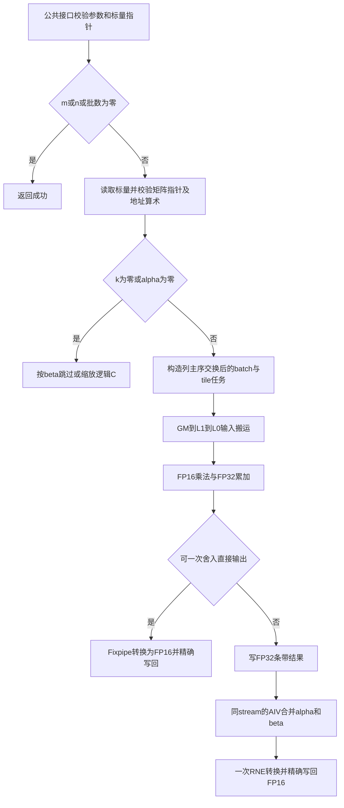

# aclblasHgemmStridedBatched（Ascend 950PR）设计文档

## 1 需求背景

### 1.1 需求来源

本设计对应 [10月社区任务-aclblasHgemmStridedBatched算子开发（950）](https://www.hiascend.com/activities/task-center/details/39ca031614a04829b74c47a68265db99)，依据该页面发布的《aclblasHgemmStridedBatched_Atlas950PR_task_doc.md》及随附测试指导、用例 CSV 和 GPU 基线。网页提供 ZIP 下载，未提供与下载正文对应的 Git commit；不以文件摘要或参考仓库 commit 代替任务书版本。

设计参考 [社区任务设计模板](https://gitcode.com/cann/cann-competitions/blob/master/04_tasks/01_community-task-2026/resources/design_template.md)，实现基于 [ops-blas](https://gitcode.com/cann/ops-blas)，精度依据任务书引用的 [mixed_tolerance_standard](https://gitcode.com/cann/opbase/blob/28a1ce52ae856353589841226a0002af73314a6b/docs/zh/ops_precision_standard/mixed_tolerance_standard.md)。

### 1.2 背景与目标

固定步长批量 GEMM 用于具有相同尺寸和布局的多个独立矩阵乘法。矩阵位于单一设备缓冲中，通过元素步长定位各批次，避免构造设备指针数组。目标是在 Ascend 950PR、CANN 9.1.0 上以 Ascend C kernel 直调补齐半精度接口，复用 GEMM 族的布局、搬运、矩阵计算及句柄工作区机制，并减少小矩阵大批量场景的逐批次发射开销。

### 1.3 标杆能力与计算流程

标杆为 [cuBLAS gemmStridedBatched](https://docs.nvidia.com/cuda/cublas/index.html#cublas-gemmstridedbatched) 的 Hgemm 接口，支持半精度列主序固定步长批量 GEMM 和 N/T/C。cuBLAS 设备内部实现源码未公开，本设计按公开接口及任务书对齐数学结果、参数和边界行为，不虚构其内部 kernel 或 TBE 源文件；本任务也不依赖 TBE/ACLNN 算子信息库。


## 2 需求分析

### 2.1 公共接口与数据布局

在 `include/cann_ops_blas.h` 增加唯一公共声明，接口序列与 cuBLAS 对齐，不另设产品线专用 API：

```cpp
aclblasStatus_t aclblasHgemmStridedBatched(
    aclblasHandle_t handle,
    aclblasOperation_t transa, aclblasOperation_t transb,
    int m, int n, int k,
    const aclblasHalf* alpha,
    const aclblasHalf* A, int lda, long long strideA,
    const aclblasHalf* B, int ldb, long long strideB,
    const aclblasHalf* beta,
    aclblasHalf* C, int ldc, long long strideC,
    int batchCount);
```

`alpha/beta` 为 Host FLOAT16 标量指针；A/B/C 为 Device FLOAT16 缓冲。句柄关联 stream，计算异步提交到该 stream，由调用者同步并检查执行错误。`transa/transb` 支持 N/T/C，实数 C 与 T 等价。

设批次为 `b`，行列下标为 `r,c`，约简下标为 `p`，地址均以元素计：

| 数据 | 逻辑元素地址 | 前导维要求 |
| --- | --- | --- |
| op(A)，N | `b*strideA + r + p*lda` | `lda >= max(1,m)` |
| op(A)，T/C | `b*strideA + p + r*lda` | `lda >= max(1,k)` |
| op(B)，N | `b*strideB + p + c*ldb` | `ldb >= max(1,k)` |
| op(B)，T/C | `b*strideB + c + p*ldb` | `ldb >= max(1,n)` |
| C | `b*strideC + r + c*ldc` | `ldc >= max(1,m)` |

所有步长非负，支持紧凑、padding、只读 A/B 的跨批次重叠和零步长复用。零步长不扩展矩阵维度的广播规则。C 的不同批次应具有互不重叠的逻辑输出区域；随附测试指导将输出重叠列为未定义，不为该情形承诺并行执行顺序。前导维 padding 和批次间隙不属于逻辑 C 输出，须保持原值。

### 2.2 参数校验与边界分支

按以下顺序处理，避免空任务掩盖非法参数，也避免读取空矩阵指针：

1. 空 handle 返回 `ACLBLAS_STATUS_HANDLE_IS_NULLPTR`。
2. 非 N/T/C 枚举返回 `ACLBLAS_STATUS_INVALID_ENUM`。
3. 校验 m/n/k、batchCount 非负，lda/ldb/ldc 满足前导维约束，三个 stride 非负，alpha/beta 指针非空；失败返回 `ACLBLAS_STATUS_INVALID_VALUE`。
4. `m==0 || n==0 || batchCount==0` 返回 SUCCESS，不解引用 A/B/C，也不发射 kernel。标量指针已校验非空，零任务无需解引用其数值。
5. 对有效输出尺寸，`k>0` 时 A/B 必须非空，与 alpha 是否为零无关；`k>0 || beta!=0` 时 C 必须非空。
6. `k==0 && beta==0 && C==nullptr` 按任务书参数表和正向用例返回 SUCCESS；C 非空时仅置零逻辑输出区域。`k==0` 不读取 A/B。
7. `k==0` 或 `alpha==0` 进入独立缩放路径；beta 为零时只写零、不读旧 C，beta 为一时无需修改 C，其余执行 FP32 缩放并舍入回 FLOAT16。alpha 为零的优化在第 5 步之后执行。

对包含 NaN 的标量，零值判断使用实际数值比较，不以绝对值比较误判。前导维与步长以有符号类型校验后再转换；所有矩阵跨度、批次偏移、元素到字节的乘法均作溢出检查。对有效缓冲的最后一个可访问元素，按 `(batchCount-1)*stride + (cols-1)*ld + rows-1` 检查地址算术；不要求 stride 大于单矩阵跨度。库不能推断调用者实际分配的缓冲长度，该长度由调用者保证。

### 2.3 精度与性能目标

输入、标量与输出保持 FLOAT16，乘法使用 FP16 输入、FP32 累加，通用 alpha/beta 合并在 FP32 完成后一次 round-to-nearest-even 回写 FLOAT16，避免先将矩阵乘积舍入到 FP16 再合并。

golden 按任务书使用 Netlib BLAS 3.10.0 `cblas_sgemm` 逐批次计算，再舍入到 FLOAT16。逐批次、全逻辑矩阵验证，固定 `atol=rtol=2^-10`、有限值匹配率不低于 0.99。按指定 commit 精度标准 §2.1.2，最大误差硬限为 `max(0.1, 32*ULP(g_low))`；`g_low` 是最大绝对误差位置的 golden 收窄到实际输出 FLOAT16 的值，不能取全矩阵最大 golden 值来抬高阈值。FLOAT16 的零/次正规数 ULP 为 `2^-24`，其余有限值按指数与10位尾数计算；65504处 ULP 为32，不用向 Inf 的相邻值之差造成无限阈值。输出实际最大误差、锚点和所得硬限；不以 MERE/MARE 替代混合容差，也不采用标准备注允许的更宽松逐元素阈值。

非有限值独立统计：双方 NaN、同号 Inf、NaN 与任意符号 Inf 按任务书视为等效；异号 Inf 或有限/非有限混配不通过。非有限元素不计入有限值比例，若某批次无有限元素，则有限值检查记为不适用，仍要求所有非有限元素等效。大 k 或 FP16 溢出失败须给出原始输出、CPU 对照及累加路径分析，不放宽阈值。

性能主口径为任务书 §3.3：msprof op 模式，预热 5 次，预热外连续 10 个有效样本，取单次算子设备耗时的算术平均，单位 us；逐例 `GPU_us/NPU_us >= 0.4`，全部 200 条性能 case 的倍率算术平均不低于 0.5。GPU 附件 `gpu_ms` 转换为 us 时乘 1000，不重新生成或覆盖已填入的基线。

任务书 §7.4 另写“有效采样 >10 次、达到 GPU 性能”，测试指导又要求 >50 次，存在口径冲突。验证计划保留独立的预热5+10有效样本组，另在重新准备输入后采集预热5+至少60个有效样本组，同时报告两组均值和逐例是否达到1.0× GPU；正式验收判据需任务方确认。不得把 §3.3 通过直接写成全部要求通过。

## 3 详细设计

### 3.0 依赖与调用方式

采用 handle/stream 绑定的 Ascend C kernel 直调，不增加 ACLNN 或 PyTorch 调用层。内部依赖 ops-blas 的句柄、有效工作区、状态码、日志、平台查询及 GEMM 模板；外部依赖 CANN 9.1.0 Ascend C 编译器、运行时和所用 Cube/Vector API。构建时沿用仓库锁定的第三方依赖及兼容头，避免依赖开发机未提交的补丁。

测试侧依赖仓库 CSV/GTest 框架、Netlib BLAS 3.10.0 CBLAS、msprof op；材料生成侧按脚本固定 Python 与工作簿/截图处理依赖。CPU BLAS 和报告工具不进入算子运行时依赖。

### 3.1 算子分析

每批次计算：

```text
C_b[r,c] = alpha * sum_p(op(A_b)[r,p] * op(B_b)[p,c])
           + beta * C_b[r,c]
```

主计算量约为 `2*batchCount*m*n*k` FLOPs。大矩阵关注 Cube 利用率与数据复用；小矩阵大批量关注核占用、任务发射次数和尾块开销。一般不使用 split-K，单个输出块由一个 AIC 完成全部 k 归约，避免跨核原子累加及额外舍入。必要的 split-K 优化须作为后续独立策略验证精度与总耗时。

底层参考仓库 GEMM 的布局和流水模式，并复用 `gemm_strided_batched_ex/arch35` 中已有 half×half→float 的 BlockMmad 模板和 batch×tile 调度能力。现有普通 GEMM 的 tensor_api FP32 专用实例不能直接处理 FP16 数据；将所需的 GEMM 计算模板提取到 `blas/gemm/arch35/`，按输入/输出类型、布局和批次参数实例化 FP16→FP32 累加路径，避免另造并行 GEMM 引擎，并对原调用路径回归。半精度新增实现仍放在任务指定的 `blas/gemm/arch35/`。

### 3.2 Host/Tiling 设计

Host 读取两个半精度标量并提升到 FP32，构造一次 Tiling。Tiling 包括 m/n/k、lda/ldb/ldc、64 位 stride、batchCount、转置标志、alpha/beta、tileM/N/K、尾块尺寸、任务总数和工作区描述。按平台接口查询 AIC/AIV 数及内存资源，失败时返回库错误，不以零核继续提交。

列主序通过计算 `C^T = op(B)^T * op(A)^T` 适配行主序 GEMM：交换 m/n、A/B、lda/ldb、strideA/strideB 和转置标志，输出仍映射到原 C 的地址。不在 GM 物化整体转置。

输出分块与批次共同形成任务空间：

```text
tilesM = ceil(n / tileM)   # 交换后坐标
tilesN = ceil(m / tileN)
tilesPerBatch = tilesM * tilesN
totalTasks = batchCount * tilesPerBatch
task = coreId, coreId+usedCores, ... < totalTasks
batch = task / tilesPerBatch
tile = task % tilesPerBatch
```

`usedCores <= min(totalTasks, AIC数)`，任务数量及索引用 64 位计算。小矩阵将多个 batch 分派到不同核心；大矩阵在一个 batch 内切 M/N tile。使用确定的 tile 次序，按需要蛇形遍历改善局部性。通用路径若需分条带工作区，在每个条带内部仍保留 batch/tile 并行；条带间按同一 stream 顺序复用工作区，避免每个 batch 单独发射整套 kernel。

首选候选块为 M/N 的 16 对齐、K 的 FP16 分形对齐，先验证 64×64、128×64、128×128 等候选；不把 FP32 的 K 对齐、Fixpipe 对齐直接套用到 FP16。实际合法块、指令边界与选择阈值以 CANN 9.1.0 编译验证及设备 profiling 决定，不依赖 CSV case 名或 golden 数据分派。

kernel 直调不使用 ACLNN 的 tilingKey 注册机制。Host 通过明确的内部枚举/模板实例选择四种 N/T 组合、缩放、微小矩阵SIMT、Fixpipe直写和 FP32 临时结果加合并路径；C 在 Host 归一为 T。分派条件仅来自已校验尺寸、布局、alpha/beta 和资源约束，Tiling 中保留必要的运行时参数。

### 3.3 Kernel 设计

#### 3.3.1 GEMM 主路径

每个 AIC 根据任务编号确定 batch 和输出 tile，按 `batch*stride` 定位输入。GM 视图按转置组合选择行/列布局；使用 GM→L1、L1→L0A/L0B、FP16 Mmad→FP32 L0C 的数据流，K 分块累加，首块初始化累加器，最后一块完成后输出。

L1采用K chunk256，候选64²/128²输出块对应L0 K块64/128；不复用旧Ex的L1硬编码地址。L1 与 L0A/L0B 双缓冲按已消费事件复用；MTE2、MTE1、M、FIX 之间使用成对事件同步，任务切换前完成仍引用旧缓冲的流水。多个 batch 或尾块不得共享仍在消费的 L0C 状态。新任务首个 K 块必须重新初始化 L0C。事件token在核入口初始化、跨grid-stride任务维持、出口统一drain。低层Mmad与Fixpipe采用一致的unitFlag=0及显式M_FIX/FIX_M协议，NZ/ZN输入设置disableGemv=true，小L0C连续累加增加PIPE_M依赖。

`alpha=1 && beta=0` 时，在Arch3510 GM专属Fixpipe支持的逐元素ND地址和步长条件下，FP32 累加结果直接转换写入 C，减少通用后处理开销。beta 为零路径不读取 C，包含 C 旧值为 NaN 的情形。

通用 alpha/beta 使用 FP32 中间结果和 AIV 合并：`float(alpha)*tmp + float(beta)*float(C_old)`，最后一次转换为 FP16。beta 为零不建立 C 的读依赖。中间结果按条带和并行批次分组复用，工作区大小受句柄有效工作区约束；库自有工作区按句柄约定在Host增长至需求或2GiB上限，增长成功后重新读取指针与容量；用户工作区不足时减小条带/分组，不在 kernel 执行中进行无界分配。

m/n/k均不超过16的微小矩阵可用SIMT路径：将batch*m*n元素平铺到线程，每线程按递增K以FP32完成点积及alpha/beta合并，最后一次RNE转换为half；beta=0不读取旧C，所有批次地址乘法先提升64位。该路径位于已校验的k=0/alpha=0分支之后，不绕过指针约束；验证标准仍与Cube相同，不承诺与Netlib逐比特一致。

#### 3.3.2 缩放与尾块

缩放 kernel 在 batch、列和行片段形成的逻辑任务空间上并行，显式处理 beta=0 写零分支，严格避开 lda/ldb/ldc padding 和批次间隙。

末 M/N/K 块传递实际有效尺寸，K 对齐填充仅发生在片上存储，不读取矩阵边界外的 GM 数据。对于 GM 非对齐批次首地址、奇数 leading dimension 或短尾行，使用支持相应字节粒度的搬运路径；不能直接整块覆盖相邻列、padding 或相邻 batch。若硬件存储粒度导致不同核心对同一存储块有读改写风险，调整输出分工或走独立 staging/精确写回路径，验证同一物理块无并发覆写。

### 3.4 硬件与资源约束

目标硬件仅 Ascend 950PR，编译架构随仓库 `--soc=ascend950` 选择 arch35；使用 CANN 9.1.0 与仓库固定依赖，不以其他产品线测试推断支持。

令对齐后的输出 tile 尺寸为 `M_a,N_a`，L1 K chunk的对齐尺寸为 `K1_a`，L0 K片的对齐尺寸为 `K0_a`；L1 缓冲份数为 `d1`，L0A/B 缓冲份数为 `d0`。两个K尺寸须分别计算，FP16 输入、FP32 累加至少满足：

```text
L1_AB = d1 * 2 * (M_a*K1_a + K1_a*N_a) + 布局间隔及暂存 <= 可用L1
L0A   = d0 * 2 * M_a*K0_a                              <= 可用L0A
L0B   = d0 * 2 * K0_a*N_a                              <= 可用L0B
L0C   =      4 * M_a*N_a                               <= 可用L0C
```

转置、布局转换和 API 隐含暂存须另计。AIV UB 按 FP32 中间输入、可选 C 输入、合并结果及 FP16 输出的实际 buffer 生命周期求峰值，预留 API 暂存，不只按 FP16 输出大小估算。容量以平台查询及工具链定义核实；不将仓库其他算子的硬编码容量视为无条件保证。

GM 工作区按 FP32 tile/条带结果、必要的对齐 staging 分别计量并作 `size_t` 溢出检查。所有提交通过 handle stream 排序，不在返回前释放仍被异步 kernel 使用的存储，也不新增隐式全设备同步。

### 3.5 工程集成与兼容性

| 位置 | 计划职责 |
| --- | --- |
| `include/cann_ops_blas.h` | 唯一公共 HgemmStridedBatched 声明 |
| `blas/gemm/arch35/` | Host、Tiling、复用 GEMM 模板的 FP16 batch kernel 与必要缩放/合并 |
| `blas/gemm/README.md` | API、步长/列主序、边界、使用样例及 Ascend 950PR 支持表 |
| `test/gemm/hgemmStridedBatched/` | CMake 注册、CSV 参数解析、Netlib golden、说明 |
| `test/gemm/hgemmStridedBatched/arch35/` | NPU wrapper、GTest、官方及补充 CSV |

测试目录和源码目录按任务书 §2.2、§5 落实。附件脚本使用的 `gemm_strided_batched/hgemm_strided_batched` 旧路径需在自验入口适配。核对 `build.sh`、单算子源码筛选和测试目标发现逻辑，防止仅打印跳过而返回成功；确保单算子构建和 gemm 族回归均实际链接新接口。对模板复用涉及的现有 FP32 GEMM/strided-batch 路径做定向回归，不无关扩展公共框架。

### 3.6 实现流程与标杆差异



上述流程与公开标杆的数学定义一致，具体执行使用 Ascend Cube/Vector 分工、列主序交换和分条带工作区，以适配本平台的存储层次及指令限制。cuBLAS 公开文档的标量模式、产品能力和零步长约束不自动替代本任务书：本任务按 Host 半精度标量、A/B 零步长复用、规定的 no-op/空指针及错误码实施；仅承诺本任务要求的产品线与数据类型。

### 3.7 特性交叉分析

| 组合 | 主要风险与处理 |
| --- | --- |
| 转置 × 非方阵 × ld padding | 分别按物理行数校验ld，交换矩阵时同步交换ld和stride，九种枚举组合核对 |
| 小矩阵 × 大批数 × stride=0 | 输入可复用，输出任务保持独立；用batch/tile共同调度覆盖核心 |
| beta=0 × 旧C为NaN/Inf | 直接输出和合并路径均不读取旧C，golden同样短路 |
| alpha=0 × A/B为空 × k>0 | 先判空并报错，不能因计算退化绕过接口约束 |
| k=0 × C为空 | 按beta分别处理，beta=0允许空C，beta非零报错 |
| 非对齐stride/ld × 尾块 × 多核 | 精确GM访问，防止同一存储粒度内不同逻辑输出相互覆盖 |
| 通用标量 × 大矩阵 × 小工作区 | 分条带并复用FP32中间结果，计入所有必要task耗时 |
| 模板复用 × 原有FP32/Ex接口 | 类型实例及入口隔离，定向回归原接口和构建依赖 |

## 4 可维可测分析

### 4.1 功能、精度与边界验证

保留官方 CSV 1200 条原文和随机种子，清晰区分1000条功能/精度及200条性能分类；全部1200条均执行状态/精度验证，200条性能用例另在计时外完成全矩阵 golden 核对，再进行不含 golden 的性能采样。C++ GTest 从 CSV 加载，枚举非法值必须保持非法，不默认回落 N；负维度、空指针、空批次用例先按预期状态调用接口，避免测试准备阶段非法分配掩盖 API 返回值。

参考实现将实际 FP16 输入提升到 FP32，用 Netlib 3.10.0 CBLAS 按列主序、逐 batch 计算。在 beta=0、k=0 等语义分支中不让 NaN 旧 C 或不存在的 A/B 进入 golden。k=0在调用CBLAS前专门按任务语义处理，包括alpha为NaN/Inf时也只执行beta缩放，避免参考库某些分支计算alpha乘零产生非有限值。保存每批次有限值总数、匹配数、最大误差、ULP 诊断、非有限值判定和最差位置。严格判定任何一个 batch 失败，不以全批平均比例掩盖局部失败。

原 CSV 之外补充以下验证，保持原始用例覆盖不减少：

- 50% 均匀和 50% 正态随机输入；正态参数覆盖 μ∈[-5,5]、σ∈[0.1,2]，标量分布与特定 0/±1/大值覆盖并列记录。
- 单轴达到 16384 的瘦长矩阵、batchCount 达到 65536 的小矩阵，控制总分配和 CPU golden 代价，同时覆盖尾块。
- N/T/C 全组合的非方阵和 padding、A/B 单独或同时 stride=0、只读重叠、步长为奇数与 GM 非对齐首址。
- no-op 与非法标量、stride、leading dimension 的组合，k=0 beta=0/1/其他值，alpha=0 且 A/B 为空的错误优先顺序。
- beta=0 且 C 为 NaN/Inf、正负 Inf/NaN 混合、次正规数、65504 附近值、舍入边界及消减场景。
- C padding、批间隙与缓冲前后哨兵核对，多个批次之间数值不同以发现错 stride 和串批。

如需定位大 k 误差，保存同一实际输入下 FP32 golden、输出误差随 k 变化和最差元素，不用更宽松阈值代替修正。

### 4.2 性能验证

逐条运行全部 200 条 `TC_PF_`，基线关联包含转置、m/n/k、batchCount、leading dimension 和三种 stride，并保留重复 shape case 的独立身份，不用字典覆盖不同基线条目。输入分配、拷贝、golden 和结果校验均在计时区间外。

通过 msprof op 采集每次调用的原始 task duration、开始/结束时刻、kernel 名称、stream 和调用序号。若实现含 GEMM、合并或分组多个 task，则关联同一次 API 调用的全部必要 task，分别报告duration总和与首task开始至末task结束的设备时间跨度，并保留各task时间；不能只选最快或其中一个task。同一stream串行阶段可求duration总和；若优化引入AIC/AIV重叠，不能把简单求和直接称为调用延迟。若这些指标与任务方“单算子 task duration”口径不一致，保留完整明细并单独标明，不能用 GTest wall-time 替代。

校验预热次数、有效样本数、API 返回值及同步退出码；缺失 profile、丢失 case、重复统计、非正耗时和超时均记为未通过，不得按 NO_REF 或零失败返回成功。报告逐例 Avg us、GPU us、倍率、§3.3 判定及严格 1.0× 判定，并报告全部 200 条倍率的算术平均。记录测试前后设备负载，异常样本说明原因并重跑，不静默删除慢样本。

### 4.3 可复现交付

实现、用例、输入生成、数据解析、profiling 入口和报告生成代码纳入同一验收完整 commit；外部依赖提供固定版本和获取方法。README 和《自验证步骤说明》从获取该 commit、环境部署、编译、生成或读取输入、全部功能与性能测试，到从本次输出生成精度/性能自验证报告逐步提供命令。

报告使用任务书提供的自验证模板，清除模板示例数据和图片，以本次原始日志及采集截图填充。任务书 §3.4 不要求内存性能指标，不把通用模板示例作为本任务内存测量结论。

《复现附件说明》关联固定 CSV、GPU 基线、随机种子/分布配置、必要的实际输入输出、原始 profile 和日志，注明哪些文件是重跑输入、哪些仅供结果核对。可生成的大规模输入通过固定算法与种子重建，任务要求实际原始文件时仍按要求交付；不添加无关媒体。

交付前从原网页重新联网下载资料并处理变化，随后在完整 commit 的独立检出目录使用交付附件完整执行最终步骤，重新生成全部材料。最终 ZIP 使用 DEFLATE/STORE、无加密、不超过 100,000,000 字节，检查所有条目算法、CRC、新目录完整解压及文件内容一致性；Windows 实际解压未经验证时如实标明。
