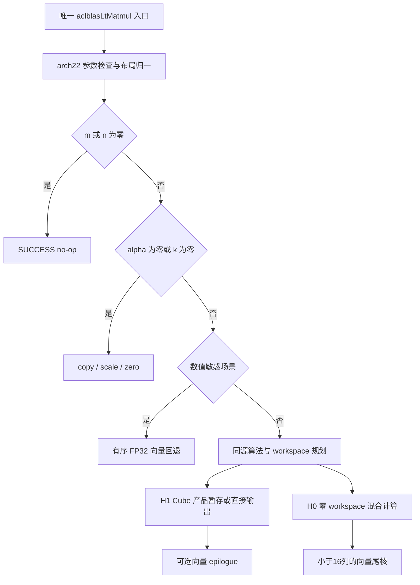

# aclblasLtMatmul 算子设计文档（Atlas A2/A3）

| 项目 | 内容 |
| --- | --- |
| 社区任务 | 10月社区任务-aclblasLtMatmul算子开发（A2A3） |
| 提交用户 | 2401_89878130 |
| 设计版本 | V1.1，2026-10-28 |
| 目标环境 | CANN 9.1.0；Atlas A2/A3，arch22；性能验收设备为 Atlas 800T A2（910B3） |
| 接口 | 复用 `include/cann_ops_blasLt.h` 中唯一的 `aclblasLtMatmul` 声明 |
| 源码分析基线 | ops-blas `05b96ea22cea926ecfd43fc7ac691a795522bd61` |
| 文档状态 | 设计评审稿；源码与测试材料已核对，以下实现方案、资源预算及验证计划不代表已编译、已上板或已通过验收 |

# 需求背景（required）

## 需求来源

本任务依据随任务包提供的《aclblasLtMatmul 算子开发任务书》，为 ops-blas 补齐 Atlas A2/A3 上的 FLOAT32 BLASLt 矩阵乘能力。设计按照社区 `design_template.md` 的需求背景、需求分析、详细设计、可维可测分析组织，覆盖任务书规定的接口、边界、精度、性能和 workspace 约束。

本文在社区任务仓的提交位置为：

```text
04_tasks/01_community-task-2026/tasklist/10-aclblasLtMatmul-A2A3/2401_89878130/docs/design.md
```

2026-10-28 核对官方任务目录后，使用已有的 `10-aclblasLtMatmul-A2A3` 任务目录，在本人用户名下提交设计。设计评审 PR 只包含本文件。实现代码、自测 CSV、日志及报告属于后续实现交付件。

## 背景介绍

### 算子功能与使用场景

`aclblasLtMatmul` 使用描述符表达计算类型、转置、矩阵物理布局和算法选择，通过显式 stream 异步执行：

\[
D=\alpha\,\operatorname{op}(A)\operatorname{op}(B)+\beta C.
\]

其中 `op(A)` 为 `m×k`，`op(B)` 为 `k×n`，C、D 为 `m×n`。本任务支持单 batch、行主序、FLOAT32，并支持 C、D 分离或完全原地。它与普通 BLAS GEMM 的接口差异包括独立 C/D 描述符、显式算法、调用方 workspace 和显式 stream；不能直接套用普通 Sgemm 的列主序接口。

### 现有实现现状分析

在固定源码基线中，公开接口调用链为：

```text
aclblasLtMatmul
  → BuildMatmulProblem
  → MatmulLaunch
  → FP32 / MXFP8 / MXFP4 计算路径
  → 可选 alpha/beta epilogue
```

| 现有位置 | 已核实事实 | 本任务设计影响 |
| --- | --- | --- |
| `include/cann_ops_blasLt.h` | 已有 16 参数声明；当前行号为 932，任务书的 909 行已漂移 | 保留公开签名与 ABI |
| `blasLt/api/aclblaslt_matmul.cpp` | 当前拒绝 `OP_C`，A/B 无条件判空，部分类型错误码与本任务不同 | 增加 arch22 能力校验及退化分流 |
| `blasLt/matmul/fp32/arch35/` | 现有 Lt FP32 设备实现面向 arch35 | 不能将该设备实现直接用于 A2/A3 |
| `blasLt/matmul/engine/matmul_engine.cpp` | 原地且需要 epilogue 时暂存原始乘积；C 空指针检查晚于乘积下发 | 将全部可检查错误前移，统一算法容量模型 |
| `blasLt/internal/src/aclblaslt_algo_heuristic.cpp` | 当前默认 epilogue、splitK=1 的 heuristic 可报 0 workspace，而上述原地路径需要 `4mn` | arch22 heuristic 与 launch 必须共用同一规划函数 |
| `blas/gemm/arch22/` | 已有 FP32 MatmulImpl、四组转置及关闭 HF32 的骨架 | 复用私有计算与 tiling 组织方式，重新建立行主序地址映射 |
| `test/blasLtMatmul/arch35/` | 使用旧 CSV 格式；部分长 K 测试将随机输入替换为常数，golden 使用 double 循环 | 新增与任务包一致的 arch22 测试及 Netlib golden |

任务书要求的 `blas/lt_matmul/arch22/` 在该基线中尚不存在；现行 Lt 设备树已迁至 `blasLt/matmul/`。本设计保留任务指定交付目录，通过构建显式归属接入 `ops_blasLt`，具体改动见“工程集成”。

# 需求分析（required）

## 需求描述

使用 Ascend C Kernel 直调方式补齐 FLOAT32 主路径；计算、状态码、零维短路、原地语义和调用方 workspace 均按本任务合同执行。适配 A2/A3，主验证使用 CANN 9.1.0 与 910B3。性能按每条 case 计算完整调用的设备执行耗时。

## 需求拆解

| 编号 | 需求 | 设计落点 | 验证方式 |
| --- | --- | --- | --- |
| R01 | 复用唯一公开 API，16 参数不变 | 公共入口按构建架构分派 | 头文件/符号检查、调用示例 |
| R02 | FLOAT32，实数 N/T/C 九组转置 | C 规约为 T，四个物理转置模板 | TC_L0、TC_MN、补充矩形用例 |
| R03 | ROW、独立 lda/ldb/ldc/ldd、ld=0 | Host 统一规范化，Kernel 按物理行宽寻址 | TC_LD、padding 哨兵 |
| R04 | C==D 和 C!=D | 同步保存旧 C 或暂存乘积 | 原地/异地、不同 ldc/ldd |
| R05 | m/n=0、k=0、alpha=0、beta=0 | no-op / copy / scale / zero 专路 | TC_ED、无效输入保护 |
| R06 | 明确状态码和校验顺序 | arch22 校验流程 | 负向及组合负向测试 |
| R07 | 显式算法与隐式选择均可用 | H1 有 workspace、H0 零 workspace | 108 条 algo=nullptr 用例 |
| R08 | 外部 workspace、16B 对齐、容量上限 | checked arithmetic 与同源规划 | 边界容量、workspace guard |
| R09 | FLOAT32 精度与非有限值规则 | 禁用 HF32，Netlib golden | 全矩阵混合容差及 EXACT |
| R10 | 200 条性能 case | Cube 主体、窄尾部、按形状选 tile | msprof 全部 task、逐 case 倍率 |
| R11 | A2/A3 与现有产品兼容 | 架构隔离、原 ABI、独立测试入口 | A2 实测及 arch35 回归 |

## 范围与材料口径

本版接受 `ACLBLAS_COMPUTE_32F`、`scaleType=ACL_FLOAT`、A/B/C/D 均为 `ACL_FLOAT`、`EPILOGUE_DEFAULT` 和 HOST 标量模式。Device 标量模式、混合精度、Bias/ReLU/GELU、batch、广播、任意 Tensor stride 不属于本次实现能力；进入不支持的 pointerMode 返回任务规定的 `INVALID_VALUE`，不得将 Device 指针在 Host 解引用。

任务书与配套材料存在以下差异，设计先明确可执行方案，正式验收口径仍由任务方确认：

| 项目 | 材料差异 | 本设计处理 |
| --- | --- | --- |
| 用例数量 | 任务书称 200；实际 CSV 为 1200 | 完整保留 1000 精度和 200 性能行 |
| 性能阈值 | §3.3 要求 ≥0.8× GPU；§7 要求 ≥1× GPU | 同时输出 0.8× 与 1× 判定列，内部按更严目标优化 |
| 采样数量 | 10、>10、>50 三种表述 | warmup 5 次，保留 60 次有效样本；分别输出前 10 次及全部 60 次均值 |
| GPU 身份 | README 前文称 A100，后文称 P102-100，CSV 无型号字段 | 保留原 CSV；标记“GPU 硬件归属未核实”，补齐来源后签发正式性能结论 |
| C 空指针 | 任务书称 beta≠0 时未定义；CSV 期望 INVALID_VALUE；当前源码已有较晚检查 | 在下发前返回 INVALID_VALUE，与 CSV 一致 |
| workspace 比较对象 | §3.4 为输入输出总量，交付表另提 GPU workspace | 执行 `W≤1.2×输入输出总字节数`；GPU workspace 未提供时标记缺项 |
| 源码/测试目录 | 指定 `blas/lt_matmul`、`test/lt_matmul`，当前仓使用 `blasLt/matmul`、`test/blasLtMatmul` | 保留指定新目录，显式完成库归属和测试别名映射 |

# 详细设计（required）

## 算子分析

### 数学公式与地址映射

对 `0≤i<m`、`0≤j<n`：

\[
P_{ij}=\sum_{p=0}^{k-1}A'_{ip}B'_{pj},\qquad D_{ij}=\alpha P_{ij}+\beta C_{ij}.
\]

实数 `ACLBLAS_OP_C` 与 `ACLBLAS_OP_T` 等价。以元素为单位的物理地址如下：

```text
A'(i,p) = transA ? A[p*lda+i] : A[i*lda+p]
B'(p,j) = transB ? B[j*ldb+p] : B[p*ldb+j]
C(i,j)  = C[i*ldc+j]
D(i,j)  = D[i*ldd+j]
```

| 操作数 | N 时存储形状 | T/C 时存储形状 | 最小 ld |
| --- | --- | --- | --- |
| A | m×k | k×m | N: max(1,k)；T/C: max(1,m) |
| B | k×n | n×k | N: max(1,n)；T/C: max(1,k) |
| C | m×n | 不适用 | max(1,n) |
| D | m×n | 不适用 | max(1,n) |

`ld=0` 在局部执行计划中归一为上述最小值，不修改调用者描述符。C、D 的 dtype、行列数及 order 必须一致；异地时允许 `ldc!=ldd`，原地时必须具有相同的有效布局。部分 C/D 重叠、D 与 A/B 重叠不属于支持范围；可由已知 span 检出的非法重叠在下发前拒绝。

### 接口定义

```cpp
aclblasStatus_t aclblasLtMatmul(
    aclblasLtHandle_t lightHandle,
    aclblasLtMatmulDesc_t computeDesc,
    const void* alpha,
    const void* A,
    aclblasLtMatrixLayout_t Adesc,
    const void* B,
    aclblasLtMatrixLayout_t Bdesc,
    const void* beta,
    const void* C,
    aclblasLtMatrixLayout_t Cdesc,
    void* D,
    aclblasLtMatrixLayout_t Ddesc,
    const aclblasLtMatmulAlgo_t* algo,
    void* workspace,
    size_t workspaceSizeInBytes,
    aclrtStream stream);
```

| 参数 | 位置与角色 | 约束 |
| --- | --- | --- |
| lightHandle | Host，上下文 | 已创建且有效，空句柄返回 NOT_INITIALIZED |
| computeDesc | Host，计算描述符 | 非空；本任务仅支持上述 FP32/HOST/DEFAULT 组合 |
| alpha、beta | Host，FLOAT32 标量指针 | 均非空；类型验证后读取，允许零、有限值、Inf/NaN |
| A、B | Device，只读矩阵 | 仅在 k>0 且 alpha≠0 时要求有效 |
| Adesc、Bdesc | Host，输入布局 | 始终非空；物理 shape、ld、order、batch 合法 |
| C | Device，旧值输入 | beta=0 时不访问，可为空；否则必须有效 |
| Cdesc | Host，C 布局 | 始终非空，原地也不可省略 |
| D、Ddesc | Device 输出 / Host 布局 | m,n>0 时 D 非空；Ddesc 始终非空 |
| algo | Host，现有算法 capsule | 可空；非空时需可解码且为 arch22 支持的配置 |
| workspace | Device，调用者提供 | 非空须 16B 对齐；不能与活动输入输出重叠 |
| workspaceSizeInBytes | Host，容量 | 同时满足公开 capsule 上界和实际计划容量 |
| stream | 显式执行流 | 原样下传，nullptr 表示默认流；接口不隐式同步 |

所有状态码使用现有 `aclblasStatus_t`。描述符创建/销毁、算法 capsule 类型和公开句柄 ABI 均沿用仓库定义。

### 退化计算语义

| 条件（按先后） | 操作 | 禁止访问 |
| --- | --- | --- |
| m=0 或 n=0 | SUCCESS，不下发 Kernel | A/B/C/D 的数据、workspace |
| k=0 或 alpha=0，beta=0 | 将 D 的有效元素置 +0 | A/B/C 的数据 |
| k=0 或 alpha=0，beta=1，C==D | SUCCESS，保持有效元素位模式 | A/B 的数据 |
| k=0 或 alpha=0，beta=1，C!=D | 按独立 ldc/ldd 复制 C 到 D | A/B 的数据 |
| k=0 或 alpha=0，其余 beta | `D=beta*C`，FP32 单次乘法 | A/B 的数据 |
| 一般计算，beta=0 | `D=alpha*P` | C 的数据 |

零维 no-op 仍要求 handle、五个描述符、alpha/beta 指针及 pointerMode 满足前置检查。其余退化路径仍进行布局、输出和 workspace 校验。不能用 `0*NaN` 代替跳过输入，也不能把异地 beta=1 误实现为“保留 D 初值”。

## 算子实现

### 实现方案

整体分为公共 API 适配、arch22 计划构造、FP32 Cube 主体、向量 epilogue/退化/尾列五个部分。



所有设备步骤在调用方 stream 中按依赖顺序执行。图中的路径由输入语义和算法能力决定，不按 CSV case 名称或数据值分布硬编码。

### 3.2.1 Host 侧设计

#### 参数检查与执行顺序

1. 检查 handle；空时返回 `ACLBLAS_STATUS_NOT_INITIALIZED`。
2. 检查 computeDesc、Adesc、Bdesc、Cdesc、Ddesc；任一为空返回 `INVALID_VALUE`。
3. 检查 alpha/beta 指针非空；检查 pointerMode 为本任务支持的 HOST，否则返回 `INVALID_VALUE`。
4. 仅从 Ddesc 取得 m、n；若任一为 0，立即返回 SUCCESS，不提前读取 FLOAT32 标量，也不进行后续布局、矩阵指针或 workspace 校验。
5. 对非空输出校验转置枚举、computeType/scaleType/dtype、epilogue、四个 ROW 布局、batchCount=1、stride=0、shape 对应关系、ld 和整数范围。非法转置、未知 order 或未知 epilogue 枚举返回 `INVALID_ENUM`；已知但非 ROW 的 order、合法但非 DEFAULT 的 epilogue，以及不支持的计算/数据类型返回 `NOT_SUPPORTED`；非法 shape/ld/batch 返回 `INVALID_VALUE`。computeType 的 `999` 按任务 CSV 的能力负向约定返回 `NOT_SUPPORTED`。
6. 规范化四个 ld，在确认 scaleType 后按 float 读取 alpha/beta。根据 k/alpha 判断是否访问 A/B，根据 beta 判断是否访问 C；m,n>0 总是要求 D 有效。所有空指针错误在 Kernel 下发前返回。
7. 检查原地布局、可识别的非法重叠、算法配置、workspace 对齐与容量。
8. 构造只读计划，执行退化、H0 或 H1 路径；传播可即时检测的下发错误。

`m/n/k`、span、tile 数和 workspace 的乘加先使用 64 位 checked arithmetic；向 Matmul 的较窄类型转换前检查可表示范围。对行主序物理矩阵，非空有效 span 为 `((rows-1)*ld+cols)*sizeof(float)`，测试分配可按 `rows*ld` 保留整行 padding。拒绝溢出，不能先截断到 uint32/int 再判断。

异步设备错误可能在后续 stream 同步时才暴露；测试同时检查接口状态和同步结果。非法 stream 的专用测试在隔离进程中执行，不将“Host 已返回 SUCCESS”视为设备完成。

#### 算法与 workspace 一致性

`BuildArch22Plan` 统一生成算法能力、tile、工作区上界和 launch 参数。Heuristic 与执行侧的私有计划检查共用该逻辑；当前公开头文件没有 AlgoCheck 接口，本任务不新增该公开接口。复用现有 capsule 编解码，增加 arch22 支持性检查；损坏编码返回 `INVALID_VALUE`，可解码但不支持的算法配置返回 `NOT_SUPPORTED`，不静默忽略指定算法。

定义 `nPrefix=(n/16)*16`、`nTail=n-nPrefix`、`ceil16(n)=16*ceil(n/16)`：

| 算法 | 适用场景 | 调用方额外 workspace | 核心行为 |
| --- | --- | --- | --- |
| H0 | 隐式选择、预算为0、窄矩阵 | 0 | Cube 完整列与 AIV epilogue 在同组握手；尾列独立向量计算 |
| H1 | 调用方允许暂存产品，n≥16 | `4*m*ceil16(n)` 字节 | 逻辑全 N 产品写入行宽对齐的 R 后处理；满足条件时直接写 D |
| 退化/有序向量路径 | 退化或数值敏感场景 | 实际使用0 | 仍遵守非空 algo 已声明容量的校验 |

H1 的产品缓冲 R 是物理行宽 `productPitch=ceil16(n)` 的 FP32 矩阵，逻辑计算覆盖完整 n 列，epilogue 只读写有效 n 列。A/B 仍使用原逻辑形状和物理 ld；R 的对齐不能扩大 A/B 读取范围，也不能扩大 D 写出范围。n<16 或对齐后 pitch 无法由内部 int32 表示时只提供 H0。

Heuristic 不知道 alpha/beta 和 C/D 地址，因此 H1 返回一般原地情况的安全上界。alpha=1、beta=0 的特化可按 ldd 直接写 D，省去 epilogue，但不改变已取得的容量合同。非对齐 N 的直接输出使用高层 Matmul 的精确 ND 尾块能力，启用前验证真实 SDK、padding 和 guard。

显式 algo 的容量检查为 `workspaceSizeInBytes >= max(algo.max_workspace_bytes, requiredBytes)`；真实需要 workspace 时指针必须非空。不能只信任调用者可改写的 `max_workspace_bytes`。隐式 `algo=nullptr` 按实际提供容量选可执行方案；`nullptr/0` 必须能落到 H0。

当前 preference 默认上限为 32 MiB；4096×4096 的 H1 需要 64 MiB。性能测试显式设置128 MiB preference，并逐例核对任务内存约束；日志记录 preference、算法和容量；预算不足时选择 H0，不隐式分配内存。workspace 在调用流完成前由调用者保持有效；实现不使用 handle 的 Host `internalWorkspace` 代替 Device 内存。

#### 算法 capsule 编码与配置闭环

现有 `PackedAlgo` 为16字节：magic、algoId、l1mDiv16、l1nDiv16、policy、numBuffers、splitK、flags。arch22 保留共享编解码、magic 和公开 capsule 大小，通过互不冲突的算法 ID 表达产品能力：

| 字段 | arch22 V1 约定 |
| --- | --- |
| magic | 沿用 `0xACBD1234` |
| algoId | H0=`0x22000000`；H1=`0x22000001`，与 arch35 ID 分离 |
| policy | `DISPATCH_POLICY_MMAD_SYNC` |
| l1mDiv16/l1nDiv16 | 保留16元素单位；H0为4/4，H1为8/8，分别表达64×64和128×128最大 tile 能力 |
| numBuffers、splitK | 本版均为1 |
| flags | 本版为0；不启用额外 splitK/reduction 配置 |

算法 ID 表示执行能力及 workspace 合同。Host 可在该能力内为小输出选择更小的 tile，以提高并行度；不得超出 capsule 能力或改变容量合同。超出能力的 tile、缓冲数、splitK 或 reduction 扩展需要新增明确支持配置和回归，不能直接放行任意字段。

`AlgoGetIds` 按目标架构枚举 H0/H1；`AlgoInit(algoId=0)` 产生 H0 默认实例，显式 ID 必须属于本架构。Heuristic 从同一能力表产生候选及 workspace 上界。`AlgoInit` 没有 shape，无法预先计算 H1 容量；执行侧必须依据实际布局重新计算。`AlgoConfigSet/GetAttribute` 保留共享接口和属性长度检查，执行侧逐项核对全部编码字段；配置接口接受的表示不等于设备已支持该配置。

序列化/反序列化、枚举→初始化、配置 Set→Get、Heuristic→执行均做往返测试。magic 损坏导致解码失败时返回 `INVALID_VALUE`；可解码但不支持的 ID 或字段组合返回 `NOT_SUPPORTED`。跨架构 capsule 不能按自动算法静默执行；原 arch35 合法 capsule 的行为保持不变。

#### Tiling 参数结构与分核

以下为内部字段设计，不新增公开 API：

```cpp
struct LtMatmulArch22Plan {
    uint64_t m, n, k;
    uint64_t lda, ldb, ldc, ldd;
    uint64_t cubeColumns, nTail, productPitch, tileCount;
    uint64_t requiredWorkspaceBytes;
    uint32_t tileM, tileN, tileK, groupCount;
    uint32_t path;                 // zero/copy/scale/ordered/H0/H1/direct
    uint32_t transposeBits;        // 实数 C 已规约为 T
    float alpha, beta;
};
```

Cube 覆盖列数 `cubeColumns` 在 H0 为 nPrefix，在 H1 为 n；产品物理行宽与逻辑覆盖列数分开传递。分核使用 `TM=ceil(m/BM)`、`TN=ceil(cubeColumns/BN)`、`T=TM*TN`。纯 Cube 使用 `G=min(T,AIC数量)`；MIX 使用 `G=min(T,AIC数量,floor(AIV数量/2))`。每组 g 处理 `t=g,g+G,...`，其中 `tileMIndex=t/TN`、`tileNIndex=t%TN`。有效尾 M/N 在每 tile 重新裁剪，BN 取 16 的倍数，K 在同一组内完整累加。

本版不引入 split-K、跨组原子累加或全核屏障，避免额外 workspace、归约误差与原地读写依赖。后续若新增 split-K，须同时修改算法标识、容量模型、完整调用计时和精度回归。

核数、UB/L1/L0 容量从目标设备的平台信息取得，使用 `GetCoreNumAic/Aiv`、`GetCoreMemSize` 等接口；不硬编码 20/40 核或固定 UB 大小。当前 Lt handle 的 `npuArch=2` 是硬编码，架构选择应来自构建配置及真实设备能力。

#### 初始 tile 与片上内存预算

| 路径 | 初始 BM×BN | BK | 用途 |
| --- | --- | --- | --- |
| H0 MIX | 64×64 | 32 | 原地、零 workspace 的基础路径 |
| H1 Cube | 最大128×128，可缩小M/N块 | 32 或 64 | 方阵、矩形及转置场景的候选 |
| 窄尾部 | 最多 16 行、少于 16 列 | 分块 K | 极小矩阵与 N 尾部 |

以上是待实测的候选，不是已确认最优参数。先按资源和指令约束过滤，再按真实 910B3 结果确定分派条件。

以 H0 的 `BM=BN=64、BK=32、L1 Kpanel=128` 为例：

| 缓冲 | 数量 | 字节公式 | 候选占用 |
| --- | ---: | --- | ---: |
| L0A | 2 | `2*BM*BK*4` | 16,384 |
| L0B | 2 | `2*BK*BN*4` | 16,384 |
| L0C | 1 | `BM*BN*4` | 16,384 |
| L1 A/B panel | 各 2 | `2*(BM*128+128*BN)*4` | 131,072 |
| 每 AIV 旧 C snapshot | 1 | `4E`，E=32×64 | 8,192 |
| 每 AIV 产品缓冲 | 1 | `4E` | 8,192 |
| 每 AIV 输出缓冲 | 1 | `4E` | 8,192 |
| 每 AIV UB 合计 | — | `12E+reserveUB` | 24,576+reserveUB |

各 LocalTensor 按 32B 对齐；库内部缓冲、队列元数据及临时区单独计入 reserve。必须同时满足 L1、L0A、L0B、L0C 和 UB 容量约束，并以实际 Matmul tiling/编译资源结果复核，不能只核算 UB。H0 首版使用严格握手的单缓冲；产品/输出改双缓冲后 UB 系数会从 12E 增至 20E，需重新设计流水再评估收益。

向量 epilogue 对长度 L 的片段使用产品、C、输出各双缓冲，上界为 `24L+reserveUB` 字节；beta=0 特化可去掉 C 缓冲。`L=alignDown((UB-reserveUB)/24,8)`，并按有效行边界裁剪，不能跨越 ldc/ldd padding。

### 3.2.2 Kernel 侧设计

#### FP32 Cube 主体

以仓内 arch22 的 `MatmulImpl` / `MatmulType<GM,ND,float>` 为骨架，实例化 NN/NT/TN/TT 四种组合。计算使用 FP32，显式关闭 HF32；不使用单次 FP16 降精或 HF32 替代本任务主路径。

API 调用顺序示意：

```cpp
AscendC::SetHF32Mode(AscendC::HF32Mode::DISABLE);
mm.Init(/* 本候选的合法静态或运行时 tiling */, &pipe);
mm.SetHF32(false);
mm.SetOrgShape(orgM, orgN, orgKa, orgKb, outputPitch);
mm.SetSingleShape(validM, validN, k);
mm.SetTensorA(aTile, transposeA);
mm.SetTensorB(bTile, transposeB);
mm.IterateAll(productTile, 0);
mm.End();
```

五参数原始 shape 表达 A/B 物理行宽和独立输出行宽；逻辑计算量由 `SetSingleShape` 表达。行主序候选映射为：

```text
orgM  = transA ? lda : m
orgN  = transB ? n   : ldb
orgKa = transA ? k   : lda
orgKb = transB ? ldb : k
outputPitch = 直接输出时的 ldd，或暂存产品时的 productPitch
A tile 起点 = transA ? i0 : i0*lda
B tile 起点 = transB ? j0*ldb : j0
```

该映射在进入整包验证前，先以四转置、独立 padding、M/K 尾部和 guard 专项核对；不得把物理 lda 当作逻辑 K 参与计算。AIC-only 风格 Matmul 放入 MIX 的 AIC 分支时，还须验证实际编译产物不引入未申报的系统 GM workspace。

A2/A3 的 L0C 结果经 Fixpipe 写 GM，再由 AIV 读入 UB；不能照搬 950 的 L0C→UB 路径。基础 V220 Fixpipe 的 nSize 要求16的倍数，H0 的保守方案只在 `[0,nPrefix)` 使用此写出方式。该基础 API 约束不等价于高层 Matmul 的逻辑 N 必须对齐：高层 `SetSingleShape`/`SetTail` 与 ND 输出可管理有效尾块。H1 暂存方案将输出对齐写入已分配的 R；直接输出方案使用库的精确尾块能力，仅写有效 D。ND 目的 stride 以元素为单位，支持独立 ldd；不额外发明 `ldd%8==0` 的接口限制。

#### H1：产品暂存与 epilogue

一般场景先将逻辑全 N 产品写入 R，随后在同一 stream 下发 AIV epilogue。R 使用 productPitch，C/D 分别使用 ldc/ldd；每个 AIV 对自己拥有的有效行片段执行：

```cpp
DataCopyPad(pLocal, productGlobal, /* 有效片段 */);
Muls(outLocal, pLocal, alpha, validLength);
if (beta != 0.0f) {
    DataCopyPad(cLocal, cGlobal, /* ldc 对应片段 */);
    Muls(cLocal, cLocal, beta, validLength);
    Add(outLocal, outLocal, cLocal, validLength);
}
DataCopyPad(dGlobal, outLocal, /* ldd 对应片段 */);
```

这里的伪代码省略了 TQue/HardEvent 展开；实际实现必须建立 MTE2→Vector→MTE3 的依赖。C==D 时产品位于 R，因此旧 C 在读取前不会被覆盖。beta=0 的实例不执行任何 C 数据搬运。

alpha=1、beta=0 时可直接写 D。对齐 N 使用基础路径；非对齐 N 使用经过专项验证的高层 ND 尾块输出，保留保守的前缀加尾核方案作为回退。H1 已计算全 N 时不再重复下发尾核；存在尾核或 epilogue 的调用必须计入全部任务耗时。

#### H0：零 workspace 原地混合路径

此路径覆盖一般尺寸，不能仅对小矩阵特判。任务 CSV 中有 108 条 `algo=nullptr`，其中 8 条同时为非零 alpha、非零 beta 和 C==D，包含 `1000×33×513`、`63×1025×255` 等形状。

采用 `KERNEL_TYPE_MIX_AIC_1_2`。AIC 的组号为 `GetBlockIdx()`；AIV 的组号为 `GetBlockIdx()/2`，子号为 `GetBlockIdx()%2`。每组两个 AIV 分别负责当前输出 tile 的上、下半行，三方使用完全相同的 tile 序列。

| 阶段 | 两个 AIV 各自执行 | AIC 执行 |
| --- | --- | --- |
| 保存旧值 | beta≠0 时将自己的旧 C 片段读入 UB；MTE2 完成后 `CrossCoreSetFlag<2,PIPE_MTE2>(8)` | `CrossCoreWaitFlag<2>(8)`，等待两个 AIV 均完成保存 |
| 生成产品 | `CrossCoreWaitFlag<2>(9)` | 完整 K 的 FP32 产品写入当前 D tile；Fixpipe 完成后 `CrossCoreSetFlag<2,PIPE_FIX>(9)` |
| 合并输出 | 从 D 读取产品，执行 alpha/beta epilogue 并按有效长度写回；MTE3 完成后 `CrossCoreSetFlag<2,PIPE_MTE3>(10)` | `CrossCoreWaitFlag<2>(10)` 后才进入下一 tile |

D 在本次调用内部充当产品通信区，旧 C 保留在 UB；完成后的 D 才是对外结果。三阶段依赖为保存→产品→最终写出，避免覆盖旧 C。beta=0 时跳过旧 C 读取但仍遵守所选混合实例的握手协议；alpha=1、beta=0 可以直接选择纯 Cube 特化。

必须满足以下同步不变量：

- 两个 AIV 和 AIC 对每个 tile 的 Set/Wait 次数匹配；没有有效行的 AIV 也参与所有握手。
- flag8 绑定 MTE2 完成，flag9 绑定 PIPE_FIX 完成，flag10 绑定 MTE3 完成；跨核同步不能代替核内 TQue/事件依赖。
- snapshot 缓冲在 epilogue 消费前不复用；AIC 等待两个 AIV 的 done 后再推进。
- 单个 Matmul 对象的内部 flag 与自定义 8/9/10 不重叠；增减对象或改变库配置时重新核对。A2 的 mode2 不使用 950 mode4 的偏移规则。
- 不采用全核 barrier，不依赖不同组的执行顺序，不使用共享静态状态或 Host 隐式设备分配。

#### N 尾列与窄矩阵

H0 对 `[nPrefix,n)`、最多15列使用独立 AIV 向量尾核，在主体/epilogue 后按 stream 串行执行。H1 覆盖逻辑全 N，不重复计算尾列。若 n<16，则整个窄矩阵走向量路径，workspace 为0。

每个输出片段只有一个 owner。将 K 分块搬入 UB：沿 K 连续的 A/B 直接分段 DMA；沿 K 非连续时，以 `DataCopyPad` 的分行/步长搬运读取有效元素，再在 UB Gather/转置，恢复连续计算向量。严禁通过逐 K 的 GM `GetValue` 搬运整矩阵。

一个保守点积微核可按以下 FP32 API 序列实现：

```text
按物理地址装载 A 的 K 片段、B 的 K 片段
→ UB Gather/转置消除装载 padding
→ Mul 得到逐 K 乘积
→ ReduceSum 得到片段和
→ Add 累加到 FP32 输出累加器
→ 完成全部 K 后 Muls(alpha)
→ beta 非零时读取旧 C、Muls(beta)、Add
→ DataCopyPad 仅写有效输出元素
```

只在完整 K 累加后应用一次 alpha/beta。尾核使用不同累加顺序，需要长 K、抵消输入和转置专项精度验证。alpha=0/k=0 由退化核处理，不经此累加流程。

尾核预算必须包含分行 DMA 的 UB padding。以每次 `Q=256` 个 K 元素、每个 4B strided 读取块在 UB 占 32B 为保守上界：两份装载 scratch 为 `2*32Q=16,384B`；紧凑 A/B/乘积各 `4Q` 合计 3,072B；另计 Gather 索引、归约临时区和至少 32B 的累加器。基础占用为 19,456B 加上述附加量，按真实平台容量确定 Q。后续可批量处理多列，但不能漏算新增缓冲。

#### 数值敏感场景的有序 FP32 回退

Cube 与 Netlib 的归约顺序和中间溢出行为有差异。对小矩阵、长 K、非有限标量及大系数放大的归约，提供与 Netlib FP32 运算顺序对应的向量回退，保持全部原始输入，不改成常数数据，不按 case 名称选择路径。

初始判据为：`n≤16 且 m*n≤8192/k`、`k>4096`、alpha/beta 非有限，或 `abs(alpha)>16 且 k≥256`；判据只在 k>0、alpha≠0 时评估。最终阈值随冻结版本记录，任何修改均复验临界点两侧、九转置、强抵消及极值。回退保留逐步 FP32 乘加及各转置分支的标量应用次序，不能用树形 ReduceSum 替代有序累加后仍声称等价。按输出片段并行、按 K 顺序推进，UB 中复用装载数据，性能计入完整调用。

回退不使用额外 GM 产品矩阵；显式 H1 的容量合同仍然有效。它用于满足任务精度及非有限规则，不承诺所有常规 GEMM 都 bit-exact。

#### 退化核、尾部和安全访问

- `beta=0`：Duplicate 生成 +0，按 D 有效行写回，不读取 C。
- `beta=1`：异地使用精确 DMA 复制，保持位模式；原地直接返回。
- 其余 beta：`DataCopyPad → Muls → DataCopyPad`，使用 FP32 单次乘法。
- M/K 尾部在本地合法 tile 内补零或使用库尾块能力；补零不能改变真实输入范围。
- 输入与输出的 padding 均保留哨兵，输出只写 `m×n` 有效区，不把 16/32B 对齐长度当成可写 GM 容量。

### 3.2.3 工程集成与文件职责

实现目录按照任务书，文件名为设计规划，最终按仓库规范控制数量：

```text
blas/lt_matmul/arch22/
  lt_matmul_host.cpp            # 规范化、检查、计划、launch
  lt_matmul_kernel.cpp          # Cube/MIX/向量入口和直调封装
  lt_matmul_kernel.h            # 私有声明及计算组件
  lt_matmul_tiling_data.h       # 共享只读参数
blas/lt_matmul/README.md

test/lt_matmul/
  CMakeLists.txt
  blasLtMatmul_param.h          # 本任务CSV解析
  blasLtMatmul_golden.h         # Netlib与退化参考
  arch22/
    blasLtMatmul_test.cpp
    blasLtMatmul_npu_wrapper.h
    blasLtMatmul_test.csv
```

| 集成位置 | 改动要求 |
| --- | --- |
| `blasLt/api/aclblaslt_matmul.cpp` | 在唯一入口中路由 arch22 校验与执行，其他架构走原分支 |
| `blasLt/api/aclblaslt_matmul_algo.cpp` 及内部算法模块 | arch22 候选、容量、预算和配置校验与执行计划同源 |
| `blasLt/matmul/engine/` | 按架构隔离 include 与调用，避免 A2 引用 arch35 kernel 符号 |
| `blasLt/CMakeLists.txt`、根 CMake | 将任务指定目录的 arch22 源显式归入 `ops_blasLt`，host=CXX、kernel=ASC |
| `blas/CMakeLists.txt` | 从普通 `ops_blas` 自动收集中排除该目录，防止重复符号或错误归库 |
| 根私有 include 配置 | 按架构选择，移除对 arch35 私有头的无条件依赖 |
| `test/CMakeLists.txt` 与测试注册辅助 | 在目录选择、按算子名查源之前完成 `blasLtMatmul → lt_matmul` 的 arch22 映射 |
| `cmake/test.cmake` 聚合 Runner | 聚合测试继承单测的 `ops_blasLt` 链接依赖，不能只链接 `ops_blas`；独立与聚合构建均检查 Lt 符号 |
| 测试脚本 | 一致映射 CSV 安装、`--ops` 和 binary 路径，二进制名仍为 `blasLtMatmul_test` |

不新增产品私有公开接口，不把普通 BLAS handle 强转成 Lt handle。当前实现使用 `.cpp` 由 CMake 指定 ASC 编译，遵循仓库现有工程方式。源码、测试各保留一份，旧 arch35 测试继续按原产品构建。

## 支持硬件

| 硬件 | 设计支持 | 验证计划 |
| --- | --- | --- |
| Atlas A2（含 Atlas 800T A2，910B3） | arch22 | CANN 9.1.0 全量精度、性能、workspace 验证 |
| Atlas A3（含 Atlas 800T A3） | arch22 | 同源构建与能力查询；有设备时补充精度回归 |
| 950PR / arch35 | 保留原分支 | 公共接口、构建、算法和原有行为回归 |

任务允许自验证覆盖一种款型。本轮设计目标不等于所有硬件已实测；报告明确具体芯片、卡号、驱动、固件、CANN、编译器与源码 commit。

## 算子约束限制

- 仅 FLOAT32/HOST 标量、ROW、单 batch、DEFAULT epilogue；不支持广播及 ld 之外的任意 stride。
- 实数 C 转置按 T 处理；不据此放开复数共轭路径。
- 支持完整 C==D，要求有效布局一致；不支持部分重叠和输出与 A/B 重叠。
- 所有矩阵维度、stride、offset、buffer 大小在实际内部类型范围内，溢出或不可表示的请求在 Host 拒绝。
- 只使用调用方明确提供的 workspace；零 workspace 正常用例走 H0。
- 调用异步，调用方在 stream 完成前保持输入、输出和 workspace 有效；Host 标量在返回前完成读取并复制至执行参数。
- 不承诺 bit-exact GEMM 或固定累加顺序；任务要求 EXACT 的退化缩放/复制独立实现和验证。

# 可维可测分析

## 精度标准/性能标准

| 验收项 | 标准 | 来源 |
| --- | --- | --- |
| 有限值精度 | atol=rtol=2^-13；matched_ratio≥0.99；满足最大绝对误差硬上限 | 任务书 §3.2、opbase mixed tolerance |
| 最大绝对误差 | `max(1e-2,32*ULP(g_low))`，g_low 为最大误差点的 FP32 golden | opbase §2.1.2，“or”取较大值 |
| 非有限值 | 同 NaN、同号 Inf、NaN 与 ±Inf 等效；有限与非有限不等效 | 本任务 §3.2 的专项规则 |
| alpha=0 | D=beta*C，按任务进行 EXACT；beta=0 不读 C，beta=1复制位模式 | 任务书补充说明 |
| 性能 | 逐 case 报 GPU/NPU 倍率，分别核对 ≥0.8 和 ≥1.0 | 任务书 §3.3/§7，口径差异已记录 |
| workspace | 实际额外设备 workspace 峰值≤输入输出总字节数1.2倍 | 任务书 §3.4 |

有限值统计仅覆盖 actual/golden 均有限的元素，非有限值单独计数且全部须通过专项规则。若没有有限值点，该项记为不适用，不能做 0/0；用例仍须全部非有限值比较通过。输出 guard/padding 与状态码另行验证，不并入 matched_ratio。

Netlib BLAS 3.10.0 的 `cblas_sgemm(CblasRowMajor,...)` 是一般路径 golden。异地 C/D 先将 C 的有效元素复制到独立 golden D，再调用 GEMM；beta=0 不读取 C。alpha=0/k=0 直接使用任务退化规则，避免 reference 代码提前访问无效 A/B。记录 BLAS 构建版本、链接库路径、输入种子和样本 hash；不能以仓内 double 循环或恒定输入替换本任务 golden。

## 测试方案与覆盖矩阵

已静态核对任务 CSV 为 1200 行，固定种子 20261028 重生成的文件与原文件 SHA256 一致。精度部分含 967 条预期 SUCCESS、33 条预期错误；性能部分为 200 条预期 SUCCESS。

| 类别 | 行数 | 验证重点 |
| --- | ---: | --- |
| TC_L0 | 13 | 九转置、原地、默认算法 |
| TC_MN | 116 | 尺寸扫描、矩形、非对齐 |
| TC_AB | 24 | alpha/beta 组合 |
| TC_LD | 14 | 四路 ld、padding、ld=0 |
| TC_FL | 24 | 零、交替、极值、Inf、NaN |
| TC_CV | 16 | 中等尺寸覆盖 |
| TC_ED | 49 | 零维、退化、指针、枚举、类型、布局、容量 |
| TC_EX | 744 | 确定性组合与 algo=nullptr |
| TC_PF | 200 | 性能与同源正确性 |
| 合计 | 1200 | 每条 case_name 保留独立结果 |

补充测试放到实现测试工程，保留原 CSV 的名称、输入、预期结果和行数：

1. M/N/K 的 15/16/17、31/32/33、63/64/65、127/128/129、K=513/1025 与九转置；独立 ldc/ldd 和每行 guard。
2. H0 一个/多个 tile、奇数 M、空 AIV 半块、多组、并发 stream；8 条非平凡零 workspace 原地用例优先验证。
3. alpha=0 或 k=0 时 A/B 为空；beta=0 时 C 为空/NaN；beta=1 异地 D 初值与 C 不同；±0、Inf/NaN 标量和 EXACT 退化分支。
4. no-op 与非法 layout/A/B/D/workspace 的组合、no-op 与空描述符/标量的组合，确认错误优先级。
5. workspace 容量精确相等、少1字节、非16B对齐、指针为空但容量非零；algo 损坏、不支持 tile/splitK、跨架构配置；未知order/epilogue与合法但不支持值分别核对错误码。
6. 标量与矩阵均匀/正态分布各50%的补充集：均匀范围[-5,5]，正态μ∈[-5,5]、σ∈[0.1,2]，记录实际分布参数；不能仅依据token名称推断满足任务分布。
7. 长 K、强抵消、极值与尾核 ReduceSum 顺序；全量有效 D 比对、padding 不变、必要时使用 mssanitizer 检查越界。
8. 上下文/设备选择、默认与显式 stream、异步生命周期、现有 arch35 接口和构建回归。

负向测试先创建合法上下文，再构造目标错误，避免 heuristic 或 descriptor setter 的失败掩盖 `aclblasLtMatmul`。若公开构造接口已拒绝非法输入，报告准确标明错误发生阶段，并用内部单测覆盖入口保护，不能把构造失败伪报成目标接口返回值。

### 测试工具适配

配套 Python 脚本是集成参考，以下问题须在实现测试交付中修正：

- 精度脚本可能在 0 条测试或子进程异常时仍 exit 0；以退出码、GTest XML、实际 case 集合和期望集合共同判定，缺失/重复/未运行均失败。
- 性能脚本读取 GTest 整条测试的整数毫秒，含 Host 准备和 golden，不能作为 task duration。新增独立的 msprof 采集和关联步骤。
- GPU CSV 的 200 行只有 198 个五元组 shape 键；按 case 行与 baseline id 保留 200 条结果，不能用字典去重后遗漏两条。
- `gen_csv.py` 默认会重写 GPU 基线为空占位；复现时使用独立输出路径，原基线保持不可变快照。
- 数据生成严格解析本包字段；不继承 arch35 测试对长 K 输入改常数的处理。

## 性能分析与优化计划

一般 GEMM 的计算量约为 `2mnk FLOPs`。大方阵优先通过 Cube 多组并行、L1 输入复用和合法双缓冲提高计算利用率；窄矩阵、小矩阵关注 launch 与搬运成本。H0 原地方案增加三段局部握手及 D 的产品写回/读回，H1 增加 R 和 epilogue 流量，这些开销均纳入完整调用。

优化顺序为：正确性与完整覆盖 → Cube tile/波次数 → 转置和 ld 搬运 → alpha=1/beta=0 直接输出 → 窄尾批量向量化 → 有证据后再融合尾部或调整缓冲。保留泛化路径，不按 case 编号定制。

性能采集使用同一个已验证源码和构建产物。每 case 预热5次，连续保留60个有效调用，记录原始 task duration、各 kernel 名与关联 ID，并输出前10次和全部60次均值。对于多 kernel 调用，同时报告 task duration 总和与首 task 开始至末 task 结束的设备时间跨度；正式与标杆比较使用任务方确认的完整调用口径，不只取最快一个 task。Host 端创建、分配、H2D/D2H、golden 和检查不混入 kernel 时间。

接口失败或同步异常的采样保留错误记录，不能作为有效样本或静默删除；不足目标样本数时该 case 记为未完成。测试期间记录卡占用、频率/温度和并发负载。性能案例也检查输出正确性。

以下只是原任务包的四个数值示例，不是 NPU 实测或已确认 GPU 型号的结果：

| case | m×n×k / 转置 | 包内 GPU 值（us） | 0.8×门槛对应 NPU 上限（us） |
| --- | --- | ---: | ---: |
| TC_PF_1001 | 1024³ / NN | 129.383 | 161.72875 |
| TC_PF_1002 | 2048³ / NN | 972.992 | 1216.24000 |
| TC_PF_1003 | 4096³ / NN | 7218.180 | 9022.72500 |
| TC_PF_1004 | 1024³ / TN | 132.411 | 165.51375 |

## workspace 与内存分析

按实际物理行宽计算调用方输入输出总字节数：

```text
B_IO = 4 * (rowsA*lda + rowsB*ldb + m*ldc + m*ldd)
W_H1 = 4 * m * ceil16(n)
W_H0 = 0
```

容量乘加必须检查溢出。C、D 独立分配时，`B_IO≥8mn`；H1 的 n≥16，因此 `W_H1/B_IO≤ceil16(n)/(2n)<1`，满足1.2倍上限。该界不能直接用于 C==D 去重口径：原地时同时报告去重后的实际分配字节和实际比例，不能声称所有窄矩阵都自动满足去重后的上限；若按该口径超预算则选择 H0。n<16 时使用零 workspace 向量路径，避免小 case 分配对齐产品导致预算超限。

| 典型 case | A/B/C/D 紧凑总量 | H1 申报/分配上界 | 比例 |
| --- | ---: | ---: | ---: |
| 1024³ | 16 MiB | 4 MiB | 0.25 |
| 2048³ | 64 MiB | 16 MiB | 0.25 |
| 4096³ | 256 MiB | 64 MiB | 0.25 |

alpha=1、beta=0 直接输出时实际产品 workspace 访问可为0，但已分配容量仍按真实值报告。资源报告分别给出申报容量、调用方分配峰值、算法实际使用量和内部额外分配；不能只报告实际访问0掩盖预留空间。AIV UB/L1/L0 属片上预算，另表记录。Host 侧按任务包的512MiB设计预算复用下载缓冲和 golden 缓冲，不保存全尺寸 double 中间矩阵。

## 兼容性与可维护性分析

- 这是已有接口的产品扩展，涉及兼容性；公共签名、capsule布局和显式stream语义保持一致。
- arch22 的 OP_C、状态码与 no-op 合同放在产品能力分支，不能全局改变现有 arch35 的错误处理。
- 构建按真实架构隔离，不依赖 handle 中硬编码的 npuArch，不让 arch22 链接 arch35-only 实现。
- 规范化、算法选择、workspace计算各只有一个事实来源；日志至少包含形状、转置、四ld、路径、tile、算法及所需容量。
- Kernel 参数只读，每次调用的缓冲和同步资源独立；用并发stream测试验证可重入性。
- 代码按功能职责控制文件数量，原始实验、临时 profiler 文件不进入源码目录；正式测试资产与复现命令随实现交付。

## 实施顺序与完成标准

| 阶段 | 交付与通过条件 |
| --- | --- |
| D0 设计 | 本文包含所有模板必填章节；设计 PR 只有指定路径一个文件；社区评审结果独立记录 |
| I1 工程和Host | A2构建可达唯一API；布局/错误码/退化与workspace单测通过，arch35构建不回归 |
| I2 Kernel基础 | 四转置FP32、独立ld、H1与H0、窄尾核实际编译上板；先过零workspace原地与guard专项 |
| I3 精度 | 全部1000精度行、200性能行的正确性及补充集有可复现结果；无缺失/跳过冒充通过 |
| I4 性能/内存 | 200条逐case完整计时、原始样本、算法容量与1.2倍预算；清楚区分已过/未过/来源未核实 |
| I5 交付 | 源码commit、构建环境、输入hash、Netlib版本、报告/日志相互对应；设计审核、私有自验、任务验收和代码合入分别记录 |

首轮需要实机确认的重点是：MIX中AIC-only Matmul的workspace行为、行宽映射、M/K尾部、flag资源和空AIV协议、窄尾核的精度及延迟。这些属于实现验证关卡，当前不填造通过结果。

## 参考资料与可追溯依据

1. 用户提供的 `aclblasLtMatmul_A2_task_doc.md`，SHA256：`646b95cc734df7cbf53da9305abf363ec22357f1be7a4dc2d6522bb8728ca9d5`。
2. 原任务 `blasLtMatmul_test.csv`，SHA256：`26eb13eccd2b1450fe98d4fcf4b620c7b9ac80e1a902f8449261f5e4b8cab233`；`gpu_baseline.csv`：`a04368d02715c6f4f106c4700d1aba7904efc763bbc739677ac74cb44adf7f32`。
3. [社区设计模板](https://gitcode.com/cann/cann-competitions/blob/e1ab79ca0d495afce93dfb1e85f95f546b74d2cf/04_tasks/01_community-task-2026/resources/design_template.md)、[任务仓提交规则](https://gitcode.com/cann/cann-competitions/blob/e1ab79ca0d495afce93dfb1e85f95f546b74d2cf/04_tasks/01_community-task-2026/README.md)、[社区任务流程及注意事项](https://gitcode.com/org/cann/discussions/39)。
4. [ops-blas 固定源码](https://gitcode.com/cann/ops-blas/tree/05b96ea22cea926ecfd43fc7ac691a795522bd61)、[公开头文件](https://gitcode.com/cann/ops-blas/blob/05b96ea22cea926ecfd43fc7ac691a795522bd61/include/cann_ops_blasLt.h)、[API实现](https://gitcode.com/cann/ops-blas/blob/05b96ea22cea926ecfd43fc7ac691a795522bd61/blasLt/api/aclblaslt_matmul.cpp)、[arch22 GEMM参考](https://gitcode.com/cann/ops-blas/blob/05b96ea22cea926ecfd43fc7ac691a795522bd61/blas/gemm/arch22/gemm_kernel.cpp)、[混合Kernel参考](https://gitcode.com/cann/ops-blas/blob/05b96ea22cea926ecfd43fc7ac691a795522bd61/blas/gemm_strided_batched/arch22/gemm_strided_batched_kernel.cpp)。
5. [opbase 混合容差标准](https://gitcode.com/cann/opbase/blob/d5dc8e47d0d92affee17b490837bf37cdaafd0d8/docs/zh/ops_precision_standard/mixed_tolerance_standard.md)，已核对最大误差点 ULP 的定义。
6. [cuBLASLtMatmul 参考](https://docs.nvidia.com/cuda/cublas/index.html#cublas-LtMatmul)、[Netlib SGEMM](https://www.netlib.org/blas/sgemm.f)。本任务限定子集及专项非有限规则以任务书为准。

本设计通过 ascend-kg 加载 `ascendc-operator-design` 及 Matmul/通用 tiling 配套，并以专用 API 文档核对硬件约束。关键检索记录如下；score 为检索相关度，不是代码正确性或性能分数。

| KG id | source_file | score | 用途 |
| --- | --- | ---: | --- |
| `opsblas_docs_zh_apilistpart0006_aclblasltmatmul` | `cann-ops/ops-blas/docs/zh/api_list-part0006.md` | 0.941508 | 既有 Lt API 锚点 |
| `agentskills_community_op_ascendcoperatordesign_references_matmultiling_matmultilingmd` | `Official-skills/agent-skills/community/Op/ascendc-operator-design/references/matmul-tiling.md` | 0.982015 | 两级 tiling 设计参考 |
| `cannbotknowledge_knowledge_ops_ascendc_apis_simdapi_basicapi_cubecomputeisasi_mmadcomputeauxconfig_sethf32mode_fp32矩阵乘法` | `supplement/cannbot-knowledge/knowledge/ops/ascendc/apis/simd_api/basic_api/cube_compute_isasi/mmad_compute_aux_config/set_hf32_mode.md` | 0.951052 | HF32 开关和 A2/A3 支持 |
| `cannbotknowledge_knowledge_ops_ascendc_apis_simdapi_advapi_cubecompute_matmulkernel_setorgshape_matmul` | `supplement/cannbot-knowledge/knowledge/ops/ascendc/apis/simd_api/adv_api/cube_compute/matmul_kernel/set_org_shape.md` | 0.929370 | 原始 shape 与独立输出行宽 |
| `cannsamples_samples_0introduction_01simdcppapi_03fusionoperation_matmulleakyrelubasicapi_readmeen_crosscoresetflag_0x2_pipe_fix_0` | `ascend-c-kernel/cann-samples/Samples/0_Introduction/01_simd_cpp_api/03_fusion_operation/matmul_leakyrelu_basic_api/README_en.md` | 0.973358 | A2/A3 GM 通信及 1:2 组映射 |
| `ascdevkit_docs_zh_api_simdapi_basicapi_synccontrol_intercoresync_crosscoresetflagisasi_aic等aiv` | `ascend-c-kernel/asc-devkit/docs/zh/api/SIMD-API/basic_api/sync_control/inter_core_sync/CrossCoreSetFlag_ISASI.md` | 0.951041 | mode2 同步语义 |
| `cannbotknowledge_knowledge_ops_ascendc_apis_simdapi_advapi_cubecompute_matmulkernel_settail_matmulobj` | `supplement/cannbot-knowledge/knowledge/ops/ascendc/apis/simd_api/adv_api/cube_compute/matmul_kernel/set_tail.md` | 不适用，关联节点定位 | 高层 Matmul 逻辑尾块能力，与基础 Fixpipe 约束区分 |
| `ascdevkit_docs_zh_api_simdapi_basicapi_cubecomputeisasi_cubecomputestore_fixpipel0ctogm_fixpipeparamsv220` | `ascend-c-kernel/asc-devkit/docs/zh/api/SIMD-API/basic_api/cube_compute_ISASI/cube_compute_store/Fixpipe_L0CToGM.md` | 不适用，图查询定位 | nSize、ND stride 和写出约束 |
| `ascdevkit_docs_zh_api_simdapi_basicapi_synccontrol_intercoresync_keyfeatures_核间同步flagid的占用情况` | `ascend-c-kernel/asc-devkit/docs/zh/api/SIMD-API/basic_api/sync_control/inter_core_sync/key_features.md` | 不适用，图查询定位 | 内部与自定义 flag 避让 |
| `ascdevkit_docs_zh_api_utilsapi_platforminfo_platformascendc_getcorememsize_l0_b` | `ascend-c-kernel/asc-devkit/docs/zh/api/Utils-API/platform_info/PlatformAscendC/GetCoreMemSize.md` | 0.954658 | 片上容量查询 |
