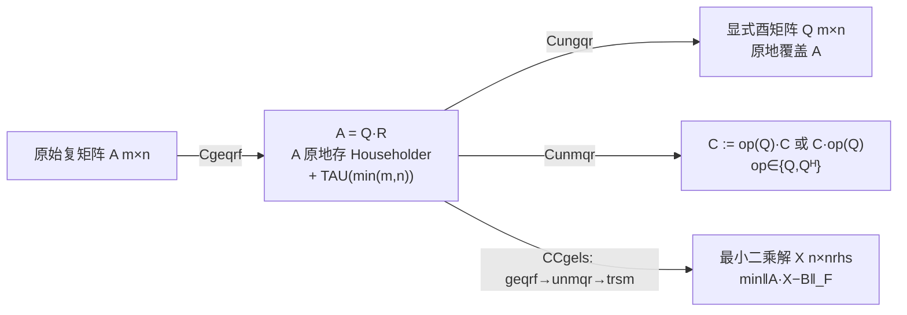
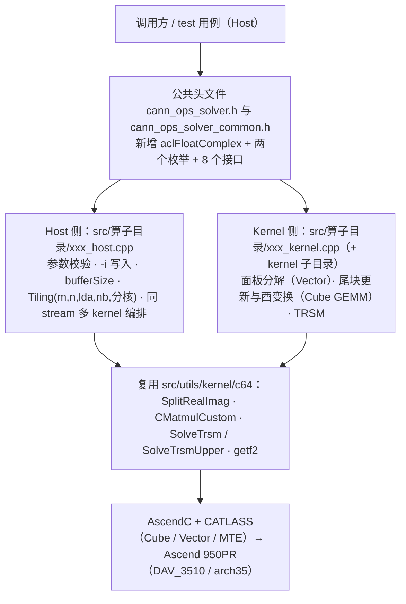
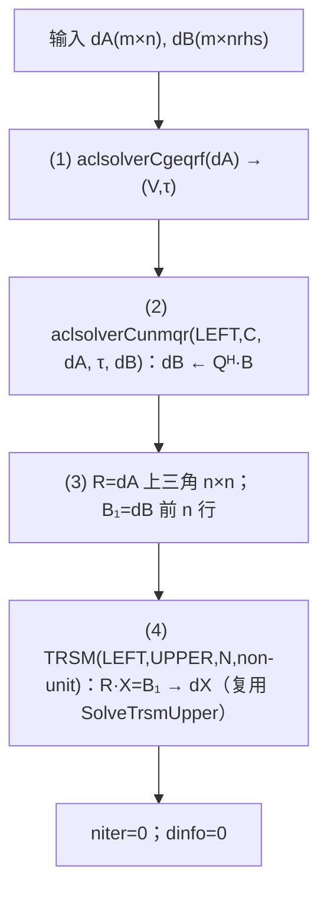

# aclsolverCgeqrf / Cungqr / Cunmqr / CCgels 算子设计文档

> 状态：v1.0 评审稿
> 目标代码仓：`https://gitcode.com/cann/ops-solver`（实测主线 commit `a29362cfa605c69b1f330feadbff21e686eb9502`，2026-10-12）
> 目标硬件：Ascend 950PR（Atlas 950，DAV_3510 / arch35），CANN 9.0.0 及以上
> 工程模式：ops-solver Host C API + AscendC/CATLASS Kernel 直调（非 aclnn 两段式）
> 依据：任务书 `Atlas950_Cgeqrf_Cungqr_Cunmqr_CCgels_task_doc.md`、社区设计模板 `resources/design_template.md`

---

## 一、需求背景

### 1.1 需求来源

本任务为 CANN 社区任务 2026「10 月社区任务-单精度复数 QR 分解与最小二乘（950）」。要求在昇腾 NPU 上基于 AscendC/CATLASS，开发稠密复数 QR 分解、酉变换与最小二乘求解能力，接口/功能/参数/约束对标 NVIDIA cuSolver DN legacy API，精度达到 CANN 生态算子开源精度标准：

| NPU 交付接口 | 对标 CUDA 接口 |
|---|---|
| `aclsolverCgeqrf` / `aclsolverCgeqrf_bufferSize` | `cusolverDnCgeqrf` / `cusolverDnCgeqrf_bufferSize` |
| `aclsolverCungqr` / `aclsolverCungqr_bufferSize` | `cusolverDnCungqr` / `cusolverDnCungqr_bufferSize` |
| `aclsolverCunmqr` / `aclsolverCunmqr_bufferSize` | `cusolverDnCunmqr` / `cusolverDnCunmqr_bufferSize` |
| `aclsolverCCgels` / `aclsolverCCgels_bufferSize` | `cusolverDnCCgels` / `cusolverDnCCgels_bufferSize` |

四个接口作为**同一社区任务一并交付**，不允许拆分验收；本任务**不交付** `aclsolverXlarft`（其验收归属实数 QR 任务）。

### 1.2 背景介绍

#### 1.2.1 算法背景

复数 QR 分解是稠密线性代数的基础正交化工具，是复数最小二乘、特征值（QR/Krylov 迭代）、酉变换的基础构件。四个接口构成完整链路：



#### 1.2.2 目标仓库现状（基于远端主线实测）

ops-solver 主线（commit `a29362c`，2026-10-12）当前已合入算子和关键基础设施如下：

- 已合入算子（`src/` 与 `test/` 同名目录）：`cgetrf`、`cgetri`、`cgetri_batched`、`cmatinv_batched`、`sgetrf`、`sgetri`、`cheevj`。
- 公共头文件 `include/cann_ops_solver_common.h`：**已定义** `aclsolverStatus_t`（含 `ACLSOLVER_STATUS_SUCCESS=0`、`ACLSOLVER_STATUS_INVALID_VALUE=3` 等）与 `aclsolverHandle_t`；**尚未定义** `aclFloatComplex`、`aclsolverOperation_t`、`aclsolverSideMode_t`。
- 公共头文件 `include/cann_ops_solver.h`：已有 `aclsolverCreate/Destroy/SetStream/GetStream` 及 `aclsolverCgetrf/Sgetrf/Cgetri/Sgetri/CgetriBatched/CmatinvBatched/Cheevj`；现有计算接口沿用 `std::complex<float>` 与 `aclError` 返回值，枚举 `aclsolverEigMode_t`/`aclsolverFillMode_t` 亦定义于此。**尚无**任何 QR / gels 接口。
- 可复用复数 Kernel 工具（`src/utils/kernel/c64/`）：
  - `pad.hpp` → `SplitRealImag<T>`：复数 ↔ 实/虚分离存储与 padding；
  - `gemm.hpp` → `CMatmulCustom<T>`：以实数 GEMM 组合实现复数 GEMM（`AccumulateRealProducts`/`AccumulateImagProducts`，支持 `A_imag` 取负与 segmented 模式）；
  - `trsm.hpp` / `trsm_custom.hpp` / `trsm_upper_custom.hpp` → `SolveTrsm`/`SolveTrsmCustom`/`SolveTrsmUpper`：复数三角求解；
  - `getf2.hpp`、`cast.hpp`、`lu_custom.hpp`：无阻塞 LU 面板、类型搬运等。
- 构建与测试入口：根目录 `build.sh`（`--ops=<算子列表> --soc=<芯片> [--run]`，仓库 README 声明配套 CANN `9.0.0`）；`src/CMakeLists.txt` 自动递归收集算子目录源码；测试目录规范见 `test/cheevj/`（`*_test.cpp`、`*_benchmark.cpp`、`*_contract_test.cpp`、`CMakeLists.txt`、`README.md`、`data/`）。

**结论**：本任务为**全新实现**（无 QR 原型可改），但可直接复用 `c64` 的复数 GEMM、复数分裂/合并、三角求解等基础件，显著降低开发量。设计须与主线头文件、目录结构、构建/测试规范保持一致，并在 `cann_ops_solver_common.h` 补充 `aclFloatComplex` 与两个枚举。

#### 1.2.3 与实数 BLAS/LAPACK 版本的关键差异

1. **反射器相位约定**：复数 Householder 的 β 取实数并携带 `real(α)` 的符号；相位约定必须固定才能保证确定性（R10）。
2. **共轭转置**：`Cunmqr` 支持 `op(Q)=Q` 或 `Qᴴ`，**不支持转置 T**（`trans=T` 必须报错，禁止按转置实现）。
3. **复数 GEMM**：AI Core 无原生复数乘，需拆分为实数 GEMM。
4. **精度单位舍入**：COMPLEX64 下 ε = 2^-24 ≈ 5.96e-8。

---

## 二、需求分析

### 2.1 需求描述

在 Ascend 950PR 上以 Host C API + AscendC/CATLASS Kernel 直调方式实现列主序、单精度复数（COMPLEX64 / `aclFloatComplex`）的 4 个计算接口与 4 个 `_bufferSize` 查询接口，功能/参数/约束对齐 cuSolver，精度满足 LAPACK 残差判据，性能达到 ≥ 0.35×GPU（cuSolver）。

### 2.2 需求拆解

| 编号 | 需求项 | 内容 | 验收方式 |
|---|---|---|---|
| R1 | 类型与枚举 | `cann_ops_solver_common.h` 增加 `aclFloatComplex`（`{float real; float imag;}`，布局等价 `cuComplex`）、`aclsolverOperation_t`(N/T/C)、`aclsolverSideMode_t`(LEFT/RIGHT) | 头文件 C 可调用 |
| R2 | 接口签名 | 8 个接口，参数名/顺序/含义/Device·Host 归属不得增删调换，维数用 32-bit int | 与任务书 §2.3 对齐 |
| R3 | CGEQRF | 原地 Householder QR；上三角=R，严格下三角=V，TAU 长 min(m,n) | 精度 §任务书 3.2.1.1 |
| R4 | CUNGQR | 由 (V,τ) 生成 m×n 显式酉阵 Q，原地覆盖 A，覆盖 k=n/k<n | 精度 3.2.1.2；CUNMQR 前置 |
| R5 | CUNMQR | `C:=op(Q)·C`(LEFT) / `C·op(Q)`(RIGHT)，trans∈{N,C}，T 报错 | 精度 3.2.1.3 |
| R6 | CCGELS | `min‖A·X−B‖_F`（n≤m），out-of-place 写 dX，报告 niter/dinfo | 方阵 CQRT16 / 超定 CQRT17 |
| R7 | bufferSize | geqrf/ungqr/unmqr 以 `aclFloatComplex` 元素个数计；CCgels 以字节计 | 返回 ≥ 实际使用 |
| R8 | info 语义 | `0` 成功；`-i` 第 i 个参数非法（不计 handle）；空问题成功 | 用例覆盖 |
| R9 | 句柄/流 | 复用 `aclsolverCreate/Destroy/SetStream/GetStream`，走调用方 stream，无必要不同步 | 非默认 stream 用例 |
| R10 | 确定性 | 同输入同 stream 多次 bit-wise 一致（含 tau/info） | 重复执行比对 |
| R11 | 精度 | 满足 4 条 LAPACK 残差判据（ε=2^-24） | NPU vs CPU 参考 |
| R12 | 性能 | 每 case `T_NPU ≤ T_GPU/0.35`，950PR 达标 | msprof 比对 bench |
| R13 | 交付件 | 设计文档、自测用例/代码、自测报告、待验收代码仓 | 评审 + 验收 |

### 2.3 外部组件依赖

| 组件 | 用途 | 是否新增 |
|---|---|---|
| CANN 9.0.0+ / ACL Runtime | 设备、内存、stream 管理 | 否 |
| AscendC | AI Core Kernel 编程 | 否 |
| CATLASS（`lib/matrix/matmul/matmul.h`） | 分块 GEMM（复数经实数 GEMM 组合） | 否 |
| ops-solver `src/utils/kernel/c64/` | `SplitRealImag`、`CMatmulCustom`、`SolveTrsm*`、`getf2` | 否（复用） |
| NumPy/SciPy LAPACK(complex128) | 精度 golden | 否 |

### 2.4 接口与算子原型

在 `cann_ops_solver_common.h` 补充类型/枚举（R1）；在 `cann_ops_solver.h` 补充 8 个接口（返回值统一 `aclsolverStatus_t`）：

```c
typedef struct { float real; float imag; } aclFloatComplex;
typedef enum { ACLSOLVER_OP_N=0, ACLSOLVER_OP_T=1, ACLSOLVER_OP_C=2 } aclsolverOperation_t;
typedef enum { ACLSOLVER_SIDE_LEFT=0, ACLSOLVER_SIDE_RIGHT=1 } aclsolverSideMode_t;

aclsolverStatus_t aclsolverCgeqrf_bufferSize(
    aclsolverHandle_t handle, int m, int n, aclFloatComplex *A, int lda, int *Lwork);
aclsolverStatus_t aclsolverCgeqrf(
    aclsolverHandle_t handle, int m, int n, aclFloatComplex *A, int lda,
    aclFloatComplex *TAU, aclFloatComplex *Workspace, int Lwork, int *devInfo);

aclsolverStatus_t aclsolverCungqr_bufferSize(
    aclsolverHandle_t handle, int m, int n, int k,
    const aclFloatComplex *A, int lda, const aclFloatComplex *tau, int *lwork);
aclsolverStatus_t aclsolverCungqr(
    aclsolverHandle_t handle, int m, int n, int k,
    aclFloatComplex *A, int lda, const aclFloatComplex *tau,
    aclFloatComplex *work, int lwork, int *devInfo);

aclsolverStatus_t aclsolverCunmqr_bufferSize(
    aclsolverHandle_t handle, aclsolverSideMode_t side, aclsolverOperation_t trans,
    int m, int n, int k, const aclFloatComplex *A, int lda, const aclFloatComplex *tau,
    const aclFloatComplex *C, int ldc, int *lwork);
aclsolverStatus_t aclsolverCunmqr(
    aclsolverHandle_t handle, aclsolverSideMode_t side, aclsolverOperation_t trans,
    int m, int n, int k, const aclFloatComplex *A, int lda, const aclFloatComplex *tau,
    aclFloatComplex *C, int ldc, aclFloatComplex *work, int lwork, int *devInfo);

aclsolverStatus_t aclsolverCCgels_bufferSize(
    aclsolverHandle_t handle, int m, int n, int nrhs,
    aclFloatComplex *dA, int ldda, aclFloatComplex *dB, int lddb,
    aclFloatComplex *dX, int lddx, void *dwork, size_t *lwork_bytes);
aclsolverStatus_t aclsolverCCgels(
    aclsolverHandle_t handle, int m, int n, int nrhs,
    aclFloatComplex *dA, int ldda, aclFloatComplex *dB, int lddb,
    aclFloatComplex *dX, int lddx, void *dWorkspace, size_t lwork_bytes,
    int *niter, int *dinfo);
```

**参数原型（对标 cuSolver）**：

| 接口 | 关键参数 | dtype | 布局 | shape | 约束 |
|---|---|---|---|---|---|
| Cgeqrf | A(原地 in/out) | COMPLEX64 | 列主序 | lda×n (有效 m×n) | `lda≥max(1,m)`；TAU 长 min(m,n) |
| Cungqr | A(原地 in/out), tau(in) | COMPLEX64 | 列主序 | lda×n | `0≤k≤n≤m`；`lda≥max(1,m)` |
| Cunmqr | A(in), tau(in), C(原地 in/out) | COMPLEX64 | 列主序 | lda×k, ldc×n | `nq=(LEFT?m:n)`，`0≤k≤nq`，`ldc≥max(1,m)` |
| CCgels | dA(in/out), dB(in), dX(out) | COMPLEX64 | 列主序 | ldda×n, lddb×nrhs, lddx×nrhs | `n≤m`，`ldda≥max(1,m)`，`lddb≥max(1,m)`，`lddx≥max(1,n)` |

### 2.5 规格与泛化下限

| 接口 | 维数 | 其他 |
|---|---|---|
| aclsolverCgeqrf | m, n ∈ [1, 4096]，方阵+矩形 | lda padding |
| aclsolverCungqr | m ∈ [1, 4096]，n,k ≤ m | 覆盖 k=n 与 k<n |
| aclsolverCunmqr | m, n ∈ [1, 4096]，k 合法 | side L/R，trans N/C，T 报错 |
| aclsolverCCgels | n ∈ [1,4096]，n≤m≤4096，nrhs ∈ [1,128] | m=n 与 m>n |

不支持 broadcast，不要求图融合；自构造 case 保证输入数据占内存在 4GB 以内。

### 2.6 算子约束

1. 仅支持 COMPLEX64、列主序、Device 指针。
2. `lda`/`ldc`/`ldda`/`lddb`/`lddx` 须满足下界，**禁止**要求等于 m/n。
3. `Cunmqr` 仅 `trans∈{N,C}`；`trans=T` 必须报错。
4. `CCgels` 须 `n≤m`；解 X 独立输出。
5. `Cungqr`/`Cunmqr` 输入必须是 CGEQRF 的 (V,τ) 表示。
6. 空问题成功返回；非法参数写 `-i`。
7. 核心计算全部在 AI Core，禁止 CPU fallback。

---

## 三、详细设计

### 3.1 使能方式

采用 **ops-solver Host C API + AscendC/CATLASS Kernel 直调**（**非** aclnn 两段式、**非** PyTorch 接口）：

- 公开头文件：`include/cann_ops_solver.h`、`include/cann_ops_solver_common.h`；
- Host：参数校验、workspace 计算、tiling 生成、kernel 下发（`src/<op>/<op>_host.cpp`）；
- Kernel：基于 AscendC/CATLASS 实现 CGEQRF/CUNGQR/CUNMQR/CGELS（`src/<op>/<op>_kernel.cpp`）；
- 计算走调用方 stream（`aclsolverSetStream`），无必要不同步；
- 返回值统一 `aclsolverStatus_t`；对仓内现存 `aclError` 原型给出对照表（见 §5.2）。

### 3.2 总体设计（分层）



**分阶段落地（先正确后性能）**：

- **M1 正确性基线**：非分块/小块实现打通接口语义与精度（CGEQRF 列扫描 + 秩 1 更新；CUNGQR 逐列；CUNMQR 逐反射器；CCGELS 三步串联），保证功能、info、边界、精度全绿。
- **M2 性能优化**：分块 WY + Cube GEMM（复用 `CMatmulCustom`），把 O(n³) 的尾块更新/酉变换/回代落到 Cube；调 `nb`、double buffer、look-ahead。
- 两阶段共用同一 Host 校验/info/tiling 骨架与同一 Kernel 入口，用编译期模板参数或 TilingKey 切换。

### 3.3 关键算法设计

#### 3.3.1 复数 Householder 反射器与确定性相位约定（核心）

设当前列 `x=[α;x₂]∈C^n`（α=x₀）。构造 `H=I−τ·v·vᴴ` 使 `H·x=[β;0]`，采用 **LAPACK CLARFG 同款相位约定**：

```
xnrm2 = ‖x₂‖₂                                   # 2-范数（缩放式，防上溢/下溢）
if xnrm2 == 0 and imag(α) == 0:
    τ = 0, β = α
else:
    ρ = √(real(α)² + imag(α)² + xnrm2²)
    β = -SIGN(ρ, real(α))                        # β 恒为实数；SIGN(a,b)=|a|·sign(b)，sign(0)=+1
    τ = ((β − real(α)) + i·(−imag(α))) / β
    v₂ = x₂ / (α − β)                            # 隐式 v₀ = 1
```

存储：`A[j,j]=β`；`A[j+1:m,j]=v₂`；`TAU[j]=τ`。确定性要点：β 恒实数且携带 `real(α)` 符号、范数固定缩放与归约顺序、`SIGN(0)=+1` —— 保证 (V,τ,R) 位级可复现（R10）。

#### 3.3.2 CGEQRF：分块 WY 算法

以列块宽 `nb` 把 n 列切成 `⌈n/nb⌉` 个 panel，每个 panel 三步：

```
for jp = 0; jp < n; jp += nb:
    ib = min(nb, n − jp)
    # (a) PanelGeqrf(A[jp:m, jp:jp+ib])：块内逐列生成反射器 + 对 panel 剩余列秩-1 更新(Vector)
    # (b) FormT(larft)：构造上三角 T(ib×ib)
    #      T(i,i)=τᵢ; T(1:i−1,i) = −T(1:i−1,1:i−1)·(τᵢ·V(1:i−1,1:i−1)ᴴ·vᵢ)
    # (c) Larfb(Cube GEMM)：A[:, jp+ib:n] ← (I − V·T·Vᴴ)·A[:, jp+ib:n]
    #      等价：W = A_trailᴴ·V ; W = W·Tᴴ ; A_trail ← A_trail − V·Wᴴ
```

- 面板串行、尾块并行；`nb` 越大 Cube 占比越高。
- `T` 为**内部实现**，不对外交付（本任务不交付 `Xlarft`）。
- 边界：`n=0`/`m=0` 成功返回；`m<n` 时 TAU 长 m，R 为梯形。`lda>m` 时按有效区域搬运并跳过 padding。

#### 3.3.3 CUNGQR：分块生成显式 Q

对齐 LAPACK CUNGQR，目标 `Q=H(1)…H(k)` 前 n 列（m×n）：

```
# 先将反射器覆盖区域按 identity 规则初始化
ki = ⌈k/nb⌉
for i = ki down to 1:
    i1=(i−1)·nb; i2=min(i1+nb,k); i3=min(i1,k)
    # (a) CUNG2R：在 A[i1:m, i1:i2] 上由 (V,τ) 生成本块对角区列
    # (b) i3>0：用块反射器(larfb, Cube) 更新已生成的前 i3 列 A[:, :i3]
```

覆盖 `k=n` 与 `k<n`。CUNGQR 是通过 CUNMQR 验收的**先决条件**（op2 依赖其输出）。

#### 3.3.4 CUNMQR：分块应用 Q / Qᴴ

| side | trans | 变换 | 块施加顺序 |
|---|---|---|---|
| LEFT | N | `C ← (I − V T Vᴴ)·C` | 最后块→第一块（Q=H₁…H_k 左乘） |
| LEFT | C | `C ← (I − V Tᴴ Vᴴ)·C` | 第一块→最后块（Qᴴ=H_kᴴ…H₁ᴴ 左乘） |
| RIGHT | N | `C ← C·(I − V T Vᴴ)` | 第一块→最后块（C·H₁…H_k） |
| RIGHT | C | `C ← C·(I − V Tᴴ Vᴴ)` | 最后块→第一块（C·H_kᴴ…H₁ᴴ） |

`nq=(LEFT?m:n)`，`0≤k≤nq`，`lda≥max(1,nq)`；`trans=T` 返回 `ACLSOLVER_STATUS_INVALID_VALUE` 并写 `devInfo=-i`。就地更新 C。

#### 3.3.5 CCGELS：QR + 酉变换 + 三角回代



- 四步在同一调用方 stream 顺序下发，步骤间无需 Host 同步。
- 方阵/超定统一：超定仅取前 n 行。`m<n` 报错。X 为独立输出。
- `nrhs` 多右端时 TRSM 与 unmqr 按 nrhs 成批处理（含 nrhs=1 与多右端）。

#### 3.3.6 复数 GEMM 分解（Cube 化）

Core 无原生复数乘，`C=A·B`（A=A_r+iA_i，B=B_r+iB_i）拆为实数 GEMM：

```
C_r = A_r·B_r − A_i·B_i
C_i = A_r·B_i + A_i·B_r
```

**复用 `src/utils/kernel/c64/gemm.hpp` 的 `CMatmulCustom<T>`**（其内部已按上述 4 次实数 GEMM 组合，并提供 `SetMatrixWithAImagNeg` 以适配 `−V·Wᴴ` 等场景），无需自研复数乘。默认 4 次 GEMM 直式（前向误差最稳、确定性好）；若 M2 阶段吞吐不足，再评估 Karatsuba 3 次乘（须以 §5.1 判据实测验证）。

### 3.4 Host 侧设计

- **参数校验与 info 语义**：校验 handle、维数范围、leading dimension 下界、枚举（含拒绝 `trans=T`）、必要指针非空。非法→`ACLSOLVER_STATUS_INVALID_VALUE` 且 info 可写时写 `-i`（i 为不计 handle 的 1-based 参数序号）；空问题成功返回 info=0。`devInfo` 由 Kernel 末段真实写入。
- **bufferSize**：geqrf/ungqr/unmqr 以 `aclFloatComplex` 元素个数计（含 W/T/面板缓冲/staging）；CCgels 以字节计（`size_t*`，对齐 cuSolver）。
- **Tiling 与分核**：Host 按 (m,n,lda,nb) 生成 `TilingData`（维数、leading dimension、panel 数、nb、核数、每核区间、UB 切分）并拷贝至 Device。尾块类按输出 tile 在 M/N 二维切分到各 AIC；面板类天然串行，采用单核分解 + 多核尾块更新，或 look-ahead 重叠。
- **Kernel 编排与 stream**：每接口在调用方 stream 顺序下发 1…N 个 Kernel（CCgels 四步），以流序保证依赖，**不做无必要 Host 同步**；`niter` 为 Host 标量，直接置 0。

### 3.5 Kernel 侧设计

- **范式**：`Init`（解析 tiling/绑定 GM/初始化 UB）→ `Process`（CopyIn→Compute→CopyOut），`TPipe`/`TQue` 双缓冲。
- **面板分解（Vector）**：逐列 ColNorm（缩放 2-范数）→ 复数 Householder（§3.3.1）→ 写回 V/τ → 对 panel 剩余列秩-1 更新 `A[:,j] −= τ·v·(vᴴA[:,j])`；复数分 real/imag 存放（`SplitRealImag`）便于向量化。
- **尾块更新/酉变换/回代（Cube）**：以 CATLASS 分块 GEMM + `CMatmulCustom` 实现 `(I−V T Vᴴ)X` 形式：`W=XᴴV`（或 `VᴴX`）→ `W=W·T`（或 `W·Tᴴ`）→ `X=X−V·Wᴴ`；`V`/`T`/目标矩阵分块 staging 到 L1/L0，K 方向串行累加。
- **TRSM**：对角块行内回代（Vector）+ 非对角块 GEMM 更新（Cube），`UPPER`/`non-unit`/`N`，复用 `SolveTrsmUpper`。
- **分核与 UB 规划**：`block_M×block_N` 依 950PR 的 L1/L0/UB 容量与 n 动态选择；复数 staging 需 real/imag 分离缓冲，double buffer 隐藏 MTE2/MTE3 延迟。

### 3.6 确定性设计（R10）

| 环节 | 措施 |
|---|---|
| Householder 相位 | β 恒实数 + `real(α)` 符号，`SIGN(0)=+1`；缩放式范数固定顺序 |
| 分块 | `nb` 由 shape 决定（非流/时间相关），固定 Kernel 数 |
| 归约 | 无原子加/无竞态；固定树形或串行归约 |
| Cube 累加 | K 方向串行、固定切分（避免 split-K 归约次序漂移） |
| 复数 GEMM | 固定 4 次实数 GEMM 拆分与中间量顺序 |
| 输出 | tau/info 亦位级一致 |

### 3.7 支持硬件

| 支持的芯片版本 | 涉及勾选 |
|---|---|
| Ascend 950PR（Atlas 950，DAV_3510 / arch35） | √ |

### 3.8 算子约束限制

见 §2.6。补充：`aclsolverCungqr`/`aclsolverCunmqr` 的输入必须是 CGEQRF 输出，不是未分解的原始 A。

---

## 四、特性交叉分析

| 特性 | 设计处理 | 覆盖 |
|---|---|---|
| m<n（仅 geqrf） | 梯形 R，TAU 长 m | 泛化测试 |
| m=n / m>n（gels） | R 取上三角 n×n；超定取 B 前 n 行 | CQRT16/17 |
| side L/R、trans N/C | 四分支 + 对应块顺序（§3.3.4） | 测试覆盖 |
| trans=T | 参数校验拒绝，写 -i | 契约测试 |
| k=n / k<n（ungqr） | 分块 i3 分支 | 测试覆盖 |
| lda/ldc padding > 下界 | 有效区域搬运，跳过 padding | 测试覆盖（+8/+32） |
| nrhs=1 / 多右端 | 成批 TRSM/unmqr | 测试覆盖 |
| 空问题 m/n/k/nrhs=0 | Host 快速路径，info=0 | 边界测试 |
| 非默认 stream | 全程走调用方 stream | 流测试 |
| 确定性 | §3.6 | 重复执行比对 |

---

## 五、可维可测分析

### 5.1 精度标准/性能标准

| 验收标准 | 描述 | 标准来源 |
|---|---|---|
| 精度 | CQRT01/02/03 + CQRT16/17 LAPACK 残差判据（ε=2^-24≈5.96e-8） | 任务书 §3.2、opbase 开源精度标准 |
| 性能 | 每 case `T_NPU ≤ T_GPU/0.35`（≥0.35×GPU） | 任务书 §3.3、`bench_result.json` |
| 内存 | 不做要求 | 任务书 §3.4 |

**残差判据（ε=2^-24）**：

- Cgeqrf：`ratio = ‖R − QᴴA‖₁/(m·‖A‖₁·ε) ≤ max(5·ratio_cpu, 0.1)`（Q 用 NPU (V,τ) 升精度 construct，维度 m×m）。
- Cungqr：`ratio = ‖I − QᴴQ‖₁/(m·ε) ≤ max(5·ratio_cpu, 1.5)`（分母固定取行数 m）。
- Cunmqr：`ratio = ‖op2 − op1‖₁/(m·‖C‖₁·ε) ≤ max(5·ratio_cpu, 0.1)`（op2 用同一份 NPU (V,τ) 经 CUNGQR 生成 m×m 酉阵后矩阵乘）。
- CCgels：方阵 CQRT16 逐列 `≤ max(5·ratio_cpu, 0.015)`；超定 CQRT17 `ratio_opt ≤ 10·ratio_opt_cpu`。

**性能基线（取自各算子目录 `bench_result.json` 的 `perf.avg_ms`）与 950PR 目标（`≤ GPU/0.35`）**：

| 编号 | 接口 | 规格 | GPU avg_ms | 目标上限(ms) |
|---|---|---|---|---|
| P-01 | Cgeqrf | m=n=1024, lda=m | 4.3359 | 12.388 |
| P-02 | Cgeqrf | m=n=4096, lda=m | 34.8149 | 99.471 |
| P-03 | Cgeqrf | m=2048, n=1024, lda=m | 见 bench_result.json | ≤ GPU/0.35 |
| P-04 | Cungqr | m=n=k=1024 | 0.990 | 2.828 |
| P-05 | Cungqr | m=n=k=4096 | 11.5596 | 33.027 |
| P-06 | Cunmqr | m=n=2048,k=2048,LEFT,N | 3.0497 | 8.713 |
| P-07 | Cunmqr | m=n=2048,k=2048,LEFT,C | 见 bench_result.json | ≤ GPU/0.35 |
| P-08 | Cunmqr | m=n=2048,k=2048,RIGHT,N | 见 bench_result.json | ≤ GPU/0.35 |
| P-09 | CCgels | m=n=1024, nrhs=1 | 5.0703 | 14.487 |
| P-10 | CCgels | m=4096,n=1024,nrhs=8 | 见 bench_result.json | ≤ GPU/0.35 |
| P-11 | CCgels | m=n=4096, nrhs=32 | 40.3246 | 115.213 |
| P-12 | Cgeqrf | m=1024,n=2048,lda=m | 见 bench_result.json | ≤ GPU/0.35 |

> 表中「见 bench_result.json」表示该精确规格未在本次读取的 bench 文件命中（cunmqr bench 仅含 LEFT/N 与 RIGHT/C；cgels bench 仅含 nrhs=1），验收时按各目录 bench 文件逐条关联；GPU 口径为 cuSolver 同 shape/dtype/列主序、多次迭代平均。

### 5.2 兼容性分析

- **接口兼容**：新增算子/接口，不改变既有 `cgetrf`/`cheevj` 等行为。既有计算接口当前返回 `aclError` 并使用 `std::complex<float>`，新增 QR 接口按任务书统一使用 `aclsolverStatus_t` 与 `aclFloatComplex`；提供对照表：

  | aclsolverStatus_t | 语义 |
  |---|---|
  | `ACLSOLVER_STATUS_SUCCESS` | 成功 |
  | `ACLSOLVER_STATUS_INVALID_VALUE` | 非法参数（写 -i） |
  | `ACLSOLVER_STATUS_HANDLE_IS_NULLPTR` | 空 handle |
  | `ACLSOLVER_STATUS_INVALID_ENUM` | 非法枚举（含 trans=T） |
  | `ACLSOLVER_STATUS_NOT_SUPPORTED` | 未实现路径 |

- **数据兼容**：`aclFloatComplex` 布局对齐 `cuComplex`，维数 32-bit int，便于从 cuSolver 迁移。
- **硬件兼容**：目标 950PR；A2/A3 若后续支持需另评估 tiling。
- **精度兼容**：与 NumPy/SciPy LAPACK(complex128) 参考在判据内一致。

---

## 六、工程集成与交付件

### 6.1 仓内落地目录（对齐主线规范）

```
include/cann_ops_solver_common.h          # 新增 aclFloatComplex + aclsolverOperation_t + aclsolverSideMode_t
include/cann_ops_solver.h                 # 新增 8 个接口原型
src/cgeqrf/{cgeqrf_host.cpp, cgeqrf_kernel.cpp}
src/cungqr/{cungqr_host.cpp, cungqr_kernel.cpp}
src/cunmqr/{cunmqr_host.cpp, cunmqr_kernel.cpp}
src/ccgels/{ccgels_host.cpp, ccgels_kernel.cpp}
docs/zh/{cgeqrf,cungqr,cunmqr,ccgels}.md
docs/api_list.md                           # 追加 4 个算子条目 + 4 个计算接口
test/{cgeqrf,cungqr,cunmqr,ccgels}/        # test / benchmark / contract_test / CMakeLists.txt / README.md / data/
```

- `src/CMakeLists.txt` 自动收集算子目录源码，新增目录无需改构建脚本。
- Kernel 复杂逻辑可下沉到 `<op>/kernel/*.hpp|.inc`（参照 `src/cheevj/kernel/`）。
- 四个接口作为同一 PR 或一组关联 PR 合入，不得只合入部分。

### 6.2 构建与验证

```bash
# 编译
bash build.sh --ops=cgeqrf,cungqr,cunmqr,ccgels --soc=ascend950
# 正确性（生成数据→运行→校验）
bash build.sh --ops=cgeqrf --soc=ascend950 --run
# 契约门禁 / 性能（示例）
LD_LIBRARY_PATH=build:${LD_LIBRARY_PATH} ./build/test/cgeqrf/cgeqrf_contract_test 0
LD_LIBRARY_PATH=build:${LD_LIBRARY_PATH} ./build/test/cgeqrf/cgeqrf_benchmark 0 1024
# 符号与依赖检查
nm -D -C build/libops_solver.so | grep 'aclsolverCgeqrf(' && ldd -r build/libops_solver.so
```

### 6.3 自测覆盖（任务书 §3.5）

| 类别 | 必测 |
|---|---|
| 基础功能 | geqrf；geqrf+ungqr 还原 Q；geqrf+unmqr；CCgels |
| 矩形 | m>n、m=n、m<n（仅 geqrf）；CCgels 仅 m≥n |
| side/trans | LEFT/RIGHT、N/C；trans=T 报错 |
| CCgels | nrhs=1 与多右端；m=n 与 m>n；m<n 报错 |
| padding | lda/ldc > 最小合法值（+8/+32） |
| info | 成功 0；非法 -i |
| 空问题 | m/n/k/nrhs=0 成功 |
| 确定性 | 重复执行 bit-wise 一致 |
| 流 | 非默认 stream 结果正确 |

数据分布：A/C/B 实虚部各 50% 均匀 [-5,5]、50% 正态 μ∈[-5,5] σ∈[0.1,2]；m,n 覆盖 2 的幂与 2 的幂-1；nrhs ∈ {1,8,32,128}。

### 6.4 设计文档提交（另一仓库）

设计文档按社区模板提交至 `cann-ops-competitions/04_tasks/01_community-task-2026/tasklist/<任务目录>/<TeamName>/docs/design.md`，以 PR 形式评审合入；自测用例/代码/报告与待验收代码仓另作为交付件提交，并在个人仓邀请 `Ascend-CANN` 为开发者。

### 6.5 性能采集

```bash
msprof op --application="{BUILD_DIR}/test/${op}/${op}_test --output=./prof_${op}
```

统计 `OPPROF_*/OpBasicInfo.csv` 的 `Task Duration(us)` 平均单次 kernel 耗时，与 `bench_result.json` 的 `perf.avg_ms` 逐条比对，要求 `NPU ≤ GPU/0.35`。

---

## 七、开发计划

- 第 1 阶段（约 2 周）：M1 正确性基线，打通 4 接口语义、info、边界与精度判据。
- 第 2 阶段（约 1.5 周）：M2 性能优化，分块 WY + Cube GEMM、`nb` 调参、look-ahead。
- 第 3 阶段（约 1 周）：测试完善（契约/正确性/性能/流/确定性），msprof 采集填表。
- 第 4 阶段（约 0.5 周）：文档（`docs/zh/*.md`、`api_list.md`）、自测报告与提交材料。

验收：功能全绿、精度满足判据、性能 ≥0.35×GPU、代码符合仓内规范（`CONTRIBUTING.md`）。

---

## 八、风险评估

| 风险 | 影响 | 缓解 |
|---|---|---|
| 面板分解串行、NPU 利用率低 | 性能不达标 | 增大 `nb`；面板 look-ahead 与尾块更新流水重叠；小 shape 走轻量路径 |
| 复数 GEMM 拆 4 次实数 GEMM 吞吐减半 | 性能不达标 | 复用 `CMatmulCustom` 的 segmented/双缓冲；评估 Karatsuba 3 次乘（须实测精度） |
| 相位/归约顺序漂移 | 确定性失败 | 固定 β 符号与 SIGN(0)；固定归约/GEMM 累加顺序；禁用竞态原子加 |
| 大 lda padding 降低搬运效率 | 性能下降 | 按有效区域搬运、跳过 padding |
| CCgels 三步串联同步开销 | 性能下降 | 仅用流序依赖、不引入 Host 同步；评估 kernel 融合 |
| 混合分布极端条件数 | 精度临界 | 缩放式范数；升精度 golden；误差溯源举证 |

---

## 九、参考

1. 任务书 `Atlas950_Cgeqrf_Cungqr_Cunmqr_CCgels_task_doc.md`；接口列表与用例 `api_list.md`、各算子 `cases.json`/`bench_result.json`；工程速览 `QUICKSTART.md`。
2. 社区设计模板 `cann-ops-competitions/04_tasks/01_community-task-2026/resources/design_template.md`；同类已评审稿 `tasklist/05-1-aclsolverCheevj/`。
3. ops-solver 主线（commit `a29362cfa605c69b1f330feadbff21e686eb9502`）：`include/`、`src/utils/kernel/c64/`、`test/cheevj/`、`docs/api_list.md`、`build.sh`、`README.md`。
4. NVIDIA cuSolver 文档（geqrf/ungqr/unmqr/gels）：https://docs.nvidia.com/cuda/cusolver/index.html
5. LAPACK 测试例程 CQRT01/CQRT02/CQRT03/CQRT16/CQRT17。
6. 生态算子开源精度标准：https://gitcode.com/cann/opbase/blob/master/docs/zh/ops_precision_standard/mixed_tolerance_standard.md
