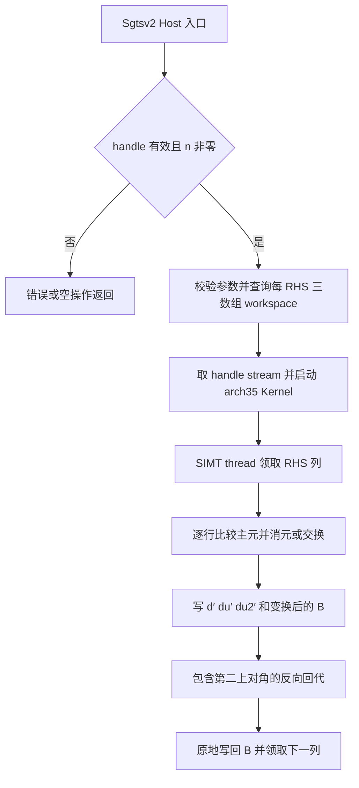
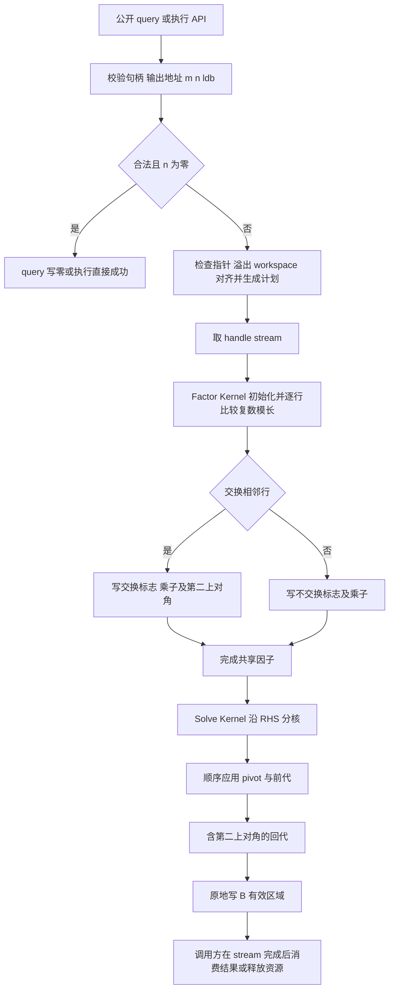

# aclsparseCgtsv2 算子开发方案与设计文档

适用平台：Ascend 950（A5，DAV_3510，arch35）。日期：2026-10-28。状态：开发前设计，尚未完成目标环境编译、NPU 精度与性能验证。

本方案新增独立 complex64 三对角线性方程组求解接口，采用 aclsparse Legacy C++ API 和 Ascend C Kernel 直调，支持部分主元选取、多 RHS、B 原地覆盖、workspace 查询与异步 stream。推荐先实现一次带主元分解、再并行求解 RHS 的两阶段路径；性能优化以全部 203 条用例逐例达标为完成条件。

本文只落实本次请求的开发方案，不执行任务材料中的提交 PR、发送邀请、申请算力或创建验收交付目录等操作。材料中的这些内容作为后续开发与交付要求列入计划。

## 一、需求背景

### 1.1 需求来源

来源为本地《10月社区任务-aclsparseCgtsv2算子开发 (950)》任务包，任务书为 `aclsparseCgtsv2_A5_task_doc.md`。目标代码仓为 `cann/ops-sparse` 的 master 分支。方案结构对齐指定设计文档 CheckList 第 2～24 行，并参考本地社区设计模板。

资料入口：

- [任务书](</Users/swen/Documents/Code/cann/operator_development_workspace/aclsparseCgtsv2950wsp/10月社区任务-aclsparseCgtsv2算子开发 (950)/aclsparseCgtsv2_A5_task_doc.md>)。
- [设计文档 CheckList](/Users/swen/Documents/Code/cann/asctool/docs/official/设计文档CheckList.md)。
- [本地设计模板](/Users/swen/Documents/Code/cann/cann-ops-competitions-cy/04_tasks/01_community-task-2026/resources/design_template.md)。模板中的 Addcdiv、TBE、ACLNN 和广播示例不作为本任务需求。
- [测试工程总览](</Users/swen/Documents/Code/cann/operator_development_workspace/aclsparseCgtsv2950wsp/10月社区任务-aclsparseCgtsv2算子开发 (950)/test_cases/README.md>)。

### 1.2 背景介绍

#### 1.2.1 算子实现目标及源码参考

求解 `A X = B`。A 为 m 阶复数三对角矩阵，`A[i,i]=d[i]`、`A[i,i-1]=dl[i]`、`A[i,i+1]=du[i]`，边界 `dl[0]=du[m-1]=0+0i`。B 的有效区域为 m×n，完整分配为 ldb×n，列主序，地址为 `B[i+j*ldb]`。求解结果覆盖有效区域，padding 不变。

本任务不是 TBE 算子迁移，不存在可作为本接口基线的 TBE Python 源文件及 TBE 算子信息库条目；相应路径/文件名不适用，也不虚构 `cgtsv2.py` 或 OPP 配置。公开 Legacy ABI 已明确，不能以 aclnn 名称匹配替代确认。CheckList 对参考来源的要求通过以下文件级证据落实：

| 参考项 | 当前可读路径（相对工作区根目录） | 作用 |
| --- | --- | --- |
| 公开接口、状态码和句柄 | `ops-sparse-cy/include/cann_ops_sparse.h` | Sgtsv2 ABI、已有复数类型及 stream API |
| 同族 Host | `ops-sparse-cy/sparse/gtsv2/arch35/gtsv2_host.cpp` | 参数校验、workspace 和 launch 结构 |
| 同族 Kernel | `ops-sparse-cy/sparse/gtsv2/arch35/gtsv2_kernel.cpp` | FP32 部分主元前消元及回代 |
| 同族调度数据 | `ops-sparse-cy/sparse/gtsv2/arch35/gtsv2_tiling_data.h`、`gtsv2_kernel.h` | Host/Device 数据传参 |
| 同族功能说明 | `ops-sparse-cy/sparse/gtsv2/README.md`、`ops-sparse-cy/docs/zh/api_list.md` | 替代 TBE 信息库的接口说明 |
| 构建和测试 | `ops-sparse-cy/CMakeLists.txt`、`sparse/CMakeLists.txt`、`test/gtsv2/CMakeLists.txt` | arch35 源收集及 C++ 测试接入 |

本地 ops-sparse-cy 参考 HEAD 为 `4f9936e933c4710490d9e8ae7525de5a495b04af`；未将该工作副本认定为上游 master 的最新状态。实施前需比较分支差异，保留已有改动。

接口标杆为任务书指定的 CUDA Toolkit/cuSPARSE 13.3 Update 1。在线 [NVIDIA gtsv2 文档](https://docs.nvidia.com/cuda/cusparse/index.html#cusparse-t-gtsv2) 可辅助核对 pivot、原地输出及 workspace 行为；2026-10-28 访问的在线首页已显示 13.4，不能据此声称核验了指定 13.3 Update 1 的全部版本语义。开发环境需保留指定版本头文件、动态库版本和调用记录。

#### 1.2.2 现状分析

##### 1.2.2.1 现有参考支持的数据类型和格式

| 项目 | 当前 Sgtsv2 参考 | 目标 Cgtsv2 |
| --- | --- | --- |
| dtype | float32 | complex64，实虚各 float32 |
| 系数布局 | 连续 `[m]`，三个数组只读 | 相同，以复数元素计数 |
| RHS | 列主序 `[ldb,n]`，原地覆盖 | 相同，padding 保持不变 |
| 选主元 | 实数绝对值比较 | 复数模长比较 |
| 临时结果 | 每 RHS 的 d′、du′、du2′ | 推荐共享 U 对角、乘子、pivot 标志 |

现有头文件还有 `aclsparseComplex {float x; float y;}`，不能直接当作满足 `real/imag` 字段契约的新类型。新增 `aclsparseComplex_t` 时保持旧类型及所有 Sgtsv2 签名不变；若目标分支已经合入同名类型，只复用并核验布局，不重复声明。

##### 1.2.2.2 现有实现描述

Sgtsv2 Kernel 每个 SIMT thread 处理一个 RHS，通过 grid-stride 分派列。前向从第 1 行至 m−1 行比较当前修改后的主对角与原始 dl；不交换时作消元，交换时交换相邻方程对应的 RHS，并保存第二上对角填充。每列在 workspace 保存三条长度 m 的 FP32 对角数组，B 保存变换后的 RHS。回代从 m−1 到 0，使用第一、第二上对角写回解。

其 workspace 计算为 `align128(3*m*n*4)`，每列重复系数消元。它没有奇异主元保护，可能产生 Inf/NaN。Host 的执行和查询入口在 n=0 时提前返回，部分形状校验会被绕过；这不是直接复制到新接口的理由。新接口按任务书先检查 m/n/ldb 的合法性，再处理合法空 RHS，并为此添加真实 C++ 合同测试。

##### 1.2.2.3 现有参考流程图（TBE 不适用）



图描述现有 FP32 参考的主路径，不声称存在 TBE 实现；具体查询入口与执行入口的校验顺序差异已在上一节列明。

## 二、需求分析

### 2.1 外部组件依赖

| 依赖 | 版本/作用 | 接入状态 |
| --- | --- | --- |
| CANN、ACL runtime、Ascend C 编译器、驱动/固件 | 任务书要求 CANN 9.0.0 及后续配套版本；需实际支持 DAV_3510 | 目标板环境待验证 |
| ops-sparse | Legacy handle、stream、日志、状态码、构建框架 | 本地源码已核对 |
| 官方 ATK | 26.9.8，提交 `9504bee6076820ca74259fb919a790a12ef88cf8` | 使用附件原生 YAML/插件，未运行设备测试 |
| Python/NumPy/SciPy LAPACK | Python 3.10/3.11、NumPy <2；complex128 Golden | 测试依赖，生产求解不依赖 CPU Golden |
| PyTorch/torch_npu | 2.7+ / 26.0.0+ 的配套组合 | 测试适配层需要，不改变公开 C++ ABI |
| CUDA/cuSPARSE、NCU | 指定标杆版本与 GPU Kernel 采集 | 附汇总 CSV，完整原始证据待补 |
| NPU Profiler、Event | Kernel/Event 分开采集 | 待真实设备执行 |

不引入 TBE、ACLNN、Cube/Matmul 或 CPU fallback。软件最低版本不代表任意组合都可用，报告必须记录实际配套组合。

### 2.2 内部适配模块

| 落点（相对目标 ops-sparse 根目录） | 新增/修改内容 |
| --- | --- |
| `include/cann_ops_sparse.h` | 一次性新增 `aclsparseComplex_t` 和两个公开接口 |
| `sparse/cgtsv2/` | 公共参数校验、checked arithmetic、workspace 布局、复数工具及 README |
| `sparse/cgtsv2/arch35/` | `cgtsv2_host.cpp`、`cgtsv2_kernel.cpp/.h`、`cgtsv2_tiling_data.h`（拟定文件名） |
| `test/cgtsv2/` | 公共 Golden、附件 ATK/性能配置、真实 NPU 注册扩展及构建说明 |
| `test/cgtsv2/arch35/` | C++ 接口/Host/Kernel/端到端测试 |
| 根及现有相关 `CMakeLists.txt` | 接入 arch35、测试和库链接，沿用现有源收集，不创建重复 build 目录 |
| `docs/zh/api_list.md` | 新 ABI、错误码、布局、异步使用和限制说明 |

公共层不引用 950 专属 Device 头文件。A2/A3 与 A5 合入顺序变化时对已合入类型及 Host 层作增量适配，新增 arch35 文件不污染其他架构的构建列表。

### 2.3 需求模块设计

#### 2.3.1 Ascend C 算子原型与参数

```cpp
typedef struct {
    float real;
    float imag;
} aclsparseComplex_t;

static_assert(sizeof(aclsparseComplex_t) == 8);
static_assert(alignof(aclsparseComplex_t) == alignof(float));
// 同时检查标准布局、offsetof(real)==0、offsetof(imag)==4。

aclsparseStatus_t aclsparseCgtsv2_bufferSizeExt(
    aclsparseHandle_t handle, int m, int n,
    const aclsparseComplex_t *dl, const aclsparseComplex_t *d,
    const aclsparseComplex_t *du, const aclsparseComplex_t *B,
    int ldb, size_t *pBufferSizeInBytes);

aclsparseStatus_t aclsparseCgtsv2(
    aclsparseHandle_t handle, int m, int n,
    const aclsparseComplex_t *dl, const aclsparseComplex_t *d,
    const aclsparseComplex_t *du, aclsparseComplex_t *B,
    int ldb, void *pBuffer);
```

| 参数 | 契约 |
| --- | --- |
| handle | 有效 aclsparse 句柄；采用其绑定 stream |
| m/n/ldb | int32，m≥3、n≥0、ldb≥max(1,m)，运行时动态参数 |
| dl/d/du | 同设备连续 complex64 `[m]`，只读；dl[0]、du[m−1] 为零 |
| B | 同设备 complex64，完整 `[ldb,n]`，列主序 stride `(1,ldb)`；仅写前 m 行 |
| pBufferSizeInBytes | 非空 Host size_t 输出地址；合法 n=0 写 0 |
| pBuffer | 按查询值足量分配、128 字节地址对齐的 Device workspace；n=0 可空 |

没有独立 X、batchCount、转置、广播或任意 stride 参数。ABI 的 int32 值域与测试配置中 `2^20` 维度边界不是同一概念，不能将测试因子上界当作接口新增限制。

#### 2.3.2 与参考相比的差异及约束

相对 TBE：无对应实现，不存在以 TBE 功能缺口定义的迁移项。相对任务书：目标能力均列入设计，暂未完成设备实现验证。相对 Sgtsv2：增加独立复数 ABI、稳定复数除法和模长 pivot；改变内部分解复用方式，不改变原 Sgtsv2 行为。只承诺本任务 complex64 单系统多 RHS；不扩展 complex128、batched 或 nopivot ABI，也不承诺 CUDA Graph 与 NPU 图捕获对等支持。

## 三、需求详细设计

### 3.1 使能方式

采用 Legacy C++ Kernel 直调，调用链为 `公开 API → Host 校验/布局 → handle stream → <<<>>> → AIV 入口 → SIMT VF`。Host 不能直接调用 `__aicore__` 函数。调用方创建并绑定 handle/stream，查询字节数，分配并对齐 workspace，再执行求解；stream 完成后才能读取结果、释放或复用相关内存。

执行 API 只确认 Host 校验及提交阶段状态；不得为返回数据依赖的奇异状态而在每次调用内部强制同步。相同 stream 的两个 Kernel 按顺序执行；不使用跨核自旋或全设备同步。不同并发调用使用独立 workspace 和可写 B，系数可共享只读。

测试扩展须真实注册：

- `torch.ops.ops_sparse_test.cgtsv2_buffer_size_ext_npu(m,n,dl,d,du,B,ldb) -> int`。
- `torch.ops.ops_sparse_test.cgtsv2_npu(m,n,dl,d,du,B,ldb,workspace)`，原地修改 B，绑定当前 torch_npu stream。

扩展负责 dtype/device/shape/stride/实际长度验证及存储生命周期，不把 B 隐式转换成行主序；失败转异常。已识别的参数合同错误使用附件约定前缀 `CGTSV2_INVALID_PARAMETER:`；缺库、缺 Kernel、OOM 等运行错误原样传播，不包装为预期拒绝成功。须提供扩展源代码、可导入模块及构建安装说明，仅设置 `CGTSV2_EXTENSION_MODULE` 不构成实现。

### 3.2 需求总体设计

将系数分解和 RHS 变换拆开：Factor Kernel 对 A 做带相邻行交换的三对角 LU，写 D、U1、U2、L 和 pivot；Solve Kernel 复用因子，对 RHS 先应用顺序行交换及前代，再回代。复杂度为 O(m)+O(mn)，避免每列重复系数分解。该变换保持部分主元能力，不能替换为仅适用于对角占优输入的无主元 Thomas。

#### 3.2.1 Host 侧设计

##### 3.2.1.1 分核策略

Factor Kernel 初始实现使用 1 个 AIV block，由一个有效 SIMT lane 顺序处理有依赖的 m 行，其余 lane 不访问数据；线程配置按合法 warp 粒度选 32。Solve Kernel 初始取 T=32，每线程独立处理一列；AIV 核数 C 来自平台查询，`G=min(C,ceil(n/T))`。列号 `j=blockIdx.x*T+threadIdx.x+k*G*T`，仅 j<n 执行。

同一列的行递推不并行，不在非一致循环中设置 block barrier。分核只沿 RHS 列，B 写区与 workspace 因子读区不会冲突。n 小时采用单列或少列的融合路径候选，减少 Kernel 启动开销；n=0 不查询核数、不启动 Kernel。

风险：n=64/128 时上述基础策略仅使用 2/4 个 block，无法据此推断达标。调优需比较“每 block 1/2/4/8/32 个有效 RHS”的映射，允许其余 lane 空闲以提高列跨核分布；最终映射以 Profiler 与逐例结果决定，而不是机械满线程。分解链仍是串行瓶颈，需单独测量。必要时评估带主元的分段/等价并行消元，不能凭无主元 CR/PCR 的结果替代本任务能力。

##### 3.2.1.2 数据分块和内存优化策略

定义 `A128(x)=128*ceil(x/128)`，全部计算先作溢出检查，再取整。两阶段基础布局为五个独立对齐区域：

| 区域 | 有效长度 | 字节数/对齐分配 |
| --- | --- | --- |
| D、U1、U2、L | 各 m 个 complex64，末尾不用的位置也初始化 | 各 A128(8m) |
| pivot | m 个 uint32，0 表示不换，1 表示相邻交换 | A128(4m) |

`Wshared(m,n)=0 (n=0)`，否则 `4*A128(8m)+A128(4m)`，约 36m 字节、与 n 无关。偏移为前面各区域对齐字节数之和。U2 仅 m−2 项有意义、L/pivot 仅 m−1 项有意义，统一分配 m 项便于索引和尾部初始化。Kernel 参数直接传值及指针，不额外分配 GM tiling 存储。

三条主场景理论 workspace 分别为：P-01 294,912 bytes，P-02 147,456 bytes，P-03 258,048 bytes。这是方案公式的计算值，不是实际查询或内存实测。若小 n 融合路径采用每列三条复数对角数组，其查询为 `Wfused=A128(24mn)`；初始仅启用 n=1，并与查询/执行共用同一计划器。扩展融合分支前必须复核 workspace 和精度。

内存地址使用 64 位偏移。检查 `8*m`、`ldb*n`、`8*ldb*n`、`24*m*n`、各分区和与 `x+127`，先验证 `a<=MAX/b` 再乘；对可寻址偏移同时满足 size_t 及所用有符号地址计算范围。不能在溢出后除回来判断，也不能把计算失败返回 0 冒充合法空操作。

基础 SIMT 路径直接访问 GM，显式 UB 数组为 0；每线程仅保留复数主元/乘子/相邻 B 或 x 等固定数量标量，不定义长度 m 的线程局部数组。GM workspace 不因“隐含使用 Cache”而从统计中删除。编译报告核对寄存器、栈和 spill。

如增加分块预取，使用连续行 tile R。每个 tile 包含 D/U1/U2/L 四个复数数组、pivot 和一个 RHS tile，单缓冲预算 `Utile=5*A32(8R)+A32(4R)`；双缓冲预算 `2*Utile`。R=256 时分别为 11,264 / 22,528 bytes。m 尾块按实际行数读写，复数内部 real/imag 均处理；相邻 tile 传递递推状态，不重置主元或前代状态。

950 总 UB 预算按 `Ustatic+Udynamic+Ureserve+Ucache ≤ 262144`，预留 Ureserve 至少 8192 bytes，SIMT Data Cache 初筛 32768～131072 bytes；实际配置和编译器保留量以目标环境为准。R 的上界由该不等式求得，不能将 256 KiB 全部分给数据，也不把规划中的 UB 预取写成当前已实现。

逻辑 IO=`8*(3m+ldb*n)`，B 只计一次。算子不分配独立 X；恢复 B 的测试副本另计。workspace 查询值、实际对齐申请值（手动对齐可需 W+127）、allocator 峰值/增量、设备 free/total 分别报告，禁止重复相加。

##### 3.2.1.3 tilingKey 规划策略

本接口不使用 ACLNN `GET_TILING_DATA` 或框架 tilingKey 注册。定义内部 `dispatchKey`，与 Host 计划和 query 一致：

| key | 条件 | 调度及 workspace |
| --- | --- | --- |
| 0 | 合法 n=0 | 空操作、0 bytes |
| 1 | n>0，默认路径 | Factor+Solve，Wshared |
| 2 | n=1 且融合路径完成精度与性能验证 | 单 Kernel 带主元消元+回代，Wfused |

初始仅使能 0/1；key 2 是候选，不影响未验证版本的查询值。key 选择只依赖公开尺寸、设备能力和固定版本策略，不在 Host 读取矩阵值。调度数据含 int32 m/n/ldb、uint32 key/blocks/threads/有效RHS数，以及需用的 uint64 区域偏移；显式初始化并静态断言 Host/Device 布局一致。

校验顺序：检查 handle、查询输出指针（仅 query）、m/n/ldb；合法 n=0 返回；随后检查数据指针、可见地址运算范围，执行入口另检查 workspace 非空及128字节对齐；构建同源调度计划并取 stream。query 不读取 Device 数据、不触发求解。执行 ABI 没有实际 workspace 长度，无法检测任意分配不足，长度由调用方/适配层保证。

错误码规划：空句柄及非法整数/指针/对齐/算术溢出按任务书返回参数错误 `ACL_SPARSE_STATUS_INVALID_VALUE`；平台不匹配映射仓内 `ARCH_MISMATCH/NOT_SUPPORTED`，平台信息失败映射 `INTERNAL_ERROR`，可见提交失败映射 `EXECUTION_FAILED`。具体 runtime 映射复用同仓约定，不新增公共枚举；异步设备失败在 stream 同步点报告。handle 非空不证明其实际对象存活，不能声称识别任意悬空地址。

#### 3.2.2 Kernel 侧设计

##### 3.2.2.1 实现描述

**复数基础运算。** 以两个 float32 分量实现加减、乘法和除法，乘法 `(a+ib)(c+id)=(ac−bd)+i(ad+bc)`，不使用共轭。模长比较不直接算 FP32 `real²+imag²`：有限值先用两候选共同比例 s（四个分量绝对值最大值）缩放，再比较平方和；s=0 判平局。必要时用稳定 hypot/指数缩放辅助，要求覆盖极大、极小、次正规及近等模长输入。平局固定不交换，避免非确定性分支。

复数除法采用经过边界验证的缩放 Smith 类算法，按分母较大分量分支并作指数缩放，避免直接构造 `c²+d²`；不能只用未经缩放的 Smith 公式声称解决所有溢出/下溢。相关辅助函数在目标 SIMT 环境核验合法性；默认不开 fast-math 或主动 FTZ，精确除法等选项以编译器版本和精度回归结果确定。

**Factor。** 初始化 `D=d`、`U1=du`、`U2=0`、`L=0`、`pivot=0`，全部写 workspace，原始系数不写。对 i=0…m−2，取 a=D[i]、b=dl[i+1]、c=U1[i]、e=D[i+1]、f=(i+1<m−1 ? U1[i+1] : 0)。以下右侧均引用更新前的值：

| 分支 | 因子更新 |
| --- | --- |
| `abs(a)>=abs(b)` 且 a 非零 | q=b/a；L[i]=q；D[i+1]=e−q*c；当前 D[i]/U1[i] 不变；pivot[i]=0 |
| `abs(a)<abs(b)` | q=a/b；L[i]=q；D[i]=b；D[i+1]=c−q*e；U1[i]=e；若有第二上对角，U2[i]=f、U1[i+1]=−q*f；pivot[i]=1 |
| a=b=0 | 不作 0/0 的系数更新，L[i]=0、pivot[i]=0，保留零 D；进入安全奇异传播路径 |

最后一步不读不存在的 U1[m−1] 作为有效上对角，不写 U2[m−2] 的数学项。上述 m 长区域可初始化哨兵，但数学回代只使用存在的项。

**Solve 前代。** 每列 j 对 i=0…m−2 依次执行：不交换时 `B[i+1,j] -= L[i]*B[i,j]`；交换时保存 t=B[i,j]，令 `B[i,j]=old_B[i+1,j]`、`B[i+1,j]=t−L[i]*old_B[i+1,j]`。必须按顺序应用 pivot，不能先汇总为无顺序的并行行交换。

**回代。** `x[m−1]=B[m−1]/D[m−1]`；`x[m−2]=(B[m−2]−U1[m−2]*x[m−1])/D[m−2]`；其余 `x[i]=(B[i]−U1[i]*x[i+1]−U2[i]*x[i+2])/D[i]`。每次只写 `0≤i<m` 的对应列。若相乘系数为精确零，可跳过该项，防止单位三对角的特殊值 B 因无意义 `0*Inf` 传播污染相邻行；与 Golden 的特殊语义单列验证。

**奇异及非有限值。** 真奇异系统可在回代出现零除及 Inf/NaN，但必须保证线程结束、内存安全，保留 API 提交返回码、同步状态和实际输出；不能把提交成功等同求解成功。对 NaN/Inf 不用于寻址、循环边界或分区选择。任务未承诺所有非有限系数的传播规则，独立记录实际行为；附件单位系数、B 注入特殊值的补充语义须单独满足。

**同步与缓存。** Factor 与 Solve 在同一 stream 顺序启动，按 runtime 的 Kernel 依赖和缓存可见性约定交接 GM 数据，不依赖 kernel 内跨 block barrier。实现时核对目标 3510 文档和同族代码是否需要具体缓存维护；无依据不插入猜测 API。同一线程的 B 前代/回代具有程序顺序，不引入原子规约。后续混合 VF 共享 UB 时按实际写入者和读取者补全依赖与缓存处理。

##### 3.2.2.2 Ascend C 实现流程图



图中 F 之后是执行路径；query 生成计划后直接返回 workspace 字节数，不提交 G～O。参数检查失败均立即返回错误，不进入 Kernel。

##### 3.2.2.3 与 TBE/同族参考流程的差异及原因

| 差异 | 原因与一致性依据 |
| --- | --- |
| 无 TBE 图、无 ACLNN 调用 | 任务明确要求 Legacy C++ Kernel 直调 |
| 实数绝对值改复数模长 | 满足 Cgtsv2 的复数 pivot；不能改为只比较实部或 L1 范数 |
| 一次共享分解，再对各列应用 pivot | 原系数与列无关，减少重复计算及 O(mn) 因子内存；与逐列消元数学等价 |
| 两个 Kernel 替代单 Kernel | 利用 stream 完成因子生产/消费依赖，避免跨核全局自旋 |
| 可见整数校验后再空返回 | 使 query/执行与任务书 m/n/ldb 约束一致 |
| 安全处理双零主元及特殊值乘零 | 保证奇异系统终止和内存安全，补充特殊语义；不是普通精度通过证据 |

分解复用改变浮点执行结构，是否达到混合容差必须实测，数学等价不自动等于逐位一致于 GPU。确定性只针对相同 NPU、软件和固定配置复跑。

### 3.3 支持硬件及 API 依据

本任务支持 Ascend 950（A5，DAV_3510，arch35）；不据此声明 A2/A3 新增 Cgtsv2 可运行。950PR/950DT 的具体部署型号以实际板卡记录为准。选择 AIV/SIMT，不使用 Cube，因此不引入已移除的 GM→L0A/L0B、L1→GM 路径。

本次 DEVKIT_PATH 解析为 `/Users/swen/Documents/Code/cann/asc-devkit-dls`，其 docs/include/impl/tests/examples 均存在，参考 HEAD=`2c5312f14087255d6a2ed82470922dfac6a910f8`。CANN_PATH 尚未在可编译目标环境确认，SOC_ARCH=`dav-3510`。本地 9.1.0-beta.1 API 索引用于初筛，其中 SIMD 版 `asc_vf_call` 的 UB 指针约束不能误套到混合编程的 SIMT 重载。

| 接口/约束 | 文档与代码依据（相对 DEVKIT_PATH） | 选型 |
| --- | --- | --- |
| AIV 入口、`<<<>>>`、SIMT VF 启动 | `docs/zh/api/SIMT-API/SIMD_SIMT_hybrid_programming_intro/extended_syntax/kernel_function_config.md` | AIV 入口协调 SIMT VF，GM 指针及内置标量参数 |
| `asc_vf_call(dim3,Args...)` | `include/simt_api/common_functions.h` 的声明及 `cce::async_invoke` 包装实现 | 使用混合编程 SIMT 重载，不使用 SIMD VF 的 UB-only 重载 |
| SIMT 头文件 | `include/simt_api/asc_simt.h` | 对齐目标 Toolkit 实际安装版本 |
| block/thread 索引与启动上限 | 同目录 `builtin_variables.md`、`programming_model.md` | thread 总数≤2048，建议32倍数；launch_bounds≥实际线程数 |
| 950 SIMT 测试入口 | `tests/api/simt_api/ascendc_case_ascend950pr_9599_simt/test_operator_simt_common.cpp` | 作为目标架构样例入口；不是新 Kernel 已编译证据 |

架构和编译模式必须一致。当前 ops-sparse 根 CMake 明确指出 `AIV → asc_vf_call → SIMT VF` 是混合模式，不给该 translation unit 全局添加纯 SIMT 的 `--enable-simt`。`common_functions.h` 也在 `__NPU_COMPILER_INTERNAL_PURE_SIMT__` 条件下屏蔽该包装。若未来改为纯 SIMT 独立入口，再按其文档/构建使用 `--enable-simt`，并移除不兼容混合模式头文件。实施时保留真实编译命令，检查 `--npu-arch=dav-3510`、架构宏及寄存器报告，不能只看构建选项名推断成功。

### 3.4 算子约束限制

- 只接受统一 complex64；没有运行时 dtype/stride 描述符，raw ABI 无法校验实际分配长度、真实 dtype 或任意地址有效性。
- m≥3、n≥0、ldb≥m；不广播，不接受转置或任意 stride，不提供批量系统接口。
- 系数与 B、workspace 的可写区不得重叠；原始系数只读。系数边界零值是调用契约，不为检查其内容在 Host 强制同步或读取 Device 内存。
- n=0 仍要求合法 handle、m、ldb 和查询输出地址；数据指针和 workspace 可空，不触发求解。
- workspace 至少为当前版本同源查询返回值且128字节对齐；不同尺寸、dispatch 或版本不能沿用旧查询值。
- 资源可用性限制与数学合法性分开；不能声称保证超出设备物理内存的输入分配成功，也不能静默缩小测试有效域。
- 奇异系统不承诺同步返回数据依赖错误码；需如实记录返回、同步和输出。非有限输出不作为常规数值验收通过。

## 四、特性交叉分析

| 交叉项 | 风险/影响 | 设计与验证方法 |
| --- | --- | --- |
| pivot × 复数 | 绝对值溢出、平局选取不稳定 | 稳定模长比较、固定平局规则、连续交换及近等模长专项 |
| pivot × 多 RHS | 行交换漏列或次序错误 | 共享 pivot 只读，每列按相同顺序前代；以已知 X 构造 B 验证 |
| pivot × fill-in | 漏第二上对角导致错误 | U2 全初始化，交换触发链和边界 m=3 单列验证 |
| 原地 × padding | 错写 padding 或将其用于消元 | 64 位列偏移、有效行界，padding 填充 canary 前后比较 |
| 异步 × 生命周期 | 提前释放 workspace、跨 stream 读旧因子 | 同 stream 两 Kernel，扩展绑定当前 stream并保留资源到完成 |
| 动态尺寸 × 安全 | 整数/取整溢出，尾部越界 | checked arithmetic，查询/执行同源计划，canary/设备工具验证 |
| 精度 × 优化 | FTZ、fast-math、FMA 或分段顺序改变误差 | 精度模式固定并记录；优化后重跑受影响套件 |
| 特殊值 × 稀疏运算 | 0×Inf 产生无意义 NaN | 跳过精确零乘项，分类 mask/Inf 符号独立检查 |
| 公共 ABI × 多平台 | 重复类型/符号、arch35污染其他构建 | 单一定义、按架构收集，A2/A3旧API与A5交叉构建/回归 |
| 性能 × 内存 | 共享分解省内存但存在串行链 | 分开测 Factor/Solve/总耗时，逐例选择已验证映射 |

## 五、可维可测分析

### 5.1 精度标准和性能标准

#### 5.1.1 精度

CPU Golden 使用同一份已经量化为 complex64 的输入，提升为 complex128 后用 SciPy/LAPACK 带主元带状求解，不能改为稠密求解覆盖大 m，也不能用无主元 Thomas。参考任务书锁定的精度标准提交 `a5e8e716743b20bfb2ffa16e0213c4aa73b823b3`，以附件比较器为直接接入口。

实部和虚部各自满足混合容差 `abs(actual−golden) ≤ 2^-13 + 2^-13*abs(golden)`，各自匹配率≥0.99。每个分量最大有限绝对误差还须≤`max(1e-2,32*ULP(g_low))`；g_low 为该分量最大有限绝对误差位置的 Golden 收窄到 float32 后的值。不得使用全局最大 Golden 或另一个误差点代替 ULP 锚点。NaN 不记普通精度通过；有限/非有限值不参与同一最大有限误差统计。

普通精度溢出特例：NPU 为 ±Inf、Golden 有限时，只在 Golden 按 RNE 收窄为 float32 后为同号 Inf 才通过。特殊套件另检查收窄前 Golden 分类：NaN 同位置匹配，Inf 同位置同号匹配；mask/符号任一不符整例失败，其余有限位置逐点满足上述容差，不使用0.99放宽，也不套普通最大误差ULP门槛。不能将 NaN/NaN 特殊语义成功写成普通数值精度通过。

#### 5.1.2 性能

正式标准：全部203条、每条 `R_i=GPU_Kernel中位数/NPU_Kernel中位数 ≥0.3`。不以三条主场景、平均倍率或 Event 代替逐例判定。

| 场景 | m/n/ldb | GPU Kernel 中位数 μs（附件） | 推导的 NPU 上限 μs | GPU Event μs（辅助） |
| --- | --- | ---: | ---: | ---: |
| P-01 | 8192/64/8192 | 640.896 | 2136.320 | 664.976 |
| P-02 | 4096/64/4096 | 628.944 | 2096.480 | 641.184 |
| P-03 | 7168/128/7168 | 1220.048 | 4066.8267 | 1224.944 |

每例预热≥10次、正式采样≥30次，每次先恢复原始 B 并确保恢复完成，再开始求解计时；workspace 稳态复用。先对一次求解范围内全部计算 Kernel 耗时求和，再对样本求中位数，不能将各 Kernel 中位数相加。排除编译、初始化、数据构造/拷贝、B 恢复和 workspace 查询/分配。Factor 与 Solve 都在计时范围内。

GPU 用 NCU、NPU 用 Profiler；Event 在无 Profiler instrumentation 的独立进程中同 stream 包围求解，独立列示，不用于0.3验收。保留单次样本、median/P90/mean/std、全部 Kernel trace、单位及设备软件版本。两端按 case_index/m/n/ldb/seed/distribution 配对，并核验实际输入；属性/种子 hash 不等同实际 Tensor 字节 hash。

已静态确认附件有200条精度JSON、203条性能JSON和203行GPU基线CSV。GPU CSV仅汇总，不包含完整原始样本、Profiler、版本及10/30证据，不能仅凭汇总认定正式标杆证据闭环；需补齐或同输入重采。当前没有NPU结果。

#### 5.1.3 内存标准

任务书两条满足其一：① IO总量>500 MB时，相同Torch调用条件下，NPU额外内存不超过GPU使用内存总量5%；②方案固有workspace绝对值不超过目标硬件L2 Cache容量。优先按②验证共享因子方案，使用真实型号可核验的L2容量，不将UB或芯片总内存代入。单位MB采用任务验收方统一定义，报告同时给bytes。

逐例记录IO、查询workspace、实际对齐申请、恢复副本、框架allocated/reserved的基线/峰值/增量，以及设备free/total。原生库分配单列，设备全局快照不当作算子峰值。对超大动态m，如果Wshared超过目标L2，必须评估①或调整算法，不预先宣称全部动态输入已满足内存验收。检查重复调用、并发stream、泄漏和越界，禁止CPU fallback。

### 5.2 兼容性分析

公共头文件新增ABI，不改 `aclsparseSgtsv2(float*)`、旧复数类型及已有枚举。类型名称、字段、大小、对齐、offset均以编译断言和外部调用样例验证。A2/A3与A5后合入的PR复用已合入公共定义，不生成重复符号。运行跨平台既有Sgtsv2与相关公共层回归，未上板的平台明确记录未验证。

适配层严格保留列主序B，不能通过`.contiguous()`隐式变更布局后只修改副本。原始指针接口和Python元数据合同分层验证：Python拒绝测试不能替代C++状态码；CPU Golden正确不能替代NPU Dispatch；注册点存在不能替代真实调用。

### 5.3 测试覆盖与证据计划

| 套件 | 数量/输入 | 完成判据 |
| --- | --- | --- |
| 发布精度 | 200，独立种子与结果 | 每例实虚分别通过；其中4条合法空RHS检查合同 |
| 额外验收精度 | 800，验收方新种子独立生成运行 | 不覆盖/复用200结果，两组分别通过 |
| 完整有限因子域 | 66,432有效组合 | 原生元数据审计与实际数值运行分别报告 |
| 特殊值 | 8，单位系数+B的NaN/+Inf/−Inf/混合Inf | 分类位置/Inf符号一致，有限位置逐点满足容差 |
| 拒绝合同 | 12，空/标量/下边界/非法整数等 | 适配层明确拒绝；另补真实C++证据 |
| 性能/内存 | 固定203，3主+200扩展 | 全部R_i≥0.3，同口径内存、原始trace齐全 |
| 算法专项 | 对角占优、随机非占优、单/连续pivot、零主对角非奇异、病态/真奇异 | 常规精度、异常语义分开，不以奇异NaN结果凑通过率 |
| C++接口及ST | ABI、指针、对齐、动态、stream、padding、原地、只读、复跑 | query→分配→执行→同步→释放闭环，保留状态码及输出 |

完整域定义：m在[1,2^20]合法`2^k/2^k−1`中取m≥3，共38种；正n同域40种；padding取0/1/32，ldb=m+padding；四个Tensor各均匀/正态，共16种组合。过滤ldb>2^20或`3m+ldb*n>2^34`后为66,432条。每个输入配置各50%均匀[-5,5]、50%正态（mu∈[-5,5]，sigma∈[0.1,2]）；只置dl[0]/du[m−1]零，不以对角占优变换替换精度分布。

200+800不替代完整域覆盖；完整域只表示声明的有限因子及等价类，不穷举ABI所有整数。超资源case保留需求和未执行记录。附件说明ATK通用CasesMetrics约4GiB尺寸门槛与本任务2^34元素上限不同，full元数据生成可退出0但出现`oversize_case=True/result=False`；不得修改第三方检查来伪造通过，需单列此差异及大case的实际运行状态。

12类适配拒绝为empty_dl/d/du/B、scalar_dl/d/du/B、lower_all_ones、m_below_3、negative_n、ldb_below_m。C++另覆盖空handle/查询输出、n>0时空数据与workspace、未对齐workspace、checked arithmetic、m<3但n=0、ldb<m但n=0，明确不能把不可见长度错误声称为Host可检测。

内存及数据保护：系数逐字节对比，B有效区域比Golden，padding及workspace分区边界canary比对。确定性至少独立复跑多轮，每轮恢复同一B，固定版本/设备/策略，有限非奇异输出逐位比较并保存hash与差异；特殊/奇异结果另记。用非默认stream验证异步执行和生命周期。

### 5.4 复现命令规划

以下为目标Linux环境待执行命令，不代表本次已经运行。构建遵循目标分支根README和现有CMake，记录真实工具链/CANN路径、目标架构、模块安装命令；未确认目标环境前不编造可用的完整构建命令。

在附件`test_cases/atk/`执行（使用已安装官方ATK的同一Python环境，各suite结果单独留存）：

```bash
set -e
set -o pipefail
mkdir -p logs/seed_1028
atk case -f case_designs/accuracy.yaml -p atk_plugins.py -s 1028 2>&1 | tee logs/seed_1028/generate_200.log
atk case -f case_designs/accuracy_acceptance_800.yaml -p atk_plugins.py -s 20261029
atk case -f case_designs/accuracy_full_coverage.yaml -p atk_plugins.py -s 1028
atk case -f case_designs/accuracy_special.yaml -p atk_plugins.py -s 1028
atk case -f case_designs/accuracy_contract.yaml -p atk_plugins.py -s 1028
python3 audit_atk_cases.py --suite published --case-file result/accuracy/json/all_accuracy.json --report coverage_published.json
python3 audit_atk_cases.py --suite acceptance --case-file result/accuracy_acceptance_800/json/all_accuracy_acceptance_800.json --report coverage_acceptance.json
python3 audit_atk_cases.py --suite full --case-file result/accuracy_full_coverage/json/all_accuracy_full_coverage.json --report coverage_full.json
python3 audit_atk_cases.py --suite special --case-file result/accuracy_special/json/all_accuracy_special.json --report coverage_special.json
python3 audit_atk_cases.py --suite contract --case-file result/accuracy_contract/json/all_accuracy_contract.json --report coverage_contract.json
atk task -c result/accuracy/json/all_accuracy.json -n nodes_accuracy.yaml -p . -tk accuracy -sp --disable_id_seed 2>&1 | tee logs/seed_1028/run_200.log
atk task -c result/accuracy_acceptance_800/json/all_accuracy_acceptance_800.json -n nodes_accuracy.yaml -p . -tk accuracy -sp --disable_id_seed
```

800的示例种子可由验收方更换，保持独立输出。`--disable_id_seed`保证用保存的default_seed，不能仅更换生成种子而执行旧数据。full/special/contract的执行入口和独立结果按附件`atk/README.md`组织，检查工具报告和退出码；元数据审计不能代替实际运行。

在`test_cases/performance/`分别于GPU/NPU环境执行全量采集，NPU端先安装并加载真实注册模块：

```bash
python3 collect_performance.py --case-file performance_cases.json --dry-run
python3 collect_performance.py --backend gpu --metric both --case-file performance_cases.json --device 0 --warmup 10 --samples 30 --output results_gpu_all
python3 collect_performance.py --backend npu --metric both --case-file performance_cases.json --device 0 --warmup 10 --samples 30 --output results_npu_all
```

两端命令在各自环境运行，不是在无设备机器依次执行。结果目录每次新建，保留`summary.csv`、`run_summary.json`、每case原始采样及Profiler/Event/内存日志；检查203/203、all_cases_complete、状态和同输入证据。现有冻结性能清单不换成新版精度分布，若换输入必须两端重采。

### 5.5 开发阶段和交付

| 阶段 | 实施内容 | 阶段出口 |
| --- | --- | --- |
| P0 契约与环境 | 对齐指定cuSPARSE版本、目标master、CANN/DEVKIT、编译模式、L2及附件 | 文件/API/版本证据与待办清单完成 |
| P1 公共层 | 类型/ABI、校验、共享计划器、workspace、构建、README | Host/ABI合同验证，旧API不变 |
| P2 正确性 | Factor+Solve、稳定复数运算、pivot/U2、原地和padding | 小规模NPU与CPU Golden通过，真实Dispatch证据 |
| P3 全量验证 | ATK注册、200与800、完整域审计/运行、特殊/合同、确定性 | 分组结果明确，失败与未运行不隐藏 |
| P4 性能与内存 | 203条、Factor/Solve分析、RHS映射/融合/预取候选 | 每例≥0.3及内存条款满足，原始证据齐全 |
| P5 兼容与提交 | A2/A3/A5交叉回归、源码精简、设计/代码PR、报告 | 评审与任务交付项逐项闭环 |

后续开发交付包含设计文档及评审记录、公开头/Host/Kernel、C++UT/ST、真实NPU扩展及构建说明、ATK YAML/原生命令/审计、逐例精度/性能/内存报告、原始日志/trace/截图、个人仓分支/commit/目录。task_submission按任务书原文件名规划：

```text
task_submission/
├── 1 自验证步骤说明.md
├── 2.1 精度自验证报告.xlsx
├── 2.2 精度自验证日志.log
├── 3.1 性能自验证报告.xlsx
├── 3.2 性能自验证日志.log
├── 4.1 内存自验证报告.xlsx
└── 4.2 内存自验证日志.log
```

这些是开发完成后的交付项，本次未创建空报告或修改任务包原始日志。

## 六、设计文档 PR 与代码提交规划

设计文档必须用PR提交，不以issue代替；标题为 `【社区任务】aclsparseCgtsv2算子设计文档`。完成CLA签署，并在设计PR评论`/compile`，保存构建结果。代码PR目标为`cann/ops-sparse` master，附设计、自测和证据索引。

CheckList给出`cann/cann-competitions/04_tasks/01_community-task-2026/tasklist`，任务书给出`cann/cann-ops-competitions/04_tasks/01_community-task-2026/`。两个仓名存在差异：本任务按任务书优先，规划提交到cann-ops-competitions的本任务对应tasklist目录，实际提交前核对社区迁移/仓规及目标分支；不能将两者写成已确认同一仓。在线模板无法读取时，本方案使用§1.1的本地模板，未据此确认在线流程发生变化。

社区任务流程入口为[社区任务流程](https://gitcode.com/org/cann/discussions/39)，在线页面仅返回动态页面外壳，本次没有核验其正文。算力申请、账号邀请等材料中的动作留待实际开发交付阶段按用户授权执行；本次仅输出本地方案。

## 七、设计文档 CheckList 逐项对照

“已覆盖”表示设计内容已填写；“待执行”表示后续工程或提交动作，不代表验收通过。以下逐项保留原表第2～24行。

| 原行号 | 审核项 | 本文落点 | 结论 |
| ---: | --- | --- | --- |
| 2 | PR而非issue、仓库位置、CLA、/compile | §6 | 已规划；仓名差异明确，提交/CLA/构建待执行 |
| 3 | 社区任务PR标题 | §6 | 已给精确标题 |
| 4 | 1.1需求来源 | §1.1 | 已覆盖 |
| 5 | TBE源码和信息库路径，含文件名并核对接口 | §1.2.1 | TBE不适用；已给同族源码/头/API文档文件及原因 |
| 6 | TBE dtype/格式对齐 | §1.2.2.1 | TBE不适用；已列现状与目标dtype/布局 |
| 7 | TBE实现逻辑详细描述 | §1.2.2.2 | TBE不适用；已按同族源码描述并指出校验差异 |
| 8 | TBE实现流程图与源码一致 | §1.2.2.3 | TBE不适用；已给同族参考主流程图 |
| 9 | 外部组件依赖 | §2.1 | 已覆盖版本、用途与接入状态 |
| 10 | 内部适配模块 | §2.2 | 已覆盖文件/目录和构建隔离 |
| 11 | Ascend C算子原型 | §2.3.1 | 已给两个完整签名、类型及参数 |
| 12 | 相关约束和相对参考缺失功能 | §2.3.2、§3.4 | 已覆盖；未扩展能力与未验证状态明确 |
| 13 | 使能方式和调用框架 | §3.1 | 按任务采用Legacy直调及真实测试注册 |
| 14 | Host分核策略 | §3.2.1.1 | 已给分核/线程/列号公式和低占用风险 |
| 15 | 分块与LocalMemory优化、公式 | §3.2.1.2 | 已给GM分区、workspace、UB/Cache/双缓冲和溢出公式 |
| 16 | tilingKey条件 | §3.2.1.3 | 已给等价dispatchKey条件及同源查询规则 |
| 17 | Kernel设计及与参考逻辑一致性 | §3.2.2.1 | 已给复数pivot、L/U2、前代、回代和同步 |
| 18 | Ascend C流程图 | §3.2.2.2 | 已覆盖 |
| 19 | 与TBE/参考流程差异及原因 | §3.2.2.3 | 已逐项列明，TBE不适用原因明确 |
| 20 | 支持硬件与任务书一致 | §3.3 | Ascend950/A5/DAV_3510/arch35 |
| 21 | 算子约束限制 | §3.4 | 已覆盖可见/不可见校验、布局、异步及奇异限制 |
| 22 | 特性交叉分析 | §4 | 已覆盖功能、精度、内存、stream、安全和跨平台 |
| 23 | 精度/性能标准不低于参考 | §5.1 | TBE不适用，按任务cuSPARSE/Golden精确门槛执行 |
| 24 | 兼容性分析 | §5.2 | 已覆盖ABI、布局、架构、旧API及测试分层 |

## 八、开发和评审门禁

- [ ] 目标master与本地参考差异、公共类型先后合入和API证据已复核。
- [ ] 指定cuSPARSE版本、CANN/驱动/固件、DEVKIT及编译模式留档。
- [ ] real/imag、size/align/offset断言通过，原Sgtsv2 ABI保持兼容。
- [ ] query/执行校验同源；合法空RHS与非法整数+空RHS分开验证。
- [ ] 复数模长、稳定除法、平局、连续pivot、U2和末行边界验证。
- [ ] 系数只读、B原地、padding、canary、非默认stream、生命周期验证。
- [ ] 无跨核自旋、无非一致barrier、无CPU fallback、无越界或泄漏。
- [ ] workspace、UB/Cache、寄存器/spill、目标L2及内存条款有真实证据。
- [ ] 发布200与新增800分别通过；完整域、特殊/合同、超资源项状态独立。
- [ ] ATK原生命令、种子、退出码、报告字段、覆盖审计和确定性复跑齐全。
- [ ] 203条逐例倍率≥0.3，Kernel总和中位数、独立Event和内存记录齐全。
- [ ] GPU原始Profiler/版本/采样证据补全，双端真实输入与统计口径一致。
- [ ] A2/A3旧API及A5交叉回归记录，未验证项如实列出。
- [ ] 设计PR、代码PR、CLA、/compile、报告与原始证据完成后再更新实际状态。

