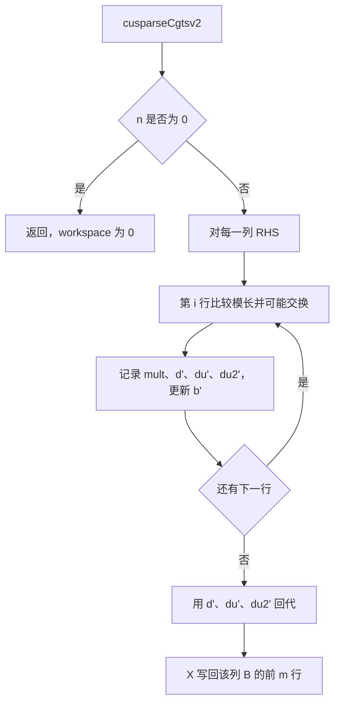
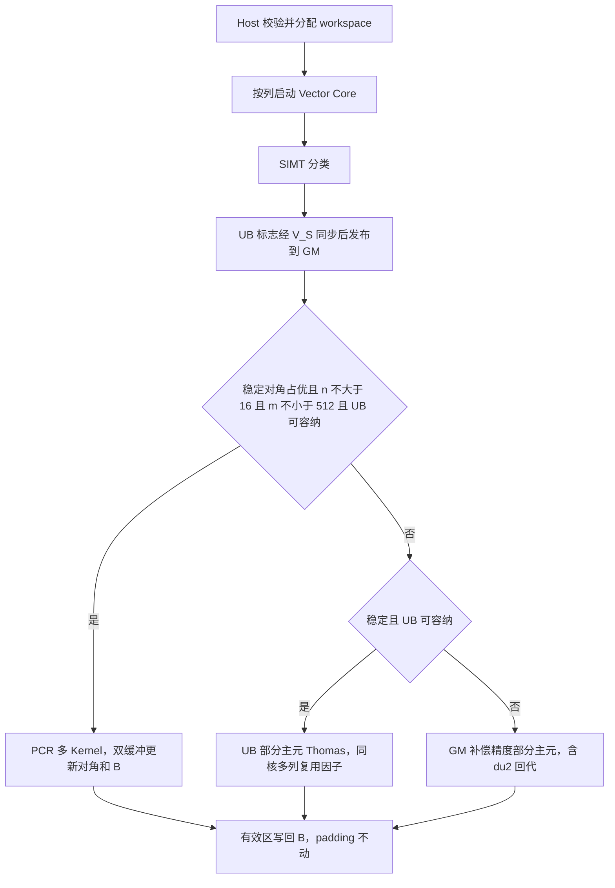

# aclsparseCgtsv2 算子设计文档（Ascend 950）

提交位置：`04_tasks/01_community-task-2026/tasklist/10-aclsparseCgtsv2-950/algrex/docs/design.md`

官方 checklist 写的仓地址是 `cann-competitions`。该目录现位于 `cann-ops-competitions` 的同一相对路径。A5 任务目录是 `10-aclsparseCgtsv2-950`，与 `10-aclsparseCgtsv2-A2A3`、`10-21-aclsparseCgtsv2-950` 不是同一份任务。

PR 标题：`【社区任务】aclsparseCgtsv2算子设计文档`

# 需求背景（required）

## 1.1 需求来源

本需求来自 CANN 2026 年 10 月社区任务「aclsparseCgtsv2 算子开发（950）」，任务书为 `aclsparseCgtsv2_A5_task_doc.md`。

要在 Ascend 950（DAV_3510，arch35，A5）上用 C++ 和 Ascend C 实现 complex64 三对角求解 `aclsparseCgtsv2`，语义对齐 cuSPARSE `cusparseCgtsv2`（CUDA Toolkit 13.3 Update 1）。实现合入 ops-sparse（https://gitcode.com/cann/ops-sparse）：

- 声明：`include/cann_ops_sparse.h`
- Host / Kernel：`sparse/cgtsv2/arch35/`
- 测试：`test/cgtsv2/`、`test/cgtsv2/arch35/`

个人实现仓：https://gitcode.com/algrex/ops-sparse ，分支 `feature/aclsparseCgtsv2-a5`。

## 1.2 背景介绍

### 1.2.1 算子实现优化

本算子是新增的 aclsparse Legacy C 接口，不是对已有 TBE 算子的迁移。

- CANN 内置 TBE 路径（`opp/built-in/op_impl/ai_core/tbe/impl`）和 TBE DSL 中没有 `aclsparseCgtsv2`。
- ops-sparse 里原来也没有该公开接口。已有的 `aclsparseSgtsv2(float*)` 只作为调用流程和 Thomas 结构参考，本设计不修改它的声明和实现。
- 因此不存在可引用的 TBE 源文件名。标杆是 cuSPARSE `cusparseCgtsv2`，数值对照是同一份 complex64 输入升到 complex128 后的带主元带状求解（SciPy `solve_banded((1, 1))` / LAPACK 风格）。

本次实现：

- 硬件：Ascend 950，CANN 9.0.0 及后续；自验环境为 CANN 9.1.0
- 语言：Ascend C，Vector Core
- 工程模式：Kernel 直调。`aclsparseHandle_t` 携带 stream，Host 校验后异步下发，不走 aclnn
- 复数类型：新增 `aclsparseComplex_t {float real, imag}`，`sizeof == 8`，对齐与 `float` 相同。不改旧的 `aclsparseComplex {x, y}`

### 1.2.2 标杆现状分析

#### 1.2.2.1 标杆支持的数据类型和数据格式

| 项 | cuSPARSE `cusparseCgtsv2` |
| --- | --- |
| 数据类型 | complex64。实部、虚部各一个 float32，连续存放 |
| 系数 | `dl`、`d`、`du`，长度 `m` 的连续一维数组，只读 |
| 右端项 | `B` 列主序，存储形状 `[ldb, n]`，地址 `B[i + j * ldb]`，解原地覆盖有效区 `[m, n]` |
| 结构约束 | `dl[0] = 0`，`du[m-1] = 0`，其余带外元素视为 0 |
| 形状 | `m >= 3`，`n >= 0`，`ldb >= max(1, m)`。`n` 是 RHS 列数，不是 batchCount |
| 空 RHS | `n = 0` 合法，不求解，workspace 为 0 |
| 选主元 | 按复数模长做部分主元，交换相邻行，并保留第二上对角填充 |

没有 NCHW、广播、转置视图或额外 dtype。这些都不是本接口的合法入口。

#### 1.2.2.2 标杆实现描述

对每个 RHS 列独立求解 \(AX=B\)。下标从 0 开始：\(A_{i,i}=d_i\)，\(A_{i,i-1}=dl_i\)（\(1 \le i < m\)），\(A_{i,i+1}=du_i\)（\(0 \le i < m-1\)）。

前向从第 1 行到第 \(m-1\) 行。比较当前主元和 \(dl_i\) 的模长：

- 不交换：`mult = dl_i / d'`，用它消去下对角，并更新下一行的对角和右端项。
- 交换：主元改为 \(dl_i\)，`mult = d' / dl_i`。原上对角被推到第二上对角 `du2`，新的上对角是 fill-in。

然后对上三角（含 `du2`）回代。同一输入重复执行，结果必须确定。真正奇异的系统只要求不崩溃、不越界，不用 NaN 充当精度通过。

#### 1.2.2.3 标杆流程图



### 算子功能分析

- 输入：`dl`、`d`、`du`、`B`。输出：原地 `B`。没有单独的 `X`。
- `m < 3`、`n < 0`、`ldb` 不够、`n > 0` 时的空指针、workspace 未按 128 字节对齐，返回参数错误。
- 空 handle 返回 handle 为空。
- `m <= i < ldb` 的 padding 保持不变。系数求解后仍只读。
- Inf/NaN 不进入常规精度通过，走独立特殊值语义。

# 需求分析（required）

## 需求描述

在 Ascend 950 上用 Kernel 直调实现带部分主元的 complex64 三对角求解。接口与 cuSPARSE 同名参数对应。精度按任务书混合容差。全部 203 条性能用例的 Kernel 中位数倍率不低于 0.3。workspace 不超过目标硬件 L2，本机 L2 为 128 MiB。

## 需求拆解

1. 公开类型和两个函数：`aclsparseCgtsv2_bufferSizeExt`、`aclsparseCgtsv2`。
2. 部分主元消去、填充项和回代。对角占优的稳定输入可以走数学等价的并行路径，但不能只做无主元 Thomas。
3. `bufferSizeExt`、128 字节对齐 workspace、绑定 stream 的异步执行。
4. 系数只读、padding、确定性复跑、`n = 0`、非法参数、奇异不崩溃。
5. 实部、虚部 `rtol = atol = 2^-13`，匹配率均不低于 0.99，最大有限绝对误差不超过 `max(1e-2, 32*ULP)`。
6. 203 条性能：预热不少于 10，正式采样不少于 30，倍率取两端 Kernel 中位数之比。Event 单独列出。

## 2.1 外部组件依赖

不新增第三方计算库。NPU 计算只依赖 CANN 和本仓。

| 依赖 | 用途 |
| --- | --- |
| CANN 9.0.0 及后续，Ascend C | 编译和运行 Kernel |
| ACL runtime | 设备内存、stream |
| `PlatformAscendC` / 本仓 host 工具 | Vector Core 数、UB 大小 |
| 测试侧 SciPy / LAPACK | complex128 Golden，不参与 NPU 计算 |
| 测试侧 ATK 26.9.8、PyTorch 2.7+、torch_npu 26.0.0+ | 官方用例和注册适配。缺这些库不能把采集失败记成算子拒绝 |

## 2.2 内部适配模块

| 模块 | 文件 | 职责 |
| --- | --- | --- |
| 公共声明 | `include/cann_ops_sparse.h` | `aclsparseComplex_t` 和两个 API |
| Host | `sparse/cgtsv2/arch35/cgtsv2_host.cpp` | 校验、workspace、按 `ldb` 判断列对齐、下发 |
| Kernel | `sparse/cgtsv2/arch35/cgtsv2_kernel.cpp` | 分类、UB Thomas、PCR、GM 路径调度 |
| 数值与 PCR | `sparse/cgtsv2/arch35/cgtsv2_robust.h` | 补偿复数、指数缩放、GM 部分主元、PCR |
| Tiling | `sparse/cgtsv2/arch35/cgtsv2_tiling_data.h` | `m,n,ldb`、核数、slot 跨度、UB 字节 |
| C++ UT | `test/cgtsv2/arch35/cgtsv2_test.cpp` | 契约、精度、奇异、只读和 padding |
| Golden / 比较 | `test/cgtsv2/cgtsv2_golden.h`、`cgtsv2_compare.h` | complex128 Thomas 和任务书容差 |
| 任务包副本 | `test/cgtsv2/acceptance/` | 原样 ATK YAML、203 条清单、GPU 基线 |
| torch 适配 | `test/cgtsv2/python/csrc/cgtsv2_extension.cpp` | 两个 `torch.ops.ops_sparse_test` 注册点 |

`sparse/CMakeLists.txt` 按当前 SOC 收集 `arch35`。不新增第二套构建目录。

## 2.3 需求模块设计

### 2.3.1 Ascend C 算子原型

```cpp
typedef struct {
    float real;
    float imag;
} aclsparseComplex_t;

aclsparseStatus_t aclsparseCgtsv2_bufferSizeExt(
    aclsparseHandle_t handle, int m, int n,
    const aclsparseComplex_t *dl, const aclsparseComplex_t *d,
    const aclsparseComplex_t *du, const aclsparseComplex_t *B,
    int ldb, size_t *pBufferSizeInBytes);

aclsparseStatus_t aclsparseCgtsv2(
    aclsparseHandle_t handle, int m, int n,
    const aclsparseComplex_t *dl, const aclsparseComplex_t *d,
    const aclsparseComplex_t *du, aclsparseComplex_t *B,
    int ldb, void *pBuffer);
```

与 cuSPARSE 的对应关系：`handle` 各自属于运行时；`m,n,dl,d,du,B,ldb` 同名；workspace 先查询再执行。ATK 里的 `padding` 只用于生成 `ldb = m + padding`，不是新的公开参数。

### 2.3.2 相对标杆的约束

对齐标杆的部分：complex64、部分主元、原地 `B`、系数只读、`n = 0`、列主序和 padding。

相对标杆，本接口明确不做：

- 不提供独立 `X` 或 `batchCount`。
- raw C ABI 看不到 dtype、真实分配长度和 stride。
- 不接受转置视图、任意 stride 和广播。
- 奇异系统的非有限输出不算精度通过。
- A5 实现不替代 A2/A3 的 `Sgtsv2`。

# 详细设计（required）

## 3.1 调用方式

Kernel 直调，不注册 aclnn，也不把 torch 适配做成第二套产品接口。

调用顺序：创建 handle 并绑定 stream，调用 `bufferSizeExt`，按返回值分配 128 字节对齐的 workspace，再调用 `aclsparseCgtsv2`。函数异步返回。读回 `B` 之前由调用方同步 stream。`n = 0` 不要求 workspace。

torch 测试注册名：

- `torch.ops.ops_sparse_test.cgtsv2_buffer_size_ext_npu`
- `torch.ops.ops_sparse_test.cgtsv2_npu`

已确认的参数或形状错误在适配层抛出 `ValueError` 或 `RuntimeError`，消息前缀为 `CGTSV2_INVALID_PARAMETER:`。缺库、缺 kernel、OOM 保持原样，不能包成这个前缀。

## 算子分析

### 数学公式

复数乘法：

```text
(a)(b) = (ar*br - ai*bi) + i(ar*bi + ai*br)
```

除法按共轭，分母是模长平方。主元比较用模长平方，次序与模长一致，避免开方。

第 `i` 步，记当前主元行为 `pivot`：

```text
不交换，|pivot_d| >= |dl_i|：
  mult = dl_i / pivot_d
  d'_i = d_i - mult * pivot_du
  b'_i = b_i - mult * pivot_b

交换：
  mult = pivot_d / dl_i
  du2'_{i-1} = 原 du_i
  du'_i = -mult * du_i
  主元行与第 i 行交换后再消去
```

回代：

```text
x_i = (b'_i - du'_i * x_{i+1} - du2'_i * x_{i+2}) / d'_i
```

稳定对角占优且右端项列数较少时，使用 PCR：按距离 1、2、4……并行消去。该路径只在 `|d|` 明显大于相邻非对角之和、部分主元不会交换时启用。其余输入仍走带主元 Thomas。

AIV 没有可用的原生 double。通用路径用两个 float 保存实部或虚部的高位和低位，再用独立 int32 指数覆盖消元和回代，最后按 round-to-nearest-even 收窄回 complex64。这是为了避免极小主元下溢或极大解溢出成 NaN，不是改比较器。

### 支持数据类型

仅 `aclsparseComplex_t`，对应 complex64。实部和虚部分别与 complex128 Golden 比较。

### 支持形状

`dl/d/du` 为长度 `m` 的一维连续复数。`B` 为 `[ldb, n]` 列主序。`m/n/ldb` 每次调用固定。合法空 RHS 是 `n = 0` 且 `m >= 3`。`m < 3`、空系数、shape `[1]` 属于拒绝，不记精度通过。

## 3.2 需求总体设计

### 3.2.1 Host 侧设计

#### 3.2.1.1 分核策略

优先用满 Vector Core。本机是 56 个 Vector Core。

- `n = 0`：不下发 Kernel。
- 列起点按 `ldb * sizeof(aclsparseComplex_t)` 是否 32 字节对齐判断，不用 `m`。对齐时 `blockDim = min(n, 核数)`，核 `b` 处理列 `b, b+blockDim, ...`。
- 不对齐时只启动 1 个核，避免多核同时处理未对齐的列尾。
- 不能均分时，前 `n % blockDim` 个核多一列。

分类依赖对角线数值，Host 不读 `dl/d/du` 决定算法。分核只按列。

#### 3.2.1.2 数据分块和内存优化策略

UB 为 221184 字节。三条主场景的完整对角线大约 96 到 192 KiB，小矩阵可以留在 UB。大 `m` 不再把整段对角线放进 UB。

通用 GM 路径每个核一个 slot。每行 20 个 float，共 80 字节：`d'`、`du'`、`du2'`、`b'` 各自包含实部高/低、虚部高/低和指数。

```text
bytes = 0，当 n = 0
bytes = 256 + slots * (align_up(80 * m, 128) + 128)，当 n > 0
slots = min(n, vector_core_count)
align_up(x, 128) = (x + 127) 按 128 向下取整的补齐
```

头部 256 字节只发布 PCR 是否启用的标志。PCR 的双缓冲复用同一 slot，不和通用因子同时占用。额外 128 字节把 slot 错开，避免过于规则的 cache 映射。查询返回值本身按 128 字节对齐。Host 同时检查 `ldb * n * 8` 和 slot 下标是否溢出。

UB 路径把对角线按复数行跨度补到 4 的倍数，分块搬运 `b'`。块长 512 行。一个核若分到两列，两列右端项共用一次消元；第三列用已记下的乘数和交换标志再算。

旧 UB 容量判断包含 32 字节路由缓冲：`24 * align_up(m, 4) + 16416 < ubBytes`。放不下就走 GM。

#### 3.2.1.3 tilingKey 规划策略

不设置 tilingKey。

原因：PCR、UB Thomas、GM 补偿路径依赖对角线是否对角占优、是否含非有限值，以及 UB 是否放得下。这些要在 Kernel 读入数据后判断。Host 只传入 `m,n,ldb`、核数、slot 跨度和 UB 字节。用 tilingKey 会要求 Host 先扫一遍系数，多一次全局内存读取，也不能覆盖 Kernel 内的数值分支。

### 3.2.2 Kernel 侧设计

#### 3.2.2.1 Kernel 侧实现描述

入口在 `cgtsv2_kernel.cpp`。流程是 Init、分类、按类 Process。

1. SIMT 检查对角占优和数值尺度。条件是每行 `hypot(d) > 1.125 * (hypot(dl) + hypot(du))`，并限制系数尺度。少右端项还检查 `B` 是否非有限或过大。
2. 分类结果先写 UB，用 `HardEvent::V_S` 交给标量。block 0 再用 `DataCacheCleanAndInvalid(..., CACHELINE_OUT)` 把标志写到 GM 头部。不能让标量直接读尚未可见的 SIMT 写回。
3. 三条路径：
   - 稳定对角占优、`n <= 16`、`m >= 512` 且 UB 旧路径放得下：PCR。距离按 2 的幂前进，双缓冲更新 `dl/d/du/B`，最后写回 `B` 的有效区。一次求解有多个 Kernel，性能统计必须把该次求解范围内的计算 Kernel 相加。
   - 稳定对角占优、右端项较宽或矩阵很小：原来的 UB 部分主元 Thomas。对角线留在 UB，因子复用到该核的其余列。
   - 其余有限输入，或 UB 放不下：GM 补偿精度部分主元。一个 SIMT block 的 thread 0 处理一列或多列，保存第二上对角填充。指数同时用于前向和回代。缩放减法要保留零操作数，不能让零的指数盖住很小的非零数。
4. 非有限特殊输入在 UB 放得下时仍走旧路径，避免 PCR 产生额外的 `0 * Inf`。
5. 路由只看数值和形状，不看用例编号。

设备 `scalbnf` 在大指数上出现过约 `1e-6` 的比例误差，指数缩放已改为 IEEE 位操作。AIV 上的原生 double 探测失败，生产路径不使用 double。

#### 3.2.2.2 Ascend C 实现流程图



#### 3.2.2.3 与标杆流程图的差异

| 差异 | 原因 |
| --- | --- |
| 标杆对每列串行 Thomas。本设计先分类，稳定小 `n` 走 PCR | 任务书允许功能、精度和主元能力等价的并行算法。该分支的对角占优条件保证不需要交换 |
| 标杆用 complex128 或库内复数。本设计在通用路径用双 float 加指数 | Ascend 950 的 AIV 不能把原生 double 当作生产计算 |
| 标杆一次库调用对应一次求解。PCR 会发出多个 Kernel | 性能验收要求把同一次求解里的计算 Kernel 相加，不能只取其中一个 |
| workspace 按核保存因子，大于 cuSPARSE 常见的很小工作区 | 因子留在设备上，避免每行回读全局内存。三条主场景的申请量仍低于 128 MiB L2 |
| 列不对齐时退回单核 | 多核对不齐的列尾做标量访问会互相覆盖 |

相同点：部分主元的交换规则、`du2` 填充、原地 `B`、系数只读、`n = 0` 空操作。

## 3.3 支持硬件

| 芯片 | 架构目录 | 本任务 |
| --- | --- | --- |
| Ascend 950（DAV_3510，A5） | `sparse/cgtsv2/arch35/` | 是 |
| Atlas A2 / A3 | 不在本设计 | 否。不修改这些产品上的 `Sgtsv2` |

## 3.4 算子约束限制

1. 只支持 complex64 这一套新 ABI。
2. `m >= 3`。`n = 0` 是空操作。`ldb >= max(1, m)`。
3. `dl/d/du/B` 必须是约定的连续布局。C 接口不检查 dtype 和真实长度。
4. workspace 由调用方按查询值分配，地址 128 字节对齐，采样期间复用。
5. API 异步返回。读 `B` 之前要同步 stream。
6. 奇异输入只保证不崩溃、不越界。
7. 不保证与 cuSPARSE 逐位相同，只保证任务书混合容差。
8. 不在算子内做 CPU fallback。

# 可维可测分析

## 5.1 精度标准 / 性能标准

| 验收标准 | 描述 | 来源 |
| --- | --- | --- |
| 精度 | 实部、虚部 `\|actual-golden\| ≤ 2^-13 + 2^-13*\|golden\|`，匹配率均不低于 0.99；最大有限绝对误差不超过 `max(1e-2, 32*ULP)`。NaN 不算常规通过 | 任务书 §3.2，opbase 混合容差提交 `a5e8e716743b20bfb2ffa16e0213c4aa73b823b3` |
| 特殊值 | 8 条独立用例比较 NaN/Inf 分类和 Inf 符号。不用 0.99 匹配率，也不用 32 ULP 上限 | 任务书 §3.2 |
| 性能 | 203 条全部 `GPU Kernel 中位数 / NPU Kernel 中位数 ≥ 0.3`。预热不少于 10，正式不少于 30。同一次求解的计算 Kernel 相加。Event 不参与倍率 | 任务书 §3.3 |
| 内存 | IO 不超过 500 MB 时，workspace 不超过 L2。分别记录查询值、对齐申请、恢复 `B` 的副本，以及 allocator 与设备 free/total | 任务书 §3.4 |

主场景 GPU Kernel 中位数：P-01 `(8192,64,8192)` 640.896 us，P-02 `(4096,64,4096)` 628.944 us，P-03 `(7168,128,7168)` 1220.048 us。NPU 数字以正式 203 条采集为准，不在本设计里用中间版本的代表值代替。

## 测试设计

- C++ UT/ST：`bash build.sh --ops=cgtsv2 --soc=ascend950 --run`。覆盖布局断言、只读、padding、确定性、`n = 0`、非法参数和奇异不崩溃。
- 官方 ATK：在 `test/cgtsv2/acceptance/atk/` 用 `atk case` 生成，不另写 JSON 生成器。发布 200 条种子 `1028`，额外 800 条种子 `20261029`，另有 66432 条完整网格、8 条特殊值和 12 条合同。`atk task` 必须带 `--disable_id_seed`。
- 性能和内存：`test/cgtsv2/acceptance/performance/collect_performance.py`，清单 `performance_cases.json`。NPU 入口同时保留 `test/cgtsv2/python/collect_msprof.py`，默认 203 条；只传少量 `--case-indexes` 时不能把结果写成全量通过。
- 比较器和 YAML、冻结清单、GPU 基线不放宽。

## 5.2 兼容性分析

新符号。`aclsparseComplex_t` 与旧 `aclsparseComplex` 布局不同，调用方不能混用。不修改 `aclsparseSgtsv2(float*)`。A2/A3 若以后改同一公共头文件，后续 PR 要基于已合入版本处理冲突并做交叉回归。本设计不包含 A2/A3 实现。

## 特性交叉

- 与 aclnn、广播、多 batch 无交叉。
- 与 `Sgtsv2` 只共享“三对角、部分主元、inplace B”这一类算法结构，ABI 和数据类型分开。
- torch 适配只服务 ATK 和性能采集，不改变 C 接口语义。
