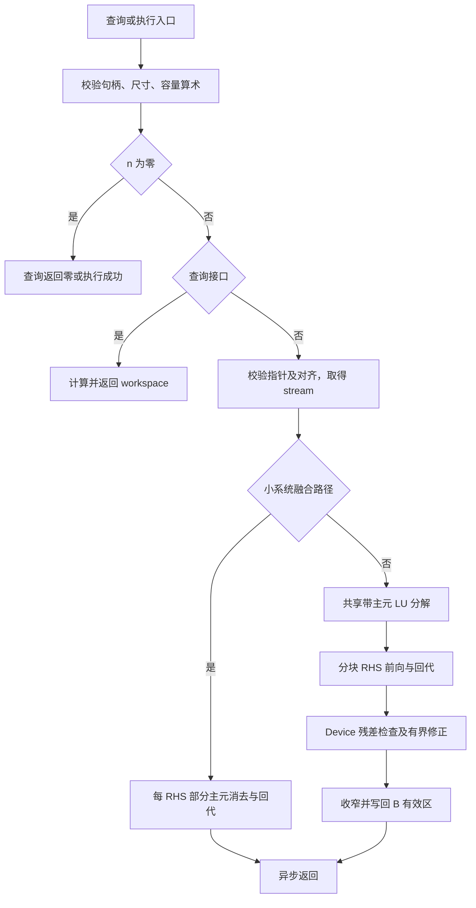

# 需求背景（required）

## 需求来源

本设计对应《10月社区任务-aclsparseCgtsv2 算子开发（950）》及附件 `test_cases/`，贡献账号为 `moka8`，目标为 Ascend 950（DAV_3510、`arch35`、A5）。实现仓库为 [cann/ops-sparse](https://gitcode.com/cann/ops-sparse)，个人 fork 为 [moka8/ops-sparse](https://gitcode.com/moka8/ops-sparse)，最终代码目标分支为 `master`。

本文采用[官方设计模板](https://gitcode.com/cann/cann-ops-competitions/blob/e1ab79ca0d495afce93dfb1e85f95f546b74d2cf/04_tasks/01_community-task-2026/resources/design_template.md)的章节结构，并遵循[社区任务目录说明](https://gitcode.com/cann/cann-ops-competitions/blob/e1ab79ca0d495afce93dfb1e85f95f546b74d2cf/04_tasks/01_community-task-2026/README.md)。2026-10-28 核对的设计仓基线为 `e1ab79ca0d495afce93dfb1e85f95f546b74d2cf`；该版本任务列表尚无本任务编号，目录按月份、算子和平台命名为 `10-aclsparseCgtsv2-950/moka8/docs/design.md`。

本文为拟实现方案与验证计划。性能表中的 GPU 数据来自任务附件，NPU 精度、耗时及内存均留待实测。接口语义以任务书指定的 CUDA Toolkit/cuSPARSE 13.3 Update 1 为基线，核对具体安装版本后保存版本记录。

## 背景介绍

### 功能与应用背景

`aclsparseCgtsv2` 求解同一个复数三对角矩阵对应的单列或多列右端项 `A·X=B`。`C` 表示单精度复数，四个输入均为 complex64。下、主、上对角分别由 `dl/d/du` 表示，解原地写回列主序 B。求解必须支持相邻行部分主元选取及换行产生的第二上对角填充项，以覆盖零主对角但非奇异、非对角占优和病态输入。

任务主场景分别使用 `(m,n,ldb)=(8192,64,8192)`、`(4096,64,4096)`、`(7168,128,7168)`。场景名称及参数沿用任务书，算法只依赖实际输入和尺寸。

### 上游实现现状分析

源码调研固定于 ops-sparse 提交 [`e0580fa8991ab473c5cc06259c2c44f2db412aac`](https://gitcode.com/cann/ops-sparse/commit/e0580fa8991ab473c5cc06259c2c44f2db412aac)。

| 文件与符号 | 基线现状 | 本设计使用方式 |
| --- | --- | --- |
| `include/cann_ops_sparse.h`，`aclsparseSgtsv2*` | 已有实数 Legacy 接口；没有 `aclsparseComplex_t`、`aclsparseCgtsv2*` 声明 | 新增独立复数类型和两个入口，保持实数声明及符号 |
| `sparse/gtsv2/arch35/gtsv2_host.cpp`，`ComputeWorkspaceBytes`、`LaunchGtsv2Kernel` | 实数参数检查、128 字节 workspace 对齐、句柄 stream 调度 | 参考调度方式；复数 Host 依任务书重新实现校验及容量公式 |
| `sparse/gtsv2/arch35/gtsv2_kernel.cpp`，`Gtsv2ForwardSweep`、`Gtsv2BackwardSubst` | SIMT 每线程处理一列，支持 pivot 与 `du2`，每 RHS 使用三条 FP32 工作数组 | 参考消去状态与混合 SIMD/SIMT 入口，不复制实数 ABI 或其工作区公式 |
| `sparse/common/aclsparse_host_utils.h`，`GetAivCoreCount`、`GetUbSize` | 平台核数和 UB 查询 | 复用实际平台能力查询 |
| `sparse/CMakeLists.txt` | 自动收集公共和目标架构源文件，支持 `OP_LIST` | 新目录按现有模式接入 |
| `test/gtsv2/CMakeLists.txt`、`test/gtsv2/arch35/` | 仓库 GTest、参数化求解和异常测试 | 新增独立 `test/cgtsv2` 测试目标 |

本算子采用 C++/Ascend C Kernel 直调模式；调研基线中的实数实现是工程参考，GPU cuSPARSE 是接口与性能标杆。CPU Golden 使用附件的 SciPy/LAPACK complex128 带状求解。

# 需求分析（required）

## 需求描述

新增以下公开 C ABI，参数顺序与任务书一致：

```cpp
typedef struct {
    float real;
    float imag;
} aclsparseComplex_t;

aclsparseStatus_t aclsparseCgtsv2_bufferSizeExt(
    aclsparseHandle_t handle, int m, int n,
    const aclsparseComplex_t *dl, const aclsparseComplex_t *d,
    const aclsparseComplex_t *du, const aclsparseComplex_t *B,
    int ldb, size_t *pBufferSizeInBytes);

aclsparseStatus_t aclsparseCgtsv2(
    aclsparseHandle_t handle, int m, int n,
    const aclsparseComplex_t *dl, const aclsparseComplex_t *d,
    const aclsparseComplex_t *du, aclsparseComplex_t *B,
    int ldb, void *pBuffer);
```

通过编译期断言验证 `sizeof(aclsparseComplex_t)==8`、`alignof(aclsparseComplex_t)==alignof(float)`，并在 UT 检查标准布局和 `offsetof(imag)==sizeof(float)`。公共类型只定义一次；接口不增加 `batchCount` 或独立 X。

| 参数 | 语义、布局及校验 |
| --- | --- |
| `handle` | 有效 aclsparse 句柄；空句柄返回 `ACL_SPARSE_STATUS_HANDLE_IS_NULLPTR` |
| `m/n/ldb` | int32；要求 `m>=3`、`n>=0`、`ldb>=max(1,m)`，包括空 RHS 的整数合法性检查 |
| `dl/d/du` | 只读 Device complex64，一维连续 `[m]`；约定 `dl[0]=du[m-1]=0+0i` |
| `B` | Device complex64，完整存储 `[ldb,n]`，地址为 `B[i+j*ldb]`；只写 `0<=i<m`，保留 padding |
| `pBufferSizeInBytes` | 非空 Host 输出指针；成功时返回完整 workspace 字节数 |
| `pBuffer` | 执行用 Device workspace；`n>0` 时足量且地址为 128 字节对齐 |

`n>0` 时查询和执行均检查 `dl/d/du/B` 非空。合法 `n=0` 查询返回 0，执行成功且不发射 Kernel，允许数据和 workspace 指针为空。raw ABI 的实际 dtype、分配长度和 stride 由调用者保证；Python 适配层校验这些可见元数据。指针间重叠不属于支持的输入：工作区与各输入互不重叠，B 不与系数重叠。

## 需求拆解

| 编号 | 任务书依据 | 设计与验收方式 |
| --- | --- | --- |
| R01 | §2.1～2.3 | 独立 complex64 ABI、公开布局断言；头文件编译和符号检查 |
| R02 | §2.1 | 按复数模长选主元、相邻换行及 `du2`；手工 pivot 和零主对角非奇异用例 |
| R03 | §2.4 | 运行时 m/n/ldb、列主序、只读系数、原地 B、padding；C++ 与 ATK 同时检查 |
| R04 | §2.1、§2.4 | workspace 查询、128 字节对齐、溢出及生命周期；完整 C++ 调用流程 |
| R05 | §2.1、§3.5 | 异步 stream、确定性复跑、真实 NPU Dispatch；两条 stream 和 Profiler 记录 |
| R06 | §3.2、§3.5 | 200 条随包及新增 800 条分别通过；实部/虚部混合容差和最大误差上限 |
| R07 | §3.3 | 冻结 203 条性能逐条倍率 ≥0.3；完整 Kernel 求和后取中位数 |
| R08 | §3.4 | 逐例内存记录，优先采用 workspace 不超过实测 L2 容量的条件 |
| R09 | §3.2、§3.5 | 66,432 组合审计、8 条特殊值、12 条适配合同，以及 C++ 非法参数/奇异检查 |
| R10 | §2.1、§5 | 公共 Host 与架构 Kernel 分离，实数 Sgtsv2 及 A2/A3 构建/运行交叉回归 |
| R11 | §4～5 | 设计、源码、构建安装说明、测试和原始报告按对应仓库与交付目录保存 |

# 详细设计（required）

## 算子分析

### 数学公式

以零基下标表示：`A[i,i]=d[i]`、`A[i,i-1]=dl[i] (i>0)`、`A[i,i+1]=du[i] (i<m-1)`。对各列 j 求解：

```text
dl[i] * X[i-1,j] + d[i] * X[i,j] + du[i] * X[i+1,j] = B_original[i,j]
```

首末行省略不存在的邻项。复数乘法为 `(ar*br-ai*bi, ar*bi+ai*br)`；复数除法采用按量级缩放的分支，避免直接构造 `br*br+bi*bi` 导致不必要的上溢或下溢。

### 支持数据类型

输入和输出仅 complex64，内部以实部、虚部 FP32 表示。精度保护采用两个 FP32 分量构成的高、低位展开（下文称扩展值）；一个扩展复数占 16 字节。使用 FMA 计算乘法舍入残差、误差补偿加法和商的残差修正，不依赖设备原生 FP64。非有限分支使用明确的 IEEE 分类与复数运算规则，独立验证其分类传播。

### 支持形状

三条系数数组分别为 `[m]`，B 为列主序 `[ldb,n]`，有效输出 `[m,n]`。支持单 RHS、多 RHS、非紧凑 leading dimension 和合法空 RHS；不支持广播、转置参数或任意 stride。

附件现成 200 条精度清单的 m 为 `3/4/7/8/15/16/31/32/63/64`，n 为 `0/1/2/3/4/7`。冻结性能清单的 m 为 512～8192，n 为 `1/8/16/32/64/128`，最大 IO 为 7,512,064 字节。上述是当前清单范围；公开接口按整数约束及资源边界支持动态输入。

## 算子实现

### 实现方案

#### 3.2.1 Host 侧设计

**参数检查与 dispatch。** 两个入口共用参数/容量计算，顺序为句柄、整数约束、查询输出指针、合法空 RHS、必要数据指针、地址范围及 workspace 对齐。无效整数、必要空指针、容量算术溢出和错误对齐返回 `ACL_SPARSE_STATUS_INVALID_VALUE`；平台查询或运行时发射故障按仓库规则映射到执行/内部错误。

先以带边界检查的 `size_t/uint64_t` 计算 `m*8`、`ldb*n*8`、总 IO、各工作数组长度和对齐增量，再转换为 tiling 字段；GM 索引使用 64 位。Host 不解引用 Device 系数，也不扫描主元。执行 ABI 没有工作区长度参数，实际分配容量由调用方或适配层校验。

通过 `aclsparseGetStream` 使用句柄绑定的 stream；发射后立即返回，不插入 Host 同步。系数、B、workspace 及其所属运行时上下文须保持有效到该 stream 的相关工作结束。

**尺寸分派。** 初始设计采用下表，阈值以 A5 实测调整，所有分支保持相同 pivot 与精度合同。

| 路径 | 初始选择条件 | 计算与并行方式 |
| --- | --- | --- |
| 空 RHS | `n=0` | 返回成功，workspace 为 0 |
| 小系统融合 | `m<=256 && n<=8` | 每 RHS 独占工作区；一次 Kernel 内完成带主元消去与回代，消除阶段间发射开销 |
| 共享分解 | 其余合法尺寸 | 一次带主元 LU 分解供所有 RHS 复用；RHS 按工作区预算分 tile 求解与残差修正 |

不按 case ID、seed、分布标签或 GPU 标杆选择算法。性能清单虽然使用历史对角占优数据，各路径仍保留完整 pivot 能力。

**Workspace 布局。** 记 `A(x)=ceil(x/128)*128`，以下每段起始地址均按 128 字节对齐。

- 小系统融合：为每 RHS 保存扩展 `D/U1/U2/Y` 四条 m 长数组。查询值 `W_small=A(64*m*n)`；每 RHS 子段长度 `64*m` 本身不一定为 128 倍数，内部只要求按扩展值自然对齐，统一由整块 128 字节基址定位。最大初始小系统工作区为 131,072 字节。
- 共享分解：四条扩展复数数组 `L/D/U1/U2`、一条 int32 pivot 数组和一段 128 字节状态（包括奇异标记、轮数及至多 32 个独立 uint8 列活动标记）。`W_factor=4*A(16*m)+A(4*m)+128`。
- 两个扩展 RHS tile 缓冲区分别保存当前解和残差/修正量，`W_general=W_factor+2*A(16*m*r)`。原始 B 在输出提交前保持可读，残差以该原始值计算。
- 初始软件预算 `S=8 MiB`，`r<=min(n,32)`，选满足上述精确公式且 `W_general<=S` 的最大 r。若一个合法大系统的 `r=1` 仍超过 S，则按实际公式查询并处理，不因软件预算额外缩小公开尺寸域。
- 正式 203 条的 `m<=8192`，按上述分块规则可将查询 workspace 控制在 8 MiB 内；该结论为容量公式推导。内存验收时记录实际 A5 的 L2 容量，与查询量和实际申请量逐例比较。

在此初始方案下，P-01/P-02/P-03 的 r 分别为 29/32/32，查询量分别为 8,159,360 / 4,472,960 / 7,827,584 字节。此处为方案估算，不是设备分配实测。workspace 不保存持久输入缓存，每次执行均重新分解，允许调用者在两次完整执行之间更新系数。

Tiling 记录 m/n/ldb、路径 key、r、RHS tile 起止列、各工作段偏移和有效长度。共享分解 Kernel 与后续求解 Kernel 在同一 stream 顺序发射，以 Kernel 边界实现跨核可见性。独立 stream 使用各自 workspace；同一 workspace 的复用由调用者建立依赖。

#### 3.2.2 Kernel 侧设计

**A. 带相邻行部分主元选取的分解。** 使用 Ascend C AIV 入口与 SIMT VF。三条输入对角线仅只读加载；状态写入 workspace。主元比较采用缩放后的复数欧氏模长，避免直接平方溢出；模长相等时固定选择当前行。LAPACK 的常见复数实现使用 `abs(real)+abs(imag)`，因此本设计只参考其带状消去结构，主元比较遵循本任务的复数模长定义。

第 i 步令当前主元、第一上对角分别为 p、u，相邻原始下对角为 l，下一行主对角、上对角为 a、v：

| 情形 | 保存第 i 行 | 下一行状态 |
| --- | --- | --- |
| `abs(p)>=abs(l)` | `L[i]=l/p; D[i]=p; U1[i]=u; U2[i]=0; pivot[i]=0` | `p=a-L[i]*u; u=v` |
| `abs(p)<abs(l)` | `L[i]=p/l; D[i]=l; U1[i]=a; U2[i]=v; pivot[i]=1` | `p=u-L[i]*a; u=-L[i]*v` |

末行保存最终 D；不存在的 U1/U2 填 0。前后 m-tile 之间携带 p/u，保持全局相邻换行状态，不将矩阵切成彼此独立的三对角子系统。分解工作量为 O(m)，共享路径的系数存储为 O(m)。

**B. 对全部 RHS 应用同一消去。** 每列 j 的前向阶段按固定行顺序执行：

```text
if pivot[i] == 0:
    Y[i+1,j] = Y[i+1,j] - L[i]*Y[i,j]
else:
    old = Y[i,j]
    Y[i,j] = Y[i+1,j]
    Y[i+1,j] = old - L[i]*Y[i+1,j]
```

每个 RHS 列只由一个执行任务写入，其余线程无写冲突。RHS 任务按列分配给可用 AIV 核，核内沿列使用 SIMT lane，超出有效列的 lane 直接退出。核数由实际 AIV 数和有效列任务数决定；比较每核 1/4/8/32 列的映射，避免 n 较小时仅有少数核工作。

回代为：

```text
X[m-1,j] = Y[m-1,j]/D[m-1]
X[i,j] = (Y[i,j]-U1[i]*X[i+1,j]-U2[i]*X[i+2,j])/D[i]
```

`i+2>=m` 时省略第二项。各列工作在扩展复数缓冲区中完成，最后按 RNE 收窄并写回 B 有效区。融合路径将相同消去直接应用于该 RHS，同时保存 D/U1/U2/Y，省去单独的 L/pivot 数组和分阶段发射。

**C. 精度与残差修正。** 有限值路径以 FP32 高、低位展开保存主元、填充、前向和回代结果；编译选项保留补偿表达式的求值顺序，不启用破坏误差补偿的重结合。复数乘加、除法与模长比较分别设置零值、消减、大/小量级、次正规数和接近相等主元的 UT。

共享路径在写回 B 前，以原始 `dl/d/du/B` 和扩展解计算 `r=B-A*X`，边界只访问实际存在的邻项。记复数 `norm1(z)=abs(real(z))+abs(imag(z))`，每行尺度为 `s[i]=norm1(B[i])+sum_k(norm1(A[i,k])*norm1(X[k]))`，只累加实际存在的三个带状项。初始内部收敛条件为全行 `norm1(r[i])<=2^-20*s[i]`；`s[i]=0` 时要求残差为零。未收敛列复用同一 LU 解修正方程并更新扩展解，初始最多两轮，列收敛标志保存在 Device。全部 Kernel 预先在同一 stream 排队，无 Host 读回。该尺度残差作为稳定性控制；正式通过判定仍使用附件 Golden 比较器。出现停滞、非有限结果或难例时保留真实失败，使用对应输入继续分析。

非有限值和零主元按确定的分支处理，避免将 Inf/NaN 输入送入只适用于有限数的误差分解。特殊值检查直接对齐附件实际 SciPy Golden 的分类结果，包含零系数乘非有限值和复数除法的传播，不用裁剪、加 epsilon 或固定替换值改变方程。真正奇异系统记录 Device 状态和输出；异步接口不为读取奇异状态而同步 Host，不新增任务书以外的奇异返回值 ABI。

**D. 搬运、同步及确定性。** 第一版使用 SIMT GM 访问与有界工作区，随后按 Profiler 结果对连续 m-tile 引入 UB 缓存和双缓冲。采用 TPipe/TQue 管理搬运事件，不混用固定事件 ID；搬入完成后计算，搬出完成后再复用对应缓冲。m-tile 边界保留前向 p/u 或回代两行状态，尾块只搬运有效元素，不能将 32 字节补齐写入 B padding。

共享分解和 RHS 求解的跨核同步由同一 stream 的 Kernel 边界完成。单 Kernel 中如使用协作线程、共享缓存或生产者/消费者，则以该 CANN 版本支持的同步与缓存可见性 API 配对实现，不依赖不同核的隐含执行顺序。无原子浮点归约；主元平局规则、行顺序、修正轮数上限固定，复跑前恢复原始 B 后比较输出。

#### 3.2.3 流程与性能优化



主要瓶颈为主元递推的串行依赖、列主序多列访问、扩展复数运算成本及小 n 核利用率。优化顺序为：先保证随机/pivot 精度；再比较融合与共享分解的发射和带宽成本；调整 RHS tile 与每核列数；最后用残差及全量回归评估局部 FMA/FP32 快路径。每次优化保留相同输入及完整 Kernel 计时，所有路径都处理任意合法系数。

不直接用无主元 PCR/Thomas 替换带主元路径，也不对任意局部块的可逆性作额外假设。若进一步使用并行带状分解，须单独证明换行、填充及奇异局部块的处理与原合同一致，并重新完成全量验证。

#### 3.2.4 工程落点与测试适配

```text
include/cann_ops_sparse.h                 公开复数类型与接口
sparse/cgtsv2/                           公共校验、工作区计算和 README
sparse/cgtsv2/arch35/                    A5 tiling、Kernel 与 dispatch
test/cgtsv2/CMakeLists.txt               仓库 GTest 目标
test/cgtsv2/arch35/                      C++ UT/ST 和完整调用流程
test/cgtsv2/                             Golden、ATK 附件、适配模块及构建说明
```

公共修改限制在新增类型/声明及必要构建接入；不修改 Sgtsv2 ABI，不复制 build 目录或提交编译产物。测试目标沿用 `ops_sparse_add_gtest_tests`。实现后通过 `bash build.sh --ops=cgtsv2 --soc=ascend950 --run` 验证仓库编译和测试入口，实际 SOC 字符串随设备记录。

随包 ATK 适配模块导入后注册以下两个真实 NPU 调用：

```text
torch.ops.ops_sparse_test.cgtsv2_buffer_size_ext_npu(m,n,dl,d,du,B,ldb) -> int
torch.ops.ops_sparse_test.cgtsv2_npu(m,n,dl,d,du,B,ldb,workspace)
```

适配层验证同一 NPU 设备、complex64、系数连续且长度为 m、B 形状 `[ldb,n]` 与 stride `(1,ldb)`、uint8 workspace 容量及对齐；使用当前 torch_npu stream 绑定句柄，保持 B 原地更新。句柄创建不放入每次性能采样热路径，资源释放前保证其相关异步工作结束；输入和 workspace 的 allocator stream 生命周期正确登记。输入拒绝仅使用明确的 `CGTSV2_INVALID_PARAMETER:` 前缀；加载、注册、OOM 或执行错误按实际故障传播。

## 支持硬件

| 平台 | 本任务实现范围 |
| --- | --- |
| Ascend 950，DAV_3510，A5/arch35 | 本次实现与真机验收平台 |
| Atlas A2/A3，arch22 | 公共头文件/公共 Host 兼容及已有算子交叉回归；不在本次增加专用复数 Kernel |

软件采用任务书要求的 CANN 9.0.0 及后续配套版本。Python 适配要求 PyTorch ≥2.7、torch_npu ≥26.0.0，官方 ATK 26.9.8（提交 `9504bee6076820ca74259fb919a790a12ef88cf8`），推荐 Python 3.10/3.11、NumPy <2。记录实际驱动、固件、CANN、编译器、运行库和 L2 容量；FMA/SIMT API 以部署版本编译及上板结果为准。

## 算子约束限制

调用者保证三条系数的边界零值、分配长度、设备上下文和原始 C ABI 的内存布局；Host 校验整数和地址算术可见的错误。每次调用尺寸固定，工作区为调用方所有；异步结束前不得释放或冲突复用。B padding 不参与数值计算。非有限输入与真正奇异输入单列语义检查；一般有限非奇异输入进入正常精度验收。

# 可维可测分析

## 精度标准/性能标准

### 验收标准

| 项目 | 标准 | 来源与记录 |
| --- | --- | --- |
| 常规精度 | 实部、虚部分别满足 `abs(actual-golden)<=2^-13+2^-13*abs(golden)` 的比例 ≥0.99；每分量最大有限绝对误差 ≤`max(0.01,32*ULP_fp32(g_low))` | 任务书 §3.2、附件 `atk/accuracy_compare.py` |
| Golden | 同一份量化 complex64 输入升为 complex128，SciPy/LAPACK 带主元带状求解 | 附件 `common/cgtsv2_operation.py::golden` |
| 特殊值 | NaN/Inf 分类和位置一致，Inf 同号；其余有限分量逐点满足混合容差 | 独立 8 条特殊语义检查 |
| 性能 | 每条 `GPU Kernel总耗时中位数 / NPU Kernel总耗时中位数 >=0.3`，203 条全部满足 | 任务书 §3.3、冻结清单与 `gpu_baseline.csv` |
| 内存 | 满足任务书两条件之一：IO>500 MB 时相同 Torch API 下 NPU 额外内存 ≤GPU 使用总量的5%；或固有 workspace ≤目标硬件 L2 容量 | 任务书 §3.4；逐条保存查询、分配及设备/allocator 统计 |
| 行为 | 系数只读、B 原地与 padding、合法空 RHS、确定性、完整生命周期、异常和跨平台回归 | C++ UT/ST、ATK 和 Profiler 证据 |

`g_low` 是该分量最大有限绝对误差位置的 Golden 收窄为 float32 后的值；ULP 取朝 `+inf` 的 float32 间距绝对值。常规溢出特例按 Golden RNE 收窄后是否为同号 Inf 处理。常规比较出现 NaN 时转入独立异常分析，不能按数值匹配通过。

附件 JSON 中通用 `standard.mem=1.1` 是框架配置元数据，本任务的正式内存门槛仍采用上述 §3.4 的 5%/L2 二选一条件；报告同时保留框架结果与任务书判定。

### 用例数量和覆盖

| 集合 | 数量 | 执行及通过要求 |
| --- | --- | --- |
| published | 200 | 官方 ATK 原生输入，与 CPU Golden 比较；含 4 条合法空 RHS |
| acceptance | 800 | 验收方选择新种子独立生成和运行，与 published 分开保存；含 4 条空 RHS |
| 正式性能/内存 | 203 | 冻结 3 个主场景及 200 个扩展；每条同时采集内存 |
| full | 66,432 | 声明有限因子域的有效组合，先审计再按资源分批数值执行 |
| special | 8 | NaN、正/负 Inf、混合 Inf，按独立分类比较器 |
| contract | 12 | 空系数/错误 B、shape `[1]`、下边界、负 n、非法 ldb 等适配拒绝 |
| C++ UT/ST | 按需求补充 | API 返回码、null、对齐与容量边界、pivot、奇异、确定性及异步流程 |

现成清单合计 423 条（200+203+8+12），额外 800 条和 full 由官方 YAML 生成。新版四组性能 YAML 合计也为 203 条，但与冻结历史输入不同；正式比较沿用冻结清单，改用新输入时两端重新采集。

full 遍历 38 种 m、40 种正 n、padding `0/1/32` 和四个 Tensor 的 16 种分布组合，经 `ldb<=2^20`、总元素 `<=2^34` 过滤。各 Tensor 配置均匀 `[-5,5]` 与正态各占 50%，正态参数由 ATK 随机采样 `mu∈[-5,5]`、`sigma∈[0.1,2]`。仅设置 `dl[0]/du[m-1]` 结构零值，不以对角占优变换替换精度输入。

附件 README 已记录 full 的 ATK 通用 CasesMetrics 存在 4 GiB 尺寸阈值，与该任务有效域不同，报告为 `oversize_case=True/result=False`。保持第三方规则原样，分别记录因子域审计、通用 metrics 和数值执行；大组合列明实际资源、执行结果及未执行项。

C++ 补充测试覆盖：模长平局、模长与 L1 比较结果不同、首/中/末行 pivot、连续换行、`du2` 填充、零主对角非奇异、病态/奇异；字节级系数只读和 padding 哨兵；128 字节地址偏移、空指针、整数乘法/对齐溢出；两条 stream 及反复执行后结果一致。小系统使用独立 complex128 参考或已知解，较大系统使用带状 Golden，不构造 m×m 稠密矩阵。

### 可复现执行计划

以下从实现交付的 `test/cgtsv2/test_cases/` 执行，先按构建说明安装真实 NPU 适配模块，并令 `PYTHON_BIN` 指向官方 ATK 所在环境：

```bash
export CGTSV2_EXTENSION_MODULE=ops_sparse_cgtsv2
export PATH="$(dirname "$PYTHON_BIN"):$PATH"
cd atk
atk case -f case_designs/accuracy.yaml -p atk_plugins.py -s 1028
atk case -f case_designs/accuracy_acceptance_800.yaml -p atk_plugins.py -s 20261029
atk task -c result/accuracy/json/all_accuracy.json -n nodes_accuracy.yaml -p . -tk accuracy -sp --disable_id_seed
atk task -c result/accuracy_acceptance_800/json/all_accuracy_acceptance_800.json -n nodes_accuracy.yaml -p . -tk accuracy -sp --disable_id_seed
```

`20261029` 为复现示例，正式验收由验收方重新选择种子。另对 full/special/contract 使用对应 YAML、原生 `atk case`、`audit_atk_cases.py` 和 `atk task`，保留每组原生 JSON/CSV/XLSX、命令、版本、种子、退出码和逐例结果。审计只检查官方输出，不生成替代用例。

性能按附件 `performance/collect_performance.py` 的 GPU/NPU 同口径流程执行：每例预热 ≥10 次、正式采样 ≥30 次，计时前恢复 B 并完成恢复操作。单次求解内全部计算 Kernel 耗时先求和，再对正式样本取中位数；包含该方案的分解、各 RHS tile、残差、修正和输出 Kernel。首次编译、初始化、数据生成、H2D/D2H、B 恢复和 workspace 查询/分配排除在外，workspace 复用。

Event 使用独立无 Profiler 插桩的进程，在同一 stream 上包围求解调用，单独列示。保存 NCU report/CSV、NPU trace、逐次采样和版本记录。采样时确认设备作业占用；性能对比配对相同 m/n/ldb、输入数值、种子及采样参数。

| 主场景 | 参数 `(m,n,ldb)` | GPU Kernel 中位数/μs | 由 0.3 门槛推导的 NPU 上限/μs | NPU 实测 |
| --- | --- | ---: | ---: | --- |
| P-01 | `(8192,64,8192)` | 640.896 | 2136.320 | 待测 |
| P-02 | `(4096,64,4096)` | 628.944 | 2096.480 | 待测 |
| P-03 | `(7168,128,7168)` | 1220.048 | 4066.827 | 待测 |

完整 203 条逐例核验，附件中最紧的耗时门槛约 283.093 μs（case_index=74，m=512、n=1、ldb=528），优化同时关注 n=1 和多 RHS 场景。

内存统计按 bytes 报告：`io_bytes=(3*m+ldb*n)*8`，B 只计一次；分别记录查询 workspace、实际对齐申请、恢复 B 的夹具副本、准备前/后及采样后的 allocator allocated/reserved、峰值和增量、设备 free/total。原生运行时的额外分配单列，不能把设备全局快照当成 allocator 峰值。冻结 203 条均未达到 500 MB IO，本方案优先用实测 L2 与 workspace 对照完成内存判定。

最终交付记录固定源码 commit、构建产物来源和实际兼容环境，按任务书提供 `task_submission/` 的自验步骤、精度/性能/内存 XLSX 与原始日志；这些验收产物由个人交付目录保存，设计 PR 仅提交本文档。

## 兼容性分析

新增 Cgtsv2 类型与符号保持独立；现有 Sgtsv2 的声明、行为和 arch22/arch35 实现维持原状。公共校验/容量代码不依赖 A5 专属头文件，SIMT/FMA 及调度留在 arch35。A2/A3 与 A5 的后续代码 PR 以实际合入基线解决公共头文件冲突，避免重复定义复数类型，并重新运行实数回归。

PyTorch 适配只负责测试注册及桥接，实际计算调用公开 NPU 接口；CPU complex128 路径仅用于 Golden。相同软件、硬件和配置下复跑使用固定主元选择与运算顺序，输出和 workspace 管理不依赖历史调用。

## 风险与实施验证节点

1. 扩展复数运算及共享分解存在串行依赖成本。先完成小系统融合和通用共享路径，再以全量 Profiler 确定主要瓶颈及分派阈值。
2. 病态系统、极值和次正规数需要验证设备舍入、除法和残差停滞行为；以实际失败输入定位，调整精度保护后重跑 200+800 及相关 UT。
3. 8 MiB 是软件初始预算。实际 L2、CANN/SIMT 支持和 allocator 行为在 A5 验证后记录；若预算或布局调整，查询与执行同步修改并重新测量。
4. full 集合含高资源组合。按资源需求分批执行并保留未执行清单；正式进度分别记录编译、功能、精度、性能及内存结果。

## 参考资料

1. 本任务书 `aclsparseCgtsv2_A5_task_doc.md` 及随包 `test_cases/README.md`、`atk/README.md`、`atk/case_designs/README.md`、`performance/README.md`。
2. [ops-sparse 调研基线](https://gitcode.com/cann/ops-sparse/tree/e0580fa8991ab473c5cc06259c2c44f2db412aac)与 [贡献指南](https://gitcode.com/cann/ops-sparse/blob/e0580fa8991ab473c5cc06259c2c44f2db412aac/CONTRIBUTING.md)。
3. [NVIDIA cuSPARSE 文档](https://docs.nvidia.com/cuda/cusparse/index.html)，具体接口版本按任务书的 13.3 Update 1 核对。
4. [Netlib LAPACK CGTTRS](https://www.netlib.org/lapack/explore-html/d4/dfa/group__gttrs_gad30f87b5bb22730fe7097ab87bae6f49.html)：带主元三对角 LU 因子的求解结构。
5. [Ascend C SIMT fmaf API](https://www.hiascend.com/document/detail/en/CANNCommunityEdition/910/API/ascendcopapi/docs/en/api/SIMT-API/math_functions/float_math_functions/fmaf.md)：FMA 与 SIMD/SIMT 混合调用示例，部署版本另行编译验证。
6. [生态算子混合容差精度标准](https://gitcode.com/cann/opbase/blob/a5e8e716743b20bfb2ffa16e0213c4aa73b823b3/docs/zh/ops_precision_standard/mixed_tolerance_standard.md)，任务书指定核对提交。
7. [官方 ATK](https://gitcode.com/Ascend/ATK)，任务书指定版本 26.9.8 及源码提交 `9504bee6076820ca74259fb919a790a12ef88cf8`。
