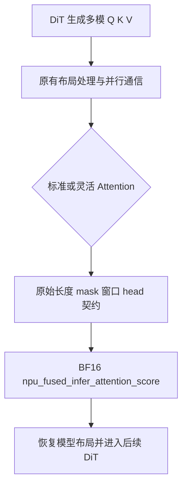
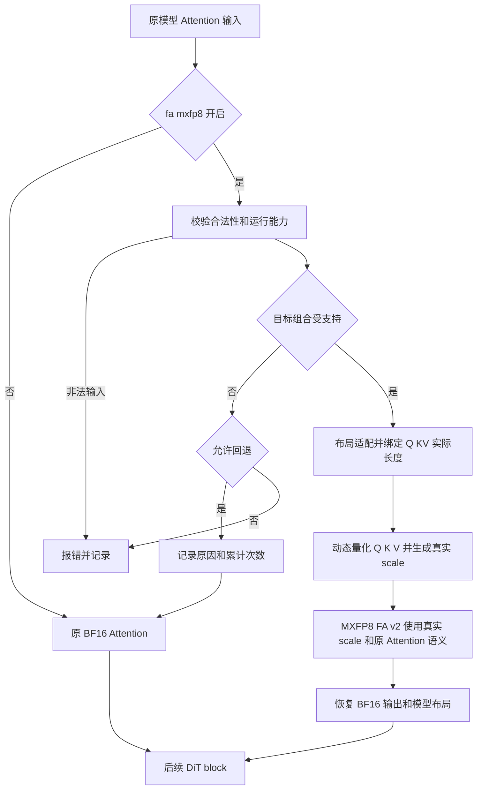

# daVinci-MagiHuman FA MXFP8 量化开发方案

版本：V1.0；日期：2026-10-17；状态：开发设计稿，待源码核对、RFC 定版和 Ascend 950 实机验证。

本任务在 daVinci-MagiHuman 的真实 Attention 路径中接入 MXFP8 动态量化，复用 `module/fa_quant/`，以保持生成质量、降低端到端耗时和峰值 NPU 内存为验收目标。工程类型为 Python 模型接入及公共封装扩展，不新建独立 Ascend C kernel 工程。

## 一、需求背景

### 1.1 需求来源

需求依据为本地 [A5 任务书](</Users/swen/Documents/Code/cann/operator_development_workspace/MagiHuman_wsp/10月社区任务-daVinci-MagiHuman FA MXFP8 量化任务书(A5)/daVinci-MagiHuman FA MXFP8 量化任务书(A5).md>)、附件 [自验规范](</Users/swen/Documents/Code/cann/operator_development_workspace/MagiHuman_wsp/10月社区任务-daVinci-MagiHuman FA MXFP8 量化任务书(A5)/test_cases/README.md>)和 [设计文档 CheckList](</Users/swen/Documents/Code/cann/asctool/docs/official/设计文档CheckList.md>)。任务名称采用任务书中的 **daVinci-MagiHuman**。

任务书中的功能、测试和交付标准作为方案输入；环境申请、账号示例及截图仅为操作参考。本次工作只生成本地开发方案，不执行附件中的环境申请、Issue/PR 创建或提交动作。

代码目标仓为 [cann/cann-recipes-infer](https://gitcode.com/cann/cann-recipes-infer)，模型目录为 `models/davinci-magihuman/`。本地未发现该仓源码副本，远端模型及公共模块源码页面未能读取。因此下文“现状”依据任务书及自验规范，不将其表述为逐行源码审查结论；拟议接口、分支支持和参数映射须在阶段 M0 对固定源码 commit 核实后定版。

### 1.2 背景介绍

#### 1.2.1 实现优化与参考文件

按任务书，模型在 `flash_attn_func`、`flex_flash_attn_func` 中调用 BF16 `npu_fused_infer_attention_score`；公共模块已有动态 MXFP8 量化及 FA v2 封装，HunyuanVideo 已有接入。MagiHuman 包含统一多模序列、局部/变长 Attention 及 context-parallel，不能仅替换定长函数。

| 文件或接口 | 作用与核对事项 |
| --- | --- |
| `models/davinci-magihuman/README.md`、`infer.sh` | 依赖准备、配置解析、生成与 profiling 入口 |
| `models/davinci-magihuman/config/base.yaml`、`base_config.json` | BF16 基准配置及全部权重路径 |
| `models/davinci-magihuman/inference/model/dit/dit_module.py` | 任务书点名的 `flash_attn_func`、`flex_flash_attn_func`；以固定 commit 核实实际定义位置 |
| `models/davinci-magihuman/inference/model/dit/dit_model.py` | 任务书列出的可能改动文件；核实配置注入与 DiT 调用链 |
| `module/fa_quant/fa_quant.py`、`README.md` | `npu_mxfp8_quant`、`npu_mxfp8_attn` 的签名、dtype、layout、scale 与限制 |
| `models/hunyuan-video/hyvideo/modules/attention.py`、`config/single_fp8.yaml` | 现有调用兼容性及代表性回归配置 |
| 目标版本 torch_npu 的 API 文档、注册 schema、对应算子文档 | 核对 `npu_dynamic_mx_quant`、`npu_fused_infer_attention_score_v2` 的真实参数及 A5 能力 |
| `CONTRIBUTION.md`、`docs/common/new_model_checklist.md` | 代码、CI、License、文档及依赖合入要求 |

**TBE 源码和算子信息库：不适用。** 本任务没有需要迁移的同名独立 TBE 算子，也不新增 aclnn 接口。BF16 FIA 是模型基线，MXFP8 FIA v2 是被复用的底层算子，不能冒充本任务的 TBE 源码或信息库。M0 应补充目标安装包中实际 torch_npu schema 和底层算子文档路径、版本及文件名，核对绑定的 aclnn 接口；未确认前不猜测 aclnn 符号或参数名。

#### 1.2.2 现状分析

##### 1.2.2.1 数据类型和格式

| 层次 | 当前契约或待核对内容 |
| --- | --- |
| 模型 BF16 基线 | Q/K/V 为 BF16；具体输入布局、stride、head 关系、mask 由实际分支采集 |
| 公共 MXFP8 封装 | 附件明确当前仅支持 TND、非 sparse 基础路径；不能据此认定已支持一般变长、局部、GQA/MQA 或多卡 |
| 目标模型输入 | 逐调用记录 BSND/TND 或实际布局；BSND 为 `[B,S,N,D]`，TND 为 `[T,N,D]` |
| 目标量化数据和 scale | 实际 FP8 子类型、scale 类型/形状、量化轴、block 大小、padding 和 FA 参数映射须由目标版本 API 与实机核实 |
| 输出 | 恢复 BF16、原始逻辑 shape、设备与模型所需布局；禁止将 FP8 输出误传后续层 |

##### 1.2.2.2 基线实现逻辑

基线的语义为 `O = softmax(alpha × QKᵀ + M)V`，其中 `alpha`、mask/sparse、局部窗口、有效长度和 head 关系必须继承原调用，不能借量化改变模型行为。DiT 组织多模 token，标准或灵活 Attention 接收 Q/K/V，必要时进行原有并行通信，再调用 BF16 FIA 并将结果接回后续 DiT。

这只是任务书确认的语义级流程。原分支中的 reshape、transpose、padding、窗口切分、通信先后次序及异常处理须在 M0 建立“源码行号—运行 trace—输入契约”表，作为详细实现依据。

##### 1.2.2.3 基线流程图



该图为语义流程，不声称已与源码逐行对齐；M0 源码核对是 CheckList 中流程一致性项目关闭的前置条件。

## 二、需求分析

### 2.1 外部组件依赖

目标为 Ascend 950 单卡。参考 README 的 Python 3.12、CANN 9.0.0、PyTorch 2.10.0、torch_npu v26.0.0 是 A2/A3 示例组合，不能直接声明为 A5 支持矩阵。RFC 必须记录并锁定 A5 实测 OS、Python、CANN、PyTorch、torch_npu、驱动、固件、MagiCompiler 及模型依赖版本，验证两个目标算子可用且契约一致。

固定上游模型 commit 为 `209209b7086eba2020c5439265221495a8357322`；另外固定 infer 仓基线 commit 和优化 commit，二者不可混为同一 revision。记录 daVinci-MagiHuman、T5Gemma、Stable Audio、Wan2.2 VAE 的全部权重 revision/hash、prompt hash 和输入配置。按 README 非覆盖合并上游 `inference/`，准备 assets/prompts，保留可复现的合并记录。

### 2.2 内部适配模块

模型侧负责开关传递、原始 Attention 语义、多模 token/局部窗口/context-parallel 信息和回退；公共模块负责可复用的布局适配、参数校验、动态量化、scale 绑定和 FA v2 调用。仅模型需要的逻辑保留在 DiT 目录，不复制一套公共量化实现，不新建平行公共目录。

### 2.3 需求模块设计

#### 2.3.1 接口原型与语义契约

Ascend C 独立算子原型不适用。保留现有 `npu_mxfp8_attn` 名称、位置参数及默认行为；新增能力采用可选关键字参数，先核对原签名再确定准确命名。下面是**设计层输入契约，非已存在的 Python 函数签名**：

| 参数组 | 设计要求 |
| --- | --- |
| Q/K/V | 同设备、合法 dtype/shape/stride；K/V token 数及 KV head 一致；D 与输出维度按目标算子文档校验 |
| layout | 显式声明；BSND/TND 可转换时保持 token 顺序及 batch 边界；未知 layout 拒绝或回退 |
| head | 显式传递 Hq/Hkv；要求正整数且 `Hq % Hkv == 0`；MQA 为 Hkv=1；支持性由实机证明 |
| 长度 | Q/KV 分别提供有效长度；累计端点或逐样本长度的具体形式由 FA v2 schema 确认 |
| Attention 语义 | alpha、mask、sparse、窗口、causal 对齐规则与原 BF16 一致，禁止忽略非默认参数 |
| 量化结果 | Q/K/V 各自的动态量化数据与真实 scale 成对传递；量化轴、scale 排列与 FA 消费方式一致 |
| 返回值 | 与原模型调用约定一致；如原接口返回 tuple，保持结构；恢复 Q 的 BF16 输出语义 |
| 能力和错误 | 区分可预判的不支持组合与非法输入、执行故障；模型侧决定是否采用允许的 BF16 回退 |

长度契约使用统一逻辑定义：每个样本 Q/KV 的有效长度为 `lq[b]`、`lkv[b]`，打包后 `Tq=Σlq[b]`、`Tkv=Σlkv[b]`；前缀端点 `cq[b]=Σ(i≤b)lq[i]`、`ckv[b]=Σ(i≤b)lkv[i]`。adapter 按已核实的底层 API 转换为所需形式；若 API 要求累计长度，不得传逐段长度，反之亦然。验证长度个数、范围、单调性和末端总数；零长度策略由算子能力决定，不自行接受。

#### 2.3.2 相关约束与缺失能力

| 路径 | 交付策略 | 成为支持项的条件 |
| --- | --- | --- |
| base 标准 Attention | 必须接入真实 MXFP8 | 目标 A5、dtype、layout、长度及最终质量通过 |
| flex、局部或真实变长/GQA 中至少一个实际分支 | RFC 选定并验证；不能仅有合成输入 | 两个真实运行 case 中第二个有调用 trace 和完整生成证据 |
| BSND 输入 | 在公共模块适配到受支持目标布局 | batch 边界和 token 顺序不变，计入转换开销 |
| TND 真实变长 | 必要时扩展公共接口 | 独立 Q/KV 长度准确，padding 不参与注意力 |
| GQA/MQA | 条件支持或明确回退 | 不以重复 KV head 冒充原生支持，核实 Hq/Hkv 语义 |
| 局部/稀疏/causal | 条件支持或明确回退 | 原窗口、mask 与 sparse 参数可精确表达 |
| context-parallel | 首版不承诺量化支持，显式回退/拒绝 | 后续扩展需各 rank 全局语义、通信、长度、head 与同步验证 |

若实际配置无法触发第二个目标分支，提交 profiling 证据、支持限制与 RFC 范围调整记录，不能宣称第二路径已覆盖；验收按任务书和社区确认结论执行。范围不含训练/反向、MatMul 权重量化、RoPE 融合和缓存算法优化，相关收益不计入本任务。

## 三、需求详细设计

### 3.1 使能方式

新增 `models/davinci-magihuman/config/fa_mxfp8.yaml`，从固定版本 `base.yaml` 复制全部字段，保留原生成参数，仅显式增加：

```yaml
model_args:
  fa-mxfp8: true
  fa-mxfp8-fallback: true
```

`bash infer.sh base` 为 BF16 基线，`bash infer.sh fa_mxfp8` 为目标入口。核对 YAML 中带连字符键到模型构造参数的实际映射，禁止配置可读但未传到 Attention。现有 base 及公共调用方默认关闭新增特性，关闭后使用原 BF16 路径。运行清单记录解析后的最终配置。

| 条件 | 行为 |
| --- | --- |
| 特性关闭 | 原 BF16 调用；不发生量化 |
| 开启且契约、能力均满足 | 公共 MXFP8 路径 |
| 已知不支持且 fallback=true | 量化前回退；记录原因和次数 |
| 已知不支持且 fallback=false | 抛出带分支和参数摘要的异常 |
| 非法长度、head、shape、dtype 等输入 | 明确报错，不借回退掩盖输入错误 |
| NaN/Inf、算子执行失败、OOM 等故障 | 使测试失败并保留诊断；不以宽泛异常捕获静默转 BF16 |

回退日志至少含 branch、reason、shape、layout、dtype、Hq/Hkv、长度摘要、并行模式和调用次数，支持按原因聚合。验收目标 case 若全部回退，判为未生效。为避免高频日志扰动，单次原因可限频，但累计计数必须完整。

### 3.2 需求总体设计

#### 3.2.1 Host 侧设计

这里 Host 指 Python 调用和调度层；底层算子的 C++ op_host 和设备 tiling 由 CANN 实现，本任务不重新定义。

##### 3.2.1.1 分核策略

物理 AIC/AIV 分核不适用，本任务不设置 blockDim。以一次原始 Attention 调用为最小调度单元，保留 batch、head、局部窗口和 rank 的原有划分；单次量化 Q/K/V 后调用 FA v2，不在 Python 中新增按 head 小循环。定长 BSND 可以按 batch 和序列顺序打包为 TND；异长输入按有效段打包。局部块原来若独立计算，保留其边界，不能将窗口并成全局注意力。

##### 3.2.1.2 数据分块和内存优化策略

物理量化分组及片上 tile 使用目标算子契约，不能从通用 MXFP8 概念直接硬编码量化轴或 scale shape。方案不指定未经核实的 K/32、K/64 约束。Host 只组织原有序列段和必要的连续存储，避免显式产生 `[Sq,Sk]` 注意力矩阵；不缓存跨 DiT step 的动态 Q/K/V scale。

设 `nq=Tq×Hq×Dq`、`nk=Tkv×Hkv×Dq`、`nv=Tkv×Hkv×Dv`，`E=nq+nk+nv`。BF16 QKV 逻辑存储为 `2E` 字节，8 bit 量化数据逻辑存储为 `E` 字节。若经 API 确认每组 g 元素一个 scale，scale 字节数为 s，则可用于估算的逻辑开销为 `S≈s×Σx ceil(nx/g)`；实际需按各张量量化轴、每行分组、padding 和 scale 存储布局重新计算，不能把该近似值当分配大小。

量化期间 BF16 输入仍存活时，局部增量至少包含 `E+S+C+W`，其中 C 为 layout/contiguous 拷贝，W 为算子 workspace；输出另为 `2×Tq×Hq×Dv` 字节。进程峰值取决于这些分配的同时存活区间、权重和框架缓存，不能凭 FP8 位宽声称峰值减半。

先复用满足 stride 的 view，只有算子要求时才 materialize；完成量化后及时解除仅由 wrapper 持有的临时引用，但不得破坏模型仍引用的输入；不保留逐层 GPU/NPU tensor 调试快照。分别核算输入、量化数据、scale、转换临时区、输出和 workspace 生命周期，实测 allocated/reserved 与设备内存。若输入始终无法释放导致峰值上升，优先消除重复转换和长寿命引用，仍不下降则该方案不满足内存验收。

片上 UB/L1/L0 和双缓冲由已选底层算子负责，本任务没有可独立配置的 LocalMemory 公式。若能力缺失迫使修改底层 kernel，应单独立项核对 Ascend 950 的 API、片上容量、分核与 tiling，不能将其隐含纳入本接入任务。

##### 3.2.1.3 tilingKey 规划策略

独立 kernel tilingKey 不适用。Python 分发条件为“特性开关 → A5 能力 → 输入合法性 → layout/长度/head/mask/并行组合 → MXFP8 或 BF16”。如缓存能力判定，缓存键只包括设备与软件能力、dtype、layout、shape/stride、head 和语义属性；实际长度、量化值和 scale 每次重新绑定，不缓存运行时张量。动态 shape 在编译模式中需验证重编译及 guard，不能复用失效判定。

#### 3.2.2 Kernel 侧设计

##### 3.2.2.1 复用算子的执行设计

1. 保存原始输出契约，校验输入和支持矩阵，先决定回退，避免不支持场景先分配量化临时区。
2. 按原语义将输入转换或打包为受支持布局，独立构造 Q/KV 长度；变长不能直接把含 padding 的 BSND reshape 成有效 TND。
3. 通过现有 `npu_mxfp8_quant` / `npu_dynamic_mx_quant` 得到 Q/K/V 各自真实的量化数据和 scale，核对 scale 与当前张量、轴、设备及 FA 消费约定匹配。
4. 公共 wrapper 调用 MXFP8 `npu_fused_infer_attention_score_v2`，传递实际 head、长度、alpha 和全部受支持 Attention 语义。不能以函数名含 v2 作为 dtype 生效证明。
5. 将输出恢复到原始布局、shape 与 BF16 返回契约，接回后续 DiT。异长输出按原 token 位置恢复，需要时按原基线规则处理 padding。
6. 独立诊断运行中检查张量分布与非有限值，计时运行关闭耗时的统计和快照。量化真实性依靠 trace、输入 dtype 和 scale 联合证明，不允许全 1/伪造 scale 或量化后立即反量化再调用 BF16 FA。

scale 的重建关系统一记为 `x̂=Decode(q,scale,axis,layout)`；scale 是乘数、倒数还是指数编码完全遵从目标 API，不能将 BF16 浮点 scale 直接强转为目标低比特编码。零组、全零张量、极小值、极大值及 padding 的 scale 行为均应纳入数值测试。

##### 3.2.2.2 Ascend C 算子组合流程图



本图表示复用 Ascend C 底层算子的调用链，不是本任务新增 kernel 的设备代码流程。

##### 3.2.2.3 与 TBE 或 BF16 基线的差异和原因

TBE 流程对比不适用；与 BF16 基线相比，新增能力判定、布局适配、QKV 动态量化、真实 scale 和 FA v2 调用，原因是低比特数据与原 BF16 算子的输入契约不同。保持 token 顺序、有效长度、窗口、mask、alpha、head 和输出不变，差异仅允许来自 RFC 接受的数值误差。布局转换和动态量化会引入额外耗时与临时内存，必须在 Attention 总收益中扣除。

### 3.3 支持硬件

验收仅面向 Ascend 950（A5），具体 PR/DT/整机型号、卡数和内存以实机清单为准。必验配置为单卡；不将 A2/A3、其他模型或离线仿真性能当作本任务 A5 基线。

### 3.4 算子约束限制

仅在固定 A5 软件组合、实测 dtype/layout/head/长度和语义组合中使能。第一阶段不新增跨 rank 低比特通信、不支持未验证的 sparse/mask 组合、不改变缓存策略、不引入训练路径。任何合法但不支持组合均进入已定义回退或 fail-fast；超出算子 shape、对齐或 head 范围时不能截断输入、修改有效长度或静默忽略参数。

## 四、特性交叉分析

| 特性组合 | 主要风险 | 处理与验证 |
| --- | --- | --- |
| 多模统一序列 × TND 打包 | 模态或 batch 边界混乱 | 逐段 token 映射和长度校验，对照原 Attention 输出 |
| 局部/causal × 变长 | 窗口偏移、mask 对齐错误 | 验证短段、边界窗口、Q/KV 不同长度，不能省略 sparse 语义 |
| GQA/MQA × layout | query/KV head 混淆 | 显式校验 Hq/Hkv，记录实际 schema 参数 |
| context-parallel × 量化 | rank 间尺度、全局长度与通信契约变化 | 首版明确回退；扩展时多 rank 独立验收 |
| NoCache × DiT steps | 引入缓存导致收益混淆 | 基线与优化均 `dit_cache.method: NoCache`，32 steps 不变 |
| MagiCompiler/图编译 × 新开关 | 分支未生效、graph break 或重编译 | 核对真实执行图和 trace，比较同一编译模式 |
| 公共接口 × HunyuanVideo | 默认参数或返回值变更 | 兼容旧调用、所有直接调用方测试及代表配置回归 |
| profiler/统计 × 性能和内存 | 观测行为扰动结果 | profiling、张量诊断和干净计时分开运行并记录设置 |
| dtype 恢复 × 下游 DiT | 低精度误差沿层累积 | FA、至少一个后续 block 和最终视频共同判定 |

## 五、可维可测分析

### 5.1 精度标准和性能标准

本任务数值基线为同机同配置 BF16 模型，无独立同名 TBE 精度标准。仅当精度通过时才评估性能收益。

#### 5.1.1 固定基线与测量方法

BF16/MXFP8 均为 Ascend 950 单卡、base 文生视频、448×256、5 秒、32 steps、CFG=2、seed=42、`dit_cache.method: NoCache`，同 prompt、全部权重、软件环境及编译模式。第二个真实 Attention case 在 RFC 中单独锁定参数，两种精度间保持一致。可增加更高分辨率档验证收益随分辨率增长的趋势，但不能替换必验基线，显存不足则记录可用范围。

先采集基线：

```bash
cd models/davinci-magihuman
export ENABLE_PROFILER=1
bash infer.sh base
```

目标配置完成后以同环境运行 `bash infer.sh fa_mxfp8`。profile 默认目录为 `prof/<mode>_prof/`，每次产物单独归档避免覆盖。单独运行不含 profiler 和张量抓取的端到端计时，按实际代码确认关闭 profiler 的方式。每档至少预热 1 次、完整正式生成至少 3 次，计时开始和结束均完成 NPU 同步，明确编译和加载是否计入各时间口径。逐次记录 Base、Decode、Total、平均值、中位数和极差；固定设备负载，采用交替 BF16/MXFP8 运行减小漂移影响。

拟议波动判据：`Rbf=max(Tbf)-min(Tbf)`，`ΔT=median(Tbf)-median(Tmx)`，要求 `ΔT>Rbf` 且 `ΔT>0`，在 RFC 中于优化测试前冻结；若噪声过大，增加样本重新评估，不缩小门限迁就结果。加速比为 `median(Tbf)/median(Tmx)`，耗时降幅为 `ΔT/median(Tbf)×100%`。任务书未规定固定加速百分比，方案不编造达标值。

FA 累计耗时须下降；Attention 总耗时须计入动态量化、layout 转换、FA、输出恢复及必要同步。异步重叠时同时报告算子累计设备时间和 Attention 区间墙钟时间，不能把重叠事件相加当端到端时间。

#### 5.1.2 中间张量与最终质量

在相同 step、层、分支和输入上配对采集量化前 Q/K/V、实际 scale、必要的量化重建值、FA 输出及至少一个后续 DiT block。记录 shape/dtype/stride、min/max、均值、标准差、分位数、零值率、NaN/Inf、量化饱和率。分布统计可在 FP32 中执行，快照使用采样或受控离线导出，不扰动正式性能/内存测量。

定义 `NRMSE=||Ymx-Ybf||₂/max(||Ybf||₂,ε)`、`MaxAbs=max|Ymx-Ybf|`、余弦相似度及逐元素 `atol+rtol×|Ybf|` 覆盖率。ε、atol、rtol、NRMSE、cosine 和饱和率门限对 QKV 重建、FA、DiT 分别设定，**由 RFC 在正式优化验证前冻结，当前无任务书给出的统一数值，不能擅自声明阈值已满足**。前置探测可用于选定门限，但不能观察最终结果后放宽；报告同时保留误差分布和失败样本。

至少 5 组固定 prompt 覆盖单人、多人、肢体动作、镜头运动、复杂背景。逐组固定 seed 和生成参数，BF16/MXFP8 输出匿名随机编号，由 2 名指定验收人独立评估主体、语义、构图、动作、时序、色彩、音画一致性和伪影。保存样本 hash、匿名映射、评审表和结论；两人均未发现可稳定辨识的质量退化方可通过，不能用单一中间指标代替盲测。

#### 5.1.3 真实性与内存标准

trace 中同时出现 Q/K/V 动态 MXFP8 量化和 MXFP8 FA v2；结合调用关联、输入 dtype、真实 scale、head、layout 和长度证明同一目标路径生效。统计成功量化/回退次数、各分支耗时，排除只出现 API 名称、scale 伪造或全量 BF16 回退。

同配置报告加载后、生成峰值及连续 5 次生成后的 NPU/Host 内存；明确设备级用量、框架 allocated/reserved 的单位与采样方式，重置并同步峰值统计，使用同样进程生命周期。要求 `Peakmx<Peakbf`，下降量为 `Peakbf-Peakmx`，降幅为 `(Peakbf-Peakmx)/Peakbf×100%`。重复生成、回退和非法参数后资源可释放，无持续增长；不要求权重文件存储减少。

### 5.2 兼容性分析

保持公共封装旧签名、默认路径、返回结构、dtype 和异常约定；新增可选能力不得改变其他模型默认行为。M0 用仓内检索 `npu_mxfp8_attn`、`npu_mxfp8_quant` 及模块导入，结合别名和间接包装检查列全直接调用方。修改公共模块时，对全部直接调用方执行 API/功能与精度、代表性性能回归；至少用 HunyuanVideo `single_fp8.yaml` 完成精度性能回归。其性能不低于基线波动下界，测量与判定方法在 RFC 固定。HunyuanVideo 结果仅证明兼容性，不作为 MagiHuman 性能基线。

### 5.3 测试矩阵与可观测性

下表是开发后须执行的测试计划，当前没有实测通过结论。验证脚本任一必要项目失败返回非零；不支持 case 必须证明正确回退或 fail-fast，不计为量化覆盖。

| ID | 测试 | 必要证据和判定 |
| --- | --- | --- |
| T01 | A5 环境和算子能力探测 | 版本/型号、schema、合法最小输入、真实 dtype/scale/输出；仅检测符号存在不够 |
| T02 | base 关闭与开启 | 完整生成、配置传递、关闭时无量化、开启真实调用 |
| T03 | 标准 shape、BSND/TND 转换 | 数值对照、token 次序、布局和输出 dtype 正确 |
| T04 | 第二个实际 flex/局部/变长/GQA case | 真实模型触发 trace、有效长度、窗口/head、完整质量结果 |
| T05 | GQA/MQA 和 head 非法组合 | Hq/Hkv 绑定正确；不支持明确回退；非法比例报错 |
| T06 | 长度与布局异常 | 非法端点、总数不符、mask/sparse 不兼容、非连续 stride、空段；正确失败或已定义处理 |
| T07 | 量化边界 | 全零、极小/大值、padding、饱和、NaN/Inf 注入；检查 scale 编码和异常处理 |
| T08 | 回退开关与 context-parallel | fallback 两值、reason/count、不支持并行组合无静默错误 |
| T09 | FA 和 DiT 数值/分布 | 配对张量、RFC 阈值、无非有限值和异常饱和 |
| T10 | 最终视频盲测 | 至少 5 组、2 人、匿名记录及音画等全部维度 |
| T11 | 同机性能 | 至少 1 次预热及 3 次正式值、量化/layout/FA/Attention 分项、端到端收益超过波动 |
| T12 | 内存与资源释放 | 加载/峰值/连续 5 次、Host/NPU、回退和错误后释放；峰值严格下降 |
| T13 | 公共模块回归 | 全部直接调用方及 HunyuanVideo 代表配置的功能精度性能 |
| T14 | 工程质量 | pre-commit、CI、License、无权重/输入/视频大文件、A5 实机结论 |

### 5.4 开发阶段与退出条件

| 阶段 | 工作内容 | 退出条件 |
| --- | --- | --- |
| M0 基线与 RFC | 固定源码/依赖/权重，梳理全部分支，探测算子，采集 BF16 | 版本清单、源码流程、shape trace、数值阈值、波动方法、目标第二 case 和支持矩阵定版；预计完成时间在 RFC 记录 |
| M1 标准接入 | 配置贯通、复用公共封装、真实 QKV 量化和 scale | base 开关与端到端生成正确，trace 证明量化生效 |
| M2 分支和公共扩展 | 实际第二 case、变长/局部/head 语义、回退 | 所选路径真实覆盖，非法输入与回退可审计，旧调用兼容 |
| M3 数值和质量 | 张量诊断、固定样本及双人盲测 | 全部冻结门限与质量标准满足；未通过先定位误差而非追求覆盖率 |
| M4 性能与内存 | 减少转换和临时引用、分项分析、正式测量 | FA、Attention、端到端和峰值内存全部满足任务书 |
| M5 回归与交付 | 公共调用方、文档、原始日志、CI 和 PR 材料 | 交付清单完备，失败项目关闭并可复现 |

主要阻塞项是 A5 软件能力、scale/长度契约、复杂 Attention 语义、量化误差累积以及输入与量化临时区同时存活。若目标算子能力不足，先确认依赖版本或按贡献指南推进算子变更合入，不能用静默 BF16 或更改输入参数取得验收结果。

## 六、交付和提交方案

### 6.1 代码和文档范围

| 路径 | 拟修改内容 |
| --- | --- |
| `models/davinci-magihuman/inference/model/dit/dit_module.py` | 标准/灵活 Attention 分发、开关、模型语义和回退 |
| `models/davinci-magihuman/inference/model/dit/dit_model.py` | 如调用链需要，传递配置并采集 DiT 对比点 |
| `models/davinci-magihuman/config/fa_mxfp8.yaml` | 完整 base 派生配置及两个显式开关 |
| `module/fa_quant/fa_quant.py`、`README.md` | 仅必要的可复用扩展、契约说明与兼容测试 |
| `models/davinci-magihuman/README.md` | A5 软件矩阵、准备和启用方式、限制及排障 |
| `docs/models/davinci-magihuman/` | 原理、支持矩阵、回退、数值/性能/内存结果 |
| 测试脚本与结果索引 | 按仓库实际规范放置，覆盖 T01—T14，失败返回非零 |

### 6.2 自验材料

开发者私仓 `task_submission/` 必须包含以下原名文件：

1. `1 自验证步骤说明.md`
2. `2.1 精度自验证报告.xlsx`
3. `2.2 精度自验证日志.log`
4. `3.1 性能自验证报告.xlsx`
5. `3.2 性能自验证日志.log`
6. `4.1 内存自验证报告.xlsx`
7. `4.2 内存自验证日志.log`

关联保存命令、退出码、完整输入/配置、源码与环境版本、逐次耗时、profiling、张量分布、scale 契约、5 组盲测、异常/回退日志、调用方回归和 CI 结果。材料附清单及校验值，大文件仅提供经授权的获取位置与 hash；不向代码 PR 提交权重、输入数据和生成视频。非适用项须逐项说明，不能省掉报告或用方案代替原始日志。

### 6.3 RFC 与两类 PR

RFC/Issue 用于讨论并冻结范围、基线、软硬件、输入、种子、精度门限、测量方法、回退和完成时间。[贡献指南](https://gitcode.com/cann/cann-recipes-infer/blob/master/CONTRIBUTION.md)要求新增特性先进行 Issue 方案讨论，代码 PR 关联该讨论，并完成风格与 CI 验证；公共或底层算子变更需满足对应的前置合入要求。

设计文档按 CheckList 单独提交到 [cann-competitions tasklist](https://gitcode.com/cann/cann-competitions/tree/master/04_tasks/01_community-task-2026/tasklist) 的本任务对应位置，必须是 PR，不能用 RFC Issue 代替。建议标题为 `【社区任务】daVinci-MagiHuman FA MXFP8 量化算子设计文档`，任务目录和最终标题以社区本任务登记信息确认；签署 CLA，按要求在设计 PR 评论 `/compile` 并核实构建状态。

实现 PR 提交至任务书指定的 `cann/cann-recipes-infer`，关联 RFC，附代码配置、模型文档、必要公共扩展与回归、全部自验结果，完成 `pre-commit run --all-files`、仓库 CI 和 Ascend 950 实机验证。通用贡献指南的新增样例目录示例不覆盖本任务明确指定的模型目录。

## 七、设计文档 CheckList 逐项对照

本表覆盖原 Markdown 的第 2—24 行，共 23 项。“已覆盖”表示方案有对应内容，不代表开发、提交或实机验收已完成。TBE/独立 kernel 项按本任务工程模式标注不适用，并保留相应的 BF16/调度设计；源码相关项须在 M0 补齐后才能作为最终设计提交。

| 原行号 | 审核项 | 本方案位置与处理 | 关闭条件 |
| --- | --- | --- | --- |
| 2 | 设计 PR 提交位置、CLA、构建 | 6.3，设计 PR 与代码 PR 分开 | 对应任务目录 PR、CLA、`/compile` 构建结果待提交 |
| 3 | PR 标题 | 6.3，提供社区标题格式 | 按登记名称提交后核对 |
| 4 | 1.1 需求来源 | 1.1，任务书/自验/仓库与范围 | 已覆盖 |
| 5 | TBE 源码及信息库路径含文件名 | 1.2.1，TBE 不适用，列出模型和公共文件 | M0 补固定 commit、实际 schema/底层算子文档路径及绑定核对 |
| 6 | TBE dtype/格式对齐 | 1.2.2.1、2.3，TBE 不适用 | M0 固定实际 dtype/layout/scale 支持矩阵 |
| 7 | TBE 实现描述与源码一致 | 1.2.2.2，改为模型 BF16 基线 | M0 按源码核对，不能以语义推断替代 |
| 8 | TBE 实现流程图 | 1.2.2.3，提供 BF16 语义图 | M0 补真实分支/通信顺序并对齐源码 |
| 9 | 外部组件依赖 | 2.1，A5 软件与权重版本 | 方案覆盖，版本实测待 M0 |
| 10 | 内部适配模块 | 2.2，模型与公共模块边界 | 已覆盖 |
| 11 | Ascend C 原型与参考对齐 | 2.3.1、3.2.2，独立原型不适用 | M0 核对 wrapper 签名和输出契约 |
| 12 | 相比 TBE 缺失的能力 | 2.3.2、3.4，TBE 不适用，列出路径缺口 | 已覆盖；实际支持以测试更新 |
| 13 | 使能方式与调用框架 | 3.1，infer/YAML/torch_npu | 已覆盖，待配置贯通测试 |
| 14 | Host 分核策略 | 3.2.1.1，底层分核复用，列出逻辑调度 | 不适用理由及替代设计已覆盖 |
| 15 | 数据分块、LocalMemory 与公式 | 3.2.1.2，GM 生命周期及内存公式；片上资源复用 | 已覆盖，实际峰值待验证 |
| 16 | tilingKey 条件 | 3.2.1.3，独立 key 不适用，列出分发条件 | 已覆盖 |
| 17 | Kernel 实现描述 | 3.2.2.1，量化与 FA v2 组合 | 已覆盖，参数绑定待 M0 与实机 |
| 18 | Ascend C 实现流程图 | 3.2.2.2，含量化/回退/异常 | 已覆盖 |
| 19 | 与 TBE 流程差异及原因 | 3.2.2.3，TBE 不适用，比较 BF16 | 已覆盖 |
| 20 | 支持硬件 | 3.3，Ascend 950 单卡 | 已覆盖，具体型号待实测记录 |
| 21 | 算子约束限制 | 2.3.2、3.4，layout/head/长度/并行 | 已覆盖 |
| 22 | 特性交叉分析 | 第四章，九类交叉风险和验证 | 已覆盖 |
| 23 | 精度与性能标准 | 5.1，BF16 数值、双人盲测、FA/Attention/端到端 | 已覆盖；门限 RFC 冻结、结果待验证 |
| 24 | 兼容性分析 | 5.2、T13，全部直接调用方与 HunyuanVideo | 已覆盖，回归待执行 |

## 八、任务书验收完整性对照

| 任务要求 | 对应章节或用例 |
| --- | --- |
| RFC、版本/输入/权重/种子固定，A5 能力确认 | 2.1、5.1.1、M0、6.3、T01 |
| 标准/flex/局部/context-parallel profiling 和耗时 | 1.2、2.3.2、M0、T04/T08/T11 |
| 公共复用、不复制通用实现、默认兼容 | 2.2、2.3.1、5.2、T13 |
| QKV 动态量化、真实 scale、布局/长度/head/输出 | 2.3.1、3.2.2.1、T03—T09 |
| 开关、fail-fast/BF16 回退 | 3.1、T02/T06/T08 |
| 数值/分布/饱和、FA 与 DiT、无 NaN/Inf | 5.1.2、T07/T09 |
| 至少两个真实 case、5 组固定样本、2 人盲测 | 2.3.2、5.1.2、T04/T10 |
| 真实 MXFP8 profiling、量化开销被收益覆盖 | 5.1.1、5.1.3、T11 |
| 至少 1 次预热和 3 次正式值、端到端超过波动 | 5.1.1、T11 |
| 峰值内存下降、加载/连续 5 次及异常后资源释放 | 5.1.3、T12 |
| 所有直接调用方与 HunyuanVideo 精度性能回归 | 5.2、T13 |
| 高分辨率收益趋势、禁止缓存/权重量化等混入 | 2.3.2、第四章、5.1.1 |
| 七件私仓材料、原始日志、命令/输入/配置、失败非零 | 5.3、6.2 |
| README、优化说明、License、pre-commit、CI、实机及 PR | T14、6.1—6.3 |

当前完成开发方案与静态覆盖核对；未执行代码开发、NPU/仿真、数值盲测、性能、内存或 CI 验证，不包含实测通过结论。
