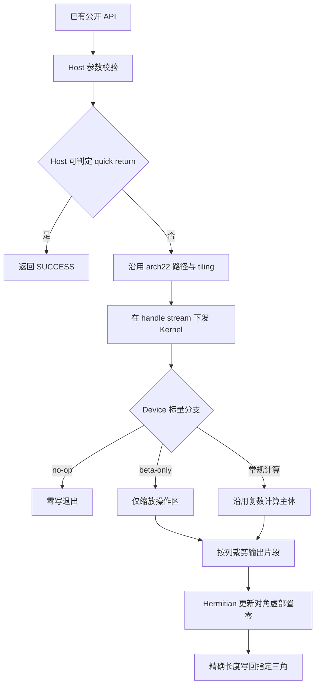

# 需求背景（required）

## 需求来源

本需求来源于 CANN 2026 年 10 月社区任务《aclblasCsyr2/aclblasCher2k/aclblasCherk 精度修复-A2/A3》。三个算子作为同一任务设计、开发和验收，修复目标是指定三角之外的输出缓冲保持调用前的全部位模式。

| 项目 | 内容 |
| --- | --- |
| 文档名称 | aclblasCsyr2 / aclblasCher2k / aclblasCherk 精度修复设计文档 |
| 文档版本 | V1.0，2026-10-28 |
| 队名 | westbrook3638 |
| 任务编号 | 10月28日社区任务-aclblasCsyr2/aclblasCher2k/aclblasCherk精度修复-A2/A3 |
| 代码仓库 | https://gitcode.com/cann/ops-blas |
| 设计基线 | master，commit 为 05b96ea22cea926ecfd43fc7ac691a795522bd61 |
| 目标架构 | Atlas A2 / Atlas A3，arch22 |
| 软件版本 | CANN 9.1.0，Netlib BLAS 3.10.0 |
| 性能主验收设备 | Atlas 800I A2，Ascend 910B3 |
| 设计文档归档仓库 | https://gitcode.com/cann/cann-ops-competitions |

## 背景介绍

### 三算子精度修复

三个公开接口已经存在，分别执行复数对称秩-2 更新、厄米特秩-2k 更新和厄米特秩-k 更新。本任务沿用现有接口、Host 校验、计算公式、流异步执行及架构分派，在已有 arch22 实现中修复三角边界和前导维 padding 的访问范围。

输出矩阵采用列主序，只更新 uplo 指定的三角。另一三角以及每列逻辑阶数之外的 padding 是非操作区。这些位置可能保存 NaN 载荷、正负零、非规范数或调用方的其他数据，验收要求调用前后逐 bit 相同。

### 现有实现分析

| 算子 | 当前仓库实现位置 | 重点检查的路径 | 修复方向 |
| --- | --- | --- | --- |
| aclblasCsyr2 | blas/syr2/arch22/ | 单列、打包多列、整窗口、原子累加写回 | 每列按三角边界裁剪实际提交范围，原子累加也仅覆盖操作区 |
| aclblasCher2k | blas/her2k/arch22/ | direct epilogue、Cube 写回、postprocess、beta-only | 统一有效行区间，按需读取旧 C，裁剪对角 tile 的输出 |
| aclblasCherk | blas/herk/arch22/ | direct epilogue、通用 epilogue、小 K 特化、beta-only | 统一三角读取和写回，保留全操作区 tile 的批量搬运 |

在上述代码基线中，Cher2k 归档于 her2k 算子族。实现与测试沿用该既有目录。

现有部分路径将非操作区前缀置零后参与原子累加，或把旧矩阵区域经过浮点加零后整块回写。浮点加零可能改变负零、NaN 载荷及非规范数；即使数值表面相等，整块回写也超出了本任务要求的零写范围。本设计把区域保护落实为 GM 访问范围裁剪。

### 算子功能分析

| 算子 | 输入 | 原地输出 | 三角性质 | 对角虚部 |
| --- | --- | --- | --- | --- |
| Csyr2 | 复数 alpha、向量 x/y、旧 A | A | 对称，普通转置 | 按普通复数公式更新 |
| Cher2k | 复数 alpha、矩阵 A/B、实数 beta、旧 C | C | Hermitian，共轭转置 | 更新时置 0 |
| Cherk | 实数 alpha、矩阵 A、实数 beta、旧 C | C | Hermitian，共轭转置 | 更新时置 0 |

Hermitian 矩阵由指定三角表示。仅在发生更新时处理对角虚部；合法 quick return 保留完整输出缓冲。

# 需求分析（required）

## 需求描述

在三个算子的既有 arch22 路径内完成精度修复，使操作区满足 FLOAT32 混合容差，非操作三角和前导维 padding 与调用前逐 bit 一致，并满足任务书规定的性能上限。公开 API、标量内存归属、状态码及 stream 异步语义保持一致。

## 需求拆解

1. 复用 include/cann_ops_blas.h 中的三个声明，保持参数顺序、类型、枚举及返回码。
2. 按实际 lda/ldb/ldc 计算列主序地址，支持合法 padding；Csyr2 按 Netlib 语义处理负步长。
3. 将所有输出路径的写回范围裁剪至指定三角与逻辑矩阵的交集。
4. 对角 tile 中的旧 A/C 只读取操作区；Hermitian 的 beta 为 0 时跳过旧 C 读取。
5. 保留 quick return、beta-only、普通复数对称更新及 Hermitian 对角虚部置零语义。
6. 复用任务包全部原始 CSV，并在 GTest 中接入哨兵注入、非操作区 bit 检查及 quick return 全缓冲检查。
7. 在 A2、A3 分别验证功能、精度和 bit 一致性；在 A2 910B3 验证性能主门禁，在 A3 记录性能运行结果。
8. 交付联合设计文档、实现、测试脚本、复现说明和真实自测记录。

# 详细设计（required）

## 算子分析

### 数学公式

Csyr2 使用普通转置：

$$
A \leftarrow \alpha xy^T+\alpha yx^T+A.
$$

其中 \(\alpha\)、\(x\)、\(y\)、\(A\) 均为复数；对操作区元素计算 \(A_{ij}\leftarrow A_{ij}+\alpha x_i y_j+\alpha y_i x_j\)。

Cher2k 的两种操作为：

$$
\begin{aligned}
\mathrm{trans}=N:\quad
C &\leftarrow \alpha AB^H+\overline{\alpha}BA^H+\beta C,\\
\mathrm{trans}=C:\quad
C &\leftarrow \alpha A^HB+\overline{\alpha}B^HA+\beta C.
\end{aligned}
$$

Cherk 的两种操作为：

$$
\begin{aligned}
\mathrm{trans}=N:\quad
C &\leftarrow \alpha AA^H+\beta C,\\
\mathrm{trans}=C:\quad
C &\leftarrow \alpha A^HA+\beta C.
\end{aligned}
$$

Cher2k 的 \(\alpha\) 为复数、\(\beta\) 为实数；Cherk 的 \(\alpha,\beta\) 均为实数。两者只更新指定三角，并在更新时令 \(\operatorname{Im}(C_{ii})=0\)。

### 支持数据类型

矩阵和向量使用 aclblasComplex，即实部、虚部各为 binary32 的 COMPLEX64。复数分量计算及累加沿用原 FP32 计算路径。

| 参数 | Csyr2 | Cher2k | Cherk |
| --- | --- | --- | --- |
| alpha | COMPLEX64，Host 指针 | COMPLEX64，Device 指针 | FLOAT32，Device 指针 |
| beta | 无 | FLOAT32，Device 指针 | FLOAT32，Device 指针 |
| x/y、A/B/C | COMPLEX64，Device 指针 | COMPLEX64，Device 指针 | COMPLEX64，Device 指针 |
| n/k、inc、ld、枚举 | Host 值参数 | Host 值参数 | Host 值参数 |

### 支持形状

| 算子/参数 | 逻辑形状 | 物理存储与合法条件 |
| --- | --- | --- |
| Csyr2 x/y | 长度 n | 元素跨度为 incx/incy；n 大于 0 时分配至少 \(1+(n-1)\lvert inc\rvert\) 个复数元素 |
| Csyr2 A | n × n | lda × n，lda ≥ max(1,n) |
| Cher2k A/B，N | n × k | lda × k / ldb × k，lda/ldb ≥ max(1,n) |
| Cher2k A/B，C | k × n | lda × n / ldb × n，lda/ldb ≥ max(1,k) |
| Cherk A，N | n × k | lda × k，lda ≥ max(1,n) |
| Cherk A，C | k × n | lda × n，lda ≥ max(1,k) |
| Cher2k/Cherk C | n × n | ldc × n，ldc ≥ max(1,n) |

维度满足 n ≥ 0、k ≥ 0，Csyr2 步长满足 incx ≠ 0、incy ≠ 0。矩阵均为列主序，运行时形状通过现有参数表达。

## 算子实现

### 实现方案

复用 Ascend C kernel 直调和 ops-blas handle。Host 完成参数校验、资源查询、路径选择和 tiling，Kernel 完成计算与三角范围内的读写。修复集中在 tile 读写和 epilogue，不更换主计算算法。



#### 3.2.1 host侧设计：

##### 1. 接口与参数校验

复用以下既有签名：

```cpp
aclblasStatus_t aclblasCsyr2(
    aclblasHandle_t handle, aclblasFillMode_t uplo, int n,
    const aclblasComplex* alpha,
    const aclblasComplex* x, int incx,
    const aclblasComplex* y, int incy,
    aclblasComplex* A, int lda);

aclblasStatus_t aclblasCher2k(
    aclblasHandle_t handle, aclblasFillMode_t uplo,
    aclblasOperation_t trans, int n, int k,
    const aclblasComplex* alpha,
    const aclblasComplex* A, int lda,
    const aclblasComplex* B, int ldb,
    const float* beta, aclblasComplex* C, int ldc);

aclblasStatus_t aclblasCherk(
    aclblasHandle_t handle, aclblasFillMode_t uplo,
    aclblasOperation_t trans, int n, int k,
    const float* alpha, const aclblasComplex* A, int lda,
    const float* beta, aclblasComplex* C, int ldc);
```

| 检查项 | 返回值或行为 |
| --- | --- |
| handle 为空 | ACLBLAS_STATUS_HANDLE_IS_NULLPTR |
| uplo 为 UPPER/LOWER 之外的值 | ACLBLAS_STATUS_INVALID_ENUM |
| Hermitian trans 为 N/T/C 之外的值 | ACLBLAS_STATUS_INVALID_ENUM |
| Hermitian trans 为 OP_T | ACLBLAS_STATUS_INVALID_VALUE |
| n/k 为负、步长为零、前导维不足 | ACLBLAS_STATUS_INVALID_VALUE |
| alpha 或适用的 beta 指针为空 | ACLBLAS_STATUS_INVALID_VALUE |
| 活跃计算路径所需输入/输出指针为空 | 按任务书对应参数条件返回 ACLBLAS_STATUS_INVALID_VALUE |
| 合法 quick return | ACLBLAS_STATUS_SUCCESS，输出缓冲保持原样 |

旧 C 的读取由 beta 分支控制，输出仍写入调用方提供的有效 Device C 缓冲。形状、元素跨度、字节数和列偏移采用足够宽的整数计算。

##### 2. 分核策略：

Csyr2 沿用按列或列组分配的 AIV 任务，保留单位步长、跨步和整窗口路径的分派。不同核心处理互不重叠的列或输出片段，三角边界在每列写回前计算。

Cher2k/Cherk 沿用原有 direct/Cube 路径及输出 tile 分配。完全位于非操作三角的 tile 跳过输出；完全位于操作区的 tile 使用原有批量搬运；对角与尾部 tile 按列裁剪。

核数及片上资源容量通过平台接口获取，沿用现有 tiling 对可用资源的限制。

##### 3. 数据分块和内存优化策略：

输出 tile 的逻辑形状、UB 分量布局和计算缓冲沿用现有实现。新增裁剪描述由 tile 起始坐标、有效行列数、uplo、n 和实际 ld 直接推导。

对需要 32 字节对齐的 UB 操作，在片上将有效片段重排到对齐暂存区；GM 访问使用有效片段的真实起点和字节长度。优先复用已有 VECIN/VECOUT 与 Gather 暂存区。

修复使用的临时存储限定于当前 tile 的片上重排，保持 workspace 随计算规模及现有路径需求分配。非操作区通过缩小写回范围保留，不配置用于备份或恢复完整输出矩阵的设备缓存。

##### 4. tilingkey规划策略：

Csyr2 保留现有 key：0/1 表示 UPPER/LOWER 单位正步长，2/3 表示跨步，4/5 表示单位正步长窗口路径，以及现有入口选择的整窗口特化。

Cher2k/Cherk 保留现有 direct、Cube、通用 epilogue 和小 K 路径标识。三角裁剪在各路径 epilogue 内实现，同一数学输入继续使用原有计算路径和精度配置。

##### 5. Quick return 与异步语义

| 算子/条件 | 执行设计 |
| --- | --- |
| 三算子 n=0 | 合法参数校验后成功返回，跳过矩阵计算 |
| Csyr2 alpha=(0,0) | Host 可直接读取 alpha，成功返回 |
| Cher2k/Cherk，alpha=0 或 k=0，且 beta=1 | Device 分支在输出写回之前退出，保留对角及完整缓冲 |
| Cher2k/Cherk，alpha=0 或 k=0，且 beta≠1 | 仅对操作区执行 beta 缩放；更新对角虚部为 0 |
| Cher2k/Cherk，beta=0 | 直接生成操作区结果，跳过旧 C 的读取 |

Device alpha/beta 由设备执行路径读取和判定，Host 沿用 stream 异步下发。计算结束后的同步由调用方或测试框架执行。

#### 3.2.2 kernel侧设计：

##### 1. 列主序与区域定义

令输出矩阵为 \(M\)，其前导维为 \(ld\)。Csyr2 中 \(M=A,ld=lda\)，Hermitian 中 \(M=C,ld=ldc\)。元素地址为：

$$
\operatorname{offset}(i,j)=i+j\cdot ld.
$$

| 区域 | UPPER | LOWER | 处理方式 |
| --- | --- | --- | --- |
| 操作区 | \(0\le i\le j<n\) | \(0\le j\le i<n\) | 计算并更新 |
| 非操作三角 | \(j<i<n\) | \(0\le i<j<n\) | 保留输入位模式，GM 零写 |
| padding | \(n\le i<ld,\ 0\le j<n\) | 同左 | 保留输入位模式，GM 零写 |

##### 2. Tile 的逐列裁剪

设 tile 的行区间为 \([r_0,r_0+m)\)，某列的全局列号为 \(j\)，且 \(j<n\)。先取 \(e_0=\min(r_0+m,n)\)，再计算：

$$
\begin{aligned}
\mathrm{UPPER}:&\quad s=r_0,\quad e=\min(e_0,j+1),\\
\mathrm{LOWER}:&\quad s=\max(r_0,j),\quad e=e_0.
\end{aligned}
$$

当 \(e\le s\) 时跳过该列片段；否则访问 \([s,e)\)，其 GM 起点为 \(s+j\cdot ld\)，复数元素数为 \(e-s\)，字节数为 \(8(e-s)\)。

该区间同时用于必要的旧矩阵读取和输出写回。完全处于操作区的 tile 保留原有二维批量拷贝；对角 tile 和尾部 tile 使用精确长度的单列片段。

##### 3. 非对齐片段搬运

LOWER 对角片段的起始行随列号变化，UB 中的交错复数后缀可能偏移 8、16 或 24 字节。写回前使用 Gather 或等价的片上批量重排，将该后缀放到对齐的 VECOUT 暂存区，再使用 DataCopyPad 按真实字节数提交到 GM。

旧矩阵的有效片段通过对齐 VECIN 暂存区搬入，再重排到计算布局。片上为向量计算设置的补齐元素只服务于 UB 计算；GM 读取和写回保持 \([s,e)\) 的长度。已有精确长度拷贝在选择普通 DMA 或非对齐 DMA 时，同时核对起始地址、源布局和长度要求。

重排与搬运之间沿用队列及流水事件完成同步，确保 V 计算结束后才由 MTE3 写出，并在暂存区复用前等待搬运完成。

##### 4. Csyr2 更新

沿用复数乘加及系数复用。令 \(t_1=\alpha y_j,t_2=\alpha x_j\)，操作区的增量为 \(x_i t_1+y_i t_2\)。

原子累加路径只向操作区提交增量。普通读改写路径只读取与写回指定三角。多列打包时，每列分别计算有效长度；对齐起点前的片上前缀不参与 GM 写回。

负步长采用零基起点：

$$
b_x=
\begin{cases}
0,&incx>0,\\
(1-n)incx,&incx<0,
\end{cases}
\qquad x_i=x[b_x+i\cdot incx].
$$

y 使用同样的起点规则。Csyr2 对角实部和虚部均执行普通复数更新。

##### 5. Cher2k/Cherk 更新

保留 N/C 对应的复数计算及 FP32 累加。Epilogue 按以下顺序执行：

1. 在设备端处理 no-op 与 beta-only 分支。
2. 对需要乘积的路径完成原有复数归约和 alpha 缩放。
3. beta 非零时，仅搬入操作区旧 C；对角只使用旧 C 实部。
4. 对操作区融合 beta 项，显式生成对角虚部 0。
5. 将各列有效片段重排到对齐输出暂存区，按精确长度写回。

beta 为 0 时直接由乘积或零值生成输出。k 为 0 时跳过乘积，执行与 beta 对应的 no-op 或缩放分支。

##### 6. 修改范围

| 目录/文件 | 设计修改内容 |
| --- | --- |
| blas/syr2/arch22/csyr2_device_chunks.h | 单列及打包列读写范围裁剪 |
| blas/syr2/arch22/csyr2_device_lower_window.h、csyr2_device_lower_packed.h | LOWER 列组和整窗口写回裁剪、非对齐后缀重排 |
| blas/syr2/arch22/csyr2_device_xy.h、csyr2_ascend_kernel.h | 精确长度搬运、对齐判定与必要 helper |
| blas/her2k/arch22/cher2k_kernel_entry.cc | direct 输出、旧 C 读取及对角 tile 裁剪 |
| blas/her2k/arch22/cher2k_kernel_cube.cc、cher2k_kernel_postprocess.cc | Cube/postprocess 路径的三角输出及非对齐处理 |
| blas/herk/arch22/cherk_direct_kernel.cpp、cherk_compute_kernel.cpp | direct/通用 epilogue 读取与写回 |
| blas/herk/arch22/cherk_kernel.cpp | 小 K 特化及辅助输出路径裁剪 |
| test/syr2/csyr2/arch22/ | Csyr2 CSV、bit 检查、负步长与 quick return 测试 |
| test/her2k/cher2k/arch22/ | Cher2k CSV、bit 检查、N/C 与设备标量测试 |
| test/herk/cherk/arch22/ | Cherk arch22 测试实现、bit 检查与性能测试 |

公开接口头文件和 arch35 计算实现沿用基线。测试所需的检查 helper 与脚本随三个 arch22 测试目录交付。

## 支持硬件

| 产品 | 架构 | 验证内容 |
| --- | --- | --- |
| Atlas A2 | arch22 | 功能、操作区精度、非操作区 bit 检查；910B3 性能主门禁 |
| Atlas A3 | arch22 | 功能、操作区精度、非操作区 bit 检查和性能运行记录 |

编译与运行环境采用 CANN 9.1.0；golden 使用 Netlib BLAS 3.10.0。自测报告记录实际产品、驱动、固件、CANN、编译器和 Netlib 版本。

## 算子约束限制

| 项目 | 约束与行为 |
| --- | --- |
| 数据布局 | 列主序；向量步长及矩阵前导维按接口参数寻址 |
| uplo | UPPER 或 LOWER，另一三角与 padding 保持输入位模式 |
| Hermitian trans | N 或 C，普通转置 T 按约定返回 INVALID_VALUE |
| 标量归属 | Csyr2 alpha 为 Host 指针；Hermitian alpha/beta 为 Device 指针 |
| 输出 | A/C 指定三角原地更新 |
| 广播与视图 | 使用接口定义的向量/矩阵操作数及原地输出 |
| 确定性 | 操作区按混合容差验收；非操作区逐 bit 一致 |
| 执行模式 | 在 handle 绑定的 stream 上异步执行，计算由 NPU 完成 |
| 资源口径 | 片上暂存随 tile 使用，workspace 沿用计算规模需求 |

# 可维可测分析

## 精度标准/性能标准

### 1. 操作区精度

Cher2k/Cherk golden 分别使用 Netlib BLAS 3.10.0 的 cblas_cher2k、cblas_cherk。Csyr2 golden 按 Netlib ssyr2 的三角访问、负步长和 quick return 语义实现复数参考。

操作区实部、虚部分别按 FLOAT32 检查：

$$
|actual-golden|\le 2^{-13}+2^{-13}|golden|.
$$

要求匹配比例至少 0.99，且所有有限比对点的最大绝对误差满足：

$$
\mathrm{max\_abs\_error}\le\max(10^{-2},32\operatorname{ULP}(g_{\mathrm{low}})).
$$

\(g_{\mathrm{low}}\) 是最大绝对误差点的 golden 值按 FLOAT32 收窄后的值。Inf/NaN 按精度标准的特殊值规则单独处理。Hermitian 对角虚部另行检查为 0。

标准来源：https://gitcode.com/cann/opbase/blob/master/docs/zh/ops_precision_standard/mixed_tolerance_standard.md

### 2. 非操作区二进制一致

调用前保存完整 ld × n 缓冲的 Host 快照；调用后同步 stream 并读回。非操作三角和 padding 对每个 aclblasComplex 使用 memcmp，或比较 real/imag 的 uint32_t 位模式。通过条件是所有位置全部相同，bit-exact 匹配比例为 100%。

输入生成后，用整数位模式覆盖非操作区哨兵。哨兵包括有限随机值、正负零、多个 NaN payload、正负 Inf、正负非规范数。所有 SUCCESS 计算用例均接入 bit 检查，quick return 对完整传入缓冲另做比较。

零维测试提供独立的非空保护缓冲，核对调用前后保护数据；设备标量 no-op 测试在 n 大于 0 时比较完整输出，覆盖对角虚部也保持不变。

### 3. 测试覆盖

| 类别 | 覆盖内容 |
| --- | --- |
| 原有用例 | 保留任务包每算子原 1000 条功能/精度和 200 条 PF 用例，以及已有 Csyr2 22 条、Cher2k/Cherk 各 24 条 BIT |
| 三角与转置 | UPPER/LOWER；Hermitian N/C 正交组合 |
| Shape | 0、1、小质数、2 的幂及其相邻值、非对齐值、大规模及 tile 边界 |
| 步长 | Csyr2 incx/incy 为 ±1、±2、±3；步长为 0 的负向用例 |
| 前导维 | 最小合法 ld、多种 padding、非法 ld；输入和输出前导维独立覆盖 |
| 哨兵 | n 为 1、7、8、16、63、64、128；ld 为 n、n+8、n+32，结合两种三角和 Hermitian N/C 补齐 |
| 标量分支 | alpha 为 0、1、纯实、纯虚、大值；beta 为 0、1、负值；k=0 |
| 特殊数值 | 操作区 Inf/NaN、抵消、极端值；非操作区 NaN payload、正负零和非规范数 |
| 对角 | Csyr2 普通复数更新；Hermitian 更新时虚部为 0，no-op 时保持原值 |
| 异常 | 空 handle、标量及路径所需数据指针、非法枚举、负维度、零步长和非法前导维 |
| Stream | 非默认 stream；同一 stream 上先更新设备标量再调用接口，核对执行顺序 |

测试框架沿用仓内 GTest + CSV。补充用例追加到原 CSV，保留原用例名和原始输入。任务包中 Csyr2 非法 uplo 用例的期望码按本次任务书明确的 INVALID_ENUM 处理，并在测试 README 记录该处勘误。

启动脚本校验子进程返回码、实际执行用例、失败/跳过统计和计时字段。缺失用例、零用例及无有效性能数据分别记录为未通过。

### 4. 性能验收

设备为 Atlas 800I A2（910B3）。先 warmup，再采样超过 50 次，记录平均单次设备执行耗时。计时使用设备事件或 msprof，数据生成、golden、Host/Device 快照及比较置于计时区间外。

| 算子 | uplo | trans | n | k | 平均耗时上限（us） |
| --- | --- | --- | ---: | ---: | ---: |
| Csyr2 | UPPER | — | 512 | — | 7.54 |
| Csyr2 | LOWER | — | 1024 | — | 9.72 |
| Csyr2 | UPPER | — | 2048 | — | 19.05 |
| Cher2k | UPPER | N | 1024 | 1024 | 1458.91 |
| Cher2k | UPPER | N | 2048 | 2048 | 5240.68 |
| Cher2k | LOWER | C | 1024 | 1024 | 1081.90 |
| Cherk | UPPER | N | 1024 | 1024 | 738.09 |
| Cherk | UPPER | N | 2048 | 2048 | 2616.28 |
| Cherk | LOWER | C | 1024 | 1024 | 485.94 |

同时运行三个算子各自全部 200 条 TC_PF 用例，根据任务包 gpu_baseline.csv 和验收倍率输出逐用例对比。九个直接门限使用上表精确值。报告包含 warmup、采样数、平均 us、设备负载和测量日志。

性能优化保持在写回层：全操作区 tile 延续批量搬运，对角 tile 使用片上对齐重排和有效长度 DMA，避免非操作区旧值的搬入与恢复。

### 5. 可维护性与验收证据

| 项目 | 检查与交付 |
| --- | --- |
| 访问范围 | 对所有 GM 写回入口核对三角区间、n 尾部、实际 ld 和 DMA 字节数 |
| 片上资源 | 核对 Gather 暂存容量、对齐、队列复用及流水事件 |
| 内存 | 代码检视 workspace、缓存生命周期与问题规模关系 |
| 版本 | 记录代码 commit、CANN 9.1.0、Netlib 3.10.0、驱动、固件及 NPU 型号 |
| 精度与 bit | A2/A3 分别保存 GTest 原始日志、操作区结果、非操作区匹配统计和首个失败位置 |
| 性能 | 保存 warmup/采样配置、设备计时、逐用例 CSV 与真实结果截图 |
| 复现 | README 给出环境激活、构建、CSV 安装、精度、bit 检查和性能命令 |

本设计文档用于方案评审，实测结果归档于自测报告。

## 兼容性分析

| 兼容维度 | 设计处理 |
| --- | --- |
| API/ABI | 复用三个既有公开声明与枚举，调用参数保持一致 |
| 数学语义 | 保留对称/厄米特公式、N/C 共轭关系及对角行为 |
| 数据布局 | 按实际前导维和向量步长访问，保留列主序与原地输出 |
| Quick return | 合法 no-op 保留完整缓冲；Device 标量在设备路径判定 |
| 执行语义 | 使用已有 handle stream，保留异步下发 |
| 架构隔离 | 修复位于现有 arch22 路径，arch35 计算与公开接口沿用基线 |
| 测试兼容 | 保留任务包原始用例，新增覆盖通过追加和 arch22 测试逻辑接入 |

## 参考资料

1. 官方设计模板：https://gitcode.com/cann/cann-ops-competitions/blob/master/04_tasks/01_community-task-2026/resources/design_template.md
2. 设计文档提交目录说明：https://gitcode.com/cann/cann-ops-competitions/blob/master/04_tasks/01_community-task-2026/README.md
3. ops-blas：https://gitcode.com/cann/ops-blas
4. FLOAT32 混合容差标准：https://gitcode.com/cann/opbase/blob/master/docs/zh/ops_precision_standard/mixed_tolerance_standard.md
5. cuBLAS syr2：https://docs.nvidia.com/cuda/cublas/index.html#cublas-t-syr2
6. cuBLAS her2k：https://docs.nvidia.com/cuda/cublas/index.html#cublas-t-her2k
7. cuBLAS herk：https://docs.nvidia.com/cuda/cublas/index.html#cublas-t-herk
8. Netlib ssyr2：https://www.netlib.org/blas/ssyr2.f
9. Netlib cher2k：https://www.netlib.org/blas/cher2k.f
10. Netlib cherk：https://www.netlib.org/blas/cherk.f
11. Netlib BLAS 3.10.0：https://github.com/Reference-LAPACK/lapack/releases/tag/v3.10.0
12. 社区任务流程：https://gitcode.com/org/cann/discussions/39
