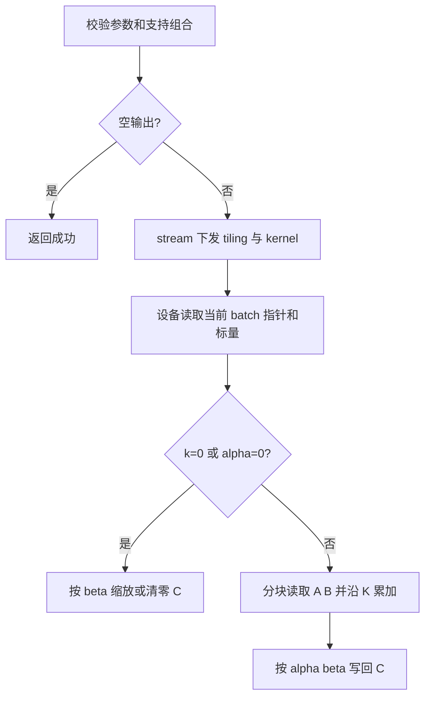

# 【社区任务】aclblasGemmBatchedEx 算子设计文档（A2/A3）

## 一、需求背景

### 1.1 需求来源

依据[任务书](aclblasGemmBatchedEx_A2_task_doc.md)，为 ops-blas 补齐 Atlas A2/A3 上的 `aclblasGemmBatchedEx`，使用 Ascend C、句柄绑定的 stream 和 kernel 直调；对标 cuBLAS 同名批量矩阵乘接口，精度以 Netlib BLAS 3.10.0 `cblas_sgemm` 为基准。

### 1.2 背景介绍与基线分析

本地上游基线为 ops-blas `05b96ea22cea926ecfd43fc7ac691a795522bd61`。公共原型位于 `include/cann_ops_blas.h`；现有实现和说明分别位于 `blas/gemm_batched_ex/arch35/gemm_batched_ex_host.cpp`、`blas/gemm_batched_ex/arch35/` 和 `blas/gemm_batched_ex/README.md`，当前只声明 950 支持，不包含 FP32 组合，A2/A3 标记不支持。可参考的 A2/A3 同类实现为 `blas/gemm_strided_batched/arch22/`，其中批地址由固定 stride 计算。

基线 arch35 流程：Host 校验形状、枚举、类型、指针和 leading dimension → 读取 Host 标量 → 空输出返回或 beta-only kernel → tiling、按需 workspace → Cube GEMM → 按需 alpha/beta 后处理。其 dtype 表为 FP16/BF16/FP8。设备指针数组、列主序和原位 C 是共同语义；内核、指针寻址及支持组合按 arch22 单独设计。

## 二、需求分析

### 2.1 外部依赖

开发依赖 CANN 9.1.0 的 ACL runtime、Ascend C 和 ops-blas 工程；测试使用 Netlib BLAS 3.10.0 `cblas_sgemm`、GTest 和 msprof。功能、精度和性能测试均在CANN的910C设备上完成。

### 2.2 内部适配模块

复用 `include/cann_ops_blas.h` 的公共声明、handle/stream 与 workspace 管理、构建注册和 `test/` 测试框架。新增实现位于 `blas/gemm_batched_ex/arch22/`，测试接入 `test/gemm_batched_ex/`，按仓库实际架构组织注册；更新现有算子 README 的产品与 dtype 表。保留 arch35 的类型组合和行为，不复制或新建公开符号。

### 2.3 需求模块设计与范围

开发内容分为接口适配、算子实现和测试验收三部分。

| 工作内容 | 具体实现 |
| --- | --- |
| 接口适配 | 沿用 `aclblasGemmBatchedEx` 公共声明，在 arch22 增加 Host 入口，完成参数校验、tiling 和 kernel 下发；使用 handle 中的 stream 与 workspace |
| 算子实现 | 在 Device 读取 A/B/C 指针数组，支持每个 batch 使用独立矩阵地址；实现 FP32 矩阵乘、N/T/C 转置、leading dimension padding 和 alpha/beta 缩放，结果写回 C |
| 测试验收 | 将配套 1200 条 CSV 用例接入 C++ GTest，在 910C 上完成精度、参数校验和性能测试，输出逐用例结果、自测报告及复现步骤 |

计算公式为 `C_b = alpha * op(A_b) * op(B_b) + beta * C_b`。其中 op(A) 为 m×k，op(B) 为 k×n，C 为 m×n。各 batch 共享维度、转置、标量和 leading dimension，矩阵按列主序存储，批次之间不要求地址连续。

本次实现的类型组合为 `Atype=Btype=Ctype=ACL_FLOAT`、`computeType=ACLBLAS_COMPUTE_32F`、`algo=ACLBLAS_GEMM_DEFAULT`。其他类型组合返回 `ACLBLAS_STATUS_NOT_SUPPORTED`。零维、零批次、k=0、alpha=0 等行为按任务书实现；实数路径下 OP_C 与 OP_T 等价。

## 三、详细设计

### 3.1 调用方式与校验

**调用方式：Kernel 直调。**

对外提供 `include/cann_ops_blas.h` 中的句柄式 BLAS 接口 `aclblasGemmBatchedEx`。调用方在 Host 调用该接口，Host 实现完成参数校验和 tiling 后，通过 handle 绑定的 stream 直接下发 Ascend C kernel。

调用链：`Host 应用 / GTest → aclblasGemmBatchedEx → arch22 Host 实现 → Ascend C kernel → Device 上的 C 矩阵`。

调用过程如下：

1. 初始化 ACL、选择设备并创建 stream，调用 `aclblasCreate(&handle)` 创建句柄，再通过 `aclblasSetStream(handle, stream)` 绑定 stream。
2. 为各 batch 分配设备矩阵并上传数据。A、B、C 均为列主序，分配大小包含 lda、ldb、ldc 对应的 padding。
3. 在 Host 收集各矩阵的设备地址，将三组地址分别上传为设备侧的 Aarray、Barray、Carray。传入接口的是这三个设备数组的地址。
4. 准备 FP32 标量 alpha、beta，调用公共接口。下例中 dAarray、dBarray、dCarray 已准备完成，alpha、beta 位于 Host。

```cpp
aclblasHandle_t handle = nullptr;
aclblasCreate(&handle);
aclblasSetStream(handle, stream);

float alpha = 1.0f;
float beta = 0.0f;
aclblasStatus_t status = aclblasGemmBatchedEx(
    handle, transa, transb, m, n, k, &alpha,
    dAarray, ACL_FLOAT, lda, dBarray, ACL_FLOAT, ldb,
    &beta, dCarray, ACL_FLOAT, ldc, batchCount,
    ACLBLAS_COMPUTE_32F, ACLBLAS_GEMM_DEFAULT);
```

5. 检查接口返回值，调用 `aclrtSynchronizeStream(stream)` 等待计算完成，再将 C 拷回 Host。矩阵、设备指针数组和 workspace 保留至计算完成后释放；最后销毁 handle 和 stream。

测试程序检查上述每个 API 的返回值。接口返回 `SUCCESS` 表示校验及下发成功，结果验证在 stream 同步完成后进行。

Host 校验 handle、转置枚举、维度、leading dimension、指针及类型组合，通过后再处理 no-op。

| 条件 | 处理方式 |
| --- | --- |
| handle 为空 | 返回 `ACLBLAS_STATUS_HANDLE_IS_NULLPTR` |
| transa/transb 不为 N/T/C | 返回 `ACLBLAS_STATUS_INVALID_ENUM` |
| 负维度、非法 leading dimension、空标量，或 batchCount>0 时数组为空 | 返回 `ACLBLAS_STATUS_INVALID_VALUE` |
| 不支持的类型组合或算法 | 返回 `ACLBLAS_STATUS_NOT_SUPPORTED` |
| m=0、n=0 或 batchCount=0 | 参数校验通过后返回 `SUCCESS`，不执行计算 |
| k=0 或 alpha=0 | 只执行 C=beta*C；beta=0 清零，beta=1 保持 C 不变 |

leading dimension 满足 `lda ≥ max(1, transa==N ? m : k)`、`ldb ≥ max(1, transb==N ? k : n)`、`ldc ≥ max(1,m)`。

任务要求 alpha/beta 支持 Host 和 Device 两种来源。Host 标量读取后传入 kernel，Device 标量由 kernel 读取。

### 3.2 总体设计

#### 3.2.1 Host：分核、分块与 tiling

将输出空间分为 `batchCount × ceil(m/BM) × ceil(n/BN)` 个互不重叠的逻辑块，以 64 位安全计算块数及地址偏移；每核处理 `blockId, blockId+coreNum, ...`，尾块以真实边界裁剪。`coreNum=min(可用核数, 逻辑块数)`，避免空核和跨核写同一 C 元素；k 方向在单个输出块内顺序累加，不做跨核归约。运行时根据平台可用 L1/L0/UB 容量、数据搬运对齐及转置选择 BM/BN/BK，分别计算输入块、累加块和临时缓冲需求；保留非对齐尾块的边界搬运。参数乘法、对齐、workspace 字节数先做溢出检查。

Tiling 数据至少包含 m/n/k、lda/ldb/ldc、batchCount、N/T 标志、BM/BN/BK、块数和标量来源。按路径选择 key：`beta-only`、FP32 通用计算；N/T 组合作为 tiling 标志或编译分支，C 归一为 T。设备标量值未知时不得由 Host 依据 alpha/beta 值选择路径，应在设备侧分支，确保不引用无须读取的矩阵。

#### 3.2.2 Kernel：地址和计算流程

设备侧从 Aarray/Barray/Carray 获取当前 batch 的地址，按列主序取元素：`A_N(i,p)=A[i+p*lda]`，`A_T(i,p)=A[p+i*lda]`；`B_N(p,j)=B[p+j*ldb]`，`B_T(p,j)=B[j+p*ldb]`；`C(i,j)=C[i+j*ldc]`。加载时只访问逻辑范围，不能覆盖 padding 或跨越 batch 的分配范围。

主路径将对应的 A/B 分块搬入片上内存，执行 K 循环并以 FP32 累加，最后计算 alpha*acc；beta 非零时读取旧 C 并加上 beta*C，beta 为零时不读旧 C。beta-only 路径不读取 A/B 元素，beta=0 写零，beta=1 不写，其他值逐元素乘；`alpha=0` 对应结果按任务书做 EXACT 校验。计算路径需通过 FP32 精度测试，再进行性能调优。



arch22 实现采用 FP32 计算，沿用设备指针数组、列主序和 beta-only 语义。需要临时存储时复用 handle 的 workspace，并在同一 stream 上按计算顺序使用。

### 3.3 支持硬件

任务面向 Atlas A2/A3 的 arch22 实现。本次开发、自测和验收使用CANN 提供的 910C，报告中的精度与性能数据均来自该设备。

### 3.4 算子约束限制

主路径只承诺 FP32 输入、输出和计算；其他 dtype 在 arch22 返回 `NOT_SUPPORTED`，不影响 arch35。所有矩阵是列主序，每 batch 共享维度和 leading dimension；不支持额外非连续视图和广播。`beta=0` 仍需有效的输出存储，但不能依赖 C 原值。维度过大导致地址/工作空间计算溢出时返回错误，不得截断。结果不要求确定性或与通用 GEMM 位一致；alpha=0 的任务书特殊规则除外。

## 四、特性交叉分析

结合配套用例，验证转置与 padding、不同 batch 地址、alpha/beta 缩放及零维处理的组合。重点检查实数 OP_C 与 OP_T 一致、beta=0 时不读旧 C、k=0 或 alpha=0 时不读 A/B，以及异步调用后同步读回结果。Inf/NaN 用例按任务书的特殊值规则比对。

## 五、可维可测分析

### 5.1 精度、性能和测试标准

| 验证项 | 方法与判定 |
| --- | --- |
| 测试环境 | 单台 910C，记录设备型号、CANN/驱动版本、代码 commit 和测试命令 |
| 功能与精度 | 执行配套 1000 条精度及参数用例，逐 batch 比较完整输出矩阵；负向用例检查返回状态码 |
| 精度标准 | `atol=rtol=2^-13`，有限元素匹配率 ≥0.99，最大绝对误差按任务书的 `1e-2 或 32×ULP` 判据检查；Inf/NaN 单独比对，alpha=0 路径做 EXACT 校验 |
| 性能 | 执行配套 200 条性能用例；预热 5 次后采集 51 次有效调用，计算平均耗时 |
| 对标方法 | 使用配套 `gpu_baseline.csv`，逐条计算 `GPU耗时 / 910C耗时`，按任务书 §3.3 的 ≥0.8 判断，同时记录是否达到 ≥1.0 |
| 缺陷回归 | 先将问题写入测试并确认失败，再修复并验证通过，最后运行相关回归用例 |

#### 测试执行

将配套 CSV 接入 `test/gemm_batched_ex/` 的 C++ GTest 工程，由测试程序完成数据生成、设备内存准备、算子调用和结果比对。沿用 CSV 的随机种子，保留各用例编号。完成 C++ 测试接入后，使用配套 `verify_accuracy.py`、`verify_performance.py` 执行测试并汇总结果。

精度 golden 在 910C 所在主机的 CPU 上通过 Netlib `cblas_sgemm` 逐 batch 生成。对每条用例记录返回码、匹配率、最大绝对误差和通过结果；alpha=0、k=0 按对应缩放逻辑生成参考值。测试发现的问题补入回归用例。

#### 性能采集

使用 msprof op 获取 kernel 的 `Task Duration(us)`。一次接口调用包含多个 kernel 时，将该次调用的 kernel 耗时相加，随后对 51 次调用取平均。beta 非零时在采样前恢复初始 C，使重复计算使用相同输入，恢复数据的时间不计入 kernel 耗时。

GPU 对比直接使用任务配套 CSV，`gpu_ms` 乘 1000 转为微秒，并按转置、m/n/k 和 batchCount 匹配用例。报告列出 GPU 参考耗时、910C 平均耗时、性能比值和逐条判定。配套 README 对 GPU 型号有两种描述，报告引用该 CSV 为数据来源，不据此指定 GPU 型号。

#### 自测报告

报告包括环境信息、运行步骤、1000 条精度及参数用例结果、200 条性能结果、问题修复记录和原始日志。记录算子使用的 workspace 大小，现有 GPU CSV 未提供 workspace 数据，该项只报告 910C 实测值。精度结果、性能数据和必要截图按用例编号对应，便于复现与验收。

### 5.2 兼容性与交付

复用公共声明，新增 arch22 的 FP32 实现，保留 arch35 原有代码。开发时检查公共接口和导出符号，在 910C 上完成新增实现的测试。

交付内容包括设计文档、算子代码、自测代码与运行说明、910C 自测报告及日志。设计文档按社区要求提交至 cann-competitions 对应 tasklist；算子代码按 ops-blas 目录规范组织，README 写明类型、参数、支持范围和调用方法。
