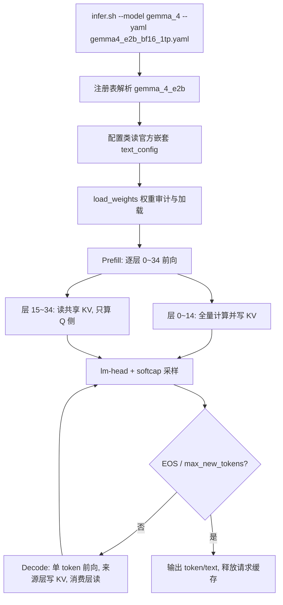

# 需求背景（required）

## 需求来源

10 月社区任务：Gemma-4-E2B 纯文本推理接入（Atlas A3 单卡，BF16 Offline，Python + YAML 模型级适配）。

- 任务书：`Gemma-4-E2B纯文本推理接入任务书.md`（本设计的唯一需求真值源）
- 代码合入仓：`https://gitcode.com/cann/cann-recipes-infer`（模型配置、代码、测试提交至 `models/gemma_4/`，注册提交至 `executor/core/support_models.py`，文档摘要提交至 `docs/models/gemma_4/`）
- 官方模型与配置：`https://huggingface.co/google/gemma-4-E2B`（config.json 为嵌套 `text_config` 结构）
- 官方参考实现：transformers `v5.5.0` 的 `models/gemma4/modeling_gemma4.py`（精度对标基线，版本在 RFC 固定）
- 贡献指南与新模型 Checklist：`CONTRIBUTION.md`、`docs/common/new_model_checklist.md`
- 设计文档提交仓：`cann-ops-competitions`，提交路径 `04_tasks/01_community-task-2026/tasklist/10月社区任务-Gemma-4-E2B纯文本推理接入任务书（A3）/lunhao2023/docs/design.md`

## 背景介绍

### 仓内现状与任务目标

cann-recipes-infer 仓的 `models/gemma_4/` 已有 Gemma-4-26B-A4B 的语言 MoE 推理样例：`Gemma4ForCausalLM`/`Gemma4TextModel`/`Gemma4DecoderLayer`/`Gemma4Attention`（sliding/full 双类型 GQA、双套 paged KV block pool）、`Gemma4MLP`（Dense MLP）、`Gemma4RMSNorm`/`Gemma4RotaryEmbedding` 等模块，接入 `executor/core/` 统一执行器，支持 `ge_graph`/`npugraph_ex` 图模式。该样例针对 26B-A4B 权重结构（每层 Dense MLP + MoE 双支路），不含 E2B 的三项特有结构。

本任务在 `models/gemma_4/` 内接入 Gemma-4-E2B 的**纯文本 BF16 Offline 推理**：官方 E2B 为稠密语言模型（含 embedding 约 5.1B 参数，BF16 静态权重约 10.2 GB），与仓内 26B-A4B 共用目录与执行器，但需要新增三项 E2B 特有结构并独立注册模型名 `gemma_4_e2b`。首期限定 BF16、纯文本、Offline、单卡（1TP）；视觉/音频、量化、MTP、Online PD、多卡优化、极限长上下文与同批次变长 Prefill 不在必做范围。

### E2B 结构要点（官方 text_config 驱动，各项尺寸从模型配置读取）

| 结构项 | 官方配置 | 说明 |
| --- | --- | --- |
| 层栈 | 35 层，hidden size 1536 | `layer_types` 按 4:1 排列 sliding/full（每 5 层为 4 sliding + 1 full）；sliding 滑窗 512 token；两类 attention 的 head_dim 不同（sliding 与 full 各自的 `head_dim`/`global_head_dim`） |
| 逐层输入链路 | `hidden_size_per_layer_input=256` | 每层专用 token embedding、主隐藏状态投影、归一化与缩放、门控与残差融合；计算顺序、激活与缩放因子与 RFC 确定的官方 v5.5.0 实现一致 |
| 跨层 KV 共享 | `num_kv_shared_layers=20` | 零基索引 15～34 层为共享消费区：sliding 层复用第 13 层、full 层复用第 14 层的 K/V；来源由 `layer_types` 与共享层数推导，消费层使用自身 Q |
| 双宽 FFN | `use_double_wide_mlp` | 前 15 层 FFN 中间维度 6144，共享区 20 层 12288，官方 GELU 门控 MLP |
| 逐层缩放 | 每层 `layer_scalar` | HF 每层一个非 1 标量 buffer，乘到该层输出 |
| 输出 | embedding/lm-head 共享权重、final logit softcap | 权重加载需覆盖全部必要 buffer，缺失或未匹配须列出并说明处理结果 |

三项特有结构（逐层输入、跨层 KV 共享、双宽 MLP）均为必做项，按官方实现验证。

# 需求分析（required）

## 需求描述

基于统一执行器接入 Gemma-4-E2B 纯文本 BF16 Offline 推理：独立注册 `gemma_4_e2b`、解析官方嵌套 `text_config`、实现逐层输入链路 / 跨层 KV 共享 / 分层 FFN 宽度三项结构、完成语言权重与 buffer 的完整加载，并交付可复现的 YAML 配置、模块精度对齐、模型评分与性能/内存基线。沿用统一模型契约：构造函数 `(config, infer_config, comm_manager, prefix)`、模型 `forward`、`load_weights`、`get_cache_info`。

启动入口沿用 `models/gemma_4/` 现有方式：

```bash
bash ../../executor/scripts/infer.sh --model gemma_4 --mode offline \
  --yaml gemma4_e2b_bf16_1tp.yaml
```

`--model gemma_4` 指向目录，YAML 的 `model_config.model_name` 使用新增注册名 `gemma_4_e2b`（目录名与注册名区分，命名细节可在 RFC 约定）。

## 需求拆解

1. **注册与配置**：`executor/core/support_models.py` 的 `_specs` 新增 `gemma_4_e2b` 条目（模型类 + 配置类）；配置类解析官方嵌套 `text_config`，35 层、1536、4:1 层排列、512 滑窗、双 head_dim、共享层数、逐层输入维度、双宽开关等全部由配置驱动，不硬编码；新增 `config/gemma4_e2b_bf16_1tp.yaml`（首期 `world_size=1`、`exe_mode: eager`，交付时验证 `npugraph_ex` Decode）。
2. **逐层输入链路**：实现每层专用 token embedding（256 维）、主隐藏状态投影、归一化与缩放、门控投影与残差融合；计算顺序、激活与缩放因子以 RFC 固定的官方实现为准。
3. **跨层 KV 共享**：来源层映射、Prefill/Decode 衔接、缓存绑定与生命周期管理（见详细设计）；防止重复写入、提前回收和跨请求污染。
4. **双宽 MLP**：复用 Dense MLP 模块，中间维度按层从配置读取（6144/12288），GELU 门控结构对齐官方。
5. **权重加载与审计**：语言权重与必要 buffer 全量加载（逐层输入链路、`layer_scalar`、embedding/lm-head 共享、softcap），列出缺失/未匹配权重及处理结果，不允许静默跳过。
6. **生成链路复用**：统一推理入口完成生成、EOS 与最大输出长度处理；确定性生成参数、seed 与模板在 RFC 固定。
7. **RFC/Issue 先行**：按任务书 2.1 节提交基线（代码与权重版本、对标实现环境、测试配置、判定方法、共享 KV 可行性方案与单卡内存预算、记录索引），评审通过后再进入实现与 PR；修改共享代码前先采集 26B-A4B 受影响路径基线。

# 详细设计（required）

## 模型分析

### 与仓内 26B-A4B 样例的复用关系

| 模块 | 26B-A4B 现状 | E2B 处理 |
| --- | --- | --- |
| `Gemma4Attention`（sliding/full 双类型、paged KV、Q/K/V norm） | 已有 | 复用；消费层叠加共享 KV 绑定逻辑 |
| `Gemma4MLP`（Dense GELU 门控） | 已有 | 复用，`intermediate_size` 改为按层读取 |
| `Gemma4RMSNorm`/`Gemma4RotaryEmbedding` | 已有（RoPE 按 layer_type 区分参数） | 复用 |
| Embedding/lm-head（含 TP 变体与 scale） | 已有 | 复用，共享权重绑定 |
| MoE 相关（Router/SparseMoeBlock/MC2） | 已有 | E2B 不使用，不实例化 |
| 逐层输入链路、KV 共享、`layer_scalar`、softcap | 无 | 新增（E2B 特有模块，放 `models/gemma_4/models/` 模型包内） |

原则：复用 `models/gemma_4/` 既有模块与执行器能力，原则上不新增 kernel 直调或 aclnn 工程；公共缓存如需改动，须有通用设计与全部调用方回归，不建模型私有调度框架；若现有算子不满足必要功能，先在 RFC 明确缺口并拆分算子任务。

### 执行链路



## 详细设计

### 注册与配置

1. `support_models.py` 注册（懒加载表追加一项，不改注册机制）：

```python
"gemma_4_e2b": [
    ("models.gemma_4.models.modeling_gemma4", "Gemma4E2BForCausalLM"),
    ("models.gemma_4.models.configuration_gemma4", "Gemma4E2BTextConfig"),
],
```

2. 配置类从官方 `config.json` 的嵌套 `text_config` 读取语言参数；`layer_types`（35 项 0/1 或 sliding/full 列表）、`num_kv_shared_layers`、`hidden_size_per_layer_input`、`use_double_wide_mlp`、双 head_dim 等直接透传为成员，派生量（共享来源层索引、每层 FFN 宽度）按规则推导并在加载时与权重 shape 交叉校验，不匹配即明确报错。
3. YAML `config/gemma4_e2b_bf16_1tp.yaml`：`model_name: "gemma_4_e2b"`、`exe_mode` 首期 `eager`、`parallel_config.world_size=1`（其余并行字段为 1）、`scheduler_config.batch_size=1`、`data_config.input_truncated_len` 与 `max_new_tokens` 按 RFC 验收容量设置；路径字段用占位符，不提交真实环境路径。

### 逐层输入链路

按官方 v5.5.0 实现在 `Gemma4E2BDecoderLayer` 中补齐 256 维逐层输入路径：

1. 每层专用 token embedding（`hidden_size_per_layer_input=256`），从层栈规定起始层起参与计算；embedding scale 按官方缩放因子；
2. 主隐藏状态（1536）经投影降维至 256 维与逐层输入汇合：归一化、投影、门控、激活顺序与官方一致；
3. 融合结果经层内 FFN 与投影升维回主链，按官方顺序做 pre/post feedforward 归一化与残差融合；
4. 层输出乘 `layer_scalar`（沿用 26B-A4B 已有的 buffer 乘法位置）；
5. 模块级数值对齐用例在 RFC 指定分布、值域与 seed，与参考实现逐层比对。

### 跨层 KV 共享（本任务核心设计点）

**来源映射**（由 `layer_types` + `num_kv_shared_layers=20` 推导，不硬编码）：35 层中最后 20 层（零基 15～34）为共享消费区；对每种 attention 类型，其 KV 来源为共享区之前**最后一个同类型层**——当前配置下 sliding 消费层 → 第 13 层，full 消费层 → 第 14 层。若配置变化，映射按规则重推。

**缓存绑定与存储**：沿用仓内 paged KV 管理的双类型 block pool（`CacheEntry` 按 `attn_type` 区分 sliding/full，`tensor_setter` 由框架绑定张量）：

1. 仅来源层（13/14）注册 `CacheEntry`，KV 写入职责只在来源层——消费层不分配缓存、不写 block，**杜绝重复写入**；
2. 消费层 attention 的 `k_cache`/`v_cache` 引用绑定到对应来源层被框架绑定的同一张量（模型包内完成引用绑定，不改公共缓存框架；若评审确认需框架级共享语义，按任务书第 7 节拆分独立任务）；
3. 消费层前向使用与来源层一致的 `block_table`/`slot_mapping` 读取 K/V，Q/K/V 形状按消费层自身 head 头数与 head_dim 投影；消费层使用**自身 Q** 与自身 RoPE 参数，来源层 K/V 已按相同位置编码，位置对齐由"同一请求同一序列位置"保证；
4. **Prefill**：来源层对全输入计算并写入 KV；消费层对全输入只算 Q 侧（含 512 滑窗语义按消费层自身 `sliding_window` 生效）；
5. **Decode**：来源层写当前 slot，消费层同 slot 读取；两阶段均不产生消费层私有缓存；
6. **生命周期**：共享缓存随来源层 entries 由既有请求级 block table 机制分配与回收；消费层无独立分配即无提前回收问题；每请求独立 block table 隔离，不存在跨请求污染；连续请求结束后的内存回落纳入内存验收（3.4 节）。

内存收益与开销（写入 RFC）：共享区 20 层不分配 KV block，KV 显存占用从 35 层口径降为 15 层来源层口径（按双类型 pool 分别折算），该收益是 E2B 单卡（A3）可行性的关键组成。

### 双宽 MLP

`use_double_wide_mlp` 时按层读取中间维度：共享区之前的 15 层为 6144、共享区 20 层为 12288（与逐层输入链路的启用范围一致，均由配置派生）；复用 Dense GELU 门控 MLP 模块，权重 shape 校验随 `load_weights` 审计一并完成。不启用时回落单一 `intermediate_size`。

### 权重加载与审计

`load_weights` 按 name 匹配分派：语言层权重（含逐层输入 embedding/投影/门控、`layer_scalar` per-layer buffer、共享 embedding/lm-head 绑定、final logit softcap）全量加载；加载完成输出审计报告——缺失、未匹配、显式跳过（仅限任务范围外组件，如视觉/音频权重）三类清单及处理结果；必要权重缺失即失败，不允许静默跳过。语言参数外的视觉/音频权重范围与校验信息在 RFC 声明。

### 图模式与执行

首期 `eager` 模式对齐精度；交付时验证 `npugraph_ex` Decode：固定 shape 稳态不反复重编译，预热与正式运行分开统计；`ge_graph`/`npugraph_ex` 切换沿用 `exe_mode` 字段，不支持的模式明确报错。若 `npugraph_ex` 对共享 KV 引用绑定存在图捕获限制，在 RFC 提前说明并约定替代验收方式。

### 测试设计

| 类别 | 用例与通过条件 |
| --- | --- |
| 结构与权重 | 共享区前后 MLP shape、逐层输入参数、共享词表、必要 buffer 逐项检查；只允许显式跳过范围外组件 |
| 共享 KV | 来源层映射（13/14 与类型对应）、Prefill 全输入计算、Decode 连续读取、消费层结果与参考实现对齐、请求结束清理 |
| 边界与生命周期 | 511/512/513 token 滑窗边界、共享区前后层、EOS、输出上限；连续 ≥20 请求无状态污染、无持续内存增长 |
| 模块精度 | 逐层输入、共享 KV 路径、双宽 MLP、归一化、softcap、最终 logits 与官方参考实现的模块级 dtype/误差对齐（阈值 RFC 预定） |
| 模型精度 | ≥10 个固定文本样本（中文/英文/问答/摘要改写/简单推理），保留双方完整输出；≥1 个约定数据集同条件评测，评分在容差内 |
| 输入限制 | 首期 batch=1；等长 batch=2 扩展单独验证；不支持的变长 batch 明确报错 |
| 回归 | 若改共享代码：26B-A4B 受影响路径功能/精度全回归 + 代表性性能不低于基线波动下界 |

脚本统一入口、失败返回非零；记录关联配置、commit、环境与输入生成方法；不提交权重、数据集与二进制。

## 支持硬件

| 支持的芯片版本 | 涉及勾选 |
| --- | --- |
| Atlas 800I A3（首期目标，单卡 1TP） | √ |

实测环境（芯片/整机型号、物理卡与逻辑设备映射、可用 HBM、Host 内存、OS/Python/驱动/固件）在 RFC 与验证报告中记录；未经实测不声明其他型号支持。CANN/PyTorch 参考起点为仓内 Gemma-4 README 的 CANN 9.0.0 + PyTorch 2.8.0 + torch_npu 2.8.0.post4（v26.0.0），并验证 E2B 算子 shape 与实际版本兼容性；本实现与精度参考实现（transformers v5.5.0）分别声明可运行环境，不将仓内 requirements 视为参考模型已验证依据。

## 约束限制

- 首期限定 BF16、纯文本、Offline、单卡（1TP）、batch=1；视觉/音频、量化、MTP、Online PD、多卡优化、极限长上下文、同批次变长 Prefill 不在必做范围；
- 逐层输入、跨层 KV 共享、双宽 MLP 为必做项，按官方实现验证；共享 KV 实现方案以 RFC 评审结论为准，如需大幅重构公共缓存框架则单独拆分任务；
- E2B 特有模块放在 `models/gemma_4/` 模型包内，不影响既有 26B-A4B MoE 默认行为；不建立模型私有调度框架；
- 不提交模型权重、数据集、二进制与大日志；遵循模型与仓库 License；真实环境路径脱敏。

# 可维可测分析

## 精度标准/性能标准

| 验收标准 | 描述 | 标准来源 |
| --- | --- | --- |
| 模块精度 | 逐层输入链路、共享 KV 来源与消费路径、双宽 MLP、归一化、softcap、最终 logits 逐项对齐官方 BF16 参考实现，dtype 与误差度量/阈值在 RFC 预先约定 | 任务书 3.2 节 |
| 模型精度 | ≥10 固定样本完整输出留档 + ≥1 数据集同条件评分在约定容差内；确定性测试固定生成参数/seed/模板；eager 与 npugraph_ex 同条件过相同精度要求 | 任务书 3.2 节 |
| 性能 | 不预设加速比；按 RFC 测试矩阵记录 Prefill/Decode 耗时、生成 token 数、吞吐与实际执行模式，建议首期 128/512/1024/2048 输入 token、最大输出 128、batch=1，编译预热与稳态分开统计 | 任务书 3.3 节 |
| 内存 | RFC 最大输入/输出/batch 下无 OOM；记录加载后、Prefill 峰值、Decode 峰值、连续请求结束后 Host/NPU 内存；除常驻缓存外不持续增长，共享缓存不重复回收或提前释放（BF16 静态权重约 10.2 GB，峰值含 KV/激活/工作区/图缓存以实测为准） | 任务书 3.4 节 |
| 自验 | `pre-commit run --all-files`、仓库 CI、目标平台实机自验；失败非零退出；静态检查不替代模型验收 | 任务书 3.5 节 |

交付按任务书第 4 章执行：RFC/Issue（含基线与共享 KV 方案）→ 注册与 YAML → 模型代码（`executor/core/support_models.py`、`models/gemma_4/{models,config,tests,README}`）→ 测试脚本 → 用户/设计文档（`docs/models/gemma_4/gemma4_e2b_adaptation.md`、`gemma4_e2b_validation.md`）→ 验证报告。PR 关联 RFC/Issue，说明支持型号、结构适配点、共享影响与限制，附逐项自验与 CI 结果；PR 按贡献指南提交至 `cann/cann-recipes-infer` 对应目录。

## 兼容性分析

新模型以独立注册名 `gemma_4_e2b` 接入，注册表为懒加载追加，不改动既有注册与调度机制；既有 Gemma-4-26B-A4B 的模型类、YAML 与文档不动，其默认行为不受影响（E2B 复用的模块若需签名级调整，保持向后兼容默认值并在回归中覆盖）。共享 KV 采用模型包内引用绑定、消费层不分配缓存的方案，公共缓存框架无接口变更（若 RFC 评审后需要框架级改动，单独拆分任务并对其余模型做回归）。KV 显存从 35 层口径降为 15 层来源层口径，为单卡 10.2 GB 静态权重 + 推理峰值留出预算，具体余量以 RFC 内存预算与实测为准。
