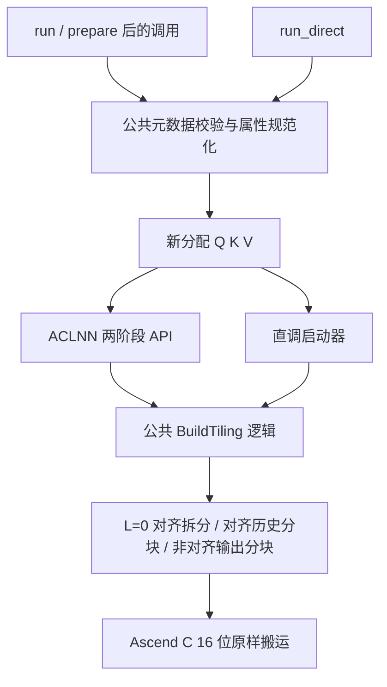

# T5SplitQkvAppendCache 算子（Atlas A3 / 910C）设计文档

| 项目 | 内容 |
| --- | --- |
| 任务名称 | T5 QKV 拆分与缓存追加算子开发（题目 3） |
| 算子名称 | `T5SplitQkvAppendCache` |
| 编程与工程模式 | Ascend C；正式 ACLNN 工程 + Kernel 直调交叉验证 |
| 目标硬件 | Ascend 910C / Atlas A3，`Ascend910_9382`，单个逻辑设备，48 Vector Core / 24 Cube Core |
| 目标架构 | A3 Vector 路径；按 910C 实际编译目标构建，不套用 Ascend 950 的 RegBase 实现 |
| 目标软件 | CANN 9.1.0，Python 3.12.13，torch 2.10.0+cpu，torch_npu 2.10.0.post4+git5dd8ef3 |
| 设计评审仓 | `cann/cann-ops-competitions` 的 `master` |
| 设计文档路径 | `04_tasks/01_community-task-2026/tasklist/10月社区任务-T5QKV拆分与缓存追加算子开发/Aiminer/docs/design.md` |
| 贡献者目录 | `Aiminer` |
| 算子代码合入目标 | `xLLM-AI/xllm` 的 `main`，调用封装目录 `xllm/core/kernels/npu/xllm_ops/` |
| 底层源码工程 | 主仓 `third_party/xllm_ops` 子模块；实际远端为 `https://gitcode.com/xLLM-AI/xllm_ops.git` |
| 文档版本 / 日期 | v1.1 / 2026-11-03（目录规范修订） |
| 文档状态 | 开发前设计说明；本文不作为内核构建或 NPU 验收报告，所有性能值均为目标 |

修订记录：2026-10-28，Codex 辅助整理初稿，沿用贡献者目录 Aiminer；基于任务包、既往设计文档及上游工程只读核对，并补充当前设计评审仓、分支和提交路径，待社区评审。

2026-11-03，按 PR #2409 的路径评审意见，迁移到上游已存在的十月同任务目录，统一文内提交路径和目录说明；设计章节沿用社区模板及已合入的 DualAffineLayerNorm 设计文档格式。本次修订不改变算子接口、算法与验收目标。

## 一、需求背景（required）

### 1.1 需求来源与设计依据

本设计依据任务目录中的 `T5QKV拆分与缓存追加算子任务书.md`，同时阅读独立包的 `README.md`、`op.json`、`case.json`、`golden.py`、`generate_data.py`、`verify.py`、`performance_targets.json`、`benchmark.py`、`check_performance.py`、`coverage_requirements.json` 和 `SHA256SUMS.txt`。

文档结构参考以下既往任务，语义、验收门槛及工程接口全部按当前任务重新核对：

- `CANN社区贡献/2026.8.26批次/设计文档/design.md`：aclblasSrotmg。
- `CANN社区贡献/2026.9.2批次/设计文档/design.md`：aclsparseScatter。
- `CANN社区贡献/2026.9.28批次/设计文档/design.md`：aclblasStbsv。
- `CANN社区贡献/2026.9.28批次/提交材料/aclblasStbsv-910B3-验收材料-v4/7-算子设计说明.md`：将设计、最终实现和实测结论分开记录的交付方式。

本文参考 `ascendc-docs-gen`、`ascendc-tiling-design` 及搬运 API 资料补充接口、分核、地址公式和资源预算。旧任务的 BLAS 句柄接口、原地更新、浮点容差、GPU 性能倍率和 CANN Bench 规则均不作为本任务契约。

### 1.2 背景与价值

T5 单 token 解码使用融合投影得到 Q、K、V。该任务将输入末维的三段数据拆开，生成独立 Q，并在重新分配的 K/V 输出中复制全部历史缓存和当前 token。

一般框架组合通过 Q 复制及两次 Concat 完成操作。融合 Ascend C 内核可减少多算子下发和重复元数据处理，并让历史缓存的读写接近连续搬运。本算子不执行投影矩阵乘、注意力分数计算、归一化、RoPE 或量化。

“追加”表示新输出长度由 L 变为 L+1：输入历史缓存保持不变，输出不能复用历史缓存的底层存储。历史量随 L 增长，因此每次调用必须复制历史；不能把它改成预分配缓存中的原地追加来规避成本。

### 1.3 仓库定位及已核实的工程关系

| 用途 | 仓库 / 路径 | 核实结论 |
| --- | --- | --- |
| 任务书规定的代码 PR 目标 | [xLLM-AI/xllm](https://github.com/xLLM-AI/xllm) | 任务书第 5 节明确指定 |
| 主仓中的调用封装层 | [xllm/core/kernels/npu/xllm_ops](https://github.com/xLLM-AI/xllm/tree/main/xllm/core/kernels/npu/xllm_ops) | 已读取该目录 CMakeLists、replace_token.cpp、scatter_nd_update.cpp、layer_norm_fwd.cpp |
| 底层 Ascend C 算子工程 | [xLLM-AI/xllm_ops（GitCode）](https://gitcode.com/xLLM-AI/xllm_ops) | 主仓 `.gitmodules` 将其登记为 `third_party/xllm_ops` |
| 可查阅的 GitHub 算子工程 | [xLLM-AI/xllm-ops](https://github.com/xLLM-AI/xllm-ops) | 已读取 README、build.sh、xllm_ops/build_aclnn.sh、xllm_ops/CMakeLists.txt、attention/CMakeLists.txt；与 GitCode 下划线仓的提交一致性尚未确认 |

2026-10-28 查询主仓 `main` 为 `9dee07ef4ab6d8130794ceb538e2c6c049d49ed2`。GitCode 算子仓 HEAD 查询值为 `1f8583ca85721eacd3eb73dd4188de0cae2d97db`；GitHub 算子仓 main 查询值为 `d74400feba5b39dceb6eb72f7c337b9d4a946d30`。这些是调查时的远端指纹，不能代替主仓固定提交中的 submodule gitlink；正式开发须固定主仓和其实际子模块提交，再核对目录及构建脚本。

主仓包装层的 CMake 依赖生成头目录 `third_party/xllm_ops/build/autogen` 和 `opapi`。因此需要将底层内核、OpDef、tiling、ACLNN 产物与主仓调用层一并接通；只在主仓新增一个 C++ 包装文件不能构成完整交付。

设计评审按本仓 `04_tasks/01_community-task-2026/README.md` 的流程，将本文放在团队目录 `docs/design.md`，由个人 Fork 向 `cann/cann-ops-competitions` 的 `master` 提交设计文档 PR。个人 Fork 为 `https://gitcode.com/m0_64481238/cann-ops-competitions_6657`，本次文档分支为 `docs/t5-qkv-append-cache-design`。

按路径评审意见，本文复用上游 `master` 已存在的同任务目录 `04_tasks/01_community-task-2026/tasklist/10月社区任务-T5QKV拆分与缓存追加算子开发/`，提交位置为该目录下的 `Aiminer/docs/design.md`。该目录与本任务的十月批次一致；不再单独创建无月份的 `T5SplitQkvAppendCache` 任务目录，也不将独立包中的“题目 3”当作社区任务编号。

文档格式参照[已合入的 DualAffineLayerNorm 设计文档](https://gitcode.com/TreamTik/cann-competitions/commit/ed54432708cb5e95d742025d0822784ec1325b1c)：保留需求背景、需求分析、详细设计、可维可测分析及 `docs/design.md` 文件结构；具体接口、逐位复制语义和性能门槛仍以本题材料为准。

设计文档 PR 仅包含本文。实际代码交付另按维护者要求安排底层算子 PR、xllm 主仓包装 PR及子模块指针更新，两类 PR 的目标仓分别记录。

### 1.4 任务包版本差异与处理原则

| 差异 | 实际材料 | 当前设计处理 |
| --- | --- | --- |
| 性能口径冲突 | 任务书 §3.3 文字写“提交 / 最快合格基线的耗时比”，表内却列 28～77 的耗时上限；README 标注 2026-10-23 固定耗时版，JSON 的 `policy_id=absolute-wall-us-reviewed-v3`，两个性能脚本均按绝对 μs 判定 | 实施目标按随包脚本的绝对上限设计，同时保留任务书要求的同机基线对照和全部原始轮次；正式验收前由发布方确认口径，不能自行把 28 当倍率或百分数 |
| 校验清单与任务书不一致 | SHA256SUMS 中任务书文件名多出“题目3-”，预期摘要为 `f494347ab477b13cbf9f817df2562e07701e941e4cb616fef3fcf1cba0186144`；实际任务书摘要为 `e65bf0cc08fcb170bf9b15caac0922fa3cde539f4a58c23722c15fe3bdb7ca57` | 原 ZIP 内也存在当前名称和上述性能冲突，不能归因于解压后的本地编辑；保留原 ZIP、实际摘要及差异说明，不修改官方包冒充校验通过 |
| 准备接口未给出完整签名 | 任务书要求 `prepare` 能校验非法参数，且多流测试执行准备后的调用，但公开 verify/benchmark 仅调用 `run` | 本设计补充明确的 prepare 协议，详见 2.4；作为实现约定，评审时确认 |

其余 10 个被清单列出的 JSON / Python / README 文件摘要匹配。`case.json` 的实际 SHA-256 为 `9ce34ba31fc08abe1969ad4997f7b6173fa950533473d6977398a8ed4db741e8`，与任务书、目标文件一致。文档只记录发现，不改写任务包。

## 二、需求分析（required）

### 2.1 接口与张量规格

正式 Python 入口：`run(inputs, attributes) -> (query, key, value)`。

| 参数 | 方向 | Shape | dtype / 约束 |
| --- | --- | --- | --- |
| qkv | 输入 | `[B,1,3*H*D]` | FP16 或 BF16；末维依次为全部 Q、全部 K、全部 V |
| pastKey | 输入 | `[B,H,L,D]` | 与 qkv 同 dtype、同 NPU 设备；连续 |
| pastValue | 输入 | `[B,H,L,D]` | 与 pastKey 同形状、同 dtype、同 NPU 设备；连续 |
| headNum | 属性 | Python int / C++ int64 | 必须等于 H；Python bool 不作为整数接受 |
| headDim | 属性 | Python int / C++ int64 | 必须等于 D；Python bool 不作为整数接受 |
| query | 输出 | `[B,H,1,D]` | 与输入同 dtype、同设备；独立连续存储 |
| key | 输出 | `[B,H,L+1,D]` | 与输入同 dtype、同设备；独立连续存储 |
| value | 输出 | `[B,H,L+1,D]` | 与输入同 dtype、同设备；独立连续存储 |

合法范围：`1<=B<=64`、`1<=H<=128`、`1<=D<=256`、`0<=L<=8192`，且三份输出的元素数之和 `B*H*D*(2*L+3)<=2^28`。各维达到各自上限并不意味着组合合法。

支持连续但 `storage_offset != 0` 的输入，不将“连续”误判为“存储偏移为零”。输出新分配并采用标准连续 ND 布局。L=0 的空历史张量合法，内核不能读取其地址。

### 2.2 数学语义与 bit-wise 要求

令 `b∈[0,B)`、`h∈[0,H)`、`d∈[0,D)`：

```text
Q[b,h,0,d] = qkv[b,0,h*D+d]
K[b,h,t,d] = pastKey[b,h,t,d]       (0 <= t < L)
V[b,h,t,d] = pastValue[b,h,t,d]     (0 <= t < L)
K[b,h,L,d] = qkv[b,0,H*D+h*D+d]
V[b,h,L,d] = qkv[b,0,2*H*D+h*D+d]
```

这里的赋值是原始 16 位编码复制。FP16/BF16 内核均按 `uint16_t` 视图搬运，不执行浮点 Cast、算术或 NaN 规范化。正负零、正负 Inf、subnormal、quiet/signaling NaN 及 payload 必须逐位保留；比较 `uint16` 编码，不使用 atol/rtol，也不能使用“两个 NaN 都视为相等”的数值检查。

三个输出底层 storage 两两独立，并与任一非空输入 storage 不同。L=0 时也必须分别分配 Q、K、V，不能直接返回 qkv 的三个视图。

### 2.3 校验规则与失败行为

所有执行入口共用校验函数，先验证元数据，再计算 tiling、分配输出和下发。非法参数在 Host 报错，不依赖内核越界暴露错误。

1. inputs 为三张量序列；attributes 必须为字典，只接受 headNum、headDim，未知键直接报错。
2. qkv rank=3、第二维=1；历史 rank=4；两历史 shape 一致；batch 一致；`qkv.size(2)==3*H*D`。
3. 三输入定义完整，均位于同一 NPU，dtype 相同且只允许 FP16/BF16，均为标准连续布局。拒绝 CPU、FP32、非连续输入，不用隐式 `.contiguous()` 修正非法参数。
4. 范围和总输出元素数使用 64 位带溢出检查的乘法校验；属性必须为严格整数，值域合法且等于张量 H、D。
5. `op.json` 的两个属性默认值均为 1。拟保留该定义：缺省按 1 处理，仍需与真实 H/D 匹配；非平凡 H/D 的调用应显式传属性。不得由 golden 忽略属性推导出生产入口也可以忽略属性。
6. 框架层创建三份独立输出；C++ ACLNN 调用方负责有效设备指针、正确 ND 描述和互不重叠的输出存储。Host 能核查描述元数据，但不宣称能证明任意外部指针的真实分配长度。
7. 对连续偏移输入，明确 aclTensor 的 base pointer / storage offset 约定，仅计算一次偏移；Kernel 直调传张量有效首地址。

### 2.4 三入口与两阶段 ACLNN API

拟定协议如下；prepare 的具体返回形态是本设计补充约定：

```python
run(inputs, attributes) -> tuple[Tensor, Tensor, Tensor]
run_direct(inputs, attributes) -> tuple[Tensor, Tensor, Tensor]
prepare(inputs, attributes) -> Callable[[], tuple[Tensor, Tensor, Tensor]]
```

prepare 完成相同参数校验并返回持有该组输入引用、规范化属性和不可变 host tiling 的可调用对象。每次调用仍新分配输出，提交到调用时的当前 stream，正式执行 ACLNN；不缓存输出、历史数据或可变 executor，不省略正式 run 的检查以改变公开性能口径。删除该对象后释放其输入引用。

ACLNN 两阶段接口拟为下列参数顺序，最终以 OpDef 生成头文件为准：

```cpp
aclnnStatus aclnnT5SplitQkvAppendCacheGetWorkspaceSize(
    const aclTensor* qkv, const aclTensor* pastKey,
    const aclTensor* pastValue, int64_t headNum, int64_t headDim,
    const aclTensor* query, const aclTensor* key, const aclTensor* value,
    uint64_t* workspaceSize, aclOpExecutor** executor);

aclnnStatus aclnnT5SplitQkvAppendCache(
    void* workspace, uint64_t workspaceSize,
    aclOpExecutor* executor, aclrtStream stream);
```

调用方按所选设备创建三输出描述，阶段一取得 workspaceSize 和 executor，阶段二使用当前 stream 下发。目标 workspaceSize=0，此时不分配临时全局张量；若运行时返回非零，须查明并修复，不能忽略该返回值后宣称满足零工作区。

### 2.5 任务拆解

| 模块 | 需求 |
| --- | --- |
| OpDef / 推导 | 三输入、三输出、两 int 属性；ND 与 FP16/BF16；shape/dtype 一致性校验 |
| Host / tiling | 公共参数规范化、合法性检查、64 位地址参数、分核与 UB 预算 |
| Kernel | Q 拆分、历史复制、K/V 当前 token 追加、空历史、非对齐处理 |
| ACLNN / 安装 | 两阶段 API、可复现构建、用户目录 .run 安装包、独立 C++ 样例 |
| PyTorch / 直调 | 当前 stream 调用、独立输出、设备及存储生命周期管理、双入口一致性 |
| 验证 / 文档 | 全部公开及扩展用例、性能、内存、多流、非法元数据和交付七件套 |

## 三、详细设计（required）

### 3.1 总体架构与拟新增目录



以下均为拟新增文件，并非声称已经存在；最终随固定的目标子模块目录规范调整：

```text
# 底层 xllm_ops 源码工程（在主仓 third_party/xllm_ops 中）
xllm_ops/attention/t5_split_qkv_append_cache/
  op_host/
    t5_split_qkv_append_cache.cpp              # OpDef、shape/dtype 推导
    t5_split_qkv_append_cache_tiling.cpp
    t5_split_qkv_append_cache_tiling.h
    CMakeLists.txt
  op_kernel/
    t5_split_qkv_append_cache.cpp
    t5_split_qkv_append_cache_kernel.h
  common/
    t5_split_qkv_append_cache_tiling_core.h    # 纯元数据切分函数
  examples/
    aclnn_t5_split_qkv_append_cache.cpp
  direct/
    t5_split_qkv_append_cache_launch.cpp
  tests/
    solution.py
    t5_split_qkv_append_cache_binding.cpp
    test_engineering.py
  docs/design.md

# xllm 主仓
xllm/core/kernels/npu/xllm_ops/t5_split_qkv_append_cache.cpp
xllm/core/kernels/npu/xllm_ops/xllm_ops_api.h   # 增加公开包装声明
xllm/core/kernels/npu/xllm_ops/CMakeLists.txt  # 纳入新增源文件
```

底层构建须将本算子纳入 910C 的有效算子集合，并产出生成 ACLNN 头文件、opapi/注册库、设备二进制与安装包。测试入口只负责装载当前构建的扩展；`run` 不能绕过 ACLNN 改为单独直调，以免验收入口与产品路径不同。

### 3.2 地址推导与存储偏移

定义 `R=B*H`、`P=L*D`、`S=(L+1)*D`、`r=b*H+h`。以下偏移以 16 位元素为单位，指针字节偏移再乘 2：

```text
qkvQ(b,h,d) = b*(3*H*D) + h*D + d
qkvK(b,h,d) = b*(3*H*D) + H*D + h*D + d
qkvV(b,h,d) = b*(3*H*D) + 2*H*D + h*D + d
past(r,t,d) = r*P + t*D + d
query(r,d)  = r*D + d
cache(r,t,d)= r*S + t*D + d
```

每个 head 的历史段 `[r*P,(r+1)*P)` 映射到新缓存 `[r*S,r*S+P)`；末尾 `[r*S+P,(r+1)*S)` 来自当前 K/V。历史之间新增 D 个元素，因此不能把整个 past 张量一次线性复制到输出起始位置。

qkv 的拼接顺序按“每个 batch 的 Q 全段、K 全段、V 全段”处理，不能解释为每个 head 的 Q/K/V 交错存储。单 token 条件下 Q 的 H、D 元素已有目标顺序，不需要真实转置。

所有 shape 乘积、任务总数、源/目的地址、字节数均使用检查过的 64 位值；API 的 32 位长度只接收已受 tile 上限约束的局部搬运量。L=0 时 P=0，跳过历史任务，也不对空历史指针进行访问。

### 3.3 内核路线与分核原则

采用纯 AIV 搬运内核；不使用 Cube、跨核归约或全局同步。默认单次调用一次 kernel launch，在该 kernel 内融合拆分与追加。

| 路线 | 选择条件 | 任务粒度 | 目的 |
| --- | --- | --- | --- |
| EMPTY_HISTORY_ALIGNED | L=0，D 是 16 的倍数 | 每个 batch 的 HD 连续分段 | 复制三个连续分量，减少逐 head 小搬运 |
| HISTORY_ALIGNED | L>0，D 是 16 的倍数 | 历史 `(K或V, r, chunk)` + 当前 Q/K/V 任务 | 长缓存并行，支持 R=1 |
| GENERIC_BITS | 其他合法形状 | 以每个输出的连续目标 tile 为单位 | 支持 D=1/3/5/65/255 及不规则行距，避免跨核短写冲突 |

路线只取决于合法元数据、硬件能力和地址对齐，不依赖 case ID、输入值、随机种子或当前性能测试阶段。FP16/BF16 共享位搬运实现；外部 dtype 元数据保留原类型。

#### 3.3.1 空历史对齐路径

每个 batch 的输入三段长度均为 HD。对 HD 按 tileElems 切块，每块分别从 batch 的 Q/K/V 段搬入 UB，写入对应新输出中的相同 batch 偏移。

`taskCount = B * ceil(HD/tileElems)`；每核领取一段或多个 task。即使原始 tensor 在 NPU 上且连续，也仍要为全部输出执行真实复制。输入存在非零存储偏移时使用可处理 GM 非对齐首址的搬运方式。

#### 3.3.2 对齐历史路径

取 `C=ceil(P/tileElems)`。历史任务共 `2*R*C` 个，解码为 K/V 类别、head r 和 chunk c：

```text
p = c*tileElems
n = min(tileElems, P-p)
source = past + r*P + p
output = cache + r*S + p
```

另外设置 R 个当前任务，每个任务复制该 head 的 Q、K、V 三段 D 元素，K/V 分别写到新缓存的 `r*S+P`。

`taskCount=2*R*C+R`。当 B=H=1、L=8192 时仍有多块历史任务，可使用多个 AIV；不采用“一个 head 固定一个核”导致单核搬运整份长缓存的方案。

D、P、S 和 tileElems 都满足 16 元素边界，因此不同任务写回区域不跨共享的 32 字节边界。各任务内部顺序搬运；写回长度始终使用有效 n。所有输入首地址仍逐次检查，源存在 2 字节 storage offset 时不错误进入严格对齐的 DataCopy 快路。框架新分配输出采用分配器对齐首址；若外部 C++ 调用提供合法但首址非 32B 对齐的独立连续输出，内核运行时转入单核通用搬运（仅核 0 处理全部任务），保留正确性且不额外拒绝合法布局。这类输出不套用本段跨核对齐证明。

#### 3.3.3 非对齐通用路径

对 Q、K、V 分别按连续输出元素区间切 tile，tileElems 为 16 的倍数。各 tile 的目标首址为 32 字节边界，最后一个 tile 仅写剩余有效字节。一个 tile 完整归一个核，避免按短 head 行分核时对同一 32 字节写回粒度的竞争。

对 K/V 的输出线性索引 j：

```text
r = j // S
u = j % S
if u < P: source = past[r*P + u]
else:     source = qkv[b*3*H*D + kind*H*D + h*D + (u-P)]
b = r // H; h = r % H; kind = 1(K) 或 2(V)
```

Q 的线性索引 j 映射为：`b=j//(H*D)`，源偏移 `b*3*H*D + j%(H*D)`。

实际搬运按这些映射中的最大连续片段进行，不逐元素访问 GM。tile 跨越 head、历史/当前边界时，先在 UB 拼接完整目标 tile，再连续写出：

1. 将片段拆成不足 16 元素的首残段、16 元素整数倍主体、末残段；主体仅在 UB 目标偏移满足 32B 对齐时直接 DMA。
2. 残段先搬到独立对齐 scratch，再用 UB 内 uint16 原样加载/存储补齐目标位置；必要的局部访问只用于片段边缘，禁止逐元素 GlobalTensor GetValue/SetValue。
3. UB 目的位置不足对齐且不能直接拼入的短片段全部经 scratch 处理；scratch 的每次使用均有明确完成依赖。
4. tile 所有有效元素完成填充后，按有效字节数一次 CopyOut；padding 不写入用户张量，不覆盖下一 tile。

通用路径是功能回退路径。公开性能用例均为 D=64/128，可走对齐路径；优化不能删除 D=1/3/5/65/255 等合法能力。

### 3.4 公共 tiling 设计

将切分实现为只依赖 `B,H,L,D`、dtype 字节数和平台容量的纯 Host 函数。ACLNN 适配器从 tiling context 获取平台信息，直调适配器获取同一设备的等价参数后调用该函数。

| 字段 | 含义 |
| --- | --- |
| version、route | tiling 布局版本、三路线选择 |
| batch、headNum、headDim、pastLen | B、H、D、L |
| headsTotal、pastHeadElems、outHeadElems | R、P、S |
| queryElems、cacheElems、outputElems | 输出规模和校验结果 |
| tileElems、chunksPerHead | UB tile 元素数和历史块数 C |
| taskCount、blockDim | 总任务数和实际 AIV 核数 |
| queryTileCount、cacheTileCount | 通用路径按输出划分的任务数 |
| ubBytes、scratchBytes | 缓冲容量及调试预算 |

基础规则为 `blockDim=min(平台可用AIV核数, taskCount)`，目标设备最多 48 AIV，不把 24 Cube Core 数当作 Vector 核数。小任务可选择更少核，阈值由实测确定并集中在 tiling 中。

任务采用 grid-stride 分配：核 i 执行 `i, i+blockDim, ...`，减少尾核大包袱。更细的连续分组调度仅在 profiling 显示收益后引入；当前路径之间没有跨核依赖。

先按 UB 求出 tile 上限，再兼顾有效任务数与流水长度。长缓存优先保证不少于可用核数的任务；候选 tile 为 8K/16K/32K 元素及容量推导上限，最终用固定硬件上的数据确定。tile 过大导致 R=1 时核数不足，或过小导致 DMA 命令开销放大，都需要按实测调整。

### 3.5 UB、workspace 与总内存预算

令 `U` 为平台查询得到的单 AIV UB 字节数，预留 `Rsv=8KiB`，对齐残段 scratch 预留 `Sbuf=1KiB`，每个 16 位 tile 容量 `A=AlignUp(2*tileElems,32)`。

| 缓冲 | 生命周期 / 用途 | 分配字节数 |
| --- | --- | ---: |
| ping tile | GM→UB→GM；当前或下一 tile | A |
| pong tile | 同上，流水复用 | A |
| 对齐 scratch | 短片段及当前 token 暂存，复用 | 1024 |
| 系统 / 保守预留 | 不分配给用户 tile | 8192 |
| 独立 Q/K/V 中间 GM | 不申请 | 0 |
| 显式全局 workspace | 不申请 | 0 |

约束：`2*A + Sbuf + Rsv <= U`。tileElems 取 16 的倍数，故 `tileMax=AlignDown((U-Rsv-Sbuf)/4,16)`，并继续受 DMA 长度和任务并行度约束。

例如仅在平台返回 U=192KiB 时，容量上限为 46848 个 16 位元素：两个 tile 实际占 187392B，scratch 占 1024B，合计 188416B，加预留 8192B 等于 196608B。该例是容量计算，不是对未查询硬件的断言。小输入按有效量缩小缓冲，长流水尽量复用容量，不为三个输出分别申请同等大小的队列或临时区。

输入、输出元素数相同：`E=R*D*(2*L+3)`；输出总字节数 `O=2*E`，上限 512MiB。理论一次读取全部输入、一次写出全部输出，主数据流量 `2*O=4*E` 字节，DMA padding 的影响单独记录。

内存验收是 PyTorch NPU 活跃张量分配口径：`峰值增量 <= O + 0 workspace + 16KiB`。UB、驱动缓存与整卡 HBM 不加入该统计；运行时真正分配的临时 Tensor 或 workspace 不能借此排除。

最大公开审计用例 034 的 `(B,H,L,D)=(64,128,62,256)`：E=266338304，输出 O=532676608B（508MiB），合法但接近总元素上限。必须分块运行，不能整缓存放入 UB，也不能增加与历史同规模的临时全局区。

### 3.6 搬运 API 与边界约束

核心 API 使用原始 16 位表示：

```cpp
// GM -> UB
DataCopyPad<uint16_t>(local, global,
    DataCopyExtParams{blockCount, blockLenBytes, srcStride, dstStride, 0},
    DataCopyPadExtParams<uint16_t>{false, 0, 0, 0});
// UB -> GM
DataCopyPad<uint16_t>(global, local,
    DataCopyExtParams{blockCount, blockLenBytes, srcStride, dstStride, 0});
```

| 检查项 | 设计要求 |
| --- | --- |
| GM 地址 | DataCopyPad 支持非对齐首址，输入 storage offset 不能被忽略 |
| UB 地址 | 每次 DMA 的 local 起始地址必须为 32B 对齐；非对齐局部拼接经 scratch |
| blockLen | Ext 参数单位为字节；合法范围在文档中为 1～2097151，且不超过已分配 UB；零长度直接跳过 |
| blockCount | 不超过 4095，批量路径须按上限分批 |
| stride | GM 侧以字节计，UB 侧以 32B 块计；是块间空隙，不是整行跨度 |
| 严格对齐快路 | 仅在源首址、目的首址和长度均满足所选 DataCopy 重载要求时启用；不能仅根据 D 判断 |
| 数据保真 | 不进行数值转换；自动 padding 不参与输出；输出长度不扩大到对齐长度 |
| 批量搬运 | 连续多个 head 的 Q/当前 K/V 可合并合法的 2D 搬运；按 batch 边界拆分，检查 stride 和 padding |

官方 DataCopyPad 资料已核对 A3 的 uint16_t 支持、原型及首址/长度/stride 限制。当前 Windows 没有 ASC_DEVKIT_DIR，未进行 CANN 9.1.0 目标头文件或最小程序编译；正式实现须在指定镜像中复核相应重载及同步接口，不能把本表写成编译或上板已通过。

### 3.7 流水同步与输入输出生命周期

两个 tile 缓冲按“读入完成 → 使用/拼接 → 写出完成 → 复用”循环。纯搬运路径建立 MTE2 到 MTE3 的依赖；缓冲复用前等待前次 MTE3 完成。通用路径额外建立 DMA 到 Scalar、Scalar 到后续 DMA 的依赖，禁止靠 Host 同步掩盖 UB 竞争。

PyTorch C++ 包装层：

1. 使用输入设备 guard，在调用时取得该设备当前 NPU stream；ACLNN 和直调都使用此 stream，不切换到默认 stream。
2. 所有输出通过 PyTorch NPU 分配器单独创建；不使用静态全局 Tensor、跨调用共享输出池或与输入共享 storage 的 view。
3. ACLNN 通过 torch_npu 的流安全调用机制提交；如使用裸 ACL 调用，按该版本分配器的 recordStream / 等价机制登记输入及输出使用。C++ 局部引用存活至 Host 返回不等于设备执行完成。
4. raw 直调同样登记实际异步使用，不把 run_direct 的生命周期测试简化成同步执行。
5. aclTensor、executor 和 launch 参数按 CANN API 的所有权及异步捕获规则释放；不让下发任务引用已经销毁的 Host 栈参数。直调 tiling 优先使用启动器安全捕获的按值结构；不能为省实现而增加每次调用的临时 GM Tensor。
6. 生产入口不调用全设备同步或流同步；验收脚本负责在比较和计时边界同步。

### 3.8 私有构建与安装

指定开发镜像为 `quay.io/jd_xllm/xllm-ai:xllm-dev-cann9.1.0-a3-openeuler24.03-py3.12`。记录驱动 `25.5.t6.b001`、aarch64、openEuler 24.03 LTS-SP3、NumPy 2.2.6、ml_dtypes 0.6.0；容器内用逻辑设备 0，物理分配由 ASCEND_RT_VISIBLE_DEVICES 控制。

已读 GitHub 算子工程的外层 build.sh 会向 `${ASCEND_HOME_PATH}/opp` 安装并更新 vendor 配置；不能直接照抄运行后声称符合本任务“安装到用户目录”。拟调用固定版本中的打包阶段产出 .run，再用用户可写绝对路径安装，例如 `$HOME/.local/ascend/t5_split_qkv_append_cache/`，仅在当前进程加载该私有包的环境设置。具体命令由固定提交的构建参数及 .run --help 确认。

安装脚本必须使编译工具链与自定义 OPP 安装根分离，保留系统 CANN 原内容。打包、安装、C++ 样例及 Python 扩展都记录实际库加载路径、安装前缀、完整源码 commit、子模块 commit、编译选项及二进制 SHA-256；不能只保留 solution.py 的摘要。

## 四、可维可测分析

### 4.1 精度验证与公开用例

以官方 CPU `golden.calculate` 为唯一数学参考：CPU 生成标杆后，以原始 int16/uint16 编码传到 NPU，再解释成 FP16/BF16。回传时同样先获取原始编码，避免 NaN 或 BF16 浮点转换改变位模式。

公开 35 个用例均执行正式 run，并以相同输入执行 run_direct 交叉验证；每输出记录 shape、dtype、设备、连续性、底层 storage 独立性和 bit_mismatches，逐位核对全部输入保持不变。正式记录按“case ID + 入口”去重，不能把两入口当成两个独立输入。

公开用例包括：L=0 的最小值、B/H/D 最大值、非对齐 D、最长历史、两种 dtype、原始 bits 模式，以及审计 026～034。附录 A 从实际 case.json 提取完整清单。

### 4.2 扩展覆盖与工程测试

| 项目 | 最低覆盖 / 验收方式 |
| --- | --- |
| 额外固定种子与 storage offset | 按 coverage_requirements 的 12 个完整 ID，统一 kind=random、performance=false；每输入分配 numel+16 个元素，从第 1 个元素偏移取连续视图；run 与 run_direct 共 24 条记录 |
| 非法输入 / 属性 | 固定 28 场景分别执行 prepare、run、run_direct，共 84 条拒绝记录；不能提前转换字符串、浮点数或 bool 使其合法 |
| 验证器反例 | CPU 输出、复用输入 storage、起始指针不同但底层重叠的输出均须被拒绝 |
| 双独立 stream | 分别用 001 FP16 和 018 BF16；每 stream 至少 10 次准备后正式 ACLNN 调用，检查两边结果和输入不变 |
| 提前释放输入 | 异步提交后释放调用方输入引用，在另一 stream 制造分配压力；同步后原输出仍逐位正确；压力构造须实际能够触发复用 |
| 重复回收 | ACLNN 和直调分别重复 20 次调用、释放并同步，活跃张量分配回到调用前水平；保证测试自身已删除输出和 prepare 引用 |
| 输出独立生命周期 | 保留 8 次调用的全部输出，并执行 32 次提前释放输出和同流分配写压力；所有保留输出继续正确且存储独立 |
| 连续两次追加 | 首个 L=31 公开输入先追加一次，再用其 K/V 输出作为历史、同一 qkv 再追加；最终历史长度为原 L+2，逐位对照连续 CPU golden |
| 额外工程元数据检查 | 至少 5 次；建议覆盖 C++ 输出 shape 错误、输出 dtype 错误、ND 描述错误，以及框架跨设备输入、总输出元素数超限 |

28 个固定负例完整名称见附录 B。不额外构造大量张量才能拒绝可由 Host 元数据判定的非法描述。总元素超限建议使用合法维度组合 `(64,128,63,256)` 验证，不能只校验单维上限。

12 个额外 ID 来源以 coverage_requirements.json 为准，不能按名称中的 bits 字样沿用 bits 模式。有效输入总数为 47（35+12），另有 28 类非法场景；性能、内存、压力循环、入口数均不增加独立输入计数。

公开 verify.py 仅验证正式 run 的公开精度和基本存储要求，不包含全部扩展测试；benchmark.py 仅测性能子集。两者通过不能替代 test_engineering.py 与内存验收。

### 4.3 性能目标及测量协议

以下为 `performance_targets.json` 的绝对上限，全部是待达到的目标：

| ID 简写 | B,H,L,D | dtype | max_wall_us |
| --- | --- | --- | ---: |
| 001 | 4,8,0,64 | FP16 | 28 |
| 005 | 1,8,128,64 | FP16 | 28 |
| 006 | 8,12,512,64 | FP16 | 29 |
| 007 | 16,16,2048,64 | FP16 | 75 |
| 008 | 1,1,8192,128 | FP16 | 29 |
| 011 | 4,8,0,64 | BF16 | 28 |
| 015 | 1,8,128,64 | BF16 | 28 |
| 016 | 8,12,512,64 | BF16 | 29 |
| 017 | 16,16,2048,64 | BF16 | 77 |
| 018 | 1,1,8192,128 | BF16 | 29 |

计时入口必须是每次新分配输出并走本题 ACLNN 的正式 run。预热 50 次后同步，测量 5 轮，每轮连续 200 次；从该轮提交前到设备操作全部完成取墙钟时间，再除以 200，取五个轮均值的中位数。保留全部原始轮次，按未四舍五入的值与上限比较。不得只挑最快轮、用纯 kernel 时间或预分配输出的直调时间替换结果。

设备事件数据同时记录，事件区间包含主机提交间隙，因此不能直接称为纯内核耗时。H2D 输入传输、CPU golden 与精度比较均在计时区间外；输出分配、包装、ACLNN 查询/提交和完成等待在正式区间内。

为覆盖任务书旧文字要求，另以其 views_concat_q_copy 候选基线做同机、相同输入、相同 50/200/5 协议测量，基线须先通过 bit-wise 和存储检查，并记录候选入选/排除原因。基线对照单独报告，不伪装成当前公开检查器已验证的性能比规则；冲突按 1.4 节处理。

007 的输出约 128.09MiB，理论读写总量 268632064B。75μs 对应约 3.58TB/s 的合计读写有效带宽需求；这是按目标反推的成本指标，未考虑 API 固定开销，不是硬件带宽实测值，也不是可达性保证。优化应同时关注主机下发成本与大缓存搬运吞吐。

### 4.4 内存验收

10 个 performance=true 用例同时用于内存测试。输入先创建、运行时先预热，再设定本轮活跃张量基线和峰值；调用后同步并计算峰值增量，与实际三个输出字节数+16KiB 比较。释放所有输出、可调用对象及临时引用后同步，分别核对 20 次循环的活跃分配回收。

使用当前 torch_npu 版本的活跃分配指标及对应峰值重置接口；不得把 reserved cache、npu-smi 整卡占用或进程峰值 RSS 当作该统计。若内部库使用分配器之外的全局空间，需额外说明并核实零显式 workspace，而非利用不可见分配规避要求。

8 组输出保留压力测试与“每次释放后回落”的测试分开设置基线，避免把刻意保留的输出误判为泄漏或为了回收而提前销毁仍应可用的结果。

### 4.5 原始记录与复现入口

在指定 Linux/NPU 镜像中，从原始题目包目录运行：

```bash
python3 verify.py --solution-file /absolute/path/to/solution.py --report public_accuracy.json
python3 benchmark.py --solution-file /absolute/path/to/solution.py --report performance.json > performance.log 2>&1
python3 check_performance.py --report performance.json --output performance_acceptance.json
```

另外交付工程扩展测试及内存测试命令、独立 C++ 样例命令、Kernel 直调复现命令、构建/安装步骤。所有命令检查退出码；失败、中断、缺失记录和环境未知均如实记录。

每条测试记录至少包含 case ID、入口、输入/属性描述、结果、各输出 bit_mismatches、存储检查、输入不变检查。性能保留五轮 wall 与 event 数据；环境附设备型号、核数、驱动、CANN 运行时、框架、镜像及完整源码/产物指纹。公开脚本给出的 unknown 项另外补证。

### 4.6 可维护性与上游规范

主仓已存在 AGENTS.md，要求修改 `xllm/` 前阅读共享风格文件和相应 C++/Python 风格文件，C++ 修改后用 clang-format 20.1.6。正式实施时遵循该固定版本的 AGENTS.md 及子目录指令，不从旧 ops-blas/ops-sparse 任务复制构建或测试规范。

参数校验、地址工具和纯 tiling 逻辑集中复用；ACLNN、直调仅负责各自的接口适配。性能阈值、API 签名和合法范围以带版本的任务资产维护；新增调优分支同步增加边界及双入口一致性覆盖。

## 五、交付件与实施计划

| 阶段 | 主要交付 | 退出条件 |
| --- | --- | --- |
| 设计评审 | 本文、性能口径差异、prepare 协议、仓库/子模块范围 | 接口与验收口径闭环；设计目录按活动流程确认 |
| 工程骨架 | OpDef、shape/dtype、公共校验与 tiling、两阶段 ACLNN、C++ 样例 | 指定镜像构建并私有安装，最小 FP16/BF16 和 L=0 可运行 |
| 完整实现 | 三路线、64 位寻址、偏移输入、零 workspace、PyTorch 与直调 | 35 个公开输入两入口逐位一致，输入及存储检查通过 |
| 工程验证 | 12 个额外输入、28 类非法场景、多流/生命周期、两次追加 | 完成全部覆盖清单和独立记录，不漏入口 |
| 性能与内存 | 正式 run 50/200/5 结果、同机基线、10 例内存与回收记录 | 逐项符合已确认门槛；保留真实原始数据 |
| 最终提交 | 完整源码、安装包、两仓/子模块固定版本、七件套、代码 PR | 指定环境可从提交源码独立复现；评审意见闭环 |

验收资料严格使用任务书七个文件名：

```text
task_submission/
  1 自验证步骤说明.md
  2.1 精度自验证报告.xlsx
  2.2 精度自验证日志.log
  3.1 性能自验证报告.xlsx
  3.2 性能自验证日志.log
  4.1 内存自验证报告.xlsx
  4.2 内存自验证日志.log
task_submission.zip
```

设计文档、公开验证器、额外测试、C++ 样例、完整构建/私有安装脚本、.run 包、Python 封装和直调入口随源码工程交付。报告填写真实数据；本次仅形成设计文档，不预填“通过”，也不代表已完成代码仓克隆或提交。

## 六、风险与应对

| 风险 | 后果 | 应对 |
| --- | --- | --- |
| 性能规则与清单版本冲突 | 实现完成后验收口径变化 | 保留冲突和指纹；以随包绝对门槛安排实现，评审确认并补同机基线 |
| 只修改 xllm 包装目录 | 缺少内核、ACLNN 头及安装包 | 同时维护底层子模块工程与主仓接入，固定两层版本 |
| 直接执行上游外层安装脚本 | 修改系统 CANN OPP | 将打包与用户前缀安装分开，核实实际加载路径 |
| FP16/BF16 数值转换 | NaN payload 或符号位被改写 | uint16 位搬运、uint16 对比、原始位模式输入 |
| 非对齐 D / storage offset | UB 非对齐、错误地址、越界或相邻输出损坏 | DataCopyPad + 对齐 scratch；通用路径按目标 tile 归核 |
| 只有一个 head 的长历史 | 单核吞吐不足 | 按历史 chunk 拆任务，保证多核并行 |
| 输入提前释放 / 跨流分配 | 异步读到被复用的存储 | 使用框架流安全提交/分配器登记，压力测试验证 |
| 大规模输入临时副本 | 超出零 workspace 与活跃内存门槛 | 三输出直写，UB 流式，禁止中间 GM Tensor |
| 大用例接近带宽上限 | kernel 快但正式 run 仍超时 | 同时分析 API 固定开销、主机提交和 DMA 吞吐，按全部正式轮次调优 |
| 错误复用 executor 或输出 | 并发污染、保留输出失效 | 不共享可变调用状态，每次新输出，8 组保留输出验证 |

## 七、评审检查项

- [ ] 发布方已确认绝对 μs 门槛与任务书旧比值文字之间的关系。
- [ ] 任务包校验清单与实际任务书差异已记录并确认来源版本。
- [ ] 上游主仓、底层子模块、设计文档提交位置和固定 commit 已确定。
- [ ] prepare 协议及属性默认值与任务方对齐。
- [ ] Q/K/V 三段排列、逐 head 历史插空地址和 L=0 不读空缓存正确。
- [ ] FP16/BF16 原始 16 位保真覆盖全部特殊编码。
- [ ] 总输出元素数、64 位乘法、非对齐 D 和偏移输入均有实现及测试。
- [ ] ACLNN 正式入口、直调入口、当前 stream 和流安全生命周期闭环。
- [ ] 全局 workspace=0，UB 预算按实际平台查询并完整核算。
- [ ] 35+12 有效输入、28 类负例、扩展工程覆盖、10 例性能/内存均无遗漏。
- [ ] .run 私有安装、独立 C++ 样例、完整源码与构建产物指纹可复现。
- [ ] 所有已通过结论均来自指定 910C 环境的真实记录。

## 八、参考资料与资料核对边界

1. 本地任务书及随包脚本：见 1.1；原始文件保持不变。
2. [xllm 主仓 .gitmodules（调查固定提交）](https://github.com/xLLM-AI/xllm/blob/9dee07ef4ab6d8130794ceb538e2c6c049d49ed2/.gitmodules)。
3. [主仓算子封装 CMakeLists](https://github.com/xLLM-AI/xllm/blob/9dee07ef4ab6d8130794ceb538e2c6c049d49ed2/xllm/core/kernels/npu/xllm_ops/CMakeLists.txt)。
4. [主仓 ACLNN 调用参考 replace_token.cpp](https://github.com/xLLM-AI/xllm/blob/9dee07ef4ab6d8130794ceb538e2c6c049d49ed2/xllm/core/kernels/npu/xllm_ops/replace_token.cpp)：只借鉴两阶段调用和当前流取得方式，不能照搬原地输出或可选同步行为。
5. [主仓 AGENTS.md](https://github.com/xLLM-AI/xllm/blob/9dee07ef4ab6d8130794ceb538e2c6c049d49ed2/AGENTS.md)。
6. [xllm-ops 工程构建脚本](https://github.com/xLLM-AI/xllm-ops/blob/main/build.sh)及[底层打包脚本](https://github.com/xLLM-AI/xllm-ops/blob/main/xllm_ops/build_aclnn.sh)：调查时为 GitHub 工程内容，实施前与主仓实际 GitCode 子模块固定提交对齐。
7. [官方 DataCopyPad 接口资料](https://www.hiascend.com/doc_center/source/en/CANNCommunityEdition/900/API/ascendcopapi/atlasascendc_api_07_0265.html)：已核对 uint16_t、A3、GM/UB 对齐和 Ext 参数；该在线页面属于 9.0 系列，9.1.0 以目标镜像头文件和编译结果复核。
8. [任务书给出的 Kernel 直调说明](https://www.hiascend.com/document/detail/en/CANNCommunityEdition/910/programug/Ascendcopdevg/docs/en/guide/programming_guide/appendix/completing_kernel_launch_based_on_sample_project.md)。
9. [任务书给出的天数功能对标](https://developer.iluvatar.com/docs/ixformer#t5_split_qkv_update_kv_cache)：本任务输入/输出及存储语义仍以本地任务书和 CPU golden 为准，不从外部对标扩展规格。

本文完成静态设计、材料阅读及上游目录关系核实。待执行事项为目标 CANN 版本编译、真实 NPU 精度、性能、内存、stream 与生命周期验证；在线资料查询、公式核对或本地脚本结果均不算上板验收。

## 附录 A：35 个公开用例清单

以下由当前 case.json 逐条提取，完整 ID 保留用于与原始记录关联。

| Case ID | B,H,L,D | dtype | kind | 性能及内存 |
| --- | --- | --- | --- | --- |
| T5SplitQkvAppendCache_000_float16_random | 1,1,0,1 | float16 | random | 否 |
| T5SplitQkvAppendCache_001_float16_random | 4,8,0,64 | float16 | random | 是 |
| T5SplitQkvAppendCache_002_float16_random | 2,3,2,5 | float16 | random | 否 |
| T5SplitQkvAppendCache_003_float16_random | 3,7,31,80 | float16 | random | 否 |
| T5SplitQkvAppendCache_004_float16_random | 2,3,127,65 | float16 | random | 否 |
| T5SplitQkvAppendCache_005_float16_random | 1,8,128,64 | float16 | random | 是 |
| T5SplitQkvAppendCache_006_float16_random | 8,12,512,64 | float16 | random | 是 |
| T5SplitQkvAppendCache_007_float16_random | 16,16,2048,64 | float16 | random | 是 |
| T5SplitQkvAppendCache_008_float16_random | 1,1,8192,128 | float16 | random | 是 |
| T5SplitQkvAppendCache_009_float16_bits | 1,1,512,128 | float16 | bits | 否 |
| T5SplitQkvAppendCache_010_bfloat16_random | 1,1,0,1 | bfloat16 | random | 否 |
| T5SplitQkvAppendCache_011_bfloat16_random | 4,8,0,64 | bfloat16 | random | 是 |
| T5SplitQkvAppendCache_012_bfloat16_random | 2,3,2,5 | bfloat16 | random | 否 |
| T5SplitQkvAppendCache_013_bfloat16_random | 3,7,31,80 | bfloat16 | random | 否 |
| T5SplitQkvAppendCache_014_bfloat16_random | 2,3,127,65 | bfloat16 | random | 否 |
| T5SplitQkvAppendCache_015_bfloat16_random | 1,8,128,64 | bfloat16 | random | 是 |
| T5SplitQkvAppendCache_016_bfloat16_random | 8,12,512,64 | bfloat16 | random | 是 |
| T5SplitQkvAppendCache_017_bfloat16_random | 16,16,2048,64 | bfloat16 | random | 是 |
| T5SplitQkvAppendCache_018_bfloat16_random | 1,1,8192,128 | bfloat16 | random | 是 |
| T5SplitQkvAppendCache_019_bfloat16_bits | 1,1,512,128 | bfloat16 | bits | 否 |
| T5SplitQkvAppendCache_020_float16_boundary | 64,128,0,256 | float16 | random | 否 |
| T5SplitQkvAppendCache_021_float16_boundary | 1,128,3,255 | float16 | random | 否 |
| T5SplitQkvAppendCache_022_float16_boundary | 2,1,4097,3 | float16 | random | 否 |
| T5SplitQkvAppendCache_023_bfloat16_boundary | 64,128,0,256 | bfloat16 | random | 否 |
| T5SplitQkvAppendCache_024_bfloat16_boundary | 1,128,3,255 | bfloat16 | random | 否 |
| T5SplitQkvAppendCache_025_bfloat16_boundary | 2,1,4097,3 | bfloat16 | random | 否 |
| T5SplitQkvAppendCache_audit_026_float16_bits | 64,128,0,256 | float16 | bits | 否 |
| T5SplitQkvAppendCache_audit_027_float16_bits | 1,1,8192,256 | float16 | bits | 否 |
| T5SplitQkvAppendCache_audit_028_float16_bits | 2,3,63,255 | float16 | bits | 否 |
| T5SplitQkvAppendCache_audit_029_float16_bits | 1,128,1,1 | float16 | bits | 否 |
| T5SplitQkvAppendCache_audit_030_bfloat16_bits | 64,128,0,256 | bfloat16 | bits | 否 |
| T5SplitQkvAppendCache_audit_031_bfloat16_bits | 1,1,8192,256 | bfloat16 | bits | 否 |
| T5SplitQkvAppendCache_audit_032_bfloat16_bits | 2,3,63,255 | bfloat16 | bits | 否 |
| T5SplitQkvAppendCache_audit_033_bfloat16_bits | 1,128,1,1 | bfloat16 | bits | 否 |
| T5SplitQkvAppendCache_audit_034_float16_bits | 64,128,62,256 | float16 | bits | 否 |

## 附录 B：28 类固定非法场景

名称与 coverage_requirements.json 保持一致；均须在 prepare、run、run_direct 执行。属性不匹配场景以首个性能用例 H=8、D=64 为基准，headDim_65 表示属性与真实 D 不匹配，并不表示合法范围不含 D=65。

| 序号 | 场景 ID |
| ---: | --- |
| 1 | `attributes_type` |
| 2 | `cache_dtype` |
| 3 | `cache_mismatch` |
| 4 | `cache_rank` |
| 5 | `cpu_input` |
| 6 | `float32` |
| 7 | `headDim_'8'` |
| 8 | `headDim_-1` |
| 9 | `headDim_0` |
| 10 | `headDim_1.5` |
| 11 | `headDim_65` |
| 12 | `headDim_True` |
| 13 | `headNum_'8'` |
| 14 | `headNum_-1` |
| 15 | `headNum_0` |
| 16 | `headNum_1.5` |
| 17 | `headNum_9` |
| 18 | `headNum_True` |
| 19 | `input_count` |
| 20 | `noncontiguous` |
| 21 | `packed_mismatch` |
| 22 | `packed_tokens` |
| 23 | `shape_limit_(0, 1, 0, 1)` |
| 24 | `shape_limit_(1, 1, 0, 257)` |
| 25 | `shape_limit_(1, 1, 8193, 1)` |
| 26 | `shape_limit_(1, 129, 0, 1)` |
| 27 | `shape_limit_(65, 1, 0, 1)` |
| 28 | `unknown_attribute` |

## 附录 C：12 个额外输入 ID

均按 kind=random 重新生成，输入包含一个元素的 storage offset；每例覆盖 run 和 run_direct。

- `T5SplitQkvAppendCache_000_float16_random__extra_seed_0`
- `T5SplitQkvAppendCache_001_float16_random__extra_seed_1`
- `T5SplitQkvAppendCache_002_float16_random__extra_seed_2`
- `T5SplitQkvAppendCache_002_float16_random__extra_seed_6`
- `T5SplitQkvAppendCache_002_float16_random__extra_seed_7`
- `T5SplitQkvAppendCache_002_float16_random__extra_seed_8`
- `T5SplitQkvAppendCache_003_float16_random__extra_seed_3`
- `T5SplitQkvAppendCache_004_float16_random__extra_seed_4`
- `T5SplitQkvAppendCache_005_float16_random__extra_seed_5`
- `T5SplitQkvAppendCache_009_float16_bits__extra_seed_9`
- `T5SplitQkvAppendCache_010_bfloat16_random__extra_seed_10`
- `T5SplitQkvAppendCache_011_bfloat16_random__extra_seed_11`
