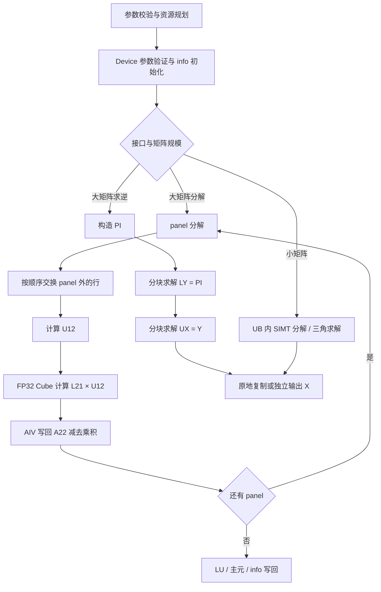

# 需求背景（required）

## 需求来源

本设计对应昇腾社区「10月社区任务-单精度实数LU分解、求解和批量求逆(950)」，任务入口为[官方任务详情](https://www.hiascend.com/activities/task-center/details/cd66edbecb8840b3bbcd39035146a970)，实现目标仓为 [cann/ops-solver](https://gitcode.com/cann/ops-solver)。

需求依据为任务附件 `Atlas950_Sgetrf_Sgetri_SgetriBatched_SmatinvBatched_task_doc.md`，以及 `sgetrf`、`sgetri`、`sgetribatched`、`smatinvbatched` 下的用例和 `bench_result.json`。文档结构采用[社区任务设计模板](https://gitcode.com/cann/cann-competitions/blob/master/04_tasks/01_community-task-2026/resources/design_template.md)。

| 版本 | 日期 | 修改人 | 修改内容 |
| --- | --- | --- | --- |
| 1.0 | 2026-10-14 | li12345abc123 | 初始设计，覆盖四项计算接口及两项工作空间查询接口 |

## 背景介绍

### 功能定位

LU 分解把一般稠密矩阵分解为置换、下三角和上三角因子，是矩阵求逆等线性代数运算的基础。本任务提供单矩阵分解、基于 LU 的单矩阵与批量求逆，以及小矩阵直接批量求逆；计算统一运行于 Ascend 950PR AI Core。

### 现有实现与改造范围

ops-solver 已有 `Sgetrf`、`Sgetri` 原型。本次将公开接口统一为任务书指定的 Device 指针、列主序和 `aclsolverStatus_t` 语义，补充 workspace 查询、主元及 `info` 写回，并增加两个批量接口。复用现有 handle 和调用方 stream，保持公开接口与具体 Kernel 的职责分离。

| 接口 | 输入 | 输出 | 主要用途 |
| --- | --- | --- | --- |
| `aclsolverSgetrf` | 原始 `m×n` 矩阵 | 原地打包 LU、可选主元、`devInfo` | 方阵或矩形 LU 分解 |
| `aclsolverSgetri` | 方阵 LU、可选主元 | 原地逆矩阵、`devInfo` | 单矩阵求逆 |
| `aclsolverSgetriBatched` | Device LU 指针数组、可选主元数组 | 独立逆矩阵指针数组、逐矩阵 `info` | 批量 LU 求逆 |
| `aclsolverSmatinvBatched` | Device 原始矩阵指针数组 | 独立逆矩阵指针数组、逐矩阵 `info` | `n≤32` 的融合批量求逆 |

# 需求分析（required）

## 需求描述

采用 ops-solver Host C API 与 Ascend C/CATLASS Kernel 直调模式，提供下列接口。参数名、顺序和公开类型保持任务书定义。

```cpp
aclsolverStatus_t aclsolverSgetrf_bufferSize(
    aclsolverHandle_t handle, int m, int n, float *A, int lda, int *Lwork);
aclsolverStatus_t aclsolverSgetrf(
    aclsolverHandle_t handle, int m, int n, float *A, int lda,
    float *Workspace, int *devIpiv, int *devInfo);

aclsolverStatus_t aclsolverSgetri_bufferSize(
    aclsolverHandle_t handle, int n, float *A, int lda, int *Lwork);
aclsolverStatus_t aclsolverSgetri(
    aclsolverHandle_t handle, int n, float *A, int lda, int *devIpiv,
    float *Workspace, int Lwork, int *devInfo);

aclsolverStatus_t aclsolverSgetriBatched(
    aclsolverHandle_t handle, int n, const float *const Aarray[], int lda,
    const int *PivotArray, float *const Carray[], int ldc,
    int *infoArray, int batchSize);
aclsolverStatus_t aclsolverSmatinvBatched(
    aclsolverHandle_t handle, int n, const float *const A[], int lda,
    float *const Ainv[], int lda_inv, int *info, int batchSize);
```

`Lwork` 查询结果为 FLOAT32 元素个数，其输出指针位于 Host；矩阵、主元、`info`、计算 workspace 和批量矩阵指针数组均位于 Device。标量维数为 32 位 `int`，内部容量、地址偏移和调度计数采用 64 位计算。

## 需求拆解

| 项目 | 设计要求 |
| --- | --- |
| 数值类型 | 输入、因子、逆矩阵和累加均使用 FLOAT32；主元与 `info` 使用 INT32 |
| 布局 | 列主序，`A(row,col)=A[col*lda+row]`；支持合法 leading dimension 和 padding |
| 分解 | 支持方阵、矩形、部分主元和无主元分解；`L` 的单位对角不存储 |
| 主元 | 1-based；候选按「绝对值最大、并列时行号最小」确定选择 |
| 求逆 | `Sgetri` 和 `SgetriBatched` 读取已分解 LU；空主元表示无置换 |
| 小矩阵 | `SmatinvBatched` 对原始矩阵直接求逆；`n>32` 返回非法参数 |
| 批量 | 按指针数组解析独立矩阵，不要求连续存放；逐矩阵输出结果与状态 |
| 错误 | `info=0` 表示成功，正值为首个零对角位置，负值为非法参数序号（不计 handle） |
| 工作空间 | 两个查询接口与执行路径使用同一容量计算；内部分片对调用方透明 |
| 执行 | 复用 handle 对应 stream；矩阵计算在 NPU 上完成，保持固定归约和累加次序 |
| 空问题 | 合法维数下的 `m=0`、`n=0` 或 `batchSize=0` 成功返回，不访问无效矩阵区域 |

支持域至少覆盖任务书要求的 `m,n≤4096`、批量规模至百万级，同时覆盖附件中的宽矩形和更大批量。矩形分解支持 `m≤4096,n≤8192`，方阵求逆支持 `n≤4096`；小矩阵直接求逆支持 `1≤n≤32`。批量计数按非负 INT32 处理，按设备容量和实际地址跨度校验，不把百万级规模作为固定上限。

公共类型中补充 `aclsolverOperation_t`，令 `ACLSOLVER_OP_N/T/C` 分别取值 `0/1/2`。本次六项接口没有转置入参，不改变其公开参数列表。

# 详细设计（required）

## 算子分析

### 数学公式

记 `s=min(m,n)`，带部分主元 LU 分解满足：

$$P A=L U,$$

其中 `L` 为 `m×s` 单位下梯形矩阵，`U` 为 `s×n` 上梯形矩阵。第 `k` 步选择 `p=argmax_{r≥k}|A(r,k)|`，交换行，随后执行：

$$L_{r,k}=A_{r,k}/U_{k,k},\qquad
A_{r,c}\leftarrow A_{r,c}-L_{r,k}U_{k,c}.$$

无主元分解固定 `p=k`。`U(k,k)=0` 时记录第一个 `k+1`，不执行除零；该列下方更新按其实际消元结果处理，后续分解保持受控执行。

基于 LU 的求逆采用多右端项三角求解：

$$L Y=P I,\qquad U X=Y,\qquad X=A_{\mathrm{original}}^{-1}.$$

`P I` 通过按正序重放主元行交换构造。求逆的 LU 输入保持可读直到所有右端项计算完毕；单矩阵接口最后将 `X` 写回 `A`，批量接口直接写入独立 `C[i]`。

### 支持数据类型

输入和输出为有限 FLOAT32 实数。主元选择、消元、三角求解和矩阵更新均保留 FP32 精度，Cube 路径关闭 HF32 模式。不把操作数降为 FP16/BF16，不以近似倒数替代关键除法。零对角使用精确零判定，不用经验阈值把近奇异矩阵改判为奇异。

### 支持形状

| 接口 | 有效矩阵 | leading dimension | 主元 |
| --- | --- | --- | --- |
| `Sgetrf` | `m×n`，包含宽矩形和高矩形 | `lda≥max(1,m)` | 输出 `min(m,n)` 项或空指针 |
| `Sgetri` | `n×n` | `lda≥max(1,n)` | 输入 `n` 项或空指针 |
| `SgetriBatched` | `batchSize` 个 `n×n` | `lda,ldc≥max(1,n)` | 按 `PivotArray[i*n+k]` 访问或空指针 |
| `SmatinvBatched` | `batchSize` 个 `n×n`，`n≤32` | `lda,lda_inv≥max(1,n)` | Kernel 内部执行部分主元 |

矩阵每列只读写有效行。padding 不参与归约、消元或残差计算，写回保持原值。

## 算子实现

### 实现方案

#### 3.2.1 host侧设计

**接口与参数校验。** Host 校验 handle、标量维数、leading dimension、顶层指针、workspace 容量及可计算的内存重叠。批量数组元素、主元值和矩阵间别名关系由 Device 验证阶段检查。需要据此返回 `INVALID_VALUE` 时，仅回读验证状态并等待该验证阶段；LU 和逆矩阵不回传 Host 计算。计算阶段通过调用方 stream 顺序下发，不在 panel 之间插入 Host 同步。

非法参数序号按接口独立维护，不能共用不同签名的位置编号：

| 接口 | 参数序号（不计 handle） |
| --- | --- |
| `Sgetrf` | `m=1,n=2,A=3,lda=4,Workspace=5,devIpiv=6,devInfo=7` |
| `Sgetri` | `n=1,A=2,lda=3,devIpiv=4,Workspace=5,Lwork=6,devInfo=7` |
| `SgetriBatched` | `n=1,Aarray=2,lda=3,PivotArray=4,Carray=5,ldc=6,infoArray=7,batchSize=8` |
| `SmatinvBatched` | `n=1,A=2,lda=3,Ainv=4,lda_inv=5,info=6,batchSize=7` |

`info` 可写时，参数错误通过独立 Device 写回阶段记录负序号。空 handle 返回 `HANDLE_IS_NULLPTR`；资源不足和 Kernel 下发失败分别映射为分配错误与运行错误，不能写成奇异矩阵。每次有效计算先初始化 `info`，避免读取上一次调用的状态。

**分支与调度。** 分支只依赖接口种类、维数、主元模式、可用片上空间和设备核数，不依赖测试编号或输入数据内容。

| 路径 | 条件 | 核心策略 |
| --- | --- | --- |
| 空问题 | 有效维数为零 | 写回有效 `info=0`，不启动矩阵计算 |
| 小矩阵分解/求逆 | `max(m,n)≤128` 且资源公式满足 UB 预算 | 一个 AIV block 拥有一个矩阵，SIMT 共享 LU 与右端项 |
| 大矩阵分解 | 其他合法 `Sgetrf` | panel 分解、行交换、块三角求解、Cube 尾矩阵更新 |
| 大矩阵 LU 求逆 | 其他合法 `Sgetri` / `SgetriBatched` | 分块多右端项求解，Cube 更新剩余右端项 |
| 小矩阵直接求逆 | `SmatinvBatched` 且 `1≤n≤32` | 在一个 Kernel 中融合部分主元 LU 和求逆 |

AIV 核数、AIC 核数和片上容量从当前设备取得。任务量不足时使用 `min(任务块数,可用核数)`；剩余矩阵或 tile 采用固定步进分配，所有输出块均有唯一写入者。

**workspace 规划。** 定义 `S(x)=64*ceil(x/64)`，单位为 FLOAT32 元素，使内部段起点按 256 字节对齐。panel 宽度初值 `b=64`，不足一块时取实际剩余宽度；Host 在查询与执行中使用相同规则。

| 接口/路径 | workspace 内容 | 容量规划 |
| --- | --- | --- |
| 小矩阵 `Sgetrf` | LU 位于原矩阵，临时数据位于 UB | `Lwork=0` |
| 分块 `Sgetrf` | 尾矩阵乘积、紧凑 panel 操作数、状态区 | `S(m*n)+S(m*b)+S(b*n)+S(2*m)+64` |
| `Sgetri` | 独立求解结果 `X`、矩阵更新乘积、状态区 | `S(n*n)+S(n*n)+64`；空问题为零 |
| 小矩阵批量接口 | 每核 LU、主元和求解临时区 | 无按 batch 展开的全局中间矩阵 |
| 大矩阵 `SgetriBatched` | 一波矩阵更新结果和紧凑 panel 操作数 | 波次缓存按设备剩余容量取值，设计上限 256 MiB，独立于总 batch 数 |

批量接口没有公开 workspace 入参。大矩阵批量求逆使用 handle 管理的 Device scratch 池，完成事件决定复用时机；池按 stream 分槽，不让不同在途调用覆盖同一空间。`SetStream` 切换后重新关联槽位，`Destroy` 等待相关使用结束再释放。分配容量不随百万级总 batch 数线性增长，分配失败直接返回对应状态。

容量表达式采用 64 位中间量，转换为公开 `int Lwork` 前检查溢出。调用方负责保持输入、输出、主元和公开 workspace 存活，直至所属 stream 完成。

#### 3.2.2 kernel侧设计

**执行数据流。**



**小矩阵与直接批量求逆。** 一个 block 独占一个矩阵，循环按 block 数步进处理后续矩阵。把有效 LU 区域搬入 UB；SIMT 线程按行扫描候选，在共享区以固定树形次序合并「绝对值、INT32 行号」二元组。得到主元后按列并行交换行，再计算乘子和剩余区域更新。每一步写者完成后通过核内同步与内存栅栏开放给下一步读者。

求逆时并行处理右端项列，各列拥有独立的 `X[:,j]`。正序重放主元构造单位右端项，再做前代和回代。小矩阵 LU 与 RHS 在 UB 内复用已有空间；成功时只写有效逆矩阵区域，奇异矩阵仅写 `info`，不将不完整结果写为有效逆矩阵。`SmatinvBatched` 的完整流程位于同一个 Kernel 内，原始输入始终只读。

**大矩阵 `Sgetrf`。** 采用右看分块 LU，令当前 panel 起点为 `k`，宽度为 `b_k=min(b,min(m,n)-k)`。

1. AIV 对 `A[k:m,k:k+b_k]` 分解。主元搜索覆盖全部剩余行，panel 内行交换同时作用于该 panel 已完成的 L 列；结果主元写全局行号。
2. 行交换 Kernel 对 panel 外的全部列重放该 panel 的主元序列，包含之前的 L 列与右侧未分解区域。一个列分片拥有者按主元顺序执行所有交换，不让两个交换同时写同一行。
3. 按右侧列块并行求解 `L11*U12=A12`。`L11` 采用隐含单位对角，禁止读取打包 LU 对角位置作为 L 的对角。
4. Cube 计算 `D=L21*U12`，AIV 执行 `A22←A22-D`。最后一块按照有效行列裁剪；内部对齐补零不改变用户 padding。
5. 尾矩阵更新结束后进入下一 panel。不同阶段通过同一 stream 的 Kernel 顺序建立全局依赖，核内同步仅用于当前 block，不用跨核自旋等待。

无主元路径省去选主元和交换，保留相同的分块更新与零对角处理。首次零对角位置由确定的唯一状态写入者记录，后续阶段不覆盖该状态。

**大矩阵 `Sgetri`。** LU 在整个求解阶段只读；将 `X` 初始化为 `P I`，按行 panel 正向求解 L，再逆向求解 U。每个 diagonal panel 完成后，剩余 RHS 更新转化为矩阵乘法：

$$X_{\mathrm{remaining},:}\leftarrow
X_{\mathrm{remaining},:}-T_{\mathrm{remaining},\mathrm{panel}}
X_{\mathrm{panel},:}.$$

对角块求解用 AIV，乘积用 Cube。U 求解读取真实对角并执行 FP32 除法。Device 预检查主元范围与 U 对角，失败时保留 LU 输入；成功后才将完整 `X` 复制回用户 `A`。所有结果写回遵循原 `lda`。

**`SgetriBatched`。** 小矩阵按 batch 并行，LU 常驻 UB 后复用同一矩阵的多个右端项。大矩阵按 scratch 预算分波，每波使用同一分块求解流程；`Carray[i]` 作为该矩阵的求解输出，LU 因子不原地覆盖。矩阵指针可指向非连续分配，主元按 `i*n` 寻址。奇异矩阵的状态独立记录，不影响同波其他有效矩阵。

**列主序与 Cube 映射。** 复用 [CATLASS Ascend 950 FP32 示例](https://gitcode.com/cann/catlass/tree/master/examples/43_ascend950_basic_matmul)的 TLA 组件。其输出采用 RowMajor，将列主序乘积转写为 `Dᵀ=Bᵀ*Aᵀ`：交换左右操作数，保留各自真实 leading dimension，输出 RowMajor 临时矩阵，再由 AIV 映射到用户列主序区域。panel 操作数按有效数据紧凑打包，padding 只在内部使用且填零。

| 组件 | 选择 |
| --- | --- |
| 架构 | `Catlass::Arch::Ascend950` |
| 数据与累加 | `float`，`useHF32=false` |
| 调度策略 | 示例中的 `Gemm::MmadPingpong`，A/B 的 L1 与 L0 为双缓冲，L0C 为单缓冲 |
| 计算块 | `BlockMmadTla` 与 `PackedTileCopyTla` |
| 基本 tile | L1 `(128,128,64)`；L0 `(128,128,32)` |
| Kernel | `BasicMatmulTla`；块调度采用 `GemmIdentityBlockSwizzle` |
| 后处理 | `BlockEpilogue=void`，减法与列主序写回交给同 stream 的 AIV 阶段 |

tile 为资源满足时的基础配置；边界尺寸按有效范围处理，调优只调整资源允许的块形状与预取深度，保持完整 FP32 和固定 K 累加顺序。

**片上内存预算。**

| 区域 | 大小公式/基础配置 | 说明 |
| --- | --- | --- |
| 小矩阵 SIMT 共享区 | `4*h*w+4*h*q+4*min(h,w)+8*T` | LU、至多 q 个右端项、主元及归约区；`h,w,q≤128,T=128` 时不超过 130 KiB |
| `n≤32` 融合区 | `8*n*n+4*n+8*T` | LU 与逆矩阵共享区，不超过 10 KiB |
| panel AIV 区 | `4*(2*r*b+2*b*b)+8*T` | 两个行片和两个对角块；`r=256,b=64,T=128` 为 161 KiB |
| Cube L1 | `2*4*(128*64+64*128)` | 128 KiB |
| Cube L0A/L0B | 各 `2*4*128*32` | 各 32 KiB |
| Cube L0C | `4*128*128` | 64 KiB |

上述共享区预算按 SIMD/SIMT 混合场景的实际可用 UB 核算，不能直接用标称 248 KiB 减去零保留区。缓冲区、对齐开销与编译器保留空间共同计入；超预算时缩小行片或右端项块。右端项临时区按生命周期复用，完成事件之后才允许覆盖下一轮 buffer。

**确定性和访存。** 每个输出 tile 的写回者唯一；主元比较使用整数行号，归约树、panel 顺序与 K 累加顺序固定，不使用浮点原子累加。列主序连续行片优先合并访存，矩阵尾部使用有效长度控制；不足对齐粒度的数据采用支持尾部的搬运或 SIMT 有界访问。连续两次调用不能依赖上一次 workspace 内容。

**性能优化。** 小矩阵优先融合、避免 Kernel 启动放大；大矩阵将三阶复杂度的尾矩阵和 RHS 更新交给 Cube。L1/L0 双缓冲用于重叠搬运和乘加，AIV 复用 LU panel 与 RHS tile，batch 用固定步进均衡分配。调优分别关注 panel 串行占比、尾矩阵乘积、三角求解和输出写回，不能只优化单个 GEMM 而遗漏接口整体开销。

## 支持硬件

| 支持的芯片版本 | 涉及勾选 |
| --- | --- |
| Ascend 950PR（DAV_3510 / arch35） | √ |

依赖 CANN 9.0.0 及以上、与 ops-solver README 匹配的 ACL/Ascend C 工具链，以及具有 Ascend 950 FP32 TLA 组件的 CATLASS 版本。测试记录保留 CANN、驱动、具体 NPU 和对标库版本。

## 算子约束限制

- 不支持广播，不要求图模式融合；采用 handle 管理的 C API 直调模式。
- LU 求逆的输入必须是同一列主序约定下的 LU 因子，主元模式必须与分解一致。
- 主元范围为 1-based 合法行号；生成的 `Sgetrf` 主元满足当前消元步的候选范围。
- 批量输出与输入不重叠，不同输出矩阵之间也不能存在写入别名；用户指针数组及其元素必须在调用结束前保持有效。
- `SmatinvBatched` 严格限制 `n≤32`，不改变大于 32 时的错误行为。
- `info` 在计算完成后由调用方通过所属 stream 的同步/事件读取；其存储不能提前释放。
- 计算接口不改变调用方设备、ACL context 或 stream 的所有权，不销毁外部创建的资源。

# 可维可测分析

## 精度标准/性能标准

### 精度判定

令 `ε=2^-24`，矩阵范数为 1-范数。CPU 基线采用相同输入的 FLOAT32 LAPACK 因子或逆矩阵，残差乘积与范数在测试端以 FLOAT64 计算，避免把测试累计舍入混入算子误差。

| 接口 | 残差 | 判定 |
| --- | --- | --- |
| `Sgetrf` | 将 `L*U` 按主元逆序交换还原到原始行序，`‖LU-A‖₁/(n*‖A‖₁*ε)` | `≤max(5*ratio_cpu,0.3)` |
| `Sgetri` | `‖I-C*A‖₁/(n*‖A‖₁*‖C‖₁*ε)` | `≤max(5*ratio_cpu,0.05)` |
| `SgetriBatched` | 每个矩阵独立计算上述求逆残差 | 每项 `≤max(5*ratio_cpu_i,0.05)` |
| `SmatinvBatched` | 原始矩阵对应的逐矩阵求逆残差 | 每项 `≤max(5*ratio_cpu_i,0.5)` |

矩形 LU 中分母的 `n` 为列数。奇异与非法参数用例独立检查状态和内存保护，不与可逆矩阵残差混合判定。重复执行比较输出、主元和 `info` 的完整有效字节，验证 bit-wise 一致性。

### 性能判定

每个附件 case 按接口、维数、leading dimension、batch 和主元模式关联 `bench_result.json`，将 `perf.avg_ms` 统一换算为微秒。达标条件为：

$$T_{\mathrm{NPU}}\le T_{\mathrm{GPU}}/0.35.$$

使用 msprof 采集逐 Kernel `Task Duration(us)`。多 Kernel 接口按一次调用内全部相关计算 Kernel 的耗时求和，再对重复调用求平均；保留逐 Kernel 明细，不能用各 Kernel 的平均值代替完整接口耗时。workspace 查询、Host 分配、H2D/D2H 和测试数据恢复不计入计算 Kernel 耗时。

求逆测试中的预先 LU 分解位于计时范围外；`SmatinvBatched` 内部 LU 属于该接口，必须计入。非原地输入、输出初始化和原地 LU 恢复在每轮一致执行，避免重复测试使用了上一次产生的逆矩阵。

### 测试覆盖

| 类别 | 覆盖内容 |
| --- | --- |
| 官方全量用例 | `Sgetrf` 148 项、`Sgetri` 200 项、`SgetriBatched` 149 项、`SmatinvBatched` 215 项 |
| 矩形与切分 | 高/宽矩形，维数为 2 的幂及相邻非对齐值，跨 panel、跨 tile 和最后一块 |
| padding | 最小 leading dimension、`+8`、`+32`；输入与输出 padding 使用哨兵值检查 |
| 主元 | 开启/关闭主元、强制换行、绝对值相等时选择最小行号、非法主元范围 |
| 数值 | 均匀/正态数据、对角占优、非对角占优、奇异、近奇异和很小的非零对角 |
| 批量 | 1、8、128、1024、3000、大 batch；打散矩阵分配，混合成功与奇异矩阵 |
| 边界 | `n=1`、小矩阵 `n=32`、`n=33` 报错；空问题、非法 lda、空必需指针和 workspace 不足 |
| 资源与并发 | 输入输出别名、输出间别名、容量溢出、非默认 stream、多个 handle、scratch 池复用与销毁 |
| 确定性 | 同输入同 stream 连续调用，包含 pivot、padding、空问题和大 batch 路径 |

测试工程沿用 ops-solver 的接口测试组织，按 `sgetrf`、`sgetri`、`sgetri_batched`、`smatinv_batched` 分目录。构建日志、逐项功能/残差结果、性能采集明细和版本记录对应同一被测提交；文档定义验收目标，不将设计方案视为已取得的测试结果。

## 兼容性分析

保留既有 handle 生命周期和状态类型，将 `Sgetrf`、`Sgetri` 的公开原型升级为任务书指定签名，同步更新 `include/cann_ops_solver.h`、`include/cann_ops_solver_common.h`、API 文档、调用示例和测试。调用方由 Host/紧凑布局原型迁移为 Device/列主序及 workspace 查询，不通过同名接口隐藏参数差异。

架构相关代码放入 `arch35` 路径，并由设备架构选择对应构建。四项计算接口、两项查询接口、公共枚举与配套说明作为同一功能族维护，其他算子和 handle 的公开行为保持兼容。
