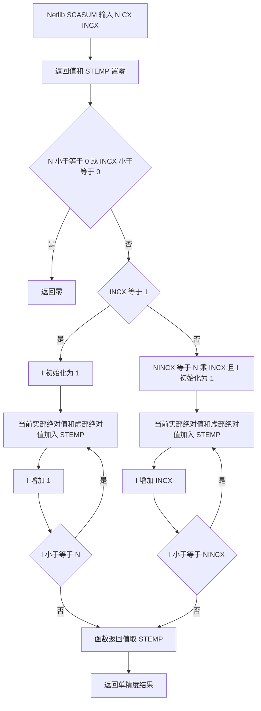
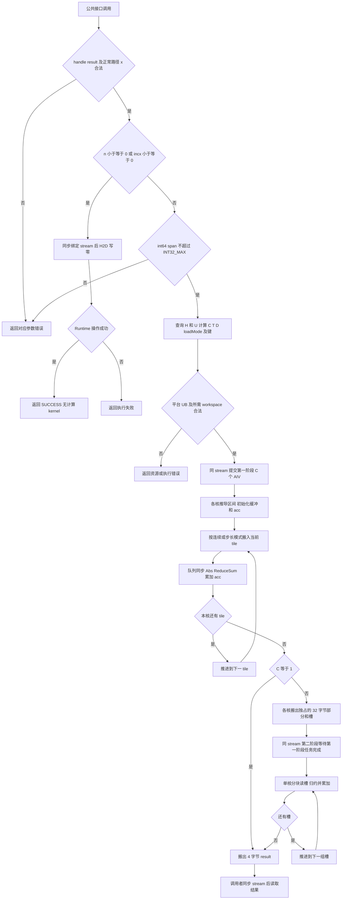

# 一、需求背景

## 1.1 需求来源

本设计对应 CANN 社区 2026 年 11 月序号 1「aclblasScasum 算子开发（A2/A3）」，任务归属见[官方任务列表](https://gitcode.com/cann/cann-competitions/blob/353edb186cf9a96524ea18f2c5fba842daba542e/04_tasks/01_community-task-2026/tasklist/README.md)。依据任务包《11月社区任务-aclblasScasum算子开发（A2A3）》内的 `aclblasScasum_AtlasA2_A3_task_doc.md`、`test_cases/README.md`、两份 CSV、`gen_csv.py`、`verify_accuracy.py` 和 `verify_performance.py` 编写，格式遵循[设计模板](../../../../resources/design_template.md)及社区设计文档审核目录。

目标是在 ops-blas 的 `blas/asum/arch22/` 补充 Ascend C kernel 直调实现，支持 Atlas A2/A3 的单精度复数向量分量绝对值归约，并在 `test/asum/scasum/arch22/` 配套 CSV 驱动 GTest。本文是待实现设计；源码核对基线为 ops-blas `c3ecf8cad3aae31037b04e1e6b523c307a080da5`，未进行编译、NPU 精度或性能实测。

## 1.2 背景介绍

Scasum 属于 BLAS Level 1。正常计算路径采用零基索引：

\[
y=\sum_{i=0}^{n-1}\left(\left|\operatorname{Re}(x[i\cdot incx])\right|+\left|\operatorname{Im}(x[i\cdot incx])\right|\right).
\]

这不是复数模长之和，不计算平方和或平方根。`n`、`incx` 均以复数元素为单位，只有一个 FLOAT32 输出；没有广播、矩阵 leading dimension、批维或转置属性。`n <= 0` 或 `incx <= 0` 时输出零，不遍历输入。

### 1.2.1 aclblasScasum 算子实现优化

本任务为 BLAS 接口的 A2/A3 平台补齐，不是 ACLNN/TBE 算子迁移。不存在可作为本任务依据的 TBE Python 实现文件、TBE 算子信息库 JSON 或 `aclnnScasum` 接口，不套用 Addcdiv 的文件路径。实际证据如下，表中 ops-blas 链接均固定到上述 SHA。

| 材料 | 已核实内容及用途 |
| --- | --- |
| [include/cann_ops_blas.h](https://gitcode.com/cann/ops-blas/blob/c3ecf8cad3aae31037b04e1e6b523c307a080da5/include/cann_ops_blas.h) | `aclblasScasum` 声明已存在，本快照为第 248 行；复用该声明，不新增平行接口 |
| [include/cann_ops_blas_common.h](https://gitcode.com/cann/ops-blas/blob/c3ecf8cad3aae31037b04e1e6b523c307a080da5/include/cann_ops_blas_common.h) | `aclblasComplex` 的 `real`、`imag` 均为 float；定义公共状态码 |
| [blas/asum/README.md](https://gitcode.com/cann/ops-blas/blob/c3ecf8cad3aae31037b04e1e6b523c307a080da5/blas/asum/README.md) | Scasum 产品表只支持 950PR/950DT，A2/A3 标为不支持 |
| [arch22/sasum_host.cpp](https://gitcode.com/cann/ops-blas/blob/c3ecf8cad3aae31037b04e1e6b523c307a080da5/blas/asum/arch22/sasum_host.cpp)、[arch22/sasum_kernel.cpp](https://gitcode.com/cann/ops-blas/blob/c3ecf8cad3aae31037b04e1e6b523c307a080da5/blas/asum/arch22/sasum_kernel.cpp) | 已有实数 Sasum，可参考 SIMD 搬入、Abs、ReduceSum；不是复数实现 |
| [arch35/scasum_host.cpp](https://gitcode.com/cann/ops-blas/blob/c3ecf8cad3aae31037b04e1e6b523c307a080da5/blas/asum/arch35/scasum_host.cpp)、[arch35/scasum_kernel.cpp](https://gitcode.com/cann/ops-blas/blob/c3ecf8cad3aae31037b04e1e6b523c307a080da5/blas/asum/arch35/scasum_kernel.cpp) | 已有 950 SIMT 实现，仅用于接口行为、复数布局和归约组织参考 |
| [arch35/scasum_tiling_data.h](https://gitcode.com/cann/ops-blas/blob/c3ecf8cad3aae31037b04e1e6b523c307a080da5/blas/asum/arch35/scasum_tiling_data.h)、[arch35/sasum_tiling_data.h](https://gitcode.com/cann/ops-blas/blob/c3ecf8cad3aae31037b04e1e6b523c307a080da5/blas/asum/arch35/sasum_tiling_data.h) | 可参考按值传递 tiling；950 的线程参数和固定核数上界不用于 A2/A3 |

此基线没有 `blas/asum/arch22/scasum_host.cpp`、`scasum_kernel.cpp`，也没有 Scasum 的 arch22 测试文件。后文出现的同名 arch22 文件和 tiling 字段均为拟新增内容。任务书同时写有“声明已提供”和“新增声明”，应按实际头文件保留唯一公共声明。

### 1.2.2 aclblasScasum 算子现状分析

语义及性能对标接口是 [cuBLAS cublasScasum](https://docs.nvidia.com/cuda/cublas/index.html#cublas-t-asum)。cuBLAS 的 GPU kernel 源码未公开，不能据此绘制其内部流水图。可审阅的算法标杆采用任务指定的 Netlib BLAS 3.10.0：官方 LAPACK 仓该版本固定提交为 `aa631b4b4bd13f6ae2dbab9ae9da209e1e05b0fc`，对应 [BLAS/SRC/scasum.f](https://github.com/Reference-LAPACK/lapack/blob/aa631b4b4bd13f6ae2dbab9ae9da209e1e05b0fc/BLAS/SRC/scasum.f)。下图描述此源文件，不将其称为 cuBLAS GPU 实现。

#### 1.2.2.1 标杆算子支持的数据类型和数据格式

| 对象 | 类型、布局与存储范围 |
| --- | --- |
| x | complex64，实部、虚部各 FLOAT32，AoS 交错布局 `[re0, im0, re1, im1, ...]`；任务记为 ND 一维向量 |
| 逻辑长度 | 正常路径为 `[n]`，实际读取复数下标 `0, incx, ..., (n-1)incx` |
| 物理长度 | 正常路径 `L=1+(n-1)incx` 个复数，即 `8L` 字节；quick return 不计算物理长度、不分配输入 |
| 结果 | 一个 FLOAT32 实数；本任务仅支持 Device 输出，输入也在 Device |
| 属性 | `n`、`incx` 为 Host `int`；handle 为携带 stream 的 Host 句柄 |

cuBLAS 支持 Host 或 Device 结果指针；本任务选择 Device 结果契约，不扩展 Host 指针模式、double complex 或 64 位 BLAS 公共接口。元素可包含 FLOAT32 的有限值、Inf、NaN，不在 Host 扫描数值。

#### 1.2.2.2 标杆算子实现描述

Netlib `scasum.f` 先将返回值和单精度中间累加值置零；`N <= 0` 或 `INCX <= 0` 时立即返回。正常路径分为两支：`INCX=1` 时依次遍历 `1..N`；否则先计算 `NINCX=N*INCX`，再从 1 到 NINCX 按 INCX 递增。每次将当前复数的实部绝对值、虚部绝对值加入单精度累加值，结束后赋给函数返回值。它没有 handle、设备搬运和 C++ 空指针状态码校验。

仓内实现与任务验收应区分：

- arch35 Scasum 校验 handle/result/正常路径 x，quick return 使用同步 H2D 拷贝零；正常路径采用 `span > UINT32_MAX` 拒绝条件。SIMT 按核、线程累加 float2，再归约 warp 部分和，写 workspace，经 `asc_threadfence`、`SyncAll` 后由 block 0 通过 DMA 读回并归约，写一个 float。该路径不代表 A2/A3 可直接编译运行。
- arch22 Sasum Host 使用固定 8 个 block，分配并复制 GM tiling，运行后同步释放；kernel 采用固定大小输入缓冲、Abs/ReduceSum、初始化输出后的 SyncAll 和原子累加，跨步输入还使用 GM 标量读取。这些是参考源码现状，拟新增 Scasum 不继承其固定核数、逐次 tiling 分配或 GM 标量访存方案。
- [scasum_golden.h](https://gitcode.com/cann/ops-blas/blob/c3ecf8cad3aae31037b04e1e6b523c307a080da5/test/asum/scasum/scasum_golden.h) 实际为自行实现的 double 累加后转 float，并非调用 Netlib；注释中的 `rtol=2^-10` 也不能作为本任务阈值。任务验收须新建 arch22 的 Netlib/cblas golden，double 参考只能辅助诊断舍入差异。

#### 1.2.2.3 标杆算子实现流程图



图中的 `NINCX` 是原始 Fortran 循环界限；不能拿 `n*incx` 的有符号溢出行为定义 NPU 接口。本任务依据最大访问下标 `(n-1)*incx` 做 int64 校验；超过 Netlib 构建版本整数安全范围的边界应做参数层测试，不直接调用可能发生整数溢出的 golden。

# 二、需求分析

## 2.1 外部组件依赖

| 组件 | 需求及证据边界 |
| --- | --- |
| CANN | 任务明确要求 9.1.0；使用 Ascend C 编译工具、ACL Runtime 和平台查询库。测试 README 的“仓指定版本及以上”不替换该版本要求 |
| Netlib BLAS / CBLAS | 精度 golden 使用 3.10.0，测试报告记录链接库和构建参数，避免误连其他 BLAS 或使用已有 double golden 冒充 Netlib |
| 测试与性能工具 | ops-blas CSV/GTest、Python 3、msprof op；性能脚本自身不生成 golden、不负责有效采样 |
| GPU 对照数据 | 随包 `gpu_baseline.csv`；README 标注 A100-SXM4-80GB、CUDA 12.8、cuBLAS 12.8.4。本文仅核查文件内容，未复测 GPU |

已查阅的官方 [DataCopyPad 文档](https://www.hiascend.com/doc_center/source/zh/canncommercial/900/API/ascendcopapi/atlasascendc_api_07_0265.html)和 [ReduceSum 文档](https://www.hiascend.com/doc_center/source/en/CANNCommunityEdition/900/API/ascendcopapi/atlasascendc_api_07_0078.html)明确列出 A2/A3 支持，所读页面版本为 9.0。它们用于确认成熟 SIMD API 的参数及平台边界；目标 9.1.0 的编译、链接和执行仍须验证，本文不声称已经完成版本适配实测。

## 2.2 内部适配模块

| 模块 | 拟实现或调整 |
| --- | --- |
| `blas/asum/arch22/scasum_host.cpp` | 公共接口实现、参数校验、quick return、动态平台查询、分核与 tile 选择、工作区检查、同 stream 下发 |
| `blas/asum/arch22/scasum_kernel.cpp` | AIV-only SIMD 输入处理、分块归约、单核写结果或两阶段汇总 |
| `blas/asum/arch22/scasum_tiling_data.h` | 小型按值 tiling，包含逻辑长度、正步长、核数、tile、buffer 数和分支键，不含固定核数数组 |
| `test/asum/scasum/arch22/` | Scasum GTest、Device wrapper、CSV 和仅该测试使用的 Netlib golden/分布补充；共享头的改动须兼顾 arch35 |
| [test/asum/scasum/CMakeLists.txt](https://gitcode.com/cann/ops-blas/blob/c3ecf8cad3aae31037b04e1e6b523c307a080da5/test/asum/scasum/CMakeLists.txt) | 现有文件只在 arch35 调用 `ops_blas_add_gtest_tests`；新增 arch22 注册，防止回退非 GTest runner |
| 公共 handle 与支持表 | 复用现有 stream/workspace 管理；实现验收后再更新根 README 和 `blas/asum/README.md` 的 A2/A3 支持状态 |

内部资源依据为 [aclblas_handle_internal.h](https://gitcode.com/cann/ops-blas/blob/c3ecf8cad3aae31037b04e1e6b523c307a080da5/blas/common/helper/aclblas_handle_internal.h) 的 `GetEffectiveWorkspace`、`GetEffectiveWorkspaceSize`、`EnsureDefaultWorkspace`，不新建公共 workspace 参数，也不跨调用缓存输入数据或结果。

## 2.3 需求模块设计

正常路径包含 Host 调度、每核局部归约，以及仅在多核时启动的最终归约。一次读取一个有效复数的两项 float，计算过程中保持 FP32。单核模式直接写 result；多核模式先写各自独立 workspace 槽，再由同 stream 的第二个 kernel 汇总。quick return 和非法参数在这些计算步骤之前处理。

### 2.3.1 Ascend C 算子原型

```cpp
aclblasStatus_t aclblasScasum(
    aclblasHandle_t handle,
    int n,
    const aclblasComplex* x,
    int incx,
    float* result);
```

| 参数 | 位置及约束 | 预期行为 |
| --- | --- | --- |
| handle | 有效 Host 句柄 | 空指针优先返回 `ACLBLAS_STATUS_HANDLE_IS_NULLPTR` |
| result | 至少 4 字节的独立 Device 输出，不与 x/workspace 重叠 | 任意 n/incx 下为空均返回 `ACLBLAS_STATUS_INVALID_VALUE` |
| n | Host int，逻辑复数数目 | `n <= 0` 是合法 quick return |
| incx | Host int，复数间隔 | `incx <= 0` 是合法 quick return，包括 `INT32_MIN`；不计算 `abs(incx)` |
| x | 正常路径可读 Device 缓冲，交错 complex64 | 仅 `n>0 && incx>0` 时要求非空 |

接口不接收分配大小，不能自动确认任意非空地址背后的容量；调用者负责正常路径至少 `8L` 字节输入和 4 字节输出。实现以公共结构为准，并静态确认 `sizeof(aclblasComplex)==8`、imag 偏移为 4，转换为 float 视图不增加新的数据类型接口。

### 2.3.2 Ascend C 算子相关约束

Host 的判定次序固定为：handle 空指针 → result 空指针 → 正常路径 x 空指针 → quick return → 跨度 → 平台和工作区 → kernel。quick return 不读 x，不启动 Scasum 计算 kernel；先同步 handle 所绑 stream，确保先前对 result 的写入完成，再用同步 `aclrtMemcpy` 从 Host 的 `0.0f` 拷贝 4 字节到 Device。这样不直接解引用 Device 指针，也不向异步队列提交生命周期已结束的栈变量；正常计算路径保持异步。

只有 `n>0 && incx>0` 时计算 `span=int64_t(n-1)*int64_t(incx)`。任务书要求 `span > INT32_MAX` 返回 `ACLBLAS_STATUS_INVALID_VALUE`，本设计遵循该上限。现有 arch35 源码及生成器一致性检查使用 UINT32_MAX；包内唯一跨度错误用例 `(n=4,incx=2147483647)` 同时超出两种上限，不能证明 int32 边界已覆盖。须补充 `INT32_MAX`、`INT32_MAX+1` 邻域的参数判定检查。

字节计算 `8*(span+1)`、kernel GM 偏移 `8*i*incx` 均使用 64 位，不因 span 限制为 int32 就将字节数缩窄。无负步长遍历、广播或原地结果支持；没有 cuBLAS 的 Host 结果指针模式。Runtime 拷贝/同步/下发中可立即获知的失败返回 `ACLBLAS_STATUS_EXECUTION_FAILED`，工作区分配失败透传 `ACLBLAS_STATUS_ALLOC_FAILED`；异步设备执行错误由调用者同步时检查。

# 三、需求详细设计

## 3.1 调用方式

采用 ops-blas handle 绑定 stream 的 kernel 直调，调用顺序为 ACL 初始化及 Device/context 设置、创建 stream、`aclblasCreate`、`aclblasSetStream`、分配并填充 Device 输入/输出、调用 `aclblasScasum`、同步该 stream、读回结果并释放资源。精度和性能测试都调用公共接口，不直接调用私有 kernel 绕开参数校验。

tiling 按值传给 kernel，避免每次分配/拷贝/释放 GM tiling。A2/A3 仓内按值下发有 [ssbmv_kernel.cpp](https://gitcode.com/cann/ops-blas/blob/c3ecf8cad3aae31037b04e1e6b523c307a080da5/blas/sbmv/arch22/ssbmv_kernel.cpp) 可参考，但本算子仍须在目标 CANN 编译验证。两阶段操作连续提交到同一 `handle->stream`，第二阶段消费第一阶段已完成的工作区；正常路径不插入 Host 同步。

## 3.2 需求总体设计

设有效输入为 n 个复数，忽略尾部填充的数学工作量为 2n 次绝对值与约 `2n-1` 次加法，有效输入流量 `8n` 字节、输出 4 字节。多核实现使用 C 个 32 字节槽，额外写入及读回共 `64C` 字节，因此逻辑 GM 请求量约为：

\[
Q_{request}=8n+4+\begin{cases}0,&C=1\\64C,&C>1.\end{cases}
\]

步长路径只请求有效元素，不将 `8L` 物理跨度全部搬入。请求量不等于实际 DRAM 事务量：离散地址会造成事务放大，重复测试也可能命中缓存。加法强度约为 0.25 次/字节，提示大 n 优先检查访存供给、小 n 优先检查启动开销；不据此宣称达到带宽上限。平台可持续带宽、Vector 吞吐及两次启动的成本均待实测。

### 3.2.1 host 侧设计

通过 [host_utils.h](https://gitcode.com/cann/ops-blas/blob/c3ecf8cad3aae31037b04e1e6b523c307a080da5/blas/common/helper/host_utils.h) 的 `GetAivCoreCount()` 获取可用 AIV 核数 H；通过平台对象的 `GetCoreMemSize(CoreMemType::UB, U)` 获取每核 UB 容量，调用形式可核对 [ssbmv_host.cpp](https://gitcode.com/cann/ops-blas/blob/c3ecf8cad3aae31037b04e1e6b523c307a080da5/blas/sbmv/arch22/ssbmv_host.cpp)。查询失败或 H/U 无效时返回执行失败，不填入猜测的 40/64 核、192/248 KiB 默认值。

拟定义 tiling 字段 `n, incx, span`（64 位）、`coreNum, perCoreN, remainder, tileComplex, finalTileSlots, bufferNum, loadMode, tilingKey`。Host 完成所有乘法、上取整及容量检查后再窄化字段；两个 kernel 共用明确版本的结构，kernel 从 `GetBlockIdx()` 推导区间，无固定长度核数组。

#### 3.2.1.1 分核策略

先根据下节 UB 预算得到 tile 容量 T。初始分核粒度取 `G=T` 个复数：

\[
C=\min(H,\lceil n/G\rceil),\quad q=\lfloor n/C\rfloor,\quad r=n\bmod C.
\]

第 c 核（`0 <= c < C`）处理：

\[
s_c=cq+\min(c,r),\quad \ell_c=q+[c<r],\quad [s_c,s_c+\ell_c).
\]

各区间首尾相接、无重复、覆盖 `[0,n)`，且 `C<=n`，没有空核进入处理。`n<=T` 时单核单 tile；较大 n 在不超过 H 的前提下分核，不能为了“满核”将一个短向量切成大量微小任务。`G=T` 是首版设计选择，后续按完整接口耗时及全量 PF 用例校准，不作为已验证最优阈值。

#### 3.2.1.2 数据分块和内存优化策略

令 `A(v)=32*ceil(v/32)`（字节对齐），D 为输入 buffer 数。初始容量按 `D=2` 规划，再检查各核 tile 数；若每核只有一个 tile，则使用 `D=1` 且不放大原 T。正常 tile 的有效复数数目 `t=min(T,ell_c-j*T)`。

| 输入路径 | UB 内布局 | 单个输入 buffer 字节 R(T) | 向量处理 float 数 E(T) |
| --- | --- | --- | --- |
| `incx=1` | 连续交错两分量 | `A(8T)` | `2T` |
| `incx>1` | 每个复数占 32 字节槽，前两项为实部/虚部，其余六项明确补零 | `32T` | `8T` |

步长槽避免额外 Gather 索引表及解交织缓冲；代价是 UB 和向量操作数约为连续路径的 4 倍，只作为功能完整的初始方案。它不读取步长空洞，空洞中的 NaN/Inf 也不会参与计算。

每核同时存活的资源预算为：

\[
U_{used}(T,D)=D R(T)+S(E(T))+32_{tileResult}+32_{acc}+32_{out}+U_{reserve}\le U,
\]

\[
S(E)=A\left(4\max(1,\lceil E/64\rceil)\right).
\]

三个 32 字节区分别保存 tile 标量、核内累加标量和 VECOUT 写出槽，输入在原地址执行 Abs。`S` 是保守的归约临时区预算，不是声称 count 版本必须使用这么多空间；所读 ReduceSum 文档中 A2/A3 count 版本为 repeat 内树形、repeat 间顺序累加，临时区可不使用。保留该预算方便后续切换显式分段归约。`U_reserve` 为目标编译器/框架实际需要的预留，须按目标版本核定并记录，不能视为已知硬件常数。

Host 从满足预算的 32 个复数整数倍中取最大 T，进一步限制 `E(T)<=64*255`，步长路径限制 `T<=4095`，连续路径限制 `8T<=2097151`。`64*255` 是控制普通向量指令 repeat 分批的保守设计上限，不是 ReduceSum count 接口的最大 count。总 n 不受这些 tile 上限限制，由外层循环覆盖。若 `n<T`，将 T 收缩到 `32*ceil(n/32)`；预算不足以容纳最小 tile 时返回资源错误。

最终归约 kernel 按 F 个 workspace 槽分块，单 buffer、`R_final(F)=32F`、`E_final(F)=8F`，同样满足上述预算及向量分批限制。这样即使平台核数变化，也不假定所有部分和必然能一次放入 UB。

`C=1` 不需要 GM 工作区；`C>1` 需要 `W=32C` 字节。第 c 核独占 `[32c,32(c+1))`，写出完整槽 `[partial,0,0,0,0,0,0,0]`。通过现有 handle 工作区 helper 保证容量，用户注入的不足工作区不能擅自释放或扩容；错误透传。工作区保持到两阶段完成，同 handle/stream 后续操作依流顺序复用，不支持多个 Host 线程无序共享同一 handle。

#### 3.2.1.3 tilingKey 规划策略

kernel 直调采用内部 `tilingKey` 字段和显式分支，不虚构 ACLNN 的 OpTiling 注册接口。定义 `loadMode` 为 0（连续）、1（正步长分块）、2（超出搬运 stride 字段范围的逐块 DMA），键值如下：

| tilingKey | 条件 | 行为 |
| --- | --- | --- |
| 0 / 1 / 2 | `C=1` 且 loadMode 为 0 / 1 / 2 | 单阶段核内归约，精确写 4 字节结果 |
| 4 / 5 / 6 | `C>1` 且 loadMode 为 0 / 1 / 2 | 第一阶段写 C 个部分和槽 |
| 16 | 已成功提交多核第一阶段 | 第二阶段单核分块读取 C 个槽并归约 |

正常路径 `incx=1` 选 mode 0；`incx>1` 且 `8*(incx-1)<=UINT32_MAX` 选 mode 1；否则选 mode 2。乘法先用 uint64 计算。mode 2 对每个有效复数发起 `blockCount=1, blockLen=8, srcStride=0` 的 DataCopyPad，并以 64 位 GM 基址推进；它不因 DMA stride 字段有限而擅自拒绝接口允许的正步长。quick return 不生成 tilingKey，不发射计算 kernel。

### 3.2.2 kernel 侧设计

使用 AIV-only、TPipe/TQue/TBuf 的 SIMD 实现，分为初始化、搬入、归约和写出。中间运算及部分和保持 FLOAT32，不使用 half 降精度，也不引入 SIMT、RegBase 或 950 专有搬运模式。两个 kernel 的工作区发布与消费通过同 stream 的任务顺序连接；不在同一个 kernel 内轮询其他核，也不依赖原子输出初始化与跨核屏障。

#### 3.2.2.1 kernel 侧实现描述

**初始化与边界。** 第一阶段按 tiling 推导 `s_c,ell_c`，配置输入 GlobalTensor 的物理长度 `2*(span+1)` 个 float，输出长度 1。输入队列深度与 D 一致；归约临时区、标量区和输出队列均按 UB 预算分配。核内累加区八个 float 全部置零。tile 序号 j 的逻辑起点为 `b=s_c+j*T`，有效长度 t 满足 `b+t<=s_c+ell_c<=n`。

**搬入。** 以下参数采用 `DataCopyExtParams` 和 `DataCopyPadExtParams<float>`，保留字段置零，不将字节长度截断到 uint16：

| loadMode | GM 起点与搬运参数 | UB 有效区域 |
| --- | --- | --- |
| 0 | float 偏移 `2*b`；`blockCount=1, blockLen=8*t, srcStride=dstStride=0`；右补 `(8-(2*t)%8)%8` 个零 | 前 `2*t` 项参与 Abs/ReduceSum，补齐区不参与 |
| 1 | float 偏移 `2*b*incx`；`blockCount=t, blockLen=8, srcStride=8*(incx-1), dstStride=0`；每块右补六个零 | `8*t` 个 float，槽 j 的前两项有效，后六项为零 |
| 2 | 循环 `j=0..t-1`，float 偏移 `2*(b+j)*incx`；逐块搬运 8 字节并右补六个零，目标 UB 偏移 `8*j` | 与 mode 1 相同 |

mode 1/2 每个复数的最后一字节为 `8*(b+j)*incx+7`，不超过 `8*span+7=8L-1`。mode 0 的最后一字节为 `8*(b+t)-1<=8n-1`。补齐只发生在已分配 UB，不向 GM 输入末尾扩读。GM 指针即使不是 32 字节对齐，也使用 DataCopyPad；保持 C++ 类型所需的自然对齐。所有 UB 子区起点为 32 字节对齐，尤其不能用 4 字节步进为各复数分配 DMA 目标槽。

**计算。** 通过输入队列 `EnQue/DeQue` 建立 MTE2→Vector 依赖。先原位 `Abs`，完成 Vector 依赖后执行 `ReduceSum<float>(tileResult,input,scratch,count)`；mode 0 的 count 为 `2*t`，mode 1/2 的 count 为 `8*t`。后者填入的六个零属于设计中的中性元，而非读取未初始化 padding。tile 结果累加到 `acc[0]`，其余七项继续为零。tile 间累加、Abs→ReduceSum、ReduceSum→Add 显式保证 Vector 顺序；不将 A2/A3 的 count 版本描述成全局平衡二叉树。重复使用 scratch 前须完成上次归约，释放输入 buffer 前须完成对其最后一次 Vector 读取。

**流水与生命周期。** 单 tile 使用 D=1；多 tile 才使用 D=2，预取下一 tile 与当前 tile 计算交错，尾部排空。队列承担搬入就绪及 buffer 复用同步；未经过队列的 TBuf 依赖显式设置相应硬事件或 Vector barrier。输出先进入 VECOUT 队列，再搬出，保证 V→MTE3；输出缓冲在搬出完成前不能被重写，kernel 返回前须完成本核待发布的 MTE3 写入。不能以“buffer 数为 2”替代实际预取与依赖安排。

**结果发布。** 单核直接从输出槽精确搬出 4 字节，不覆盖 result 邻接空间。多核第一阶段输出完整 32 字节槽，其余七项清零；各核不读写其他核的槽。第二阶段用一个 AIV，分块读 `32*f` 字节 workspace、归约 `8*f` 项到 FP32 累加值，再精确写出 4 字节 result。第一阶段不写 result；第二阶段不读取旧 result，不要求调用者预清零。

两阶段方案避免跨核原子累加的初始化竞争，但增加一次 kernel 启动及 workspace 往返；必须将这两项计入性能，不将第二阶段从统计中剔除。NaN/Inf 直接参与绝对值和加法，不为通过检查而钳制或替换；其传播、溢出和次正规数行为仍需 A2/A3 真机确认。

#### 3.2.2.2 Ascend C 实现流程图



图中 kernel 步骤表示 Device 执行顺序；Host 完成下发即返回，已知下发失败须立即透传，不能将图末的调用者同步解释为正常接口内部同步。

#### 3.2.2.3 Ascend C 实现流程图与标杆算子流程图存在的差异点和原因

| 差异 | 原因与必须保持的语义 |
| --- | --- |
| 增加 handle/指针/跨度/资源检查 | Netlib 是 CPU 数学子程序；ops-blas 是有状态 Device API，必须在访问前完成任务规定的检查 |
| quick return 经 stream 同步和 Device 拷贝 | result 为 Device 指针；必须保持先前提交操作的顺序并保证零已写入，不在 Host 解引用 |
| 连续输入直接归约两个 float 分量，跨步输入补零成槽 | 对应同一分量绝对值总和；避免复数模长计算、空洞污染和 GM 越界 |
| 由顺序累加改为分块、分核和第二阶段归约 | 利用 AIV SIMD 和多核并行；浮点加法顺序变化，允许非逐位一致，但仍必须通过任务阈值 |
| 原 Fortran 的 NINCX 循环改为 64 位逻辑起点和有效数量 | 避免 Host/Device 索引乘法溢出，准确处理尾 tile |
| 不使用 arch35 的 SIMT warp、threadfence、单 kernel SyncAll 汇总 | A2/A3 使用已确认适用的 SIMD 接口；两次同 stream 启动提供明确的跨核阶段边界 |

第一张图的每个有效复数在第二张图中恰有一核一次搬入；每个实部/虚部绝对值参与一次归约，额外参与项仅为零。顺序变化属于数值设计差异，不是已证明精度达标的结论。

## 3.3 支持硬件

| 目标平台 | 工程/编译目标 | 验证要求及当前状态 |
| --- | --- | --- |
| Atlas A2 系列，含 Atlas 800T A2 | `arch22`，`--soc=ascend910b`；对应 DAV_2201 SIMD 路径 | 任务性能指定 910B3；尚未编译或实测 |
| Atlas A3 系列，含 Atlas 800T A3 | `arch22`，`--soc=ascend910_93`；采用同一 SIMD 设计 | 任务要求支持；尚未编译或实测 |

任务允许自验证覆盖一种款型，精度建议 910B3 或 A3，性能建议并指定比较设备为 910B3。提交代码仍需检查两个编译目标；仅在其中一款完成实测时必须明确另一款未实测，不据共享 arch22 宣称性能一致。950 arch35 现有实现属于兼容性回归边界，不在本任务新增支持范围。实际核数、UB、预留均按目标环境获得，不将 950 参数移植到 A2/A3。

## 3.4 算子约束限制

- 仅 complex64 输入、FLOAT32 标量输出；输入布局为交错复数一维向量，incx 单位为复数。内部 float 视图不意味着对外支持实数输入。
- 正常计算支持正步长并受任务 `span<=INT32_MAX` 限制；零或负步长合法返回零，不反向读取。处理 `INT32_MIN` 时不先取绝对值。
- n 是运行时整数，支持按调用重新 tiling；不增加任务不要求的动态 shape 图编译、广播、批处理、梯度和原地语义。
- result 是独立 Device 标量；输入、输出、工作区由调用者在流完成前保持有效。非空指针不等于已验证实际可访问容量。
- 小向量一个计算 kernel，大向量拟两个计算 kernel；quick return 无 Scasum 计算 kernel。工作区为 O(C)，UB 为 O(T)，输入物理空间为 O(L)。不将测试用例 Host 预算 4 GB 当成硬件或接口上限。
- 归约顺序不承诺 bit-exact 或跨核数逐位确定性。有限结果、非有限结果及次正规数按第 5.1 节分别验收。

# 四、特性交叉分析

| 交叉项 | 风险与设计处理 | 验证重点 |
| --- | --- | --- |
| quick return × 空指针 | result 校验优先；quick return 允许 x 为空；handle 为空始终先报错 | 零/负 n、零/负 incx、INT32_MIN 与 x/result 空指针组合 |
| 正步长 × 地址宽度 | 复数索引、float 索引和字节偏移不同量纲；采用 int64/uint64，并检查 DMA 字段 | span 边界、`8*(incx-1)` 字段边界、n=1 的大正 incx |
| 尾 tile × Padding | GM 只读真实范围；每槽补零；输出只写 4 字节 | T±1、32 字节偏移、guard 区和邻接输出哨兵 |
| 非有限输入 × 稀疏地址 | 间隔位置未参与数学运算，不允许空洞 NaN 污染结果 | 有效元素有限、空洞 Inf/NaN；交换实虚部和符号不改变有限结果 |
| 多核 × stream/workspace | 同流两阶段保证发布消费；每核独占槽；同 handle 并发调用需外部串行 | 重复调用更换数据、多个独立 handle/stream、用户工作区不足 |
| FP32 归约 × Netlib golden | 分核改变累加顺序，Netlib 顺序累加也可能积累舍入误差 | 大 n、动态范围、溢出；同时保存 Netlib 和诊断 double 结果，不替换验收 golden |
| 精度 × 性能采样 | 先确认接口返回及结果，避免计入失败调用；两阶段不能只计第一阶段 | 200 条性能 case 的实际执行数、有效样本数和计时任务归属 |
| A2/A3 × 950 共享框架 | 声明和通用测试头已共享，不能为新平台破坏旧平台约定 | 新增文件限 arch22，CMake 两平台分支及公共声明无重复定义 |

# 五、可维可测分析

## 5.1 精度标准/性能标准

**精度判据。** 以任务书第 3.2 节为准，参考其指定的[固定版本混合容差标准](https://gitcode.com/cann/opbase/blob/28a1ce52ae856353589841226a0002af73314a6b/docs/zh/ops_precision_standard/mixed_tolerance_standard.md)。对有限标量结果 a、golden g：

\[
d=|a-g|,\quad atol=rtol=2^{-13}=0.0001220703125,
\]

\[
d\le atol+rtol|g|\quad\text{且}\quad d\le\max(10^{-2},32\operatorname{ULP}_{FP32}(|g|)).
\]

误差计算提升到 double，避免验证器自身溢出。ULP 按当前仓 [mixed_tolerance.h](https://gitcode.com/cann/ops-blas/blob/c3ecf8cad3aae31037b04e1e6b523c307a080da5/test/frame/mixed_tolerance.h) 的量级相关定义：非零有限 g 取 `2^(max(floor(log2(abs(g))),-126)-23)`，零取 `2^-149`。标量 matched_ratio 只能为 0 或 1，不能解释为允许 1% 用例失败。CSV 的 `mere_threshold=0.00012207031`、`mare_multiplier=10.0` 是继承列，不用 MERE/MARE 代替本任务双条件。

非有限值先分类：同为 NaN、同号 Inf，或一方 NaN/另一方任意符号 Inf，按任务书视为等效；有限值与非有限值、异号 Inf 均失败。当前 [verify.h](https://gitcode.com/cann/ops-blas/blob/c3ecf8cad3aae31037b04e1e6b523c307a080da5/test/frame/verify.h) 的 scalar MIXED_TOLERANCE 不接受 NaN/Inf 交叉组合，须在 Scasum 测试适配层实现任务规则并记录分类，不能悄悄修改全仓其他算子的判据。quick return 的 golden 固定为 `0.0f`，还要验证返回成功、输出原哨兵已被覆盖、输入没有读取。

正常有限值 golden 调用 Netlib 3.10.0 的 `cblas_scasum(n,x,incx)`，输出为单个 float；已核对同版本 [CBLAS/src/cblas_scasum.c](https://github.com/Reference-LAPACK/lapack/blob/aa631b4b4bd13f6ae2dbab9ae9da209e1e05b0fc/CBLAS/src/cblas_scasum.c) 经 Fortran wrapper 调用 Scasum。对大 n 保存诊断 double 结果帮助判断差异，但任务没有授权用更高精度参考替换 Netlib；即使 NPU 更接近数学真值而偏离 Netlib 超限，也应报告失败及原因。FP32 分块/顺序累加的阈值兼容性是必须上板验证的风险，不能仅凭“非负归约”保证通过。

**随包 CSV 的实际覆盖。** 按全部记录解析，`scasum_test.csv` 共 1200 条数据（含表头 1201 行），十列为 `case_name,description,n,incx,x,result,expect_result,mere_threshold,mare_multiplier,random_seed`。CSV 没有 dtype 列，1200 条均由本接口固定为 complex64→FLOAT32，不存在多 dtype 覆盖。

| 分类前缀 | 实际条数 | 范围 |
| --- | --- | --- |
| TC_L0 | 4 | n=1/8、incx=1/2 |
| TC_SQ | 38 | 正 n 尺寸扫描，包含质数、2 的幂及邻域、非对齐值 |
| TC_INC | 9 | n=16/64/256 × incx=1/2/3 |
| TC_FL | 12 | 六种非空填充 × 两种长度 |
| TC_OV | 3 | n=524288/1048576 与极端值，包含 incx=2 |
| TC_ED | 18 | quick return、空指针、INT32_MIN、跨度溢出 |
| TC_EX | 916 | 固定种子的尺寸/步长/填充扩展 |
| TC_PF | 200 | 性能，全部 incx=1，n=1..4194304 |

精度部分恰为 1000 条，n 范围 `[-8,1048576]`、43 种 n；正常正 n 有 39 种，其中额外包含溢出用例的 524288。精度 incx 计数为：1→336、2→257、3→284、0→28、-1→33、-2→22、-3→38、INT32_MIN→1、INT32_MAX→1。全部 CSV 有 1194 条期望成功、6 条期望 INVALID_VALUE；满足 quick-return 条件的 129 条中，126 条成功、3 条因 result 为空失败。正常成功路径精度 868 条，加性能 200 条共 1068 条。

精度填充实际为均匀随机 874、全零 24、交替值 24、极端值 27、Inf 23、NaN 23、NULLPTR 5；性能填充为均匀随机 198、全零 1、极端值 1。无 `GAUSS_NORM_5_2`，也无 offset/dtype 字段。README 写 TC_ED=13、TC_EX=921，实际为 18/916；以 CSV 为准。默认种子在内存中重建的生成结果与原 CSV 逐记录一致，但 `--dist mixed` 仍退回均匀分布，不证明满足 50% 正态要求。重运行生成器会写出空 gpu_ms 的基线占位文件，不能覆盖随包已有 GPU 数据。

**补充测试计划。** 以下均为待实现测试，不是已执行结果：

| 维度 | 具体测试及判定 |
| --- | --- |
| 分布 | 868 条正常成功精度用例中有 763 条均匀随机；为这 763 条逐一增加同参数的正态输入，以正常随机子集 763:763 达到 50%/50%，保留全部原始边界与特殊值用例。实虚部独立抽样，记录 seed、μ∈[-5,5]、σ∈[0.1,2] |
| 正态生成语义 | [test/frame/fill.h](https://gitcode.com/cann/ops-blas/blob/c3ecf8cad3aae31037b04e1e6b523c307a080da5/test/frame/fill.h) 已有 GaussGenerator，但会裁剪至 [-5,5]；任务未要求裁剪。arch22 测试需提供符合任务原始正态分布的本地生成方式，记录与已有 token 的差异，不把裁剪分布直接当作原正态分布 |
| 参数优先级 | 直接调用公共 API 测空 handle；n=0/负数/INT32_MIN、incx=0/负数/INT32_MIN 与空 x/result 组合。现有 arch35 wrapper 会在 handle 为空时自行返回，不能用于证明被测 API 的检查 |
| 溢出与窄化 | 先测试 Host 参数判定中 span 的 int32 邻域及 DMA stride 的 uint32 邻域；超限用 dummy Device 输入，不按跨度分配。合法但超大物理空间的端到端用例按实际资源单独安排并披露未覆盖项，不用参数层测试冒充设备访问测试 |
| 地址与尾部 | n=1、T±1、2T±1、C 分核余数，各 loadMode；合法自然对齐的 x 偏移（如相对 32 字节基址偏移 4/8/16 字节）、result 偏移与前后哨兵、输入尾部 guard；不要求读取越界 padding |
| 数值 | 实虚部符号组合、正负零、纯实/纯虚、极小值/次正规数、FLT_MAX 与多元素溢出、NaN/Inf 混合、步长空洞填毒；区分有效元素和间隔位置 |
| 异步与状态 | 同 stream 先写 result 再 quick return、重复提交且更换输入、不同 handle/stream、用户工作区不足；每个 Runtime 操作及同步均断言成功 |
| 流程完整性 | 校验计划 case 集合与实际 GTest 执行集合一致，单独记录固定测试和新增参数化测试；不能仅因脚本输出部分 PASS 就称全量通过 |

负向用例按单复数 dummy 或 NULLPTR 输入；quick return 无需输入分配。当前 [arch35/scasum_npu_wrapper.h](https://gitcode.com/cann/ops-blas/blob/c3ecf8cad3aae31037b04e1e6b523c307a080da5/test/asum/scasum/arch35/scasum_npu_wrapper.h) 会在正常维度下先按跨度分配/拷贝，再调用接口，不能直接复用到超跨度负例。六条错误用例必须先按期望行为分流，防止测试程序先发生巨大分配或 Host 越界读取。

**性能判据和冲突处理。** 任务书要求 Atlas 800T A2（910B3）、warmup 5 次、有效采样至少 10 次，使用 msprof op 的 task duration（us）取平均，每个 case 满足：

\[
T_{NPU,us}\le1.25\times1000\times GPU_{ms},\qquad
speedup=1000\times GPU_{ms}/T_{NPU,us}\ge0.8.
\]

任务第 3.3 节的“FLOAT32 输入场景”与接口 complex64 冲突，性能仍必须跑 complex64 输入、FLOAT32 输出；不把数据宽度减半来比较。对于本设计两阶段实现，第 k 次完整调用计为 `duration_stage1(k)+duration_stage2(k)`，再对有效调用求均值；单阶段按单任务计算。按 case/call 对应采集，确认实际完成的 warmup 和有效样本数量，不能把所有 kernel 行独立平均导致两阶段耗时减半。Host 造数、分配、H2D/D2H 和 golden 不在性能窗口内，另记录含下发及队列间隙的完整调用时间。

任务 README 末段却要求 `[PERF] case=... avg_us=...` 的 aclrtEvent 时间参与判定，并称 msprof 仅交叉验证；`verify_performance.py` 确实只解析此日志、不调用 msprof。两种口径不能互相替代。本设计以任务书的 msprof 口径为正式目标，同时补齐 event 日志满足配套脚本，报告分列两种结果；若判定不同，须列明冲突并取得验收口径结论，不能只选择有利结果称验收通过。

当前 [arch35/scasum_test.cpp](https://gitcode.com/cann/ops-blas/blob/c3ecf8cad3aae31037b04e1e6b523c307a080da5/test/asum/scasum/arch35/scasum_test.cpp) 用 Host chrono 测量 100 次调用加同步，warmup 10 次，打印 `[case] avg_single_us=...` 而没有 `[PERF]`。它不符合所附性能脚本格式，也不是 README 宣称的 event 计时；新测试须显式实现规定的采样和日志，每次返回码、同步错误均计入验证，不能照抄后称脚本可用。

**GPU 基线关联。** `gpu_baseline.csv` 共 200 条数据（含表头 201 行），全部 gpu_ms 非空且为正，全部 incx=1；n 有 198 种，最小 1、最大 4194304。行顺序与 200 条 TC_PF 的 n/incx 完全一致。前三条原始 GPU 时间如下，仅转录文件，不代表本次实测：

| 基线 ID | n | gpu_ms | NPU 阈值（us） |
| --- | --- | --- | --- |
| scasum-base-000 | 1048576 | 0.0198655993 | 24.831999125 |
| scasum-base-001 | 2097152 | 0.0221525334 | 27.690666750 |
| scasum-base-002 | 4194304 | 0.0335530668 | 41.941333500 |

`(4194304,1)` 出现三次，另两行分别为 `scasum-perf-027=0.0334165335 ms`、`scasum-perf-028=0.0332970668 ms`，对应均匀/全零/极端值场景。脚本按 `(n,incx)` 建字典会保留最后值，实际只剩 198 个键，丢失 case 级对照。正式结果须建立并保存原始行号/ID↔case_name 映射，逐行验证 n/incx 一致性；调整采样和关联实现时保留原始基线。配套脚本原样运行的覆盖结果应另行标注，不当作精确的一一对应结果。

精度脚本只要解析到至少一个 PASS 且无 FAIL 就可成功退出；性能脚本也没有核对全部 200 条是否执行，且未独立检查子进程返回码。外层验收必须核对预期 case 集合、唯一性、进程退出码和每条有效采样数。`verify_accuracy.py --filter` 拼出的正负 GTest 过滤串亦须用 `--gtest_list_tests` 核对实际选中集合。NO_REF、未执行、无 `[PERF]` 或无有效采样都不能按通过计。

**内存与复现。** 任务第 3.4 节无独立内存门槛，但仍要求交付内存记录；统计输入 `8L`、输出 4 字节、工作区 `32C`、每核 UB、handle 资源和分配峰值。最大正常精度输入为 3145726 个复数（25165808 字节），最大性能输入为 4194304 个复数（33554432 字节）；Host 同时存在的数据副本和 golden 存储应另计。4 GB 是测试 README 的单例 Host 预算设计值。

后续复现顺序为：构建 arch22 Scasum GTest → 校验 CSV 全部用例已注册 → 精度及负向测试 → 补充分布/边界测试 → 逐 case 性能采样和基线关联 → 输出精度、性能、内存报告。脚本运行参数使用 A2 的 `--soc ascend910b` 或 A3 的 `--soc ascend910_93`；`--csv` 会向被测源码测试目录复制文件，必须针对开发 checkout 使用。本文仅完成材料核对、统计及设计静态检查，没有运行上述上板流程。

## 5.2 兼容性分析

公共函数签名和 `aclblasComplex` 布局与现有头文件保持一致；复用 handle/stream/workspace，不新增公共 ABI。新实现放在 arch22，不修改 arch35 SIMT 算法；公共测试工具如需调整，先评估其对 950 的现有阈值、非有限值和分布语义影响，优先采用 Scasum arch22 的局部适配。

版本边界固定为任务要求的 CANN 9.1.0、Netlib 3.10.0 和本文列出的 ops-blas SHA。源码现状不能外推为未来主分支状态。已识别但尚待实现验证的内容包括：9.1.0 API 编译、两平台下发、Device quick return 顺序、DMA stride 回退、归约舍入/特殊值、两阶段的完整性能，以及配套脚本的计时/基线映射修正。上述内容全部完成并留下可复现记录前，不把本设计文档视为实现通过、平台支持已发布或任务验收完成。
