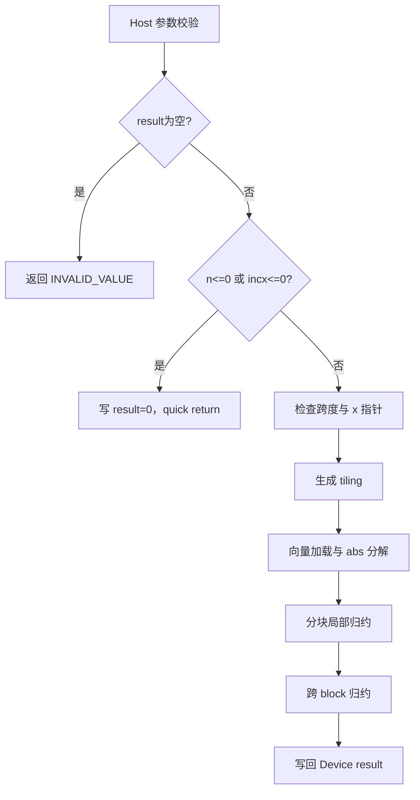

# 需求背景

## 需求来源

本设计文档依据《11月社区任务-aclblasScasum算子开发（A2A3）》任务书、随任务提供的测试指导和设计文档模板编制，面向 `ops-blas` 开源仓 Atlas A2/A3（`arch22`）实现。任务要求使用 Ascend C 编程语言开发单精度复数向量绝对值分量之和算子 `aclblasScasum`，完成公共接口、NPU kernel、测试工程和验收材料。

接口语义对齐 cuBLAS `cublasScasum`，参考实现为 Netlib `scasum`。任务书、测试指导中的功能边界、quick return、精度阈值、性能判据和用例要求优先于本设计中的工程实现选择。

## 背景介绍

`aclblasScasum` 对复数向量进行 L1 分量归约，计算：

```text
result = Σ (|real(x[k])| + |imag(x[k])|)
```

输入 x 为 `complex64`，输出为 Device 上的单个 `float32` 标量。向量使用复数元素步长 `incx`；当 `n<=0` 或 `incx<=0` 时遵循 cuBLAS/Netlib 语义，不遍历向量，直接将 result 写为 `0.0f` 并返回成功。

## 工程接入范围

| 模块 | 路径 | 本任务工作 |
| --- | --- | --- |
| 公共接口 | `include/cann_ops_blas.h` | 使用仓内已有/共用的 `aclblasScasum` 声明 |
| A2/A3 算子 | `blas/asum/arch22/` | 复数 Host、tiling、归约 kernel 和 README |
| 测试工程 | `test/asum/scasum/arch22/` | CSV 驱动 GTest、golden、NPU wrapper |
| 测试注册 | `test/asum/scasum/CMakeLists.txt` | arch22 注册 `scasum_test` |
| 任务用例 | `test_cases/scasum_test.csv` | 1000 条精度 + 200 条性能用例 |

# 需求分析

## 算子功能

对 `n` 个逻辑复数元素，定义：

```text
k(i) = 1 + (i - 1) * incx,  i = 1..n
result = Σ(i=1..n) (abs(real(x[k(i)])) + abs(imag(x[k(i)])))
```

复数按实部/虚部各一个 `float32` 交错存储，x 的物理元素数量至少为 `1 + (n-1)*abs(incx)`（仅对正常路径 `n>0 && incx>0` 有意义）。输出 result 是独立 Device 标量，不是原地更新。

## 公共接口

```cpp
aclblasStatus_t aclblasScasum(
    aclblasHandle_t handle,
    int n,
    const aclblasComplex* x,
    int incx,
    float* result);
```

参数顺序与 cuBLAS `cublasScasum`、仓内 `aclblasSasum` 同构。`aclblasComplex` 以 `include/cann_ops_blas_common.h` 定义为准。

| 参数 | 方向/属性 | 类型 | 语义和约束 |
| --- | --- | --- | --- |
| `handle` | 输入，Host | `aclblasHandle_t` | 有效 BLAS 句柄和 stream；为空返回 `HANDLE_IS_NULLPTR` |
| `n` | 输入，Host | `int` | 复数元素个数；`n<=0` 合法 quick return |
| `x` | 输入，Device | `const aclblasComplex*` | 只读复数向量；仅正常计算路径需要非空 |
| `incx` | 输入，Host | `int` | `incx<=0` 合法 quick return；正值表示物理步长 |
| `result` | 输出，Device | `float*` | 单个归约结果；任何路径都必须非空 |

## 数据类型与内存布局

当前实现支持：

| x | result | 计算 |
| --- | --- | --- |
| `COMPLEX64` | `FLOAT32` | 支持 |
| 其他类型 | - | 不在接口范围内 |

复数元素地址按元素而不是 float 分量计算：

```text
x[i] = xBase + i * incx,  i = 0..n-1
```

每个 `x[i]` 包含 `(real, imag)` 两个连续 FP32 分量。正常路径只支持正 `incx` 的遍历；负、零步长不代表反向访问，而是按 quick return 处理。

## 边界语义

| 条件 | 行为 | A/x 访问 | result 要求 |
| --- | --- | --- | --- |
| `result == nullptr` | 返回 `ACLBLAS_STATUS_INVALID_VALUE` | 不下发 kernel | 必须非空 |
| `n <= 0` | 写 `0.0f`，返回 `SUCCESS` | 不读取 x | 写入 0 |
| `incx <= 0` | 写 `0.0f`，返回 `SUCCESS` | 不读取 x | 写入 0 |
| `n > 0 && incx > 0 && x == nullptr` | 返回 `INVALID_VALUE` | 不下发计算 | 必须非空 |
| 正常路径 | 归约所有逻辑元素 | 按 incx 读取 x | 写入非负和，溢出可为 Inf |

校验顺序为：handle 判空 → result 判空 → 判断 `n<=0` 或 `incx<=0` 并 quick return → 计算跨度并检查溢出 → 检查 x 非空 → 生成 tiling 并下发 kernel。任务书明确要求 quick return 直接成功，因此负 n、零步长和负步长不返回非法值。

## 状态码

| 状态码 | 触发条件 |
| --- | --- |
| `ACLBLAS_STATUS_SUCCESS` | 正常归约或合法 quick return |
| `ACLBLAS_STATUS_NOT_INITIALIZED` | handle 或底层运行时未初始化 |
| `ACLBLAS_STATUS_HANDLE_IS_NULLPTR` | handle 为空 |
| `ACLBLAS_STATUS_INVALID_VALUE` | result 为空、正常路径 x 为空、正步长跨度溢出 |
| `ACLBLAS_STATUS_EXECUTION_FAILED` | workspace、tiling 或 kernel 下发失败 |

# 详细设计

## 算子分析

### 数学与数值语义

每个输入元素的贡献是两个非负 FP32 绝对值之和：

```text
term = abs(real(x)) + abs(imag(x))
sum  = sum + term
```

累加顺序不要求与 Netlib 逐位一致，也不承诺 bit-exact。正常有限值按 FLOAT32 误差阈值比较；大 n 与接近 `FLT_MAX` 的输入可能产生 Inf。输入含 NaN/Inf 时，输出按浮点传播结果处理，并按任务书的非有限值等价规则验证。

### 总体架构



Host 负责校验、quick return、跨度检查、tile 选择和 kernel 下发。Kernel 负责复数加载、实虚部绝对值、局部归约和最终标量写回。

## 算子实现

### Host 侧设计

Host 侧固定执行以下步骤：

1. 检查 `handle`；空句柄返回 `ACLBLAS_STATUS_HANDLE_IS_NULLPTR`；
2. 检查 `result`，任意 n 和 incx 下为空均返回 `ACLBLAS_STATUS_INVALID_VALUE`；
3. 若 `n<=0` 或 `incx<=0`，在绑定 stream 上将 result 写 0.0f，或通过同步标量写路径完成后直接返回成功；
4. 对正常路径使用 int64 计算 `(n-1)*incx` 和物理跨度，若超出 int32/可寻址范围返回 `INVALID_VALUE`；
5. 检查 x 非空；
6. 根据 n、incx、SoC 和 UB 容量选择 tile 与 block 数，生成 plain-data tiling；
7. 在 handle 绑定的 stream 上下发归约 kernel，返回下发状态。

由于 quick return 仍需把结果写为 0，不能把该路径实现成完全不触碰 Device 的 Host 返回；“不触发 kernel”指不启动 Scasum 计算 kernel，结果写入可使用 stream 上的异步 memset/copy 或专用轻量写零操作，且不能读取 x。

### Tiling 元数据

建议的 Host/kernel 共享结构为：

```text
struct ScasumTiling {
    int32_t n;
    int32_t incx;
    int32_t tileElements;
    int32_t tileCount;
    int32_t blockCount;
    uint64_t xOffsetBytes;
    uint64_t partialOffsetBytes;
    uint64_t workspaceBytes;
    uint8_t pathKind;       // QUICK_ZERO or REDUCE
};
```

tile 以复数元素为单位，所有字节数通过 64 位 checked multiply/add 计算。`incx` 为正时，kernel 用 `elementIndex * incx` 生成复数元素偏移，再乘以 `sizeof(aclblasComplex)` 得到字节地址。

### 归约 kernel

归约采用“连续读取、局部求和、分级归约”的结构：

1. 每个 block 负责一个连续逻辑区间 `[begin,end)`；
2. block 内线程按 `incx` 读取复数元素，分别计算 `fabs(real)` 和 `fabs(imag)`；
3. 在线程本地或 UB 中进行向量化局部累加；
4. 使用 UB/shared reduction 得到 block partial sum；
5. 将 partial sum 写入 workspace；
6. 当 block 数大于 1 时，启动第二级 reduction kernel，将所有 partial sum 归约到 result；
7. block 数为 1 时可直接写 result，减少一次 kernel。

伪代码如下：

```text
local = 0.0f
for i in assigned logical indices:
    z = load x[i * incx]
    local += abs(z.real) + abs(z.imag)
partial[block] = reduce(local)

if block == 0 and blockCount == 1:
    store result = partial[0]
else:
    final = reduce(partial[0:blockCount])
    store result = final
```

不把复数转换成模长平方再开方；Scasum 的定义是实部和虚部绝对值之和。`fabs` 对 Inf 保留 Inf，NaN 按硬件浮点语义传播。对大 n 使用分层归约降低单 block 循环长度，同时允许不同 block 的累加顺序变化。

### 访存与调度

性能用例全部为 `incx=1`，进入连续读取路径：每次搬运一段相邻的复数元素，实部/虚部在 UB 中拆分并向量化执行。`incx=2/3` 等功能用例使用 stride-aware 地址生成器，保持逻辑顺序不变。

block 按逻辑元素数量均衡划分：

```text
begin = floor(block * n / blockCount)
end   = floor((block + 1) * n / blockCount)
```

每个元素只进入一个 partial，避免原子加和。tile 尾部使用有效长度，禁止读取超出 n 的元素。对于 n 很小的输入，Host 选择单 block 路径，避免多级归约的额外开销；对于大 n，block 数受 SoC 可用核数和 UB 容量约束。

### Quick return 写零路径

quick return 不读取 x，也不启动正常归约 kernel：

```text
if result == nullptr:
    return INVALID_VALUE
if n <= 0 or incx <= 0:
    async_store(result, 0.0f, handle.stream)
    return SUCCESS
```

`result` 是 Device 指针，写零必须遵守 stream 顺序；调用方在读取结果前仍需同步 handle stream。quick return 组合用例允许 x 为空，且不会因为 n 或 incx 非法而申请巨大输入 buffer。

### Stream 与异步语义

所有写零、主归约和最终写回均在 `aclblasSetStream` 绑定的 stream 上执行，不在 API 内部全局同步。接口返回表示 Host 校验和下发完成，不表示 result 已可被 Host 读取。需要读取 result 时，调用方必须同步对应 stream。

## Workspace 与资源预算

workspace 只保存 block partial sum 和 tiling 所需元数据：

```text
partialBytes  = checkedMul(blockCount, sizeof(float))
metadataBytes = checkedAlign(sizeof(ScasumTiling))
workspaceBytes = checkedAdd(partialBytes, metadataBytes)
```

单 block 路径可将 partial 保存在 UB 或直接写 result，不申请全局 partial。多级归约路径按 stream 顺序复用 workspace，前一次归约完成前不得覆盖。任何容量溢出、对齐失败或 workspace 获取失败，在 kernel 下发前返回错误，不允许截断成 32 位长度。

任务书未规定硬件内存专项指标；测试指导将单用例 Host 侧预算设为不超过 4 GB，测试工程应按 dummy/最小 buffer 规则处理 quick return 和负向用例，避免因自身分配失败误判算子。

## 计算资源

| 资源 | 用途 | 设计策略 |
| --- | --- | --- |
| GM | x 和 result、partial workspace | x 按正 incx 读取，result 原地写入 |
| L1 | 连续 x tile 预取 | incx=1 时合并读取；stride 路径按元素访问 |
| UB | 复数 tile、实虚部、局部和 | 复数拆分后做向量 fabs 与 FP32 累加 |
| AIV/向量单元 | 绝对值、加法、归约 | 主计算为向量归约，不需要矩阵单元 |
| GM workspace | block partial | 仅多 block 或多级归约使用 |

# 支持硬件

| 项目 | 支持情况 |
| --- | --- |
| Atlas 800T A2 / 910B3 | 支持，目标性能设备 |
| Atlas A3 系列 | 支持，使用 arch22 兼容路径 |
| 目录 | `blas/asum/arch22/` |
| 编程模型 | Ascend C kernel 直调 |
| 软件 | CANN 9.1.0；golden 为 Netlib CBLAS |

性能验收目标设备是 Atlas 800T A2（910B3）。实际自测若使用其他设备，报告必须同时记录目标设备和实测设备，以及 CANN、驱动、profiler 版本。

# 算子约束和未覆盖范围

- 只支持 complex64 输入和 float32 输出；不支持其他复数精度或混合精度。
- `incx<=0` 是合法 quick return，不表示负步长反向遍历；负步长功能不作为正常计算路径。
- `result` 在任何路径都必须非空，包括 n/ incx quick return。
- 正常路径要求 `n>0 && incx>0 && x!=nullptr`；x 的物理存储必须覆盖所需跨度。
- 不涉及广播、batch、矩阵、原地输入输出或动态 rank；n 是运行时标量。
- 不承诺 bit-exact 或固定归约顺序；有限结果按 FLOAT32 阈值，非有限结果按任务书等价规则。
- API 异步执行；读取 Device result 前必须同步 handle 绑定的 stream。
- `INT64` 用于 Host 跨度和 workspace 容量检查；超出可表示范围返回 `INVALID_VALUE`。

# 可维护性与可测试性分析

## 模块划分

| 文件 | 职责 |
| --- | --- |
| `blas/asum/arch22/scasum_host.cpp` | 公共 API、参数校验、quick return、tiling 和 kernel 下发 |
| `blas/asum/arch22/scasum_kernel.cpp` | 复数加载、绝对值分解、局部/最终归约和写回 |
| `blas/asum/arch22/scasum_tiling_data.h` | Host/kernel 共用 plain-data tiling |
| `blas/asum/arch22/README.md` | 接口、支持范围、构建和限制 |
| `test/asum/scasum/arch22/scasum_param.h` | CSV 解析、buffer 规划和 quick return 判定 |
| `test/asum/scasum/arch22/scasum_golden.h` | Netlib `scasum` 标量 golden 和 Inf/NaN 判定 |
| `test/asum/scasum/arch22/scasum_test.cpp` | GTest 精度、边界和性能入口 |
| `test/asum/scasum/arch22/scasum_npu_wrapper.h` | Device 资源、stream、H2D/D2H 和同步 |

Host、kernel 和测试层只通过 plain-data tiling/CSV 字段通信。可设置 `SCASUM_DEBUG=1` 输出路径、n、incx、block 数、workspace 和首个失败信息；调试日志不得进入正式性能统计。

## 精度验证

golden 由 Netlib CBLAS `scasum` 生成，quick return 用例固定为 0.0f，不调用 CBLAS。输出是单个 FLOAT32 标量，实质为单值比较：

```text
atol = 2^-13 ≈ 1.2207e-4
rtol = 2^-13 ≈ 1.2207e-4
matched_ratio >= 0.99
max_abs_error <= 1e-2 或 32 * ULP
```

有限结果判定为 `abs(actual-golden) <= atol + rtol*abs(golden)`；单值通过时 matched ratio 记为 1，否则为 0。golden 和 actual 同为 NaN、同为同号 Inf，或一方 NaN/另一方 ±Inf 时视为等效；有限值与 Inf/NaN 不等效。大 n 极端输入造成的 Inf 单独记录。

## 测试覆盖

任务附件 `scasum_test.csv` 实际包含 1200 条用例：

| 类别 | 前缀 | 实际条数 | 覆盖内容 |
| --- | --- | ---: | --- |
| 基础 | `TC_L0` | 4 | n=1/8，incx=1/2 |
| 尺寸 | `TC_SQ` | 38 | n=1 到 1048576，质数、2 的幂和非对齐值 |
| 步长 | `TC_INC` | 9 | incx=1/2/3，多种 n |
| 填充 | `TC_FL` | 12 | 随机、零、交替、极值、Inf、NaN |
| 溢出 | `TC_OV` | 3 | 大 n 与极端值，结果可能为 Inf |
| 边界 | `TC_ED` | 18 | n/ incx quick return、空指针和非法路径 |
| 扩展 | `TC_EX` | 916 | 尺寸、步长和填充确定性采样 |
| 性能 | `TC_PF` | 200 | 典型 case、规模扫描和连续访存 |
| **合计** |  | **1200** | 1000 条精度 + 200 条性能 |

任务 README 的分类汇总写作 `TC_ED=13、TC_EX=921`；当前附件 CSV 统计为 `18/916`，总数和精度/性能总量不变，提交时应以最终 CSV 实际内容为准。负向用例使用单元素 dummy 或空指针，不按超大跨度申请输入。正态分布需补充 `GAUSS_NORM_5_2` 用例，并在自测报告说明数量。

## 性能验证

性能基线 CSV 的判定键为：

```text
(n, incx)
```

附件基线包含 200 条记录，前三条为任务书典型 case：n=1048576、2097152、4194304，incx=1。基线来自 NVIDIA A100-SXM4-80GB、CUDA 12.8/cuBLAS 12.8.4 的 `cublasScasum`，warmup 5 次后取有效样本均值。

NPU GTest 在预置 Device buffer 上执行，先 warmup 5~10 次，再用 `aclrtEvent` 连续采样不少于 10 次，打印：

```text
[PERF] case=<case_name> ... avg_us=<value>
```

判据为：

```text
task_ratio = gpu_ms / npu_ms
task_ratio >= 0.8
```

性能脚本只解析 `avg_us`，不使用包含 Host/golden 开销的整数毫秒用例时间。`msprof op` 的 `Task Duration(us)` 可用于交叉分析和报告截图，但不替代脚本判定。
