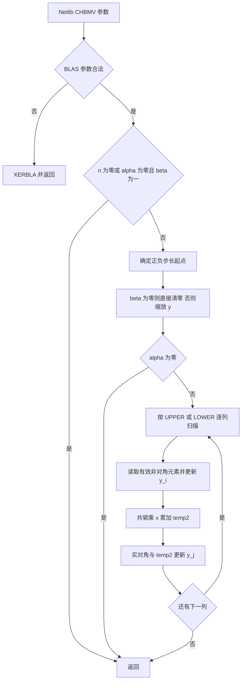
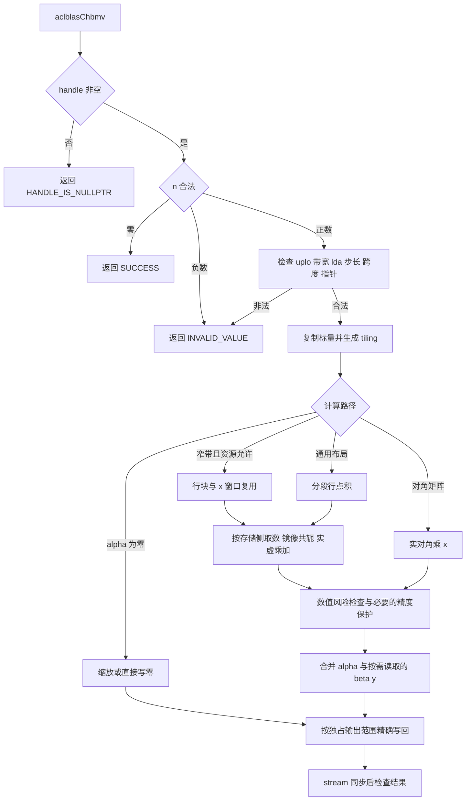

# 一、需求背景

## 1.1 需求来源

本设计对应 CANN 2026 年 11 月第 10 号社区任务“aclblasChbmv 算子开发（A2/A3）”。依据任务附件 `aclblasChbmv_AtlasA2_A3_task_doc.md`、`test_cases/README.md`、测试 CSV 和验证脚本编写，任务编号以[社区任务列表](../../../../docs/README.md)为准，章节遵循[设计模板](../../../../resources/design_template.md)及设计文档审核要求。

目标是在 Atlas A2/A3 上通过 Ascend C kernel 直调实现单精度复数 Hermitian 带状矩阵向量乘，遵循 `aclblasChbmv` 公共接口及任务指定的异常、精度和性能合同。设计文档提交到 competition 仓库的本目录；后续算子实现和测试在 `ops-blas` 的 `blas/sbmv/arch22/`、`test/sbmv/chbmv/arch22/` 中进行。

本文是设计与验证方案。已核对任务附件及参考源码，尚未执行本方案的 NPU 编译、精度、性能或内存访问检查，不将参考实现的运行结果视为本方案的实测结果。

## 1.2 背景介绍

### 1.2.1 aclblasChbmv 算子实现优化

算子计算 `y ← alpha·H·x + beta·y`。H 是 n 阶 Hermitian 带状矩阵，仅保存一个带形三角，另一侧通过共轭对称恢复；这种存储可避免窄带场景下保存整个 n×n 矩阵。优化需要同时处理列主序带状访存、复数乘加、跨行复用及 strided 向量，不能直接套用实数 SSBMV 或复数对称 CSYMV 的计算规则。

本次源码调研固定 `ops-blas` 提交为 `9565ef46a98f82e8884ee084aea96ec62e3e993e`，后文仓内路径均相对该版本。任务书发布时称公共头文件尚无本接口；当前版本已包含公共声明及 arch22/arch35 实现。因此后续开发应复用公共接口、核对现有代码并形成必要增量，不重复声明接口、不另建平行工程，也不把已有实现归为本设计新增成果。

| 参考对象 | 文件及用途 |
| --- | --- |
| 语义标杆 | [Netlib chbmv.f](https://www.netlib.org/blas/chbmv.f)：带状寻址、共轭、实对角、负步长和计算流程 |
| 对标接口 | [cuBLAS cublasChbmv](https://docs.nvidia.com/cuda/cublas/index.html#cublas-t-hbmv)：参数顺序和 Hermitian 带状矩阵向量乘语义 |
| 公共接口 | [include/cann_ops_blas.h](https://gitcode.com/cann/ops-blas/blob/9565ef46a98f82e8884ee084aea96ec62e3e993e/include/cann_ops_blas.h)、[include/cann_ops_blas_common.h](https://gitcode.com/cann/ops-blas/blob/9565ef46a98f82e8884ee084aea96ec62e3e993e/include/cann_ops_blas_common.h)：函数、类型和状态码 |
| 当前 Chbmv | [blas/sbmv/arch22/chbmv_host.cpp](https://gitcode.com/cann/ops-blas/blob/9565ef46a98f82e8884ee084aea96ec62e3e993e/blas/sbmv/arch22/chbmv_host.cpp)、[chbmv_kernel.cpp](https://gitcode.com/cann/ops-blas/blob/9565ef46a98f82e8884ee084aea96ec62e3e993e/blas/sbmv/arch22/chbmv_kernel.cpp)、`chbmv_kernel.h`、`chbmv_tiling_data.h`：现有调度、行分工及复数实现 |
| 同族实现 | [blas/sbmv/arch22/ssbmv_kernel.cpp](https://gitcode.com/cann/ops-blas/blob/9565ef46a98f82e8884ee084aea96ec62e3e993e/blas/sbmv/arch22/ssbmv_kernel.cpp)、[blas/gbmv/arch22/cgbmv_kernel.cpp](https://gitcode.com/cann/ops-blas/blob/9565ef46a98f82e8884ee084aea96ec62e3e993e/blas/gbmv/arch22/cgbmv_kernel.cpp)：带状窗口与复数实虚分离的工程参考 |
| 测试实现 | [test/sbmv/chbmv/arch22/chbmv_golden.h](https://gitcode.com/cann/ops-blas/blob/9565ef46a98f82e8884ee084aea96ec62e3e993e/test/sbmv/chbmv/arch22/chbmv_golden.h)、`chbmv_test.cpp`、`chbmv_param.h`：高精度参考及任务合同验证 |

本任务为 BLAS 句柄接口直调，不以 TBE 算子为迁移对象，没有对应的 TBE Python 实现文件或待新增的 TBE 算子信息库条目。模板中对源码路径的要求由上述实际文件满足，不虚构 `chbmv.py` 或 ACLNN 接口。

### 1.2.2 aclblasChbmv 算子现状分析

#### 1.2.2.1 标杆算子支持的数据类型和数据格式

| 参数 | 所在位置/类型 | 形状、布局与约束 |
| --- | --- | --- |
| handle | Host，`aclblasHandle_t` | 有效句柄，携带 stream；空句柄优先返回状态码 9 |
| uplo | Host，`aclblasFillMode_t` | `ACLBLAS_UPPER` 或 `ACLBLAS_LOWER`，无 trans/diag 参数 |
| n、k、lda | Host，`int` | n≥0，k≥0，lda≥k+1；有效带宽 b=min(k,n−1) |
| alpha、beta | Host，`const aclblasComplex*` | 各为一个 complex64 标量，调用期间复制其值供异步 kernel 使用 |
| A | Device，只读 complex64 | 列主序 ND 存储，物理数组 lda×n，仅指定带形三角有效 |
| x | Device，只读 complex64 | 逻辑长度 n，物理长度至少 `1+(n−1)·abs(incx)` |
| y | Device，complex64 | 同时为输入和原地输出，物理长度至少 `1+(n−1)·abs(incy)` |
| incx、incy | Host，`int` | 非零、非 INT32_MIN，且 `(n−1)·abs(inc)` 不超过 INT32_MAX |

`aclblasComplex` 由 `float real; float imag;` 构成，一个元素 8 字节；步长和 lda 均以复数元素计，不能误用 float 分量数。只有 y 的逻辑位置被修改，向量间隙、A 和 x 保持不变。不涉及广播、转置、批量接口或任意 Tensor stride。

以零基逻辑行 i、列 j 表示完整矩阵 H，记 `A[p]` 为带状数组的复数元素，映射如下：

| 模式 | 条件 | H(i,j) |
| --- | --- | --- |
| UPPER | j>i 且 j−i≤b | `A[j·lda+k+i−j]` |
| UPPER | j<i 且 i−j≤b | `conj(A[i·lda+k+j−i])` |
| UPPER | j=i | `real(A[i·lda+k])` |
| LOWER | j<i 且 i−j≤b | `A[j·lda+i−j]` |
| LOWER | j>i 且 j−i≤b | `conj(A[i·lda+j−i])` |
| LOWER | j=i | `real(A[i·lda])` |
| 两种模式 | abs(i−j)>b | 结构零，不参与乘法，不访问对应不存在的元素 |

`k>n−1` 时只缩减计算范围，UPPER 物理对角行仍为原始 k，不能把地址公式中的 k 替换为 b。对角虚部不参与计算，即使其存储内容是 NaN/Inf，也不能污染结果。

负步长的基址仍指向物理分配起点，逻辑位置映射为：

$$
p(i,inc)=\begin{cases}i\cdot inc,&inc>0,\\(n-1-i)\cdot(-inc),&inc<0.\end{cases}
$$

先把 inc 提升到 int64 再处理符号；Host 先拒绝 INT32_MIN，避免在 int32 域执行 `abs` 或取负溢出。

#### 1.2.2.2 标杆算子实现描述

Netlib 先校验 BLAS 参数，再处理 quick return，计算向量起点，并将 y 缩放为 beta·y；beta=0 时直接置零，alpha=0 时结束。随后按存储列扫描：令 `temp1=alpha·x[j]`，用列中非对角元素更新对应的 y[i]，同时累加 `temp2=Σconj(Aij)·x[i]`，再结合实对角更新 y[j]。UPPER 和 LOWER 的扫描范围不同，但都只解释指定带形三角。负步长分支使用逻辑起点和增量完成同一计算。

任务接口的参数检查顺序与 Netlib 原始错误处理有明确差异：本任务必须先检查 handle，再检查 n，n=0 后立即成功，不继续检查 uplo/k/lda/步长/数据指针；不能原样照搬 Netlib 的检查顺序或 XERBLA。

当前 arch22 主仓已有窄带对角遍历、通用行点积和宽带面板路径，使用 AIV/Vector 完成复数 FP32 计算，依据布局与形状选择路径。它还包含 `finite_soft64.hpp` 和 `finite_netlib_row.hpp`，用于有限输入异常数值范围的高精度行重算。本设计借鉴其职责划分，具体阈值、搬运方式和数值路径仍需针对本任务验证；不把其他平台的 SIMT、核数或 UB 常量移植为 A2/A3 默认值。

#### 1.2.2.3 标杆算子实现流程图



该图描述公开语义参考，不代表 cuBLAS 内部 GPU kernel 的实现细节。

# 二、需求分析

## 2.1 外部组件依赖

| 组件 | 要求 |
| --- | --- |
| 平台 | Atlas A2/A3；任务性能指定 Atlas 800T A2（910B3），自验证允许覆盖其中一种款型 |
| CANN | 以任务要求的 CANN 9.1.0 为验证基线，记录 Toolkit/Ops/驱动/固件实际版本 |
| 开发框架 | ops-blas 公共句柄、Host 工具、Ascend C 编译和现有 arch22 构建体系 |
| 数值 golden | Netlib BLAS 3.10.0；complex64 输入升为 double 分量，通过 `cblas_zhbmv` 计算后收窄为 float 分量 |
| 测试 | 仓内 CSV/GTest 框架，附件精度/性能脚本、msprof op 及设备内存访问检查工具 |
| 性能参照 | 附件 `gpu_baseline.csv` 的 200 条数据；附件声明 GPU 为 A100-SXM4-80GB、CUDA 12.8、cuBLAS 12.8.4 |

任务书称 `cblas_chbmv` 为语义基线，但要求 FP64 真值计算；实际应调用双精度复数接口 `cblas_zhbmv`，不能仅把数据转换为 double 后继续调用单精度接口。测试只依赖 CPU 高精度 BLAS，NPU 执行本身不依赖 CUDA/cuBLAS。

## 2.2 内部适配模块

| 路径 | 职责与改动边界 |
| --- | --- |
| `include/cann_ops_blas.h` | 复用已有统一声明；若基于尚未声明的旧基线实现，只添加同一签名一次 |
| `include/cann_ops_blas_common.h` | 复用 complex64、fill mode、status，不定义私有替代类型 |
| `blas/sbmv/arch22/chbmv_host.cpp` | 参数检查、Host 标量复制、tiling 与 stream 异步下发 |
| `blas/sbmv/arch22/chbmv_tiling_data.h` | 物理 k、有效 b、维度、步长、标量、块大小及路径标识 |
| `blas/sbmv/arch22/chbmv_kernel.cpp`、`chbmv_kernel.h` | AIV 计算、搬运、共轭处理、精度保护和写回 |
| `blas/sbmv/arch22/finite_soft64.hpp`、`finite_netlib_row.hpp` | 复用并验证已有有限数高精度重算能力，避免另建重复数值库 |
| `test/sbmv/chbmv/arch22/` | CSV 参数解析、分配边界、golden、精度与性能测试及补充用例 |
| `test/sbmv/chbmv/CMakeLists.txt`、`blas/sbmv/README.md` | 按已有工程注册测试，说明接口、限制及 A2/A3 支持情况 |

不新建独立 `op_host/op_kernel` 工程，不创建同名平行算子目录，不将其他架构实现替换为 arch22 专用代码。

## 2.3 需求模块设计

### 2.3.1 Ascend C 算子原型

公共接口严格沿用任务签名：

```cpp
aclblasStatus_t aclblasChbmv(
    aclblasHandle_t handle,
    aclblasFillMode_t uplo,
    int n, int k,
    const aclblasComplex* alpha,
    const aclblasComplex* A, int lda,
    const aclblasComplex* x, int incx,
    const aclblasComplex* beta,
    aclblasComplex* y, int incy);
```

通过 handle 的 stream 调用内部 kernel 启动封装。alpha/beta 的四个 float 分量以值传入 tiling，Device 不解引用 Host 标量指针。输出在 y 原地更新，无额外公开返回 Tensor、workspace 查询接口或 pointer mode 扩展。

### 2.3.2 Ascend C 算子相关约束

输入/输出只支持 complex64，采用 FP32 Vector 运算与受控的高精度保护，不通过 FP16/BF16 降精度取得性能。支持上下带、padding、正负非零步长及 k>n−1；有动态运行时 n/k 参数，但不依赖图模式 dynamic shape。

调用方提供足够容量的有效 Device 缓冲区；本方案要求 A、x、y 不重叠。y 原地更新不意味着支持 x=y 或部分重叠，Host 不能仅凭裸指针保证任意分配容量与重叠关系。接口保持异步，结果检查在 stream 同步后进行。

# 三、需求详细设计

## 3.1 调用方式

使用 ops-blas 句柄式 kernel 直调：创建 handle/stream，通过 `aclblasSetStream` 绑定，准备 Host alpha/beta 和 Device A/x/y，调用 `aclblasChbmv`，在读回结果前同步 stream。遵循库中既有设备、句柄及错误处理流程，不在算子内部执行全设备同步。

Host 校验次序固定如下：

1. `handle==nullptr` 返回 `ACLBLAS_STATUS_HANDLE_IS_NULLPTR`（9）。
2. `n<0` 返回 `ACLBLAS_STATUS_INVALID_VALUE`（3）。
3. `n==0` 直接返回 `ACLBLAS_STATUS_SUCCESS`（0），不读取其他参数指向的数据、不启动 kernel。
4. 对 n>0 检查 uplo、k、lda、incx/incy 及 alpha/beta/A/x/y；任何非法项返回状态码 3，包括非法 uplo，不能沿用某些同族接口的 `INVALID_ENUM`。
5. 校验完成后复制标量，再选择恒等返回、缩放或矩阵向量路径。即使 alpha=0 或 beta=0，也不能豁免 n>0 时的数据指针非空要求。

`k+1`、向量跨度、矩阵偏移在 int64/uint64 域计算；先检查乘法上界再计算 `lda*n*sizeof(aclblasComplex)`，避免字节数溢出。n=0 分支之前不得计算 n−1。资源获取或 kernel 下发失败按仓库既有规则报告，成功下发不代替同步时的异步错误检查。

## 3.2 需求总体设计

整体采用“输出行独占、有效带分块、UB 内实虚分离”的 AIV 方案。每行 i 仅处理 `j∈[max(0,i−b), min(n−1,i+b)]`；同一输出只由一个核写回，不使用复数原子加或跨核部分和归约。

先实现覆盖全部合法布局的分段行点积，再为连续向量和较窄带增加行块内对角遍历。宽带仍采用有界归约块，不展开 n×n 稠密矩阵。对小 n、k=0、alpha=0 等情况采用轻量路径，路径阈值由 UB 预算和性能扫描确定，不能按测试名称、随机种子或数据文件路径分流。

### 3.2.1 host 侧设计

tiling 至少记录 `n/k/b/lda/uplo`、`incx/incy`、逻辑起点、alpha/beta、行块 R、归约块 L、核数和路径。k 与 b 使用不同字段；全局偏移保持 64 位，在 DMA 字段转换之前单独检查长度、stride 和 blockCount 的表示范围。

复用 Host 的 AIV 核数查询；UB 容量使用目标平台查询结果扣除预留，不能把物理容量全部分配给显式 Tensor，也不能固定 A2/A3 均有某个核数。[PlatformAscendC](https://www.hiascend.com/document/detail/en/CANNCommunityEdition/910/API/ascendcopapi/docs/en/api/Utils-API/platform_info/PlatformAscendC/GetCoreNumAic.md)区分 Cube/Vector 核数，本设计选择 Vector 资源，不以 Cube FP16 峰值估计 FP32 复数性能。

#### 3.2.1.1 分核策略

连续且 y 起址 32 字节对齐时，以 4 个复数输出为最小完整写回组。令 `G=ceil(n/4)`，分配 `C<=min(C_aiv,G)` 个 block，第 c 个 block 拥有组区间 `[floor(cG/C), floor((c+1)G/C))`，对应行区间乘 4 后截断到 n；仅最后一组可能不足 4 个元素。核内进一步按 R 行切分。小输入选择较少核以减少固定开销。

当 incy 非 1 或 y 起址不满足上述边界时，首版使用单 block 处理全部输出，避免两个核对同一 32 字节写回事务产生竞争；这不限制合法步长支持。后续若对该场景并行化，必须先证明物理写回区域互不干扰，并验证间隙保护。附件性能用例全部 incx=incy=1，可单独评估连续路径收益。

带边界的实际工作量为 `w_i=min(n−1,i+b)−max(0,i−b)+1`。初始采用组数均分，宽带若出现明显核间长尾，再按 `Σw_i` 调整完整写回组边界，保持每行唯一归属。

#### 3.2.1.2 数据分块和内存优化策略

**通用行点积。** 对一行分为左非对角、实对角、右非对角三段：UPPER 左段位于存储列 i 内，可连续搬入并共轭；右段在不同列中相隔 `lda−1` 个复数；LOWER 正好相反。每段以 L 个逻辑元素分批搬入，A/x 在 UB 中解交织为实、虚平面，向量复乘后分别归约，最后合并 alpha/beta。

跨列和非单位步长采用分块 DMA 与 UB Gather/重排；负步长先按物理递增地址搬入，再逆序恢复逻辑顺序。大 stride 超过 DMA 参数范围时拆为多个合法搬运，必要时以 8 字节有效负载和 32 字节 UB 槽位暂存。避免把稀疏跨度整体复制到巨大缓冲，也不以逐元素 GM GetValue/SetValue 作为正常数据通路。

**窄带行块。** 处理 R 个输出时，只需 x 的 `[r0−b,r1+b)` 有效窗口。分批搬入与输出块有关的存储列有效带段，按偏移 d 生成对应系数索引，对多个输出并行乘加。每个带段只搬入有效内容，UB 补位初始化为零；边界通过有效索引区间处理，不能先对结构零乘 Inf 再乘掩码。padding 和未使用三角均不作为数值输入。

设 `A32(z)=32·ceil(z/32)`，字节预算可按下表计算；这是候选实现的保守预算，实际同时存活的每个 TBuf/TQue 都要计入。

| 缓冲 | 字节预算 |
| --- | --- |
| 每路 AoS 暂存 | `S(L)=A32(8L)`；8 字节分散搬运时按 `S(L)=32L` 计，不按有效负载低估 |
| A/x 输入 ping-pong | `4S(L)`，分别为两套 A 和 x 暂存 |
| 复数计算平面 | `8A32(4L)`，含 A/x 实虚及四个乘积临时平面 |
| 索引平面 | 预留 `2A32(4L)`，实际 Gather/逆序索引逐项核对 |
| 输出累加、旧 y 与打包 | 预留 `3A32(8R)`；beta=0 时不搬入旧 y |
| 归约及管理预留 | `U_reduce + U_reserve`，由 API 所需空间及编译资源核定 |

通用路径要求上述总量不超过查询到的 `U_UB`。窄带路径另计驻留 x 窗口 `A32(8W)`，其中 `W=min(n,R+2b)`，以及实际装入的带段、索引和累加平面；若一次覆盖超预算，按列批分段，不因 b 或 lda 增大而分配 O(n²) 缓冲。

候选 R 取 32/64/128，L 取 64/128/256，均为待调优参数，不是硬件通用最佳值。每个候选先检查对齐、容量和 API 限制，再以小输入、窄带、宽带及尾块的消融结果决定保留范围。输入 ping-pong 只有在缓冲生命周期允许时开启。

**工作量与流量。** 有效非对角元素对数为 `P=nb−b(b+1)/2`，完整逻辑带元素数为 `E=n+2P`，实际存储有效复数元素数为 `S=n+P`。名义工作量约 `8E+O(n)` 个实数 FLOP；理想情况下非对角复数各读取一次、对角只读实部、x 读取一次、旧 y 按需读取、输出写一次，有效负载为：

$$
Q_{ideal}=8P+4n+8n+8n+8n[\beta\ne0]\quad\text{Byte}.
$$

该下界不代表实现流量：若对角仍按 8 字节槽位搬入，需另加 4n 字节；行独占可能把非对角系数读取两次，x 在行块间也有重读，非对齐搬运还存在事务放大。分别统计 GM 请求量和经缓存后的 HBM 流量，用 `max(F/P_{FP32},Q_{HBM}/B_{HBM})` 作为有条件的资源下界，不将其当作预测时延。实际瓶颈还需比较 DMA 次数、Scalar 寻址、Gather、归约及同步；本设计不宣称已达硬件极限。

#### 3.2.1.3 tilingKey 规划策略

这是直接启动 kernel 的工程，不新增图算子 Tiling 注册。使用内部路径枚举并传入 tiling；编号为设计标识，实施时与现有字段统一，不形成公开 ABI。

| 路径 | 准入条件 | 行为 |
| --- | --- | --- |
| SCALE | 参数合法且 alpha=0 | beta=0 写零；beta=1 可成功返回；其他 beta 缩放 y |
| DIAGONAL | alpha≠0 且 b=0 | 仅加载实对角与对应 x，不进行带内归约 |
| BAND_ROWS | 连续向量，行块/窗口满足 UB 与搬运约束 | 按带偏移并行计算输出行，复用 x 窗口 |
| ROW_DOT | 其余合法布局或窗口超预算 | 左/右带分段点积，支持 padding 与正负步长 |

数值风险保护在实际数据检查后选择，不能仅凭形状推断输入一定有限；未经精度验证的快路径退回通用计算。特殊输入不通过修改输出为有限值、饱和到最大浮点数或放宽比较器来“修复”。

### 3.2.2 kernel 侧设计

#### 3.2.2.1 kernel 侧实现描述

1. **Init**：建立 float 分量形式的 GM Tensor，读取按值传入的 tiling，确定本核输出区间及缓冲，所有全局地址先在宽整数域计算。
2. **CopyIn**：按 uplo 和零基映射获取有效带段及逻辑 x；beta=0 时完全不读取旧 y。用 `DataCopyPad` 处理非对齐长度，UB 起址按 32 字节对齐；GM 输出长度严格等于有效字节数，不能把补齐长度写回。[搬运 API 说明](https://www.hiascend.com/doc_center/source/zh/canncommercial/900/API/ascendcopapi/atlasascendc_api_07_0265.html)中的参数单位和取值需与目标 9.1.0 头文件再核对；blockCount 分批控制在 API 范围内。
3. **Compute**：复数乘法为 `pr=ar*xr−ai*xi`、`pi=ar*xi+ai*xr`，镜像带先对 ai 取负。对角独立执行 `diag*xr`、`diag*xi`，不读取其虚部参与复乘。归约只覆盖有效元素，不能将未初始化 UB lane 带入结果。
4. **数值保护**：一般输入以 FP32 分段乘加；长归约和强相消补充验证 pairwise/补偿累加。全为有限值但中间溢出、过小值或异常相消的路径，评估复用现有有限数软件 binary64 重算，并保持 Netlib 行更新语义及最终一次 FP32 收窄。原本含 NaN/Inf 的输入使用明确的特殊值路径，不能送入只支持有限数的软件算法。实现要记录触发条件和次数，验证软浮点与 native double 标杆一致，而不是假定已有 helper 对所有输入无误。
5. **标量合成**：最终形成 alpha·sum 与 beta·y。alpha=0 路径不计算矩阵乘积；这是允许的优化，但接口校验仍先完成。alpha=1、beta=1 可保持原值分量操作，避免无必要的零乘特殊值；其他复数标量按参考语义处理。
6. **CopyOut**：实虚交织打包后写回 y 的逻辑位置，非单位步长保留间隙。若一行需重新计算，必须在最终写回前完成，不能让重算读到已覆盖的旧 y。

队列方案通过 EnQue/DeQue 建立 MTE2→Vector→MTE3 依赖，手动缓冲方案显式配对对应 HardEvent。Vector/Scalar 读取归约结果、Scalar 填写索引、DMA 覆盖旧槽位均需满足各自依赖；单独的 PIPE_V 屏障不能替代跨流水事件。输出 DMA 完成前不复用其 UB 槽位，不依赖跨核隐式同步。

#### 3.2.2.2 Ascend C 实现流程图



#### 3.2.2.3 Ascend C 实现流程图与标杆算子流程图存在的差异点和原因

| 差异 | 原因及影响 |
| --- | --- |
| 输出行独占替代逐列跨行更新 | 消除多核写冲突；代价是部分系数重读，需要窗口复用缓解 |
| 实虚平面 Vector 计算替代串行复数循环 | 适应 AIV，改变部分归约次序；按任务混合容差验证，不能要求 bit-exact |
| Host 检查顺序按任务规定 | 支持 n=0 叠加其他非法参数的 quick return，且空 handle 优先 |
| 只搬入有效段、对角单独处理 | 避免 padding、无效三角、对角虚部及结构零污染特殊值结果 |
| 有限数风险保护与普通路径分开 | 覆盖 FP64 golden 下 FP32 中间溢出等问题，不假设所有测试为小幅值随机数 |
| 单核处理首版非连续写回 | 保证写回事务与间隙安全，接受通用步长路径的性能代价 |

## 3.3 支持硬件

| 平台 | 目标 |
| --- | --- |
| Atlas A2 系列，含 Atlas 800T A2 | arch22 支持；性能验收优先使用任务指定的 910B3 |
| Atlas A3 系列，含 Atlas 800T A3 | arch22 支持；可按任务要求选择该款型完成自验并记录环境 |
| Ascend 950/arch35 | 本任务不新增适配；公共声明与现有其他架构保持兼容 |

编译和验证需记录实际 SoC、核数、UB、驱动、固件、CANN 与编译器版本。未验证的平台不得填报“测试通过”；A3 上的数据不能无说明替代指定 910B3 的性能结果。

## 3.4 算子约束限制

- n=0 只要求 handle 有效且 n 不为负；不启动 kernel，不解引用 alpha/beta/A/x/y。
- n>0 时全部指针非空，beta=0 只免除读取 y 旧内容，不免除 y 作为有效输出缓冲的要求。
- k 可超过 n−1，lda 仍需满足原始 k+1；检查过程不允许 int32 回绕。
- alpha=0 可以只缩放 y，但任务不要求保证跳过 A/x 读取，验收不组合 alpha=0 与 x 的 Inf/NaN 用例。
- 不支持超出 lda/incx/incy 语义的任意非连续 Tensor、矩阵广播、数据类型转换或输入输出重叠。
- 不要求位级确定性，但每次结果都须满足精度标准；不能通过跨核原子更新破坏复数输出的完整性。

# 四、特性交叉分析

| 特性 | 主要风险 | 处理与验证 |
| --- | --- | --- |
| UPPER/LOWER 与 k>n−1 | 把有效带宽用于物理对角寻址 | 保留 k/b 双字段，构造两种存储的等价矩阵交叉比对 |
| Hermitian 与对角虚部 | 少取共轭，或对角虚部 NaN 传播 | 镜像虚部取反，对角实数乘，专项污染用例 |
| 结构零与 Inf/NaN | 先算 0×Inf 再掩码造成错误传播 | 不对带外项执行乘法，按有效段和索引限制计算 |
| 正负步长与 padding | 起点错误、读写越界或覆盖间隙 | 64 位映射，负步长重排，首尾及间隙 canary |
| 参数校验与 quick return | 先解引用空标量，或错误检查 n=0 的其他参数 | 单测覆盖 handle/n 与全部非法参数组合及优先级 |
| 多核与非对齐写回 | 不同逻辑行共享物理事务 | 32 字节输出组独占，通用写回首版单核 |
| 精度与分段归约 | 相消、舍入及中间溢出导致 finite/nonfinite 不一致 | 固定混合容差，补充强相消与极端范围验证，核对重算路径 |
| stream 与生命周期 | 下发后 Host 标量失效、缓冲过早释放 | 标量按值传入；Device 缓冲由调用方保留到同步完成 |
| 窄带复用与大 lda | UB 溢出、复制 padding 降低有效搬运比例 | 显式预算，按有效带段分批，超预算回退 |

# 五、可维可测分析

## 5.1 精度标准/性能标准

**附件覆盖。** 本次对原始 CSV 的静态统计为 1200 条：1000 条精度/边界用例、200 条 `TC_PF` 性能用例；前者包含 984 条期望 SUCCESS 和 16 条期望 INVALID_VALUE。精度表的 UPPER/LOWER/非法 uplo 数量为 507/490/3，性能为 95/105。性能表最大 n=4096、k=2047，200 条 GPU 基线均非空。成功返回用例中仍包含 quick return，不能把 984 条都算作数值计算用例。

保持发布用例及 GPU 基线可追溯，另行补充：

- 空 handle，尤其与 n=0/n<0 组合的错误优先级；原 CSV 没有 handle 列。
- 未使用带角、lda padding、对角虚部置 NaN/Inf；修改这些内容不应影响合法输出。
- y 旧值为 NaN 且 beta=0，负步长逻辑首尾、输出间隙与前后 canary。
- 跨行块、跨归约块边界，n 为 2 的幂及其 ±1，n=1、k=0、满带及 k>n−1。
- INT32_MIN、跨度溢出、k=INT32_MAX 与 lda 比较；错误用例只分配 dummy 缓冲，不能为预期非法参数分配数十亿元素。
- 有限大/小值、长归约相消与非有限值传播，确保没有按用例名称选择特殊实现。

附件默认生成器尚未兑现随机输入“均匀/正态各 50%”的要求。保留原用例，增加等量的随机分布镜像用例：均匀分布 [-5,5] 与正态分布 `μ∈[-5,5]、σ∈[0.1,2]`，实虚独立采样；A/x/y 使用相应填充方式，alpha/beta 也须重新按分布生成，不能只替换 a_fill token。固定 seed，报告每类随机变量的分布计数；固定边界和特殊值用例单列，不强行归入随机分布比例。

**golden 与精度判定。** 从实际生成的 complex64 输入提升到 double 分量，用 Netlib BLAS 3.10.0 `cblas_zhbmv(CblasColMajor,...)` 计算，再将输出实虚分量分别收窄为 FLOAT32。golden 按相同 k/lda/uplo/步长解释输入，保留 beta=0 不读旧 y、对角仅取实部的语义。记录实际链接库身份，不能使用单精度 CBLAS 结果冒充 FP64 真值。

以任务书指定的[固定版本混合容差标准](https://gitcode.com/cann/opbase/blob/28a1ce52ae856353589841226a0002af73314a6b/docs/zh/ops_precision_standard/mixed_tolerance_standard.md)为口径，实部和虚部分别全量检查：

- `rtol=atol=2^-13`，有限值逐元素满足 `abs(actual−golden) <= atol+rtol*abs(golden)`。
- 有限值 matched_ratio≥0.99，且最大绝对误差≤`max(1e-2,32*ULP(golden_at_max_error))`。
- ULP 在最大误差对应的 FLOAT32 golden 数值处计算；不是固定取 1.0 处 ULP。零和次正规数使用对应的最小 FLOAT32 间距。
- 非有限值单独统计：双方同为 NaN、同号 Inf，或一方 NaN/另一方 ±Inf，通过特殊值判定；异号 Inf 或有限/非有限混合不通过。所有非有限值元素必须通过，且不进入有限值误差统计；没有有限元素时不执行除零统计。

CSV 的 `mere_threshold/mare_multiplier` 为保留列，不能用 MERE/MARE 替换上述门槛，也不能依据旧版本通用精度表放宽阈值。每个数值 case 保存实部/虚部的有限数总量、匹配数、最大误差及对应 golden、特殊值通过数；状态码测试另行统计。跳过、缺失、未匹配用例不得计为通过。

**性能判据与口径差异。** 任务书 §3.3 指定 `msprof op` 的单算子 task duration；附件 README 和 `verify_performance.py` 实际解析 GTest 的 `[PERF] ... avg_us=`，其来源是 aclrtEvent，二者并不相同。设计以任务书为主口径，同时保留附件脚本要求的 event 数据，分别出表，并在验收材料中明确差异、供验收方确认，不把 event 冒称 kernel duration，也不只挑较小的一列。

每条用例先预热 5 次，再采集至少 10 个成功的有效样本，warmup 不计入均值。msprof 自带预热与测试程序预热需在日志中区分，按 trace 确认正式样本；多个 kernel 构成一次 API 调用时，包含该次调用的全部实际工作，不能只报告最快的子 kernel。H2D/D2H、造数、golden 计算不进入算子计时；beta≠0 的扩展场景需在计时外恢复同一初始 y，避免重复更新改变数值和分支。

单 case 的要求为 `T_npu_us <= 1000*gpu_ms/0.8`，即 GPU/NPU 加速比≥0.8，而不是 NPU 耗时≤GPU 的 0.8 倍。200 条全部逐例比较，报告原始样本、算术平均、波动和失败项，不以整体平均掩盖单例失败。

| 附件典型 case | GPU 标杆 / μs | NPU 门槛 / μs |
| --- | --- | --- |
| UPPER，n=512，k=8 | 9.88159995 | ≤12.352（展示值四舍五入） |
| UPPER，n=1024，k=16 | 15.8719998 | ≤19.840（展示值四舍五入） |
| LOWER，n=2048，k=32 | 28.0064001 | ≤35.008（展示值四舍五入） |
| LOWER，n=4096，k=64 | 53.0261327 | ≤66.283（展示值四舍五入） |

实际比较使用 CSV 原始值，不使用表中舍入值。这些是附件基线和计算出的验收上限，不是 NPU 实测成绩。匹配 GPU 基线时核对 uplo/n/k/incx/incy，并额外核对 lda、标量和输入设置；重新生成用例导致缺基线时须补测，NO_REF 不通过。

**验证入口。** 后续实现阶段在附件 `test_cases` 目录执行下列脚本；`OPS_BLAS_REPO` 指向实际源码仓，脚本会向测试目录安装 CSV，应保存原始输入及备份。当前设计 PR 不运行这些设备测试。

```bash
python3 verify_accuracy.py --repo "$OPS_BLAS_REPO" --soc ascend910b --csv ./chbmv_test.csv
python3 verify_performance.py --repo "$OPS_BLAS_REPO" --soc ascend910b --csv ./chbmv_test.csv
```

A3 使用 `--soc ascend910_93`。编译命令与 GTest 二进制路径以当前仓构建产物为准；单例 profiling 示例为：

```bash
msprof op --application="${CHBMV_TEST_BIN} --gtest_filter=${CHBMV_CASE_FILTER}" --output=./prof_chbmv
```

`CHBMV_CASE_FILTER` 每次收敛到一条性能 case，解析对应 task duration，并验证所有预期用例、有效样本数和日志完整性。附件示例的多余引号不直接照搬；脚本返回零也不能代替完整用例计数检查。

**内存与工程检查。** 任务未设置内存性能指标，仍需检查 UB 超限、越界、未初始化读取、间隙覆盖和并发写回。附件 512 MB 是测试生成器的 Host 单例预算，不是设备或接口上限；升为 complex128 的 golden 缓冲也要计入测试峰值，逐 case 释放。完成指定平台编译、测试与仓库静态检查后再填写实现验收结论。

后续开发者私仓 `task_submission/` 按任务要求提供 `1 自验证步骤说明.md`、`2.1 精度自验证报告.xlsx`、`2.2 精度自验证日志.log`、`3.1 性能自验证报告.xlsx`、`3.2 性能自验证日志.log`、`4.1 内存自验证报告.xlsx`、`4.2 内存自验证日志.log`。内存指标填“不涉及”并说明访问检查情况，不伪造指标；保存环境、命令、提交号、CSV/基线校验值及逐例证据。

## 5.2 兼容性分析

保持公共 API、complex64 二分量布局、Host 标量和 handle/stream 语义，与其他产品线共享声明。按任务规定支持负步长和宽于矩阵的 k；不引入任务没有要求的 trans、动态类型或 workspace 参数。新增内部路径不得改变错误码及 quick return 顺序。

主仓已存在对应实现，后续应基于固定版本评审差异并复用测试基础设施，不能把重新提交同一能力当作接口新增。其他同族算子的行为不随本任务调整；非法 uplo 返回值以本任务 `INVALID_VALUE` 为准。

设计文档遵循 competition 目录规范；后续实现遵循 [ops-blas CONTRIBUTING.md](https://gitcode.com/cann/ops-blas/blob/9565ef46a98f82e8884ee084aea96ec62e3e993e/CONTRIBUTING.md)，保留引用代码的 License 与来源，完成必要的 Issue/方案评审、构建及门禁。当前提交仅包含设计文档，AI 参与情况在提交信息及后续 PR 描述中如实注明。
