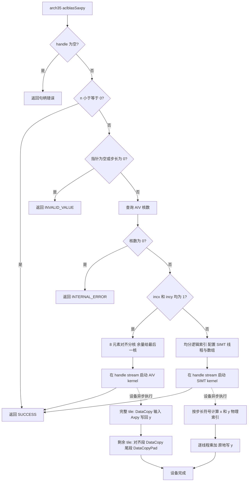
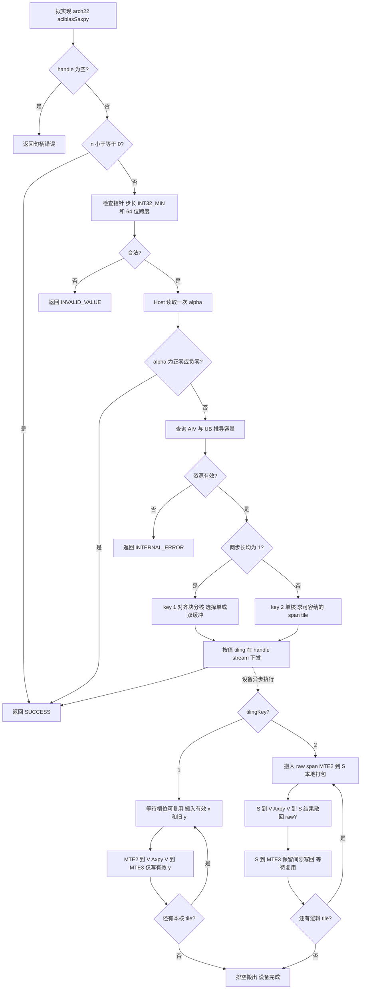

# 一、需求背景

## 1.1 需求来源

本设计对应 CANN 社区任务 2026 年 11 月序号 2《aclblasSaxpy 算子开发（A2/A3）》，依据任务包中的 `aclblasSaxpy_AtlasA2_A3_task_doc.md`、`test_cases/README.md`、两份 CSV 及三个 Python 脚本编写。目标是补齐 ops-blas 在 Atlas A2/A3 上的单精度实数 BLAS-1 AXPY 能力，采用 Ascend C、Host 参数校验与 tiling、kernel 直调模式。

设计文档归档位置为 `04_tasks/01_community-task-2026/tasklist/11-2-aclblasSaxpy-A2A3/Xztxzt/docs/design.md`，文档目标仓基线为 `353edb186cf9a96524ea18f2c5fba842daba542e`。实现目标位置为 ops-blas 的 `blas/axpy/arch22/`，测试目标位置为 `test/saxpy/arch22/`。本文是待实施设计；源码核对和用例统计不代表已完成编译、NPU 精度或性能验收。

## 1.2 背景介绍

SAXPY 对长度为 n 的两个实向量执行 `y ← alpha*x + y`，x 只读，y 原地更新，无归约、矩阵布局转换或向量间广播。每个输出只依赖相同逻辑位置的 x 和旧 y，适合按输出区间并行。连续输入的有效数据量为读 x、读 y、写 y 各 `4n` 字节；一般跨步输入还需考虑搬运放大、地址计算和间隙保护。

### 1.2.1 aclblasSaxpy 算子实现优化

本任务是 BLAS kernel 直调接口，既有参考不是 TBE 算子，也没有本任务可引用的 TBE Python 实现、TBE 算子信息库 JSON 或 ACLNN 两段式入口。不能套用 Addcdiv 的实现路径。下面的实际文件均核对至 ops-blas 提交 `c3ecf8cad3aae31037b04e1e6b523c307a080da5`。

| 证据文件 | 已核实内容及用途 |
| --- | --- |
| [include/cann_ops_blas.h](https://gitcode.com/cann/ops-blas/blob/c3ecf8cad3aae31037b04e1e6b523c307a080da5/include/cann_ops_blas.h) | 第 481 行已有公共 `aclblasSaxpy` 声明；任务书所述第 461 行为旧行号。沿用该 ABI。 |
| [blas/axpy/README.md](https://gitcode.com/cann/ops-blas/blob/c3ecf8cad3aae31037b04e1e6b523c307a080da5/blas/axpy/README.md) | Saxpy 产品表列出 950PR/950DT 支持，A2/A3 不支持；Caxpy 已有 A2/A3 路径。 |
| [blas/axpy/arch35/saxpy_host.cpp](https://gitcode.com/cann/ops-blas/blob/c3ecf8cad3aae31037b04e1e6b523c307a080da5/blas/axpy/arch35/saxpy_host.cpp) | 当前参数检查、连续/跨步 tiling、stream 下发流程。 |
| [blas/axpy/arch35/saxpy_kernel.cpp](https://gitcode.com/cann/ops-blas/blob/c3ecf8cad3aae31037b04e1e6b523c307a080da5/blas/axpy/arch35/saxpy_kernel.cpp)、[saxpy_tiling_data.h](https://gitcode.com/cann/ops-blas/blob/c3ecf8cad3aae31037b04e1e6b523c307a080da5/blas/axpy/arch35/saxpy_tiling_data.h)、[saxpy_kernel.h](https://gitcode.com/cann/ops-blas/blob/c3ecf8cad3aae31037b04e1e6b523c307a080da5/blas/axpy/arch35/saxpy_kernel.h) | 连续 SIMD、非连续 SIMT、tiling 字段与启动包装；不是可直接编译到 A2/A3 的完整实现。 |
| [blas/axpy/arch22/caxpy_host.cpp](https://gitcode.com/cann/ops-blas/blob/c3ecf8cad3aae31037b04e1e6b523c307a080da5/blas/axpy/arch22/caxpy_host.cpp) | 同族 A2/A3 工程参考；复数算术、mask 缓存、packing workspace 和 `n<0` 行为不直接移植到 Saxpy。 |
| [test/saxpy/saxpy_golden.h](https://gitcode.com/cann/ops-blas/blob/c3ecf8cad3aae31037b04e1e6b523c307a080da5/test/saxpy/saxpy_golden.h)、[saxpy_param.h](https://gitcode.com/cann/ops-blas/blob/c3ecf8cad3aae31037b04e1e6b523c307a080da5/test/saxpy/saxpy_param.h) | CPU golden 调用 `cblas_saxpy`；参数类解析 n、两个步长、float alpha 与 x/y 填充方式。 |
| [test/saxpy/arch35/saxpy_test.cpp](https://gitcode.com/cann/ops-blas/blob/c3ecf8cad3aae31037b04e1e6b523c307a080da5/test/saxpy/arch35/saxpy_test.cpp)、[saxpy_npu_wrapper.h](https://gitcode.com/cann/ops-blas/blob/c3ecf8cad3aae31037b04e1e6b523c307a080da5/test/saxpy/arch35/saxpy_npu_wrapper.h)、[test/saxpy/CMakeLists.txt](https://gitcode.com/cann/ops-blas/blob/c3ecf8cad3aae31037b04e1e6b523c307a080da5/test/saxpy/CMakeLists.txt) | 当前测试、缓冲区分配和 GTest 注册边界；A2/A3 测试需要新增，现有测试没有任务脚本要求的 `[PERF] avg_us` 采样输出。 |

任务包、固定源码与外部接口文档存在差异。本文分别记录现状与目标，以任务书的显式功能要求设计新增 arch22 路径，不把任务书对旧源码的概述当成源码事实。

### 1.2.2 aclblasSaxpy 算子现状分析

功能对标是 [cuBLAS 12.8 文档 §2.5.4 cublasSaxpy](https://docs.nvidia.com/cuda/archive/12.8.1/cublas/index.html#cublas-t-axpy)，可阅读的 CPU 算法参考是 [Netlib saxpy.f](https://netlib.org/blas/saxpy.f)，仓内实现参考是上述 arch35 源码。cuBLAS 文档公开接口语义，并未公开其 GPU kernel；下文流程图展示可核验的仓内实现，不推测 cuBLAS 内部调度。

#### 1.2.2.1 标杆算子支持的数据类型和数据格式

| 参数 | 类型及位置 | 布局、长度与用途 |
| --- | --- | --- |
| alpha | FLOAT32；本任务及仓内接口仅 Host 指针 | 一个标量，按值下发；cuBLAS 另外支持 Device pointer mode，本任务不要求。 |
| x | FLOAT32 Device 指针 | 一维 ND 向量，逻辑 n 个元素，物理 span 为 `1+(n-1)*abs(incx)`，支持正负步长。 |
| y | FLOAT32 Device 指针，输入兼输出 | 一维 ND 向量，物理 span 为 `1+(n-1)*abs(incy)`；仅逻辑选中的位置发生数值更新。 |
| n、incx、incy | Host int32 | 没有独立 shape/stride Tensor 描述符；不涉及 NCHW、NHWC、FRACTAL_NZ。 |

这里的 span 只适用于 `n>0` 且参数合法的情况。Saxpy 不覆盖 FP16、BF16、FP64、复数或混合 dtype；任务书通用精度表中的其他 dtype 列不扩展该接口范围。

#### 1.2.2.2 标杆算子实现描述

arch35 Host 顺序为：检查 handle；`n<=0` 返回成功；检查 alpha/x/y 非空、两个步长非零；查询 AIV 核数；按两个步长是否均为 1 分流。固定源码**没有** `alpha==0` 快速返回、INT32_MIN 拒绝或 `(n-1)*abs(inc)>INT32_MAX` 检查。这三项是任务书要求补齐的能力。

连续路径取 `P=min(n, AIV核数)`，每核基础长度为 `8*floor(floor(n/P)/8)`，所有余量交给最后一个核。tile 按公共 `UB_SIZE`、两个 float buffer 推导，再以 32768 元素封顶。kernel 使用两个 TBuf，完整 tile 依次 `DataCopy → Axpy → DataCopy`；最后一块分为 8 元素对齐段和不足 8 元素的尾段，尾段使用 DataCopyPad，计算只覆盖有效长度。源码未显式调用队列或 SetFlag/WaitFlag，本文不将其描述为已验证的 A2/A3 同步方案。

跨步路径按 `SIMT_MIN_THREAD_NUM` 和核数确定启动块数，并受 64 项 tiling 数组上限约束，均分逻辑元素，余数分给前面的核。kernel 使用 `asc_vf_call`，线程按 grid-stride 循环访问 `q_s(i)`：正步长为 `i*abs(s)`，负步长为 `(n-1-i)*abs(s)`，直接执行单精度乘加。这里的线程配置、64 核数组及 UB 常量属于该版本实现，不能作为 A2/A3 硬件常量。

Netlib 参考在 `n<=0` 或 alpha 为零时返回；连续分支有清理循环和四路展开，其他步长按正/负起点遍历。其 Fortran `REAL` 运算和仓内 `cblas_saxpy` 属于单精度参考，不是 float64 真值实现。任务书 §3.2 的 float64 描述与 §3.5、§7 及源码不一致，验收设计见 5.1。

#### 1.2.2.3 标杆算子实现流程图



图中 SUCCESS 是 Host 下发返回，不表示设备已完成；也没有把新增的 alpha 零值分支画入旧实现。

# 二、需求分析

## 2.1 外部组件依赖

| 组件 | 依赖目的与边界 |
| --- | --- |
| CANN 9.1.0 | 任务书指定开发与验收版本；Ascend C 编译器、ACL runtime、平台查询库和 A2/A3 对应设备支持均须匹配。 |
| Ascend C 基础 SIMD API | 使用 FLOAT32 Axpy、GM/UB DataCopyPad、TPipe/TBuf 和核内事件；不依赖 arch35 SIMT、RegBase 或 Compact 搬运模式。 |
| C++、CMake、GTest、Python 3 | 复用 ops-blas 构建、CSV 测试与验收脚本；实际门禁需确认目标被构建且用例被执行。 |
| Netlib BLAS 3.10.0 / CBLAS | 任务指定的 CPU 单精度 golden；另构造 float64 后收窄的诊断参考，分别记录结果。 |
| msprof op、ACL event | 前者满足任务书 kernel task duration 口径，后者满足随包性能脚本口径；二者不能混记。 |
| A100 基线数据 | 随包 README 标注来源为 A100-SXM4-80GB、CUDA 12.8、cuBLAS 12.8.4；本设计仅审计 CSV，没有复采 GPU 数据。 |

## 2.2 内部适配模块

复用公共 `cann_ops_blas.h`、handle/stream 管理和算子构建规则，拟新增 `blas/axpy/arch22/saxpy_host.cpp`、`saxpy_tiling_data.h`、`saxpy_kernel.h`、`saxpy_kernel.cpp`。这些是计划文件，不是当前 arch22 已存在的 Saxpy 实现。

在 `test/saxpy/arch22/` 新增 CSV 驱动 GTest、NPU wrapper 和性能驱动，复用并核对公共参数解析与 golden。修改 `test/saxpy/CMakeLists.txt`，为 arch22 调用 `ops_blas_add_gtest_tests(${OPS_BLAS} saxpy_test)`；保留 arch35 注册。固定版本根 [test/CMakeLists.txt](https://gitcode.com/cann/ops-blas/blob/c3ecf8cad3aae31037b04e1e6b523c307a080da5/test/CMakeLists.txt) 还会按当前架构检查算子和测试源码，因此未补齐文件时可能直接跳过，不能把构建命令退出成功当成 Saxpy 已编译。

测试侧需先分流负向与快速返回，再分配正常数据，避免现有 wrapper 在 int 域计算 span 的溢出风险。性能驱动需直接使用预置 Device 缓冲，不能对包含分配、H2D、D2H、同步和 golden 的整个 wrapper 计时。

## 2.3 需求模块设计

Host 负责合法性、快速返回、平台查询、分核/分块和按值封装 tiling；Device 负责搬入、按逻辑配对计算和原地写回。测试模块独立核验返回码、数学结果、未选中内存、异步行为与两种性能指标。

### 2.3.1 Ascend C 算子原型

```cpp
aclblasStatus_t aclblasSaxpy(
    aclblasHandle_t handle, int n, const float* alpha,
    float* x, int incx, float* y, int incy);
```

保持公共声明中的非 const `float* x`，实现中按只读使用。与 cuBLAS 的主要签名差异是 x 的 const 限定以及库自身的 handle/返回码类型；不存在复数类型转换。

对 `n>0`、合法非零步长 s，定义零基物理索引和长度：

\[
a_s=|\operatorname{int64}(s)|,\quad
L_s=1+(n-1)a_s,\quad
q_s(i)=\begin{cases}ia_s,&s>0\\(n-1-i)a_s,&s<0\end{cases},\quad 0\le i<n.
\]

计算为 `y[q_incy(i)] = alpha*x[q_incx(i)] + y_old[q_incy(i)]`。传入指针指向物理 span 的低地址端，负步长的调用方不再次预偏移。所有合法访问满足 `0<=q_s(i)<=L_s-1`。例如 `n=3, incx=-2, incy=3` 时，x 访问 `4,2,0`，y 访问 `0,3,6`；其余 y 位置保留。

| 参数/条件 | 拟实现约束及响应顺序 |
| --- | --- |
| handle 为 nullptr | 优先返回 `ACLBLAS_STATUS_HANDLE_IS_NULLPTR`，即使 n 非正也不例外。 |
| handle 有效且 `n<=0` | SUCCESS；不检查或解引用 alpha/x/y，不计算 span，不启动 kernel。 |
| `n>0` 时 alpha/x/y 为空 | `ACLBLAS_STATUS_INVALID_VALUE`。 |
| `n>0` 时任一步长为 0 或 INT32_MIN | `ACLBLAS_STATUS_INVALID_VALUE`；在取绝对值前拒绝 INT32_MIN。 |
| `n>0` 时 `(n-1)*abs(incx)` 或 y 对应值大于 INT32_MAX | 在 int64 域检查，返回 `ACLBLAS_STATUS_INVALID_VALUE`；字节偏移用 uint64/size_t，防止元素跨度合法而乘 4 溢出。 |
| 上述检查全部通过，Host 读取 alpha 等于正零或负零 | SUCCESS；不读取 Device x/y、不启动 kernel，y 按位不变。无效指针/步长不能借 alpha 为零绕过校验。 |
| 其他 alpha、x/y 数值 | 不扫描、不拒绝 NaN/Inf；执行 FLOAT32 运算，特殊值验收单独判定。 |
| 查询平台失败、核数为 0、可用 UB 无法容纳最小 tile | 拟返回已有枚举 `ACLBLAS_STATUS_INTERNAL_ERROR`，不下发非法配置。 |

INT32_MAX 约束作用于最大**元素偏移**，不是 `L_s` 本身；边界上 `L_s` 可为 `INT32_MAX+1`。`n=1` 时最大偏移恒为 0，除 0/INT32_MIN 外的大步长合法，不能先把步长乘 4 截断为 uint32。

### 2.3.2 Ascend C 算子相关约束

本任务仅要求 Host alpha、int32 长度/步长和 FLOAT32 一维向量，不扩展 cuBLAS 的 Device alpha、64 位整数接口或其他 AXPY dtype。无广播、无独立输出 Tensor、无图模式动态 shape 注册；运行时 n 和步长由每次调用的 tiling 处理。

任务书把返回码称为与 cuBLAS 对齐，但所核对 cuBLAS AXPY 条目没有列出本任务全部参数检查或 `ACLBLAS_STATUS_*` 枚举。本文将空 handle、INT32_MIN、跨度上限与检查优先级明确归于任务及 ops-blas 合同，不声称两个库的枚举逐值相同。

任务书 §3.5 把 `incx<=0/incy<=0` 一并写作无需分配的 quick return，与其正负步长功能要求冲突。实现与测试必须区分：负的非零合法步长是正常计算；仅 n 非正、alpha 为零的有效调用及明确非法参数可走免大缓冲路径。

# 三、需求详细设计

## 3.1 调用方式

调用方初始化 ACL、选择设备、创建 stream 和 aclblas handle 并绑定 stream；为 x/y 分配足够的物理 span、初始化数据；传入 Host alpha 调用公共接口；检查 Host 返回码，再在读取结果或释放 Device 缓冲前同步该 stream。正常计算路径仅提交设备任务，不在库内加入 `aclrtSynchronizeDevice`。

alpha 在 Host 校验后读取一次并存入按值 tiling，异步 kernel 不保留 Host alpha 指针。tiling 通过 kernel launch 参数复制，不使用临时 Host 指针悬挂到设备任务，也不新增 GM workspace。启动包装尽可能传回 runtime 能获取的提交错误；设备异步错误由 stream 同步及 runtime 日志暴露，SUCCESS 不作为设备正确性的证据。

## 3.2 需求总体设计

设计分为连续 SIMD 快路径和通用跨步路径。连续路径服务全部随包性能用例；通用路径采用单 AIV、受 UB 约束的局部 span 搬运、核内打包、FLOAT32 Axpy 与保留间隙的写回，覆盖任意合法正负步长。单核通用路径是首版正确性设计，避免跨核对同一输出存储块进行读改写；其吞吐需单独测量，不宣称等同于连续路径。

对于 alpha 非零，名义工作量为 `F=2n FLOPs`，连续有效搬运量 `Q_payload=12n B`，计算强度为 `1/6 FLOP/B`。它提示大输入应关注搬运，小输入应关注固定下发开销，不能据此宣布已达到 HBM 极限。若使用某平台已核实的吞吐 P、带宽 B，可比较 `F/P` 与 `Q_DRAM/B`；这里尚无 `Q_DRAM`、持续带宽或实测时延，不代入其他芯片参数。

### 3.2.1 host 侧设计

完成 2.3.1 中的顺序检查后，查询平台资源，计算 tilingKey、blockDim、tile 容量与 buffer 数。拟定 tiling 按值包含：`n`、带符号的 `incx/incy`、64 位 `absIncx/absIncy` 和最大偏移、`alpha`、`tilingKey`、`blockDim`、`tileElements`、`bufferCount`、连续分核的整块商余数。字段须有固定宽度类型并在 Host/Device 共用定义；避免按固定核数存储每核数组。

不把 n、步长或 alpha 当作编译期模板参数，也不按每个 n 生成一个 kernel。任何访问偏移先提升到 64 位再乘法，只有已证明不超过 API 参数范围的局部搬运长度才收窄。

#### 3.2.1.1 分核策略

通过 `PlatformAscendCManager::GetInstance()` 获取平台对象，再调用 `GetCoreNumAiv()` 与 `GetCoreMemSize(CoreMemType::UB, U)`。kernel 直调无需伪造 gert TilingContext；相关接口见固定 asc-devkit 提交 `d433ffc4f75274b901521dfc42d98542abb98627` 的 [PlatformAscendCManager.md](https://gitcode.com/cann/asc-devkit/blob/d433ffc4f75274b901521dfc42d98542abb98627/docs/zh/api/Utils-API/platform_info/PlatformAscendCManager.md)、[GetCoreNumAiv.md](https://gitcode.com/cann/asc-devkit/blob/d433ffc4f75274b901521dfc42d98542abb98627/docs/zh/api/Utils-API/platform_info/PlatformAscendC/GetCoreNumAiv.md)、[GetCoreMemSize.md](https://gitcode.com/cann/asc-devkit/blob/d433ffc4f75274b901521dfc42d98542abb98627/docs/zh/api/Utils-API/platform_info/PlatformAscendC/GetCoreMemSize.md)。API 文档快照用于设计核验，目标 CANN 9.1.0 仍须实际编译验证。

连续路径以 32B 即 8 个 FLOAT32 元素作为分核基本单位。令 `B=ceil(n/8)`，平台可用 AIV 数为 C，单核目标工作量为 G（8 的倍数，首版取下一节的单缓冲容量 T1，后续凭实测调整），则：

\[
P=\min(C,B,\max(1,\lceil n/G\rceil)),\quad q=\lfloor B/P\rfloor,\quad r=B\bmod P.
\]

核 c 的块数、起点与有效元素数为：

\[
b_c=q+[c<r],\quad s_c=8(cq+\min(c,r)),\quad
\ell_c=\min(8b_c,n-s_c),\quad 0\le c<P.
\]

这些区间不重叠、无遗漏，覆盖 `[0,n)`，只有最后的物理输出尾块可能不足 8 元素。首地址 y 若非 32B 对齐，连续路径保留相同算法但取 `P=1`，避免在非对齐输出分界处并发写同一个数据块；这不是拒绝非对齐有效 float 指针。x 首地址非对齐时使用 DataCopyPad 搬入。

通用跨步路径取 `P=1`，连续处理逻辑区间 `[b,b+t)`。暂不将不同 span 分给不同核，避免非连续 y 的间隙读改写以及相邻核存储块相交。零长度及 alpha 零值快速返回不分核、不占用设备资源。

#### 3.2.1.2 数据分块和内存优化策略

记 `A(z)=32*ceil(z/32)`，U 是平台查询的 UB 容量，R 是实现与工具链需预留的非数据 UB 字节数，必须逐项核对后计入；不能默认未知预留为零，也不照抄 arch35 的 `UB_SIZE`。所有下式均为每个 AIV 的预算，事件资源另行核对。

连续路径每个槽位只有 xLocal 和 yLocal 两个 float buffer，Axpy 直接更新 yLocal，不另分配结果或乘积数组。缓冲槽数 d 为 1 或 2：

\[
U_{dense}(T,d)=2dA(4T)+R\le U,\qquad
T_d=8\left\lfloor\frac{1}{8}\min\left(\frac{U-R}{8d},\left\lfloor\frac{2^{21}-1}{4}\right\rfloor,\mathrm{INT32\_MAX}\right)\right\rfloor.
\]

公式中的 API 上限来自 DataCopyExtParams 的 blockLen 字节范围；它不是芯片容量。先用 T1 计算 G 和分核；若最大单核长度不超过 T1，使用 d=1；否则尝试 d=2、T=T2。双缓冲不足以容纳一个 8 元素块时保留单缓冲多 tile，只有最小单缓冲也无法容纳时才报资源错误。最后 tile 的有效长度 `v=min(T, ell_c-offset)`，GM 读写仅 `4v` 字节，UB 分配容量仍按 T 对齐。双缓冲只在至少存在多个 tile 时形成重叠，需用目标设备时间线确认收益。

跨步路径不使用 GM 临时区。对逻辑 tile `[b,b+t)`，定义：

\[
S_x(t)=1+(t-1)a_x,\quad S_y(t)=1+(t-1)a_y,
\]

\[
m_x=\min(q_x(b),q_x(b+t-1)),\quad
m_y=\min(q_y(b),q_y(b+t-1)).
\]

分配 rawX、rawY 两个物理 span 和 packedX、packedY 两个连续逻辑 buffer，预算为：

\[
U_{stride}(t)=A(4S_x(t))+A(4S_y(t))+2A(4t)+R\le U.
\]

Host 在 `[1,n]` 上按单调预算寻找最大可行 t，同时要求两段 span 的字节数均不超过 `2^21-1`，packed 元素数可由 count 接口表示。若步长极大，t 会下降至 1，此时 `S_x=S_y=1`，仅搬运真实的两个元素；不将大步长直接塞入 DMA stride 字段。因此合法 `n=1` 大步长仍可处理，不存在分配整个全局 span 的内部 workspace。

rawX 从 `x+m_x` 读取 `4S_x` 字节，rawY 从 `y+m_y` 读取 `4S_y` 字节；UB 补齐只用于本地容量。kernel 打包计算后，仅改动 rawY 中逻辑元素的位置，再写回原始 `4S_y` 字节，间隙保持原位位模式。逻辑区间的物理 span 都位于全局合法范围，相邻 tile 的 y span 不重叠；单核按序执行并等待前次写回后复用 buffer。

该方案每个跨步 tile 的 GM 请求有效长度为 `4(S_x+2S_y)` 字节，可能大于 `12t`；这是首版的明确成本。若大步长导致搬运空洞或单元素 tile 太多，后续可基于实际 API 限制评估离散打包，但不能未经验证就替换为 950 SIMT。连续快路径不承担这部分成本。

#### 3.2.1.3 tilingKey 规划策略

| 设计 key | Host 条件 | 执行计划 |
| --- | --- | --- |
| 不下发 | 有效 handle 且 n 非正，或完整合法性检查后 alpha 为正/负零 | Host 返回成功，无 kernel。 |
| 1 | `incx==1 && incy==1` | 连续 SIMD；按工作量与输出地址决定 P，按预算决定 d/T。 |
| 2 | 其他全部合法正负步长组合 | 单 AIV span 打包、Axpy、间隙保留写回；不区分有限值/特殊值。 |

key 1/2 是拟实现的内部调度编号，不是现有库已注册的 tilingKey。kernel 直调可由启动包装选择对应模板/入口，不需要 TBE 信息库。bufferCount、尾块和符号是 tiling 字段，不额外膨胀 key；不为 alpha=1 省略乘法，保持特殊值、舍入与通用路径一致的验收边界。

### 3.2.2 kernel 侧设计

统一使用 AIV-only kernel，设备端先依据 key 初始化 GlobalTensor、TBuf 与事件资源，再执行自身有效区间；无跨核归约、原子累加或全局 barrier。所有设备工作均为拟实现方案。

#### 3.2.2.1 kernel 侧实现描述

连续路径每轮执行：等待当前槽位上次 MTE3 完成；搬入有效 x/y；等待 MTE2→V；调用 `AscendC::Axpy<float,float>(yLocal,xLocal,alpha,v)`；等待 V→MTE3；写回 y。d=2 时槽位交替，允许另一槽位的输入搬运与当前计算/写回重叠；同槽位绝不在输出 DMA 结束前覆盖。最后排空所有已提交输出，事件成对使用。MTE3→MTE2 的复用等待也保护该槽位输入区，避免只等待计算而忽略写出。

使用 A2/A3 支持的 memory-based [Axpy.md](https://gitcode.com/cann/asc-devkit/blob/d433ffc4f75274b901521dfc42d98542abb98627/docs/zh/api/SIMD-API/basic_api/memory_vector_compute/composite_compute/Axpy.md) 的 count 原型，全部数据保持 FP32，不降精度计算。若改为 repeat 原型，必须按其 repeatTime 与 mask 上限拆分，不能把大 T 强转为 uint8。Axpy 与 CPU 表达式可能存在乘加收缩及次正规数差异，需以 5.1 验证，不承诺跨设备逐位一致。

DataCopy 只用于已证明地址和长度均符合约束的对齐块；其他情形使用 A2/A3 不含 mode 模板参数的 DataCopyPad，`DataCopyExtParams{1,4v,0,0,0}`，搬入时在 UB 右侧补至 32B，计算 count 为 v，搬出仍为 `4v`。A2/A3 对应原型及范围见 [DataCopyPad_GMToUB.md](https://gitcode.com/cann/asc-devkit/blob/d433ffc4f75274b901521dfc42d98542abb98627/docs/zh/api/SIMD-API/basic_api/memory_vector_compute/data_move/DataCopyPad_GMToUB.md) 和 [DataCopyPad_UBToGM.md](https://gitcode.com/cann/asc-devkit/blob/d433ffc4f75274b901521dfc42d98542abb98627/docs/zh/api/SIMD-API/basic_api/memory_vector_compute/data_move/DataCopyPad_UBToGM.md)：UB 首地址 32B 对齐、GM 首地址允许非 32B 对齐，blockLen 以字节计且为元素宽度倍数；本设计 blockCount 始终为 1，不使用负 DMA stride 或 Compact 模式。

通用路径按以下顺序执行，每个阶段的有效长度都使用实际 t：

1. 用两次单块 DataCopyPad 将合法的 rawX/rawY span 搬入 UB，等待 MTE2→S。
2. 对 `j∈[0,t)`，核内标量按 `q_x(b+j)-m_x`、`q_y(b+j)-m_y` 从本地 raw buffer 打包到 packedX/packedY。只在 LocalTensor 上取写值，以 32 位位模式搬移数据，不用 GlobalTensor 单元素 GetValue/SetValue，也不把 padding 当有效元素。
3. 等待 S→V，执行 packedY 的 FP32 Axpy；等待 V→S，将 t 个结果放回 rawY 的相应索引，间隙不写，保留 NaN payload、正负零等原始位模式。
4. 等待 S→MTE3，把原始长度 rawY span 写回 GM；等待 MTE3→MTE2 后推进 b，复用缓冲。排空最后一次搬出后结束。

核内事件依赖及同流水栅栏分别处理，不用单个 `PipeBarrier<PIPE_V>` 代替跨流水同步。事件方向参考 [intra_core_sync_overview.md](https://gitcode.com/cann/asc-devkit/blob/d433ffc4f75274b901521dfc42d98542abb98627/docs/zh/api/SIMD-API/basic_api/sync_control/intra_core_sync/intra_core_sync_overview.md)，具体配对遵循 [SetFlag_WaitFlag_ISASI.md](https://gitcode.com/cann/asc-devkit/blob/d433ffc4f75274b901521dfc42d98542abb98627/docs/zh/api/SIMD-API/basic_api/sync_control/intra_core_sync/SetFlag_WaitFlag_ISASI.md)。每个双缓冲槽位的事件在生命周期内独立管理，不能复用仍未消费的事件标识。

访问边界由 `b+t<=n`、`m_s+S_s-1=max(q_s(b),q_s(b+t-1))<=L_s-1` 保证。`t=1` 与 `n=1` 不读取第二个元素，尾块不从 GM 补齐到下一块；32B padding 只在 UB 中发生。所有分支先确认有效长度非零再调用搬运/计算。

#### 3.2.2.2 Ascend C 实现流程图



#### 3.2.2.3 Ascend C 实现流程图与标杆算子流程图存在的差异点和原因

| 差异 | 原因与影响 |
| --- | --- |
| 新增 INT32_MIN/元素跨度检查及 alpha 零值 Host 快返 | 补齐任务合同，避免无效地址计算与 `0*Inf/NaN` 改变 y；旧 arch35 未实现这些分支。 |
| 连续分核按 32B 块均分，核数受工作量约束 | 避免旧方案将全部余量集中到最后一核，以及短向量出现大量无工作核。具体 G 仍需上板调优。 |
| UB 和核数动态查询，按全部存活 buffer 预算 | 不继承 950 的容量、核数组和线程配置；双缓冲必须明确核算容量和复用等待。 |
| 通用路径用 A2/A3 的 DMA、本地打包和 SIMD | 替换 950 专用 SIMT 执行模型，保留正负步长逻辑映射；代价是 span 放大及标量编排。 |
| 通用路径单核，连续非对齐输出也单核 | 首版通过写入所有权消除跨核读改写冲突；不借助浮点原子改变数值行为。 |
| 显式建立搬入、计算、搬出及复用依赖 | A2/A3 不能凭 arch35 源码的指令书写顺序推断异步 DMA 已完成。 |

两图都保留 Host 返回与 Device 异步完成的区别。新图不增加归约、结果 Tensor、全局 workspace 或库内设备同步。

## 3.3 支持硬件

| 平台 | 本设计支持目标 | 构建/验收边界 |
| --- | --- | --- |
| Atlas A2 训练/推理系列，arch22 / DAV_2201 | FLOAT32 Saxpy | 按任务包使用 `--soc=ascend910b`；任务要求在 Atlas 800T A2 910B3 提供自验，CANN 9.1.0。 |
| Atlas A3 训练/推理系列，arch22 / DAV_2201 | 相同接口与 SIMD 路径 | 按任务包使用 `--soc=ascend910_93`；须分别编译和验证平台查询，A2 数据不等于 A3 实测。 |
| 950PR/950DT，arch35 | 当前参考实现 | 不属此次新增实现范围，不将其 SIMT、UB 或性能结论移植为 A2/A3 保证。 |

以上是目标支持范围。本文没有执行任何芯片编译、仿真或 NPU 测试，A2/A3 均没有本次实测通过结论。

## 3.4 算子约束限制

输入须为有效 Device float 存储，长度足以覆盖合法物理 span；Host 无法仅凭裸指针验证实际分配容量。正常调用的 alpha 是有效 Host float 指针。无效地址但非 nullptr 不属于可可靠诊断的参数错误。

y 原地更新；不允许并发任务在未建立 stream 依赖时修改本调用的 x/y 或 y 间隙。普通使用中 x/y 存储互不重叠。完全同址且 `incx==incy` 的映射可按读旧值后写回设计验证；一般部分重叠或不同步长交叉别名没有任务定义，也没有全量 x 快照，本设计不将其列为已支持能力。若要扩展该类合同，须另行设计依赖或快照，不能凭单核执行就声称安全。

特殊值不触发数据扫描。alpha 非零时由 FLOAT32 运算产生结果；alpha 为零时采用明确的 no-op 语义。相同输入、相同路径没有跨核规约顺序变化，重复结果应稳定；跨平台、编译器或 SIMD/CPU 的 bit 级一致性不作为既有事实。

# 四、特性交叉分析

| 交叉特性 | 设计处理与测试关注点 |
| --- | --- |
| 快速返回 × 错误优先级 | 空 handle 优先；有效 handle 的 `n<=0` 不触碰其他入参；正 n 先完成参数校验，再判断 alpha 零值。组合测试不能只测单条件。 |
| 负步长 × tile 边界 | 使用全局 n 计算 q，再减当前 tile 物理最小地址；不能用 tile 长度替换 n。覆盖双负、异号与所有尾数。 |
| 原地 y × 双缓冲 | 每个逻辑元素只由一个连续区间负责，槽位复用等待 MTE3；在 x/y 同映射别名时仍先读两个旧输入。 |
| 稀疏间隙 × 并行 | 跨步 rawY 读改写由单核完成，保留间隙位模式；边界哨兵、x 未修改与 gap 检查独立于数值容差。 |
| dtype × API | 只使用 float/float/float Axpy；不把支持 half 的 API 能力扩展为 Saxpy 新 dtype，不用降精度提高表观性能。 |
| 异步 × 对象生命周期 | alpha 值在 Host 复制；x/y 生命周期持续至 stream 完成；不共享可被下一调用覆盖的临时 tiling 指针。 |
| 特殊值 × alpha 零值 | no-op 必须按位保留 y；NaN/Inf 数学传播与验收器的等效规则分开记录，不能把“等效通过”描述为 bit 相同。 |
| 构建分支 × 验收脚本 | 同时验证目标源码纳入 arch22、GTest 注册、实际执行数量和 `[PERF]` 输出；禁止以 skip、部分 PASS 或 GTest 整数毫秒替代验收。 |
| 性能重复执行 × 原地更新 | 连续下发会反复累加；精度测试每例恢复 y，性能采样记录输入恢复及缓存条件，H2D/恢复不混入 kernel 计时。 |

# 五、可维可测分析

## 5.1 精度标准/性能标准

**实际用例资产。** 以下统计直接读取随包 CSV 的数据行，不含表头，不按 README 的历史数字推算。CSV 无 dtype 列，全部由 Saxpy FLOAT32 接口解释。

| 集合/类别 | 实际行数 | 覆盖 |
| --- | --- | --- |
| `saxpy_test.csv` | 1200 | 1000 精度行与另列的 200 个 `TC_PF` 性能行，不是从前 1000 行中抽取 200 行。 |
| L0 / SQ / INC / AB / FL | 8 / 38 / 17 / 12 / 24 | 基础、尺寸扫描、步长、alpha 与填充。 |
| ED / EX | 22 / 879 | README 表中 19 / 882 已过时；当前含两个 INT32_MIN 和一个 x 跨度溢出负向例。 |
| 精度 1000 行 | 989 期望 SUCCESS，11 期望 INVALID_VALUE | SUCCESS 中 11 个 `n<=0`，978 个正 n 正常域；n 有 43 个不同值，范围 -8 至 1048576。 |
| 性能 200 行 | 200 期望 SUCCESS | n 从 1 到 4194304，共 198 个尺寸；全部 `incx=incy=1, alpha=1.0`。 |
| `gpu_baseline.csv` | 200 | gpu_ms 全部非空；按脚本参数键只有 198 个唯一值，全部性能用例能匹配到键。 |

精度正常域步长为 `{-3,-2,-1,1,2,3}` 的全部 36 种组合，负向域另含 0、INT32_MIN 及 x 的 INT32_MAX。尺寸覆盖小数值、质数、2 的幂及邻值；实际正 n 集合为 `{1,2,3,4,5,7,8,15,16,17,31,32,33,63,64,65,100,127,128,129,255,256,257,511,512,513,1000,1024,1025,2048,4095,4096,8192,16384,32768,65536,131072,262144,1048576}`，非正值为 `{-8,-5,-1,0}`。

alpha 实际覆盖 `{0,1,-1,0.5,2.5,-2.5,1e10,1e-30,Inf,NaN}`。精度 x/y 中均匀填充 token 分别为 985/984 行，此外有零值、交替、极端、Inf、NaN 与空指针；没有 `GAUSS_NORM_5_2`。任务要求的步长 7、alpha=-1.5/0.1/10、`n=2^30,inc=8` 负向、y 跨度溢出需补齐；handle/alpha 空指针无法用现有 CSV 列表达，需独立接口测试。新增正态测试应实际实现 μ∈[-5,5]、σ∈[0.1,2]，按正常随机输入子集分别统计 x/y 的均匀与正态各 50%；特殊值和负向例单独计数。生成器 `--dist mixed` 只提供 token 入口，不证明比例、框架填充器或覆盖已经达标。

**精度合同与差异处理。** 采用任务书 FLOAT32 的 `atol=rtol=2^-13=0.0001220703125`、有限值 matched_ratio≥0.99，以及绝对误差硬上限。固定仓内 [test/frame/mixed_tolerance.h](https://gitcode.com/cann/ops-blas/blob/c3ecf8cad3aae31037b04e1e6b523c307a080da5/test/frame/mixed_tolerance.h) 的 FLOAT32 默认值与该阈值一致。技能中的通用阈值不覆盖任务显式标准。

令 F 为 actual/golden 都有限的位置集合，`e_i=abs(actual_i-golden_i)`：

\[
\operatorname{ratio}_F=\frac{\#\{i\in F:e_i\le2^{-13}+2^{-13}|g_i|\}}{|F|},\qquad
e_i\le\max(10^{-2},32\operatorname{ULP}_{FP32}(|g_i|)),\quad\forall i\in F.
\]

硬上限按仓内实现逐元素计算 ULP，同时报告全体有限元素的 max_abs_error；不能用最大幅值元素的 ULP 放宽所有位置。FP32 的正常值 ULP 为 `2^(floor(log2(abs(g)))-23)`，零和次正规区间为 `2^-149`。当 F 为空时比例约定为 1、max_abs_error 为 0，但仍须完成全部非有限值检查。

任务书将同为 NaN、同号 Inf、NaN 与任意符号 Inf 配对视为等效；有限与非有限不匹配、异号 Inf 不匹配，非有限位置不进入有限值比例。固定 [test/frame/verify.h](https://gitcode.com/cann/ops-blas/blob/c3ecf8cad3aae31037b04e1e6b523c307a080da5/test/frame/verify.h) 更严格：NaN/Inf 交叉配对失败，统计分母也不是任务所述的有限子集。拟在 Saxpy 测试层增加任务口径比较与计数，保留仓内比较结果单列；不修改通用比较器来隐式放宽其他算子。

任务书 §3.2 要求 float64 真值计算后收窄，§3.5/§7 和实际 `saxpy_golden.h` 则要求 `cblas_saxpy` 单精度直接计算。实现测试保留两路：以指定 Netlib 3.10.0 CBLAS 生成兼容性 golden，另以双精度乘加后转 FP32 生成诊断 golden；两路均执行上述任务阈值并保留日志。出现结果分歧时记录输入、运算收缩、特殊值和逐元素误差，不能选择有利的一路宣称验收完成。两路均按相同 Host 前置条件处理 n 非正及 alpha 零值，不用浮点表达式重算 no-op。

CSV 的 `mere_threshold` 实际为 `2^-13`、`mare_multiplier` 为 10.0；README/生成器注释仍有 `1e-13` 旧描述。固定 Saxpy 测试调用的是 applyMixedTolerance，这两个列名本身不保证混合容差生效，也不能把 MARE=10 当作 rtol。

**拟补充的验证集合。**

| 层次 | 具体测试与判定 |
| --- | --- |
| Host 合同 | 空 handle 与 n 非正组合；n=0/负数叠加空指针及非法步长；正 n 的空 alpha/x/y、0/INT32_MIN 步长、双侧跨度超限与精确上界；alpha 为 ±0 且参数非法的优先级。 |
| 正常与特殊数值 | 全量 1000 精度行；补齐任务规定参数及正态分布；正负步长配对、强相消、次正规数、极值、Inf/NaN；alpha=0 且 x 含 Inf/NaN 时 y 按位不变。 |
| 分块与所有权 | n=1..17，T-1/T/T+1、2T±1、8P±1；所有余数、最后核不足块、单/双缓冲；非 32B 对齐合法子视图、超大合法步长且 t=1、负步长跨 tile。 |
| 内存保护 | 非别名用例比较 x 原始字节，所有正常用例检查 y 未选中间隙及前后哨兵；同址同映射用例按共享存储的预期输出验证，不要求作为输入别名的 x 保持旧值。有限值容差只用于有效输出。正常负步长必须分配真实 span，负向例用能保持预期错误原因的有效 dummy 指针，避免大分配。 |
| 异步与重复 | 同 stream 连续调用、不同 stream 的互不重叠数据、输出同步后读取；同输入恢复后重复验证；同址同映射别名单独测试。 |
| 测试器自身 | 构造恰好 99% 匹配、单点越过硬上限、全非有限、异号 Inf 与 NaN/Inf 配对；故意错误应被判失败，防止统计逻辑掩盖问题。 |

`verify_accuracy.py` 仅执行/解析 GTest，不自行计算 golden；默认排除 `TC_PF`。其“至少一个 PASS、无 FAIL”不足以证明覆盖完整，独立固定名测试的输出也未必被参数化用例正则计入。验收须核对预期 CSV 名单、实际运行数量、固定接口用例以及进程返回码，避免过滤或漏解析。

**性能标准与复现边界。** 每个性能 case 要求 GPU/NPU 耗时比≥0.8，等价于 `NPU<=GPU/0.8`。gpu_ms 单位为 ms，与 us 比较时必须乘 1000。任务书 §3.3 要求 910B3、msprof op 的单算子 task duration、5 次 warmup 后至少 10 次成功有效样本取算术平均；README 末段和 `verify_performance.py` 则以 GTest 的 ACL event `[PERF] case=... avg_us=...` 判定，明言含下发开销，msprof 仅作分析。两者范围不同，当前材料没有可证明等价的转换。

因此实现交付同时保存两组结果：按任务书导出每例 kernel 明细与样本索引、排除预热后计算均值；按随包脚本输出 ACL event 均值。每组注明硬件、CANN/驱动、实现 SHA、预热与有效次数、缓存和输入恢复策略，分别判定，不混用一组更快的数字。任务验收口径未统一且两组结论冲突时，不能标为已验收通过。异常调用不计有效样本并报告数量，补足至少 10 个成功样本；no-op 不伪造 kernel 耗时。

原地性能测试在计时前准备 Device 输入，warmup 后恢复 y，再进行受控重复；若在同一 y 上连续累加，明确记录该模式并与 GPU 条件对齐。H2D/D2H、分配、Host 造数、golden 比较和恢复操作不计入 kernel 样本。对跨步用例可另做诊断采样，但随包没有跨步 GPU 基线，不套用连续数据作验收。小尺寸仍逐例判定，不因下发占比高而剔除。

基线中 `(4194304,1,1,1.0)` 有三行，gpu_ms 分别为 `0.0348160006`、`0.0346624006`、`0.0345941339`。脚本按 `(n,incx,incy,alpha)` 建字典，实际保留最后一行，并把三条不同填充性能例都映射到它。复现原脚本时必须报告该覆盖行为；若改为一一关联，应通过 case/id 显式映射并保留原基线，不自行均值合并或挑选最宽松值。200 行不是 200 个独立参数基线。

`verify_performance.py` 不采样，只解析 GTest 输出；没有 `[PERF] avg_us` 时判 FAIL，不允许用 GTest 整数毫秒替代。它未完整核对 200 例是否全部运行，也未把所有进程异常统一纳入结论，交付时需额外检查退出码、完整 case 集合、重复行、正且有限的时间值及 `NO_REF=0`。生成器会输出空 gpu_ms 占位，重新生成时必须另存，不能覆盖任务提供的已填基线。

实现完成后的建议入口为随包脚本 `verify_accuracy.py --repo <ops-blas> --soc ascend910b --csv <saxpy_test.csv>` 和 `verify_performance.py --repo <ops-blas> --soc ascend910b`；前者会复制 CSV 并触发编译，后者依赖已安装的用例与新增性能驱动。msprof 对每条性能 case 分别过滤采集，避免多 case 混合统计。A3 使用任务包指定的 `ascend910_93`。这些是待执行步骤，本设计未运行。

任务未设置额外 workspace 验收上限，本文方案也不申请 GM workspace；这不免除 UB 越界、缓冲生命周期和 y 间隙保护检查。README 的 64MB 是用例生成预算，不是设备内存规格或算子支持上限。

## 5.2 兼容性分析

保持公共符号、参数顺序、Host alpha、Device x/y 和 stream 异步约定；不新增平行接口，不通过更改 arch35 来隐藏任务与现状差异。实现目录隔离为 arch22，新增 GTest 注册需同时回归 arch35 的既有测试选择与编译入口。公共比较器继续保留原语义，任务专属精度规则在 Saxpy 测试中显式展示。

A2/A3 采用同一数学映射和基础 SIMD 路径，运行时查询资源。实际 CANN 9.1.0 的 API 原型、编译产物、事件资源、尾块行为、数值精度、非对齐写回及性能必须在实现后核验；文档引用的较新固定 API 快照不替代该版本验证。无证据时不承诺额外芯片、指针模式、任意别名或跨平台逐位一致。

本次可确认的交付仅为设计文档、任务资产统计和固定源码审计。未提供 NPU 精度通过率、时延、加速比或验收成功结论；这些需由后续实际实现与完整采样记录支持。
