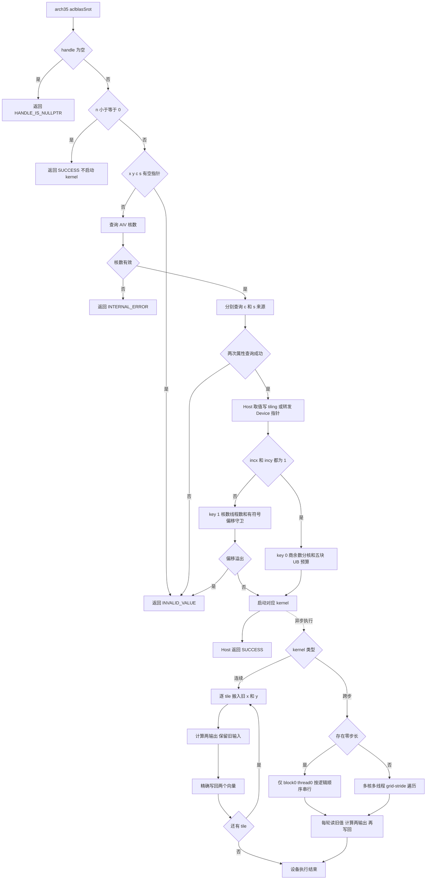
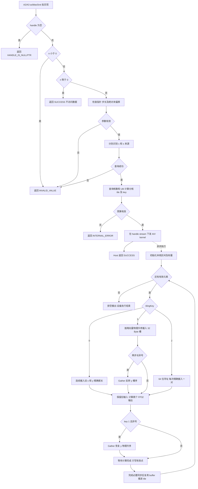

# 一、需求背景

## 1.1 需求来源

本设计对应 CANN 社区 2026 年 11 月序号 3“aclblasSrot 算子开发（A2/A3）”，依据任务包 `11月社区任务-aclblasSrot算子开发（A2A3）.zip` 中的 `aclblasSrot_AtlasA2_A3_task_doc.md`、`test_cases/README.md`、两份 CSV、生成器及验收脚本编写。目标是以 Ascend C、kernel 直调方式补齐 ops-blas 的 A2/A3 单精度实数平面旋转能力。

设计文档提交位置为 `04_tasks/01_community-task-2026/tasklist/11-3-aclblasSrot-A2A3/Xztxzt/docs/design.md`，competition 目标基线为 `353edb186cf9a96524ea18f2c5fba842daba542e`。本文只描述设计及静态核对结果，不代表算子已经实现、编译通过或完成 NPU 精度、性能验收。

## 1.2 背景介绍

Srot 对两个实数向量逐对应用矩阵 `[[c,s],[-s,c]]`，常用于数值线性代数中的旋转变换。两份输出都依赖旋转前的 `x`、`y`，因此原地更新必须保护旧值。参数 `c`、`s` 不要求满足 `c²+s²=1`；不能对任意参数承诺范数保持，也不能把单位旋转短路用于含 Inf/NaN 的输入。

### 1.2.1 aclblasSrot 算子实现优化

本任务属于 BLAS 库接口开发，不是 ACLNN/TBE 算子迁移，无对应 TBE Python 实现、算子信息库 JSON 或 ACLNN 两段式接口。固定源码核对版本为 ops-blas `c3ecf8cad3aae31037b04e1e6b523c307a080da5`，以下链接均绑定该版本。

| 对象 | 已核对的官方文件 | 事实及用途 |
| --- | --- | --- |
| 公共接口 | [include/cann_ops_blas.h](https://gitcode.com/cann/ops-blas/blob/c3ecf8cad3aae31037b04e1e6b523c307a080da5/include/cann_ops_blas.h) | 第 468–469 行已声明 `aclblasSrot`，沿用该声明 |
| 已有 Host | [blas/rot/arch35/srot_host.cpp](https://gitcode.com/cann/ops-blas/blob/c3ecf8cad3aae31037b04e1e6b523c307a080da5/blas/rot/arch35/srot_host.cpp) | arch35 的参数检查、标量来源判断、分派参考 |
| 已有 kernel | [blas/rot/arch35/srot_kernel.cpp](https://gitcode.com/cann/ops-blas/blob/c3ecf8cad3aae31037b04e1e6b523c307a080da5/blas/rot/arch35/srot_kernel.cpp) | 连续 SIMD 与跨步 SIMT；后者不能直接移植到 A2/A3 |
| 已有 tiling | [blas/rot/arch35/srot_tiling_data.h](https://gitcode.com/cann/ops-blas/blob/c3ecf8cad3aae31037b04e1e6b523c307a080da5/blas/rot/arch35/srot_tiling_data.h) | 可参考数据结构；部分分核注释落后于 Host/kernel，以执行代码为准 |
| 产品支持 | [blas/rot/README.md](https://gitcode.com/cann/ops-blas/blob/c3ecf8cad3aae31037b04e1e6b523c307a080da5/blas/rot/README.md) | Srot 节明确 A2/A3 不支持；per-arch 返回码表属于同族 Csrot，不能写成已有 Srot A2/A3 行为 |
| arch22 工程参考 | [blas/rot/arch22/csrot_host.cpp](https://gitcode.com/cann/ops-blas/blob/c3ecf8cad3aae31037b04e1e6b523c307a080da5/blas/rot/arch22/csrot_host.cpp) | 同族边界语义参考；其固定核数、Host 同步及分配流程不作为本设计的性能方案 |
| 测试及 golden | [test/rot/srot/srot_golden.h](https://gitcode.com/cann/ops-blas/blob/c3ecf8cad3aae31037b04e1e6b523c307a080da5/test/rot/srot/srot_golden.h)、[test/rot/srot/srot_param.h](https://gitcode.com/cann/ops-blas/blob/c3ecf8cad3aae31037b04e1e6b523c307a080da5/test/rot/srot/srot_param.h) | golden 调用 `cblas_srot`；参数解析已有 `cs_ptr_mode` |

当前不存在 `blas/rot/arch22/srot_host.cpp`、`srot_kernel.cpp` 和 `test/rot/srot/arch22/`。拟新增 arch22 Srot Host、kernel、内部 tiling 及测试，保持公共 ABI。任务书引用的头文件行号及“GTest 仅在 arch35 注册”与当前固定源码不同，不能照搬为现状。

### 1.2.2 aclblasSrot 算子现状分析

性能标杆是任务包给出的 NVIDIA A100 `cublasSrot` 基线；其内部 kernel 源码未提供，本文不推断其线程组织。可阅读的实现参照是 Netlib `srot.f` 和仓内 arch35 Srot。二者的算法、参数约束和任务 A2/A3 的新增要求分别说明。

#### 1.2.2.1 标杆算子支持的数据类型和数据格式

[cuBLAS 12.8 文档 §2.5.8](https://docs.nvidia.com/cuda/archive/12.8.1/cublas/index.html#cublas-t-rot) 中 `cublasSrot` 的 `x`、`y`、`c`、`s` 均为 `float`；向量在 Device，标量可在 Host 或 Device。函数族的 Drot、Crot、Csrot 不属于本任务。本接口使用一维、由步长描述的实数向量；任务表称 ND，不存在矩阵转置、leading dimension、复数交错布局或操作数间广播。

`n>0` 时物理长度分别为 `Sx=1+(n−1)|incx|`、`Sy=1+(n−1)|incy|`，最小有效内存字节数为 `4Sx`、`4Sy`。传入的是物理缓冲区首地址；负步长的起点由实现调整到尾端，调用者不应再次把指针移到尾端。标量来源独立自动识别及混合来源是本任务和仓内接口的约定，不能据 cuBLAS 的 Host/Device 参数表推导出同样的自动识别机制。

#### 1.2.2.2 标杆算子实现描述

[Netlib srot.f](https://netlib.org/blas/srot.f) 对 `n<=0` 直接返回；双单位步长走连续循环，其余步长先设置起点，负步长从尾端开始。每轮先计算临时新 `x`，再用旧 `x` 更新 `y`，最后写 `x`。该例程不提供 ACLBLAS 返回码，也未拒绝零步长。

仓内 arch35 的实际流程如下：

1. 空 handle 返回 `ACLBLAS_STATUS_HANDLE_IS_NULLPTR`；随后 `n<=0` 返回成功；`n>0` 检查四个数据指针。
2. 查询 AIV 核数；为零返回内部错误。分别调用 `aclrtPointerGetAttributes` 查询 `c/s`，失败返回非法参数；Host 标量取值写入 tiling，Device 标量仅转发指针。
3. `incx=incy=1` 选择 key 0，核数取 `min(n,AIV核数)`，按商余数分配元素，前面的余数核各多一个元素。UB 使用两输入、两输出和一个计算临时块，tile 按源码共享 `UB_SIZE` 计算。
4. 其余步长选择 key 1；Host 使用 int64 计算有符号 `(n−1)*inc` 并检查是否位于 `[INT32_MIN,INT32_MAX]`，按源码 SIMT 调度粒度计算核数和线程数。该守卫与本任务要求的绝对偏移不超过 `INT32_MAX` 并不完全等价。
5. 连续 kernel 用 `DataCopyPad` 和 TQue 搬入旧 `x/y`；`x'` 使用 `Muls+Axpy`，`y'` 使用两次 `Muls` 和一次 `Add`，保留独立的舍入中间量。完成两个输出后才释放旧输入并精确写回。
6. 跨步 kernel 通过 SIMT grid-stride 循环读取旧值再写两输出。任一步长为零时，仅 block 0/thread 0 串行处理全部元素；其他线程退出。Host 异步启动后返回成功，无 stream 同步和工作空间分配。

这些是固定源码事实，不是 arch22 已实现能力，也不是 A100 实现细节。原有 Srot 代码未建立任意交叉别名的安全保证。

#### 1.2.2.3 标杆算子实现流程图

下图描述上述可审阅的 arch35 源码；GPU 标杆仅有接口规范及任务提供的测量数据，不能绘制其未公开的内部流程。



# 二、需求分析

## 2.1 外部组件依赖

| 依赖 | 使用边界 |
| --- | --- |
| CANN 9.1.0、Ascend C 编译器及 ACL Runtime | 任务指定开发版本；提供 arch22 SIMD、运行时指针属性、stream 和 kernel 下发。本文未执行该版本编译 |
| ops-blas 构建及 GTest | 沿用仓内 `build.sh`、架构选源、CSV 驱动测试机制 |
| Netlib BLAS 3.10.0 / CBLAS | 任务要求 FP32 CPU golden。实际链接库和编译选项须记录；当前 CMake 会查找 `openblas` 或 `blas`，并未固定 Netlib 版本 |
| msprof op | 任务指定性能采集来源；需保留原始 task duration 和有效样本映射 |
| A100 基线 CSV | README 声明来自 A100-SXM4-80GB、CUDA 12.8、cuBLAS 12.8.4；这是输入材料中的测量声明，本次未复测 GPU |

本设计使用官方 asc-devkit 文档快照 `d433ffc4f75274b901521dfc42d98542abb98627` 核对 A2/A3 API 的产品支持和参数单位，例如 [DataCopyPad GMToUB](https://gitcode.com/cann/asc-devkit/blob/d433ffc4f75274b901521dfc42d98542abb98627/docs/zh/api/SIMD-API/basic_api/memory_vector_compute/data_move/DataCopyPad_GMToUB.md) 与 [UBToGM](https://gitcode.com/cann/asc-devkit/blob/d433ffc4f75274b901521dfc42d98542abb98627/docs/zh/api/SIMD-API/basic_api/memory_vector_compute/data_move/DataCopyPad_UBToGM.md)。该快照不冒充 CANN 9.1.0 安装包；落地时须在任务工具链中复核对应重载及资源报告。

## 2.2 内部适配模块

| 模块 | 拟适配内容 |
| --- | --- |
| `blas/rot/arch22/` | 新增 Srot Host/kernel/内部 tiling；复用公共 handle、日志及平台查询工具 |
| `include/cann_ops_blas.h` | 复用已有导出原型，不另建私有 API |
| `test/rot/srot/arch22/` | 新增 GTest、NPU wrapper、A2/A3 用例；返回码判断与 arch35 分开 |
| `test/rot/srot/srot_golden.h` | 数值计算可参考 `cblas_srot`；已有 `n<=0` 与零步长放行逻辑不能直接充当 A2/A3 参数校验 oracle |
| `test/frame/` | 复用填充、CSV 读取；精度比较需显式采用任务阈值及非有限值规则 |
| `blas/rot/README.md` | 实现完成后补充 Srot A2/A3 支持及限制，不提前宣称支持已交付 |

[test/rot/srot/CMakeLists.txt](https://gitcode.com/cann/ops-blas/blob/c3ecf8cad3aae31037b04e1e6b523c307a080da5/test/rot/srot/CMakeLists.txt) 已无条件调用 `ops_blas_add_gtest_tests(${OPS_BLAS} srot_test)`；[cmake/test.cmake](https://gitcode.com/cann/ops-blas/blob/c3ecf8cad3aae31037b04e1e6b523c307a080da5/cmake/test.cmake) 按 `SOC_ARCH_DIRS` 选源。因此待完成的是新增 arch22 源文件并验证实际构建选源，不是机械重复注册测试或声称当前已有可运行的 A2/A3 runner。

## 2.3 需求模块设计

任务书 §2.4/§2.5 的 A2/A3 约束作为实现合同；cuBLAS 提供运算定义，Netlib 提供合法输入的数值参考，arch35 提供工程参照。冲突不得通过放宽 A2/A3 接口来掩盖。

### 2.3.1 Ascend C 算子原型

```cpp
aclblasStatus_t aclblasSrot(
    aclblasHandle_t handle, int n, float* x, int incx,
    float* y, int incy, const float* c, const float* s);
```

| 参数 | 类型、位置及方向 | A2/A3 设计约束 |
| --- | --- | --- |
| handle | Host 库句柄，输入 | 由库创建；空句柄优先返回 `ACLBLAS_STATUS_HANDLE_IS_NULLPTR` |
| n | Host int32 属性 | `n<0` 非法；`n=0` 成功且不访问向量或标量；正数为逻辑元素数 |
| x、y | Device `float*`，输入兼原地输出 | `n>0` 时非空、有效跨度可读写；只更新选中的元素，间隙保持不变 |
| incx、incy | Host int32 属性，元素单位 | `n>0` 时非零且非 `INT32_MIN`；支持正负；绝对末偏移不超过 `INT32_MAX` |
| c、s | `const float*`，输入，各 1 个 FP32 | `n>0` 时非空；分别识别 Host/Device，四种来源组合均纳入设计，不校验数值 |
| 返回值 | `aclblasStatus_t` | 合法调用成功表示提交完成；设备结果须由调用者同步后读取 |

令 `d=|inc|`，零基逻辑下标 `0≤i<n` 的物理下标为：

\[
p(i;inc)=\begin{cases}i d,&inc>0,\\(n-1-i)d,&inc<0.\end{cases}
\]

令 `u=x[p(i;incx)]`、`v=y[p(i;incy)]` 为旧值，计算 `x'=c*u+s*v`、`y'=c*v-s*u`。所有偏移乘积、`span=last+1`、字节长度及地址加法使用 64 位，检查后才窄化 tiling 字段。即使 `last=INT32_MAX` 合法，`span` 也已超过有符号 int32，不能用 int 保存长度。

### 2.3.2 Ascend C 算子相关约束

| 事项 | 任务/参考差异与采用口径 |
| --- | --- |
| `n<0`、零步长 | 任务 A2/A3 返回非法参数；arch35、包内 README/生成器允许。按任务实现，修订 A2/A3 用例预期并保留差异记录 |
| `INT32_MIN` 和偏移 | 在求绝对值之前拒绝 `INT32_MIN`；用 `int64(n−1)*abs(int64(inc))≤INT32_MAX`，不沿用 arch35 的有符号下界放行 |
| `n=0` 优先级 | 空 handle 仍报句柄错误；有效 handle 下跳过四个指针、步长及平台检查，返回成功 |
| cuBLAS 返回码归属 | 查阅的 cuBLAS 12.8 Srot 小节列出成功、未初始化、执行失败，并未列出任务所有非法参数条件；这些条件应归因于任务及同族 arch22 合同，不能声称逐项由 cuBLAS 文档明确规定 |
| 原地和别名 | 支持各向量自身原地更新；任务未定义 `x/y` 相互重叠、Device `c/s` 与写区重叠的行为。当前并行方案限定两个向量物理跨度互不重叠，Device 标量与输出区分离；不宣称支持交叉别名 |
| 不涉及项 | 不扩展到 FP16/BF16/FP64/复数、batch、矩阵布局、广播、视图或图模式动态 shape |

合法负步长不是 quick return。任务书“负向用例缓冲区分配规则”中将 `inc≤0` 一概归入无需分配的句子与其主体要求冲突；仅拒绝路径及 `n=0` 可用 dummy，成功的负步长用例必须分配完整物理跨度。

# 三、需求详细设计

## 3.1 调用方式

采用 `aclblasCreate` 创建 handle、`aclblasSetStream` 绑定 stream，准备 Device `x/y` 和各自来源的 `c/s`，直接调用 `aclblasSrot`。计算下发到 handle 的 stream；CPU 读回前使用 `aclrtSynchronizeStream` 或等价依赖。接口不接收 `aclTensor`，不使用 ACLNN workspace 查询或 PyTorch 注册路径。

Host 标量在调用期间读取并按值写入内部 tiling；Device 标量保持指针转发，由同一 stream 的 kernel 读取。调用者须保证 Device 数据活到最后消费者结束；其他 stream 生产的标量或向量须先建立事件依赖。内部 tiling 拟按 kernel 启动参数值传递，避免每次分配临时 GM tiling、同步后释放的开销；是否满足 CANN 9.1.0 的参数 ABI 由编译及多次异步调用测试验证。无算法工作空间，不保留跨调用的可变全局 scratch。

## 3.2 需求总体设计

每对元素独立完成 4 次乘法和 2 次加减，数学工作量为 `6n FLOPs`。连续路径每次读两个 float、写两个 float，有效向量流量 `16n Byte`，理想有效载荷算存比为 `6/16=0.375 FLOP/Byte`；Device 标量额外请求至多每核 8 Byte。缓存命中、跨步事务放大、UB padding 和启动成本未包含在该模型内，不能据此宣称已达到带宽极限。

设计分为双单位步长连续路径、可表达 DMA 间隔的通用跨步路径，以及超大字节间隔的保底路径。均使用 AIV SIMD，避免引入 950 的 SIMT/VF。连续路径优先保证批量搬运和低启动成本；通用跨步路径优先保证全合法参数域和间隙保护，当前性能 CSV 不覆盖其性能。

### 3.2.1 host 侧设计

校验顺序固定为：handle → `n<0` → `n=0` 快速返回 → 四指针非空 → 步长非法值 → 64 位末偏移守卫 → 标量来源 → 平台/UB 能力 → 分核分块和启动。非法值返回 `ACLBLAS_STATUS_INVALID_VALUE`；平台查询失败、有效核数为零或预算不能容纳最小 tile 返回 `ACLBLAS_STATUS_INTERNAL_ERROR`。检查完成前不启动 kernel，不对 Device 指针做 Host 解引用。

分别调用 `aclrtPointerGetAttributes(c)`、`aclrtPointerGetAttributes(s)`，与已有 Srot 一致将查询失败视为非法参数；Device 标量只携带指针，Host 标量立即取值。不得借用带 D2H 同步的标量读取 helper 来破坏异步路径。任务未要求检查输入元素值、归一化系数或任意失效地址的可访问性。

拟定内部 tiling 字段包括 `totalN`、有符号 `incx/incy`、`absIncX/Y`、64 位 `spanX/Y`、`blockNum`、分核商余数、`tileElems`、`tilingKey`、`bufferNum`、`reverseY`、`cIsDevice/sIsDevice`、`cValue/sValue`。其中 `reverseY` 表示跨步路径的步长符号不同；它不是通用“负步长标志”。Host/kernel 共用定义，字段初始化和宽度一致。

#### 3.2.1.1 分核策略

从平台查询可用 AIV 数 `C`，不固定 8、24 或其他芯片核数。kernel 直调使用 `PlatformAscendCManager::GetInstance()`；核数获取可复用 [blas/common/helper/host_utils.h](https://gitcode.com/cann/ops-blas/blob/c3ecf8cad3aae31037b04e1e6b523c307a080da5/blas/common/helper/host_utils.h) 的 `GetAivCoreCount`，容量采用平台 `GetCoreMemSize(CoreMemType::UB,...)`。

连续路径以 `A=32/sizeof(float)=8` 个元素作为分配单位：`Q=ceil(n/A)`、`B=min(C,Q)`，`q=Q/B`、`r=Q%B`。第 `k` 核的块数、逻辑起点及有效长度为：

\[
q_k=q+[k<r],\quad b_k=A(kq+\min(k,r)),\quad m_k=\min(Aq_k,n-b_k).
\]

`0≤k<B`，各区间拼接覆盖 `[0,n)`，无重复或遗漏，最后一核可能含尾元素。`n≤8` 自然只启一核。32 Byte 对齐依据 UB/搬运要求；若用户 GM 首地址不是 32 Byte 对齐，仍走 `DataCopyPad` 精确长度，不向下调整用户地址。

通用跨步路径以逻辑元素分核：`B=min(C,n)`、`q=n/B`、`r=n%B`，`b_k=kq+min(k,r)`、`m_k=q+[k<r]`。非零步长使每个向量内部的 `p(i)` 单射；在两向量跨度不相交的前提下，每个输出地址唯一归属一核，无归约、原子更新或跨核同步。小跨步输入的核数收缩可在实测后调整，不能凭静态分析给出最优阈值。

#### 3.2.1.2 数据分块和内存优化策略

令 `U` 为平台报告的单 AIV UB 字节数，`R` 为目标工具链、框架及所选 API 的实际预留，`Us=64` 为两个 Device 标量各占一个 32 Byte 槽位的保守预算。使用 `Ua=U−R−Us`；`R` 必须从 CANN 9.1.0 资源报告和实现核实，不将新版文档的预留或 arch35 的 `UB_SIZE` 直接移植。[GetCoreMemSize.md](https://gitcode.com/cann/asc-devkit/blob/d433ffc4f75274b901521dfc42d98542abb98627/docs/zh/api/Utils-API/platform_info/PlatformAscendC/GetCoreMemSize.md) 给出了 kernel 直调的平台查询方式。

连续路径每 tile 的五类存储为旧 `x`、旧 `y`、新 `x`、新 `y`、一个乘积临时区。设四个输入/输出队列各分配 `D` 份 buffer，scratch 只有一份，`D=1` 为初始方案，`D=2` 为待测流水候选：

\[
U_{contig}=(4D+1)\cdot4T+U_s+R\le U,\qquad
T=8\left\lfloor\frac{\min(\lfloor U_a/[4(4D+1)]\rfloor,T_{api})}{8}\right\rfloor.
\]

`Tapi` 同时限制 `4T≤2²¹−1` 的 DMA blockLen 及所用 Vector API 可处理长度。`D=1` 的 tile 数据占 `20T` Byte，`D=2` 为 `36T` Byte，不能仍用五块预算。四个队列分别为 VECIN×2、VECOUT×2；scratch 为 VECCALC。单缓冲先验证正确性；仅当每核多 tile、事件和容量允许且完整 kernel 有收益时启用双缓冲。计算 scratch 的 Vector 消费完成后才复用，不能把所有 buffer 简单翻倍并声称已有流水收益。

通用跨步路径不搬入、覆写整段含间隙的 GM span。每个有效 float 对应 UB 的一个 32 Byte 槽位，槽内第 0 个 float 有效，其余 7 个为 padding。保守同时保留：两个输入、两个输出、一个乘积 scratch、一个重排 buffer、一个 `uint32_t` 重排索引，共七块等大的 `32T` Byte 区域：

\[
U_{stride}=224T+U_s+R\le U,\qquad
T=\min(\lfloor U_a/224\rfloor,4095,T_{gather}).
\]

`Tgather` 保证 `8T` 个元素及其字节偏移符合 Gather/Vector API 的长度限制。上述 4095 来自 A2/A3 `DataCopyExtParams.blockCount` 上限。索引和重排 buffer 即使同号路径暂不用也计入预算，不以不存在的释放时机挤占 UB。极大字节步长保底路径取 `T=1`，沿用这份上界。

跨步路径按 `8m` 个 UB float 执行向量计算时，实际最多执行约 `48n FLOPs`，并有额外重排流量；它用 UB padding 换取精确稀疏搬入/搬出，不应与连续路径的 `6n` 执行成本混为一谈。优化紧凑 packing 是后续可测候选，不能影响当前正确性边界。

#### 3.2.1.3 tilingKey 规划策略

以下 key 仅为 arch22 内部设计，不改变 arch35 的解释：

| key | 完整准入条件 | 执行路径 |
| --- | --- | --- |
| 0 | `n>0` 且 `incx=incy=1` | 连续 CopyIn/Compute/CopyOut，单缓冲初始实现；D 作为独立字段 |
| 1 | 合法非连续输入，且两侧 `4*(absInc−1)≤UINT32_MAX` | 正间隔二维 `DataCopyPad`；符号不同时在 UB 重排 y |
| 2 | 末元素偏移合法，但任一侧字节间隔超过 DMA 字段上限 | 每次一对元素，两个 4 Byte CopyIn 和两个精确 CopyOut；64 位 GM 寻址 |

`4*(absInc−1)` 在 64 位计算后判定，不截断到 uint32。key 2 是合法参数的保底路径，例如 `n=2,incx=INT32_MAX` 的元素偏移合法而字节间隔不可直接编码，不能因此返回任务未规定的非法参数。`n=0` 不生成 tilingKey，不发射 kernel。未知 key 为内部错误路径，不默认当连续路径执行。

### 3.2.2 kernel 侧设计

kernel 为 AIV-only。按 tiling 和 `GetBlockIdx()` 得到本核逻辑区间，循环处理 `m=min(T,本核剩余元素数)`；`m=0` 不搬运、不计算。所有 key 采用同一 FP32 算术顺序，性能路径也不按输入数值跳过计算。

#### 3.2.2.1 kernel 侧实现描述

**标量初始化。** Host 来源直接读取 tiling 中的 FP32 值；Device 来源各搬入恰好 4 Byte 到独立 32 Byte UB 槽，不读取超出标量对象的 32 Byte。等待 `MTE2→S` 后通过 LocalTensor 读出标量，每核复用整次调用；不用 `GlobalTensor::GetValue/SetValue` 逐元素访问 GM，也不产生 Host D2H 同步。

**连续搬运。** key 0 以本核起点加 tile 偏移读 `m` 个 float。`DataCopyExtParams` 取 `{1,4*m,0,0,0}`；UB 分配按 `T` 对齐，尾块 GM 读写仍只有 `4*m` Byte。输入队列 `EnQue/DeQue` 连接 MTE2 与 Vector，输出队列连接 Vector 与 MTE3；两个旧输入在两输出全部计算完成前不得释放。精确 CopyOut 只覆盖本 tile 的有效元素，padding 不写回用户内存。

**跨步搬运及负步长配对。** 对当前逻辑区间 `[b,b+m)`，分别计算：

\[
a_x=\min(p_x(b),p_x(b+m-1)),\quad
a_y=\min(p_y(b),p_y(b+m-1)).
\]

key 1 将 x、y 各自按物理地址升序搬到 UB：`blockCount=m`、`blockLen=4`、GM 侧 `srcStride=4*(d−1)`、UB 侧 `dstStride=0`、`rsv=0`。显式右填充 7 个零，保证每槽 32 Byte。这里 `srcStride` 是前一有效 float 末端到下一 float 起点的字节间隔，不是 `inc` 或完整 pitch；A2/A3 不使用 Compact 模式或负 DMA stride。

以 x 的物理升序作为计算槽序：若 `incx/incy` 同号，两输入第 `j` 槽属于同一个逻辑元素；若异号，y 必须反转槽序。通过不重叠的 `Gather` 源/目的和独立索引区完成反转，`0≤j<m,0≤r<8` 时：

\[
idx[8j+r]=4\,[8(m-1-j)+r].
\]

索引单位为 Byte，范围 `[0,32m−4]`，均为 4 Byte 对齐，不越过实际初始化的 `32m` 字节。调用 `Gather(reverseBuf,yIn,idx,0,8*m)` 后，以 `xIn/reverseBuf` 计算。得到两输出后，异号路径再用同一置换将 `newY` 写入 `reverseBuf`，恢复 y 的物理升序；该复用发生在旧 reverseBuf 已被两输出完全消费之后。Gather 不做源目的同址原地重排。[Gather.md](https://gitcode.com/cann/asc-devkit/blob/d433ffc4f75274b901521dfc42d98542abb98627/docs/zh/api/SIMD-API/basic_api/memory_vector_compute/scatter_gather/Gather.md) 明确 A2/A3 FP32 支持、字节偏移、32 Byte 首址和非重叠要求。

CopyOut 取 `blockCount=m`、`blockLen=4`、UB 侧 `srcStride=0`、GM 侧 `dstStride=4*(d−1)`，从 `a_x/a_y` 写回升序有效点。UB 的每槽 28 Byte padding 由接口去除，GM 间隙不参与读改写。key 2 则按逻辑 `i` 计算 `p_x(i)/p_y(i)`，以 `blockCount=1,blockLen=4` 分别搬入、计算和写回，不需要重排，不把超范围间隔写进 DMA 描述符。

**两输出的舍入与旧值保护。** 连续路径取 `L=m`，跨步槽位路径取 `L=8m`，每个 lane 执行：

```text
newX = Muls(oldX, c)
work = Muls(oldY, s)
newX = Add(newX, work)
newY = Muls(oldY, c)
work = Muls(oldX, s)
newY = Sub(newY, work)
```

输入与输出、work 分别存储；work 第二次写入前，前一次 Add 必须完成消费。使用适用的 Vector 屏障保证这类同流水读写依赖。算术选普通 LocalTensor 的前 N 个元素重载，`L` 检查后传为 int32；[Muls.md](https://gitcode.com/cann/asc-devkit/blob/d433ffc4f75274b901521dfc42d98542abb98627/docs/zh/api/SIMD-API/basic_api/memory_vector_compute/basic_arithmetic/Muls.md) 支持 A2/A3 FP32，不能混用同名的 flexible-scalar 变体。若实现改用 repeat 形式，须分段使每次 `repeatTime≤255`，并保留段尾有效 mask。采用显式 FP32 乘法再加减作为初始数值方案，避免默认照搬 arch35 的 `Muls+Axpy` 融合舍入；是否可启用融合必须依据任务的相消、大值、特殊值精度回归，不能从实数代数等价推出 FP32 结果等价。无 FP16 降精度、无 `c=1,s=0` 等数值快返回。

**同步和资源复用。** key 0 使用四个 TQue 的 Alloc/EnQue/DeQue/Free 生命周期，计算临时区用 TBuf；D=2 时只有队列拥有空闲槽位才能预取下一 tile。key 1/2 初始方案使用单缓冲 TBuf 和显式事件：MTE2 完成后通知 Vector；索引由 Scalar 初始化后用 `S→V`；Vector 两输出及逆重排完成后用 `V→MTE3`；下一 tile 重写输入需 `V→MTE2`，重写输出/重排区需 `MTE3→V`，索引重建前需 `V→S`。每个 Set 有对应 Wait，首轮不等待未产生的事件，尾轮排空最后一次 MTE3。重排区选 VECOUT，支持后续搬出；不能将仅允许特定架构 GM 搬运的 VECCALC 当作通用搬入区。同流水 `PipeBarrier<PIPE_V>` 不替代跨流水事件。

**边界证明。** `0≤p(i)≤(n−1)d=span−1`；tile 的末 DMA 地址为 `a+(m−1)d`，等于 tile 两端较大下标，因此仍小于 span。每次写出 4 Byte，不覆盖下个元素或间隙。连续尾块只读写 `m` 个元素；重排只触及 `m` 个已初始化槽。多核只分割逻辑元素且 `d≠0`，不存在同一向量内的重复写地址；这一证明依赖 §2.3.2 的非交叉别名边界。

#### 3.2.2.2 Ascend C 实现流程图



#### 3.2.2.3 Ascend C 实现流程图与标杆算子流程图存在的差异点和原因

| 差异 | 原因及保持的语义 |
| --- | --- |
| `n<=0` 放行改为负 n 拒绝、零 n 放行 | 遵守任务 A2/A3 合同；不是错误声称 Netlib 或 arch35 本来如此 |
| 零步长串行分支删除 | A2/A3 入口已拒绝零步长，没有重复地址递推路径 |
| SIMT grid-stride 改为 SIMD DMA 槽位和 Gather | 按 A2/A3 支持的 API 处理负步长及异号配对；多核之间仍按独立逻辑元素划分 |
| 增加超大 DMA 间隔保底 | BLAS 的合法元素偏移范围与 DMA 字节间隔字段范围不同，不能截断或缩小接口域 |
| UB 常量改为平台容量与实际预留预算 | A2/A3 和 arch35 容量、API 资源不同；预留与双缓冲份数必须计入 |
| 连续分核改为 8 元素组，尾核裁切 | 保持多数核边界对齐并避免小输入过多空核；未声称这是已测最优策略 |
| 两输出均采用显式乘、加减 | 初始方案控制舍入步骤，待精度和性能实测后评估融合 |
| Host/Device 标量均保持异步数据流 | 保留 arch35 转发 Device 指针思路，不继承同族 arch22 Csrot 的同步 D2H/分配流程 |

与 Netlib 串行循环相比，设计把独立元素并行化，双负步长可按物理升序逆转整个 tile 的逻辑处理顺序；因非零步长及非别名，每对元素之间没有数据依赖，单对内部旧值和求值顺序仍保持。对于交叉别名，这一重排证明不成立，故不纳入当前支持承诺。

## 3.3 支持硬件

| 平台 | 目标支持 | 验证要求及现状 |
| --- | --- | --- |
| Atlas A2 系列，arch22 / NPU arch 2201 | 是，拟实现 | 任务要求 Atlas 800T A2 910B3 精度及性能自验证；当前未实测 |
| Atlas A3 系列，arch22 / NPU arch 2201 | 是，拟实现 | 共用 SIMD 方案，需完成对应目标编译和运行兼容性核对；当前未编译、未实测 |
| Ascend 950，arch35 | 仅保留已有实现 | 作为源码参考，不改其 key、返回码及 SIMT 路径，不计作本任务自验证 |

官方 [npu_arch_2201.md](https://gitcode.com/cann/asc-devkit/blob/d433ffc4f75274b901521dfc42d98542abb98627/docs/zh/guide/programming_guide/advanced_programming/hardware_implementation/architecture_spec/npu_arch_2201.md) 对应 Atlas A2/A3，说明 AIV/UB 数据通路。实际核数、可分配 UB 和编译预留必须以目标环境查询及资源报告为准，不引用其他 SKU 峰值来推算本算子时延。测试脚本将 `ascend910b`、`ascend910b3`、`ascend910b4`、`ascend910_93` 映射到 arch22；验收建议分别使用任务示例 `ascend910b` 与 `ascend910_93`。

## 3.4 算子约束限制

| 任务 §2.5 项目 | 设计结论 |
| --- | --- |
| 参数合法性 | 按 §3.2.1 顺序；步长和乘积在读数据前校验；n=0 优先于数据参数检查 |
| 非连续输入 | 支持非零正负步长、单侧跨步和异号组合；间隙元素保持不变 |
| broadcast | 无向量广播；c/s 是旋转系数，不扩展出多标量 Tensor 广播 |
| dynamic shape | n、inc 为运行时属性，Host 每次计算 tiling；不增加图模式适配承诺 |
| 原地与视图 | 两向量自身原地写回、不产生视图；相互重叠不在当前支持边界 |
| 确定性 | 固定每对运算顺序，无归约/原子随机次序；同输入、同编译产物的重复结果需验证，不承诺不同平台/编译器 bit 一致 |
| 空 Tensor | 对应 n=0；不需要有效 Device 数据指针、不发 kernel |
| 0 维 Tensor | 接口是裸指针 BLAS，无 aclTensor 维度；c/s 是单元素指针，n=0 不是标量旋转 |
| 异步执行 | 同 stream 下发，Host 返回不等于设备完成；Device 标量和向量须保持生命周期及依赖 |
| 值域 | FP32，保留 Inf/NaN 的算术传播；不检查或强制归一化 c/s，不做单位旋转短路 |
| 内存 | API 不接收分配长度，调用者保证有效跨度；Host 计算跨度只做溢出检查，不能证明任意指针的底层分配充足 |

# 四、特性交叉分析

| 交叉特性 | 影响与防护 | 拟验证证据 |
| --- | --- | --- |
| 原地 × 双输出 × 多核 | 必须保留两个旧输入至最后消费者；输出地址唯一归属依赖非零步长及非交叉别名 | 非平凡 c/s、两种不同初值、tile/核边界，检查 x 和 y |
| 负步长 × 两侧符号 | 负步长尾端起算；异号时配对方向相反 | `(+,+)、(+,-)、(-,+)、(-,-)`，不同绝对步长和非整 tile |
| 稀疏写回 × padding | 不能将 UB padding 或整个 GM span 写回 | 有效点比对、间隙及前后 canary 逐位检查 |
| 标量位置 × 异步 | c/s 分别判断；不在 Host 解引用 Device，不提前释放 | Host/Host、Device/Device、Host/Device、Device/Host；同流前置 kernel 生成标量、跨流事件依赖 |
| 系数快路 × 特殊值 | `0*Inf` 可能产生 NaN；代数单位变换不能绕过公式 | 单位系数、零系数与部分 Inf/NaN 的交叉，不用“整向量全 NaN”替代逐元素判断 |
| 小 n × 多核/双缓冲 | 启动和事件开销可能超过计算；双缓冲不一定有稳态收益 | 小尺寸、单 tile、多 tile 分开采样；不复制他例阈值 |
| 偏移合法 × DMA 字段 | 元素偏移可合法但字节间隔不可编码 | key 2 参数边界、64 位 Host 模型、条件允许时稀疏大跨度验证 |
| 架构 × 编译资源 | 不能使用 950 的 SIMT/Compact/预留量 | A2/A3 分别编译、资源预算审计、事件排空和重复调用检查 |
| 测试接口 × golden | 公共 arch35 golden 的参数守卫不适用于 arch22 | 参数负向直接调用被测 API；合法数值单独调用 FP32 CBLAS |

# 五、可维可测分析

## 5.1 精度标准/性能标准

**精度合同。** 按任务书 §3.2 及其锁定的 [mixed_tolerance_standard.md](https://gitcode.com/cann/opbase/blob/28a1ce52ae856353589841226a0002af73314a6b/docs/zh/ops_precision_standard/mixed_tolerance_standard.md)，本任务仅采用 FLOAT32 一行：`atol=rtol=2^-13=0.0001220703125`，有限值 matched ratio 至少 0.99，另满足最大绝对误差限制 `1e-2 or 32*ULP`。不要把其他 dtype 表格当作本算子支持面，也不采用未锁版本的默认容差替换任务阈值。

对 x、y 分别收集逻辑有效点并独立判定。有限值元素 `|actual−golden|≤atol+rtol*|golden|` 为通过；误差用更宽的 Host 类型计算，避免差值自身 FP32 溢出。原始记录同时保存 max_abs_error 和 ULP 信息。为消除任务正文对 ULP 取值位置未展开的歧义，初始自验证采用更保守的固定 `max_abs_error≤1e-2` 门槛；不得仅因逐元素 ULP 放宽后通过就宣布任务验收通过，采用 ULP 分支前须锁定验收方的具体定义并记录。

非有限值逐元素单独处理：同为 NaN、同号 Inf、或 NaN 与任意符号 Inf 配对按任务规则通过；异号 Inf 不通过；有限值与非有限值配对不通过。非有限值不进入有限值比例和误差统计，必须全部满足规则。有限值集合为空时记录“无有限值元素”，只判非有限值规则；n=0 只判返回码和无访问行为，不伪造数值通过率。既有 [test/frame/verify.h](https://gitcode.com/cann/ops-blas/blob/c3ecf8cad3aae31037b04e1e6b523c307a080da5/test/frame/verify.h) 的 MixedToleranceStrategy 拒绝 NaN/Inf 交叉配对，不能不加区分直接复用。已有 [arch35/srot_test.cpp](https://gitcode.com/cann/ops-blas/blob/c3ecf8cad3aae31037b04e1e6b523c307a080da5/test/rot/srot/arch35/srot_test.cpp) 还包含输出出现 NaN 后要求整个向量全 NaN 的分支，也不能用于部分特殊值的任务判定。

golden 对合法输入使用任务要求的 Netlib BLAS 3.10.0 FP32 `cblas_srot`，从同一初始数据分别构造 x、y 的 CPU 和 Device 副本。记录实际链接库、编译器及是否融合乘加；不能用 FP64 重写 golden 后仍称为任务指定真值。不同向量使用可复现但不同的随机种子，避免 x=y 的退化输入掩盖错误。

**真实 CSV 覆盖。** 对原始文件按 CSV 记录而非 README 宣称统计，均不计表头：

| 内容 | 实际统计 |
| --- | --- |
| `srot_test.csv` | 1200 条，case_name 全部唯一；精度 1000、性能 200，并非 1000 条内含 200 条性能子集 |
| 精度类别 | L0 12、SQ 38、INC 21、CS 22、CSM 11、FL 24、ED 17、EX 855 |
| dtype/维度 | CSV 无 dtype 列，Srot 原型决定全部 FP32 一维向量；精度有 45 个不同 n，范围 −5 至 1048577，其中最大值是溢出负向；正常精度规模至 1048576 |
| 精度 n 边界 | n=0 共 4 条，n<0 共 7 条；包含 1、2、3、32±1、64±1、128±1、256±1、512±1、1024、1025、4095、4096、16384、262144、1048576 |
| 精度步长 | incx 为 `{−2147483648,−3,−2,−1,0,1,2,3,4096}`；incy 为 `{−3,−2,−1,0,1,2,3,65536}`；任务要求的步长 7 未覆盖 |
| 标量来源 | 精度 Host 850、Device 75、mixed 75；mixed 只含 c Host/s Device，反向混合缺失 |
| 填充 | 精度 x/y 各 986 条 `RANDOM_NORM_5_5`，各有零、交替、极值、Inf、NaN 2 条及 NULLPTR 4 条；`GAUSS_NORM_5_2` 为 0 条，不满足均匀/正态各 50% 的要求 |
| 标量值 | c 集合为 `{−1,−0.6,0,0.6,1,1e10,1e−30,Inf}`；s 为 `{−1,−0.8,0,0.8,1,1e10,1e−30,NaN}`；任务列举的 −0.5、s=0.6 未覆盖 |
| 预期返回码 | 精度 SUCCESS 994、INVALID_VALUE 6；后者是 x/y 空指针 3 条与溢出/INT_MIN 3 条；handle、c/s 空指针需接口单测补充 |
| A2/A3 预期冲突 | 7 条负 n 与 385 条正 n 零步长仍期望 SUCCESS，共 392 条需按任务改为非法参数；另有 362 条正常成功的非零负步长用例，不能过滤掉 |
| 性能 | 200 条均为 incx=incy=1、c=0.6、s=0.8、Host 标量；n 从 1 到 4194304，共 198 个不同规模 |
| `gpu_baseline.csv` | 200 条 `gpu_ms` 均已填正值；联合键 `(n,incx,incy,c,s)` 仅 198 个；200 条性能用例均能找到联合键 |

实施时保留原始用例包，输出 A2/A3 修订清单。392 条预期修正后不能仍将 1000 条全部称为数值精度测试：需区分正常计算、no-op 和拒绝路径，并补足有效数值覆盖。正态/均匀各 50% 应在新增正常随机数值集合中显式分配并统计，特殊值和负向集合单列；生成器 `--dist mixed` 仅追加 token，不保证实际达到 50%，也不能直接重生成并覆盖已回填的 GPU 基线，因为生成器写出的 `gpu_ms` 为空。

负向测试先分类，再分配单元素 Device dummy 或按相应空指针传入，直接触发 API 守卫，不按巨大跨度分配，不在 int32 域做 `abs(INT_MIN)`。成功的负步长用例则必须分配完整 span。原有 [arch35/srot_npu_wrapper.h](https://gitcode.com/cann/ops-blas/blob/c3ecf8cad3aae31037b04e1e6b523c307a080da5/test/rot/srot/arch35/srot_npu_wrapper.h) 会先计算跨度和分配，不能原样用于这些溢出负向。

补充测试覆盖：四种标量来源、空 handle 与 n=0 优先级、n=0 加空指针/非法步长、两侧 0/INT_MIN、偏移恰等 `INT32_MAX` 与超一、n=1 超大合法步长、步长 7、−0.5 系数、部分非有限值、相消/大值/次正规数、不同 x/y 初值、`T−1/T/T+1` 和核边界、两次异步调用不同标量、间隙及 canary 不变。不能实际分配的大跨度合法用例先用 Host 寻址模型验证并标注未上板，不能用模型结果冒充完整 API 通过。

**性能合同及脚本差异。** 任务要求 Atlas 800T A2 910B3，CANN 9.1.0；msprof op 预热 5 次后取得至少 10 个有效执行的 task duration，算术平均为 `t_npu_us`。每条用例均须满足：

\[
t_{npu,us}\le\frac{1000\cdot gpu\_ms}{0.8},\qquad
speedup=\frac{1000\cdot gpu\_ms}{t_{npu,us}}\ge0.8.
\]

以下差异是验收前必须处理的测量问题：

| 差异 | 处理约束 |
| --- | --- |
| README 和 `verify_performance.py` 解析 `[PERF] ... avg_us=`，声明来自 aclrtEvent，msprof 仅辅助；任务书指定 msprof task duration | 任务验收以 msprof 原始 duration 为主，Event 端到端设备窗口另列，不混用或只提交脚本 PASS |
| 固定版本 arch35 GTest/wrapper 没有 `[PERF]` 采样输出 | 新增 arch22 性能入口，预置 Device 数据，在计时外准备输入/golden；不能假定复制 CSV 即已有采样能力 |
| 基线有 3 行重复联合键 `n=4194304,1,1,0.6,0.8` | 原值依次为 `0.0488277345`、`0.0487765346`、`0.0487936012` ms；脚本字典覆盖后只留最后一条。正式结果保留基线 id 和各行对应关系；映射未锁定前可用三者最小值作保守检查，不冒称还原了独立测量 |
| 脚本不强制期望总数齐全 | 验证 1000/200 原始 case 名集合及补充集合，漏测、重复、崩溃、NO_REF、缺少时长均不可视为通过 |
| 精度脚本传 `--filter` 时构造 `*过滤串*:-*TC_PF*` | 正过滤末尾多一个空模式，不据此直接断言过滤失败；可规范为 `*过滤串*-*TC_PF*`，并以实际执行名单核对覆盖范围 |
| README msprof 示例有多余末尾引号，且一次匹配所有性能 case | 修正命令并优先每次采集单一 case，建立 case→启动→样本的映射，不按同名 kernel 汇总不同 n |

原地旋转的性能重复执行会改变数据。测量须记录是否同一缓冲连续旋转、是否复位以及复位位置；复位和 H2D/D2H 不计入 kernel 时长，精度使用独立初值。若工具已经提供预热，不重复将预热算入有效样本。仅成功下发且设备执行无错的样本有效，异常次数及原因单列；不得只剔除慢样本。200 条均属于连续 Host 标量面，不能据此宣称跨步或 Device 标量性能达标。

精度脚本只解析 GTest 输出，不自行计算上述混合容差；性能脚本也不自行采样。运行它们之前必须完成 arch22 实现、测试构建及统计契约修正。本次只完成材料与设计静态检查，未运行两个脚本连接 NPU，未得到任何精度通过率或 NPU 耗时。

## 5.2 兼容性分析

公共签名、参数顺序、FP32 类型和 handle/stream 用法与既有声明一致，新增实现按 arch22 选择编译；不改变 arch35 的返回码或测试预期。A2/A3 与 arch35 对负 n、零步长、INT_MIN 的差异需在 Srot README 中单独声明，不能仅指向 Csrot 的表。默认 `cs_ptr_mode=host` 的历史 CSV 仍可解析，新增反向 mixed 用例由测试代码显式构造。

A2/A3 共同使用不带 Compact mode 的 DataCopyPad、内存式 SIMD Muls/Add/Sub 和 Gather；无 SIMT、寄存器 VF 或 950 专用负 DMA stride。FP32 输入输出不作类型转换。平台容量和核数动态获取，目标 CANN 9.1.0 的 API 重载、启动 ABI、事件资源、UB 预留和实际编译选源仍需在实现阶段验证。

材料中的 API/任务语义冲突、392 条用例预期、分布缺失、性能计时来源及重复基线映射均须在自测报告中保留处理证据。只有两向量分别通过任务精度标准、全部规定性能用例达到阈值且覆盖集合完整时，才可报告任务验收达标；本文的地址和预算推导、官方支持表及静态检查均不能替代该结论。
