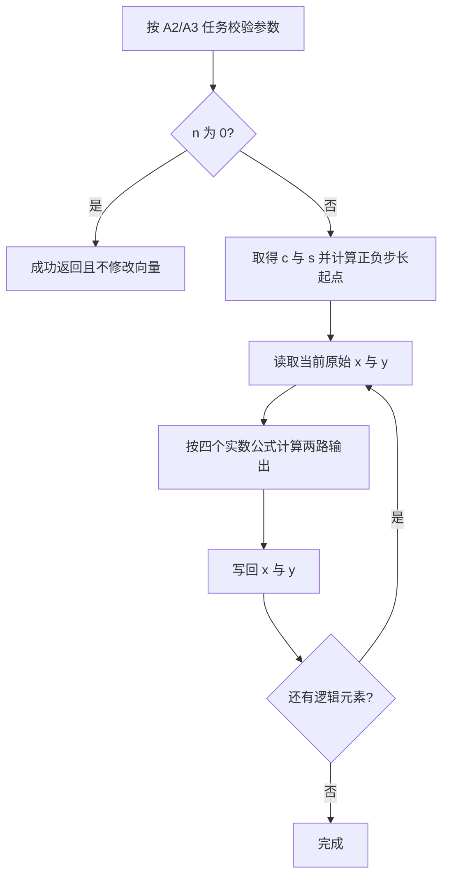
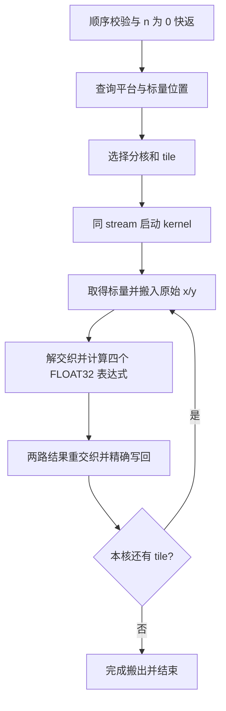

# 一、需求背景

## 1.1 需求来源

承接“11月社区任务-aclblasCrot算子开发（A2A3）”，为 ops-blas 补齐 Atlas A2/A3 的单精度复数平面旋转能力。需求以任务包 `aclblasCrot_AtlasA2_A3_task_doc.md`、`test_cases/crot_test.csv` 和 `test_cases/gpu_baseline.csv` 为准；本设计对应[任务列表](../../../../docs/README.md)的 `11-4-aclblasCrot-A2A3`，按[设计模板](../../../../resources/design_template.md)提交。

## 1.2 背景介绍

### 1.2.1 aclblasCrot 算子实现优化

计算 `x' = c*x + s*y`、`y' = c*y - conj(s)*x`，其中 `c` 为实数、`s` 为复数，两个输出均覆盖原向量。面向连续向量采用 Ascend C Vector 分核与输入双缓冲；跨步向量保留完整正负步长语义，优先保证原地写回正确。

本接口属于 BLAS Kernel 直调，不存在对应的 TBE Python 实现、ACLNN 两段接口或 TBE 算子信息库文件，不能套用 `Csrot` 的实数 `s` 公式。源码核对基于 ops-blas 提交 `9565ef46a98f82e8884ee084aea96ec62e3e993e`：

| 用途 | 已有文件 / 拟适配文件 |
| --- | --- |
| 公共接口 | `include/cann_ops_blas.h` 已声明 `aclblasCrot`，沿用该声明 |
| 现有 950 实现 | `blas/rot/arch35/crot_host.cpp`、`crot_kernel.cpp`、`crot_kernel.h`、`crot_tiling_data.h` |
| A2/A3 同族参考 | `blas/rot/arch22/csrot_host.cpp`、`csrot_kernel.cpp`，只参考平台接入及搬运方式 |
| 本次开发落点 | 新增 `blas/rot/arch22/crot_host.cpp`、`crot_kernel.cpp`、`crot_kernel.h`、`crot_tiling_data.h` |
| 测试及说明 | 新增 `test/rot/crot/arch22/` 测试；复核 `test/rot/crot/CMakeLists.txt`；更新 `blas/rot/README.md` |

### 1.2.2 aclblasCrot 算子现状分析

#### 1.2.2.1 标杆算子支持的数据类型和数据格式

| 参数 | 类型 / 内存 | 布局与约束 |
| --- | --- | --- |
| `x`、`y` | `aclblasComplex*`，COMPLEX64，Device | ND 一维向量；实虚交错，每个复数 8 Byte；分别原地更新 |
| `n` | Host `int` | 元素个数；`n<0` 报错，`n=0` 返回成功 |
| `incx`、`incy` | Host `int` | 以复数为单位的有符号步长；计算路径排除 0、INT32_MIN 和跨度溢出 |
| `c` | `const float*`，FLOAT32 | Host 或 Device 单标量 |
| `s` | `const aclblasComplex*`，COMPLEX64 | Host 或 Device 单标量，内存位置与 `c` 独立判断 |
| `handle` | `aclblasHandle_t` | 必须有效，使用其绑定的 stream |

不要求 `c*c+|s|²=1`，不校验元素数值，需覆盖有限值、Inf 和 NaN。性能对标 cuBLAS `cublasCrot`；接口异常行为按本任务书约定执行。

#### 1.2.2.2 标杆算子实现描述

[LAPACK CROT](https://github.com/Reference-LAPACK/lapack/blob/master/SRC/crot.f) 的逐元素公式包含 `conjg(s)`，并用临时变量保护原始 `x`。标准参考 BLAS/CBLAS 没有可直接替代的 `cblas_crot`；精度采用测试工程内 CPU golden，参考[现有 crot_golden.h](https://gitcode.com/cann/ops-blas/blob/9565ef46a98f82e8884ee084aea96ec62e3e993e/test/rot/crot/crot_golden.h)。该文件的数值公式可复用，但其 950 版本允许零步长、`n<=0` 返回成功的参数策略不能照搬至本任务。

以零基逻辑下标 `i∈[0,n)` 计算：`startX = incx<0 ? (n-1)*abs(incx) : 0`，`jx=startX+i*incx`，`jy` 同理。先读取原始 `xr,xi,yr,yi`，再按 FLOAT32 中间量计算：

```text
xr' = c*xr + (sr*yr - si*yi)
xi' = c*xi + (sr*yi + si*yr)
yr' = c*yr - (sr*xr + si*xi)
yi' = c*yi - (sr*xi - si*xr)
```

CPU golden 显式保留单精度乘法和加减舍入顺序。设计基线使用分离的 Mul/Add/Sub，不默认做 FMA 收缩或表达式重关联，避免大系数相消时与 golden 产生明显差异。

#### 1.2.2.3 标杆算子实现流程图



图示为本任务 CPU 数值参考流程，不推断 cuBLAS 的闭源 GPU 调度方式；无效参数在校验处直接返回对应错误码。

# 二、需求分析

## 2.1 外部组件依赖

使用 CANN 9.1.0 的 ACL Runtime、Ascend C 编译器及目标平台 Vector/DataCopy 能力；使用 ops-blas 的构建、GTest 和 CSV 驱动框架。CPU golden 不依赖不存在的 CBLAS CROT 符号。GPU 数据沿用任务附件，NPU 性能按任务规定由 msprof op 采集。

## 2.2 内部适配模块

复用 handle/stream 管理、平台查询、日志与状态码体系，新增 arch22 实现并按仓库架构选择机制注册。当前 `test/rot/crot/CMakeLists.txt` 已无条件注册 `crot_test`，应接入 arch22 测试文件，不重复添加同名 target。保留 arch35 的独立构建与既有语义。

## 2.3 需求模块设计

### 2.3.1 Ascend C 算子原型

```cpp
aclblasStatus_t aclblasCrot(aclblasHandle_t handle, int n,
    aclblasComplex* x, int incx, aclblasComplex* y, int incy,
    const float* c, const aclblasComplex* s);
```

内部 kernel 接收 `x/y`、可选 Device 标量指针及 tiling。Tiling 包含 `n`、有符号步长、64 位起点、每核区间、tile 大小、标量位置标志以及 Host 标量快照；不增加公共接口参数。

### 2.3.2 Ascend C 算子相关约束

严格按顺序处理：①空 handle 返回 `ACLBLAS_STATUS_HANDLE_IS_NULLPTR`；②`n<0` 返回 `ACLBLAS_STATUS_INVALID_VALUE`；③`n=0` 直接成功，不检查向量、标量指针和步长，不启动 kernel；④计算路径检查 `incx/incy` 不为 0 或 INT32_MIN，且 `int64(n-1)*abs(int64(inc))<=INT32_MAX`，再检查 `x/y/c/s` 非空。

Host 只查询标量指针属性，不直接解引用 Device 指针。Host 标量在调用时复制进 tiling；Device 标量留给同一 stream 的 kernel 读取，支持 Host/Host、Host/Device、Device/Host、Device/Device 四种组合。属性查询、搬运和启动失败不得被转换成成功。

# 三、需求详细设计

## 3.1 调用方式

使用 BLAS Kernel 直调：初始化 ACL 和 device，创建 handle、绑定 stream，分配并初始化向量及可选 Device 标量，调用 `aclblasCrot`，同步 stream 后读取两路输出并释放资源。返回 SUCCESS 表示任务提交成功；异步执行错误由 stream 同步阶段检查。性能循环每轮恢复输入，避免反复旋转导致输入分布漂移，恢复过程放在计时区间之外。

## 3.2 需求总体设计

连续路径每个逻辑元素约 12 次实数乘法、8 次加减，计算量 `20n FLOPs`；理想 GM 请求量为两输入读取及两输出写回共 `32n Byte`，算术强度约 `0.625 FLOP/Byte`。这只是有效数据模型；实际 HBM 流量受缓存、事务和跨步访问影响，不能据此声称达到带宽上限。

设计采用小规模单核、连续大规模多核、通用跨步单核三条路径。附件 200 条性能用例全部为 `incx=incy=1`，优先优化连续主路径；通用路径的性能单独记录，并在证明写回无冲突后再扩展多核。

### 3.2.1 host 侧设计

#### 3.2.1.1 分核策略

读取实际可用 AIV 核数 `C`。对两向量基地址均 32 Byte 对齐、`incx=incy=1` 的输入，候选 `P=min(C,ceil(n/G))`，其中 `G` 为待上板校准的最小每核工作量；`R=align_up(ceil(n/P),4)`，有效核数重算为 `ceil(n/R)`。核 `b` 处理 `[bR,min((b+1)R,n))`，除最后尾块外，核边界均为 4 个复数的整数倍。

小规模、非连续、负步长或基址不满足上述条件时先使用单核。逻辑分片不能直接保证两个原地输出的物理 32 Byte 块互不重叠，因此不能把通用跨步路径无条件均分到多核。后续若并行化，必须同时证明 x/y 两组写块的独占所有权。

#### 3.2.1.2 数据分块和内存优化策略

令 `T` 为每 tile 的逻辑复数数，`U` 为查询到的可用 UB，`A` 为事件、临时区及对齐开销。所有 UB 分配逐项向上对齐 32 Byte；不硬编码 A2/A3 核数或完整物理 UB 容量。

| 存活对象 | 连续路径预算 |
| --- | --- |
| x/y 交错输入，各双缓冲 | `32T Byte` |
| 原始实虚部四平面 | `16T Byte` |
| 输出实虚部四平面 | `16T Byte` |
| 两路交错输出 | `16T Byte` |
| 四平面运算临时区 | `16T Byte` |
| 合计 | `96T+A <= U` |

连续候选 `T=1024` 时上述数组占 96 KiB，仅作起始候选；按 UB 查询结果缩减或关闭双缓冲。通用路径以每个 8 Byte 记录占一个 32 Byte UB 搬运槽作保守预算，双缓冲输入增至 `128T`，总量约 `192T+A`；候选 `T=256` 的数组占 48 KiB。

连续整块用 DataCopy，尾块用本平台支持的 DataCopyPad 精确读取/写回有效字节。跨步搬入按逻辑地址收集有效复数；正步长满足 DataCopyPad 多块搬运参数范围时合并搬运，负步长按正物理方向读取后恢复逻辑顺序，超范围时拆分为合法小请求。不能用负的 DMA stride，也不能把未分配的向量尾部作为 padding 读取。

跨步写回只写每个有效复数的 8 Byte，不覆盖间隙；同一物理块内的写回按序完成并等待搬出结束，避免后续操作复用仍被 MTE3 使用的缓冲。正常路径不需 GM workspace，不创建 n 大小的中间向量。

#### 3.2.1.3 tilingKey 规划策略

| Key | 选择条件 | 执行方式 |
| --- | --- | --- |
| 0 | 连续、对齐、小规模 | 单核向量计算 |
| 1 | 连续、对齐、足够大 | 多核独立分片，输入双缓冲按 UB 决定 |
| 2 | 其他合法步长或基址 | 单核收集、计算、精确散写 |

标量位置用独立两位标志表示，避免为四种内存组合复制 kernel。`n=0` 不生成 kernel key；阈值 `G/T` 作为待测参数，不写成已验证性能结论。

### 3.2.2 kernel 侧设计

#### 3.2.2.1 kernel 侧实现描述

1. 初始化分片和队列，取得 Host 标量快照；Device `c/s` 分别只读取 4/8 Byte 到对齐 UB，等待搬入完成后使用。调用方保证这些标量在执行结束前有效且不被并发修改。
2. CopyIn 同时装入本 tile 的原始 x/y，再将交错复数解交织为四个实数平面。双缓冲只重叠下一 tile 搬入与当前 tile 计算。
3. 用 FLOAT32 Mul/Add/Sub 执行四个公式；两路计算结束前不覆盖原始 x/y 平面。不能先更新 x，再让 y 使用更新后的 x。
4. 重新交织输出，按 tiling 对应方式写回。尾块屏蔽无效 lane，间隙元素保持原值；完成搬出后释放输出缓冲。
5. `c=1,s=0` 不无条件改成空操作：例如 `0*Inf` 会产生 NaN，需要与 golden 保持相应的特殊值行为。优化特殊标量分支前须用全值域用例证明等价。

#### 3.2.2.2 Ascend C 实现流程图



#### 3.2.2.3 Ascend C 实现流程图与标杆算子流程图存在的差异点和原因

CPU 按单元素串行循环，Ascend C 对互不重叠的连续片段并行并以 tile 批量计算；单元素公式、共轭符号和使用原始输入的约束保持一致。新增 Host/Device 标量分流是为保持异步 stream 依赖；解交织和双缓冲用于适配 Vector 与 MTE 流水。通用跨步单核是原地写回安全的初始选择，不套用 950 SIMT 实现或其零步长语义。

## 3.3 支持硬件

目标为 Atlas A2 和 Atlas A3，使用 arch22 对应实现与 CANN 9.1.0。任务性能设备为 Atlas 800T A2（910B3）；按任务要求完成至少一种款型自验证并记录型号、SoC、CANN、驱动与源码提交。另一产品系列仍需编译及接口兼容性核查，不能用 950 的实测数据证明 A2/A3 达标。

## 3.4 算子约束限制

仅支持 COMPLEX64 向量和 FLOAT32/COMPLEX64 标量组合，无广播、转置、批量、矩阵前导维参数。向量物理容量至少为 `1+(n-1)*abs(inc)` 个复数，元素跨度及字节地址运算均先扩展到 64 位。x/y 分别支持原地更新；任务没有定义两向量相互重叠或标量与输出重叠的语义，首版以独立存储作为调用约束，不宣称支持任意别名，也不自行添加未约定的错误码。

# 四、特性交叉分析

| 交叉特性 | 风险与设计措施 |
| --- | --- |
| 原地更新 × 并行 | 两输出均使用原始输入；按物理写块划分多核所有权 |
| 负步长 × 地址溢出 | 起点及乘法使用 int64；INT32_MIN 在取绝对值前检查 |
| Device 标量 × stream | 同 stream 读取上游产生的标量，禁止 Host 直接解引用 |
| 尾块 × 内存安全 | 只访问有效字节；向量前后和跨步间隙设置哨兵检查 |
| 相消/非有限值 × 优化 | 不默认 FMA、重关联或零系数短路，实虚部分别判定 |
| 测试输入 × 参数契约 | 任务附件提及“负步长 quick return”的通用文字不适用于 Crot；负步长有效，必须分配并计算 |

# 五、可维可测分析

## 5.1 精度标准/性能标准

精度按 x 实部、x 虚部、y 实部、y 虚部四组独立检查：有限元素满足 `abs(actual-golden)<=2^-13+2^-13*abs(golden)` 的比例至少 0.99，且逐点误差不超过 `max(1e-2,32*ULP(golden))` 对应上限。非有限元素单列：同为 NaN、同号 Inf、NaN 与 Inf 的组合按任务规则通过；有限/非有限不匹配或异号 Inf 失败。有限元素集合为空时只执行非有限值判定，不能做比例除零。CSV 的旧 `mere_threshold/mare_multiplier` 不能替代该混合容差判据。

已核对附件共有 1200 行：1000 条非 PF 用例及 200 条 PF 用例，7 条期望 INVALID_VALUE；最大 n 为 4194304。200 条 PF 均为单位步长，与 GPU 基线的参数多重集合一致，但只有 196 个不同参数组合，匹配时保留原始序号和重复项，禁止用 `(n,incx,incy)` 字典覆盖数据。基线未记录 c/s 和指针模式，须保存 PF CSV 的标量值及模式，不能仅靠规模匹配其他随机标量测试。

附件中 `TC_ED_123(nneg_noop)`、`TC_ED_124(zero_stride_x)`、`TC_ED_125(zero_stride_y)`、`TC_ED_126(zero_stride_both)` 仍把负 n 或计算路径零步长标成 SUCCESS，与任务书 §2.4/§2.5 冲突。实现测试时保留原始附件作为来源，在工作用例中将这 4 条预期修正为 INVALID_VALUE，并记录差异；修正后负向状态码用例为 11 条。不能为了迁就旧 CSV 放宽 A2/A3 接口契约。

实现阶段补充：空 handle、负 n、零步长、两路跨度溢出、n=0 与非法步长/空指针组合；六种步长的交叉组合；四种标量内存组合；tile/核边界及非 32 Byte 基址偏移；全值域相消、Inf/NaN；前后保护区及间隙未修改。错误参数测试用最小 dummy 缓冲，不按非法跨度分配。

附件没有 `GAUSS_NORM_5_2` 行，`RANDOM_NORM_5_5` 实际是均匀分布。需在保留原始用例和基线的前提下补齐正态生成器，确保有效随机测试集中均匀/正态各占 50%，实虚部独立采样，c/s 同步覆盖任务要求，固定并记录种子、均值和标准差。

性能在 910B3 上按任务口径预热 5 次、采集至少 10 次成功执行的 msprof op task duration，求算术平均。对每条 PF 用例要求 `NPU_avg_us <= 1.25*GPU_ms*1000`，即加速比至少 0.8；附件脚本的 aclrtEvent `[PERF] avg_us` 仅作辅助计时，不能冒充 msprof 数据。保留原始 GPU 基线，生成器输出到新文件，防止覆盖标杆耗时。

优化时分别比较核数、tile 大小及单/双缓冲，记录全调用设备区间、MTE/Vector 时间线和有效带宽；没有实测前不填写已达标耗时。当前交付为设计文档，NPU 精度、性能和内存检查结果将在代码实现后补齐，按社区流程提供日志、自验证步骤和报告。

## 5.2 兼容性分析

保持公共 API、COMPLEX64 布局和 handle/stream 机制，不改动其他产品线的行为。复用现有 golden 的数值部分，并单独建立 A2/A3 参数校验测试；Crot 与 Csrot 使用不同标量类型，禁止误用或导出平行 API。A2/A3 构建不得依赖 arch35 SIMT 指令；后续源码变动时重新核对架构注册、测试入口和接口约束。
