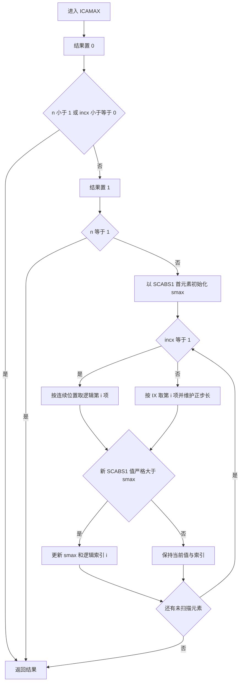
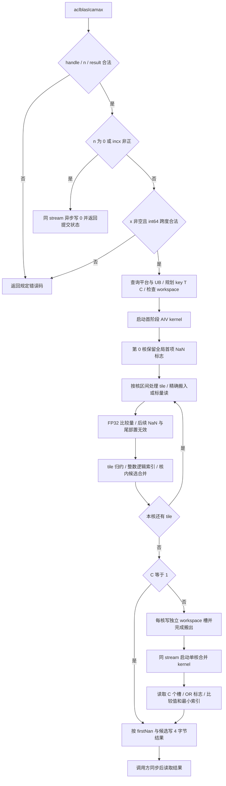

# 一、需求背景

## 1.1 需求来源

本设计对应社区任务“11月社区任务-aclblasIcamax算子开发（A2/A3）”，在[官方任务列表](../../../../README.md)中为 11 月第 5 项。competition 审阅基线为 `d7497ff0a5c48190ce7b24f67b2209b55304a468`，提交位置为 `04_tasks/01_community-task-2026/tasklist/11-5-aclblasIcamax-A2A3/Xztxzt/docs/design.md`。需求依据为任务包中的 `aclblasIcamax_AtlasA2_A3_task_doc.md` 及配套测试材料；目标为 CANN 9.1.0、Atlas A2/A3，采用 Ascend C kernel 直调。本稿是待实现方案，仅完成材料、源码和设计静态核验，未完成编译、上板或性能验收。

## 1.2 背景介绍

### 1.2.1 aclblasIcamax 算子实现优化

Icamax 对单精度复数向量求最大比较量的位置，用于主元选择等场景。令逻辑下标 `i=0,…,n−1`、物理复数下标 `p=i·incx`，逐元素计算

\[
s_i=\operatorname{FP32}(|\operatorname{Re}(x_p)|+|\operatorname{Im}(x_p)|).
\]

无 NaN 时返回 `1 + min{i | s_i=max_j s_j}`，并列依据逻辑下标，不是物理跨度。例：`[(3,4),(6,0)]` 返回 1；使用欧氏模会错误返回 2。

本任务没有 TBE 实现、算子信息库 JSON 或 ACLNN 两段式接口。已只读核对 ops-blas 固定版本 `47d82a0ebcc9f2833d661a5046d8dff6691e1d33`（下文“源码基线”）：

| 实际文件 | 已核实用途与边界 |
|---|---|
| [include/cann_ops_blas.h](https://gitcode.com/cann/ops-blas/blob/47d82a0ebcc9f2833d661a5046d8dff6691e1d33/include/cann_ops_blas.h) | 已声明 `aclblasIcamax`，共用公开 ABI，不重复新增声明 |
| [include/cann_ops_blas_common.h](https://gitcode.com/cann/ops-blas/blob/47d82a0ebcc9f2833d661a5046d8dff6691e1d33/include/cann_ops_blas_common.h) | `aclblasComplex` 为 `float real, imag`；定义状态码 |
| [blas/iamax/arch22/isamax_host.cpp](https://gitcode.com/cann/ops-blas/blob/47d82a0ebcc9f2833d661a5046d8dff6691e1d33/blas/iamax/arch22/isamax_host.cpp)、[isamax_kernel_impl.h](https://gitcode.com/cann/ops-blas/blob/47d82a0ebcc9f2833d661a5046d8dff6691e1d33/blas/iamax/arch22/isamax_kernel_impl.h) | A2/A3 实数归约框架参考；不能代替复数语义 |
| [blas/iamax/arch35/icamax_host.cpp](https://gitcode.com/cann/ops-blas/blob/47d82a0ebcc9f2833d661a5046d8dff6691e1d33/blas/iamax/arch35/icamax_host.cpp)、[icamax_kernel.cpp](https://gitcode.com/cann/ops-blas/blob/47d82a0ebcc9f2833d661a5046d8dff6691e1d33/blas/iamax/arch35/icamax_kernel.cpp)、[icamax_tiling_data.h](https://gitcode.com/cann/ops-blas/blob/47d82a0ebcc9f2833d661a5046d8dff6691e1d33/blas/iamax/arch35/icamax_tiling_data.h) | 950 已有复数实现，包含 Reg SIMD/SIMT；不能直接移植为 arch22 kernel |
| [blas/iamax/README.md](https://gitcode.com/cann/ops-blas/blob/47d82a0ebcc9f2833d661a5046d8dff6691e1d33/blas/iamax/README.md) | Icamax 支持表仍将 A2/A3 标为不支持，与源码树一致 |

### 1.2.2 aclblasIcamax 算子现状分析

性能对标 cuBLAS `cublasIcamax`；精度单标杆为 Netlib BLAS 3.10.0 的 CBLAS 包装。公开 cuBLAS 文档提供接口合同，不公开 GPU kernel；以下标杆流程图依据可读取的 Netlib 源码，不推测 cuBLAS 内部实现。

#### 1.2.2.1 标杆算子支持的数据类型和数据格式

| 参数 | 类型、位置与格式 | 本任务限制 |
|---|---|---|
| handle | `aclblasHandle_t`，Host 句柄，绑定 stream | 必须有效 |
| n / incx | `int`，Host 标量 | 正常路径 `n>0, incx>0`；步长以复数元素计 |
| x | `const aclblasComplex*`，Device COMPLEX64、交错实虚部，逻辑一维 ND | 正常路径物理元素数 `1+(n−1)·incx`，无广播 |
| result | `int*`，Device INT32 单值 | 正常返回 `[1,n]`，快速返回写 0；仅写 4 字节 |

[cuBLAS 12.8 的 cublasI&lt;t&gt;amax 文档](https://docs.nvidia.com/cuda/archive/12.8.0/cublas/index.html#cublasi-t-amax)支持 Host/Device 结果和另行提供的 64 位整数接口；本任务仅要求 Device 结果及 `int` 参数。该文档将 `n<=0` 归为返回 0，本任务明确要求 `n<0` 返回 `ACLBLAS_STATUS_INVALID_VALUE`，不能宣称错误行为完全相同。

#### 1.2.2.2 标杆算子实现描述

[Netlib v3.10.0 BLAS/SRC/icamax.f](https://github.com/Reference-LAPACK/lapack/blob/v3.10.0/BLAS/SRC/icamax.f)先置结果 0，`n<1` 或 `incx<=0` 直接返回；否则置结果 1，`n=1` 返回。其后以第一个元素初始化最大量，对连续或正步长输入顺序扫描，只在新比较量严格大于当前值时更新量和逻辑索引。[SCABS1 源码](https://github.com/Reference-LAPACK/lapack/blob/v3.10.0/BLAS/SRC/scabs1.f)使用单精度实部、虚部绝对值之和。由比较规则可推得：首项比较量为 NaN 时索引停在 1；首项非 NaN 时后续 NaN 不更新；最大量为正 Inf 时保留最早位置。`Inf+NaN` 的比较量仍为 NaN；有限分量相加溢出为 Inf 也参与上述并列规则。

源码基线的 950 实现先校验参数及跨度，快速返回用 `aclrtMemsetAsync`；正常路径查询 AIV 数、使用 handle workspace。`incx=1` 走 Reg SIMD：连续搬运、实虚拆分、Abs/Add、局部值与索引归约，`SyncAll` 后由 0 核汇总；`incx>1` 走 SIMT，之后同 stream 启动第二个归约 kernel。任一局部发现 NaN 都设置标记，最终进入 `IcamaxNanResult` 重读输入，区分首项 NaN 与后续 NaN。此处是源码行为，不是本稿实测结论。

arch22 Isamax 使用最多 40 核的固定数组、每块 23040 个 FP32 的常量，单次调用分配 workspace/tiling 并同步释放；空 handle 返回 `NOT_INITIALIZED`。这些历史策略和状态码不照搬到本任务。

#### 1.2.2.3 标杆算子实现流程图

下图严格描述 Netlib `icamax.f`，不包括本任务额外的指针、状态码检查；CBLAS 正常结果再转换为 0-based，测试侧加 1。



# 二、需求分析

## 2.1 外部组件依赖

开发与验收基于 CANN 9.1.0 的 Ascend C 编译器、AscendCL Runtime、平台信息接口及 msprof；测试使用 C++ GTest 和 Netlib BLAS 3.10.0 的 `cblas_icamax`。通过仓库公共 `REFBLAS_LIB`、`REFBLAS_INCLUDE_DIR` 固定参考库，并检查运行时实际加载库，不能把系统 `libblas` 名称当作 Netlib 身份证明。NumPy 的复数 `abs/argmax` 不适合作为此任务 golden。

API 静态依据为 asc-devkit 提交 `d433ffc4f75274b901521dfc42d98542abb98627`：本稿采用其明确支持 A2/A3 的 Memory SIMD `Gather`、基础 `ReduceMax` 和非 Compact `DataCopyPad`。该文档快照不是已安装 CANN 9.1.0 的编译结果，具体重载与编译选项仍须在目标 SDK 核验。

## 2.2 内部适配模块

在 `blas/iamax/arch22/` 拟新增 `icamax_host.cpp`、`icamax_kernel.cpp`、共享内部声明文件 `icamax_kernel.h` 和 `icamax_tiling_data.h`；这是计划路径，基线中尚不存在。Host/kernel 共用 tiling 定义，公开接口沿用已有头文件。依赖 `blas/common/helper/host_utils.h` 的 `GetAivCoreCount` 及 `aclblas_handle_internal.h` 的 `GetEffectiveWorkspace/Size`，不另建私有平行接口。

测试拟落在 `test/iamax/icamax/arch22/`，复用公共 `icamax_param.h` 的 `resultIsNull` 解析和 `icamax_golden.h` 的 CBLAS 调用方式，补齐跨度错误路径。修改 [test/iamax/icamax/CMakeLists.txt](https://gitcode.com/cann/ops-blas/blob/47d82a0ebcc9f2833d661a5046d8dff6691e1d33/test/iamax/icamax/CMakeLists.txt) 的 arch22 GTest 注册；同时核对 `blas/CMakeLists.txt` 源文件筛选、`test/CMakeLists.txt` 源码存在性检查和 `cmake/test.cmake`。基线当前缺 arch22 实现及测试，会被构建逻辑跳过，不能直接沿用任务书“退回非 GTest runner”的旧描述。

## 2.3 需求模块设计

### 2.3.1 Ascend C 算子原型

```cpp
aclblasStatus_t aclblasIcamax(
    aclblasHandle_t handle, int n,
    const aclblasComplex* x, int incx, int* result);
```

Host 按以下顺序处理，参数错误路径不访问输入、不写输出：

| 顺序 | 条件 | 行为 |
|---|---|---|
| 1 | `handle==nullptr` | 返回 `ACLBLAS_STATUS_HANDLE_IS_NULLPTR` |
| 2 | `n<0` 或 `result==nullptr` | 返回 `ACLBLAS_STATUS_INVALID_VALUE`，优先于快速返回 |
| 3 | `n==0` 或 `incx<=0` | 不访问 x、不做跨度计算、不归约；在绑定 stream 上异步将 result 的 4 字节置零；提交成功返回 SUCCESS，Runtime 失败返回 EXECUTION_FAILED |
| 4 | 正常路径 `x==nullptr` | 返回 INVALID_VALUE |
| 5 | `int64_t(n−1)*int64_t(incx)>INT32_MAX` | 返回 INVALID_VALUE |
| 6 | 平台、workspace 或启动资源检查 | 失败按库约定返回错误；成功提交 kernel，设备异步错误由调用方同步检查 |

### 2.3.2 Ascend C 算子相关约束

正常路径必须有足够的 Device 输入存储，result 独立且可写；不支持结果覆盖 x、广播、批量接口、COMPLEX128 或任意 Tensor 视图。`incx<=0` 合法但不反向遍历，`INT32_MIN` 也直接快速返回，不计算 `abs(incx)`。`n=0, x=nullptr` 合法，而任意 n 的 result 空指针均非法。

NaN、Inf、正负零和 FP32 极端值属于功能范围；不得用浮点误差阈值允许错误索引。与 cuBLAS 的差异限于任务指定的参数错误行为、Device 结果和 32 位参数范围，不扩展 pointer mode 或 64 位 ABI。

# 三、需求详细设计

## 3.1 调用方式

调用链为：AscendCL 初始化与 Device 选择 → `aclblasCreate` → `aclblasSetStream` → `aclblasIcamax` 参数检查及 Host tiling → `icamax_kernel_do` 启动 AIV kernel → 调用者同步 stream → D2H 读取一个 INT32。无 ACLNN executor、GE 注册或 TBE 信息库步骤。

快速返回和正常路径均保持异步提交。小输入单核直接写 result；多核先各自产生候选，再在同一 stream 启动单核合并 kernel，利用 kernel 完成边界保证 workspace 可见性。workspace 从 handle 取得，容量不足返回 EXECUTION_FAILED，查询平台失败返回 INTERNAL_ERROR；检查指针和容量，不在热路径分配/释放或隐式同步。输入、输出、workspace 必须保持有效直到 stream 完成，同一 workspace 不允许被不同 stream 的未完成调用并发覆盖。

## 3.2 需求总体设计

按“每元素 FP32 比较量 → tile 最大候选 → 核候选 → 全局候选”归约。候选保存 `score:float32, index:uint32, valid:uint32, firstNan:uint32`；index 始终是 0-based 逻辑索引，最后仅加一次 1。只允许逻辑第 0 项设置 firstNan；后续 NaN 和 padding 为无效候选。

合并规则为：firstNan 标记做 OR；有效候选胜过无效候选；有效候选先比较 score，score 相同则选更小 index。最终 firstNan 为真返回 1，否则输出胜者 index+1。首项非 NaN 时至少存在一个有效候选。有效域中 score 无 NaN，因此该比较构成确定的全序选择，分核、tile 划分和候选合并顺序不改变结果；不能把每个分区的“局部首 NaN”当作全局首项。

### 3.2.1 host 侧设计

Host 只处理元数据，不拷回 x 判断 NaN。查询运行 Device 的可用 AIV 数 `P` 和 UB 容量 `U`，按完整缓冲账本选择 tile 大小 `T`、路径和核数 `C`。tiling 按值传参，包含 `n, incx, C, T, pathKey` 和尾块/缓冲配置，避免临时 Host tiling 地址在异步调用后失效；需由目标编译器验证参数布局与入口支持。

#### 3.2.1.1 分核策略

正常路径取逻辑分配粒度 `a=64` 个复数、`G=ceil(n/a)`。向量路径 `T` 为 64 的正整数倍；初始候选 `C=min(P,ceil(n/T),G)`，小于等于一个 tile 时单核。大步长标量保底路径使用 `T=64` 作为调度粒度。以上是待测初始策略，不以固定 40 核替代平台查询。

令 `q=floor(G/C), r=G mod C`，第 c 核（`0<=c<C`）处理：

\[
b_c=64(cq+\min(c,r)),\quad e_c=\min(n,b_c+64(q+[c<r])),\quad N_c=e_c-b_c.
\]

各区间连续、不重叠，合起来恰为 `[0,n)`；尾数只落在末核。核内第 t 个 tile 起点 `g=b_c+tT`，有效数 `m=min(T,e_c−g)`。以实际参与的 AIV 数匹配 launch 配置，不照搬 Isamax 的 `ceil(needVecCoreNum/2)`，防止混用 AI Core 与 Vector Core 计数；具体入口与 block 数关系纳入 A2/A3 上板检查。

#### 3.2.1.2 数据分块和内存优化策略

`incx=1` 连续搬入 `8m` 字节；`incx=2/3` 先搬入从首个到末个有效复数的跨度，再在 UB 用 Gather 提取实虚部。定义 `s=incx`、`S(T,s)=1+(T−1)s`、`A32(v)=32ceil(v/32)`，一块源区预算 `A32(8S)`。每 tile 只从 GM 读取 `8[1+(m−1)s]` 字节；对齐 padding 在 UB 完成，禁止将 GM 读取长度向上扩至分配末尾之外。Gather 的偏移为 `8js` 字节、实部/虚部 base offset 分别为 0/4，`0<=j<m`；源与目标不重叠。[Gather.md](https://gitcode.com/cann/asc-devkit/blob/d433ffc4f75274b901521dfc42d98542abb98627/docs/zh/api/SIMD-API/basic_api/memory_vector_compute/scatter_gather/Gather.md)明确偏移单位为字节。

每核 UB 的保守预算如下，双缓冲只复制输入区：

\[
U_{need}=D\,A32(8S(T,s))+4A32(4T)+A32(\lceil T/8\rceil)+R(T)+64+U_0\le U.
\]

其中 `D=1` 为初始实现、`D=2` 为后续流水候选；四个 `4T` 区分别为实部、虚部、score 和 uint32 Gather 偏移；一份位掩码用于 NaN 检测/Select；64 字节为归约输出和候选暂存各 32 字节；`U0` 显式记入框架及未计临时区，不重复扣减已包含的预留。基础 `ReduceMax(calIndex=true)` 的 scratch 按逐轮结果累计：`u0=T`，`u(j+1)=2ceil(u(j)/64)`，至结果元素数不大于 2，`R(T)=Σ A32(4u(j)), j>=1`，至少预留 32 字节；尾块复用整 tile scratch。依据为[基础 ReduceMax.md](https://gitcode.com/cann/asc-devkit/blob/d433ffc4f75274b901521dfc42d98542abb98627/docs/zh/api/SIMD-API/basic_api/memory_vector_compute/reduction_compute/ReduceMax.md)，不是同名多维高阶接口。

Host 求满足预算的最大 64 倍数 `T`，初始上限取 `255·64=16320`，并检查各实际 API 长度字段。示例 `T=4096,D=1` 时，`s=1` 的已列缓冲占 99456 字节，`s=3` 为 164992 字节，均还须加 `U0` 并与查询到的 U 比较；示例不是硬件容量声明。[DataCopyPad_GMToUB.md](https://gitcode.com/cann/asc-devkit/blob/d433ffc4f75274b901521dfc42d98542abb98627/docs/zh/api/SIMD-API/basic_api/memory_vector_compute/data_move/DataCopyPad_GMToUB.md)中 A2/A3 的单块长度单位为字节且小于 `2^21`，采用非 Compact 重载。平台容量查询依据 [GetCoreMemSize.md](https://gitcode.com/cann/asc-devkit/blob/d433ffc4f75274b901521dfc42d98542abb98627/docs/zh/api/Utils-API/platform_info/PlatformAscendC/GetCoreMemSize.md)。

`incx>3` 首版用 64 位地址计算逐个读取两个 FP32 分量的保底路径，仅需常量级本地状态，避免因物理跨度过大分配 UB；后续可测量稀疏搬运方案，不能为性能擅自拒绝合法大步长。多核 workspace 每候选占独立 32 字节槽，`W=A256(32C)`，每槽写满并初始化 padding；合并核逐槽读取，UB 不随 C 无界增加。单核无需 workspace。

正常连续输入有效读量约 `8n`，多核增加 `32C` 写入和 `32C` 读取，输出 4 字节；工作量为 `2n` 次 Abs、`n` 次 FP32 Add 和线性规模比较。小步长跨度搬运约放大至 `8sn`，跨 tile 未搬间隙可略减；这些是请求量模型，不是实测 HBM 流量。小输入预计受启动延迟影响，大连续输入可能受搬运和归约共同限制，须用 profiling 判定，不能直接声称带宽饱和。

#### 3.2.1.3 tilingKey 规划策略

本任务为直调，以内部 `pathKey` 字段/Host 分发实现 tilingKey，不使用 `gert::TilingContext::SetTilingKey`。

| key | 条件 | 计划执行 |
|---|---|---|
| 0 | `incx=1,C=1` | 连续搬运、单核归约并写 result |
| 1 | `incx=1,C>1` | 连续多核候选 + 单核合并 |
| 2 | `incx=2/3` 且 UB 预算可容纳最小 tile | 有界跨度搬运、Gather；C=1 直写，否则二阶段 |
| 3 | `incx>3` 或向量最小 tile 不满足预算 | 按逻辑下标、64 位物理偏移标量读分量；同一候选合并规则 |

快速返回在 Host 完成，无归约 key。buffer 深度属于 tiling 配置，尾块由 `m` 控制，不为每个 n 增加 key。

### 3.2.2 kernel 侧设计

采用 arch22 Memory SIMD 的搬运、Abs、Add、Compare/Select 和基础 ReduceMax，所有候选比较共用规则。不使用 950 的 `Reg::DeInterleave`、`asc_vf_call`、warp shuffle 作为 A2/A3 实现依据。

#### 3.2.2.1 kernel 侧实现描述

1. **初始化与地址**：由 tiling 求 `[b_c,e_c)`；标量分量下标使用 `2·int64_t(i)·incx` 和 `+1`。Host 已限制复数跨度，但最后 float 下标仍可能超过 INT32_MAX，kernel 不能重新窄化。第 0 核检查全局首元素的 NaN，标志写入自己的候选；不得影响其他核的同步或写槽责任。
2. **CopyIn / Compute**：只处理 `m>0` 的 tile；DataCopyPad 搬运精确有效跨度，Gather 得到实虚数组，FP32 Abs/Add 形成 score。用 `score!=score` 标记 NaN 并替换为 `−Inf`；无效尾部也填 `−Inf`。正常有效 score 均非负，故全无效 tile 的最大值仍为 `−Inf`，设置 valid=0，不能让填充零在全零输入中争胜。首项 NaN 在替换前已经保留标记。
3. **核内归约**：对完整初始化的 T 个 score 执行 `ReduceMax(...,T,true)`，取最小 tile 索引；结果索引槽按 uint32 位解释，不做 float 数值转换。全局索引为 `g+tileIndex`，只在有效候选上使用。核内逐 tile 合并采用“较大 score，等值较小 index”，全部索引运算使用整数，避免大于 `2^24` 时 float 丢位。
4. **流水与生命周期**：MTE2 完成后才允许 Gather；Gather/Abs/Add/Select/Reduce 的数据依赖配置相应 Vector barrier；取归约结果前完成 V→S 同步；S 写候选后完成 S→MTE3 同步再搬出。输入槽要等最后消费者完成才可复用；双缓冲用独立槽和事件，经 timeline 证实重叠后启用。启动下一 kernel 前本 kernel 必须完成全部 MTE3，不以 Host 返回或标量赋值代替设备写完成。
5. **核间合并**：C>1 时所有核各写自己的候选槽，同 stream 第二个单核 kernel 逐槽合并；不对 score/index 分别做原子更新，也不在一个 kernel 内轮询全局计数。合并结果依据 firstNan 决定返回 1 或 index+1，精确向 result 写 4 字节；最后一个写者唯一。C=1 复用相同结束逻辑直写，省掉第二次启动。旧 workspace 每轮全部覆盖，无需预先整区清零。

单精度加法舍入、溢出和非规格化数处理都会影响索引，不能将“输出是整数”理解为“内部没有数值风险”。不改用 double 比较量、不计算平方和，也不启用会消除 NaN 检查或改变比较语义的激进浮点优化；需核验 CANN 9.1.0 的 FP32 subnormal/FTZ 与 NaN 比较行为，并用构造数据对照 Netlib。若目标指令的 FTZ 与验收合同不符，应提供位级保真的补偿或保底计算后再验收，不能通过放宽输出容差解决。

#### 3.2.2.2 Ascend C 实现流程图



#### 3.2.2.3 Ascend C 实现流程图与标杆算子流程图存在的差异点和原因

| 差异 | 原因及语义保持条件 |
|---|---|
| Netlib 顺序扫描，本设计多核、多 tile、两阶段 | 并行处理减少单核长循环；有效 score 全序与最小索引规则保证任意合并顺序等价 |
| Netlib 首值自然控制 NaN，本设计显式 firstNan 与 valid | 避免分区首 NaN 或 padding 污染结果，保持全局第一项特殊性 |
| 950 检出任意 NaN 后重算，本设计就地筛除后续 NaN | 通过首项标志保留语义，减少额外输入扫描；需硬件精度验证 |
| 小步长物理跨度搬入、UB Gather | 转为 A2/A3 可用 SIMD 输入；只取逻辑元素，间隙数据不参与比较 |
| Host 增加状态码、跨度、workspace 检查 | 来自任务接口约束，Netlib Fortran 无 handle/Device 指针语义 |
| 多核采用第二个 kernel 汇总 | 同 stream 顺序建立跨核可见性，规避常驻核/全局自旋风险；代价是启动开销，必须计入完整算子性能 |

## 3.3 支持硬件

| 目标 | 构建配置与设计范围 | 验证状态 |
|---|---|---|
| Atlas A2 系列，含 Atlas 800T A2（910B3） | `ascend910b*`，源码 CMake 映射 `arch22 / dav-2201`；910B3 为任务性能设备 | 未编译、未上板 |
| Atlas A3 系列，含 Atlas 800T A3 | `ascend910_93*`，同为 `arch22 / dav-2201` | 未编译、未上板 |

任务允许自验证覆盖一种款型；实现目标仍包括 A2/A3，需记录实际芯片、驱动、CANN、编译选项与设备可用核数。950 为源码参考和兼容性回归对象，不是本次新增适配目标。

## 3.4 算子约束限制

接口规模由 int 参数及复数跨度守卫共同约束，不能把 CSV 最大 n 当作接口上限。`M=(n−1)incx<=INT32_MAX` 仍允许输入字节数 `8(M+1)` 达到 `2^34`，所有大小、字节偏移与分配计算使用 int64/size_t；合法输入是否有足够物理内存由调用方保证。测试负向和快速返回路径只用 dummy 或空指针，不按巨大跨度分配。

大步长标量路径优先保证功能，性能目标 CSV 均为 `incx=1`，目前不承诺大步长达到同一性能倍率。只读 x、独立 result 和调用期间保持有效的 handle/workspace 是必要条件；不支持同一 handle workspace 的跨 stream 无同步复用。首次实现不承诺 graph capture 能力，不能将异步提交等同于已验证捕获兼容。

# 四、特性交叉分析

| 特性 | 交叉影响与设计处理 | 必须验证 |
|---|---|---|
| 复数度量与数值模式 | FP32 Abs/Add；舍入、溢出可能形成并列，按最小逻辑索引 | 1-范数/欧氏模反例、接近舍入边界、有限溢出 Inf、subnormal |
| NaN 与分核 | 仅全局第 0 项 NaN 具有优先权，其他 NaN 无效 | 首项、后续、分区首项、tile 尾部、Inf 与 NaN 混合 |
| 步长与访存 | 正步长单位是复数；跨度搬入的间隙不参与计算 | 间隙填超大值/NaN、非 32B 对齐基址、最小合法分配与保护区 |
| 并列与索引宽度 | tile、核内、核间都保留最小逻辑 index，最终 +1 | 跨 tile/跨核并列、全零、正负零、大于 `2^24` 的逻辑索引 |
| 异步与 workspace | 同 stream 两阶段、唯一写者、整槽覆盖；容量检查在启动前 | 多次调用、不同 handle/stream、生命周期、输出周围不被覆写 |
| 资源与性能 | UB 预算、核数、启动数影响不同规模；双缓冲可能缩小 tile | 小输入延迟、临界长度、大小核尾差、完整调用耗时 |
| 构建与既有产品 | 共享 ABI，新增 arch22，保留 arch35 | 两种 SoC 构建、符号唯一、测试未被 skip、950 无回归 |

# 五、可维可测分析

## 5.1 精度标准/性能标准

| 项目 | 验收标准与执行计划 |
|---|---|
| 精度 | 固定 Netlib BLAS 3.10.0，正常路径 `cblas_icamax+1`；快速返回直接比对 0；负向只核验状态及无非法访问。输出 INT32 精确相等，任一错误即失败，不使用 FP32 atol/rtol |
| 性能 | Atlas 800T A2（910B3）、CANN 9.1.0；预热 5 次后至少 10 次 SUCCESS 有效调用，按任务书使用 msprof op task duration。完整调用含首阶段和合并阶段；每次调用的各 kernel duration 求和后再平均，不能挑最短 kernel。门槛 `T_NPU_us <= 1000·gpu_ms/0.8` |
| 内存与边界 | 记录实际输入、输出、workspace 及峰值占用；任务未设独立内存性能阈值，README 的 Host 4GB 为测试预算。错误/快速返回不分配跨度缓冲；正常输入、结果前后保护区和访问边界单独验证 |

全量解析任务 CSV 得到：1000 条精度、200 条性能；精度中正常归约 508 条、快速返回 485 条、错误状态 7 条，分类 L0/SQ/INC/FL/ED/EX 分别为 10/38/21/18/17/896。性能 n 从 1 至 4194304、全部 `incx=1`；基线 200 行均有数值。任务包未提供独立接口核验脚本，接口边界须由 GTest 补齐。保留全部原始记录，精度阶段先证明实际注册和执行了预期用例，性能输入也先验证正确性。

必须处理以下测试材料与源码差异：

- 任务 README 的 ED=13、EX=900 已过时，实际为 17/896；生成器默认输出可逐字段复现任务 CSV，但 `--dist mixed` 仍生成均匀 token，扩展逻辑仅每第七项改为 NaN。原包无 `GAUSS_NORM_5_2`，而源码基线 `test/frame/fill.h` 已支持 GAUSS，生成器“框架尚不支持”的注释已过时。补充明确的 50% 均匀/50% 正态随机集合，实虚独立，记录实际执行分布；定向特殊值用例另列。
- 源码基线 [arch35/icamax_test.cpp](https://gitcode.com/cann/ops-blas/blob/47d82a0ebcc9f2833d661a5046d8dff6691e1d33/test/iamax/icamax/arch35/icamax_test.cpp)默认仅加载 50 行，全量需 `ICAMAX_FULL_CSV=1`；其全量 CSV 与本任务包不完全相同，且按种子阈值将 1052 条随机 token 分为 526/526。不能把这项既有实现能力写成任务生成器已有能力，不能照搬种子切分而假定新用例仍为 50/50。
- 该测试基线没有 `[PERF] avg_us` 计时代码。任务 README/`verify_performance.py` 实际使用 aclrtEvent 打印值判定，而任务书要求 msprof task duration。拟保留 event 时间作补充证据，正式报告按任务书列 msprof 结果，并明确两者计时窗口；不能宣称原脚本已满足验收口径。
- 性能脚本按 `(n,incx)` 覆盖基线，200 行缩成 198 项；`n=4194304` 的三行属于随机、全零、极端填充，原耗时不同。拟以明确 case↔baseline 行映射逐条关联，并校验 200 条完整性、进程返回码、有效采样数和有限正耗时。精度脚本只要求“至少一条 PASS 且无 FAIL”，也需增加完整性校验。生成器会输出空耗时基线，禁止覆盖已回填文件。

补充定向用例包括：全局首 NaN、后续 NaN、全 NaN、`Inf+NaN`、多个 Inf、FP32 溢出/舍入并列、正负零、跨核/tile 最早最大值、逻辑/物理索引区分、`n=1,incx=INT32_MAX`、跨度界内/超界、`n<0` 与 `incx<=0` 组合、任意 n 的空 result、空 handle、`INT32_MIN` 步长、输入偏移及结果 4 字节保护。超大合法索引的设计模型检查不能冒充实际 NPU 大内存用例。

输入随机生成遵循任务指定范围；任务书引述的 [opbase 固定版精度标准](https://gitcode.com/cann/opbase/blob/28a1ce52ae856353589841226a0002af73314a6b/docs/zh/ops_precision_standard/mixed_tolerance_standard.md)不改变本任务整数索引 bit-exact 判据；该标准网页本次未独立获取，输出判据直接依据任务书。性能基线为任务包所附 A100-SXM4-80GB / CUDA 12.8 / cuBLAS 12.8.4 数据，本稿未复测。前三项 GPU 耗时为 17.4592003、19.6437326、27.6309334 µs，对应门槛约 21.8240、24.5547、34.5387 µs；必须使用逐行原值计算。

## 5.2 兼容性分析

保持已有 `aclblasIcamax` 声明、`aclblasComplex` 布局、int 输出及 handle/stream 行为；新增 arch22 实现后再更新支持表，不将设计状态写为“已支持”。A2/A3 的编译分支与 950 分离，不能把 Reg/SIMT API 或固定 UB 常量泄漏到共享代码。共享 golden/参数文件的变更须回归 arch35，尤其是 `result=NULLPTR`、跨度守卫与全量 CSV 选择行为。

现有 Isamax 的空 handle 状态、同步分配策略和实数数据布局不构成本接口兼容约束；本任务遵循明确的 Icamax 合同。设计阶段只完成文档结构、全量 CSV、固定源码、分核覆盖、访问上界、候选合并及 UB 公式的静态核验；目标 SDK 编译、真实 FP32 数值行为、设备同步、内存访问安全与 0.8 倍性能目标仍待实现后的验证。
