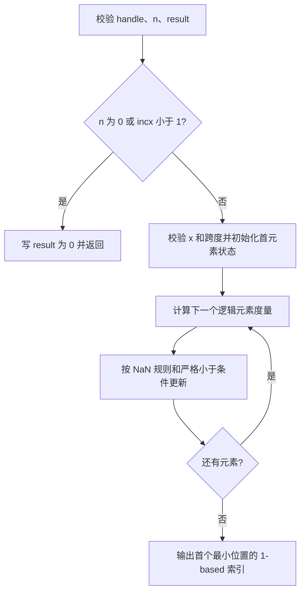
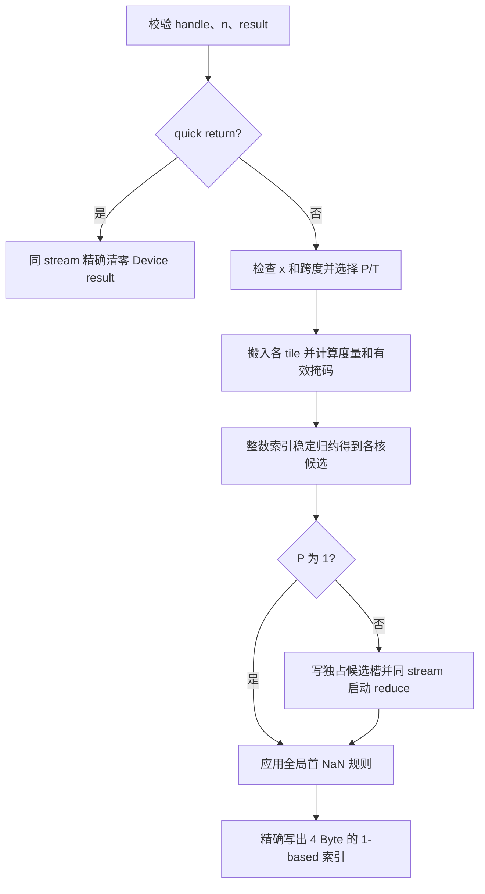

# 一、需求背景

## 1.1 需求来源

承接“11月社区任务-aclblasIsamin算子开发（A2A3）”，补齐 ops-blas 在 Atlas A2/A3 上的单精度实数绝对值最小元素索引接口。需求依据任务包 `aclblasIsamin_AtlasA2_A3_task_doc.md`、`test_cases/isamin_test.csv` 和 `test_cases/gpu_baseline.csv`；对应[任务列表](../../../../docs/README.md)的 `11-6-aclblasIsamin-A2A3`，按[设计模板](../../../../resources/design_template.md)组织。

## 1.2 背景介绍

### 1.2.1 aclblasIsamin 算子实现优化

在有效向量中查找度量最小的第一个逻辑位置，返回 1-based INT32 索引。面向连续大向量采用 Vector 批量计算、核内稳定归约、跨核候选二次归约；小输入采用单核单次启动，避免全局归约的额外调度成本。

本接口为 BLAS Kernel 直调，无对应 TBE Python 算子、TBE 信息库文件或 ACLNN 两段 API。以下现状核对基于 ops-blas 提交 `9565ef46a98f82e8884ee084aea96ec62e3e993e`，不得将 950 的 SIMT/RegBase 实现直接用于 A2/A3：

| 用途 | 文件路径 |
| --- | --- |
| 公共声明 | `include/cann_ops_blas.h`，已声明 `aclblasIsamin` |
| 950 实现参考 | `blas/iamin/arch35/isamin_host.cpp`、`isamin_kernel.cpp`、`isamin_kernel.h`、`isamin_tiling_data.h` |
| 数值参考 | `test/isamin/isamin_golden.h` |
| A2/A3 开发位置 | 新增 `blas/iamin/arch22/isamin_host.cpp`、`isamin_kernel.cpp`、`isamin_kernel.h`、`isamin_tiling_data.h` |
| 测试与文档 | 新增 `test/isamin/arch22/`；适配 `test/isamin/CMakeLists.txt`；更新 `blas/iamin/README.md` |

### 1.2.2 aclblasIsamin 算子现状分析

#### 1.2.2.1 标杆算子支持的数据类型和数据格式

| 参数 | 类型 / 位置 | 语义 |
| --- | --- | --- |
| `handle` | `aclblasHandle_t`，Host | 有效句柄及绑定 stream |
| `n` | `int`，Host | 逻辑长度；负数报错，零长度写 result=0 |
| `x` | `const float*`，Device | FLOAT32 一维 ND 输入；每元素 4 Byte，只读 |
| `incx` | `int`，Host | 以输入元素为单位的步长；正数进入计算，`incx<1` 写 result=0 |
| `result` | `int*`，Device | 独立 INT32 标量；正常为 `[1,n]` 的逻辑索引，quick return 为 0 |

正常路径访问 `x[i*incx]`，不访问跨步间隙；索引是逻辑序号，不是物理偏移。绝对值在 FLOAT32 域计算，不需要求和或浮点收窄；不得因 flush-to-zero 优化改变 subnormal 与零之间的排序。

#### 1.2.2.2 标杆算子实现描述

功能和 GPU 性能对标 [cuBLAS amin](https://docs.nvidia.com/cuda/cublas/index.html#cublas-t-amin)，具体 NaN 和异常返回策略以本任务及[仓内 CPU golden](https://gitcode.com/cann/ops-blas/blob/9565ef46a98f82e8884ee084aea96ec62e3e993e/test/isamin/isamin_golden.h)为准。标准参考 BLAS/CBLAS 没有可直接调用的 `isamin` 例程，不能把不存在的 Netlib 符号作为测试依赖。

对零基逻辑位置 i，度量为 `abs(x[i*incx])`。CPU 数值函数 `isamin_golden` 令 `minAbs=abs(x[0]), minIdx=1`；若首元素为 NaN，只把该初始值改成 `FLT_MAX`，索引仍为 1。随后跳过 NaN，仅在绝对值严格更小时更新。因此 `[NaN,0]` 返回 2，`[NaN,FLT_MAX]`、`[NaN,Inf]`、全 NaN 均返回 1；`[Inf,NaN]` 仍返回 1，不能把每个 NaN 都替换为 FLT_MAX。正负零和其他并列值均返回最先位置。

现有 `aclblasIsamin_cpu` 包装层先检查 x 非空，与任务及 Host 实现允许 quick return 时 x 为空的规则不同。本次复用数值 helper，参数状态码用独立测试验证，不把该包装层作为异常路径的唯一 golden。

| 输入（均为 incx=1） | 期望索引 | 原因 |
| --- | --- | --- |
| `[NaN,0]` | 2 | 0 严格小于首元素对应的 FLT_MAX |
| `[NaN,FLT_MAX]` | 1 | 并列，保留初始索引 |
| `[NaN,Inf]` | 1 | Inf 不小于 FLT_MAX |
| `[Inf,NaN]` | 1 | 后续 NaN 不产生有效候选 |
| `[+0,-0]` / 全 NaN / 全 Inf | 1 | 分别验证并列、首 NaN、Inf 规则 |

#### 1.2.2.3 标杆算子实现流程图



图示为本任务的 CPU 参考流程；n=1 时初始化后直接输出。cuBLAS 内部 GPU 调度不公开，不将本图解释成其 kernel 实现。

# 二、需求分析

## 2.1 外部组件依赖

使用 CANN 9.1.0 的 ACL Runtime、Ascend C Vector、数据搬运及归约 API，沿用 ops-blas CMake/GTest/CSV 框架。CPU golden 为独立顺序比较函数，GPU 标杆使用任务附件。msprof op 用于正式性能采样；aclrtEvent 仅作辅助计时。

## 2.2 内部适配模块

复用公共 handle、stream、平台核数/UB 查询、`GetEffectiveWorkspace` 与 `GetEffectiveWorkspaceSize`，以及日志和错误返回机制。当前 `test/isamin/CMakeLists.txt` 仅在 arch35 下注册 GTest；接入 arch22 时扩展该判断。测试落点确为 `test/isamin/arch22`，不另建一个未被收集的 `test/iamin/isamin` 目录。 原有 arch35 路径保持独立；实现中不引入框架 Tensor 依赖或新公共 API。

## 2.3 需求模块设计

### 2.3.1 Ascend C 算子原型

```cpp
aclblasStatus_t aclblasIsamin(aclblasHandle_t handle, int n,
    const float* x, int incx, int* result);
```

内部为单核 kernel，或 producer/reduce 两个 kernel；共享 tiling 中记录 `n/incx`、逻辑分片、有效核数、tile 长度、双缓冲开关、候选槽间距及归约阶段。workspace 属于已有 handle 机制，不增加对外参数。

### 2.3.2 Ascend C 算子相关约束

校验顺序固定：①空 handle 返回 `ACLBLAS_STATUS_HANDLE_IS_NULLPTR`；②`n<0` 返回 `ACLBLAS_STATUS_INVALID_VALUE`；③result 为空返回 INVALID_VALUE，包含 quick return；④`n==0 || incx<1` 时执行 `aclrtMemsetAsync(result,sizeof(int),0,sizeof(int),handle->stream)` 并成功返回，不启动自定义计算 kernel、不读取 x；⑤正常路径检查 x 非空及 `int64(n-1)*incx<=INT32_MAX`。

负步长、零步长以及 INT32_MIN 在本接口中属于 quick return，不反向遍历，也不执行 abs(incx)。结果为 Device 地址，严禁 Host 端 `*result=0`；异步清零失败返回执行错误。有效输入的物理容量至少为 `1+(n-1)*incx` 个元素，元素偏移与乘 4 的字节偏移均使用足够宽的地址类型。

# 三、需求详细设计

## 3.1 调用方式

创建 ACL context/stream 和 BLAS handle，绑定 stream，分配输入及至少 4 Byte 的 Device result，准备输入后调用接口；同步 stream 再读回整数索引。即使 n=0 也需提供有效 result；同一 stream 中的清零、生产候选和最终写结果按依赖顺序执行，接口不主动做全设备同步。

## 3.2 需求总体设计

采用显式候选 `{float magnitude; uint32_t globalIndex; uint32_t valid; uint32_t firstIsNaN;}`，每核槽扩展并对齐为 32 Byte。索引从读取到最终合并始终为整数，不能存进 float 后再转换，避免超过 `2^24` 时相邻位置混同。NaN 和 padding 标记为无效，Inf 仍可作为真实候选。

核 0 记录**全局逻辑元素 0** 是否为 NaN，各核局部归约均忽略 NaN。最终若该标志为真，额外插入唯一的有效候选 `(FLT_MAX,0)`，再与所有真实候选按 `(magnitude,globalIndex)` 字典序取最小，返回 `globalIndex+1`。这准确保留首 NaN 的初始索引，且不会让其他 tile/核的首 NaN 产生伪候选。

仅在上述语义规范化后，候选合并才可分层执行。有效候选优先于无效候选；有效值更小者优先；值相同则全局逻辑索引更小者优先。padding 不能仅填 `+Inf` 而省略 valid，否则全 Inf 输入可能返回不存在的位置。

理想有效输入流量为 `4n Byte`；P 核两阶段方案额外写读 `32P` Byte 候选各一次、写 4 Byte 结果，即约 `4n+64P+4 Byte` 的 GM 请求量。每个元素执行一次 Abs，比较与整数索引处理为 O(n)，不能用浮点峰值替代归约指令的吞吐模型。小输入可能受启动时延影响，大输入可能受搬运、解码或归约影响，需通过实测区分。

### 3.2.1 host 侧设计

#### 3.2.1.1 分核策略

查询实际 AIV 核数 C，先以 `P=min(C,ceil(n/G))` 选择候选核数，G 为待校准的每核最小工作量；n 较小或 workspace 不足时选择 P=1。连续输入按 `R=align_up(ceil(n/P),8)` 分片，再令 `P=ceil(n/R)`，核 b 处理 `[bR,min((b+1)R,n))`。

跨步输入仍按逻辑区间划分，实际读取地址为 `x+(bR+j)*incx`；各核只读输入，候选槽独占，只有最终 kernel 写 result，因此不产生输出跨核写冲突。非 32 Byte 基址和尾部走精确搬运路径，不拒绝本来合法的元素对齐地址。

单核直接完成全量 tile 归约并写结果，不使用 GM workspace。多核需要至少 `32P` Byte 的有效 workspace；不足时改用单核并记录 tiling，不能越界访问或直接解引用空 workspace。平台核数查询异常、启动或 Runtime 调用失败按仓库状态码返回并记录错误。

#### 3.2.1.2 数据分块和内存优化策略

令 T 为每 tile 逻辑元素数，U 为查询的可用 UB，A 为对齐及队列开销，S 为所选归约 API 要求的临时空间；S 必须按实际 API 查询/约束计算，不视为零。数组逐项按 32 Byte 对齐，预算如下：

| 同时存活对象 | Byte 数 |
| --- | --- |
| FLOAT32 输入双缓冲 | `8T` |
| FP32 绝对值 | `4T` |
| uint32 索引 | `4T` |
| 有效标志 | `4T` |
| 临时区预算 | `4T` |
| 合计 | `24T+A+S <= U` |

连续路径候选 `T=4096` 时数组约占 96 KiB；跨步收集时每个 4 Byte 实数暂存一个 32 Byte UB 槽，双缓冲输入增至 `64T`，总预算为 `80T+A+S`，候选 `T=1024` 时数组约 80 KiB。 这些均是初始候选，最终以实际 UB 预算缩减 T 或关闭输入双缓冲，不把其他芯片的 tile 常量当作 A2/A3 结论。

连续整块使用 DataCopy，尾块按真实字节数使用 DataCopyPad。跨步路径尝试以每元素 4 Byte 的多块精确搬运装入 32 Byte 槽，再整理为紧凑数据；超过 blockCount/srcStride 等参数上限时拆分或逐记录搬入，不截断参数、不读取整个含大量间隙的物理跨度。复核 CANN 9.1.0 arch22 的 API 参数单位与对齐约束。

归约阶段只需读取 P 个候选槽；若 `32P` 加临时区不能一次装入 UB，则分块合并。最终结果精确写 4 Byte，禁止因 32 Byte 对齐而覆盖调用方 result 后面的内存。producer 的所有写回完成后才能交给同 stream 的 reduce kernel 读取。

#### 3.2.1.3 tilingKey 规划策略

| Key | 条件 | kernel 组织 |
| --- | --- | --- |
| 0 | incx=1 且 P=1 | 连续单核，直接写 result |
| 1 | incx>1 且 P=1 | 跨步单核，直接写 result |
| 2 | incx=1 且 P>1 | 连续 producer + reduce |
| 3 | incx>1 且 P>1 | 跨步 producer + reduce |

quick return 不启动上述 kernel。输入槽数和 tile 长度保留在 tiling 中；两阶段复用同一候选比较规则。多核门槛须同时计入第二次启动成本，不根据单个 producer 的耗时选择阈值。

### 3.2.2 kernel 侧设计

#### 3.2.2.1 kernel 侧实现描述

1. CopyIn 只读有效输入，对输入执行 FLOAT32 Abs；保留原始逻辑索引，并由核 0 保存全局首元素的 NaN 状态。
2. 对 NaN 和尾部 padding 清除 valid。局部 ReduceMin 的数值输入先将无效 lane 替换为 Inf，避免硬件 Min 的 NaN 规则影响结果；再通过 `valid && magnitude==minValue` 选出真实匹配项，按 uint32 最小索引得到首个位置。
3. 若无任何有效 lane，则输出无效候选；真实 Inf 与 padding Inf 靠 valid 区分。跨 tile 以相同候选规则合并，不能重置为每 tile 的第一个元素或把局部索引当全局索引。
4. 单核在全部 tile 完成后应用全局首 NaN 规则并精确写 result；多核各写一个 32 Byte 独占候选槽，核 0 的槽携带 firstIsNaN。
5. Host 在同一 stream 启动第二阶段，合并 P 个候选并应用同一首 NaN 规则，只由该 kernel 写最终索引。依靠 stream 顺序实现跨核依赖，不使用跨 block 自旋、未证明安全的全核屏障或浮点原子竞争。

输入双缓冲通过队列事件保证 CopyIn 完成后才计算，消费完毕才能复用；跨调用 workspace 复用必须遵守同 stream 顺序，跨 stream 并发使用独立 handle/workspace。候选索引归约需采用目标平台支持的整数比较路径，API 不支持时用整数标量合并，不能退化为 float 索引。

#### 3.2.2.2 Ascend C 实现流程图



#### 3.2.2.3 Ascend C 实现流程图与标杆算子流程图存在的差异点和原因

CPU 串行保留首元素状态，Ascend C 将首元素特殊语义和普通有效候选分离，再按值及全局索引稳定归约，从而保持顺序参考的最终结果。两阶段方案避免跨核原子顺序影响并列位置，也避免设备上不安全的自旋等待。小输入单阶段减少启动次数；正步长收集与尾部屏蔽只改变数据组织，不改变逻辑遍历位置。

## 3.3 支持硬件

适配 Atlas A2、Atlas A3 的 arch22 路径和 CANN 9.1.0，正式性能按 Atlas 800T A2（910B3）口径验证。按任务要求至少完成一种款型自验证，记录实际 SoC、CANN/驱动、编译配置和提交号；另一系列完成构建及接口兼容性核查。950 的历史数据不能作为 A2/A3 的性能证据。

## 3.4 算子约束限制

仅支持 FLOAT32 输入和 Device INT32 输出；无 Host result 模式、广播、转置、批量或矩阵 leading dimension 参数。正常路径 incx 为正且元素跨度不超过 INT32_MAX；n/步长属于运行时标量，不引入动态 Tensor 推导。result 与输入独立存储，x 只读；调用方保持 Device 内存和 workspace 存活至 stream 完成。任务书环境条目出现 Atlas 800I A2 与性能条目 Atlas 800T A2 两种名称；性能报告以 §3.3 指定的 910B3 设备为口径，记录实际机型，不由文字差异推断已经完成另一设备验证。

# 四、特性交叉分析

| 交叉项 | 风险与处理 |
| --- | --- |
| NaN × 局部归约 | 只记录全局首元素特殊状态；不能将其他分片的首 NaN 当作全局首元素 |
| 并列值 × 并行 | 数值相等时按 uint32 全局索引选最小，最终统一加一 |
| Inf × padding | valid 显式区分；不能依靠 Inf 哨兵本身判断有效性 |
| quick return × Device 输出 | result 始终判空，使用同 stream 异步清零且检查返回码 |
| 跨步 × 溢出 | 正常路径先用 int64 检查元素跨度，字节地址继续使用宽类型 |
| workspace × 并发 | 独占 32 Byte 候选槽；跨 stream 使用独立 workspace；不足时单核回退 |
| 浮点优化 × 索引 | 禁止通过近似容差、fast-math 或 float 索引改变比较结果 |

# 五、可维可测分析

## 5.1 精度标准/性能标准

输出是离散 INT32 索引，逐用例要求 `actual==golden`，匹配率 1.0、最大绝对误差 0；不使用 FLOAT32 的 0.99 匹配率或容差放宽索引误差。CPU golden 与 NPU 共同遵循本任务的 NaN、Inf、并列和 quick return 规则，CPU 浮点编译不得启用会改写该规则的 fast-math。

附件 `isamin_test.csv` 实有 1200 行，其中 1000 条非 PF、200 条 PF，9 条期望 INVALID_VALUE，最大 n 为 4194304。200 条 PF 全为 incx=1，与 GPU 基线 `(n,incx)` 的参数多重集合一致，但只有 198 个不同组合；匹配时保留行序、case_name 和重复次数，不用参数字典覆盖重复用例。200 条 GPU 基线只读保存，扩展生成器输出到新文件，避免空标杆覆盖已有耗时。

在实现阶段执行完整 CSV，并补充独立 API/特殊值测试：空 handle；n<0 与 incx<1 的优先级；result 为空（含 quick return）；quick return 时 x 为空；跨度溢出；n=1、tile/核边界和最后有效元素最小；跨分片并列、全部 Inf/NaN、最小值位于大逻辑索引；跨步间隙和前后哨兵；不同 stream 的独立调用。非法跨度用最小 dummy 输入，不按非法 n/步长分配；快返预填非零 result 后验证确实写零。

附件 CSV 没有 result 空指针列，因此空 result（含 n=0、incx<1）需用独立 GTest 补齐。增加首 NaN 与 FLT_MAX/Inf/0 的组合、仅非首 tile 出现 NaN、最小次正规数与正负零比较，防止通用 Min 或 fast-math 改变任务规定的结果。 对大于 `2^24` 的索引首先以合成候选验证整数 tie-break，再在设备容量允许时做端到端大规模测试；候选测试不能代替 NPU 实测。

附件没有 `GAUSS_NORM_5_2`，`RANDOM_NORM_5_5` 实为均匀分布。需补齐正态生成及加载支持，令有效随机测试集均匀/正态各占 50%，记录固定种子、μ∈[-5,5]、σ∈[0.1,2]；复数场景实虚部分别独立生成。保留原有边界和异常用例，并报告补充数量。

正式性能采集按任务书：910B3 上 warmup 5 次，不计入样本；连续取得至少 10 次成功调用的 msprof op 数据，计算平均耗时。两阶段实现计入每次 API 调用对应的 producer 与 reduce 全部 task duration，并附同 stream 事件包围完整调用的设备区间作交叉检查，不能只报 producer。每条 PF 满足 `NPU_avg_us<=1.25*GPU_ms*1000`，即加速比至少 0.8。

附件脚本的 aclrtEvent `[PERF] avg_us` 不等价于 msprof task duration，报告分别标注；quick return 无自定义计算 task，单独报告清零及调用行为，不伪造零耗时参与性能评分。调优单独比较 P、T、双缓冲和第二阶段启动成本，测量完整调用而非只选快的阶段。

当前交付为设计文档，未声称完成 NPU 精度、性能或内存测试。实现后提供可复现的 CSV/GTest、精度及性能报告、原始日志、保护区检查、构建与运行步骤，记录每个 kernel 及 tiling 选择，满足[社区流程](../../../../README.md)的验收交付要求。

## 5.2 兼容性分析

沿用公共函数签名、返回码和 handle/stream 约定，新增 arch22 实现而不改写 arch35 的算法和构建。固定 INT32 逻辑索引与 FLOAT32 布局，不导出私有平行接口；多核 workspace 大小由实现自行计算并检查。参数校验以任务书和现有 Host 为依据，数值以明确的顺序 CPU golden 为依据，二者分开测试。特别保留 Icamin 与 Isamin 不同的首 NaN 语义，不能因同属 iamin 就无差别共用归约入口。
