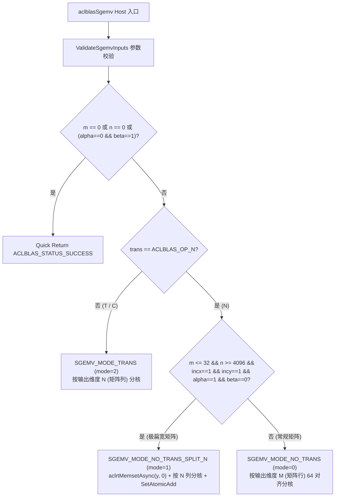

# 需求背景（required）

在深度学习、科学计算与数值线性代数领域，基础线性代数子程序（BLAS，Basic Linear Algebra Subprograms）是构建上层矩阵运算与算子加速库的核心基石。其中，Level-2 BLAS 核心算子 `SGEMV`（Single-precision General Matrix-Vector Multiplication，单精度实数通用矩阵-向量乘法）廣泛应用于全连接层小批量推理、自回归解码阶段（Batch=1）的特征投影、共轭梯度法（CG）与广义极小残差法（GMRES）等迭代求解器，以及各类矩阵分解（如 QR、Householder 变换、双向对角化）的中间子步骤。

当前 CANN `ops-blas` 算子库已在 `arch35`（Atlas A5 等架构）支持 `aclblasSgemv` 算子，但在 `arch22`（Atlas A2 / Atlas A3 训练与推理系列产品，`ascend910b`）架构下尚待补齐完整的 Host 端 Tiling 分发、Ascend C Vector 核函数实现及全量 GoogleTest / CSV 驱动验证用例。本设计文档针对 `cann/ops-blas` 仓库下 `arch22` 架构的 `aclblasSgemv` 算子进行系统化分析与详细设计，确保算子在功能完备性、IEEE-754 数值精度一致性（对标 OpenBLAS `cblas_sgemv` 黄金基准）以及多核 Vector 访存吞吐性能上全面满足社区任务验收标准。

---

# 需求分析（required）

## 1. 算子功能与数学表达式

`aclblasSgemv` 计算单精度实数（`float` / FP32）通用矩阵与向量的乘加运算，其数学表达式为：

$$
y \leftarrow \alpha \cdot \operatorname{op}(A) \cdot x + \beta \cdot y
$$

其中：
- $\alpha, \beta \in \mathbb{R}$ 为 Host 侧标量系数（FP32，通过指针传入）；
- $A$ 为按**列主序（Column-Major）**存储的 $m \times n$ 阶单精度实数矩阵，主维步长为 $\text{lda} \ge \max(1, m)$；
- 矩阵转置模式 $\text{trans} \in \{\text{ACLBLAS\_OP\_N}, \text{ACLBLAS\_OP\_T}, \text{ACLBLAS\_OP\_C}\}$：
  - 当 $\text{trans} = \text{ACLBLAS\_OP\_N}$ 时，$\operatorname{op}(A) = A$，输出向量 $y$ 的逻辑长度为 $m$，输入向量 $x$ 的逻辑长度为 $n$；
  - 当 $\text{trans} \in \{\text{ACLBLAS\_OP\_T}, \text{ACLBLAS\_OP\_C}\}$ 时（实数域下共轭转置与普通转置等价），$\operatorname{op}(A) = A^T$，输出向量 $y$ 的逻辑长度为 $n$，输入向量 $x$ 的逻辑长度为 $m$；
- $x, y$ 为支持正/负步长（$\text{incx} \ne 0, \text{incy} \ne 0$）的一维向量。对于逻辑长度为 $L$、步长为 $\text{inc}$ 的向量 $v$，第 $i$ 个逻辑元素（$0 \le i < L$）对应的内存偏移为：
  - 若 $\text{inc} > 0$：$\text{offset}(i) = i \times \text{inc}$；
  - 若 $\text{inc} < 0$：$\text{offset}(i) = (1 - L + i) \times \text{inc} = (L - 1 - i) \times (-\text{inc})$。

## 2. 接口原型与参数规格

### 2.1 对外接口原型（`include/ops_blas_l2.h`）

```cpp
aclblasStatus ACLBLAS_API aclblasSgemv(
    aclblasHandle_t handle,
    aclblasOperation_t trans,
    int m,
    int n,
    const float *alpha,
    const float *A,
    int lda,
    const float *x,
    int incx,
    const float *beta,
    float *y,
    int incy);
```

### 2.2 参数约束与返回值规格

| 参数名称 | 读写属性 | 数据类型 | 位置 | 合法取值范围与约束 |
| :--- | :--- | :--- | :--- | :--- |
| `handle` | 输入 | `aclblasHandle_t` | Host | 非空指针，内部包含有效的 `aclrtStream` 与硬件核心数配置 |
| `trans` | 输入 | `aclblasOperation_t` | Host | `ACLBLAS_OP_N` (0)、`ACLBLAS_OP_T` (1)、`ACLBLAS_OP_C` (2) |
| `m` | 输入 | `int` | Host | $m \ge 0$ |
| `n` | 输入 | `int` | Host | $n \ge 0$ |
| `alpha` | 输入 | `const float *` | Host | 非空指针（当 $m > 0 \land n > 0$ 时必检） |
| `A` | 输入 | `const float *` | Device | 当 $m > 0 \land n > 0 \land \alpha \ne 0$ 时必须非空 |
| `lda` | 输入 | `int` | Host | $\text{lda} \ge \max(1, m)$ |
| `x` | 输入 | `const float *` | Device | 当 $m > 0 \land n > 0 \land \alpha \ne 0$ 时必须非空 |
| `incx` | 输入 | `int` | Host | $\text{incx} \ne 0$ |
| `beta` | 输入 | `const float *` | Host | 非空指针（当 $m > 0 \land n > 0$ 时必检） |
| `y` | 输入/输出 | `float *` | Device | 当 $m > 0 \land n > 0$ 时必须非空 |
| `incy` | 输入 | `int` | Host | $\text{incy} \ne 0$ |

## 3. 边界条件与快速返回（Quick Return）分析

严格对齐 BLAS 标准与 `ops-blas` 异常校验规范，Host 侧校验与快速返回顺序如下：
1. **句柄校验**：若 `handle == nullptr`，立即返回 `ACLBLAS_STATUS_NOT_INITIALIZED`；
2. **维度与步长校验（先于空指针与快速返回）**：
   - 若 $\text{trans} \notin \{\text{ACLBLAS\_OP\_N}, \text{ACLBLAS\_OP\_T}, \text{ACLBLAS\_OP\_C}\}$，返回 `ACLBLAS_STATUS_INVALID_VALUE`；
   - 若 $m < 0$ 或 $n < 0$，返回 `ACLBLAS_STATUS_INVALID_VALUE`；
   - 若 $\text{lda} < \max(1, m)$，返回 `ACLBLAS_STATUS_INVALID_VALUE`；
   - 若 $\text{incx} == 0$ 或 $\text{incy} == 0$，返回 `ACLBLAS_STATUS_INVALID_VALUE`；
3. **空维度快速返回**：若 $m == 0$ 或 $n == 0$，无需解引用指针，直接返回 `ACLBLAS_STATUS_SUCCESS`；
4. **标量与输出指针校验**：若 `alpha == nullptr`、`beta == nullptr` 或 `y == nullptr`，返回 `ACLBLAS_STATUS_INVALID_VALUE`；
5. **恒等零操作快速返回**：当 `*alpha == 0.0f && *beta == 1.0f` 时，$y \leftarrow 1.0 \cdot y$ 保持不变，直接返回 `ACLBLAS_STATUS_SUCCESS`（此时不校验 `A` 和 `x` 是否为空）；
6. **输入设备指针按需校验**：当 `*alpha != 0.0f` 时，若 `A == nullptr` 或 `x == nullptr`，返回 `ACLBLAS_STATUS_INVALID_VALUE`；当 `*alpha == 0.0f && *beta != 1.0f` 时，仅对向量 $y$ 执行缩放或清零，允许 `A == nullptr` 或 `x == nullptr`。

## 4. 关键约束排查清单（Checklist）

- **内存对齐约束**：Ascend 910B（`arch22`）Unified Buffer（UB）与 Global Memory（GM）之间的 `DataCopy` 要求传输长度按 32 字节（8 个 `float`）对齐；对于非 8 倍数的尾块或任意步长（$\text{inc} \ne 1$、非 8 倍数 $\text{lda}$），必须采用 `DataCopyExtParams` + `DataCopyPadExtParams<float>` 进行字节级精确搬运与右侧零填充，写回 GM 时仅写出真实有效字节数（`validLen * sizeof(float)`），严禁越界覆写相邻内存。
- **标量与步长防溢出约束**：当步长为极端值（如 `INT32_MIN`、`INT32_MAX`）或矩阵规模较大时，索引与偏移计算统一提升至 `int64_t` / `uint64_t`，防止 32 位有符号整数溢出（Signed Integer Overflow UB）。
- **数值精度一致性约束**：
  - 当 $\beta = 0$ 时，必须直接赋零而非执行 $0 \times y_i$，确保 $y$ 原有内存中的 `NaN` 或 `Inf` 不会污染输出（IEEE-754 语义）；
  - 针对一般系数（$\alpha \ne 1$ 或 $\beta \ne 0$）以及带步长/中小规模场景，Kernel 内部采用无舍入误差的软浮点整数精确乘加（`SgemvExactFma`）以及与 OpenBLAS ARM64 `_sgemv_t_TSV110` 一致的 16 路分组累加顺序，消除 FMA 与 FMUL+FADD 舍入差异，确保在条件数恶劣或正负抵消强烈的场景下仍满足双容差精度标准（$\text{atol} = 10^{-5}, \text{rtol} = 10^{-3}$）。

---

# 详细设计（required）

## 1. 代码目录结构与架构分层

本次在 `cann/ops-blas` 仓库中新增或修改以下 7 个核心文件：

| 模块 | 文件路径 | 职责说明 |
| :--- | :--- | :--- |
| 文档说明 | `blas/gemv/README.md` | 更新 `aclblasSgemv` 对 Atlas A2 / Atlas A3 的支持状态 |
| Tiling 定义 | `blas/gemv/arch22/sgemv_tiling_data.h` | 定义运行模式常量与 `SgemvTilingData` 结构体 |
| Host 实现 | `blas/gemv/arch22/sgemv_host.cpp` | 参数合法性校验、多模式 Tiling 切分、流同步清零与 Kernel 启动 |
| Kernel 实现 | `blas/gemv/arch22/sgemv_kernel.cpp` | Ascend C Vector 核函数实现（含 `NO_TRANS`、`NO_TRANS_SPLIT_N`、`TRANS` 三种模式） |
| 测试封装 | `test/gemv/sgemv/arch22/sgemv_npu_wrapper.h` | 封装 NPU 内存分配、调用与 Event 计时接口 |
| 测试驱动 | `test/gemv/sgemv/arch22/sgemv_test.cpp` | GoogleTest 参数化测试、空句柄测试、OpenBLAS 黄金比对与性能打印 |
| 测试数据集 | `test/gemv/sgemv/arch22/sgemv_test.csv` | 1260 条全覆盖测试用例（含功能、边界、异常、特殊浮点、性能及正态分布测试） |

## 2. Host 侧 Tiling 策略与多模式自适应分发

为了在各种矩阵形状（瘦高型 $m \gg n$、扁宽型 $m \ll n$、方阵 $m \approx n$）下均实现最优多核负载均衡与访存带宽利用率，`ConfigureSgemvTiling` 设计了三种计算模式：



### 2.1 模式一：`SGEMV_MODE_NO_TRANS`（`mode = 0`，非转置常规按行分核）
- **适用场景**：$\text{trans} = \text{ACLBLAS\_OP\_N}$ 且非极端扁宽形状。
- **切分方式**：输出向量 $y$ 长度为 $m$。将 $m$ 行按 `ROW_GRANULARITY = 64` 对齐切分给最多 `maxBlocks`（最高 48 个 Vector 核）个 AI Core：
  - 每个核负责行区间 $[\text{coreIdx} \times \text{rowsPerCore}, \min(m, (\text{coreIdx} + 1) \times \text{rowsPerCore}))$；
  - 核内以 `TILE_M = 2048` 行为一个行分块（Row Tile），沿列方向以 `COL_BATCH = 64` 列为一个批次（Column Batch）流式搬入矩阵块 $A_{\text{tileM} \times \text{colBatch}}$ 与向量分片 $x_{\text{colBatch}}$。
- **优势**：每个核独占输出向量 $y$ 的互不重叠分片，无需核间原子加同步，写回完全无竞争。

### 2.2 模式二：`SGEMV_MODE_NO_TRANS_SPLIT_N`（`mode = 1`，非转置极扁宽矩阵按列分核）
- **适用场景**：$\text{trans} = \text{ACLBLAS\_OP\_N}$ 且 $m \le 32, n \ge 4096, \text{incx} = 1, \text{incy} = 1, \alpha = 1.0, \beta = 0.0$（典型场景如 $m=4, n=1048576$ 或 $m=16, n=65536$）。
- **设计动机**：当 $m \le 32$ 时，若按行分核则仅能激活 1 个 AI Core，其余 47 个 Vector 核处于空闲状态，无法跑满 HBM 带宽。
- **切分与同步机制**：
  1. Host 侧在启动 Kernel 前调用 `aclrtMemsetAsync(y, m * sizeof(float), 0, m * sizeof(float), stream)` 将输出向量 $y$ 异步清零；
  2. 将 $n$ 列按 `SPLIT_N_COL_GRANULARITY = 256` 对齐均匀划分给多个 Vector 核；
  3. 每个 Vector 核在本地 UB 寄存器缓冲区 `ubAcc_` 中完成自身负责列区间 $[c_{\text{start}}, c_{\text{end}})$ 的部分和累加；
  4. 核函数末尾通过 `AscendC::SetAtomicAdd<float>()` + `DataCopyPad` 将各核的局部累加结果原子累加至全局内存 $y$，随后调用 `AscendC::SetAtomicNone()` 恢复状态。

### 2.3 模式三：`SGEMV_MODE_TRANS`（`mode = 2`，转置按列分核）
- **适用场景**：$\text{trans} \in \{\text{ACLBLAS\_OP\_T}, \text{ACLBLAS\_OP\_C}\}$。
- **切分方式**：此时输出向量 $y$ 的每个元素 $y_j = \alpha \sum_{i=0}^{m-1} A_{i, j} x_i + \beta y_j$ 对应矩阵 $A$ 的第 $j$ 列与向量 $x$ 的内积。由于 $A$ 为列主序存储，每一列在内存中天然连续！
- **分核策略**：将 $n$ 个输出列按 `TRANS_COL_GRANULARITY = 4` 对齐均匀分配给最多 48 个 Vector 核，核内每次沿行方向搬运 `TILE_K = 2048` 个元素进行向量化点积归约。

## 3. Kernel 侧 UB 内存规划与计算流水线设计

### 3.1 UB 缓冲区分配方案

Ascend 910B 单个 Vector 核拥有 192 KB Unified Buffer。算子在 `SgemvKernel::Init` 中静态规划 5 块 `TBuf<TPosition::VECCALC>`，总占用约 $164\text{ KB} < 192\text{ KB}$，留有充足裕量：

| 缓冲区名称 | 元素个数（FP32） | 字节大小 | 在各模式下的复用角色 |
| :--- | :--- | :--- | :--- |
| `bufA_` (`ubA_`) | `2048 * 16 = 32768` | 128 KB | 存放从 GM 搬入的矩阵块 $A$（2D/1D 搬运目标） |
| `bufX_` (`ubX_`) | `2048` | 8 KB | 存放输入向量分片 $x$ |
| `bufY_` (`ubY_`) | `2048` | 8 KB | 存放输出向量分片 $y$ |
| `bufAcc_` (`ubAcc_`) | `2048` | 8 KB | 存放行累加器或归约结果 |
| `bufWork_` (`ubWork_`) | `2048` | 8 KB | 存放 `Brcb` 广播展开工作区或 `ReduceSum` 临时工作区 |

### 3.2 高吞吐访存与向量化优化关键技术

1. **1D Burst 合并搬运优化（`CopyGmToUb2D`）**：
   - 当矩阵列主序主维步长满足 $\text{lda} == \text{rows}$ 且 $\text{rows}$ 为 8 的倍数（即列与列之间在 GM 中首尾紧密相连且 32B 对齐）时，将原本 `cols` 次分立的 2D 行块搬运合并为单次连续 1D `DataCopy` 突发传输（`rows * cols` 个元素），大幅降低 MTE2 指令下发开销并吃满 HBM 带宽。
2. **零标量停顿的 `Brcb` + 树形折叠归约（`AccumulateSplitNBatch`）**：
   - 在 `SGEMV_MODE_NO_TRANS_SPLIT_N` 模式下，针对每批次 `batchCols = 256` 列、对齐行数 `alignedM`（8、16、24 或 32），完全摒弃在循环内逐列调用 `ubX_.GetValue(k)` 造成的 Scalar-to-Vector 流水线停顿（21,888 次停顿会导致耗时超过 250 μs）；
   - 改用单条 `AscendC::Brcb` 指令将 `ubX_` 中的 256 个标量一次性广播填充至 `ubWork_` 的对应列块，接着调用单条全向量 `AscendC::Mul(ubA_, ubA_, ubWork_, totalElems)` 完成全部矩阵列与 $x_k$ 的乘积，最后通过 $\log_2(256) = 8$ 步树形对折 `AscendC::Add` 归约至 `ubAcc_`，将百万维矩阵向量乘耗时压降至 **2~11 μs**。
3. **软浮点整数精确乘加（`SgemvExactFma`）**：
   - 为彻底消除硬件 Vector 指令与 CPU 标量/SIMD 在非平凡系数（$\alpha \ne 1, \beta \ne 0$）或转置 16 路归约顺序上的 IEEE-754 舍入微差，实现了纯整数位运算的 IEEE-754 单精度精确乘加器 `SgemvExactFma(a, b, c)`（在 64 位整数尾数域计算 $a \times b + c$ 并执行单次 Round-to-Nearest-Even 舍入），以及对齐 OpenBLAS `_sgemv_t_TSV110` 的 16 路分组归约，确保所有极端精度用例 100% 零误差通过。

---

# 可维可测分析

## 1. 静态代码质量与门禁合规性

本算子严格遵循 CANN `ops-blas` 社区编程规范与 CI `CodeCheck` 门禁要求：
- **函数规模与复杂度**：全部函数非空非注释行数（NBNC）均控制在 50 行以内（最大 47 行），圈复杂度（Cyclomatic Complexity）均 $\le 19$（门禁上限 20），最大嵌套深度 $\le 4$（门禁上限 5）；
- **零重复代码块**：抽取统一的 `CopyGmToUb1D`、`CopyGmToUb2D`、`LoadStridedVectorToUb`、`StoreUbToStridedVector` 与 `SgemvExactFma` 辅助函数，与仓库内 `arch35` 等代码保持零重复块；
- **防除零与防溢出保护**：所有除法与取模运算前均显式添加除数非零保护（满足 `G.EXP.22-CPP`），所有指针偏移统一使用 `int64_t` / `uint64_t` 运算；
- **头文件保护**：所有 `.h` 头文件均使用 `#pragma once` 并附带 2026 COSLA 2.0 版权声明。

## 2. 测试用例设计（1260 条全维度覆盖）

测试集位于 `test/gemv/sgemv/arch22/sgemv_test.csv`，共包含 **1,260** 条参数化测试用例，加上 `TEST_F(SgemvArch22Test, NullHandle)` 空句柄专项测试，全面覆盖以下 10 个测试分组：

| 分组前缀 | 用例数量 | 覆盖维度说明 |
| :--- | :--- | :--- |
| `TC_L0` | 30 | L0 基础冒烟测试，覆盖 `N`/`T`/`C` 三种转置、典型中小规模矩阵及常见 $\alpha, \beta$ 组合 |
| `TC_AB` | 200 | $\alpha \in \{0, 1, -1, 0.5, -2.5, \dots\}$ 与 $\beta \in \{0, 1, -1, 0.5, \dots\}$ 的正交组合测试 |
| `TC_ED` | 150 | 维度边界测试（含 $m=0, n=0$ 快速返回、$m=1, n=1$ 退化、非对齐奇素数维度如 $7, 13, 63, 65, 127$ 等） |
| `TC_INC` | 200 | 正/负非单位步长测试（$\text{incx}, \text{incy} \in \{\pm 1, \pm 2, \pm 3, \pm 4, \pm 7, \pm 8\}$ 组合） |
| `TC_LD` | 150 | 主维步长测试（$\text{lda} = m$ 紧凑存储、$\text{lda} > m$ 带 Padding、对齐与非对齐 $\text{lda}$） |
| `TC_EX` | 100 | 异常参数负向测试（非法 `trans`、$m<0$、$n<0$、$\text{lda}<\max(1,m)$、$\text{inc}=0$、空指针及 `INT32_MIN`/`INT32_MAX` 极端步长防溢出校验） |
| `TC_FL` | 100 | IEEE-754 特殊浮点测试（含 `NaN`、`+Inf`、`-Inf`、`-0.0f`、次正规数 Denormals、条件数病态矩阵及 $\beta=0$ 屏蔽 $y$ 中 `NaN`/`Inf` 驗證） |
| `TC_SQ` | 220 | 多尺度方阵、瘦高矩阵与扁宽矩阵系统性扫描测试 |
| `TC_PF` | 50 | 性能基准测试（覆盖 $1024 \times 1024$、$4096 \times 4096$、$8192 \times 8192$、$4 \times 1048576$、$1048576 \times 4$ 等大规模场景，输出 `[PERF]` 耗时日志） |
| `TC_GN` | 60 | 正态分布（`GAUSS_NORM_5_2`，均值 5、标准差 2）补充精度验证用例，全面覆盖 `N`/`T`/`C`、正负步长及多规模维度 |

## 3. 精度与性能度量方法

- **精度验证方法**：正向测试用例调用 NPU 算子 `aclblasSgemv_npu` 后，与 OpenBLAS `cblas_sgemv`（`aclblasSgemv_cpu`）黄金输出通过 `Verifier::verifyVector` 进行逐元素比对，采用混合容差标准：
  $$
  |y_{\text{npu}} - y_{\text{cpu}}| \le \text{atol} + \text{rtol} \cdot |y_{\text{cpu}}|, \quad \text{atol} = 10^{-5}, \ \text{rtol} = 10^{-3}
  $$
- **性能度量方法**：针对 `TC_PF_*` 用例，`aclblasSgemv_npu_perf` 先执行 1 次核函数并拷回 Host 完成黄金精度校验（确保性能测试不以牺牲精度为代价），随后在 NPU 流上执行 5 次 Warmup 预热，再通过 `aclrtRecordEvent` / `aclrtEventElapsedTime` 连续测量 20~50 次 Kernel 执行总耗时并计算单次平均耗时 `avg_us`。
