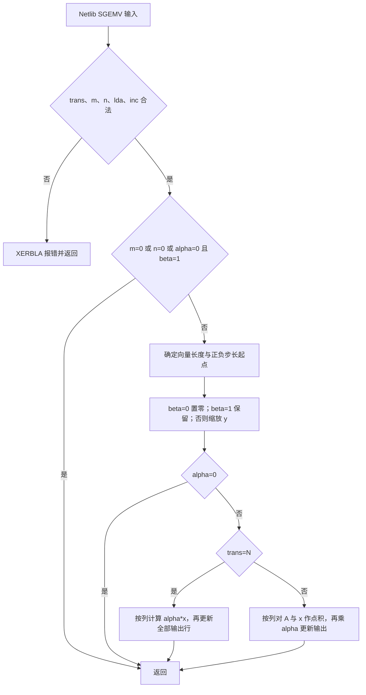
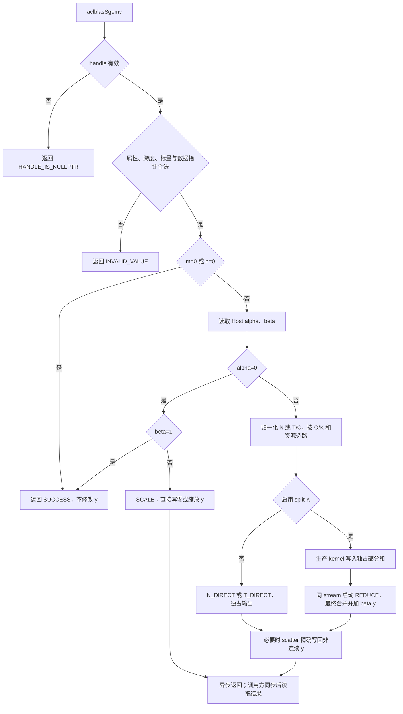

# 一、需求背景

## 1.1 需求来源

本设计对应“11月社区任务-aclblasSgemv算子开发（A2/A3）”，在[社区任务列表](../../../../docs/README.md)中的编号为 8。依据随任务提供的 `aclblasSgemv_AtlasA2_A3_task_doc.md`、`test_cases/sgemv_test.csv`、`gpu_baseline.csv`、测试脚本与 README，补齐 Atlas A2/A3 的单精度实数矩阵向量乘能力。设计按[社区任务提交要求](../../../../README.md)及[设计模板](../../../../resources/design_template.md)落入 `11-8-aclblasSgemv-A2A3/Xztxzt/docs/design.md`。

本次交付为设计文档，说明接口合同、实现方案和验证计划；算子实现及测试最终提交到 `cann/ops-blas`。文中的分块参数和优化收益属于待验证方案，不代表已完成 NPU 编译或精度、性能验收。

## 1.2 背景介绍

### 1.2.1 aclblasSgemv 算子实现优化

算子执行 `y ← α·op(A)·x + β·y`，A 为列主序 m×n 的 float32 矩阵，`op(A)` 为原矩阵、转置或共轭转置。实数输入下 T 与 C 完全等价，二者使用同一计算路径。该任务采用句柄式 BLAS API 与 Ascend C kernel 直调，不经过 ACLNN、GE 或 TBE，模板中的 TBE Python 源码及算子信息库路径不适用。

以下源码事实以 2026-11-15 核对的 ops-blas 提交 `9565ef46a98f82e8884ee084aea96ec62e3e993e` 为基准：

| 用途 | 现有文件或拟新增位置 |
| --- | --- |
| 共用 API、枚举及状态码 | `include/cann_ops_blas.h`、`include/cann_ops_blas_common.h` |
| 实数接口校验参考 | `blas/gemv/arch35/sgemv_host.cpp` |
| 其他架构实现参考 | `blas/gemv/arch35/sgemv_kernel.cpp`、`sgemv_tiling_data.h` |
| A2/A3 工程与搬运参考 | `blas/gemv/arch22/cgemv_host.cpp`、`cgemv_no_trans_kernel.cpp`、`cgemv_do_trans_kernel.cpp` |
| 本任务拟新增实现 | `blas/gemv/arch22/sgemv_host.cpp`、`sgemv_kernel.cpp`、`sgemv_tiling_data.h` |
| 测试注册及共用 golden | `test/gemv/sgemv/CMakeLists.txt`、`sgemv_param.h`、`sgemv_golden.h` |
| 本任务拟新增测试 | `test/gemv/sgemv/arch22/sgemv_test.cpp`、`sgemv_npu_wrapper.h`、`sgemv_test.csv`、补充分布用例及 `gpu_baseline.csv` |

当前公共头文件已有 `aclblasSgemv` 声明，arch22 尚无 Sgemv 实现和对应测试文件。测试 CMake 已无条件调用 `ops_blas_add_gtest_tests(${OPS_BLAS} sgemv_test)`，与任务书“仅 arch35 注册”的描述存在版本差异；实施时验证 arch22 源文件被选入即可，不重复注册目标。参考[接口与实现目录](https://gitcode.com/cann/ops-blas/tree/9565ef46a98f82e8884ee084aea96ec62e3e993e/blas/gemv)、[测试注册](https://gitcode.com/cann/ops-blas/blob/9565ef46a98f82e8884ee084aea96ec62e3e993e/test/gemv/sgemv/CMakeLists.txt)。

现有 arch35 实现使用 SIMT，并在部分场景缓存 x，不能直接作为 A2/A3 的 Vector kernel 使用。其 Host 可参考参数校验，但尚无任务要求的 int32 向量跨度检查；其四条设备路径均读取 A/x 和旧 y，尚未显式实现 α=0、β=0 的数据读取短路。本设计按任务合同补齐，不能把已有源码当作所有边界语义已满足的证明。参见[Host](https://gitcode.com/cann/ops-blas/blob/9565ef46a98f82e8884ee084aea96ec62e3e993e/blas/gemv/arch35/sgemv_host.cpp)和[kernel](https://gitcode.com/cann/ops-blas/blob/9565ef46a98f82e8884ee084aea96ec62e3e993e/blas/gemv/arch35/sgemv_kernel.cpp)。

### 1.2.2 aclblasSgemv 算子现状分析

#### 1.2.2.1 标杆算子支持的数据类型和数据格式

本任务对标 [cuBLAS cublasSgemv](https://docs.nvidia.com/cuda/cublas/index.html#cublas-t-gemv) 的单矩阵、单向量运算，不扩展 Batched、StridedBatched 或低精度接口。

| 对象 | 数据类型与位置 | 形状、布局及用途 |
| --- | --- | --- |
| A | FLOAT32，Device，只读 | 列主序 `lda × n`，每列前 m 个元素有效，`lda≥max(1,m)` |
| x | FLOAT32，Device，只读 | N：长度 n；T/C：长度 m；支持有符号 incx |
| y | FLOAT32，Device，输入兼输出 | N：长度 m；T/C：长度 n；支持有符号 incy；原地更新 |
| α、β | FLOAT32，Host 标量指针 | 指针非空，值不校验，允许 0、Inf、NaN |
| trans、m、n、lda、incx、incy | Host 参数 | trans∈{N,T,C}；维数、lda、步长类型为 int |
| handle | Host 句柄 | 承载 stream 与库上下文 |

矩阵 padding 的条件是 `lda>m`。任务书个别段落写作 `lda>n`，应以参数表及列主序地址公式为准。标量只要求 Host 内存，这是本任务范围；不沿用其他复数算子的 Host/Device 双读取能力，也不宣称覆盖 cuBLAS 的所有指针模式。

#### 1.2.2.2 标杆算子实现描述

可审计的算法参考为 [Netlib sgemv.f](https://netlib.org/blas/sgemv.f)，不推测 cuBLAS 闭源 kernel。Netlib 在参数检查后处理空矩阵和 α=0/β=1 快速返回，再根据 trans 确定 x/y 长度及负步长起点，先初始化 `βy`。β=0 直接置零，β=1 保留旧值；α=0 随后结束。

N 模式按列递增遍历，每列先算 `temp=α×x[j]`，再对输出行执行 `y[i]+=temp×A[i,j]`，利用列主序连续数据。T/C 模式逐列计算 `temp=Σ_i A[i,j]×x[i]`，再更新 `y[j]+=α×temp`。两种模式数学等价于总公式，但 α 的乘法位置和浮点求和顺序不同，需要在长归约、相消及非有限数用例中验证。

任务规定的 handle、空指针、INT32_MIN 与跨度错误码属于 C 接口合同，在 Host 独立验证；不能直接调用 Fortran 错误处理代替这些检查。Netlib 数值流程与 API 错误码检查分别作为测试依据。

#### 1.2.2.3 标杆算子实现流程图



# 二、需求分析

## 2.1 外部组件依赖

| 依赖 | 用途及要求 |
| --- | --- |
| CANN 9.1.0、配套驱动与固件 | Ascend C 编译、ACL Runtime、设备与 stream 管理 |
| Atlas A2/A3 | arch22 适配；按任务要求在 910B3 完成自验证 |
| Netlib BLAS/CBLAS 3.10.0 | `cblas_sgemv(CblasColMajor,...)` 单精度数值参考 |
| ops-blas 构建框架、CMake、GTest | 按仓库贡献要求组织构建、CSV 驱动及状态码测试 |
| Python 3 | 用例生成、完整性检查、结果汇总；不在 NPU 生产路径中调用 |
| msprof op | 收集任务书要求的 kernel task duration |

附件说明性能基线来自 NVIDIA A100-SXM4-80GB、CUDA 12.8、cuBLAS 12.8.4，本设计保留原始 `gpu_ms` 数据；这些是附件报告的采集条件，不是本次重新实测的结果。GPU 软件不属于 NPU 库的运行依赖。

## 2.2 内部适配模块

复用公共 `aclblasSgemv` 声明、句柄 stream、平台 AIV 核数查询、workspace 所有权与分配辅助能力。新增 arch22 Host、tiling 和 Vector kernel，在单个 kernel 源文件内组织 N、T/C、缩放及可选归约入口，避免按每个形状创建文件。

在 `test/gemv/sgemv/arch22/` 新建 GTest 与安全 wrapper，复用 CSV 参数格式。基于当前 CMake 验证 A2/A3 的测试发现和注册，不重复调用注册宏。更新 `blas/gemv/README.md` 的 Sgemv 产品支持说明，补充接口约束及复现步骤。无需新增 OpDef、ACLNN 两段式接口、TBE 信息库、PyTorch 注册或 ONNX 插件。

## 2.3 需求模块设计

### 2.3.1 Ascend C 算子原型

```cpp
aclblasStatus_t aclblasSgemv(
    aclblasHandle_t handle, aclblasOperation_t trans,
    int m, int n, const float* alpha,
    const float* A, int lda, const float* x, int incx,
    const float* beta, float* y, int incy);
```

定义输出长度 O 和归约长度 K：N 时 `O=m,K=n`；T/C 时 `O=n,K=m`。x 逻辑长度 K，y 逻辑长度 O。步长单位为 float 元素，物理容量在 L>0 时至少为 `1+(L-1)×abs(inc)`；L=0 时无需数据缓冲。

### 2.3.2 Ascend C 算子相关约束

任务内要求覆盖 FLOAT32、N/T/C、矩形矩阵、padding lda、正负步长、零尺寸、任意 Host 标量值及 Inf/NaN。与完整 cuBLAS 能力相比，本任务不要求 Device 标量、其他 dtype、64 位维数扩展或批量接口。

| 校验阶段 | 必须实现的行为 |
| --- | --- |
| handle | 空指针返回 `ACLBLAS_STATUS_HANDLE_IS_NULLPTR` |
| 基础属性 | 非法 trans、负 m/n、`lda<max(1,m)`、incx/incy 为 0 或 INT32_MIN，返回 `ACLBLAS_STATUS_INVALID_VALUE` |
| 长度与跨度 | 按 trans 求 K/O；L>0 时用 int64 计算 `(L-1)×abs(int64(inc))`，超出 INT32_MAX 返回 `INVALID_VALUE` |
| 标量及数据指针 | α/β 必须非空；m>0 且 n>0 时 A 必须非空；K>0 时 x 必须非空，O>0 时 y 必须非空 |
| 空矩阵 | 上述检查全部通过后，m=0 或 n=0 返回 `SUCCESS`，不读取 A/x/y 数据，不缩放 y、不启动 kernel |
| 非空计算 | 读取 Host α/β 值并选路；α=0 只缩放 y，β=0 不读取旧 y；α=0 且 β=1 可直接返回 |

非法 trans 的返回值是 `INVALID_VALUE`，不是兄弟 Cgemv 的 `INVALID_ENUM`。α=0、β=0 或 α=0/β=1 不能豁免此前的数据指针和跨度校验。例如非空矩阵且 α=0，A/x 仍需非空，但数据不被读取；β=0 时 y 仍需可写。

空矩阵的“指针合法”与“数据不访问”也要区分：N 模式 m=0,n>0 时，x 长度仍为 n、必须非空，y 可空；N 模式 m>0,n=0 时相反；T/C 交换两者。m=n=0 时 A/x/y 可均空，但 lda≥1、步长和标量指针仍须合法。

矩阵最大有效偏移 `(n-1)×lda+(m-1)`、分配长度 `lda×n` 以及乘 4 后的字节数均使用受检的 64 位/size_t 运算。跨度上限限制的是向量元素偏移；不能把它误改为 UINT32_MAX，也不能只检查跨度而遗漏字节运算溢出。

# 三、需求详细设计

## 3.1 调用方式

调用方初始化 ACL、创建设备 stream 和 `aclblasHandle_t`，通过 `aclblasSetStream` 绑定，准备 Host α/β 及 Device A/x/y 后调用接口。负步长传物理数组首地址，由算子计算逻辑起点；调用方无需再次移动到末元素。

Host 完成同步参数检查，将标量值和 tiling 按值传给 kernel，在绑定 stream 上异步启动。返回成功表示提交成功，读取输出、复用或释放 Device 缓冲和 workspace 前仍需同步 stream 并检查错误。生产调用不强制同步，不把输入矩阵拷回 Host，不跨默认流下发计算。

## 3.2 需求总体设计

采用 AIV/Vector 的全 float32 数据通路，不通过 FP16/BF16 降精度换取 Cube 吞吐。N 模式让 SIMD lane 对应连续输出行，在列内连续搬运；T/C 模式让 lane 对应同一列中的连续归约元素，计算列点积。T 与 C 统一路由。

优先沿独立输出分核，不依赖跨核同步。对于 `O` 很小、`K` 很大的矩形输入，单纯按输出切分无法利用足够核心，增加可选 split-K：生产 kernel 写独占部分和，后续 kernel 按固定顺序合并并写回。选择依据为 O/K、UB、workspace 和实测耗时，不只看矩阵元素总数。

### 3.2.1 host 侧设计

#### 3.2.1.1 分核策略

查询实际 AIV 核数 C 与可用 UB 容量 U。N 的输出块大小记 R，T/C 的输出列组大小记 J；块数 `G=ceil(O/R)` 或 `ceil(O/J)`。普通路径使用 `P=min(C,G)` 个核，各核按 `g=blockIdx+tP` 领取输出块，处理完其完整 K 后再写 y，避免多核直接更新同一个输出。

| 场景 | 分核与执行方式 |
| --- | --- |
| 小 O、小 K | 单核或少量核，合并搬运并避免 workspace/第二次启动 |
| N，输出较长 | 按连续行块分核；对每个列块更新 R 个驻留累加值 |
| T/C，输出列较多 | 按列组分核；每列的点积在本核归约完成 |
| O 很短、K 很长 | 在输出块之外沿 K 划分 S 段，`S≤min(ceil(K/K_min),floor(C/G))`；不足两段不启用 |
| α=0 | SCALE kernel 只遍历 y；β=1 由 Host 返回，β=0 生成零 |

`K_min`、R/J 和核数阈值是调优参数，不是 API 限制。附件包含 `1048576×4` 与 `4×1048576`：二者在 N 与 T/C 下分别形成长输出或长归约，必须分别选路，不能按方阵策略统一处理。

连续且 32 字节对齐的 y 按 8 个 float 的倍数划分写回块，尾部不足一块由一个核独占。一般 incy 或非对齐基址的基线采用单核精确写回；若启用并行计算，则先写连续临时输出，再由单独 scatter kernel 按逻辑索引写回。不能仅凭元素下标不同就认定非对齐 DMA 没有共享 32 字节块的竞争。

#### 3.2.1.2 数据分块和内存优化策略

令 `align32(b)=ceil(b/32)×32`。N 路径每次搬运 R 行、B 列，按列存于 UB，列跨度 `R_a=align_up(R,8)`；x 保存 B 个逻辑元素。A 使用双缓冲，每次只描述有效 R 行，列间 padding 不作为有效输入搬入。

```text
N 路径预算：
U_N = 2×B×align32(4R)          # 双缓冲 A
    + 2×align32(4B)           # 双缓冲连续 x
    + 4×align32(4R)           # 累加、补偿/部分和、旧 y、计算/搬出
    + U_aux

T/C 路径预算（J 列，每列 T 个归约元素）：
U_T = 2×J×align32(4T)         # 双缓冲 A
    + 2×align32(4T)           # 双缓冲 x，在 J 列间复用
    + J×align32(4T)           # 乘积与归约临时向量
    + 4×align32(4J)           # 部分和、补偿/旧 y、搬出
    + U_aux
```

候选 N 配置 R=128、B=64 时显式缓冲为 68096 字节（66.5 KiB）；候选 T/C 配置 J=8、T=512 时为 53376 字节（52.125 KiB）。均未包含 `U_aux`，也不是硬件 UB 大小。`U_aux` 需包含索引表、归约 API 临时区、队列和编译器资源余量，以实现及编译报告核算，并要求 `U_path≤U_available`；容量不足时减小 tile 或减少缓冲。

非连续 x 以每个 float 一个对齐槽搬入再在 UB 整理，其保守双缓冲预算由 `2×align32(4L)` 替换为 `2×32L`，L 为 B 或 T，并计入 compact/反序临时区。负步长可从较低物理地址向上搬运后在 UB 反序，禁止将负数直接填入无符号 DMA stride。大步长超出 DMA 字段时拆成多个合法描述，不截断字段或拒绝任务允许的合法跨度。

使用 `DataCopyPad` 的精确 blockLen 描述有效字节，padding 只在 UB 发生；只有源/目标与长度都满足对齐要求才采用普通 `DataCopy`。GM→UB 的源 stride 使用字节，UB 目标 stride 使用相应 API 的 block 单位，不能混用。blockCount、blockLen、stride 和 Vector repeat 均按实际 CANN API 上限分段；尾部按有效 mask 计算，防止 padding 参与求和或 `0×Inf` 产生无关 NaN。

普通路径不需要全局 workspace。split-K 使用 `O_a=align_up(O,8)`，第 s 段的输出部分和存于 `W[s×O_a+o]`，空间 `W_split=4S×O_a` 字节；各核仅写其独占输出区间。需要 scatter 时再申请 `W_out=4O_a`。复用句柄工作区机制，用户 workspace 不足时回退普通路径，不能覆盖用户缓冲；不在每次计时调用中反复分配、释放。

工作量约为 `F=2mn+O(O)` 个 float32 FLOPs（FMA 计两次）。理想有效请求包括 A 的 `4mn` 字节、x 的 `4K` 字节及 y 的 `4O×(1+I[β≠0])` 字节，矩阵占主导时计算强度约 0.5 FLOP/Byte。实际每个输出块需重读 x，约 `4KG` 字节；split-K 额外增加约 `8S×O_a` 的部分和写读。实际 HBM 流量还受 L2、padding 与传输粒度影响，不能将逻辑请求量当作实测带宽。

#### 3.2.1.3 tilingKey 规划策略

kernel 直调无需 GE tiling 注册。拟用内部 `mode` 表示主路径，trans 归一化为 N/T 两类；数值仅用于新建 arch22 实现，不更改 arch35 tiling ABI。

| mode | 条件与主行为 |
| --- | --- |
| 0：SCALE | α=0、β≠1；β=0 写零，否则缩放 |
| 1：N_DIRECT | N 模式，独占输出行块，完整遍历 K |
| 2：T_DIRECT | T/C 模式，独占输出列组，在本核完成点积 |
| 3：N_SPLIT | N 模式，输出并行度不足且长归约、资源及验证条件满足 |
| 4：T_SPLIT | T/C 模式，输出并行度不足且长归约、资源及验证条件满足 |

归约与可选 scatter 由 Host 在同一 stream 上配套启动，空矩阵及 α=0/β=1 不生成 mode。tiling 包含 m/n/lda、O/K、int64 incx/incy 与起点、R/B/J/T、有效尾部长度、核数、S、workspace 槽跨度和 α/β。大小与字节偏移采用受检宽整数。

优先仅对 α/β 有限的场景启用 split-K；这不意味着 A/x 必然有限，所有路径仍须满足特殊值合同。对未知或未验证的形状选择通用正确路径，禁止将附件最大尺寸当作接口硬上限。

### 3.2.2 kernel 侧设计

#### 3.2.2.1 kernel 侧实现描述

**索引和初始化。** 零基索引统一如下：

```text
start(L,inc) = inc<0 ? (L-1)×(-int64(inc)) : 0    # L>0
index(i)     = start(L,inc) + int64(i)×inc
A(i,j)       = A_base[i + int64(j)×lda]

N:   O=m, K=n, y[o] ← alpha×sum_k A[o+k×lda]×x[k] + beta×y[o]
T/C: O=n, K=m, y[o] ← alpha×sum_k A[k+o×lda]×x[k] + beta×y[o]
```

输入不作转置副本，N 与 T/C 仅改变访问与归约方向。β=0 的输出初值显式为零，不读取旧 y 后乘零；β=1 保留旧值，其他 β 在所需位置读取一次并缩放。α=0 的 SCALE 不搬运 A/x，避免其 NaN/Inf 污染结果。

**N_DIRECT。** 每核持有 R 个输出累加值，先形成对应 βy。对 B 列构成的 tile 搬入每列有效行段与 x；按列递增计算 `temp=α×x[j]`，对 R 个输出做 Vector 乘加。并行轴是输出行，保留参考实现的 α 预乘位置；不将 α 无条件提到整行点积之后。长 K 可用若干独立部分累加器或补偿累加减少误差，启用前比较完整精度集；普通路径保留参考顺序以便定位相消误差。

**T_DIRECT。** 每核处理 J 列，对每列按 T 长度搬入连续行段；x 的同一归约段在这些列间复用。先做 float32 逐元素乘法与局部归约，再合并段部分和，最后执行 `α×sum+βy`。列内 ReduceSum 使用有效长度；尾部和 padding 不计入归约。T/C 共用实现和切分参数，同一数据的结果应一致。

**split-K。** 将 `[0,K)` 划成不重叠的连续区间 `[floor(sK/S),floor((s+1)K/S))`。N_SPLIT 生产已经包含 `α×x[k]` 的部分贡献；T_SPLIT 生产未乘 α 的点积部分和。生产阶段不读取旧 y，输出槽全部覆盖当前有效值，不能依赖上次调用或预清零。后续 REDUCE 按 s 递增合并，N 直接加 βy，T/C 先乘 α 再加 βy；βy 只处理一次。

生产与归约 kernel 在同一 stream 顺序执行，不用跨核浮点原子更新或设备忙等。不要求跨次 bit-exact，但给定配置采用固定合并顺序方便复现。拆分改变舍入顺序，只有精度达标且完整多 kernel 耗时获益才启用，否则回退。

**非连续输出。** 单核基线按物理索引用精确长度搬出；并行扩展先生成连续 `y_dense`，scatter 阶段负责读取旧 y、处理最终 α/β 或将已合成输出写回，具体融合位置唯一且与 REDUCE 互斥，不能重复加 βy。首版规定由计算/REDUCE 完成最终值、scatter 仅搬出；需要读取旧 y 时计算阶段按逻辑索引加载。输出空洞与边界哨兵保持不变。

**流水与数值。** CopyIn、Compute、CopyOut 采用 ping/pong 与 TQue 或显式 HardEvent：MTE2 完成后允许 Vector 消费，Vector 完成后允许 MTE3 搬出，消费完成后才复用缓冲。`PIPE_V` 只能保护相应流水，不能代替跨 MTE 的依赖。使用 GM 批量搬运，生产代码不采用 GM `GetValue/SetValue` 逐元素访问。补偿累加仅作为有限值精度候选，不盲目对 Inf 使用补偿公式；不引入未经验证的 fast-math 或降精度乘积。

#### 3.2.2.2 Ascend C 实现流程图



#### 3.2.2.3 Ascend C 实现流程图与标杆算子流程图存在的差异点和原因

| 差异 | 原因及保持的合同 |
| --- | --- |
| Host 增加句柄、指针与跨度检查 | 落实任务要求的 C API 状态码；所有检查先于零尺寸返回 |
| N 沿输出行并行，T/C 沿列及归约轴并行 | 匹配列主序连续访存，避免全矩阵转置 |
| 长归约按段合并 | 提升极端矩形并行度，付出 workspace、额外启动和舍入差异 |
| βy 与最终归约融合 | 旧 y 最多消费一次，β=0 读请求消失；输出空洞保持不变 |
| 核内流水及批量 DMA | 用重叠搬运提高数据供给，尾块仍按真实有效范围处理 |
| 错误处理不依赖 CPU golden | 当前 CPU helper 的空 handle 返回值与任务不同，负向用例直接检查任务定义的期望码 |

## 3.3 支持硬件

| 产品 | 架构及验证安排 |
| --- | --- |
| Atlas A2 系列 | arch22，典型 SoC 为 `ascend910b`；910B3 执行完整自验证 |
| Atlas A3 系列 | arch22，典型 SoC 为 `ascend910_93`；保持构建、资源查询及 API 兼容 |

任务书 §3.1 写 Atlas 800I A2 910B3，§3.3 写 Atlas 800T A2 910B3；共同明确的验收芯片是 910B3，报告记录实际机型并在环境申请时确认款型，不将其混写为同一产品。950PR 的 SIMT 指令与核数、UB 常数不作为 A2/A3 默认配置。

## 3.4 算子约束限制

支持列主序 float32 单矩阵、单向量及运行时合法 m/n/lda/inc，不支持行主序接口、广播、批量、复数或任意图视图。矩阵底层存储始终按 m 行 n 列解释，T/C 不改变 lda 约束。运行时 tiling 不等价于 GE 动态 shape 支持。

α/β 指向 Host float，A/x/y 指向足够容量的 Device 缓冲。y 原地覆写指复用自身旧值，不保证 A/x/y 相互重叠；调用方提供独立存储。并发执行使用独立句柄/workspace 或外部串行化，Device 缓冲及工作区保留至 stream 完成。合法逻辑跨度不代表库能推断实际分配大小，调用方负责容量。

# 四、特性交叉分析

| 场景 | 处理与验证重点 |
| --- | --- |
| 零尺寸 × 非法参数 | m=0 仍检查 lda/inc/标量指针及非零逻辑长度指针；合法零尺寸不修改非空 y |
| α=0 × A/x 为 NaN/Inf | 指针仍需满足合同，但 kernel 不读取 A/x；分别验证 β=0、1 和一般值 |
| β=0 × 旧 y 为 NaN/Inf | 直接覆写，无旧值加载；y=nullptr 仍非法 |
| T/C × 负步长 | 按 K/O 计算各自起点，验证 T=C、非方阵和双负步长组合 |
| lda padding × DMA 尾部 | 行数以 m 为准，未使用 padding 投毒，源范围不越界；数值投毒检查与实际访问审计分别执行 |
| 大跨度 × 负向测试分配 | INT32_MIN 与超 INT32_MAX 跨度在 Host 拒绝；wrapper 用 dummy 输入，避免先发生 abs 溢出或 OOM |
| O 很小 × K 很大 | split-K 提升并行度，同时验证第二次启动、workspace 读写和长归约误差 |
| 非连续 y × 多核输出 | 连续临时输出加单核 scatter，或单核直接写回；禁止相邻写回块竞争和空洞覆盖 |
| 部分和 × 重复调用 | 每次覆盖有效槽，βy 仅加一次，workspace 不足正确回退 |
| 浮点重排 × 特殊值 | 保留 N 的 α 预乘和 T/C 的点积后乘；分别检查有限误差及 NaN/Inf 分类 |

# 五、可维可测分析

## 5.1 精度标准/性能标准

**golden 口径。** 任务书存在三处不同描述：§3.1 提及 `cblas_sgemm` 逐 batch，§3.2 提及 float64 真值计算后转 float32，而 §3.5、§7.4 明确要求 `cblas_sgemv` float32 直接计算。当前 `test/gemv/sgemv/sgemv_golden.h` 也实际调用 `cblas_sgemv`。本设计按特别说明 §7.4 和现有测试工程，以 Netlib BLAS/CBLAS 3.10.0 `cblas_sgemv(CblasColMajor,...)` 为主比对；另输出 float64 累加后转 float32 的诊断结果，记录两者差异。验收前应向任务方确认 §3.2 的歧义，不混用两套结果或使用 sgemm/batch 路径替代。

合法数值用例使用相同输入副本生成 golden；负向用例直接检查 API 返回码，不进入 CBLAS。现有 CPU helper 对空 handle 返回 `NOT_INITIALIZED`，并未完整覆盖 INT32_MIN/跨度等校验，因此不能将其状态码当作本任务判定标准。A/x 不被修改，y 只比较逻辑元素，同时检查空洞与前后哨兵。

| 指标 | FLOAT32 要求 |
| --- | --- |
| 有限值逐元素匹配 | `abs(actual-golden)≤atol+rtol×abs(golden)`，`atol=rtol=2^-13=0.0001220703125` |
| 匹配比例 | 有限元素 matched_ratio≥0.99 |
| 绝对误差 | 记录 max_abs_error，并逐有限元素检查 `error≤max(1e-2,32×ULP(golden))` |
| 非有限等效 | NaN/NaN、同号 Inf/Inf、NaN/±Inf 等效；异号 Inf 不等效，有限与非有限不等效 |
| 统计边界 | 非有限位置不纳入有限误差统计，须全部等效；无有限元素时该集合判据视为满足，空输出不做除零统计 |

阈值依据任务书引用的[固定版本 mixed_tolerance 标准](https://gitcode.com/cann/opbase/blob/28a1ce52ae856353589841226a0002af73314a6b/docs/zh/ops_precision_standard/mixed_tolerance_standard.md)。ULP 采用 float32 有效位 23、最小正规指数 -126 计算，零与次正规数使用最小间隔，有限最大值不能因 nextafter 得到 Inf 而形成无限容差。MERE/MARE 可保留为仓库诊断，不能替代任务的混合容差判据。

**用例与分布。** 静态核对附件实际有 1200 个唯一 case：1000 条非性能用例（含 25 条期望错误码用例）和 200 条 TC_PF。TC_ED 为 32、TC_EX 为 802，trans 的 N/T/C/非法枚举分别为 511/357/330/2，与附件 README 的旧统计不同，报告以实际 CSV 为准。

附件 CSV 没有 `GAUSS_NORM_5_2`，但生成器已经提供 `--dist mixed`。新增补充分布文件，保留原始 1200 条与已实测基线，统计正常随机域 A/x/y 的均匀/正态占比并补足各 50%，不以随机选择过该 token 代替比例核对。生成器会把 `gpu_baseline.csv` 写成空耗时占位，运行时必须显式使用其他 `--out`、`--baseline-out` 路径，避免覆盖原始基线。

| 测试域 | 覆盖要求 |
| --- | --- |
| 原始集合 | 全部 1000 条非性能用例及 200 条性能用例；性能用例在计时前额外验证一次正确性 |
| 维数与布局 | m/n 为 0、1、质数、2 的幂及 ±1；方阵与矩形；`1048576×4` 及其交换形状；lda=m、m+padding |
| 转置与步长 | N/T/C；inc∈{1,2,7,-1,-3}；混合正负、双负、大合法跨度和临界溢出 |
| 参数错误 | 空 handle、非法 trans、负 m/n、非法 lda/inc、INT32_MIN、跨度超限、各指针为空及零尺寸组合 |
| 数值 | α/β 特殊值、相消和长归约、零/次正规/大值、Inf/NaN、β=0 的旧 y 投毒 |
| 分派与资源 | N/T_DIRECT、N/T_SPLIT、SCALE、S=1/S>1、tile 尾部、workspace 不足、不同核数、未对齐及带步长 y |
| 内存与异步 | padding/空洞与哨兵、A/x 只读性、重复调用、非默认 stream、workspace 生命周期 |

负向及真正 quick return 用例仅使用保持指针合同所需的最小非空 dummy 缓冲，直接调用接口检查状态；不按 INT_MIN 或超限跨度预分配，也不提前调用 makeBlasStrided 触发未定义行为。正常需要计算的负步长用例仍需完整物理容量，不能因 inc<0 就省略分配。任务无独立内存性能门槛，但仍需访问安全检查。测试指导的 512 MiB 是测试程序预算，须合计矩阵、golden、备份和向量，不是设备容量限制。

**性能验收。** 按任务书 §3.3，在 910B3、CANN 9.1.0 使用 msprof op 记录 `Task Duration(us)`；预热 5 次不计入，成功执行的有效样本至少 10 次取算术平均。核对工具与测试框架的预热边界，不能重复扣除或混入预热；异常样本单列，失败或缺失 case 不计通过。记录实际机型、驱动、固件、编译器、源码 commit 和原始采样数据。

一个 API 含生产、REDUCE 或 scatter 多个 kernel 时，按调用分组求全部相关 task duration 的和，再对调用取平均；另列 ACL event 覆盖的完整设备区间，以观察启动和 kernel 间隙。不能只取生产 kernel 的时间证明整体方案达标。

每个性能 case 须满足 `Avg_NPU_us≤1.25×GPU_us`，即 `GPU_us/Avg_NPU_us≥0.8`。基线 `gpu_ms` 乘 1000 转为微秒，按 `(trans,m,n,alpha,beta,lda,incx,incy)` 关联，保留 case/id；缺少基线、样本或解析失败时不判通过。虽然 T/C 共用算法，其基线仍按原始 trans 分别匹配。

附件 README 末段和 `verify_performance.py` 使用 GTest `[PERF] ... avg_us=` 的 ACL event 平均时间，而任务书指定 msprof task duration。后续测试须同时保留两列、修正验收汇总，以任务书为主，不能把二者混为同一指标，也不能回退到包含 Host 造数/golden 的 GTest 整数毫秒耗时。小规模路径是否获益以完整调用成本判断，不因增加 split-K 核数就假定加速。

后续交付按模板准备自验证步骤、精度报告与日志、性能报告与日志及内存项适用性说明，保留全部失败参数与原因。本设计阶段仅提供方案与验证计划，不填写 NPU 通过率或加速比。

本次文档检查已核对五个章节、26 个小节、相对链接、代码围栏及格式，并确认 200 条性能基线与附件性能用例的参数对应。Host 校验规则的 Python 模型与附件全部 1200 条用例的期望状态一致，另检查空 handle；7200 组 CPU 数学验证覆盖 N/T/C、12 组方阵/矩形、两种 lda、25 组正负步长和四组标量，验证直接分块及最多七段归约与独立稠密参考一致，并检查 padding/短路输入投毒与输出空洞。这些验证仅核对设计公式及合同，不是实际 API、CBLAS、DMA 或 NPU 验收。

## 5.2 兼容性分析

公共 API、int 参数、FLOAT32 布局、状态码和 stream 语义保持稳定；新增实现与测试限定 arch22，公共测试辅助函数的调整需回归 arch35，尤其不能为了新实现改变其他架构的校验口径。Task 要求与当前参考 kernel 不一致的 α=0/β=0 行为在 arch22 明确实现并用专项用例锁定。

R/B/J/T、split-K 阈值和 workspace 属内部策略，不限制合法用户输入。资源不足正确回退，T/C 使用同一路径，非连续输出保持物理布局。版本更新后重新检查公共声明、文件选择、测试注册和资源查询；所有验收数据关联具体源码与环境，避免用其他架构或旧版本结果代替 A2/A3 实测。
