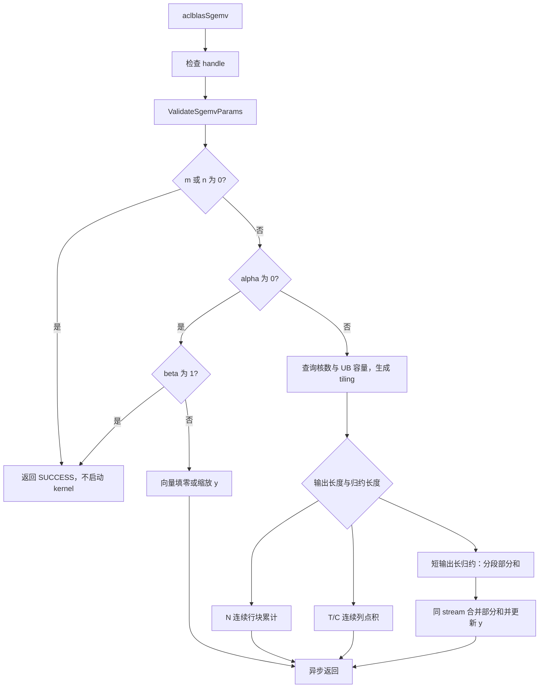

# aclblasSgemv 算子设计（Atlas A2/A3）

## 1. 需求背景（required）

### 1.1 需求来源

- [11月社区任务-aclblasSgemv算子开发（A2/A3）](https://www.hiascend.com/activities/task-center/details/a8c0b7d0985349c59503ec0c34ca7344?menu=guide)。
- [任务书及官方用例包](https://www.hiascend.com/p/resource/202611/d16e70cbfc994dd286fb8dc720a02d98.zip)。本文依据 2026-11-16 下载版本，包含 `alpha=0` 短路、负步长及跨度溢出要求。
- [任务讨论及维护者答复](https://gitcode.com/cann/ops-blas/discussions/79)。维护者明确自验环境为 910B3，性能主判据为 `msprof op`。
- 实现目标仓为 [cann/ops-blas](https://gitcode.com/cann/ops-blas)，本次分析基线为 `9565ef46a98f82e8884ee084aea96ec62e3e993e`。

本文是待评审设计，文中的分块参数是初始选择，不是已测性能结论。当前尚无本实现的编译或真机测试结果。

### 1.2 背景介绍与现状

`aclblasSgemv` 是 BLAS Level-2 单精度实数矩阵-向量运算。公共接口已在 `include/cann_ops_blas.h` 声明。当前 `blas/gemv/arch35/` 提供 950 实现，`blas/gemv/arch22/` 仅有复数 `Cgemv`，缺少 A2/A3 的实数实现。

arch35 的 SIMT 计算路径不能直接移植为 arch22 的执行路径；arch22 `Cgemv` 也存在复数专用拆分、掩码及临时资源，不能仅将类型替换为 float。此次使用 Ascend C SIMD membase，实现原有公开 API 的 arch22 路径。

## 2. 需求分析（required）

### 2.1 接口与计算定义

```cpp
aclblasStatus_t aclblasSgemv(
    aclblasHandle_t handle, aclblasOperation_t trans, int m, int n,
    const float* alpha, const float* A, int lda, const float* x, int incx,
    const float* beta, float* y, int incy);
```

计算为 `y = alpha * op(A) * x + beta * y`，y 原地更新。

| 项目 | 定义 |
| --- | --- |
| 数据类型 | A、x、y、alpha、beta 均为 FLOAT32；alpha/beta 为 Host 标量指针 |
| A 存储 | 列主序，物理长度 `int64_t(lda) * n`；元素 `(i,j)` 位于 `i + int64_t(j)*lda` |
| N | `op(A)=A`，x 逻辑长度 n，y 逻辑长度 m，归约长度 n |
| T/C | `op(A)=A^T`，x 逻辑长度 m，y 逻辑长度 n，归约长度 m；实数 C 与 T 共用路径 |
| 向量存储 | 物理长度 `1 + (len-1)*abs(inc)`；传入指针指向物理低地址端 |
| 负步长 | 逻辑元素 i 对应 `(len-1-i)*abs(inc)`，长度为零时不计算尾偏移 |
| lda 空洞 | `lda>m` 时每列有效行之后存在 padding，不能误写成 `lda>n` |

### 2.2 功能拆解

1. 复用公共接口，完成 Host 参数校验、快速返回和异步下发。
2. 实现 N 与 T/C 的向量化计算，覆盖任意合法 m/n、lda、正负 incx/incy。
3. 实现 `alpha=0`、`beta=0` 及空矩阵的任务书语义；不读取被短路的输入。
4. 按输出和归约长度调度多核；解决极端矩形的核利用率问题和非对齐写回竞态。
5. 接入原生 CSV/GTest，完成官方 1000 条精度、200 条性能及正态分布和边界回归。
6. 按模板提供同一 commit 的日志、报告、源码与复现说明。

## 3. 详细设计（required）

### 3.1 总体流程



### 3.2 Host 侧设计

#### 参数校验与返回码

入口先检查 handle，为空返回 `ACLBLAS_STATUS_HANDLE_IS_NULLPTR`。`ValidateSgemvParams` 再完成下表检查，失败返回 `ACLBLAS_STATUS_INVALID_VALUE`。

| 参数 | 检查 |
| --- | --- |
| trans | 必须属于 N/T/C；不沿用 Cgemv 的 INVALID_ENUM 返回码 |
| m/n | 必须非负 |
| lda | 必须 `>=max(1,m)` |
| incx/incy | 不能为 0 或 INT32_MIN |
| alpha/beta | 必须非空；不检查浮点值范围 |
| A | m、n 同时大于零时必须非空 |
| x/y | 按 trans 计算的各自逻辑长度大于零时必须非空 |
| 向量跨度 | 对正长度，用 int64 计算 `(len-1)*abs(int64_t(inc))`，大于 INT32_MAX 时拒绝 |

校验通过后才执行 `m=0 || n=0` 返回。因此 m=0 不会掩盖非法 lda、步长或标量指针。`alpha=0` 也不放宽任务书规定的指针和跨度检查。

`alpha=0,beta=1` 不下发计算；`alpha=0,beta=0` 只写零；其余 `alpha=0` 只缩放 y，完全不访问 A/x。一般路径中 `beta=0` 不读旧 y，避免 `0*Inf/NaN` 污染结果。

标量按本任务的 Host 指针约定读取并存入本次 tiling，不新增 Device 标量同步读取，也不缓存标量值。

#### 分核与 UB 规划

`LaunchSgemvKernel` 负责平台查询、tiling 和启动。AIV 核数与 UB 容量来自平台接口，查询失败返回错误，不假设固定核数。

常规路径按输出块独占分核，核内循环处理多个块。输出块边界按至少 8 个 float 对齐；最后一块可以不足 8 个。每个逻辑输出只由一个核负责，避免在 y 上做跨核读改写。

初始候选 tile 如下，最终大小按 UB 容量和真机剖析调整：

| 路径 | 初始分块思路 | UB 内容 |
| --- | --- | --- |
| N | 连续输出行块，按列分组读取 | A 的连续行片、x 分组、输出累计和、计算临时区 |
| T/C | 输出列块，归约行块 | A 的连续列片、x 行片、乘积和分块部分和 |
| scale | 连续逻辑 y 块 | y 输入/输出及非单位步长搬运临时区 |
| split reduction | 归约维分核 | 各核 A/x tile、少量输出部分和；最终部分和在 handle workspace |

双缓冲必须计入全部 buffer 容量，满足 `buffers_bytes + scratch_bytes <= available_ub_bytes`。tiling 只保存维度、分块参数和分派标识，不用定长数组列出每核任务。

矩阵元素跨度、物理偏移及字节数用 uint64/int64 计算。对齐和上取整避免 `a+b-1` 的窄类型溢出。合法大规模输入通过循环切块处理，不依赖测试包的矩阵规模上限。

#### 临时空间与异步约束

常规路径不需要额外 GM workspace。短输出、长归约场景若采用两阶段方案，使用 handle 已有 workspace，布局为 `[reduction_block][aligned_output]`，空间需求按实际核数及输出分块计算并校验。

若 handle 当前 workspace 不足，回到不需要 workspace 的独占输出路径，保持合法输入可计算；不在接口内部临时 malloc/free，也不加入 Host 同步。

部分和 kernel 与合并 kernel 在同一 handle stream 顺序提交。合并阶段唯一执行 alpha/beta 与旧 y 更新。workspace 不存放跨调用输入缓存，同一 stream 的连续调用依赖其本身的提交顺序。

### 3.3 Kernel 侧设计

#### N：列主序连续行片累计

每个核负责连续输出行块。对于一组输入列，批量搬入列内连续的 A 行片与 x 分组，在 UB 中对输出向量累计 `A_column*x_value`。

核心运算以 Vector Mul/Add 或 MulAdd 类接口表达，不能将每个矩阵元素退化为 GM `GetValue` 循环。x 的标量系数从已批量搬入的 UB tile 取得，不逐个通过 GM 取数。列组内组织多个独立累计链，最后归并，以降低长依赖链及舍入累积。

#### T/C：连续列点积

每个输出对应 A 的一列，沿行维连续搬运 A 与 x。使用向量乘法和分块归约求点积，块间部分和继续归约。x 可在多个输出列之间复用同一 UB tile，减少重复 GM 访问。

T 和 C 使用相同实数计算分派；不引入复数共轭计算。对相同输入检查 T/C 结果一致。

#### 非单位和负步长

物理地址从逻辑位置统一换算。正步长以二维批量搬运或读取覆盖物理片后 Gather 的方式形成连续逻辑向量；负步长先按物理低地址区间搬入，再在 UB 重排为逻辑顺序。具体搬运参数必须符合 CANN 9.1.0 对 stride、blockLen、blockCount 的范围约束，超出单次 DMA 参数范围时再切块。

输出只写逻辑 y 位置。非逻辑间隙原值保持；不得先写整个物理 span 再恢复 padding。向量散列写回按当前架构支持的 DMA 分块实现，不以逐元素 GM 标量写作为通用计算路径。

#### 短输出长归约

当独占输出分核无法利用足够 AIV 核、归约长度又很大时，按归约维切成独立连续区段。每核只写自己的对齐 workspace 槽位，第二阶段对所有槽归约并写 y。

分段路径不在 y 上使用原子累加，不在一个 kernel 中通过未验证的全局自旋同步跨核。初始启用阈值根据性能用例的 m/n 分布和实测决定，不能只优化三个 4096 方阵锚点。

#### 边界、流水与竞态

TPipe 在 kernel 入口创建并传给计算类。队列或显式事件分别保证 MTE2→Vector、Vector→MTE3 以及 buffer 复用顺序。最后一个不满对齐单位的 tile 使用 DataCopyPad 等精确长度搬运。

尤其检查不同核输出位于同一 32 字节或更大缓存单元的情形。输出块对齐只是任务划分条件，仍须验证实际非单位步长写回的范围。避免 Scalar D-Cache 写回覆盖相邻核结果；同一形状连续调用和压力复跑纳入专项验证。

#### 数值路径

普通有限输入使用 FP32 向量乘加及分块部分和，优先降低长累加链误差。是否增加补偿累计由长归约、相消及极值用例结果决定，不能预先把 FMA 当作全精度保证。

Inf/NaN 按任务书传播和比对规则处理。`alpha=0` 与 `beta=0` 必须在访问对应输入前分派；非有限输入不通过 Host 扫描、D2H 或 CPU 计算回退。有限极值发生中间溢出或相消误差时，必须保留失败结果并修正数值路径，不允许过滤用例或放宽误差门限。

### 3.4 工程文件与兼容性

实现文件放置于：

```text
blas/gemv/arch22/
  sgemv_host.cpp
  sgemv_kernel.h
  sgemv_tiling_data.h
  sgemv_kernel.cpp
test/gemv/sgemv/arch22/
  sgemv_npu_wrapper.h
  sgemv_test.cpp
  sgemv_test.csv
```

共享 `sgemv_param.h`、`sgemv_golden.h`、原生框架和现有公共接口优先复用。新增 arch22 特有的补充用例或判定辅助文件按实际需要组织，不复制整个测试框架。

当前基线 `test/gemv/sgemv/CMakeLists.txt` 已无条件调用 `ops_blas_add_gtest_tests(${OPS_BLAS} sgemv_test)`。实现时核实 arch22 源被原生框架收集，不能重复注册。该现状与任务书旧描述的差异仅影响接入方式，不减少 GTest 交付要求。

不修改 arch35 实现或公共函数签名。`blas/gemv/README.md` 更新产品支持、负步长、短路和复现方式。Host 遵循 Validate/Launch 拆分、dlog 和共用 kernel 声明头约定。

在指定 CANN 9.1.0 / 910B3 环境的独立编译探针中，`ACL_HIFLOAT4` 枚举不存在，而当前共享 `test/frame/csv_loader.h` 的 dtype 表无条件引用该枚举。Sgemv 使用 FLOAT32，但仍会受该头文件解析错误影响。测试接入需按 SDK 特性检测对这两个 HIFLOAT4 表项作最小兼容保护，不将缺失类型伪装为其他 dtype，也不修改生产 API。该兼容项需单独保留基线失败与修正后编译证据。

### 3.5 任务书约束逐项对应

| 约束 | 设计对应 |
| --- | --- |
| 参数合法性与校验层级 | §3.2，先 handle 和全部参数检查，再 quick return；补齐 int32 跨度守卫 |
| 非连续 Tensor | lda 按列寻址；正负 incx/incy 统一逻辑映射，不写空洞 |
| broadcast | 不涉及，尺寸由 m/n/trans 定义 |
| dynamic shape | m/n 等运行时传入，Host 每次推导 tiling，无图模式 shape 要求 |
| 原地与视图 | y 原地覆写，A/x 只读，不返回视图；不新增未要求的 A/x/y 任意重叠承诺 |
| 确定性 | 不要求跨次 bitwise 确定性；单次执行不存在未同步的数据依赖 |
| 空 Tensor | 校验后 m=0/n=0 不启动 kernel、不改 y |
| 0 维 Tensor | 不涉及；Host alpha/beta 承担标量语义 |
| 异步执行 | 使用 handle stream，不引入 Host 同步；测试读结果前同步 |

### 3.6 支持硬件

| 芯片 | 交付要求 |
| --- | --- |
| Atlas A2（arch22） | 支持；910B3 / CANN 9.1.0 完成自验 |
| Atlas A3（arch22） | 同一实现适配；构建覆盖，若无真机须明确未实测 |
| Ascend 950（arch35） | 保持既有实现，不以本次 A2/A3 结果替代其验证 |

## 4. 可维可测分析

### 4.1 功能和精度

官方 CSV 共 1200 条：1000 条精度和 200 条 `TC_PF` 性能。保留官方原始文件及 SHA-256，不为跑通而修改原始用例。错误域直接核对 API 返回码，不向 cblas 传非法参数，也不按非法维度或巨大步长分配缓冲。

| 分组 | 验证内容 |
| --- | --- |
| 基础与形状 | N/T/C、方阵/矩形、非 2 幂、m/n=0/1、1048576×4 及反向形状 |
| 布局 | lda=m、m+padding；正负单位和非单位步长；完整物理 y 间隙逐位不变 |
| 标量 | alpha/beta 常用组合、alpha=0 与 A/x 含 Inf/NaN、beta=0 与污染 y、alpha=0/beta=1 全缓冲不变 |
| 错误域 | 空 handle、非法 trans、负维度、非法 lda、空指针、0/INT32_MIN、跨度等于和超过 INT32_MAX |
| 正态分布 | 补充 GAUSS_NORM_5_2，覆盖与均匀分布对应的有效随机形状；统计两类覆盖，满足各 50% 要求 |
| 稳定性 | 小尾块、非对齐输出、极端转置、连续多次调用、多 handle/stream 隔离 |

精度判定采用 FLOAT32 mixed_tolerance：`atol=rtol=2^-13`，有限元素匹配率至少 0.99，同时满足最大绝对误差限制 `1e-2 or 32*ULP`。最大误差点、对应 golden、ULP 和非有限元素计数写入报告，不只打印 PASS。

非有限值单独判定：同为 NaN、同号 Inf、或一方 NaN 另一方 ±Inf 视为等效；有限值与非有限值不等效。非有限比较全部通过后，有限部分仍须满足匹配率和绝对误差要求。全为非有限值的用例单独处理有限集合为空的情况。

任务书 §3.2 的 float64 真值与 §3.5/§7 的 FLOAT32 `cblas_sgemv` 存在不一致。自验主路径保留仓内 CBLAS 参考，同时记录 FP64 诊断参考；请评审确认正式主判据。两种结果在报告中分列，不把诊断结果替换成官方通过结论。共享 verifier 若与任务书规则存在差异，则增加 arch22 的明确判定辅助，避免改变其他算子标准。

### 4.2 性能

在 910B3 / CANN 9.1.0 上逐案采集 200 条性能用例。按维护者答复，以 `msprof op` 的 task duration 为主；先预热 5 次，再取得至少 10 次 SUCCESS 调用的有效样本，计算算术平均。

单次 API 如下发两个 kernel，按该次调用的两个 task duration 合计，再对调用求平均，不能只统计其中较快的一个。每条记录附带 kernel 清单和有效样本数；预热、初始化、H2D/D2H 和 golden 不计入 kernel 样本。

`gpu_baseline.csv` 用 `(trans,m,n,alpha,beta,lda,incx,incy)` 联表，`gpu_ms` 为毫秒。采集值为微秒时判据为：

```text
mean_npu_us <= gpu_ms * 1000 / 0.8
```

200 条分别判断，不用总体平均抵销单案失败。缺失基线、重复匹配、缺样本或异常调用必须记录，不标 PASS。随包 `verify_performance.py` 的 aclrtEvent `[PERF] avg_us` 仅作辅助检查，与 msprof 主报告分开保留。

用例包审计发现八参数联合键有三组重复：`sgemv-perf-012/029`、`013/032`、`073/109`，各组 GPU 时间不同。不能用字典覆盖前一条基线。官方 `gen_csv.py` 按 `pf_rows` 顺序生成带序号的基线 ID；自验按该生成规则关联用例与 baseline ID，并逐项复核全部八个参数。当前包 200 条均可按序号和参数一致关联，原始两份 CSV 保持不变，报告保留 baseline ID 便于复核。

### 4.3 内存与交付

任务书 §3.4 写明内存不涉及，模板中的内存报告和日志仍提交并标注 N/A 及原因，不伪造测量值。

交付包括算子设计、README、源码、测试代码，以及 `task_submission` 下七个模板文件。所有性能/精度报告关联相同验收 commit、用例 hash、设备型号、CANN/参考库版本、构建命令及实际加载库 hash。

### 4.4 验证阶段与待解决项

| 阶段 | 完成条件 |
| --- | --- |
| 设计评审 | 本文评审通过并合入，正式精度参考口径明确 |
| 工程接入 | 910B3 构建成功，A3 目标构建成功，符号及 GTest 注册正确 |
| 功能精度 | 官方 1000 条及正态/边界/稳定性补充集完整通过，无跳过或缺失 |
| 性能 | 200 条均满足 1.25×A100 上限，原始 msprof 证据齐全 |
| 冻结复现 | 固定 commit 的独立目录重建及完整复验，模板报告与原始日志一致 |

当前需评审确认精度参考冲突。分段归约阈值、tile 和补偿策略将在评审允许的方案内用真机数据确定；任何失败或未实测部分如实保留。性能未满足或有偶发错值时不提交为已完成验收版本。
