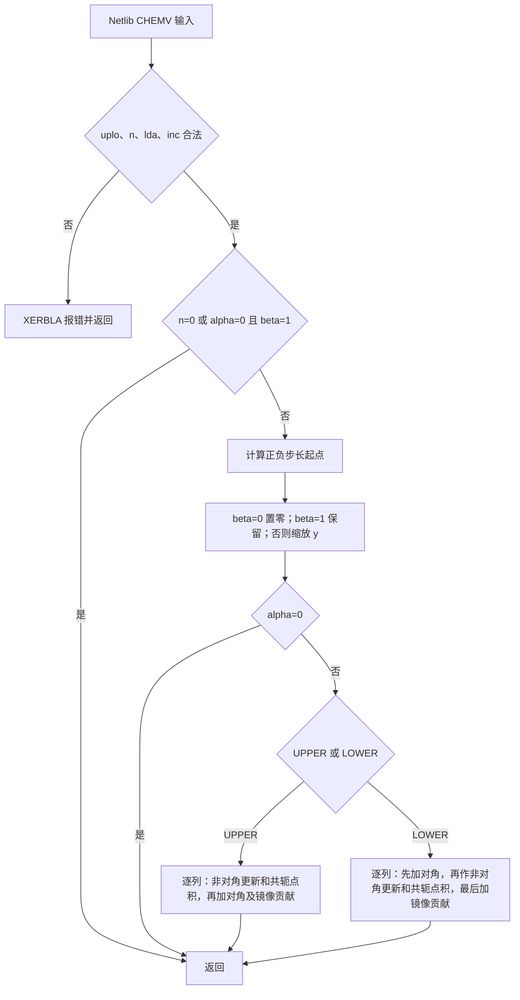
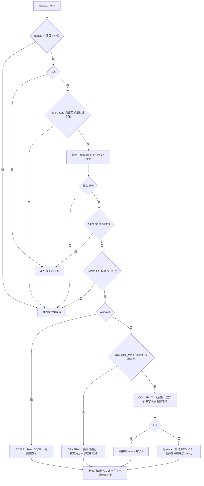

# 一、需求背景

## 1.1 需求来源

本设计对应“11月社区任务-aclblasChemv算子开发（A2/A3）”，在[社区任务列表](../../../../docs/README.md)中的编号为 9。依据随任务提供的 `aclblasChemv_AtlasA2_A3_task_doc.md`、`test_cases/chemv_test.csv`、`gpu_baseline.csv` 及测试指导，设计 Atlas A2/A3 上单精度复数 Hermitian 矩阵向量乘接口。设计文档按[社区任务提交要求](../../../../README.md)及[设计模板](../../../../resources/design_template.md)提交至 `11-9-aclblasChemv-A2A3/Xztxzt/docs/design.md`。

本次交付为设计文档；算子实现、上板精度与性能测试、自测报告属于后续开发交付，不将设计中的预期收益表述为已完成的测试结果。任务要求的工程模式是 ops-blas 句柄式接口与 Ascend C kernel 直调，最终实现归入 `cann/ops-blas`。

## 1.2 背景介绍

### 1.2.1 aclblasChemv 算子实现优化

算子计算 `y ← αHx + βy`，其中 H 为 n 阶 Hermitian 矩阵，即 `H = Hᴴ`；A 保存 H 的上三角或下三角，另一三角通过共轭关系隐含，对角虚部不参与计算。与 Csymv 的复数对称语义不同，镜像元素必须取共轭；与 Chbmv 不同，本任务采用稠密列主序存储，没有带宽 k 参数。

本接口不经过 ACLNN、GE 或 TBE，因此模板中的 TBE Python 实现及算子信息库路径不适用。实际参考文件及改造入口如下，源码事实以 2026-11-15 核对的 ops-blas 提交 `9565ef46a98f82e8884ee084aea96ec62e3e993e` 为基准：

| 用途 | 具体文件 |
| --- | --- |
| 公共 API、复数类型及状态码 | `include/cann_ops_blas.h`、`include/cann_ops_blas_common.h` |
| Host 校验与启动 | `blas/symv/arch22/chemv_host.cpp` |
| Kernel、启动包装与切分参数 | `blas/symv/arch22/chemv_kernel.cpp`、`chemv_kernel.h`、`chemv_tiling_data.h` |
| 句柄、stream、workspace 辅助能力 | `common/helper/aclblas_handle_internal.h`、`common/helper/host_utils.h` |
| 测试注册、公共参数及比对 | `test/symv/chemv/CMakeLists.txt`、`chemv_param.h`、`chemv_check.h` |
| A2/A3 测试入口及数据 | `test/symv/chemv/arch22/chemv_test.cpp`、`chemv_npu_wrapper.h`、`chemv_test.csv`、`chemv_gauss_supplement.csv`、`gpu_baseline.csv` |

任务书称公共头文件尚无声明、arch22 尚未注册 GTest；上述基准版本已包含声明、实现和 arch22 GTest 注册。实施时应复用并检查现有入口，避免重复声明或创建平行 API。参考[公共头文件](https://gitcode.com/cann/ops-blas/blob/9565ef46a98f82e8884ee084aea96ec62e3e993e/include/cann_ops_blas.h)、[Host 实现](https://gitcode.com/cann/ops-blas/blob/9565ef46a98f82e8884ee084aea96ec62e3e993e/blas/symv/arch22/chemv_host.cpp)及[测试注册](https://gitcode.com/cann/ops-blas/blob/9565ef46a98f82e8884ee084aea96ec62e3e993e/test/symv/chemv/CMakeLists.txt)。

优化重点是减少 A 的重复读取、按三角列长度均衡负载、复用 x 和部分和，并降低小规模任务的启动及同步开销。已有 kernel 包含按列分核、GM 部分和、核间同步和通用逐行路径；其中 `LoadTinyInputs` 会搬入完整小矩阵，LOWER 的 `BuildColumnAndChunkSchedule` 会将列起点向前对齐再屏蔽。本设计要求 DMA 描述的有效数据范围仅覆盖指定三角，不能仅凭搬入后清零满足“未引用三角不得读取”。参见[现有 kernel](https://gitcode.com/cann/ops-blas/blob/9565ef46a98f82e8884ee084aea96ec62e3e993e/blas/symv/arch22/chemv_kernel.cpp)。

### 1.2.2 aclblasChemv 算子现状分析

#### 1.2.2.1 标杆算子支持的数据类型和数据格式

| 对象 | 类型、位置与布局 | 本任务要求 |
| --- | --- | --- |
| A | Device，complex64，列主序 `lda × n` | 仅 UPPER 或 LOWER；`lda ≥ max(1,n)`；对角只使用 float32 实部 |
| x | Device，complex64，逻辑长度 n | 有符号元素步长 incx，物理容量至少 `1+(n-1)×abs(incx)` |
| y | Device，complex64，逻辑长度 n | 有符号元素步长 incy，原地更新；β=0 时不读取旧值 |
| α、β | complex64 标量指针 | 支持 Host/Device 地址，分别探测位置；实部、虚部均为 float32 |
| handle、uplo、n、lda、incx、incy | Host 参数 | 复用公共句柄及枚举，维数和步长 API 类型为 int |

这里 complex64 表示两个 float32 分量，共 8 字节；不支持 complex128、实数输入或隐式类型转换。本任务对标 [cuBLAS cublasChemv](https://docs.nvidia.com/cuda/cublas/index.html#cublas-t-hemv)，不扩展至批量、packed 或 band 接口。

#### 1.2.2.2 标杆算子实现描述

可审计的数学参考为 [Netlib chemv.f](https://netlib.org/blas/chemv.f)，不推断 cuBLAS 闭源 kernel 的内部算法。Netlib 先校验枚举、维数、lda 与步长，再执行 quick return，随后根据步长计算向量起点，先处理 `βy`，最后遍历指定三角。

按零基索引，列 j 的非对角有效集合为 UPPER 的 `[0,j)` 或 LOWER 的 `(j,n)`。每列计算 `t1=αx[j]`，对有效 i 更新 `y[i]+=t1*A[i,j]`，同时累加 `t2+=conj(A[i,j])*x[i]`；对角贡献为 `t1*real(A[j,j])`，镜像贡献为 `α*t2`。UPPER 在该列非对角循环后更新 y[j]；LOWER 先加对角、再处理非对角和镜像。β=0 时直接生成零初值，β=1 时保留旧 y；α=0 时不访问 A/x。

任务书对 n=0 的校验优先级比 Netlib 更宽松：有效 handle 且 n=0 时，在 uplo/lda/inc/标量校验前成功返回。本设计明确采用任务书顺序，不把两者异常参数优先级视为完全相同。

#### 1.2.2.3 标杆算子实现流程图



# 二、需求分析

## 2.1 外部组件依赖

| 依赖 | 用途及版本要求 |
| --- | --- |
| CANN 9.1.0、匹配的驱动与固件 | 任务指定环境；Ascend C 编译、ACL Runtime、stream 和内存管理 |
| Atlas A2/A3 | 两系列均适配，性能验收指定 Atlas 800T A2（910B3） |
| Netlib BLAS/CBLAS 3.10.0 | 测试调用 `cblas_chemv`、`CblasColMajor` 生成单精度 golden；不使用 `zhemv` 替代验收标杆 |
| ops-blas 构建工具链、CMake、GTest | 沿用仓库依赖与编译参数；arch22 注册 `chemv_test` |
| Python 3、任务附件脚本 | CSV 检查、测试驱动及结果整理 |
| msprof op | 采集 kernel task duration；采样边界按任务书 §3.3 |

cuBLAS/A100 用于性能基线说明，非 NPU 生产库的运行依赖。附件声明 GPU 为 A100-SXM4-80GB、CUDA 12.8、cuBLAS 12.8.4；本设计使用随包原始 CSV，不声称重新实测 GPU。

## 2.2 内部适配模块

保留统一 `aclblasChemv` API、复数内存布局、句柄 stream 和 workspace 所有权机制。Host 完成参数校验、标量取值和分派；设备实现放在 `blas/symv/arch22/`，测试放在 `test/symv/chemv/arch22/`。沿用现有文件组织，在同一 kernel 源文件内维护缩放、列分块、部分和归约及通用路径，避免按用例复制 kernel 文件。

`test/symv/chemv/CMakeLists.txt` 继续在 arch22 分支调用 `ops_blas_add_gtest_tests(${OPS_BLAS} chemv_test)`，保证逐用例结果与微秒计时可解析。无需新增 OpDef、TBE 信息库、ACLNN 两段式接口、PyTorch 注册或 ONNX 适配。后续 README 更新产品支持表、调用约束、构建方式和自测复现步骤。

## 2.3 需求模块设计

### 2.3.1 Ascend C 算子原型

```cpp
aclblasStatus_t aclblasChemv(
    aclblasHandle_t handle, aclblasFillMode_t uplo, int n,
    const aclblasComplex* alpha,
    const aclblasComplex* A, int lda,
    const aclblasComplex* x, int incx,
    const aclblasComplex* beta,
    aclblasComplex* y, int incy);
```

α/β 使用公共 `aclblasComplex`，不自定义 ABI 类型。A/x 只读，y 为可写输出；步长按复数元素计，地址换算为字节时乘 8。

### 2.3.2 Ascend C 算子相关约束

必须覆盖任务要求的复数 α/β、UPPER/LOWER、padding lda、正负步长、Host/Device 标量、零尺寸和非有限数。仅对任务限定的平台及 complex64 提供实现，不承诺 cuBLAS 的其他数据类型、64 位维数接口或图捕获能力。

| 检查顺序 | 判定与返回 |
| --- | --- |
| 1 | handle 为空：`ACLBLAS_STATUS_HANDLE_IS_NULLPTR` |
| 2 | n<0：`ACLBLAS_STATUS_INVALID_VALUE`；随后 n=0：直接 `SUCCESS` |
| 3 | 非法 uplo：`INVALID_ENUM`；lda<n、inc 为 0/INT32_MIN、跨度超限或 α/β 指针为空：`INVALID_VALUE` |
| 4 | 按地址属性读取 α/β；读取失败返回对应运行时错误，不解引用 Device 地址 |
| 5 | α=(0,0) 且 β=(1,0)：直接 `SUCCESS`，允许 A/x/y 均为空 |
| 6 | α≠0 时 A/x 为空、或需要输出时 y 为空：`INVALID_VALUE`；α=0 时允许 A/x 为空 |

跨度先提升为 int64 计算 `span=(n-1)×abs(int64(inc))`，沿用当前 Host 的 `span≤UINT32_MAX` 守卫；矩阵偏移、元素数、字节数另用受检 uint64/size_t 运算，不能只检查元素跨度而遗漏乘 8 溢出。DMA 字段容量不足时拆分搬运，不把 API 的合法步长直接截断到窄字段。β=0 只免除旧 y 的读取要求，不能免除 y 可写且非空的要求。

# 三、需求详细设计

## 3.1 调用方式

调用方初始化 ACL、设置设备、创建 stream 和 `aclblasHandle_t`，通过 `aclblasSetStream` 绑定，再准备 Device A/x/y 与 Host 或 Device α/β，调用 `aclblasChemv`。负步长传物理缓冲区首地址，由算子计算逻辑起点，调用方不再重复移动指针。读取结果或释放 Device 数据前同步绑定的 stream，并检查同步返回值。

Host 标量在返回前复制到启动参数；Device 标量为满足依赖标量值的同步错误码和 quick return，先在同一 stream 排队读回到符合 Runtime 要求的 Host 缓冲，再同步后分派，沿用当前实现语义。这一分支存在 Host 等待，不能宣称所有调用均完全异步。核函数仍在句柄绑定 stream 上执行；不增加隐式默认流操作。

## 3.2 需求总体设计

使用 AIV/Vector 进行 float32 复数拆分计算，不引入降精度 Cube 运算。策略按实际参数和资源选择：α=0 为缩放路径；小 n、非连续步长、资源不足及需要参考运算次序的场景走通用路径；单位步长的中大规模采用三角按列分块和双向贡献，减少矩阵读取。跨核部分和由同一 stream 上的后续归约 kernel 合并，避免不同核直接更新同一个 y。

### 3.2.1 host 侧设计

#### 3.2.1.1 分核策略

查询实际可用 AIV 数 C 和 UB 容量，核数不固定为某款硬件的常数。候选路径与阈值须通过 200 条性能用例实测确定。

| 路径 | 分核与写入所有权 |
| --- | --- |
| SCALE | 对连续 y 按对齐输出块划分，每核独占；不连续或地址不满足安全分块要求时单核写回 |
| GENERAL | 每核独占连续逻辑行组，独立完成整行；小尺寸先采用单核；非连续 y 的基线实现单核，保留后续安全分块优化空间 |
| COL_SPLIT | 列 j 的三角长度为 UPPER 的 j+1、LOWER 的 n-j；将 j 与 n-1-j 配对，整对按核轮转分配，中间列只分配一次 |
| REDUCE | 每核独占连续 y 行块，从所有生产核槽读取部分和，加 βy 后写回 |

配对后每对列的三角长度和为 n+1，可均衡上下三角的长短列。生产核数 `P≤min(C,ceil(n/2))`；小 n 限制 P，避免每核只处理很少元素却承担完整 x 搬运和同步开销。COL_SPLIT 的各核只写自己的 workspace 槽，不使用浮点原子加。

输出所有权同时考虑 32 字节写回粒度：连续、32 字节对齐的 y 按 4 个复数的倍数划分块，末尾不足一块由最后一个核独占。仅“逻辑下标不同”不足以证明非对齐搬运无竞争；对未对齐基址或任意 incy，基线回退到单核精确写回，不通过扩大写入范围覆盖相邻元素或步长空洞。

#### 3.2.1.2 数据分块和内存优化策略

定义 `align32(b)=ceil(b/32)×32`。设 S 为驻留向量容量、T 为单次列段的复数个数。一个保守的 COL_SPLIT UB 预算为：

```text
x 的原始与变换缓冲：       2 × align32(8S)
双缓冲 A 列段：           2 × align32(8T)
复数部分和（实/虚平面）：  2 × align32(4S)
计算、归约与搬出临时区：   6 × align32(4T)
UB_total = 2×align32(8S) + 2×align32(8T)
         + 2×align32(4S) + 6×align32(4T) + U_aux
```

`U_aux` 包括索引表、标量搬运、API 临时区和编译器资源余量，须由实现和编译报告逐项确认。候选 S=4096、T=512 的显式数据缓冲为 118784 字节（116 KiB），不含 `U_aux`；这是设计预算，不是平台 UB 容量。要求 `UB_total≤U_available` 后才能选择该路径，若不满足则减小 T 或回退。n 超出驻留容量走分段 GENERAL，不把 4096 变为 API 的 n 上限。

部分和采用两平面布局，`S_w=align_up(n,8)` 个 float，槽地址为 `W[(2p+plane)×S_w+i]`，workspace 大小为 `W_bytes=8P×S_w`。每核先清零自身 UB 部分和，再完整写入自己的两个槽，归约仅访问有效 n 个元素；不要求调用方预清 workspace。使用句柄现有 workspace 管理，用户 workspace 不足时走零 workspace 通用路径，不能覆盖或私自替换用户所有权。

GENERAL 按 T 个元素切分行贡献。跨列离散 A 和非单位步长 x 可用多 block `DataCopyPad` 搬到对齐 UB 槽，每个 8 字节复数的槽按 32 字节预算。两个 A/x 槽组、每组各 T 个 32 字节槽，另加输出和临时向量，其示例上界为 `128T+8R+16T+U_aux` 字节，R 为当前输出行组长度。连续区间改用紧凑搬运；小尺寸不为减少 DMA 次数而读取完整 n×n 矩阵。

所有三角列段按真实起止地址构造 DMA：UPPER 非对角 `[0,j)`，LOWER 非对角 `[j+1,n)`；对角单独取 4 字节实部。首尾不足对齐长度时由 `DataCopyPad` 在 UB 补齐，禁止向 GM 前移或扩张有效源区间。GM→UB 的源步长按字节、UB 目标步长按相应 API 的 block 单位配置，搬运 blockCount、stride 和 blockLen 逐项检查；超限时拆成多个有界操作。生产路径不使用 GM `GetValue/SetValue` 逐元素访存。

矩阵存储占用为 `8×lda×n` 字节，但按列路径逻辑读取量为 `8×n(n-1)/2+4n=4n²` 字节，另有约 `8Pn` 的 x 读取和 `16P×S_w` 的 workspace 写读。一般计算量约 `8n²` 个实数浮点操作。GENERAL 逐行读取的矩阵请求约 `8n(n-1)+4n` 字节。以上为逻辑请求量，实际 HBM 流量受缓存、传输粒度影响，性能报告应区分，不能直接当作实测带宽。

#### 3.2.1.3 tilingKey 规划策略

本任务采用 kernel 直调，无需注册 GE tiling。复用 `ChemvTilingData.mode` 表示分派模式，不改变现有 0/1/2 的含义；归约启动由 Host 与 COL_SPLIT 配套控制。

| mode | 条件与行为 |
| --- | --- |
| 0：SCALE | α=0、β≠1；β=0 直接写零，否则缩放 y |
| 1：COL_SPLIT | α≠0 且 α/β 有限，incx=incy=1，输出可安全分块，驻留容量、workspace、UB 满足，且处于已验证性能区间 |
| 2：GENERAL | 其他合法输入，包含小 n、负步长、padding、资源不足及标量非有限的参考顺序路径 |

UPPER/LOWER 在核入口选择模板或固定分支，避免内层反复判定。tiling 保存 n/lda、带符号 int64 步长、核数、分块容量、workspace 槽跨度、α/β 分量及 β=0/1 等标记；新增字段仅内部使用，Host/Device 布局同步更新。禁止仅凭 α/β 有限就假定 A/x 有限；非有限数据必须通过有效元素掩码和参考分组正确处理，优化路径需覆盖特殊值测试。

### 3.2.2 kernel 侧设计

#### 3.2.2.1 kernel 侧实现描述

**索引与复数运算。** 零基索引映射为：

```text
start(n,inc) = inc<0 ? (n-1)×(-int64(inc)) : 0
vec(i,inc)   = start(n,inc) + int64(i)×inc

UPPER: H(i,j) = i<j ? A[i+j×lda]
                       : (i>j ? conj(A[j+i×lda]) : real(A[i+i×lda]))
LOWER: H(i,j) = i>j ? A[i+j×lda]
                       : (i<j ? conj(A[j+i×lda]) : real(A[i+i×lda]))

(ar+i ai)×(xr+i xi) = (ar×xr-ai×xi) + i(ar×xi+ai×xr)
```

API 输入为 AoS 实虚交织，UB 根据计算路径保留 AoS 或拆为 float32 平面，通过 Mul/Add/Sub、标量乘加及归约完成计算。对角直接用实数缩放复数，不构造虚部为零的普通复乘，以免无意义的 `0×Inf` 污染结果。

**缩放路径。** α=0 时完全不搬运 A/x。β=0 用显式零初始化输出；β=1 已在 Host quick return；其他 β 只读取有效 y 元素并缩放。负 incy 使用上述物理索引，步长空洞保持不变。

**通用路径。** 每个输出行分别计算直接项、对角项和镜像项。直接项保留 `(α×x[j])×A[i,j]` 的运算分组；镜像项先累计 `conj(A[j,i])×x[j]`，再乘 α。UPPER 的行 i 先处理本列对角/镜像，再按列递增累加 j>i 的直接贡献；LOWER 先累加 j<i 的直接贡献，再加对角和镜像。以 Netlib 的逐行贡献顺序作为精度回退基线，避免把所有项无条件改写成 `α×sum(Hx)`。

**列分块路径。** 核 p 处理分配到的列 j，将 `t1=α×x[j]` 用于该列非对角元素对其行输出的贡献，同时计算本列的共轭点积并累加到 y[j] 对应的部分和。每个存储的非对角元素生成两个输出方向的贡献，对角单独贡献一次，不用“对角乘半再参与双向累加”的技巧。有效列段通过 T 大小的 ping/pong 缓冲流水搬入和计算；每核结果写入自己的 W 槽。P=1 可直接加 βy 写回；P>1 在同一 stream 再启动 REDUCE，按核编号合并各槽，βy 只在最终阶段加一次。

此方案较当前同 kernel 内 `SyncAll` 的方案增加一次启动，换取明确的 kernel 完成边界和对实际驻留核数更简单的约束。只有比较“生产+归约”的完整耗时后，才能确定 COL_SPLIT 启用阈值；小规模使用单核或 GENERAL。若后续保留单 kernel 同步实现，需单独证明所有参与核可共同驻留、barrier 路径一致以及 workspace 写入对其他核可见，不能用忙等代替这些证明。

**流水与尾部。** MTE2 完成后才允许 Vector/Scalar 消费，Vector 完成后才允许 MTE3 写回，MTE3 完成后才能复用输出缓冲。使用 TQue 的生产消费关系或相应 HardEvent，不能仅用 `PIPE_V` 屏障代替跨流水同步。尾部按有效元素数设置 mask，不让填充槽参与乘法和归约；即使槽已清零，也不能在存在 Inf 时执行额外 `0×Inf`。非有限输入的行为与 golden 分类单独验证，不以有限值误差公式处理。

#### 3.2.2.2 Ascend C 实现流程图



#### 3.2.2.3 Ascend C 实现流程图与标杆算子流程图存在的差异点和原因

| 差异 | 原因及约束 |
| --- | --- |
| n=0 提前于 uplo/lda/inc 校验 | 严格满足任务书 §2.5；handle 空和负 n 仍优先报错 |
| Host 探测两类标量位置 | 任务要求 Host/Device 双读取，并要求根据标量决定空指针合法性 |
| 列配对、双缓冲、跨核部分和 | 利用 AIV 并行和列主序连续访问；不同核通过私有槽避免竞争 |
| 多核路径最终一次加入 βy | 保证每个输出只消费一次旧值；β=0 全程不读取旧 y |
| GENERAL 保留参考分组、COL_SPLIT 改变归约次序 | 不要求 bit-exact，但仍须满足 float32 阈值及非有限分类；精度不通过时收缩优化适用域 |
| GPU 性能作为外部基线 | 不移植未知 cuBLAS kernel，不把 Netlib CPU 时间当性能目标 |

## 3.3 支持硬件

| 产品 | 编译架构 | 验证安排 |
| --- | --- | --- |
| Atlas A2 系列，含 Atlas 800T A2 | arch22，典型 SoC `ascend910b` | 首选 910B3 执行完整精度与性能验收 |
| Atlas A3 系列，含 Atlas 800T A3 | arch22，典型 SoC `ascend910_93` | 保持编译与资源查询兼容；按任务要求自验至少一种款型 |

不将 Ascend 950PR 的 arch35、SIMT 或 RegBase 专用实现作为 A2/A3 可用接口。已有其他架构实现通过共用头文件保持兼容，不在本任务扩展或修改其算法。

## 3.4 算子约束限制

仅支持列主序 complex64 Hermitian 矩阵、运行时 int 维数、合法 lda 和有符号向量步长；不提供行主序、广播、batch、packed/band 格式或超出 lda/inc 语义的任意视图。运行时 n 不等于 GE 动态 shape 接口。

y 原地更新指 y 消费自己的旧值；本设计不保证 A/x/y 之间相互重叠，调用方需提供独立存储。Device 缓冲和 workspace 必须存活至 stream 完成；并发调用使用独立句柄/工作区或外部串行化。参数检查不尝试推断调用方真实分配容量；调用方负责提供合法跨度内的有效内存。

# 四、特性交叉分析

| 交叉场景 | 设计处理与验证重点 |
| --- | --- |
| Hermitian × padding × 投毒 | 未引用三角及 lda padding 填 NaN/哨兵，检查输出独立性；另审计 DMA 地址范围，数值投毒通过不能单独证明未读取 |
| 对角虚部 × Inf/NaN | 单独加载对角实部，虚部为大值/NaN/Inf 均不能影响输出 |
| β=0 × 旧 y 无效 | 不读取旧 y；验证 y=NaN 的有限输出及 y=nullptr 的错误码 |
| α=0 × 空 A/x | 验证 scale、全零和 α=0/β=1 空指针 quick return 三类行为 |
| 负步长 × 输出原地更新 | 验证逻辑顺序、物理起点和空洞不被覆盖，不能把负步长当 abs(inc) 顺序 |
| Device 标量 × 同流先写后读 | 先行 kernel 修改 α/β 后读取最新值；指针位置缓存不等于值缓存，不因地址相同复用旧值 |
| 大跨度 × DMA 字段 | int64 地址运算、32 位元素跨度守卫及窄字段拆分分别覆盖，避免测试分配本身先溢出 |
| workspace × 多核归约 | 验证每个有效槽恰好写入、尾部不被误读、容量不足回退、重复调用无历史数据污染 |
| 编译优化 × 非有限数 | 禁止未经验证的 fast-math、乘零消除和复乘重排；检查有限/非有限分类及实虚部误差 |
| 小规模 × 严格三角搬运 | 评估额外 DMA 与启动成本，保留单核路径；不以读取无效三角换取性能 |

# 五、可维可测分析

## 5.1 精度标准/性能标准

**精度验收。** 按任务书 §3.2 及其固定引用的[生态混合容差标准](https://gitcode.com/cann/opbase/blob/28a1ce52ae856353589841226a0002af73314a6b/docs/zh/ops_precision_standard/mixed_tolerance_standard.md)，使用 Netlib CBLAS 3.10.0 `cblas_chemv` 生成 complex64 golden。逻辑输出 y 的实部、虚部分别统计，完整覆盖 n 个元素，不将两分量合并后取平均掩盖单分量失败。

| 指标 | 要求 |
| --- | --- |
| 有限值逐元素匹配 | `abs(actual-golden) ≤ 2^-13 + 2^-13×abs(golden)`，阈值精确值 0.0001220703125 |
| 匹配比例 | 每个分量的有限元素 matched_ratio≥0.99 |
| 最大绝对误差 | 记录 max_abs_error；同时按每个有限 golden 的量级检查 `error≤max(1e-2,32×ULP(golden))`，避免用其他大元素的 ULP 放宽当前元素 |
| 非有限值 | 同为 NaN、同号 Inf、或一方 NaN 另一方 Inf 视为等效；异号 Inf 不等效；有限值与非有限值不等效 |
| 统计边界 | 非有限位置单独计数且必须全部等效；没有有限元素时有限集合判据视为满足；n=0 检查状态码和未执行计算，不做空集合除法 |

ULP 使用 float32 有效位数 23、最小正规指数 -126 计算，零和次正规数使用最小步长，有限最大值不能用 nextafter 得到 Inf 后形成无限容差。现有 `chemv_check.h` 可作为统计结构参考，但需核查这些边界。MERE/MARE 保留为诊断或仓库额外要求，不能代替上述混合容差；本任务不要求逐位一致。

**用例覆盖。** 本次静态核对附件实际有 1200 条唯一用例：1000 条非性能用例和 200 条 TC_PF；其中 TC_ED 为 32 条、TC_EX 为 778 条，与附件 README 的 30/780 不同，报告以实际 CSV 为准。附件无 `GAUSS_NORM_5_2`，不能直接声称满足均匀/正态各 50% 的输入覆盖。当前源码虽已有正态补充 CSV，仍需按数据生成策略核对 α/β/A/x/y 的分布占比；保留原始用例，增加配对正态样本和随机标量样本，在报告中按分布统计，而非仅增加少数正态 case。

| 维度 | 必须验证的集合 |
| --- | --- |
| 原始数据 | 1000 条精度/边界及 200 条性能全部执行；性能用例计时前另做一次正确性比对 |
| 尺寸与布局 | 0、1、质数、2 的幂及 ±1、非对齐 n；UPPER/LOWER；最小 lda 和多组 padding |
| 步长 | incx/incy∈{±1,±2,±3}；扩展大合法步长及跨度越界；负向用例使用 dummy 缓冲 |
| 参数与标量 | 空 handle、负 n、非法 uplo/lda/inc、INT32_MIN、各指针为空及组合优先级；Host/Device/mixed 标量来源 |
| 数值 | α/β 为 0、1、纯虚、一般复数及大值；相消、极小值、Inf/NaN、对角虚部投毒 |
| 分派 | 小尺寸边界、驻留容量边界、P=1/P>1、workspace 不足、非连续及未对齐 y、两种三角 |
| 内存与复用 | A/x 只读性、y 空洞与前后哨兵、有效槽完整写入、连续调用和 stream 顺序 |

负向、n=0 及真正 quick return 用例不得按病态跨度分配巨量内存；正常 n>0、负步长且需要计算的用例仍须分配完整合法跨度。仅校验返回码的失败用例在数据读取之前返回，避免测试框架因自身 OOM 把错误行为误判为通过。任务 §3.4 无独立内存性能门槛，仍需做访问安全检查；测试指导的 512 MiB 是测试程序预算，须合计 A、golden、备份和向量内存，不当成硬件上限。

**性能验收。** 910B3、CANN 9.1.0 上，按任务书 §3.3 采用 msprof op 的 `Task Duration(us)`：预热 5 次不计入，有效成功执行至少 10 次取算术平均；记录原始样本、次数、kernel 名称、设备、编译器及提交版本。一个 API 调用含生产和归约多个 kernel 时，按调用分组求全部相关 kernel 的耗时和，再对调用求平均，不能只报告较快的单个 kernel。报告另列 ACL event 的接口设备区间，帮助解释启动/排队及多 kernel 间隙。

每条性能用例须满足 `Avg_NPU_us ≤ 1.25×GPU_us`，即 `GPU_us/Avg_NPU_us ≥ 0.8`，不得以全体平均加速比掩盖失败 case。`gpu_baseline.csv` 的 `gpu_ms` 乘 1000 转为微秒；按 uplo、n、α/β 实虚部、incx、incy、lda 完整参数关联，保留原始 case/id。缺基线、缺样本、失败调用和解析失败均不得记为通过。

任务书要求 msprof task duration，但附件 README 末尾及 `verify_performance.py` 实际按 GTest `[PERF] ... avg_us=` 的 ACL event 时间判定，二者不等价。实施时保留两列结果并修正验收采集流程，以任务书口径为主；不回退到 GTest 整数毫秒耗时，不混入 Host 造数、golden、H2D/D2H，不把 warmup 二次扣除。多 kernel 方案的附加开销需完整披露并参与分派评估。

后续自测材料记录实际通过数、所有失败原因和参数，并依任务模板组织 `task_submission/1 自验证步骤说明.md`、`2.1 精度自验证报告.xlsx`、`2.2 精度自验证日志.log`、`3.1 性能自验证报告.xlsx`、`3.2 性能自验证日志.log`；内存模板文件注明本任务无独立门槛及实际访问安全检查范围。本设计阶段没有 NPU 验收数据，不预填“全部通过”或加速比。

本次文档验证已完成五个章节、26 个小节及相对链接检查，核对附件 1200 个唯一 case 和 200 条基线的参数对应关系；另外用独立构造的稠密 Hermitian 参考完成 1792 组 CPU 数学验证，覆盖 7 种尺寸、两种三角、两种 lda、16 组正负步长及 4 组标量。验证逐行索引、列配对独占部分和及归约与参考一致，并对未引用三角、padding、对角虚部和 β=0 的旧 y 投毒，检查输出空洞保持不变。这些结果仅验证文档公式，不代表 CBLAS 精度测试、实际 DMA 访问检查或 NPU 验收。

## 5.2 兼容性分析

公共签名、int 参数、复数结构体、状态码和句柄式调用保持与既有接口一致；按当前源码增量实现，保留 arch35 等架构的构建分支和公共声明。修改内部 tiling 时同时更新 Host/kernel，验证库导出符号和 GTest 注册，不依赖任务书中已过时的“尚无声明”判断。

切分阈值、UB 预算和快路径条件属于内部实现，资源不足应正确回退。精度回归同时覆盖普通及非有限输入、不同核数和所有分派边界；性能回归逐 case 比较完整调用所需 kernel。最终提交记录源码 commit、CANN/驱动/固件、芯片、基线 CSV 与测试配置，使评审结果可复现。
