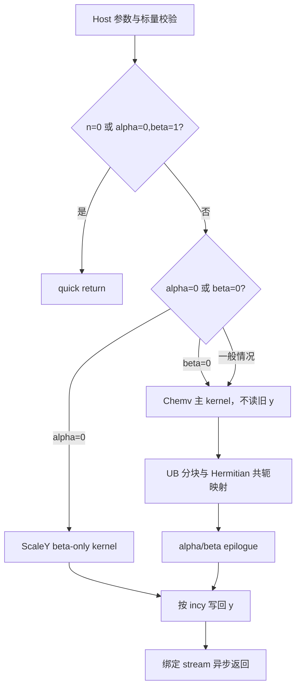

# aclblasChemv 算子设计文档

# 需求背景

## 需求来源

本设计文档依据《11月社区任务-aclblasChemv算子开发（A2A3）》任务书、随任务提供的测试指导和设计文档模板编制，面向 `ops-blas` 开源仓的 Atlas A2/A3（`arch22`）实现。任务要求使用 Ascend C 编程语言补齐单精度复数 Hermitian 矩阵-向量乘算子 `aclblasChemv`，完成公共接口、Ascend C kernel、测试工程和验收材料。

接口语义以 cuBLAS `cublasChemv` 为对标，数值参考以 Netlib `chemv`/`cblas_chemv` 为准。设计中的功能边界、返回码、精度阈值、性能判据和测试数量均以任务书及任务目录中的测试指导为准；实现方案、tiling 结构和 kernel 分工属于本设计文档提出的工程方案。

## 背景介绍

`aclblasChemv` 计算复数 Hermitian 矩阵与复数向量的乘加：

```text
y = alpha * A * x + beta * y
```

其中 A、x、y、alpha、beta 均为 `complex64`，A 采用列主序存储。Hermitian 矩阵满足 `A = A^H`，调用方通过 `uplo` 指定只引用上三角或下三角；未指定的另一三角不得读取，而是通过共轭对称性推导。对角元素的虚部按 0 处理。

该接口补齐 `ops-blas` 中复数对称/厄米特矩阵-向量计算能力，适用于复数线性代数、信号处理和科学计算场景。接口通过 `aclblasHandle_t` 绑定 stream，异步下发 Ascend C kernel；公共声明放在 `include/cann_ops_blas.h`，A2/A3 实现放在 `blas/symv/arch22/`。

## 工程接入范围

| 模块 | 路径 | 本任务工作 |
| --- | --- | --- |
| 公共接口 | `include/cann_ops_blas.h` | 新增 `aclblasChemv` 声明，与其他产品线共用 |
| A2/A3 算子 | `blas/symv/arch22/` | Host 校验、tiling、kernel 和 README |
| 测试工程 | `test/symv/chemv/arch22/` | CSV 驱动 GTest、golden、NPU wrapper |
| 测试注册 | `test/symv/chemv/CMakeLists.txt` | 在 arch22 分支注册 `chemv_test` |
| 任务用例 | `test_cases/chemv_test.csv` | 1200 条精度/性能用例 |

# 需求分析

## 算子功能

对 `0 <= i < n`，算子计算：

```text
y[i] = alpha * sum(j=0..n-1, A(i,j) * x[j]) + beta * y[i]
```

Hermitian 逻辑元素由 `uplo` 决定：

```text
if uplo == ACLBLAS_UPPER:
    j >= i: A(i,j) = Aphysical(i,j)
    j <  i: A(i,j) = conj(Aphysical(j,i))

if uplo == ACLBLAS_LOWER:
    j <= i: A(i,j) = Aphysical(i,j)
    j >  i: A(i,j) = conj(Aphysical(j,i))
```

当 `i == j` 时只使用 `real(Aphysical(i,i))`，忽略对角虚部。未引用三角中的填充值不参与计算，因此输入可以只保证 `uplo` 指定区域有效。

## 公共接口

```cpp
aclblasStatus_t aclblasChemv(
    aclblasHandle_t handle,
    aclblasFillMode_t uplo,
    int n,
    const aclblasComplex* alpha,
    const aclblasComplex* A, int lda,
    const aclblasComplex* x, int incx,
    const aclblasComplex* beta,
    aclblasComplex* y, int incy);
```

参数顺序与 cuBLAS `cublasChemv` 一致，`aclblasComplex` 以 `include/cann_ops_blas_common.h` 中的定义为准，实部和虚部均为 `float32`。

| 参数 | 方向/属性 | 类型 | 语义和约束 |
| --- | --- | --- | --- |
| `handle` | 输入，Host | `aclblasHandle_t` | 有效 BLAS 句柄，携带 stream；为空返回 `ACLBLAS_STATUS_HANDLE_IS_NULLPTR` |
| `uplo` | 输入，Host | `aclblasFillMode_t` | 只能是 `ACLBLAS_UPPER` 或 `ACLBLAS_LOWER` |
| `n` | 输入，Host | `int` | 矩阵和向量逻辑长度；`n >= 0`，负值返回 `INVALID_VALUE` |
| `alpha` | 输入，Host/Device | `const aclblasComplex*` | 复数乘法系数；`n > 0` 时不能为空 |
| `A` | 输入，Device | `const aclblasComplex*` | `lda × n` 的列主序矩阵；仅引用 `uplo` 指定三角 |
| `lda` | 输入，Host | `int` | `lda >= max(1, n)` |
| `x` | 输入，Device | `const aclblasComplex*` | 逻辑长度为 `n` 的复数向量，支持正/负 `incx` |
| `incx` | 输入，Host | `int` | 非 0，且拒绝 `INT32_MIN`；跨度计算使用 int64 |
| `beta` | 输入，Host/Device | `const aclblasComplex*` | 复数累加系数；`n > 0` 时不能为空 |
| `y` | 输入/输出，Device | `aclblasComplex*` | 原地更新的复数向量；非 quick return 时不能为空 |
| `incy` | 输入，Host | `int` | 非 0，且拒绝 `INT32_MIN`；跨度计算使用 int64 |

## 数据类型、形状与内存布局

当前实现只支持 `complex64`：

| A | x | y | alpha/beta | 计算路径 |
| --- | --- | --- | --- | --- |
| `COMPLEX64` | `COMPLEX64` | `COMPLEX64` | `COMPLEX64` | 支持 |
| 其他类型或组合 | - | - | - | 不在本接口实现范围 |

A 的物理布局为 `lda × n` 的列主序数组，元素 `(i,j)` 地址为：

```text
A + i + j * lda
```

其中 `0 <= i,j < n`，`lda >= max(1,n)`；`lda - n` 的 padding 不参与计算。向量逻辑元素的地址为：

```text
xStart = incx < 0 ? (n - 1) * abs(incx) : 0
yStart = incy < 0 ? (n - 1) * abs(incy) : 0
X(j) = x[xStart + j * incx]
Y(i) = y[yStart + i * incy]
```

Host 侧用 64 位整数计算 `(n - 1) * abs(inc)` 和物理元素数量，乘法溢出、地址跨度不可表示或 `inc == INT32_MIN` 时返回 `ACLBLAS_STATUS_INVALID_VALUE`。算子不提供广播，不支持超出 `lda/incx/incy` 语义的 Tensor 视图。

## 边界语义

| 条件 | 行为 | 是否读取 A/x/y |
| --- | --- | --- |
| `n == 0` | 合法 no-op，返回 `SUCCESS` | 均不读取；在 n 检查后不再解引用其余参数 |
| `alpha == (0,0)` 且 `beta == (1,0)` | 保持 y 不变，quick return | A/x/y 均不读取，A/x/y 指针可为空 |
| `alpha == (0,0)` 且 `beta != (1,0)` | 执行 `y = beta * y` | 不读取 A/x；`beta == 0` 时不读取 y 旧值 |
| `beta == (0,0)` | 执行 `y = alpha * A * x` | y 指针仍必须非空，但不读取 y 旧值 |
| 对角元素 | 只使用实部 | 不依赖对角虚部 |
| 未引用三角 | 由共轭对称性推导 | 不读取物理存储 |

`n=0` 的校验顺序遵循任务书：句柄判空后检查 `n<0`，随后直接返回成功，不检查 `uplo/lda/incx/incy/alpha/beta/A/x/y` 的内容。对于 `n>0`，`alpha`、`beta` 指针本身必须非空；读到标量后再根据 alpha/beta 的值决定 A、x、y 的非空要求。

| --- | --- |
| `ACLBLAS_STATUS_SUCCESS` | 正常下发、合法 no-op 或 beta-only 路径 |
| `ACLBLAS_STATUS_NOT_INITIALIZED` | handle 或底层运行时尚未初始化 |
| `ACLBLAS_STATUS_HANDLE_IS_NULLPTR` | handle 为空 |
| `ACLBLAS_STATUS_INVALID_ENUM` | `uplo` 不是 `UPPER/LOWER` |
| `ACLBLAS_STATUS_INVALID_VALUE` | 负维度、非法 lda/inc、跨度溢出、必需指针为空 |
| `ACLBLAS_STATUS_EXECUTION_FAILED` | tiling、内部 workspace 或 kernel 下发失败 |

# 详细设计

## 算子分析

### 复数数学运算

复数按 `(real, imag)` 交错元素存储。复数乘法和加法为：

```text
(ar + i*ai) * (br + i*bi)
    = (ar*br - ai*bi) + i*(ar*bi + ai*br)

(ar + i*ai) + (br + i*bi)
    = (ar + br) + i*(ai + bi)
```

kernel 在 FP32 域中完成乘法、累加、alpha/beta 缩放和最终写回。浮点累加顺序不承诺与 Netlib bit-exact 一致，但必须满足任务书规定的 FLOAT32 误差阈值；实现不额外改变 NaN/Inf 的输入语义。

### 计算分解

将输出 y 按行分块。每个计算块负责一段不重叠的输出行 `[rowBegin,rowEnd)`，并遍历全部列 tile：

```text
for each output row tile:
    accum[row] = 0 + 0i
    for each column tile:
        load x column tile
        load only the referenced A triangle
        mirror the other side with conjugation
        accum[row] += A(row, col) * x[col]
    y[row] = alpha * accum[row] + beta * old_y[row]
```

同一输出元素只由一个 block 写回，避免原子加和和跨 block 同步。A 的上/下三角分支在 tiling 中固化，kernel 不扫描未引用区域。

## 算子实现

### 总体架构



Host 负责公共 API 适配、参数校验、标量来源识别、stride 起始偏移计算、路径选择和 tiling；kernel 负责 A/x/y 搬运、Hermitian 映射、复数乘加和结果写回。

### Host 侧参数校验

固定校验顺序如下：

1. 检查 `handle`，为空返回 `ACLBLAS_STATUS_HANDLE_IS_NULLPTR`；
2. 检查 `n < 0`，返回 `ACLBLAS_STATUS_INVALID_VALUE`；
3. `n == 0` 直接返回 `ACLBLAS_STATUS_SUCCESS`，不解引用其他参数；
4. 检查 `uplo` 枚举、`lda >= max(1,n)`、`incx/incy != 0`；
5. 拒绝 `incx/incy == INT32_MIN`，并用 int64 检查向量跨度；
6. 检查 `alpha`、`beta` 指针；
7. 通过标量来源工具获得 alpha/beta 值或建立 device scalar 描述；若为 `(0,0)/(1,0)`，直接返回成功；
8. `alpha != 0` 时检查 A、x；非 quick return 时检查 y；`beta==0` 只影响是否加载 y 旧值，不豁免 y 指针非空；
9. 计算 tile、workspace 和 kernel 参数，任意 64 位容量溢出返回 `INVALID_VALUE`；
10. 在 handle 绑定 stream 上按依赖顺序下发 kernel，返回下发状态。

alpha/beta 支持 Host/Device 指针来源。Host 标量可在路径选择阶段直接分类；Device 标量由 `ComplexScalarSource` 保留指针模式，在同一 stream 上加载到 kernel 元数据。需要判断 quick return 或 alpha/beta 相关指针语义时，使用仓内复数对称算子同源的标量读取工具，避免把 device 指针误当成 host 指针。

### Tiling 元数据

Host 为本次调用生成 plain-data tiling，建议包含：

```text
struct ChemvTiling {
    int32_t n, lda, incx, incy;
    int64_t xStart, yStart;
    int32_t rowTile, colTile, rowTileCount, colTileCount;
    uint8_t uplo;
    uint8_t alphaMode, betaMode;    // zero, one, general, device
    uint8_t pathKind;               // QUICK, SCALE, FAST, STRIDED
    uint64_t workspaceOffset;
    uint64_t workspaceBytes;
};
```

`xStart/yStart` 在 Host 侧计算，kernel 使用有符号 stride；`uplo`、alpha/beta 的零值和单位值在 tiling 中显式编码，避免 kernel 内重复判断。tile 尺寸依据 NPU UB 容量和 `n` 动态选择，尾块使用有效长度掩码，不访问 tile 外内存。

### 路径选择

| 条件 | 路径 | 说明 |
| --- | --- | --- |
| `n==0` 或 `alpha=0,beta=1` | QUICK | 不下发 kernel |
| `alpha=0,beta=0` | SCALE_ZERO | 直接把 y 有效元素写为复数 0，不读取 y |
| `alpha=0,beta=1` 之外的 alpha=0 | SCALE | 只执行 `y=beta*y`，不读 A/x |
| `incx=1, incy=1` | FAST | 连续向量访问，使用 A/x tile 和 UB 双缓冲 |
| 任一 stride 非 1 | STRIDED | 使用 signed offset；必要时将 x tile 暂存为连续 UB/workspace，结果按 incy 写回 |

性能用例全部使用紧凑 `lda=n`、`incx=incy=1`，进入 FAST 路径。负步长和 padding 主要由精度/边界用例覆盖；这些路径优先保证地址和语义正确。

### Hermitian A 的加载
| --- | --- |
| Atlas 800T A2 / 910B3 | 支持，目标性能设备 |
| Atlas A3 系列 | 支持，使用 arch22 兼容路径 |
| 目录 | `blas/symv/arch22/` |
| 编程模型 | Ascend C kernel 直调 |
| 参考软件 | CANN 9.1.0；测试 golden 为 Netlib CBLAS |

A2/A3 的公共接口和测试工程共用同一签名。性能验收以任务书指定的 Atlas 800T A2（910B3）为目标；A3 只需完成兼容性和精度验证。若实际自测设备与目标设备不同，报告中应分别记录实际设备、CANN、驱动和 profiler 版本，不得混淆目标设备与实测设备。

# 算子约束和未覆盖范围

- 只支持 `complex64` 的 Chemv，暂不支持 FP16、BF16、FP8、INT8 或混合精度组合。
- 只支持列主序稠密矩阵；不支持 batch、broadcast、动态 rank 或超出 `lda/incx/incy` 语义的非连续 Tensor。
- A 必须满足 Hermitian 语义；只引用 `uplo` 指定三角，对角虚部忽略。
- y 为原地输出；A 和 x 视为只读。x 与 y 的任意重叠行为不作为本接口保证，遵循 cuBLAS/BLAS 调用约束。
- `n=0` 和 alpha/beta quick return 需要保持不访问被豁免的指针；`beta=0` 只豁免读取 y 旧值，不豁免 y 指针非空。
- 不承诺与 Netlib CBLAS bit-exact；有限值按任务书 FLOAT32 阈值比较，Inf/NaN 按任务书等价规则判定。
- 接口为异步执行；读回结果前必须同步 handle 绑定的 stream。
- 任务书 §2.4 只要求步长非零；实现额外拒绝 `INT32_MIN` 并检查 int64 跨度，属于防止地址计算溢出的实现侧增强约束。

# 可维护性与可测试性分析

## 模块划分

| 文件 | 职责 |
| --- | --- |
| `blas/symv/arch22/chemv_host.cpp` | 公共 API、参数校验、标量来源、路径选择、tiling 和 kernel 下发 |
| `blas/symv/arch22/chemv_kernel.cpp` | FAST/STRIDED 主 kernel、Scale kernel、Hermitian 加载、复数 epilogue |
| `blas/symv/arch22/chemv_tiling_data.h` | Host 与 kernel 共用的 plain-data tiling 结构和枚举 |
| `blas/symv/arch22/README.md` | 接口、支持范围、构建和限制说明 |
| `test/symv/chemv/arch22/chemv_param.h` | CSV 解析、字段校验和 buffer 规划 |
| `test/symv/chemv/arch22/chemv_golden.h` | Netlib CBLAS `cblas_chemv` golden 与 Hermitian 语义补全 |
| `test/symv/chemv/arch22/chemv_test.cpp` | GTest API、精度、边界和性能入口 |
| `test/symv/chemv/arch22/chemv_npu_wrapper.h` | Device 资源、stream、H2D/D2H 和同步管理 |

Host、kernel 和测试层只通过 plain-data tiling/CSV 字段通信，不在 kernel 中解析字符串或 JSON。`CHEMV_DEBUG=1` 可输出 n、uplo、stride、路径、tile 和 workspace 信息；调试日志不得纳入性能计时和提交包。

## 精度验证

golden 使用 Netlib CBLAS `cblas_chemv`，`CblasColMajor`，按 uplo 只读取指定三角，补全共轭对称矩阵，并将对角虚部置零。输出 y 的 n 个逻辑元素全部比较，实部和虚部分别按 FLOAT32 标准计算：

```text
atol = 2^-13 ≈ 1.2207e-4
rtol = 2^-13 ≈ 1.2207e-4
matched_ratio >= 0.99
max_abs_error <= 1e-2 或 32 * ULP
```

有限值逐元素判定为 `abs(actual-golden) <= atol + rtol*abs(golden)`。NaN 与 NaN、同号 Inf 与同号 Inf，以及一方 NaN/另一方 ±Inf 按任务书视为等效；有限值与非有限值不等效。非有限元素不计入有限值 matched ratio，但必须逐元素满足等价规则。

测试工程同时保留 CSV 的 `mere_threshold=2^-13` 和 `mare_multiplier=10.0` 字段，用于仓内 MERE/MARE 判定；该列配置不替代任务书的固定生态阈值。

## 测试覆盖

任务目录中的 `chemv_test.csv` 默认包含 1200 条用例：

| 类别 | 前缀 | 条数 | 覆盖内容 |
| --- | --- | ---: | --- |
| 基础 | `TC_L0` | 4 | UPPER/LOWER，小尺寸 n=4/8 |
| 尺寸 | `TC_SQ` | 46 | n=1 到 2048，质数、2 的幂及非对齐值 |
| 标量 | `TC_AB` | 16 | alpha/beta 零值、单位值、负值和复数值 |
| 前导维 | `TC_LD` | 18 | `lda=n+1/n+8/n+16` padding |
| 步长 | `TC_INC` | 72 | `incx/incy` 为 ±1/±2/±3 的组合 |
| 填充/特殊值 | `TC_FL` | 18 | 零、交替、极值、Inf、NaN |
| 覆盖 | `TC_CV` | 16 | 中等规模、多 uplo |
| 边界 | `TC_ED` | 30 | n=0、quick return、空指针、非法枚举/维度/步长 |
| 扩展 | `TC_EX` | 780 | 尺寸、uplo、标量、stride、padding 的确定性采样 |
| 性能 | `TC_PF` | 200 | 典型规模和 n 扫描至 4096，连续访存 |
| **合计** |  | **1200** | 1000 条精度 + 200 条性能 |

负向用例不按超大负步长申请输入 buffer；对期望错误码的用例使用单元素 dummy 或空指针，确保测试工程不会因 `INT32_MIN` 跨度分配失败而误判接口行为。正态分布用例使用 `GAUSS_NORM_5_2` 补充生成，并在自测报告中列出新增数量。

## 性能验证

性能用例与 `gpu_baseline.csv` 按以下维度一一匹配：

```text
(uplo, n, alpha_real, alpha_imag, beta_real, beta_imag,
 incx, incy, lda)
```

GPU 基线为 NVIDIA A100-SXM4-80GB、CUDA 12.8/cuBLAS 12.8.4 的 `cublasChemv`，Host pointer mode，warmup 5 次后有效采样 60 次取均值。NPU 测试在预置 Device buffer 上执行，warmup 5~10 次，再使用 `aclrtEvent` 连续采样不少于 10 次，输出：

```text
[PERF] case=<case_name> ... avg_us=<value>
```

判据为：

```text
task_ratio = gpu_ms / npu_ms
task_ratio >= 0.8
```

`verify_performance.py` 只解析 `[PERF]` 行中的 `avg_us`，不把包含 Host/golden 开销的 GTest 整数毫秒作为算子性能。`msprof op` 的 kernel task duration 用于交叉分析和报告截图，不替代脚本判定口径。
