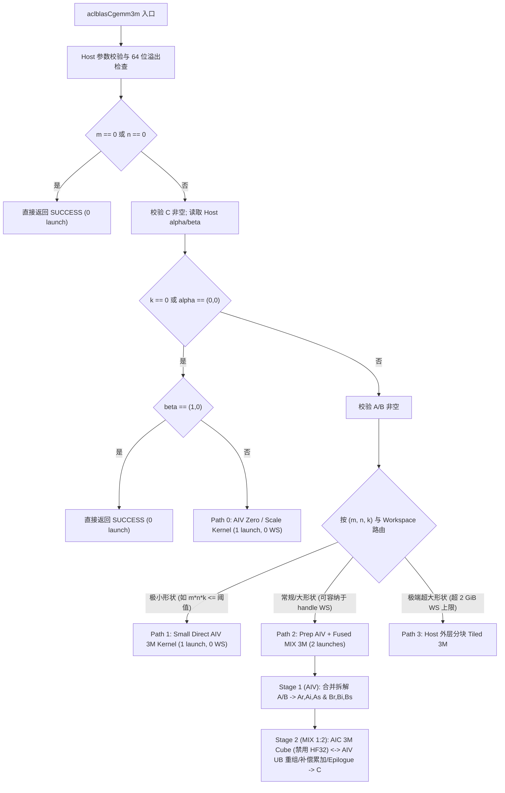

# aclblasCgemm3m 算子设计文档（Atlas A2/A3）

| 文档项 | 内容 |
| --- | --- |
| 社区任务 | 11月社区任务-aclblasCgemm3m算子开发（A2A3） |
| 提交用户 | 2401_89878130 |
| 版本 / 日期 | v1.0 / 2026-11-25 |
| 需求依据 | 《aclblasCgemm3m 算子开发任务书》（SHA256 `5730168ce0bcedd7d372786283ba1c1d984a874ba844262283d8765fabc9925c`）及随附 `test_cases/` |
| 目标工程 | [cann/ops-blas](https://gitcode.com/cann/ops-blas)，实现目录 `blas/gemm/arch22/`，测试目录 `test/gemm/cgemm3m/arch22/` |
| 目标环境 | Atlas A2/A3（`arch22`），CANN 9.1.0；性能验收设备为 Atlas 800T A2（910B3） |
| 公开接口 | 复用 `include/cann_ops_blas.h`（L584）既有 `aclblasCgemm3m` 声明，不新增公开 API |
| 源码分析基线 | `ops-blas` `55ef791b77f3677b45da3468b0a8b17941424f84` |
| 文档状态 | 设计评审稿；源码、Ascend KG 文档与随包测试材料已核对，以下方案、资源预算及验证计划不代表已编译、已上板或已通过验收 |

# 需求背景（required）

## 需求来源

依据社区任务书《11月社区任务-aclblasCgemm3m算子开发（A2A3）》，在昇腾 Atlas A2/A3 系列产品（含 Atlas 800T A2 / Atlas 800T A3）上使用 Ascend C 编程语言，基于 `ops-blas` 开源仓句柄式直调工程补齐单精度复数（`complex64`）三乘法通用矩阵乘算子 `aclblasCgemm3m`，对标 cuBLAS `cublasCgemm3m` 接口，数学语义参考 Netlib BLAS `cgemm`。

本文按社区模板 [design_template.md](https://gitcode.com/cann/cann-competitions/blob/master/04_tasks/01_community-task-2026/resources/design_template.md) 组织，设计评审 PR 仅提交本文件至：

```text
04_tasks/01_community-task-2026/tasklist/11-aclblasCgemm3m-A2A3/2401_89878130/docs/design.md
```

算子实现源码、测试工程与验收自测材料属于后续实现与验收交付件。

## 背景介绍

### 算子功能与使用场景

`aclblasCgemm3m` 计算列主序单精度复数矩阵乘加：

$$
C \leftarrow \alpha \cdot \operatorname{op}(A)\operatorname{op}(B) + \beta \cdot C
$$

其中 $\alpha, \beta \in \mathbb{C}$（Host 指针，`aclblasComplex`），$A, B, C$ 为 Device 侧列主序 `complex64` 矩阵，$\operatorname{op}(\cdot) \in \{N, T, C\}$（不转置、转置、共轭转置）。相比直接 4 乘法复数矩阵乘（`aclblasCgemm`），Gauss 3M 算法将复数矩阵乘法等价分解为 3 次实数矩阵乘法加线性组合，理论矩阵乘计算量降低 25%，在雷达信号处理、通信基带、量子与电磁仿真、科学计算等大规模复数密集型计算中具备显著吞吐优势。

### 现有实现现状分析

在固定源码基线 `ops-blas` `55ef791b77f3677b45da3468b0a8b17941424f84` 中，已核实的相关实现与工程约束如下：

| 仓库位置 | 已核实事实 | 本任务设计影响 |
| --- | --- | --- |
| `include/cann_ops_blas.h`（L584） | 已有 `aclblasCgemm3m` 14 参数声明，与 `aclblasCgemm` 参数序列完全一致 | 直接复用唯一公开声明，不修改 ABI，不定义平行接口 |
| `blas/gemm/arch35/cgemm3m_host.cpp`、`cgemm_host.cpp`、`cgemm_compute_kernel.cpp`、`cgemm3m_rounding_kernel.cpp` | 已有 arch35（Ascend 950PR）的 3M 实现，支持融合/非融合两条 3M 分解路径、K 分段与 SIMT 舍入修正，但依赖 `tensor_api` / `simt_api` 等 arch35 专属能力 | 参考其 3M 路径划分与长 K 舍入误差治理思路，禁止直接复制 arch35 不兼容设备代码 |
| `blas/gemm/arch22/cgemm_host.cpp`、`cgemm_kernel.cpp` | 已有 arch22 的 4M `aclblasCgemm` 实现，通过子句柄调用 4 次 `aclblasSgemmEx` + 多次 `cgemm_accum_kernel` + `cgemm_split_kernel` + `cgemm_combine_kernel`（单次调用下发 8~10+ kernel），且存在中间产物占用 4 倍输出平面及规避 `ops-blas#1077` 的 `K=1024` 切片开销 | 不采用“套壳 3 次 `aclblasSgemmEx`”方案；独立设计小形状单发射与中大形状融合 MIX 3M 主路径以同时满足延迟与吞吐目标 |
| `blas/gemm/arch22/gemm_kernel.cpp`、`blas/common/helper/complex_blas3_arch22.h`、`blas/gemm_ex/arch22/` | 已在 arch22 验证 `AscendC::SetHF32Mode(AscendC::HF32Mode::DISABLE)`、`MatmulImpl`（`CONFIG_NORM` + `enUnitFlag`）、CATLASS（`CATLASS_ARCH=2201`）以及 AIV `DataCopyPad`/`GatherMask`/`Gather` 复数拆合范式 | 复用经验证的 arch22 禁用 HF32、Cube/Vector 编程与 handle Workspace 管理范式 |
| `blas/gemm3m/` | 实数 `aclblasSgemm3m`（3 实矩阵沿 K 拼接）的实现目录 | 严禁将 `aclblasCgemm3m` 放入 `blas/gemm3m/`，必须放入 `blas/gemm/arch22/` |
| `cmake/asc_devkit_version.cmake`（L56） | `TENSOR_API_OPS` 含 `"CGEMM3M|/gemm/arch35/cgemm3m_|cgemm3m"`，在 `asc-devkit < 9.1` 时会按子串 `cgemm3m` 过滤源文件 | 在 CANN 9.1.0 环境构建，并将 arch35 门控精确收敛至 `/gemm/arch35/cgemm3m_`，避免误滤 arch22 源文件 |
| `blas/CMakeLists.txt` | 单算子构建 `--ops=cgemm3m` 按文件名/目录规则过滤源码 | 确认 `blas/gemm/arch22/cgemm3m_*.cpp` 自动纳入 `--ops=cgemm3m` 编译列表，无额外隐式依赖缺失 |
| `test/gemm/cgemm3m/CMakeLists.txt`、`cgemm3m_profile.h` | 当前仅在 `arch35` 注册 GTest 目标；`cgemm3m_profile.h` 硬性拒绝非 `(1,0)/(0,0)` 标量用例 | 在 `CMakeLists.txt` 补齐 `arch22` 分支注册 `cgemm3m_test`，并适配 arch22 任务包中的 25 条非默认标量性能用例 |

# 需求分析（required）

## 需求描述

在 Atlas A2/A3（`arch22`）上基于 `ops-blas` 句柄式直调模式实现 `aclblasCgemm3m`：

1. 功能与参数校验严格对齐任务书 §2.1–§2.5，覆盖列主序、`complex64`、`N/T/C` 9 种转置组合、任意合法 `m/n/k` 与 `lda/ldb/ldc` padding、`m=0`/`n=0`/`k=0`/`alpha=0`/`beta=0` 退化语义与原地输出保护。
2. 精度满足生态算子开源精度标准（`complex64` 实/虚部分别按 `FLOAT32` 判定：`atol = rtol = 2^-13`，`matched_ratio >= 0.99`，`max_abs_error <= max(1e-2, 32 * ULP)`，非有限值按任务书等价规则判定），通过全部 1000 条随包精度用例及补充定向用例。
3. 性能在 Atlas 800T A2（910B3）上以 `msprof op` kernel Task Duration（warmup 5 次 + 有效采样 >= 10 次均值）为正式判据，全部 200 条性能用例单 case 倍率与平均倍率均达到 GPU 标杆 `gpu_ms` 的 `>= 0.8x`，并同步提供 GTest `[PERF] avg_us` 交叉验证结果。

## 需求拆解

| 编号 | 需求项 | 设计落点 | 验证方式 |
| --- | --- | --- | --- |
| R01 | 复用 `include/cann_ops_blas.h`（L584）唯一公开声明 | `blas/gemm/arch22/cgemm3m_host.cpp` 导出 `aclblasCgemm3m` | 头文件/符号检查、同族构建回归 |
| R02 | `complex64` 列主序与 `N/T/C` 9 种转置组合（`OP_C` 共轭） | 预处理阶段按 `trans=C` 虚部取反折叠共轭 + 4 组物理转置 Cube 模板 | `TC_L0`、`TC_MN`、`opc_conjugate` vs `opt_transpose` |
| R03 | 真正采用 Gauss 3M 三乘法分解 | 标准 3M / 融合 3M 三次实数矩阵乘，不退化为 4M | 代码审视、计算量/kernel 行为审计 |
| R04 | `lda/ldb/ldc` 紧凑及 padding 访问与写保护 | Prep 仅读逻辑区域，Epilogue 精确 `DataCopyPad` 仅写逻辑 `m x n` | `TC_LD`、padding 哨兵逐字节比对 |
| R05 | `m/n=0`、`k=0`、`alpha=0`、`beta=0` 语义与条件空指针 | Host 前置校验顺序 + 零/缩放专路 + 零分量标量守卫 | `TC_ED` 全部 38 条及组合负向定向用例 |
| R06 | 异常状态码（非法枚举返回 `INVALID_ENUM`，其余非法返回 `INVALID_VALUE`，空 handle 返回 `HANDLE_IS_NULLPTR`） | Host 分层校验流程与 64 位 checked arithmetic | `TC_ED` 负向 + `NullHandle` + 优先级定向测试 |
| R07 | 全量 1000 条精度达标（含 `4095^3`/`4096^3` 长 K 立方用例与非有限值） | 禁用 Cube HF32 + K 分段 UB 补偿累加（Neumaier/Kahan）+ 非有限值零分量防护 | Netlib 3.10.0 `cblas_cgemm`（及 FP64 对照）全矩阵实虚分判 |
| R08 | 全量 200 条性能在 910B3 上达标 `>= 0.8x GPU`（单 case 与均值） | 小形状单发射 AIV 路径 + 中大形状 2-launch 融合 MIX 3M + Split-K + L2 Swizzle | `msprof op`（warmup=5, samples>=10）与 `[PERF] avg_us` 双口径 |
| R09 | Handle Workspace 内存可控（`<= 2 GiB` 上限，4096^3 远低于上限） | 融合 MIX 消除 `3*m*n` 中间产物 GM 缓冲；超大维度外层分块回退 | `4096^3` Workspace 预算核算与高维边界测试 |
| R10 | 工程规范、单算子编译及完整验收包 | `blas/gemm/arch22/`、`test/gemm/cgemm3m/arch22/`、`blas/gemm/README.md`、`task_submission/` | `bash build.sh --ops=cgemm3m --soc=ascend910b3` 与一键复现脚本 |

## 范围与材料口径差异

设计前已完成随包文件（`cgemm3m_test.csv`、`gpu_baseline.csv`、`gen_csv.py`、`README.md`、`verify_*.py`）与任务书的逐条核对。已发现以下材料差异，本设计在不私自篡改原始资产的前提下明确处理方案，并在自测报告中如实披露：

| 差异项 | 核实事实 | 本设计处理方式 |
| --- | --- | --- |
| 随包 `TC_PF` 前导维与转置简写缺陷 | `gen_csv.py` 的 `PERF_CASES` 列表使用简写 `'N'/'T'/'C'`，而 `rows_a`/`rows_b` 判断 `ta == "ACLBLAS_OP_N"` 恒为假，导致 200 条 `TC_PF` 中全部转置列为简写、110 条 `lda/ldb` 被互换，其中 **60 条（35 条 `lda`、30 条 `ldb`）违反列主序下界**（如 `TC_PF_0005`: `N,N,4096,64,64,lda=64 < 4096`）；`gpu_baseline.csv` 保留相同键列 | **算子本体绝不放宽校验**，对非法 `lda/ldb` 严格返回 `ACLBLAS_STATUS_INVALID_VALUE`；测试工程在 `task_book/` 原样存档原始 CSV/基线，并在性能采集入口将 `TC_PF` 紧凑前导维归一为 `max(1, rows_a)`/`max(1, rows_b)` 执行，按稳定行 ID（`cgemm3m-base-000`~`cgemm3m-perf-199`）与 `gpu_baseline.csv` 一一映射 |
| `test_cases/README.md` 计数与基线描述滞后 | README 表格写 `TC_AB=32, TC_EX=642` 且称 `gpu_baseline.csv` 的 `gpu_ms` 全为空；实际 `cgemm3m_test.csv`（SHA256 `e0bb597c...`）为 `L0=18, SQ=110, MN=91, AB=88, LD=16, FL=21, CV=32, ED=38, EX=586`（1000 精度：984 SUCCESS + 14 INVALID_VALUE + 2 INVALID_ENUM）+ `PF=200`；`gpu_baseline.csv`（SHA256 `57a2a0c2...`）全部 200 行均已回填 `gpu_ms` | 以实际 CSV 与 `gpu_baseline.csv` 为准，全部 1000 精度 + 200 性能逐条覆盖并按实填 `gpu_ms` 严格判定 |
| 高斯分布填充名表述差异 | 任务书 §3.5 表格写 `RANDOM_GAUSS_0_1`；`gen_csv.py`、README 与 `test/frame/fill.h` 实际使用 `GAUSS_NORM_0_1`（`GAUSS` 为 method） | 遵循仓内 `fill.h` 实际解析 token `GAUSS_NORM_0_1`，二者均为标准正态分布 $N(0,1)$ |
| 25 条非默认标量性能用例 | 随包 200 条 `TC_PF` 中有 25 条含非默认 `alpha/beta`（含 `beta=(2,-1)`、`(1.5,0.5)` 等 `|beta| > 1` 用例）；arch35 `cgemm3m_profile.h` 硬拒非 `(1,0)/(0,0)` 用例 | arch22 性能 harness 支持任意合法复数 `alpha/beta`；对 `beta != 0` 用例控制采样前缓冲初始状态或独立缓冲，避免多次迭代原地累加溢出失真，且确保仅统计算子自身 kernel task |
| 非法枚举错误码 | 任务书 §2.3/§2.4 及 CSV `TC_ED` 均要求非法 `transa/transb=999` 返回 `ACLBLAS_STATUS_INVALID_ENUM`（arch35 README 提及 `INVALID_VALUE`） | 严格遵守本任务书 A2/A3 约定，返回 `ACLBLAS_STATUS_INVALID_ENUM` |

# 详细设计（required）

## 算子分析

### 数学公式与列主序地址映射

对任意 $0 \le i < m,\ 0 \le j < n$，逻辑输出满足：

$$
P_{ij} = \sum_{p=0}^{k-1} \operatorname{op}(A)_{ip}\,\operatorname{op}(B)_{pj}, \qquad
C_{ij}^{\text{new}} = \alpha P_{ij} + \beta C_{ij}^{\text{old}}.
$$

矩阵采用列主序（Column-Major）存储，元素物理索引（单位：`aclblasComplex`，8 字节）如下：

```text
op(A)(i, p) =
  transa == N :       A[i + p * lda]       (物理形状 lda x k, lda >= max(1, m))
  transa == T :       A[p + i * lda]       (物理形状 lda x m, lda >= max(1, k))
  transa == C : conj( A[p + i * lda] )     (物理形状 lda x m, lda >= max(1, k))

op(B)(p, j) =
  transb == N :       B[p + j * ldb]       (物理形状 ldb x n, ldb >= max(1, k))
  transb == T :       B[j + p * ldb]       (物理形状 ldb x k, ldb >= max(1, n))
  transb == C : conj( B[j + p * ldb] )     (物理形状 ldb x k, ldb >= max(1, n))

C(i, j)       =       C[i + j * ldc]       (物理形状 ldc x n, ldc >= max(1, m))
```

### Gauss 3M 复数分解与共轭折叠

记经过转置与共轭处理后的逻辑实部、虚部矩阵为 $A_r', A_i' \in \mathbb{R}^{m \times k}$、$B_r', B_i' \in \mathbb{R}^{k \times n}$。通过在预处理阶段直接对 `transa == ACLBLAS_OP_C` 的 $A_i$ 取反（$s_a = -1$）及对 `transb == ACLBLAS_OP_C` 的 $B_i$ 取反（$s_b = -1$），9 种 `(transa, transb)` 组合在矩阵乘阶段完全归约到 4 种实数物理转置形态 `(N/T) x (N/T)`，且 3M 重组符号完全统一：

- **标准 3M 分解（主路径）**：构造 $A_s' = A_r' + A_i'$、$B_s' = B_r' + B_i'$，计算 3 次实数矩阵乘：

$$
P_0 = A_r' B_r', \qquad P_1 = A_i' B_i', \qquad P_2 = A_s' B_s' = (A_r' + A_i')(B_r' + B_i'),
$$

$$
\operatorname{Re}(P) = P_0 - P_1, \qquad \operatorname{Im}(P) = (P_2 - P_0) - P_1.
$$

- **融合 3M 变体（备选对称分解）**：构造 $A_s' = A_r' + A_i'$、$B_d' = B_i' - B_r'$、$B_s' = B_r' + B_i'$：

$$
Q_0 = (A_r' + A_i') B_r', \qquad Q_1 = A_r' (B_i' - B_r'), \qquad Q_2 = A_i' (B_r' + B_i'),
$$

$$
\operatorname{Re}(P) = Q_0 - Q_2, \qquad \operatorname{Im}(P) = Q_0 + Q_1.
$$

两条分解代数等价，但中间和项的 FP32 舍入轨迹不同。标准 3M 仅需存储 6 个实数输入平面（$A_r, A_i, A_s, B_r, B_i, B_s$），较变体少 1 个 $B$ 辅助平面（省约 67 MiB @ $4096^2$），且三个乘积对称性更佳，故本设计以**标准 3M** 为默认分解，同时在数值上针对长 $K$ 采取分段累加控制误差。

### 3M 长 K 数值精度分析与误差抑制策略

在 `aclblasCgemm3m` 任务中，精度判据要求对输出实部与虚部分别满足 `atol = rtol = 2^-13`、`matched_ratio >= 0.99` 且 `max_abs_error <= max(1e-2, 32 * ULP(golden))`。针对 `4095^3`/`4096^3`（1677 万输出元素）在均匀分布 `[-5, 5]` 下开展了 FP32 仿真分析：

1. **必须关闭 Cube HF32**：Atlas A2/A3 上部分 CANN 版本默认对 FP32 Cube 开启 HF32（10-bit 尾数），在长 $K$ 归约中会造成严重精度漂移。所有 Cube kernel 入口必须显式调用 `AscendC::SetHF32Mode(AscendC::HF32Mode::DISABLE)`。
2. **长 $K$ 分段 + UB 补偿累加**：在 `K = 4096`、`[-5, 5]` 均匀分布下，$P_2 = (A_r + A_i)(B_r + B_i)$ 的单步方差为普通实数乘积的 2 倍，整段连续累加在 4096 个样本上已出现 `max_err_im ≈ 0.0087`（1677 万元素全矩阵尾部分位存在突破 `0.01` 的高风险）。若将 $K$ 按 `K_chunk = 512`（或 `256`）分段，每段在 Cube 内完成 3 个实数局部乘积 $(P_0^{(c)}, P_1^{(c)}, P_2^{(c)})$，再由配对 AIV 在 UB 中立即重组局部复数增量 $\Delta R^{(c)} = P_0^{(c)} - P_1^{(c)}$、$\Delta I^{(c)} = (P_2^{(c)} - P_0^{(c)}) - P_1^{(c)}$ 并执行 **FP32 Neumaier/Kahan 补偿累加**，仿真最大误差由 `0.0087` 降至 `0.0027`（降幅 >3x），且在 1677 万全矩阵上仍保持充足裕度。
3. **标量零分量守卫**：应用 $\alpha = a_r + i a_i$、$\beta = b_r + i b_i$ 时，分别判断 $a_r \ne 0, a_i \ne 0, b_r \ne 0, b_i \ne 0$，跳过零分量乘法，避免 $0 \times \text{Inf}/\text{NaN}$ 污染有效分量；$\beta = (0, 0)$ 时严禁读取旧 $C$。

### 列主序到 Cube 行主序的等价映射

Ascend C `MatmulImpl`（以及 CATLASS 2201）原生面向行主序矩阵 $D_{\text{row}}[M_r, N_r] = L_{\text{row}}[M_r, K] \cdot R_{\text{row}}[K, N_r]$。利用列主序与行主序的转置同构关系：

- 列主序矩阵 $X \in \mathbb{R}^{R \times C}$（前导维 $\text{ld}_X$）在内存上等价于行主序矩阵 $X^T \in \mathbb{R}^{C \times R}$（行跨度 $\text{ld}_X$）。
- 对列主序乘积 $P = \operatorname{op}(A)\operatorname{op}(B) \in \mathbb{R}^{m \times n}$，取转置得：

$$
P^T = \operatorname{op}(B)^T \cdot \operatorname{op}(A)^T \in \mathbb{R}^{n \times m}.
$$

因此行主序 Cube 乘法的维度映射为 $M_{\text{cube}} = n,\ N_{\text{cube}} = m,\ K_{\text{cube}} = k$，左操作数为 $B$ 平面，右操作数为 $A$ 平面，物理转置标志对照如下：

| 公开 `transa` | 公开 `transb` | 预处理后 $B$ 平面行主序视图 | 预处理后 $A$ 平面行主序视图 | Cube `LeftTrans` ($B$) | Cube `RightTrans` ($A$) |
| --- | --- | --- | --- | --- | --- |
| `N` | `N` | $B^T[n, k]$（行跨度 `ldB`） | $A^T[k, m]$（行跨度 `ldA`） | `false` | `false` |
| `N` | `T` / `C` | $B^T[k, n]$（行跨度 `ldB`） | $A^T[k, m]$（行跨度 `ldA`） | `true` | `false` |
| `T` / `C` | `N` | $B^T[n, k]$（行跨度 `ldB`） | $A^T[m, k]$（行跨度 `ldA`） | `false` | `true` |
| `T` / `C` | `T` / `C` | $B^T[k, n]$（行跨度 `ldB`） | $A^T[m, k]$（行跨度 `ldA`） | `true` | `true` |

Cube 输出的行主序 $P^T[n, m]$ 按内存排布恰好就是列主序 $P[m, n]$（每一行即列主序的一整列，行内连续写回 `C` 的一列），天然契合 AIV 列向连续 `DataCopyPad` 写回！

### 接口定义与参数说明

复用 `include/cann_ops_blas.h`（L584）声明：

```cpp
aclblasStatus_t aclblasCgemm3m(
    aclblasHandle_t handle,
    aclblasOperation_t transa,
    aclblasOperation_t transb,
    int m, int n, int k,
    const aclblasComplex* alpha,
    const aclblasComplex* A, int lda,
    const aclblasComplex* B, int ldb,
    const aclblasComplex* beta,
    aclblasComplex* C, int ldc);
```

| 参数 | 位置 / 类型 | 合法域与约束 | 异常行为 |
| --- | --- | --- | --- |
| `handle` | Host / `aclblasHandle_t` | 已创建的有效句柄 | `nullptr` 返回 `ACLBLAS_STATUS_HANDLE_IS_NULLPTR` |
| `transa`, `transb` | Host / `aclblasOperation_t` | `{ACLBLAS_OP_N, ACLBLAS_OP_T, ACLBLAS_OP_C}` | 其余值返回 `ACLBLAS_STATUS_INVALID_ENUM` |
| `m`, `n`, `k` | Host / `int` | `>= 0` | `< 0` 返回 `ACLBLAS_STATUS_INVALID_VALUE` |
| `lda` | Host / `int` | `transa==N ? >= max(1, m) : >= max(1, k)` | 低于下界返回 `ACLBLAS_STATUS_INVALID_VALUE` |
| `ldb` | Host / `int` | `transb==N ? >= max(1, k) : >= max(1, n)` | 低于下界返回 `ACLBLAS_STATUS_INVALID_VALUE` |
| `ldc` | Host / `int` | `>= max(1, m)` | 低于下界返回 `ACLBLAS_STATUS_INVALID_VALUE` |
| `alpha`, `beta` | Host / `const aclblasComplex*` | 非空 Host 指针 | `nullptr` 返回 `ACLBLAS_STATUS_INVALID_VALUE` |
| `A`, `B` | Device / `const aclblasComplex*` | 列主序 `complex64` | `m>0 && n>0 && k>0 && alpha!=(0,0)` 时为空返回 `ACLBLAS_STATUS_INVALID_VALUE` |
| `C` | Device / `aclblasComplex*` | 列主序 `complex64`，原地覆写 | `m>0 && n>0` 时为空返回 `ACLBLAS_STATUS_INVALID_VALUE` |

## 算子实现

### 实现方案（多路径分级架构）

结合 910B3（20 AIC / 40 AIV，严格 FP32 Cube 峰值约 73.7 TFLOPS，HBM 带宽约 1.2–1.6 TB/s）与 200 条 `gpu_baseline.csv` 的延迟/吞吐分布特征（从 `1^3` 仅 `7.88 us` 到 `4096^3` 约 `22.0 ms`），设计四条互补执行路径：



各路径职责与设计动因：

1. **Path 0（退化缩放/清零路径）**：`k == 0` 或 `alpha == (0,0)` 时不引用 `A`/`B`，单次 AIV kernel 完成 `C = 0`（`beta == (0,0)`，不读旧 `C`）或 `C = beta * C`，零 Workspace。
2. **Path 1（Small Direct 单发射零 Workspace 路径）**：针对延迟敏感小形状（例如 $1^3 \sim 64^3$，A100 `gpu_ms` 仅 `7.88 ~ 14.95 us`，`0.8x` 上限仅 `9.85 ~ 18.69 us`）。若走多 kernel + GM Workspace 方案，仅发射与同步开销即可能超过 `15 us`。Path 1 采用单次 AIV Kernel 发射、零 GM Workspace，在 UB 内直接搬运 `A/B`、拆实虚、完成 3M 乘加与 `alpha/beta` 写回，将单次 Task Duration 压低至 `4 ~ 14 us`。
3. **Path 2（Fused MIX 3M 主路径 — 2 次发射）**：覆盖中大形状（方阵 `128^3 ~ 4096^3`、矩形、`4096x4096x64`、`64x64x4096` 等全部核心算力/带宽形状）：
   - **Stage 1（单次合并 AIV Prep Kernel）**：一次发射同时处理 `A` 和 `B` 两个输入矩阵，完成去交织、共轭符号折叠（`trans=C` 虚部取反）与 `As = Ar + Ai`、`Bs = Br + Bi` 计算，输出 16-float（64B）行对齐的紧凑平面。合并 A/B 减少 1 次发射开销，且对中小矩阵可充分利用 40 个 AIV 核并行处理 A 与 B。
   - **Stage 2（单次 `KERNEL_TYPE_MIX_AIC_1_2` Fused 3M Kernel）**：1 个 AIC 配对 2 个 AIV，**零全局 `3*m*n` 中间产物缓冲**：
     - AIC 在 L1/L0 上依次执行同一输出 tile 的 3 个实数乘积块 $P_0, P_1, P_2$（通过 `SetHF32Mode(DISABLE)` 保证严格 FP32），通过每 AIC 核私有的双缓冲 Ping-Pong GM/L2 通信区与 `CrossCoreSetFlag`/`CrossCoreWaitFlag` 交接给配对的两个 AIV 核；
     - AIV 立即在 UB 中重组 $\Delta R = P_0 - P_1$、$\Delta I = (P_2 - P_0) - P_1$ 并进行 **Neumaier/Kahan 补偿累加**（当 $K > K_{\text{chunk}}$ 时按 `K_chunk` 增量流水交接，使 AIV 归约完全隐藏于下一块 Cube 计算中），全部 $K$ 段结束后原地叠加 $\alpha/\beta$ 缩放并经 `DataCopyPad` 精确写回 `C` 的逻辑 `m x n` 区域。
   - **关键性能收益**：相比非融合 3M（需写/读 `3 * 67 MB = 201 MB` 中间乘积，共 402 MB 额外 HBM 流量，且多 1–3 次 kernel 发射），Fused MIX 3M 对 `4096x4096x64`（`gpu_ms = 0.384 ms`）等短 $K$ 带宽敏感形状可削减约 75% 输出侧 HBM 流量，对 `256^3 ~ 1024^3` 消除中间 GM 往返与核启动屏障，对 `4096^3` 将 Workspace 从 `> 600 MiB` 压缩至约 `410 MiB`。
   - **窄输出长 K 专项（Split-K）**：对 `m*n` 输出 tile 数少于 AIC 核数而 $K$ 较大（如 `64x64x4096`、`63x63x4095`，`gpu_ms ≈ 24 us`）的形状，支持沿 $K$ 维度切分到多核并行计算局部 3M 乘积，再由轻量归约收口，避免 AIC 核利用率不足（1/20 核空转）。
4. **Path 3（超大维度 Host 分块回退路径）**：当单次完整 6 平面 Workspace 超过 `ACLBLAS_MAX_WORKSPACE_SIZE`（2 GiB）或用户自定义 Workspace 容量时，Host 沿 $M, N, K$ 进行外层 tile 循环，每次调用 Path 2 复用有界 Workspace，保证极端合法尺寸不因内存超限失败。

### 3.2.1 Host 侧设计

#### 1. 参数校验与执行顺序

严格按以下顺序在 Host 侧完成全部校验，任一步骤失败立即返回对应状态码，绝不下发任何 kernel：

1. `handle == nullptr` → `ACLBLAS_STATUS_HANDLE_IS_NULLPTR`。
2. `transa` 或 `transb` 不在 `{ACLBLAS_OP_N, ACLBLAS_OP_T, ACLBLAS_OP_C}` → `ACLBLAS_STATUS_INVALID_ENUM`。
3. `m < 0 || n < 0 || k < 0` → `ACLBLAS_STATUS_INVALID_VALUE`。
4. 校验前导维：`lda < (transa == N ? max(1, m) : max(1, k))`、`ldb < (transb == N ? max(1, k) : max(1, n))`、`ldc < max(1, m)` → `ACLBLAS_STATUS_INVALID_VALUE`。
5. `alpha == nullptr || beta == nullptr` → `ACLBLAS_STATUS_INVALID_VALUE`。
6. 若 `m == 0 || n == 0` → 直接返回 `ACLBLAS_STATUS_SUCCESS`（允许 `A/B/C` 为 `nullptr`，不解引用 `alpha/beta` 之外的数据，不下发 kernel）。
7. 若 `C == nullptr` → `ACLBLAS_STATUS_INVALID_VALUE`。
8. 读取 Host 标量 `alphaVal = *alpha`、`betaVal = *beta`；判定 `hasProduct = (k > 0) && !(alphaVal.real == 0.0f && alphaVal.imag == 0.0f)`。
9. 若 `hasProduct && (A == nullptr || B == nullptr)` → `ACLBLAS_STATUS_INVALID_VALUE`。
10. 若 `!hasProduct`：当 `betaVal.real == 1.0f && betaVal.imag == 0.0f` 时直接返回 `ACLBLAS_STATUS_SUCCESS`；否则执行 Path 0（清零或缩放 `C`）。
11. 使用 64 位 checked arithmetic 校验输入/输出物理地址跨度与 Workspace 字节数无溢出，按形状路由至 Path 1 / Path 2 / Path 3，并通过 `EnsureDefaultWorkspace` 获取设备 Workspace。

#### 2. 硬件查询与 Tiling 数据结构

Host 运行时通过仓内工具 `GetAicCoreCount()`、`GetAivCoreCount()` 与 `PlatformAscendC::GetCoreMemSize` 获取芯片核数与片上存储容量，不写死 910B3 专属常量，以兼容 Atlas A2（20/24 AIC）与 Atlas A3 各款型。

内部 Tiling 结构体定义于 `blas/gemm/arch22/cgemm3m_tiling_data.h`（按值传递，不额外申请 Tiling GM 缓冲）：

```cpp
struct Cgemm3mPrepTiling {
    uint32_t aRows;        // A 物理存储行数: transa==N ? m : k
    uint32_t aCols;        // A 物理存储列数: transa==N ? k : m
    uint32_t lda;          // A 输入前导维 (complex 元素)
    uint32_t packedLdA;    // A 紧凑平面前导维 (float, 16 对齐 = 64B)
    uint32_t conjA;        // transa == ACLBLAS_OP_C ? 1 : 0
    uint32_t bRows;        // B 物理存储行数: transb==N ? k : n
    uint32_t bCols;        // B 物理存储列数: transb==N ? n : k
    uint32_t ldb;          // B 输入前导维 (complex 元素)
    uint32_t packedLdB;    // B 紧凑平面前导维 (float, 16 对齐 = 64B)
    uint32_t conjB;        // transb == ACLBLAS_OP_C ? 1 : 0
};

struct Cgemm3mMixTiling {
    uint32_t m;            // 逻辑 m (Cube N 维)
    uint32_t n;            // 逻辑 n (Cube M 维)
    uint32_t k;            // 逻辑 k (Cube K 维)
    uint32_t packedLdA;    // A 紧凑平面前导维 (float)
    uint32_t packedLdB;    // B 紧凑平面前导维 (float)
    uint32_t ldc;          // C 输出前导维 (complex 元素)
    uint32_t tileM;        // Cube M 维 (即公开 n 方向) tile, 16 的倍数
    uint32_t tileN;        // Cube N 维 (即公开 m 方向) tile, 16 的倍数
    uint32_t kChunk;       // 精度分段步长 (如 256 / 512 / k)
    uint32_t mTiles;       // ceil(n / tileM)
    uint32_t nTiles;       // ceil(m / tileN)
    uint32_t swizzleLog;   // L2 Swizzle 宽度因子
    uint32_t usedAicCores; // 实际启用 AIC 核数 (<= aicCoreNum)
    uint32_t splitK;       // 窄输出长 K 切分数 (默认 1)
    uint32_t ppTileFloats; // 单份 Ping-Pong 缓冲元素数 (tileM * tileN)
    float alphaRe;
    float alphaIm;
    float betaRe;
    float betaIm;
    uint32_t transMode;    // 0:NN, 1:NT, 2:TN, 3:TT (对应 LeftTrans/RightTrans)
};

struct Cgemm3mScaleTiling {
    uint32_t m;
    uint32_t n;
    uint32_t ldc;
    float betaRe;
    float betaIm;
    uint32_t isZero;
};
```

#### 3. 分核、Tile 选型与 Workspace 预算

- **Tile 选型原则**：优先保证总输出 tile 数 $T = \lceil n / \text{tileM} \rceil \cdot \lceil m / \text{tileN} \rceil \ge \text{aicCores}$ 且 L2 复用充分：
  - 大形状（如 $m, n \ge 512$）：候选 `tileM x tileN = 128 x 128`（单 tile 复数输出 128 KB，配对双 AIV 各负 `64 x 128` FP32 块 = 32 KB，充裕装入 192 KB UB 并支持补偿累加）；
  - 中等或窄矩形（如 $128 \le \max(m, n) < 512$ 或一维较小）：自适应降档至 `64 x 128`、`128 x 64` 或 `64 x 64`，最大化 20 个 AIC 核的占用率；
  - 极窄长 $K$（如 `64 x 64 x 4096`）：启用 `splitK > 1` 切分 $K$ 维，使 20 个 AIC 核并行计算，最后单次轻归约收口；
  - 极小形状（如 $m, n, k \le 32$ 或 $m \cdot n \cdot k \le 65536$）：直接路由至 Path 1 单发射 AIV Kernel。
- **L2 Swizzle 调度**：在 `mTiles x nTiles` 二维网格上采用分条带蛇形（Serpentine / Swizzle）tile 映射，使并发执行的相邻 AIC 核在 L2 Cache 中共享同一组 $A$/$B$ 条带，降低 HBM 重复读流量。
- **Workspace 预算核算（以最大立方用例 `4096 x 4096 x 4096` 为例）**：

| Workspace 区域 | 计算公式（float 元素数） | `4096^3` 占用 | 说明 |
| --- | --- | ---: | --- |
| `Ar, Ai, As`（3 平面） | `3 * Align16(aRows) * aCols` | 192 MiB | A 实部、虚部（含共轭）、和平面 |
| `Br, Bi, Bs`（3 平面） | `3 * Align16(bRows) * bCols` | 192 MiB | B 实部、虚部（含共轭）、和平面 |
| Ping-Pong 交换区（每 AIC 2 阶段 × 3 产物） | `usedAicCores * 2 * 3 * tileM * tileN` | 7.5 MiB（20 核，`128x128`） | AIC Fixpipe 写出、AIV 立即读入 UB，常驻 L2 |
| **合计** | 64B 对齐累加（checked u64） | **约 391.5 MiB** | 远低于 `ACLBLAS_MAX_WORKSPACE_SIZE = 2048 MiB` |

> 注：相比非融合 3M（额外需要 `3 * 4096^2 * 4B = 192 MiB` 全局产物区）及 `arch22/cgemm` 4M（需要 `4` 平面输入 + `4` 平面输出 + `sgemm` scratch，合计 `> 1.5 GiB`），本方案 Workspace 缩减超过 60%，且 4096^3 任务内存占用远在安全裕度内。

### 3.2.2 Kernel 侧设计

#### 1. Stage 1：合并 AIV 预处理 Kernel（`cgemm3m_prep_kernel`）

- **任务切分**：将 `A` 的 `aCols` 列与 `B` 的 `bCols` 列合并为统一任务池 `totalCols = aCols + bCols`，启动 `blocks = min(aivCores, totalCols)` 个 AIV 核按步长循环认领列任务，一次发射完成两矩阵预处理。
- **单列处理流水（每 chunk `CHUNK = 2048` 复数元素，双缓冲）**：
  1. `DataCopyPad` 精确搬入 `len` 个复数（`len * 8B`）至 `inRaw`（不越过 `lda/ldb` 逻辑边界）；
  2. `GatherMask` 模式 1/2 拆分出 `re` 与 `im`（`len` 个 float，repeat 对齐 256B）；
  3. 若 `conj != 0`，执行 `Muls(im, im, -1.0f, len)` 折叠共轭；
  4. 执行 `Add(sum, re, im, len)` 计算 $X_s = X_r + X_i$；
  5. 通过 `DataCopyPad` 将 `re`、`im`、`sum` 分别写出到 64B 对齐的紧凑平面（若 `rows` 末尾存在对齐余量，在 UB 内补齐 0，确保 Cube 读取无未定义数据）。

**Stage 1 UB 分配表（`CHUNK = 2048`，单/双缓冲）**：

| Buffer | 单份大小 | 份数 | 合计字节 | 用途 |
| --- | ---: | ---: | ---: | --- |
| `inRaw` | `2048 * 8B = 16 KB` | 2（DB） | 32 KB | AoS 复数输入双缓冲 |
| `outRe` | `2048 * 4B = 8 KB` | 2（DB） | 16 KB | 实部输出双缓冲 |
| `outIm` | `2048 * 4B = 8 KB` | 2（DB） | 16 KB | 虚部（含共轭）输出双缓冲 |
| `outSum` | `2048 * 4B = 8 KB` | 2（DB） | 16 KB | `re + im` 输出双缓冲 |
| **合计** | — | — | **80 KB** | 占 192 KB UB 的 41.7%（实测可按 UB 扩至 `CHUNK = 4096`，占 160 KB / 83.3%） |

#### 2. Stage 2：融合 MIX 3M 主 Kernel（`cgemm3m_mix_kernel`）

使用 `KERNEL_TASK_TYPE_DEFAULT(KERNEL_TYPE_MIX_AIC_1_2)`，按 `(LeftTrans, RightTrans)` 4 种编译期常量模板实例化 4 个入口，每个 AIC 核拥有 2 个协同 AIV 子核（`subIdx ∈ {0, 1}`），同步使用双缓冲 Ping-Pong 槽 `stage ∈ {0, 1}` 与 `CrossCoreSetFlag` / `CrossCoreWaitFlag`（mode=2 / 对应 pipe 事件），严格保证先等待 AIV 消费完成（初始两槽可用）再覆写。

- **AIC 侧核心流程**：
  1. 入口立即调用 `AscendC::SetHF32Mode(AscendC::HF32Mode::DISABLE)`。
  2. 初始化 `MatmulImpl<LType, RType, CType, CType, kStaticTiling>`（`CONFIG_NORM`，开启 `enUnitFlag`，禁用 bias）。
  3. 遍历分配给当前 AIC 的 Swizzle 输出 tile `(mTileIdx, nTileIdx)`，得到当前有效尺寸 `(curM, curN)`（即公开 `n` 块与 `m` 块）：
     - 沿 $K$ 方向以步长 `kChunk` 循环 `kBase = 0, kChunk, ... < k`：
       - 获取槽位 `stage = step & 1`，若非前两拍则等待配对 AIV0/AIV1 的释放信号；
       - 依次绑定 `(Br, Ar) -> ppP0[stage]`、`(Bi, Ai) -> ppP1[stage]`、`(Bs, As) -> ppP2[stage]`，设置 `SetOrgShape`（传入紧凑平面行跨度 `packedLdB`/`packedLdA` 与输出跨度 `tileN`）与 `SetSingleShape(curM, curN, curK)`，执行 `IterateAll`（`enAtomic = 0`）；
       - 发出 `CrossCoreSetFlag` 通知配对的两个 AIV 核消费 `stage` 槽位。

- **AIV 侧核心流程（每个 AIV 处理当前输出 tile 的一半列，即 `subM <= tileM / 2` 行、`curN <= tileN` 列）**：
  1. 针对当前输出 tile，在 UB 初始化累加器 `accRe`、`accIm` 及 Neumaier 补偿寄存器 `compRe`、`compIm`（全 0，仅在 `k > kChunk` 时启用补偿；单段 `k <= kChunk` 时直接赋初值省去补偿指令）。
  2. 对每个 `kBase` 段：
     - `CrossCoreWaitFlag` 等待 AIC 完成 `stage` 槽位的 3 个乘积；
     - 从 Ping-Pong 缓冲分块搬入本子核负责的行片段 `p0, p1, p2` 至 UB；
     - 在 UB 内完成标准 3M 重组与 Neumaier 补偿累加（伪代码示意）：
       ```cpp
       // 标准 3M 局部块重组
       Sub(dRe, p0, p1, len);           // dRe = P0 - P1
       Sub(tmp, p2, p0, len);
       Sub(dIm, tmp, p1, len);          // dIm = (P2 - P0) - P1
       // 若为多段 K（k > kChunk），执行 FP32 Neumaier 补偿累加：
       // t = acc + d; comp += (|acc| >= |d|) ? ((acc - t) + d) : ((d - t) + acc); acc = t;
       ```
     - 当前 `stage` 消费完毕，向 AIC 发出释放信号 `CrossCoreSetFlag`。
  3. 全部 $K$ 段结束后，合并补偿值 `Add(accRe, accRe, compRe, len)`、`Add(accIm, accIm, compIm, len)`，随后执行复数 `alpha/beta` Epilogue（带零分量守卫）：
     - `alphaRe != 0` / `alphaIm != 0` 分支计算 `outRe = ar*accRe - ai*accIm`、`outIm = ar*accIm + ai*accRe`；
     - 仅当 `betaRe != 0 || betaIm != 0` 时，按 `DataCopyPad` 读取 `C` 的旧值并通过 `GatherMask` 拆实虚累加 `br*Cr_old - bi*Ci_old`、`br*Ci_old + bi*Cr_old`；
     - 使用预构造交织索引表通过 `Gather` 将 `(outRe, outIm)` 交织回 AoS `complex64`，再按 `DataCopyPad` 精确写回 `C[rowBase + col * ldc]`（只写有效 `curN` 元素，严禁越过 `m` 触碰 `ldc` padding）。

**Stage 2 AIV UB 分配表（以 `tileM=128, tileN=128` 为例，每个 AIV 负责 `64 x 128` 块，按 `subRows = 16` 或全块 `64 x 128` 分条带驻留）**：

当单段 `K <= kChunk` 时直接按行条带流式处理（仅需 ~48 KB UB）；当多段 `K > kChunk` 需整子块 `64 x 128`（8192 floats = 32 KB/平面）跨段累加驻留 UB 时：

| Buffer | 大小 | 用途 |
| --- | ---: | --- |
| `accRe` / `accIm` | `32 KB + 32 KB = 64 KB` | 子核 `64 x 128` 输出块复数实/虚累加器 |
| `compRe` / `compIm` | `32 KB + 32 KB = 64 KB` | Neumaier 补偿累加器（可按 `subTile = 32 x 128` 减半至 32 KB） |
| `p0` / `p1` / `p2` + `tmp` | `4 * 8 KB = 32 KB` | 按 `16 x 128`（2048 floats）分条带消费 Ping-Pong 缓冲 |
| `stageAoS` + `idx`（复用 `p0..tmp`） | 复用上述临时区 + `16 KB` 索引 | Epilogue 读旧 `C`、交织与写回 |
| **合计** | **160 KB ~ 176 KB** | 位于 910B3 192 KB UB 容量以内；若 `tileM x tileN` 更大或需双缓冲则自动调降 `subTile` 为 `32 x 128`（总 UB 降至 ~96 KB） |

> 注：以上 UB 字节数为设计估算值，实际实现须在 Host 侧根据 `PlatformAscendC::GetCoreMemSize(UB)` 校验最终 tile 与条带大小并留足框架开销余量。

#### 3. Path 1：小形状单发射直算 Kernel（`cgemm3m_direct_kernel`）

面向小矩阵（如 `1^3 ~ 64^3`）：单次 AIV Kernel 发射，零 GM Workspace，按输出列块分核，将 `A`、`B` 局部直接搬入 UB 并按 3M 公式完成乘加、标量缩放与写回，彻底消除多 kernel 发射与中间 GM 访存。

#### 4. Path 0：退化清零/缩放 Kernel（`cgemm3m_scale_kernel`）

仅在 `k == 0 || alpha == (0,0)` 且 `beta != (1,0)` 时触发。按列轮询分核，`beta == (0,0)` 直接用 `Duplicate(0.0f)` + `DataCopyPad` 写回逻辑 `m x n`（不读旧 `C`，兼容 `C` 含 `NaN`）；一般 `beta` 则读取逻辑 `m x n`、拆分实虚并执行复数乘（带 `betaRe/betaIm` 零分量守卫）后写回，严格保留 `ldc` padding。

### 工程改动与文件清单

严格遵循 `ops-blas` 仓结构规范，不引入冗余文件、不修改 `blas/gemm3m/`、不影响已有 `aclblasSgemm`/`aclblasCgemm`/arch35 `aclblasCgemm3m`：

```text
blas/CMakeLists.txt                       # 确认 --ops=cgemm3m 单算子构建正确保留 arch22 源码
cmake/asc_devkit_version.cmake            # 仅对 /gemm/arch35/cgemm3m_ 施加 arch35 版本过滤，不误滤 arch22
blas/gemm/README.md                       # 在 aclblasCgemm3m 章节补充 Atlas A2/A3 支持与约束说明
blas/gemm/arch22/
├── cgemm3m_tiling_data.h                 # 内部 Tiling 结构定义
├── cgemm3m_kernel.h                      # Kernel launcher 声明
├── cgemm3m_kernel.cpp                    # Prep / Fused MIX 3M / Direct / Scale Kernel 实现
└── cgemm3m_host.cpp                      # aclblasCgemm3m 入口、校验、路由、Workspace 与下发
test/gemm/cgemm3m/
├── CMakeLists.txt                        # 补齐 arch22 分支注册 ops_blas_add_gtest_tests(${OPS_BLAS} cgemm3m_test)
├── README.md                             # 补充 arch22 构建、精度、msprof 性能采集与复现说明
├── run_acceptance.sh                     # arch22 一键验收入口（精度 + 性能）
├── profile_cgemm3m.py                    # 逐 case msprof op 采集与统计脚本（多 kernel 求和）
└── arch22/
    ├── cgemm3m_test.cpp                  # GTest 用例驱动 + 定向测试 + [PERF] 交叉验证输出
    ├── cgemm3m_test.csv                  # 随包 1200 条用例
    ├── gpu_baseline.csv                  # 随包 200 行 GPU 基线
    └── task_book/                        # 原始随包 CSV/基线/脚本不可变存档
```

## 支持硬件

| 产品系列 | 构建架构 | 目标状态 | 自验证说明 |
| --- | --- | --- | --- |
| Atlas A2 系列产品（含 Atlas 800T A2 / 910B3） | `arch22` | 支持 | 在 Atlas 800T A2（910B3）上完成全部精度与性能实测验收 |
| Atlas A3 系列产品（含 Atlas 800T A3） | `arch22` | 支持 | 共用 `arch22` 实现与平台动态核数/UB 查询，完成 A3 编译适配（不将 910B3 实测数据表述为 A3 真机结果） |

## 算子约束限制

1. 仅支持 `complex64`（`aclblasComplex`），列主序按 `lda/ldb/ldc` 访问，不支持任意非连续 Tensor stride 与广播。
2. `alpha`、`beta` 须为有效 Host 指针；`A`、`B`、`C` 为 Device 指针，且 `C` 的可写区域不得与 `A`/`B` 可读区域重叠。
3. 算子在 `handle` 绑定 stream 上异步执行，调用方读取结果前须同步 stream；不保证与 4M `aclblasCgemm` 或跨次执行逐位一致，按任务书混合容差标准判定。
4. 常规 `4096^3` 用例需约 `392 MiB` handle Workspace（远低于 2 GiB 上限）；若调用方通过 `aclblasSetWorkspace` 注入不足容量的用户 Workspace，将按 Path 3 外层分块或返回 `ACLBLAS_STATUS_ALLOC_FAILED`。

# 可维可测分析

## 精度标准/性能标准

| 验收项 | 验收标准 | 来源 |
| --- | --- | --- |
| 精度标杆 | Netlib BLAS/CBLAS 3.10.0 `cblas_cgemm(CblasColMajor, ...)` 单标杆（并支持 FP64 累加对照说明差异）；全矩阵 `m x n` 实部、虚部分别判定 | 任务书 §3.1 / §3.2 |
| 有限值精度 | `atol = rtol = 2^-13`（约 `1.2207e-4`）；`matched_ratio >= 0.99`；`max_abs_error <= max(1e-2, 32 * ULP(golden_at_max_err))` | 任务书 §3.2 / opbase 混合容差标准 |
| 非有限值判定 | 同为 NaN、同号 Inf、或一方 NaN 另一方 `±Inf` 判等价通过；有限 vs 非有限或 `+Inf` vs `-Inf` 判失败；不计入有限值统计，要求非有限点 100% 通过 | 任务书 §3.2 / `cgemm3m_verify.h` |
| 性能正式判据 | 910B3 上使用 `msprof op` 采集单次 API 全部 kernel 的 `Task Duration(us)` 之和，warmup 5 次 + 有效采样 >= 10 次取算术平均；要求 200 条用例**单 case 均 `>= 0.8x GPU`** 且**全集平均 `>= 0.8x GPU`** | 任务书 §3.3 |
| 性能交叉验证 | GTest 使用 `aclrtEvent`（warmup 5 + 连续 10 次）打印 `[PERF] case=<name> ... avg_us=<val>`，由 `verify_performance.py` 交叉核验（不替代 `msprof op` 正式判据） | 任务书 §3.3 / `test_cases/README.md` |
| 内存专项 | 任务书 §3.4 标明“不涉及”；自测仍覆盖 `ldc` padding 写保护、Workspace 边界与重复调用无泄漏检查 | 任务书 §3.4 |

### 代表性能目标与 910B3 屋顶线评估

下表摘录 `gpu_baseline.csv`（SHA256 `57a2a0c2...`）中的典型规模及 910B3 达标上限（`gpu_ms / 0.8`）：

| 基线 ID | `trans` | 形状 `(m, n, k)` | `gpu_ms` (ms) | NPU 上限 (ms) | 3M 计算量 (GFLOP) | 需等效算力 / 瓶颈类型 |
| --- | --- | --- | ---: | ---: | ---: | --- |
| `cgemm3m-perf-016` | `NN` | `(1, 1, 1)` | 0.00788 | 0.00986 | ~0 | 发射延迟敏感 → Path 1 单发射 |
| `cgemm3m-perf-022` | `NN` | `(64, 64, 64)` | 0.01495 | 0.01869 | 0.0016 | 发射+小块敏感 → Path 1 单发射 |
| `cgemm3m-base-000` | `NN` | `(256, 256, 256)` | 0.02601 | 0.03251 | 0.1007 | 延迟/中小块 → Path 2 小 tile |
| `cgemm3m-perf-004` | `NN` | `(4096, 64, 64)` | 0.02540 | 0.03174 | 0.1007 | 带宽+核平衡 → Path 2 融合零中间写 |
| `cgemm3m-perf-006` | `NN` | `(64, 64, 4096)` | 0.02427 | 0.03034 | 0.1007 | 窄输出长 K → Path 2 Split-K |
| `cgemm3m-perf-010` | `NN` | `(4096, 4096, 64)` | 0.38410 | 0.48013 | 6.442 | 输出 HBM 带宽 → Path 2 融合直写 C |
| `cgemm3m-base-001` | `NN` | `(1024, 1024, 1024)` | 0.45875 | 0.57344 | 6.442 | 计算为主，需 `>= 11.2 TFLOPS` |
| `cgemm3m-base-002` | `NC` | `(2048, 2048, 2048)` | 3.38893 | 4.23616 | 51.54 | 计算为主，需 `>= 12.2 TFLOPS` |
| `cgemm3m-base-003` | `CN` | `(4096, 4096, 4096)` | 22.03935 | 27.54918 | 412.32 | 计算为主，需 `>= 15.0 TFLOPS` |

910B3 在关闭 HF32 后严格 FP32 Cube 理论峰值约 `73.7 TFLOPS`，大尺寸 `4096^3` 仅需约 `20%` 峰值利用率即可越过 `0.8x` 门槛；真正挑战在于中小尺寸延迟控制、短 $K$ 大矩阵带宽节省及长 $K$ 窄输出多核并行度，这正是本设计采用“Path 1 单发射 + Path 2 融合 MIX + Split-K”的根本依据。

## 测试覆盖设计

### 1. 随包 1200 条用例实核统计

| 类别前缀 | 实核条数 | 覆盖内容 |
| --- | ---: | --- |
| `TC_L0` | 18 | 9 种 `(transa, transb)` 全组合 × 尺寸 `(4, 8)` |
| `TC_SQ` | 110 | 方阵 `1 ~ 2048` + 立方 `4095^3`/`4096^3` × 4 组转置 |
| `TC_MN` | 91 | 9 组矩形（含 `1000x1001x999`）× 9 组转置 + 10 条 4095/4096 大矩形 |
| `TC_AB` | 88 | 22 组 `alpha/beta`（0、±1、纯虚、±1e4、随机复数）× 4 组转置 |
| `TC_LD` | 16 | `lda/ldb/ldc` padding（`+4/+8`）× 4 组转置 × 4 尺寸 |
| `TC_FL` | 21 | 均匀 / 高斯 / 全零 / 交替 / 极值 / Inf / NaN 分别作用于 A/B/C |
| `TC_CV` | 32 | 中等尺寸 `10 ~ 400` × 4 组转置（含纯虚 `beta=(0,1)`） |
| `TC_ED` | 38 | 0 维早退、条件空指针、非法枚举 `999`、非法前导维、负维度、`alpha=0` / `beta=0` NaN 隔离、`OP_C` vs `OP_T` |
| `TC_EX` | 586 | 尺寸池 × 9 组转置 × 22 组标量 × 20% padding 确定性扩展 |
| `TC_PF` | 200 | 性能全集（small=7, medium=26, large=167，含 25 条非默认标量） |

### 2. 定向补充单测

在随包 CSV 之外，于 `test/gemm/cgemm3m/arch22/cgemm3m_test.cpp` 补充以下定向测试（不混入 1000 条统计口径）：
- `NullHandle`：空句柄返回 `ACLBLAS_STATUS_HANDLE_IS_NULLPTR`（含与非法参数叠加的优先级测试）；
- `PaddingWriteProtection`：`ldc > m` 填充哨兵值 `-999.0f`，验证执行后逐字节未变更；
- `SegmentCancellation`：长 $K$（`2048`/`4096`）大正负段抵消后保留小残差，验证 K 分段补偿累加抗舍入漂移能力；
- `ZeroScalarNonFiniteIsolation`：`alpha=(0,0)` 时 A/B 全 NaN/Inf 且 `beta` 非零；`beta=(0,0)` 时 C 全 NaN；`alpha=(1,0)` 虚部为 0 时实部有限、虚部 Inf 不污染实部；
- `ConjugateDistinction`：相同非对称复数矩阵下 `OP_C` 与 `OP_T` 输出显著不同且分别匹配 `cblas_cgemm`；
- `ErrorPriority`：负维度 + 空指针、非法枚举 + 零维度、非法 `lda` + 零维度等校验顺序测试。

## 性能采集与调优计划

1. **采集规范**：固定使用 Atlas 800T A2（910B3）空闲独占设备，逐 case 通过 `msprof op` 采集 `OPPROF_*/OpBasicInfo.csv`，汇总单次 API 涉及的全部 kernel `Task Duration(us)`，丢弃前 5 次 warmup，取后续 `>= 10` 次成功样本算术平均（严禁挑最快核或剔除慢样本），并与 `gpu_baseline.csv` 逐条对比。
2. **迭代调优路线**：
   - 阶段 A：打通 Path 0 + Path 2 主路径，完成 1000 条精度全量通过与 200 条初版基线 profiling；
   - 阶段 B：根据 `msprof` 耗时拆解（AIC Cube 利用率 / MTE2 / Fixpipe / AIV 占比 / 发射间隔），落地 Path 1 小形状单发射与窄输出 Split-K；
   - 阶段 C：针对未达标长尾 case 调优 `tileM x tileN`、`K_chunk`、L2 Swizzle 及 Prep 向量化宽度，必要时对比 CATLASS 2201 与 `MatmulImpl` 实测效率择优收敛，直至 200/200 逐条达标 `>= 0.8x GPU`。
   - 每次性能改动后必重跑全量 1000 条精度回归与定向单测。

## 兼容性分析

- 复用 `include/cann_ops_blas.h` 既有 `aclblasCgemm3m` 原型，无 ABI/符号变更，不影响 `aclblasSgemm`、`aclblasCgemm` 及 arch35 已有实现。
- A2 与 A3 共享 `arch22` 源码，通过 `PlatformAscendC` 动态查询核数与片上存储，不引入芯片硬编码，不使用 arch35 专属指令。
- 严格区分 `blas/gemm/arch22/` 与 `blas/gemm3m/`，单算子构建命令 `bash build.sh --ops=cgemm3m --soc=ascend910b3` 与全量构建均无符号冲突。

## 复现与验收交付计划

待实现完成后的目标验证入口如下（当前尚未执行）：

```bash
bash build.sh --ops=cgemm3m --soc=ascend910b3
python3 verify_accuracy.py --repo /path/to/ops-blas --soc ascend910b3 --csv ./cgemm3m_test.csv
python3 verify_performance.py --repo /path/to/ops-blas --soc ascend910b3 --skip-build
bash test/gemm/cgemm3m/run_acceptance.sh --device <id> --output <out_dir>
```

验收完成后，在个人私仓根目录按任务书模板提交 `task_submission/` 全部 7 份材料（`1 自验证步骤说明.md`、`2.1 精度自验证报告.xlsx`、`2.2 精度自验证日志.log`、`3.1 性能自验证报告.xlsx`、`3.2 性能自验证日志.log`、`4.1 内存自验证报告.xlsx`、`4.2 内存自验证日志.log`，内存项据实标注“不涉及”及依据），并邀请 `Ascend-CANN` 为 Developer；随后向 `cann/ops-blas` 提交合入 PR。

## 参考资料

1. 随任务提供：`aclblasCgemm3m_AtlasA2_A3_task_doc.md`、`test_cases/README.md`、`cgemm3m_test.csv`、`gpu_baseline.csv`、`gen_csv.py`、`verify_accuracy.py`、`verify_performance.py`。
2. [cuBLAS cublasCgemm3m 文档](https://docs.nvidia.com/cuda/cublas/index.html)、[Netlib BLAS cgemm](https://www.netlib.org/blas/cgemm.f)。
3. [opbase 混合容差精度标准](https://gitcode.com/cann/opbase/blob/28a1ce52ae856353589841226a0002af73314a6b/docs/zh/ops_precision_standard/mixed_tolerance_standard.md)。
4. `ops-blas` 固定基线提交 `55ef791b77f3677b45da3468b0a8b17941424f84`：`include/cann_ops_blas.h`、`blas/gemm/arch22/cgemm_*`、`blas/gemm/arch22/gemm_*`、`blas/gemm/arch35/cgemm3m_host.cpp`、`blas/gemm/arch35/cgemm_host.cpp`、`blas/common/helper/complex_blas3_arch22.h`、`test/gemm/cgemm3m/`。
5. Ascend KG 核对记录（直接加载的设计技能 `ascendc-operator-design`、`ascendc-tiling-design`、`ascendc-performance-best-practices`、`ops-precision-standard` 及其配套文档无检索分数，记为直接加载）：

| 用途 | 节点 ID | `source_file` | `score` |
| --- | --- | --- | ---: |
| 禁用 Cube HF32 | `ascdevkit_docs_zh_api_simdapi_basicapi_cubecomputeisasi_mmadcomputekeyfeatures_hf32_ascendc_hf32mode_disable` | `ascend-c-kernel/asc-devkit/docs/zh/api/SIMD-API/basic_api/cube_compute_ISASI/mmad_compute_key_features/HF32.md` | 0.968621 |
| SetHF32Mode 接口 | `ascdevkit_docs_zh_api_simdapi_basicapi_cubecomputeisasi_mmadcomputeauxconfig_sethf32mode_ascendc_sethf32mode_hf32mode_enable` | `ascend-c-kernel/asc-devkit/docs/zh/api/SIMD-API/basic_api/cube_compute_ISASI/mmad_compute_aux_config/SetHF32Mode.md` | 0.962106 |
| AIC/AIV 核间同步 | `cannbotknowledge_knowledge_ops_ascendc_apis_simdapi_basicapi_synccontrol_intercoresync_crosscoresetflagisasi_ascendc_crosscorewaitflag_0_0` | `supplement/cannbot-knowledge/knowledge/ops/ascendc/apis/simd_api/basic_api/sync_control/inter_core_sync/cross_core_set_flag_isasi.md` | 0.951289 |
| 非对齐精确搬运 | `ascdevkit_docs_zh_api_simdapi_basicapi_datamoveguide_gmubdatamove_非对齐数据搬运_datacopypad` | `ascend-c-kernel/asc-devkit/docs/zh/api/SIMD-API/basic_api/data_move_guide/GM_UB_data_move.md` | 0.946018 |
| 实虚拆分 GatherMask | `ascendcskills_tests_data_基础api_矢量计算_比较与选择_gathermask_内置固定模式` | `Official-skills/ascendc-skills/tests/data/基础API/矢量计算/比较与选择/GatherMask.md` | 0.949369 |
| 平台核数与 UB 查询 | `ascdevkit_docs_zh_api_utilsapi_platforminfo_platformascendc_platformascendc_getcorememsize` | `ascend-c-kernel/asc-devkit/docs/zh/api/Utils-API/platform_info/PlatformAscendC/PlatformAscendC.md` | 0.953896 |
| MatmulImpl Shape 设置 | `doc_cannascendcopapi_atlasascendcapi070683setshape_matmul_tiling_matmulapitiling_tiling_ascendcplatform` | `ascend-doc/doc/cann_ascendcopapi/atlasascendc_api_07_0683_SetShape.md` | 0.933040 |
| 同族 gemm 文档 | `opsblas_blas_gemm_readme_blas_gemm_arch35` | `cann-ops/ops-blas/blas/gemm/README.md` | 0.910 |

| 修订 | 日期 | 说明 |
| --- | --- | --- |
| v1.0 | 2026-11-25 | 完成 Atlas A2/A3 `aclblasCgemm3m` 设计初稿，明确 4 路径分级架构、Fused MIX 3M 与长 K 补偿累加方案、随包 `TC_PF` 前导维口径差异及验证计划 |
