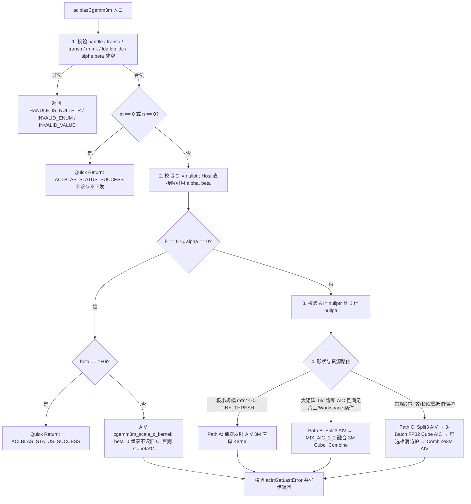

# aclblasCgemm3m 算子设计文档（Atlas A2/A3 · arch22）

- **任务名称**：11月社区任务-aclblasCgemm3m算子开发（A2A3）
- **任务链接**：https://www.hiascend.com/activities/task-center/details/cae74cb900484862a2b43b24c0f7d9d3
- **官方讨论帖**：https://gitcode.com/cann/ops-blas/discussions/93
- **目标代码仓**：https://gitcode.com/cann/ops-blas （源码核对基线：`master` @ `55ef791b77f3`）
- **代码落位**：实现 `blas/gemm/arch22/`；测试 `test/gemm/cgemm3m/arch22/`（并在 `test/gemm/cgemm3m/CMakeLists.txt` 注册 arch22 目标）
- **本文档提交路径**：`04_tasks/01_community-task-2026/tasklist/11-aclblasCgemm3m-A2A3/Kizzen983/docs/design.md`
- **提交人（报名账号）**：`Kizzen983`

> **声明**：本文档为待评审设计草稿，所有仓内现状分析均基于 `cann/ops-blas` `master` 分支源码（`55ef791b77f3`）与官方 11 月任务书及随包用例（`cgemm3m_test.csv`、`gpu_baseline.csv`、`gen_csv.py`）的直接核对。文中分块参数与路径阈值为初始设计方案，**不包含任何未实测或预填的 NPU 精度/性能数据**，实测结果将在代码开发并完成 Atlas 800T A2（910B3）真机自验后回填至验收交付件。

---

# 需求背景（required）

## 需求来源

本任务来源于 CANN 2026 年 11 月社区任务「aclblasCgemm3m 算子开发（A2A3）」。要求在昇腾 Atlas A2 / Atlas A3 系列产品（`arch22`，性能标杆测机为 Atlas 800T A2 / `Ascend910B3`，软件栈 `CANN 9.1.0`）上，基于 `cann/ops-blas` 开源仓句柄式 BLAS 接口工程与 Ascend C Kernel 直调模式，实现单精度复数（`complex64`）三乘法通用矩阵乘算子 `aclblasCgemm3m`，功能与参数语义对齐 NVIDIA cuBLAS `cublasCgemm3m`，并补齐 `arch22` 单元测试与精度/性能自验体系。

## 背景介绍

### 算子功能定位

`aclblasCgemm3m` 是 BLAS Level-3 复数单精度通用矩阵乘法（Complex GEMM）的三乘法（Gauss 3M）变体，按列主序（Column-Major）完成原地乘加更新：

$$C = \alpha \cdot \operatorname{op}(A) \cdot \operatorname{op}(B) + \beta \cdot C$$

其中 $\alpha, \beta \in \mathbb{C}$ 为 Host 侧单精度复数标量指针，$A, B, C$ 为 Device 侧单精度复数矩阵（`aclblasComplex`，实部/虚部各为 `float32` 交织存储），$\operatorname{op}(X) \in \{X, X^T, X^H\}$ 分别对应 `ACLBLAS_OP_N`、`ACLBLAS_OP_T` 与 `ACLBLAS_OP_C`。

传统 4M 复数矩阵乘需要执行 4 次实数矩阵乘；3M 算法利用代数恒等式将复数矩阵乘归约为 **3 次实数矩阵乘**，可将 Cube 矩阵乘计算量降低约 25%，代价是引入输入实/虚部线性组合与结果组合阶段的额外 Vector 计算、中间 Workspace 占用，以及与直接复数乘法不同的 FP32 中间舍入路径。

### 仓内现状分析

基于 `cann/ops-blas` `master`（`55ef791b77f3`）逐文件核对，现状与本任务落点如下：

| 维度 | 仓内现状（已核对文件与行号） | 本任务处理与关键差异 |
| --- | --- | --- |
| 公共接口声明 | `include/cann_ops_blas.h:584-587` 已声明 `aclblasCgemm3m`；`include/cann_ops_blas_common.h:20-33,57-61,77-80` 已定义 `aclblasStatus_t`、`aclblasOperation_t`、`aclblasComplex` | **只读不改**，严格复用既有声明，禁止新增私有平行 API |
| `arch35` 参考实现 | `blas/gemm/arch35/cgemm3m_host.cpp:17-23` 委托 `cgemm_host.cpp:701-730` 的 `LaunchComplexGemm(..., true)`，含 `fused`/`non-fused` 双路径与 `cgemm3m_rounding_kernel.cpp` 纠正重算；依赖 950PR SIMT/片上能力 | 仅参考其 3M 分解选择、K 分区与抵消防护思路，**不直接复制 arch35 SDK 不兼容代码**；且注意 `arch35/cgemm_host.cpp:713` 将非法枚举强转为 `INVALID_VALUE`，而 A2/A3 任务书要求返回 **`ACLBLAS_STATUS_INVALID_ENUM`** |
| `arch22` 既有同族实现 | `blas/gemm/arch22/` 现有 `gemm_*`（`aclblasSgemm`）与 `cgemm_*`（4M `aclblasCgemm`），**缺失 `aclblasCgemm3m`**。其中 `cgemm_host.cpp` 存在三点与本任务不同之处：① 通过 `CBlas3ReadScalarsFromDevice` 做 D2H 同步读标量；② `ValidateCgemmPointers` 在 `alpha==0` 前校验 `A/B` 非空；③ 为规避 `ops-blas#1077` 按 `K=1024` 切块委托 4 路 `aclblasSgemmEx` + `cgemm_accum_kernel` | 在 `blas/gemm/arch22/` 新增独立的 `cgemm3m_*` 实现（**禁止放入实数接口族 `blas/gemm3m/`**）：① `alpha`/`beta` 为 Host 指针直接解引用，保持严格异步执行；② 仅在 `m>0 && n>0 && k>0 && alpha!=0` 时要求 `A/B` 非空；③ 采用自包含原生 3M Cube/Mix 流水，避免多段 K 切块反复发射损耗性能 |
| `arch22` 共享基建 | `blas/common/helper/complex_blas3_arch22.h` 提供 `GatherMask` 解交织、`BuildInterleaveIndex` + `Gather` 重交织、Ascend C `MatmulImpl`（`CONFIG_NORM`、`SINGLE_K=8192`）范式；`complex_blas3_host_utils.h` 提供 64 位防溢出工具 `CBlas3TryMulU64`/`CBlas3TryAddU64`；`cmake/third_party/gemmex-catlass.cmake` 当前仅向 `gemm_ex/arch22/*.cpp` 注入 CATLASS 宏与头文件 | 优先采用 Ascend C 原生 `MatmulImpl` / Cube 流水以保持 `--ops=cgemm3m` 零跨目录耦合与离线构建兼容；若实测需要引入 CATLASS 模板，须严格限定在既有 pinned revision 并同步维护 CMake 作用域 |
| 构建系统约束 | `blas/CMakeLists.txt:65` 明确「arch22 设备代码不支持跨 TU 链接」；`blas/CMakeLists.txt:157` 对 `--ops=cgemm3m` 自动收集 `^cgemm3m_` 前缀源文件，但未自动拉入 `/gemm_ex/arch22/` 或 `cgemm_kernel.cpp` | `cgemm3m` 设备代码在 `blas/gemm/arch22/` 按单 TU（或各自独立可发射 kernel TU，无跨 TU device 函数链接）组织，以 `cgemm3m_` 命名，确保 `bash build.sh --ops=cgemm3m --soc=ascend910b3` 独立构建通过 |
| 测试工程 | `test/gemm/cgemm3m/CMakeLists.txt:11` 仅在 `"arch35" IN_LIST SOC_ARCH_DIRS` 时注册 `cgemm3m_test`；共享 `cgemm3m_param.h`、`cgemm3m_golden.h`、`cgemm3m_verify.h`、`cgemm3m_profile.h`（其中 `cgemm3m_profile.h:40` 拒绝非默认 `alpha`/`beta` 且不打印 `[PERF] ... avg_us=`） | 新增 `test/gemm/cgemm3m/arch22/` 并在 `test/gemm/cgemm3m/CMakeLists.txt` 放开 `arch22` 目标注册；扩展 arch22 性能采样封装以支持非默认 `alpha`/`beta` 并同时兼容 `msprof op` 与 `verify_performance.py` 交叉验证 |
| 算子文档 | `blas/gemm/README.md:956-988` 的 `### aclblasCgemm3m` 仅声明支持 Atlas 950PR / arch35 | 更新 `blas/gemm/README.md`，补充 Atlas A2/A3 支持矩阵及 `arch22` 状态码/复现说明 |

### 业界对标

- **cuBLAS `cublasCgemm3m`**：核心功能、参数序列（`handle`、操作枚举、维度、标量指针、列主序矩阵与前导维）、`OP_C` 共轭转置与 `OP_T` 转置语义、空维/`k=0`/`alpha=0`/`beta=0` 边界语义完全对齐；A100 `cublasCgemm3m` kernel-only 耗时（`gpu_baseline.csv`）作为正式性能标杆。
- **Netlib BLAS `cgemm`（Reference-LAPACK v3.10.0）**：`cblas_cgemm` 作为 CPU 侧数学语义与精度 Golden 参考基准。因 3M 分解与直接复数乘法的 FP32 舍入路径不同，不要求逐位一致，按生态算子混合容差标准（§3.2）判定。
- **有意差异说明**：cuBLAS 对非法 `transa`/`transb` 返回 `CUBLAS_STATUS_INVALID_VALUE`，而 `ops-blas` A2/A3 契约（任务书 §2.3、§2.4 及 `TC_ED_396`/`TC_ED_397`）明确要求返回 `ACLBLAS_STATUS_INVALID_ENUM`。

---

# 需求分析（required）

## 需求描述

在 `cann/ops-blas` 的 `blas/gemm/arch22/` 目录下使用 Ascend C 实现 `aclblasCgemm3m` 算子，在 `test/gemm/cgemm3m/arch22/` 补齐 GTest 与 CSV 驱动自验工程，并更新 `blas/gemm/README.md`，满足：

1. **接口完全兼容**：复用 `include/cann_ops_blas.h`（L584）既有声明，参数顺序、数据类型（`aclblasComplex` / `complex64`）、列主序前导维语义与 cuBLAS `cublasCgemm3m` 对齐。
2. **全组合与边界完备**：支持 `transa` × `transb` 共 9 种 `{N, T, C}` 组合，准确区分 `OP_C`（共轭转置）与 `OP_T`（非共轭转置）；严格按优先级执行参数与条件空指针校验；正确处理 `m=0`/`n=0`、`k=0`/`alpha=0`、`beta=0`（不读 `C` 旧值）、`ldc` padding 写保护及 Inf/NaN 传播。
3. **3M 算法核心与高精度**：所有非退化乘加路径均基于 3 次实数 FP32 矩阵乘（禁用 HF32 截断）实现复数乘积，结合大矩阵相消/极值防护策略，在 1000 条官方精度用例及补充边界单测上满足 `atol = rtol = 2^-13`、`matched_ratio >= 0.99` 且 `max_abs_error <= max(1e-2, 32 * ULP)`（实部与虚部分别达标）。
4. **高性能达标**：在 Atlas 800T A2（`Ascend910B3`）+ CANN 9.1.0 上，按 `msprof op` 采集 kernel Task Duration（warmup 5 次 + 10 次有效样本算术平均），单用例与整体平均相对 A100 `gpu_ms` 均满足 `ratio = gpu_ms / npu_ms >= 0.8`（即 `npu_ms <= 1.25 * gpu_ms`）。
5. **工程与代码规范**：严格遵守 `ops-blas` 编码规范（无硬编码核数、局部 `TPipe`、64 位防溢出尺寸计算、不污染 `arch35` 与 `blas/gemm3m/`、单算子 `--ops=cgemm3m` 可独立编译运行）。

## 需求拆解

| 编号 | 子需求 | 对应设计章节 |
| --- | --- | --- |
| R1 | 公共接口复用、参数与条件空指针校验顺序、状态码语义（含 `INVALID_ENUM`） | 详细设计 → 接口规格、Host 侧参数校验 |
| R2 | 3M 复数乘法数学分解（标准非融合路径 + 融合路径）与共轭符号折叠 | 详细设计 → 数学公式与路径选择 |
| R3 | Host 侧动态核数查询、64 位溢出保护 Workspace 规划与多路径调度路由 | 详细设计 → Host 侧设计 |
| R4 | 192 KiB AIV UB 预算内的 Split3 / Combine3M / ScaleC Kernel 与 `ldc` padding 保护 | 详细设计 → Kernel 侧设计 |
| R5 | 高吞吐 3-Batch Cube（AIC）与 `MIX_AIC_1_2` 融合流水、Swizzle 调度及小矩阵单发射快路径 | 详细设计 → 分核/分块与性能优化 |
| R6 | 禁用 HF32、极值溢出分析及长 K 大幅相消（Catastrophic Cancellation）精度保护 | 详细设计 → 数值精度与稳定性设计 |
| R7 | `blas/gemm/arch22/`、`test/gemm/cgemm3m/arch22/`、`CMakeLists.txt` 及 README 工程接入 | 详细设计 → 工程落位与构建兼容性 |
| R8 | 1000 精度 + 200 性能双口径（`msprof op` 主判据 + `aclrtEvent` 交叉验证）自验与用例包差异核查 | 可维可测分析 |

---

# 详细设计（required）

## 算子分析

### 函数原型（复用 `include/cann_ops_blas.h:584-587`，只读不改）

```cpp
aclblasStatus_t aclblasCgemm3m(
    aclblasHandle_t handle,
    aclblasOperation_t transa,
    aclblasOperation_t transb,
    int m, int n, int k,
    const aclblasComplex* alpha,
    const aclblasComplex* A, int lda,
    const aclblasComplex* B, int ldb,
    const aclblasComplex* beta,
    aclblasComplex* C, int ldc);
```

### 参数与数据类型规格

| 参数名 | 方向/属性 | 内存域 | 数据类型 | 逻辑/物理形状 | 合法域与异常返回码 |
| --- | --- | --- | --- | --- | --- |
| `handle` | 输入 | Host | `aclblasHandle_t` | 标量句柄（携带 stream 与 workspace） | `nullptr` → `ACLBLAS_STATUS_HANDLE_IS_NULLPTR` |
| `transa` | 属性 | Host | `aclblasOperation_t` | `{ACLBLAS_OP_N, ACLBLAS_OP_T, ACLBLAS_OP_C}` | 枚举越界 → **`ACLBLAS_STATUS_INVALID_ENUM`** |
| `transb` | 属性 | Host | `aclblasOperation_t` | `{ACLBLAS_OP_N, ACLBLAS_OP_T, ACLBLAS_OP_C}` | 枚举越界 → **`ACLBLAS_STATUS_INVALID_ENUM`** |
| `m`, `n`, `k` | 属性 | Host | `int` | $\operatorname{op}(A)\in\mathbb{C}^{m\times k}$，$\operatorname{op}(B)\in\mathbb{C}^{k\times n}$，$C\in\mathbb{C}^{m\times n}$ | 任一 $< 0$ → `ACLBLAS_STATUS_INVALID_VALUE`；`m=0` 或 `n=0` 为合法 no-op |
| `alpha` | 输入标量 | **Host** | `const aclblasComplex*` | 标量（实/虚部各 `float32`） | `nullptr` → `ACLBLAS_STATUS_INVALID_VALUE` |
| `A` | 输入矩阵 | Device | `const aclblasComplex*` | 列主序，物理 `lda × k`（N）或 `lda × m`（T/C） | 仅在 `m>0 && n>0 && k>0 && alpha!=0` 时 `nullptr` → `ACLBLAS_STATUS_INVALID_VALUE` |
| `lda` | 属性 | Host | `int` | $A$ 的前导维 | `transa==N` 需 `lda >= max(1, m)`，否则 `lda >= max(1, k)`；违例 → `INVALID_VALUE` |
| `B` | 输入矩阵 | Device | `const aclblasComplex*` | 列主序，物理 `ldb × n`（N）或 `ldb × k`（T/C） | 仅在 `m>0 && n>0 && k>0 && alpha!=0` 时 `nullptr` → `ACLBLAS_STATUS_INVALID_VALUE` |
| `ldb` | 属性 | Host | `int` | $B$ 的前导维 | `transb==N` 需 `ldb >= max(1, k)`，否则 `ldb >= max(1, n)`；违例 → `INVALID_VALUE` |
| `beta` | 输入标量 | **Host** | `const aclblasComplex*` | 标量（实/虚部各 `float32`） | `nullptr` → `ACLBLAS_STATUS_INVALID_VALUE` |
| `C` | 原地输入/输出 | Device | `aclblasComplex*` | 列主序，物理 `ldc × n` | 仅在 `m>0 && n>0` 时 `nullptr` → `ACLBLAS_STATUS_INVALID_VALUE`；`beta=0` 不读旧值 |
| `ldc` | 属性 | Host | `int` | $C$ 的前导维 | `ldc >= max(1, m)`；违例 → `INVALID_VALUE`；`row >= m` 的 padding 区域严禁改写 |

### 数学公式与 3M 分解

设物理存储矩阵 $A = A_r^{\text{raw}} + i A_i^{\text{raw}}$、$B = B_r^{\text{raw}} + i B_i^{\text{raw}}$。记共轭符号因子：

$$s_a = \begin{cases} -1, & \text{transa} = \text{ACLBLAS\_OP\_C} \\ +1, & \text{otherwise} \end{cases}, \qquad s_b = \begin{cases} -1, & \text{transb} = \text{ACLBLAS\_OP\_C} \\ +1, & \text{otherwise} \end{cases}$$

在 Phase 0 拆分阶段直接将共轭符号折叠入虚部平面：$A_r = A_r^{\text{raw}}$、$A_i = s_a A_i^{\text{raw}}$、$B_r = B_r^{\text{raw}}$、$B_i = s_b B_i^{\text{raw}}$，从而后续所有 Cube 实数矩阵乘只需处理纯实数转置标志 $\text{ta}, \text{tb} \in \{\text{N}, \text{T}\}$。

本设计依据形状与片上容量支持任务书 §2.1 定义的两条代数等价 3M 路径：

1. **标准非融合 3M 路径（默认通用路径，支持任意 `alpha`/`beta`、任意形状与长 K 分区）**：
   构造辅助和平面 $A_s = A_r + A_i$、$B_s = B_r + B_i$，执行 3 次实数 FP32 矩阵乘：
   $$P_0 = \operatorname{op}(A_r)\operatorname{op}(B_r), \quad P_1 = \operatorname{op}(A_i)\operatorname{op}(B_i), \quad P_2 = \operatorname{op}(A_s)\operatorname{op}(B_s)$$
   复数乘积与最终回写为：
   $$R_{\text{re}} = P_0 - P_1, \qquad R_{\text{im}} = P_2 - P_0 - P_1$$
   $$C_{\text{re}} \leftarrow (\alpha_r R_{\text{re}} - \alpha_i R_{\text{im}}) + (\beta_r C_{\text{re}}^{\text{old}} - \beta_i C_{\text{im}}^{\text{old}})$$
   $$C_{\text{im}} \leftarrow (\alpha_r R_{\text{im}} + \alpha_i R_{\text{re}}) + (\beta_r C_{\text{im}}^{\text{old}} + \beta_i C_{\text{re}}^{\text{old}})$$

2. **融合 3M 路径（面向大尺寸高吞吐的 `MIX_AIC_1_2` 可选路径）**：
   构造 $A_s = A_r + A_i$、$B_d = B_i - B_r$、$B_s = B_r + B_i$，对每个输出 Tile 在片上依次产出：
   $$P_0 = \operatorname{op}(A_s)\operatorname{op}(B_r), \quad P_1 = \operatorname{op}(A_r)\operatorname{op}(B_d), \quad P_2 = \operatorname{op}(A_i)\operatorname{op}(B_s)$$
   复数乘积组合为：
   $$R_{\text{re}} = P_0 - P_2, \qquad R_{\text{im}} = P_0 + P_1$$
   该公式使每项仅需一次加减即可得到实部/虚部，且 1 个 AIC 产出 Tile 后可直接经片上同步交由配对 2 个 AIV 完成组合与回写，消除 3 份 $m \times n$ 中间乘积矩阵的全局 GM 落盘与二次回读流量。

> **舍入语义说明**：两条 3M 路径代数等价，但中间项 $A_r+A_i$、$B_r\pm B_i$ 的 FP32 舍入行为互不相同，且均不同于直接 4M 复数乘法。因此路径选择仅依赖输入形状、标量形态及片上容量，不依赖用例名或随机种子，且两条路径各自独立满足 §3.2 精度门限。

## 算子实现

### 总体执行流程



### 3.2.1 Host 侧设计

#### 1. 参数校验顺序与异步标量读取

校验逻辑拆分为 `ValidateCgemm3mStructParams` 与 `ValidateCgemm3mMatrixPointers`，严格按以下次序执行（任何结构错误都不被 `m=0`/`n=0` 掩盖）：

1. `handle == nullptr` → `ACLBLAS_STATUS_HANDLE_IS_NULLPTR`；
2. `transa` 或 `transb` 不在 `{ACLBLAS_OP_N, ACLBLAS_OP_T, ACLBLAS_OP_C}` → **`ACLBLAS_STATUS_INVALID_ENUM`**（注意不复制 `arch35/cgemm_host.cpp:713` 的 `INVALID_VALUE` 降级）；
3. `m < 0 || n < 0 || k < 0` → `ACLBLAS_STATUS_INVALID_VALUE`；
4. `lda < max(1, transa==N ? m : k)` 或 `ldb < max(1, transb==N ? k : n)` 或 `ldc < max(1, m)` → `ACLBLAS_STATUS_INVALID_VALUE`；
5. `alpha == nullptr || beta == nullptr` → `ACLBLAS_STATUS_INVALID_VALUE`；
6. 若 `m == 0 || n == 0` → 直接返回 `ACLBLAS_STATUS_SUCCESS`（不引用 `A`/`B`/`C`，不启动 kernel）；
7. `C == nullptr` → `ACLBLAS_STATUS_INVALID_VALUE`；
8. Host 侧直接读取 `const aclblasComplex alphaVal = *alpha; const aclblasComplex betaVal = *beta;`（遵循任务书 §2.4 Host pointer mode 约定，**不调用 `CBlas3ReadScalarsFromDevice`，不插入 `aclrtSynchronizeStream`**，满足 §2.5 异步执行约束）；
9. 若 `k == 0 || (alphaVal.real == 0.0f && alphaVal.imag == 0.0f)` → 允许 `A`/`B` 为 `nullptr`；若 `betaVal == (1, 0)` 直接返回 `SUCCESS`，否则仅启动 `cgemm3m_scale_c_do`；
10. 否则校验 `A == nullptr || B == nullptr` → `ACLBLAS_STATUS_INVALID_VALUE`。

#### 2. 平台查询、动态核数与 64 位防溢出 Workspace 规划

- **动态硬件查询**：通过 `GetAicCoreCount()`、`GetAivCoreCount()` 与 `platform_ascendc::PlatformAscendCManager::GetInstance()->GetCoreMemSize(UB, ubBytes)` 动态获取核数与 UB 容量（查询为 0 返回 `ACLBLAS_STATUS_INTERNAL_ERROR`），严禁硬编码 20/40 等固定核数。
- **Packed 平面与 64 位安全算术**：所有字节与元素计数使用 `uint64_t` 配合 `CBlas3TryMulU64` / `CBlas3TryAddU64` / `CBlas3TryAlignGm`（`512 B` 区域基址对齐），杜绝 `int32` 乘法回绕。
  - $A$ 物理维度 $(a_{\text{rows}}, a_{\text{cols}}) = (\text{transa==N} ? m : k,\; \text{transa==N} ? k : m)$，packed 前导维 `ldA_p = AlignUp(a_rows, 16)`（64 B 对齐，消除 Cube MTE2 非对齐突发与 Bank 冲突）。
  - $B$ 物理维度 $(b_{\text{rows}}, b_{\text{cols}}) = (\text{transb==N} ? k : n,\; \text{transb==N} ? n : k)$，packed 前导维 `ldB_p = AlignUp(b_rows, 16)`。
  - 中间乘积 $P_0, P_1, P_2$ 前导维 `ldP = AlignUp(m, 16)`（16 float = 64 B，满足 Cube Fixpipe 连续写回对齐）。
- **Workspace 内存布局与 4096³ 预算估算**（通过 `EnsureDefaultWorkspace(h, totalBytes)` 复用 handle 托管工作区，避免调用内 `aclrtMalloc/Free` 引入同步抖动）：
  - **分离路径（Path C）**：`[Ar, Ai, As]`（$3 \cdot \text{ldA\_p} \cdot a_{\text{cols}}$）+ `[Br, Bi, Bs]`（$3 \cdot \text{ldB\_p} \cdot b_{\text{cols}}$）+ `[P0, P1, P2]`（$3 \cdot k_{\text{parts}} \cdot \text{ldP} \cdot n$）。以 `4096 × 4096 × 4096`（$k_{\text{parts}}=1$）为例：
    - $A$ 三平面：$3 \times 4096^2 \times 4\text{ B} = 192\text{ MiB}$；
    - $B$ 三平面：$3 \times 4096^2 \times 4\text{ B} = 192\text{ MiB}$；
    - $P_0, P_1, P_2$：$3 \times 4096^2 \times 4\text{ B} = 192\text{ MiB}$；
    - 合计 **$576\text{ MiB}$**，远低于 `ACLBLAS_MAX_WORKSPACE_SIZE`（2 GiB 级上限）。
  - **融合路径（Path B，`MIX_AIC_1_2`）**：无需全局 $P_0, P_1, P_2$ 整矩阵缓冲（仅需按 AIC 核数分配小块 Tile 交换区 `aicCores * 3 * TM * TN * 4 B`，如 $20 \times 3 \times 128 \times 128 \times 4\text{ B} \approx 3.75\text{ MiB}$），4096³ 总 Workspace 降至约 **$388\text{ MiB}$**，同时省去 $384\text{ MiB}$ 的 $P_0/P_1/P_2$ 全局读写流量。
  - 若极端大维度导致总需求超过 `ACLBLAS_MAX_WORKSPACE_SIZE`，返回 `ACLBLAS_STATUS_ALLOC_FAILED`（或按任务书约束退回分段策略，不在超限时静默截断）。

#### 3. 分核策略、Tiling 与路径路由规划

基于 `gpu_baseline.csv` 200 条用例的形状分布（从 `1×1×1` 的 `7.88 μs` 到 `4096³` 的 `22.04 ms`，以及 `4096×64×64`、`64×64×4096`、`4095³` 等瘦长与奇数尾块），Host 侧按运行时 `(m, n, k)` 与核数自适应选择路径与分块：

| 路径 | 路由条件（初始设计，实测微调） | 核类型与发射次数 | 核心动机 |
| --- | --- | --- | --- |
| **Path 0（ScaleC / No-op）** | `k == 0 \|\| alpha == (0,0)` | 0 次（`beta==1`）或 1 次 AIV | 严格遵循不引用 `A`/`B` 语义，免 Workspace |
| **Path A（Tiny-Shape 直算）** | `m*n*k <= TINY_VOL` 且 `m, n <= 64`（如 `1×1×1` ~ `32×32×32`） | **1 次 AIV**（无 Split/Combine 拆分） | 消除 3 次 kernel 发射开销，对齐 `gpu_baseline` `7.9~14 μs` 发射地板区 |
| **Path B（融合 3M `MIX_AIC_1_2`）** | 中大矩阵，输出 Tile 数 `ceil(m/TM)*ceil(n/TN) >= aicCores`，`kParts == 1` 且未触发全局重算保护 | **2 次**（`Split3` AIV + `MixCube3Combine` 1:2 融合） | 4096³ 级主攻路径：消除 $P_0/P_1/P_2$ 全局 GM 写回与重读，降低 HBM 带宽压力 |
| **Path C（分离 3M + 可选 Split-K）** | 其余中小方阵、瘦长高 K 矩阵（如 `64×64×4096` 需 `kParts > 1` 喂满 AIC）、或启用相消保护的大矩阵 | **3 次**（`Split3` + `Cube3` + `Combine3M`，必要时含轻量筛选/重算） | 3 个产品 × `kParts` × 输出 Tile 联合并行，最大化瘦长/中小矩阵核利用率 |

**Cube 分块（`<TM, TN, TK>`）与 L2 调度策略**：
- **列主序映射**：利用 $(C)^T = \operatorname{op}(B)^T \operatorname{op}(A)^T$ 等价关系，把列主序 $(m \times n)$ 问题自然映射到 Ascend C / Cube 原生行主序输出，使 `Fixpipe` 按列连续写回 `ldP` / `ldc`。
- **Shape 自适应 Cube Tile 族**：
  - 瘦长边界矩阵（`m <= 32` 或 `n <= 32`）：优先选用细粒度输出 Tile（如 `32×64` / `64×32` / `64×64`）配合较大 `TK`（或 `Split-K`），增加有效 AIC 任务数；
  - 中等矩阵（`m, n <= 512`）：`64×128×64` 或 `128×128×64`；
  - 大尺寸主力矩阵（`1024³` ~ `4096³`、`4095³`）：`128×128×64` 或 `128×256×64`（确保双缓冲 L0A/L0B/L0C 满足 Atlas A2 片上容量：L0C 128 KiB 容纳 `128×128×4 B = 64 KiB` × 2 ping-pong）。
- **Swizzle Tile 排布**：采用 2D Swizzle（初始窗口 `swizzle = 4`）遍历 `(mTile, nTile)`，相邻 AIC 核共享同一 $A$ 行块或 $B$ 列块，显著提高 L2 Cache 命中率。
- **3-Batch 联合调度**：在单个 AIC Kernel 内统一调度 `(batch ∈ {0,1,2}, mTile, nTile, kPart)` 四维任务空间，只需 **1 次 AIC 发射**即可完成 $P_0, P_1, P_2$ 全部计算，相比循环调用 3 次 `aclblasSgemm` 减少 2 次发射延迟与核间尾浪空泡。

### 3.2.2 Kernel 侧设计

> **arch22 UB 硬约束**：Atlas A2/A3 单 AIV 核 UB 可用预算严格按 **192 KiB** 核算（同仓内 `blas/axpy/arch22/caxpy_kernel.cpp` 与 `blas/gemm/arch22/cgemm_kernel.cpp` 约定，不沿用 `kernel_constant.h` 的 `248 KiB` 950 常量），且所有 `TPipe` 均为 kernel 入口局部变量。

#### 1. Phase 0：`cgemm3m_split3_kernel`（`KERNEL_TYPE_AIV_ONLY`）

将列主序交织输入矩阵 $X \in \{A, B\}$ 单趟读取并拆分为 3 个 64 B 列对齐实数平面（标准路径输出 `[Xr, Xi, Xr+Xi]`；融合路径按需对 $B$ 输出 `[Br, Bi-Br, Br+Bi]`）：

- **分核**：按列轮转分配 `for (col = blockIdx; col < cols; col += blockDim)`；列数少于核数且行数很大时按 `(col, rowChunk)` 二维展开避免核空闲。
- **计算流程**：
  1. `DataCopyPad` 从 GM 搬入当前列块 `len` 个复数（`2 * len` 个 `float`）至 UB `stage`（按真实字节数精确搬运，安全跨越 `lda`/`ldb` padding 且无尾块越界）；
  2. `GatherMask`（pattern `1` / `2`）分离实部 `re` 与虚部 `im`；
  3. 若该操作数为 `ACLBLAS_OP_C`，对 `im` 执行向量 `Muls(im, im, -1.0f, len)` 折叠共轭符号；
  4. 向量 `Add(aux, re, im, len)`（融合路径对 $B$ 额外 `Sub(diff, im, re, len)`）构造和/差平面；
  5. `DataCopyPad` 连续写回 `Xr`、`Xi`、`Xs`（对齐后每列偏移 `col * packedLd`，尾部对齐空隙写 0 防止未初始化脏值污染 Cube 边界加载）。
- **UB 预算核算**（双缓冲 ping-pong，`CHUNK = 2048` 复数 = `32 × 64` 满足 256 B repeat 整倍数）：
  - `stage`（交织输入）：`2048 × 2 × 4 B × 2` = `32 KiB`
  - `re` / `im` / `aux`（三平面，融合 $B$ 加 `diff` 共 4 平面）：`2048 × 4 B × 4 × 2` = `64 KiB`
  - 总占用 **`96 KiB ≤ 192 KiB`**（留足安全余量，且 `2048 × 8 B / 256 B = 64 repeats < 255` 指令上限）。

#### 2. Phase 1：`cgemm3m_cube3_kernel`（`KERNEL_TYPE_AIC_ONLY`）与 `cgemm3m_mix_cube3_combine_kernel`（`KERNEL_TYPE_MIX_AIC_1_2`）

- **纯 FP32 精度模式**：在 Cube 矩阵乘配置中显式关闭 HF32/TF32 尾数截断（严格 IEEE FP32 输入与 FP32 L0C 累加），避免 HF32 10-bit 尾数导致大矩阵误差超出 `2^-13` 容限。
- **分离路径（`KERNEL_TYPE_AIC_ONLY`）**：
  - 使用 Ascend C `MatmulImpl`（`CONFIG_NORM` + 静态/运行时 `SetOrgShape`、`SetSingleShape`）或经核验的 Cube 流水，按 `(batch, mTile, nTile, kPart)` 静态均衡派发；
  - 对 4 种实数转置组合 `(NN, NT, TN, TT)` 模板特化，避免热循环内分支；
  - `kParts == 1` 时直接覆写 $P_b$ 对应槽位；`kParts > 1` 时各分段独立写入 `[kPart][ldP * n]` 私有区，由 Phase 2 按固定 `kPart = 0..kParts-1` 顺序规约（**禁止无序 GM AtomicAdd**，既规避跨核原子争用，又保证可复现的归约顺序）。
- **融合路径（`KERNEL_TYPE_MIX_AIC_1_2`）**：
  - 1 个 AIC 核依次完成同一输出 Tile `(mTile, nTile)` 的 $P_0, P_1, P_2$ 计算并写出至该 AIC 专属的片上/Workspace Ping-Pong Tile 缓冲，随后触发 `CrossCoreSetFlag<2, PIPE_FIX>`；
  - 配对的 2 个 AIV 子核（`GetSubBlockIdx() ∈ {0, 1}`）等待 `CrossCoreWaitFlag<2, PIPE_MTE2>`，按列对半分担该 Tile，直接从 Tile 缓冲完成 `Re = P0 - P2`、`Im = P0 + P1`、`alpha/beta` 缩放与交织回写 `C`，完成后反向发信号释放 Tile 槽位。

#### 3. Phase 2：`cgemm3m_combine3m_kernel` & `cgemm3m_scale_c_kernel`（`KERNEL_TYPE_AIV_ONLY`）

参考 `blas/gemm/arch22/cgemm_kernel.cpp:136-237` 的验证范式并扩展至 3M 组合：

- **3M 实/虚部还原**：
  - 当 `hasTemp != 0`：读取 $P_0, P_1, P_2$（若 `kParts > 1` 先按固定次序逐段累加），计算 `re = P0 - P1`、`im = (P2 - P0) - P1`（融合路径对应 `P0 - P2` 与 `P0 + P1`）。
- **零分量短路防 `0 * Inf -> NaN`**（关键数值保护）：
  - 应用复数 $\alpha$：仅在 `alphaRe != 0.0f` 时乘以 `alphaRe`，仅在 `alphaIm != 0.0f` 时乘以 `alphaIm`；同理对 $\beta$ 按 `betaRe != 0.0f` / `betaIm != 0.0f` 分别条件执行。防止某一乘积或 `C` 分量为 `Inf` 时被零分量乘出错误 `NaN`。
- **`beta == 0` 严格不读 `C` 旧值**：
  - 当 `betaRe == 0.0f && betaIm == 0.0f` 时，跳过 `cGm` 的 MTE2 搬入，直接覆盖写回，确保 `C` 含未初始化值或 `NaN`（如 L6 边界用例）时结果完全正确。
- **交织与 `ldc` Padding 写保护**：
  - 复用 `cblas3::BuildInterleaveIndex` 在核初始化阶段用整型向量指令一次性生成字节索引表（避免 FP32 索引精度上限与 Host 传表开销），每块经 `Gather` 交织 `[cr | ci]` 至 `stage`；
  - 使用 `DataCopyPad` 按精确字节数 `len * 2 * sizeof(float)` 仅写回 `row ∈ [0, m)`，**绝不触碰 `row ∈ [m, ldc)` 的 padding 哨兵区域**。
- **UB 预算核算**（`COMBINE_CHUNK = 1024` 复数 = `16 × 64` 满足 256 B repeat 整倍数，单缓冲 / 双缓冲可配置）：
  - `p0` / `p1` / `p2`：`3 × 1024 × 4 B = 12 KiB`
  - `crci`（`[cr | ci]`）：`2048 × 4 B = 8 KiB`
  - `tmpA` / `tmpB`：`2 × 1024 × 4 B = 8 KiB`
  - `stage`（交织读/写区）：`2048 × 4 B = 8 KiB`
  - `idx` + `aux0`/`aux1`（初始化后 `aux0`/`aux1` 可复用或释放）：`3 × 2048 × 4 B = 24 KiB`
  - 合计单缓冲约 **`60 KiB`**（启用双缓冲亦仅 **`~104 KiB ≤ 192 KiB`**），充裕且安全。

#### 4. Path A：`cgemm3m_tiny_direct_kernel`（极小规模单发射路径）

针对 `m, n, k` 极小（如 `gpu_baseline.csv` 中 `1×1×1` 至 `32×32×32`，GPU kernel 耗时 `7.88 ~ 13.62 μs`）的用例，单次发射 1 个 AIV Kernel，直接将 $A, B$ 搬入 UB，在片上完成解交织、3M 实数乘加（$P_0, P_1, P_2$）、`alpha/beta` 缩放与 `C` 回写，零 Workspace、单次 Launch，将微秒级小矩阵耗时压至接近单核发射下限。

#### 5. 数值精度、极值溢出与大幅相消防护设计

1. **禁用 HF32**：Cube 侧强制 IEEE FP32 计算，消除 HF32 10-bit 尾数带来的系统性相对误差（$> 2^{-10}$，直接突破 `2^-13` 标准）。
2. **3M 大幅相消（Catastrophic Cancellation）风险评估与分级防护**：
   - 在 3M 公式 $\operatorname{Im} = (A_r+A_i)(B_r+B_i) - A_r B_r - A_i B_i$ 中，当 $|A_r B_r| + |A_i B_i| \gg |A_r B_i + A_i B_r|$ 或长 K 正负分段抵消（如 `SegmentCancellation`）时，中间和 $P_2 - P_0 - P_1$ 可能损失有效尾数。
   - **防护策略**：
     - 常规长 K 场景：通过合理的 K 分段树归约缩短单链 FP32 累加长度；
     - 高风险大矩阵场景（如 $m, n, k \ge 1536$）：可在编码实测阶段按需启用两级轻量 AIV 防护（参考 `arch35/cgemm3m_rounding_kernel.cpp` 的能量筛查思想，适配 `arch22` 向量指令）：① 统计 $\operatorname{op}(A)$ 行能量与 $\operatorname{op}(B)$ 列能量；② 向量筛出满足能量与输出幅值比超过安全阈值的极少数高风险坐标，仅对命中坐标执行 Double-Double（`TwoSum`/`TwoProd`）或精确 4M 补偿重算，对正常随机输入零命中、额外开销可忽略。最终是否常开及阈值由 910B3 全量 1000 条 + `SegmentCancellation` 实测决定。
3. **极端值（`RANDOM_EXTREME` / 接近 `FLT_MAX`）溢出分析**：
   - 3M 的和平面 $A_s = A_r + A_i$ 在 $|A_r|, |A_i| > \text{FLT\_MAX}/2$ 时可能提前溢出为 `Inf`，进而在 $P_2 - P_0 - P_1$ 中产生 `Inf - Inf = NaN`。
   - 编码阶段将针对 `TC_FL_*` 中的 `RANDOM_EXTREME` 用例进行实测验证；必要时借鉴仓内 `complex_blas3_host_utils.h:104-106` 的 $2^{-8}$ / $2^{+8}$ 精确 2 的幂次缩放（不引入额外尾数舍入），或对含极值特征的异常分量做安全边界验证并如实记录在自测报告中。

### 工程落位与构建集成

严格遵守任务书 §2.2 目录约定（**严禁放入实数接口族 `blas/gemm3m/`**）：

```text
ops-blas/
├── include/
│   └── cann_ops_blas.h                     # [只读不改] L584 已有 aclblasCgemm3m 声明
├── blas/
│   ├── CMakeLists.txt                      # 核验 --ops=cgemm3m 收集 blas/gemm/arch22/cgemm3m_*.cpp
│   └── gemm/
│       ├── README.md                       # [更新] aclblasCgemm3m 章节补充 Atlas A2/A3 支持说明
│       └── arch22/
│           ├── cgemm3m_host.cpp            # [新增] 入口、参数校验、Workspace 规划、路由与发射
│           ├── cgemm3m_tiling_data.h       # [新增] Host/Device 共享唯一 Tiling 定义（#pragma once）
│           ├── cgemm3m_kernel.h            # [新增] Kernel launcher 声明（带 GM_ADDR 保护）
│           ├── cgemm3m_kernel.cpp          # [新增] AIV Kernel（Split3 / Combine3M / ScaleC / TinyDirect）
│           └── cgemm3m_cube3_kernel.cpp    # [新增] AIC / MIX_AIC_1_2 3-Batch Cube Kernel（独立可发射 TU，无跨 TU 设备符号链接）
└── test/
    └── gemm/
        └── cgemm3m/
            ├── CMakeLists.txt              # [更新] 允许 "arch22" IN_LIST SOC_ARCH_DIRS 注册 cgemm3m_test
            ├── cgemm3m_param.h             # [复用/微调] 兼容短枚举 N/T/C 映射校验
            ├── cgemm3m_golden.h            # [复用] Netlib cblas_cgemm + k=0/alpha=0 分支
            ├── cgemm3m_verify.h            # [复用] 实部/虚部分离混合容差 + padding 哨兵校验
            └── arch22/
                ├── cgemm3m_npu_wrapper.h   # [新增] A2/A3 Device 缓冲与流同步封装
                ├── cgemm3m_perf_arch22.h   # [新增] 支持非默认 alpha/beta 的 msprof 与 aclrtEvent [PERF] 采样
                ├── cgemm3m_test.cpp        # [新增] GTest 主工程（CSV 驱动 + 补充边界/契约单测）
                ├── cgemm3m_test.csv        # [新增] 官方 1200 条用例
                ├── gpu_baseline.csv        # [新增] 官方 200 条 A100 基线
                └── README.md               # [新增] 910B3 构建、Netlib 3.10.0 复现与 msprof 采样步骤
```

> **单 TU 与 `--ops=cgemm3m` 构建核验**：`blas/CMakeLists.txt:157` 通过 `_src_name MATCHES "^${_test_name}_"` 过滤单算子源码，因此所有新增 `.cpp` 统一以 `cgemm3m_` 为前缀即可自动纳入 `bash build.sh --ops=cgemm3m --soc=ascend910b3`，无需改动其他算子；且 AIV TU 与 AIC/MIX TU 之间通过 Host 侧 launcher 衔接，不存在跨 TU `__aicore__` 设备函数链接，完全符合 `blas/CMakeLists.txt:65` 的 arch22 约束。

## 支持硬件

| 支持的芯片版本 | 架构目录 | 涉及勾选 | 说明 |
| --- | --- | --- | --- |
| Atlas 800T A2（Ascend 910B 系列，性能测机 `ascend910b3`） | `arch22` | √ | 精度与性能正式验收平台（CANN 9.1.0） |
| Atlas 800T A3（`ascend910_93`） | `arch22` | √ | 同 `arch22` 代码适配与构建支持（自验覆盖其一，按任务书 §3.1 性能优先 910B3） |
| Atlas 950PR（`arch35`） | `arch35` | 不涉及 | 仓内已有独立实现，本任务**不修改 `arch35` 任何源码与测试** |

## 算子约束限制（逐项对齐任务书 §2.5）

| 约束项 | 任务书要求与本设计落实 |
| --- | --- |
| 参数合法性与校验层级 | Host 入口严格按 §2.4 顺序校验 `handle`、`transa`/`transb`、`m`/`n`/`k`、`lda`/`ldb`/`ldc`、`alpha`/`beta` 及条件 `A`/`B`/`C` 指针；不对 Device 张量做元素级扫描，不做 Host 侧数值回退 |
| 非连续 Tensor 支持 | 按 `lda`/`ldb`/`ldc` 描述的带填充列主序矩阵访问；不支持任意步长非连续 Tensor，不使用 AutoContiguous/ViewCopy |
| broadcast 规则 | 不支持；`A`/`B`/`C` 为独立矩阵，不做广播 |
| dynamic shape 要求 | 不涉及图模式 dynamic shape；`m`/`n`/`k`/`lda`/`ldb`/`ldc`/`transa`/`transb` 均为运行时参数，每次调用由 Host 实时计算 tiling 与路由 |
| 原地与视图语义 | `C` 为原地覆写输出，不返回视图；调用方保证 `C` 与 `A`/`B` 内存不重叠；仅写逻辑 `m × n` 区域，严禁修改 `ldc` padding 区域 |
| 确定性计算要求 | 任务书不强制跨路径逐位一致；本设计因不使用无序跨核原子加且采用固定归约顺序，天然保证同输入同配置下的可复现性 |
| 空 Tensor 处理 | 结构合法校验通过后，`m == 0 \|\| n == 0` 直接返回 `ACLBLAS_STATUS_SUCCESS`（允许 `A`/`B`/`C` 为 `nullptr`，不启动 kernel）；`k == 0 \|\| alpha == (0,0)` 允许 `A`/`B` 为 `nullptr`，`m>0 && n>0` 时 `C` 必须非空，仅执行 `C = beta * C` |
| 0 维 Tensor 处理 | 不涉及；矩阵通过指针 + 维度/前导维传入，`alpha`/`beta` 为 Host 侧标量指针 |
| 异步执行 | 严格提交至 `handle` 绑定的 `aclrtStream`，Host 侧直接解引用 `alpha`/`beta`，**不插入 `aclrtSynchronizeStream`**；调用方在读回 Device 结果前自行同步流 |

---

# 可维可测分析

## 精度标准 / 性能标准

| 验收维度 | 正式标准与执行口径 | 标准来源 |
| --- | --- | --- |
| **精度标准** | 实部、虚部分别按 `FLOAT32` 生态混合容差标准独立比对：<br>• 逐元素匹配：`\|actual - golden\| <= atol + rtol * \|golden\|`，其中 `atol = rtol = 2^-13 ≈ 1.2207e-4`；<br>• 用例通过：`matched_ratio >= 0.99` **且** `max_abs_error <= max(1e-2, 32 * ULP)`（ULP 按最大误差点的 golden 值计算）；<br>• 非有限值：同为 NaN、同号 Inf，或一方 NaN 另一方 ±Inf 视作等效，有限与非有限不等效；<br>• `ldc` padding 区域逐字节不变；<br>• Golden 基准：独立编译链接 **Netlib Reference-LAPACK v3.10.0**（`libcblas.so` + `libblas.so`，禁用 fast-math，不以 OpenBLAS 替代验收）；按任务书 §3.2 同步记录 FP64 累加诊断对照并在自测报告中说明差异；<br>• 不以 CSV 中旧框架的 `mere_threshold`/`mare_multiplier` 替代生态精度标准 | 任务书 §3.2、`test_cases/README.md`、opbase `mixed_tolerance_standard.md` |
| **性能标准（正式判据）** | • 测试设备：Atlas 800T A2（`Ascend910B3`），CANN 9.1.0；<br>• 采集方式：使用 `msprof op` 采集单次 API 下发对应的 **NPU kernel Task Duration（μs）**（多 kernel 路径将同一次 API 调用内所有关联 kernel（Split + Cube + Combine + 可选保护）的 Task Duration 求和作为该次调用的 kernel 耗时，再转 ms 与 `gpu_ms` 比较）；<br>• 采样口径：warmup 5 次不计入，后续连续 10 次返回 `SUCCESS` 的有效样本取算术平均（异常样本不计入并在报告中说明）；<br>• 达标阈值：对标 A100 `cublasCgemm3m` kernel-only 耗时 `gpu_baseline.csv` 的 `gpu_ms`，要求单用例 `npu_ms <= gpu_ms / 0.8`（即 `ratio >= 0.8`）且全部有效用例平均倍率 `>= 0.8` | 任务书 §3.3、`test_cases/README.md` |
| **性能交叉验证（辅助）** | GTest 在预置 Device 缓冲上 warmup 5 次 + `aclrtEvent` 夹住连续 10 次下发取平均，打印 `[PERF] case=<case_name> ... avg_us=<数值>` 供 `verify_performance.py` 回归对照；**不替代 `msprof op` 正式判据** | 任务书 §3.3、`verify_performance.py` |
| **内存标准** | 任务书 §3.4 明确**不涉及**；提交 `task_submission` 交付件时按模板保留内存报告/日志并标注 N/A 及原因，不伪造数据 | 任务书 §3.4、§4 |

### A100 性能标杆锚点（摘自随包 `gpu_baseline.csv`）

| 代表用例（`gpu_baseline.csv`） | `transa`/`transb` | `(m, n, k)` | `alpha` / `beta` | A100 `gpu_ms` | 910B3 0.8× 目标上限 (`1.25 × gpu_ms`) | 重点优化对应路径 |
| --- | --- | --- | --- | --- | --- | --- |
| `cgemm3m-perf-016` | N / N | `(1, 1, 1)` | `(1,0)` / `(0,0)` | `0.00788 ms` (`7.88 μs`) | `9.86 μs` | Path A 单发射 AIV 直算 |
| `cgemm3m-perf-020` | N / N | `(16, 16, 16)` | `(0.5,0.5)` / `(0.5,0.5)` | `0.01065 ms` (`10.65 μs`) | `13.31 μs` | Path A 单发射 + 非默认标量 |
| `cgemm3m-base-000` | N / N | `(256, 256, 256)` | `(1,0)` / `(0,0)` | `0.02601 ms` (`26.01 μs`) | `32.51 μs` | Path C 中小矩阵 3-Batch Cube |
| `cgemm3m-base-001` | N / N | `(1024, 1024, 1024)` | `(1,0)` / `(0,0)` | `0.45875 ms` | `0.5734 ms` | Path B/C 高吞吐 Cube + Swizzle |
| `cgemm3m-base-002` | N / C | `(2048, 2048, 2048)` | `(1,0)` / `(0,0)` | `3.38893 ms` | `4.2362 ms` | Path B `MIX_AIC_1_2` + 共轭折叠 |
| `cgemm3m-base-003` | C / N | `(4096, 4096, 4096)` | `(1,0)` / `(0,0)` | `22.03935 ms` | `27.5492 ms` | Path B `MIX_AIC_1_2` + L2 Swizzle |
| `cgemm3m-perf-015` | N / N | `(4095, 4095, 4095)` | `(1,0)` / `(0,0)` | `21.93449 ms` | `27.4181 ms` | 64 B 对齐打包 + 奇数尾块高效处理 |

### 测试覆盖规划

1. **官方 CSV 全量（1200 条，固定种子 `20261124`）**：
   - **精度全量 1000 条**（经核对：984 条 `ACLBLAS_STATUS_SUCCESS`、14 条 `ACLBLAS_STATUS_INVALID_VALUE`、2 条 `ACLBLAS_STATUS_INVALID_ENUM` [`TC_ED_396`/`TC_ED_397`]）：覆盖 `TC_L0`（18）、`TC_SQ`（108）、`TC_MN`（81）、A2/A3 大尺寸含 `4095³`/`4096³`（12）、`TC_AB` 标量（32）、`TC_LD` padding（16）、`TC_FL` 极值/Inf/NaN（21）、`TC_CV`（32）、`TC_ED` 边界与负向（38）、`TC_EX` 扩展（642），输入覆盖 50% `RANDOM_NORM_5_5` + 50% `GAUSS_NORM_0_1`。
   - **性能子集 200 条（`TC_PF_0001` ~ `TC_PF_0200`）**：含 25 条非默认 `alpha`/`beta` 用例与 4095³/4096³ 立方用例。针对 `beta != 0` 的性能用例，采样循环每轮需在计时外重置 `C` 或验证数值稳定，防止连续 15 轮原地乘加导致数值指数膨胀/溢出失真。
2. **补充 C++ GTest 单测**：
   - `NullHandle`：CSV 无 `handle` 列，在测试装配层独立验证返回 `ACLBLAS_STATUS_HANDLE_IS_NULLPTR`；
   - `EmptyOutputPreservesSentinel`：`m=0`/`n=0` 时验证返回 `SUCCESS` 且 `C` 哨兵字节逐位不变；
   - `ZeroProductAllowsNullInputs`：`k=0` 与 `alpha=(0,0)` 叠加 `A=nullptr, B=nullptr`、`beta=(0,0)` 配 `C=NaN` 验证不读旧 `C`；
   - `OpCvsOpTDistinct`：相同非对称复数矩阵分别测 `OP_C` 与 `OP_T`，断言结果不同；
   - `SegmentCancellation`：2048 阶正负 K 段抵消 + 小残差用例，验证 3M 数值防护；
   - `LdcPaddingSentinel`：非紧凑 `ldc > m` 填充哨兵值，验证尾行之外逐字节未被改写。

## 兼容性分析

- **架构隔离**：仅在 `blas/gemm/arch22/` 与 `test/gemm/cgemm3m/arch22/` 新增代码，以及在 `test/gemm/cgemm3m/CMakeLists.txt` 增补 `arch22` 分支与更新 `blas/gemm/README.md`；**不修改 `include/cann_ops_blas.h`、不修改 `blas/gemm/arch35/`、不触碰 `blas/gemm3m/`，亦不改变 `arch22` 既有 `aclblasSgemm`/`aclblasCgemm` 行为**。
- **构建兼容**：通过 `cgemm3m_` 前缀文件命名兼容 `blas/CMakeLists.txt` 的 `--ops=cgemm3m` 单算子构建与全量构建；遵守 `arch22` 单 TU 设备链接限制。
- **跨架构状态码说明**：`arch35` 既有 `aclblasCgemm3m` 对非法枚举返回 `INVALID_VALUE`，本任务 `arch22` 按任务书 §2.3/§2.4 及 `TC_ED_396`/`TC_ED_397` 返回 `ACLBLAS_STATUS_INVALID_ENUM`，将在 `blas/gemm/README.md` 中显式注明两者差异，不回改 `arch35` 已有测试契约。

---

# 交付件清单

1. **算子设计文档（本次 PR 唯一交付物）**：`04_tasks/01_community-task-2026/tasklist/11-aclblasCgemm3m-A2A3/Kizzen983/docs/design.md`。
2. **代码与测试实现（评审通过后在个人 `ops-blas` 仓开发并提交验收）**：
   - `blas/gemm/arch22/cgemm3m_{host.cpp,tiling_data.h,kernel.h,kernel.cpp,cube3_kernel.cpp}`
   - `test/gemm/cgemm3m/arch22/` 及 `test/gemm/cgemm3m/CMakeLists.txt` arch22 注册
   - `blas/gemm/README.md`（补充 Atlas A2/A3 支持章节）
3. **验收交付件包（个人私仓 `task_submission/` 目录，邀请 `Ascend-CANN` 为开发者）**：
   - `1 自验证步骤说明.md`
   - `2.1 精度自验证报告.xlsx`、`2.2 精度自验证日志.log`（Netlib 3.10.0）
   - `3.1 性能自验证报告.xlsx`、`3.2 性能自验证日志.log`（`msprof op` 主口径 + `aclrtEvent` 交叉验证）
   - `4.1 内存自验证报告.xlsx`、`4.2 内存自验证日志.log`（按 §3.4 标注 N/A）

---

# 随包用例与源码核对发现的待确认项（不阻塞设计评审）

在撰写本设计草稿前，对官方任务书及随包脚本做了静态复核，发现以下 4 项问题需在开发/验收前向任务方确认：

1. **【重点】官方 `test_cases/gen_csv.py` 短枚举解析缺陷导致 60/200 条 `TC_PF_*` 性能用例 `lda`/`ldb` 低于合法下界**（已在 `cann/ops-blas/discussions/93` 出现同题反馈）：
   - `gen_csv.py:97-102` 中 `rows_a`/`rows_b` 仅判断 `ta == "ACLBLAS_OP_N"` / `tb == "ACLBLAS_OP_N"`，但 200 条性能用例使用短枚举 `"N"/"T"/"C"`，导致 `"N"` 被误判为转置分支。
   - 静态扫描 `cgemm3m_test.csv` 确认：**200 条 `TC_PF_*` 中共 60 条违反任务书 §2.4 前导维下界却预期 `ACLBLAS_STATUS_SUCCESS`**（35 条 `lda` 违例、30 条 `ldb` 违例、5 条同时违例），例如 `TC_PF_0005`（`N/N, 4096×64×64, lda=64 < 4096`）、`TC_PF_0007`（`N/N, 64×64×4096, ldb=64 < 4096`），且 `gpu_baseline.csv` 沿用了相同参数。
   - **本设计处理**：算子实现严格保留任务书 §2.4 前导维合法性校验，**绝不为了跑通坏用例而放松校验**；在官方发布修正版性能 CSV 与重测基线前，先基于 140 条合法 `TC_PF_*` 用例推进调优，并待官方确认剩余 60 条处置口径。
2. **共享 `test/gemm/cgemm3m/cgemm3m_profile.h` 与 A2/A3 非默认标量性能用例不兼容**：
   - 仓内 `cgemm3m_profile.h:40` 拒绝 `alpha != (1,0)` 或 `beta != (0,0)` 且不打印 `[PERF] case=... avg_us=...`，而 A2/A3 官方 `cgemm3m_test.csv` 含 25 条非默认 `alpha`/`beta` 性能用例。本设计将在 `test/gemm/cgemm3m/arch22/` 提供专用性能采样封装，不动 `arch35` 原测试文件。
3. **任务书与随包文档的两处细微口径差异**：
   - `test_cases/README.md:161` 仍注记 `gpu_baseline.csv` 的 `gpu_ms` 为空，但随包实查 200/200 条均已回填数值；
   - 任务书 §3.5 表中正态分布写作 `RANDOM_GAUSS_0_1`，而随包 `cgemm3m_test.csv` 与 `test_cases/README.md:33` 实际使用 `GAUSS_NORM_0_1`。开发与自验均以随包实际 CSV 与框架解析口径为准，并在自测报告中注明。
4. **Golden 精度域主判据确认**：
   - 任务书 §3.2 同时提及“输入/标量转 float64 累加后收窄到 complex64”与“直接调用 cblas（Netlib 3.10.0）float32 参考实现 `cblas_cgemm` 对照”。本设计以仓内 `cgemm3m_golden.h` 调用 Netlib 3.10.0 `cblas_cgemm` 为主验证路径，并在自测报告中补充 FP64 累加对照结果；请评审确认正式验收主判据。
