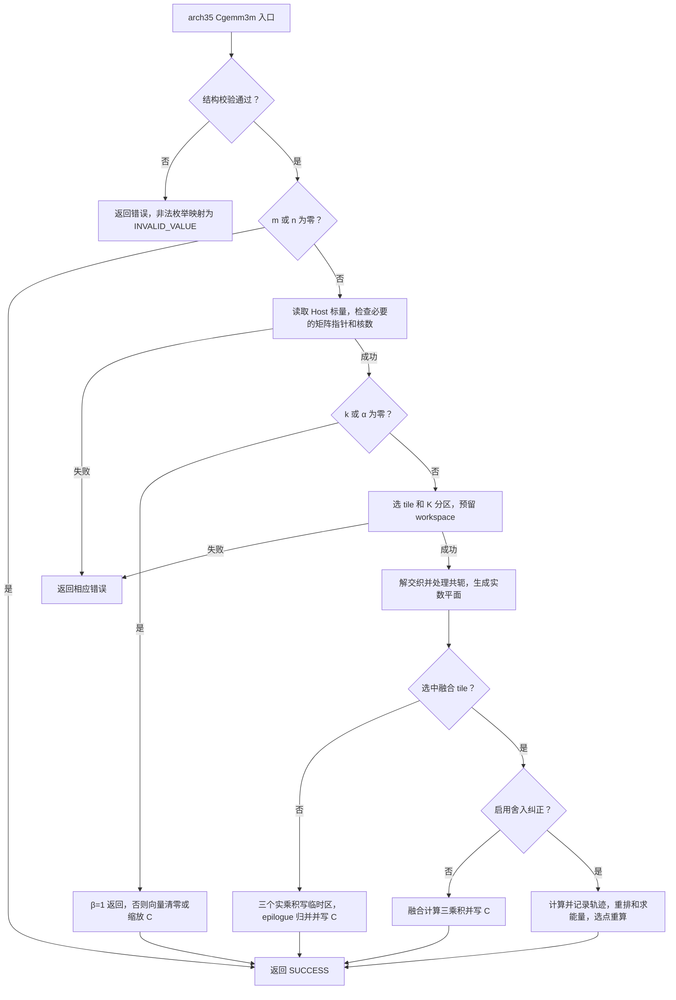
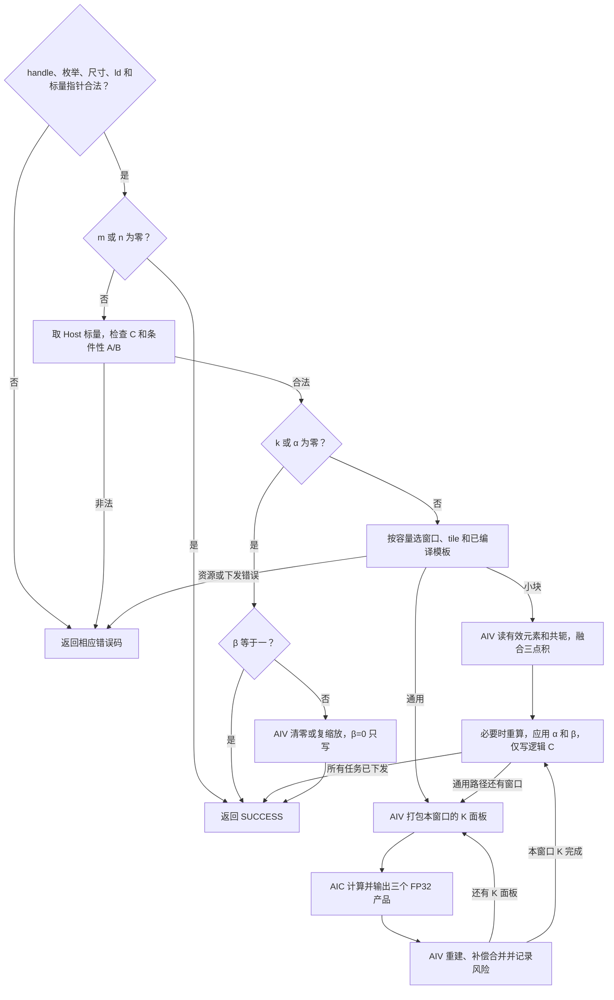

# 一、需求背景

## 1.1 需求来源

社区任务《aclblasCgemm3m 算子开发任务书（Atlas A2/A3）》要求在 ops-blas 的 arch22 上补齐单精度复数三乘法 GEMM。调用者在绑定到 handle 的 stream 上计算 `C ← α·op(A)·op(B) + β·C`。功能对标 cuBLAS `cublasCgemm3m`，CPU 数学参考为 Netlib CGEMM，性能单独与 GPU kernel 比较。本文给出设计及验收方法，尚无 arch22 实测结果。[cuBLAS gemm3m](https://docs.nvidia.com/cuda/cublas/index.html#cublas-t-gemm3m) · [Netlib cgemm.f](https://www.netlib.org/blas/cgemm.f)

## 1.2 背景介绍

### 1.2.1 aclblasCgemm3m 算子实现优化

核对的 ops-blas 快照为 `60d9d0b153e22a154b8de9b7d89f21c5443c5f98`。公开入口已在 `include/cann_ops_blas.h` 第 584 行声明，复数、转置枚举及状态码由 `include/cann_ops_blas_common.h` 定义。`blas/gemm/README.md` 的同名条目列出 arch35 的产品支持和接口约束。此接口通过库函数直接下发 kernel，模板中的 TBE 源文件、算子信息库和 ACLNN 两段式入口均不适用。[公开声明](https://gitcode.com/cann/ops-blas/blob/60d9d0b153e22a154b8de9b7d89f21c5443c5f98/include/cann_ops_blas.h) · [类型定义](https://gitcode.com/cann/ops-blas/blob/60d9d0b153e22a154b8de9b7d89f21c5443c5f98/include/cann_ops_blas_common.h) · [GEMM 说明](https://gitcode.com/cann/ops-blas/blob/60d9d0b153e22a154b8de9b7d89f21c5443c5f98/blas/gemm/README.md)

arch22 已有 `blas/gemm/arch22/gemm_host.cpp`、`gemm_kernel.cpp`、`gemm_kernel.h` 的实数 SGEMM，以及 `cgemm_host.cpp` 等文件实现的普通 CGEMM。前者给出了 FP32 Cube 与向量搬运的工程实例，后者采用四个实数乘积，其标量读取与 3M 任务也有差异。本任务复用列主序适配、平台查询和编译组织经验，新增三乘积实现。`blas/gemm3m/` 属于实数 `aclblasSgemm3m` 接口族。[arch22 GEMM 源码](https://gitcode.com/cann/ops-blas/tree/60d9d0b153e22a154b8de9b7d89f21c5443c5f98/blas/gemm/arch22)

### 1.2.2 aclblasCgemm3m 算子现状分析

#### 1.2.2.1 标杆算子支持的数据类型和数据格式

| 参数 | 位置与类型 | 形状、布局和权限 |
| --- | --- | --- |
| α、β | 本任务为 Host 上的 `const aclblasComplex*` | 各指向一个 complex64。cuBLAS 另有 device pointer mode |
| A、B | Device 上的 complex64，ND | 列主序，只读。相邻行间距为一个复数，相邻列间距分别为 lda、ldb 个复数 |
| C | Device 上的 complex64，ND | 列主序，物理跨度 ldc，原地写回逻辑 m×n 区域。β=0 只需可写 |
| transa、transb | 各自为 N、T 或 C | 分别表示原矩阵、转置、共轭转置，共九种组合 |
| m、n、k、lda、ldb、ldc | C 接口的 `int` | 维度按逻辑元素计数。前导维的下界见 2.3.2 |

每个 `aclblasComplex` 依次存放 `float real`、`float imag`，每个复数 8 字节。整个矩阵可以有列间填充，没有独立的行步长、批次步长或广播维度。

#### 1.2.2.2 标杆算子实现描述

cuBLAS 公开了 Gauss 降乘法和调用契约。Netlib 的 `cgemm.f` 则给出了可检查的列主序语义，包括先检查转置、维度和前导维，在空输出或乘积为零且 β=1 时返回，β=0 时跳过旧 C，按 N/T/C 对复数做乘加。它供 CPU 生成和校验 golden 使用。下图选用 ops-blas 已公开的同名 arch35 代码说明可复核的 3M 执行过程。GPU 的私有调度不在图中。[cuBLAS 库手册](https://docs.nvidia.com/cuda/pdf/CUBLAS_Library.pdf) · [Netlib CGEMM](https://www.netlib.org/blas/cgemm.f)

arch35 的 `cgemm3m_host.cpp` 将 `forceThreeProducts=true` 传入 `cgemm_host.cpp::LaunchComplexGemm`。它先校验结构参数，空输出直接返回。读取 Host 标量、按需检查矩阵指针并查询核数后，零乘积分支仅处理 β。常规分支规划 workspace，解交织并按共轭位准备实数平面。非融合时分发三个乘积，再归并和缩放。融合候选要求 α=1、β=0，并考虑 K 深度和可并行输出块数。符合紧凑方阵等条件、K 在 2048 到 4096 且 UB 足够时，还会记录部分和信息，按输入能量和消去情况选点重算。纠正筛选、片上通路与常量均有架构适用范围。[arch35 入口](https://gitcode.com/cann/ops-blas/blob/60d9d0b153e22a154b8de9b7d89f21c5443c5f98/blas/gemm/arch35/cgemm3m_host.cpp) · [共享调度](https://gitcode.com/cann/ops-blas/blob/60d9d0b153e22a154b8de9b7d89f21c5443c5f98/blas/gemm/arch35/cgemm_host.cpp) · [纠正 kernel](https://gitcode.com/cann/ops-blas/blob/60d9d0b153e22a154b8de9b7d89f21c5443c5f98/blas/gemm/arch35/cgemm3m_rounding_kernel.cpp)

#### 1.2.2.3 标杆算子实现流程图



# 二、需求分析

## 2.1 外部组件依赖

目标环境为 CANN 9.1.0、Atlas A2/A3 的 Ascend C 编译器和运行时。运行时提供 stream、设备内存和 kernel launch。设备端使用 FP32 向量运算与 arch22 FP32 Matmul。测试侧依赖 ops-blas 的 ATK/GTest、CPU Netlib BLAS 3.10.0 的 CBLAS 接口。正式性能采集依赖 `msprof op` 和同参数的 cuBLAS GPU kernel 基线。CPU BLAS 和 GPU 软件仅用于验证。

## 2.2 内部适配模块

| 模块 | 已有路径 | 拟开发内容 |
| --- | --- | --- |
| Host 与 kernel | `blas/gemm/arch22/` 已含普通 SGEMM/CGEMM | 在该目录按算子前缀拆分新增 `cgemm3m_host.cpp`、`cgemm3m_kernel.cpp`、`cgemm3m_kernel.h`。头文件共享私有 launch 描述、tile 参数和封装声明 |
| 句柄与编译 | `blas/common/helper/aclblas_handle_internal.h`、`host_utils.h`、`aclblas_auxiliary.cpp`，以及 `blas/CMakeLists.txt`、`build.sh` | 使用现有 stream、workspace 和平台查询。按 arch22 与 `cgemm3m_` 前缀收集源，检查单算子、全库构建均只导出一个公开定义 |
| 测试 | `test/gemm/cgemm3m/CMakeLists.txt` 当前仅注册 arch35。已有 `arch35/cgemm3m_test.cpp`、公共 `cgemm3m_param.h`、`cgemm3m_golden.h`、`cgemm3m_verify.h`、`cgemm3m_profile.h` | 拟新增 `test/gemm/cgemm3m/arch22/cgemm3m_test.cpp` 和该目录的 `cgemm3m_test.csv`，在已有 CMake 文件中注册 arch22。按 5.1 校准解析、精度和双计时 |
| 对外说明 | `blas/gemm/README.md`、`include/cann_ops_blas.h` | 拟补充 README 的 A2/A3 产品与状态码说明。沿用公开声明 |

源码与测试的目录状态以固定快照为准。表中拟开发文件属于后续实现交付。[子集编译规则](https://gitcode.com/cann/ops-blas/blob/60d9d0b153e22a154b8de9b7d89f21c5443c5f98/blas/CMakeLists.txt) · [现有测试工程](https://gitcode.com/cann/ops-blas/tree/60d9d0b153e22a154b8de9b7d89f21c5443c5f98/test/gemm/cgemm3m)

## 2.3 需求模块设计

### 2.3.1 Ascend C 算子原型

```cpp
aclblasStatus_t aclblasCgemm3m(
    aclblasHandle_t handle, aclblasOperation_t transa, aclblasOperation_t transb,
    int m, int n, int k,
    const aclblasComplex* alpha, const aclblasComplex* A, int lda,
    const aclblasComplex* B, int ldb, const aclblasComplex* beta,
    aclblasComplex* C, int ldc);
```

设 `0 ≤ i < m`、`0 ≤ j < n`、`0 ≤ l < k`。A 的 N 地址为 `i+l·lda`，T/C 地址为 `l+i·lda`。B 的 N 地址为 `l+j·ldb`，T/C 地址为 `j+l·ldb`。当 transa 或 transb 为 OP_C 时，只将对应输入的虚部取负。OP_T 保留该虚部。输出始终写 `C[i+j·ldc]`。例如 A 仅有元素 `1+2i`，B 为 `3+i`，α=1、β=0 时，TN 得 `1+7i`，CN 得 `5−5i`。

### 2.3.2 Ascend C 算子相关约束

1. 首先检查 handle，空指针返回 `ACLBLAS_STATUS_HANDLE_IS_NULLPTR`。逐个检查 transa/transb，仅接受 `ACLBLAS_OP_N/T/C` 三个合法枚举，错误返回 `ACLBLAS_STATUS_INVALID_ENUM`。arch35 同名入口会把此错误转换为 `INVALID_VALUE`，A2/A3 按任务书 §2.3 保留专用枚举错误码。
2. 检查 m、n、k 均非负。`lda ≥ max(1, transa=N ? m : k)`，`ldb ≥ max(1, transb=N ? k : n)`，`ldc ≥ max(1,m)`。A 的物理矩阵为 lda×(N 时 k，否则 m)，B 为 ldb×(N 时 n，否则 k)，C 为 ldc×n。维度、前导维或任一标量指针非法均返回 `ACLBLAS_STATUS_INVALID_VALUE`，包括空输出的情形。
3. m=0 或 n=0 时，结构参数和标量指针合法即返回 SUCCESS。A/B/C 可为空，无访存、无 workspace、无 kernel。其余情形 C 必须非空，即使后续 β=1 且乘积为零。Host 复制标量值。仅当 k>0 且 α≠(0,0) 时要求 A/B 均非空。必要指针缺失返回 `INVALID_VALUE`。
4. k=0 或 α=(0,0) 时跳过 A/B。β=(1,0) 直接返回，β=(0,0) 仅写复零，其他 β 按复乘缩放旧 C。常规乘积中 β=(0,0) 也禁止从 C 发出读请求，含 NaN 或未初始化的旧 C 不参与运算。
5. Host 检查待访问区的末元素 `(cols−1)·ld+(rows−1)`、乘 8 得到的字节偏移和地址末端均可表示。乘、加、向上取整和 tile 计数均先做溢出检查，再收窄到 ABI/指令字段。可分段的搬运优先拆段。调用者保证输入缓冲有效、C 可写且与活动 A/B 区域不重叠。Host 不扫描 Device 元素。

# 三、需求详细设计

## 3.1 调用方式

调用者创建 handle，调用 `aclblasSetStream` 绑定 stream，准备 Host 标量和 Device 矩阵，通过公开 BLAS 函数下发。Host 将标量值、前导维与窗口描述按值传给 arch22 launch 封装。常规调用在同一 stream 入队，SUCCESS 表示本次下发成功，调用者在读回 C 前同步该 stream。可检测的下发失败停止后续阶段并返回执行错误。若已有阶段入队，其存储保留到执行完成，已写窗口可能部分更新。设备异步错误由同步点报告。构建入口为 `bash build.sh --ops=cgemm3m --soc=ascend910b3`，A3 选择与实机匹配的 `ascend910_93*` 型号。[构建脚本](https://gitcode.com/cann/ops-blas/blob/60d9d0b153e22a154b8de9b7d89f21c5443c5f98/build.sh)

## 3.2 需求总体设计

### 3.2.1 Host 侧设计

#### 3.2.1.1 分核策略

对非空输出，Host 取当前设备的 `GetAicCoreCount()`、`GetAivCoreCount()`，仅查询入选路径需要的核。把 C 分成最多 `M×N` 个元素的**窗口**，每个窗口由至多 `bm×bn` 个输出元素的 tile 拼成。实际窗口为 `mw×nw` 时，网格为 `u=ceil(mw/bm)`、`v=ceil(nw/bn)`，tile 号 `t` 对应行块 `t mod u`、列块 `floor(t/u)`。

通用路径把 K 划为长度至多 D 的面板。每个面板有 `3uv` 个独立 AIC 任务（乘积号、tile 号），`blockDim=min(3uv,AIC核数)`。核 b 处理 b、b+blockDim、…。单任务独占一个实乘积 tile 并归约本面板完整 K。不同面板由同一 stream 依次归并，不对 C 做原子累加。窄输出可通过三个乘积并行、减小 bm/bn 提升并行度。将同一面板的 K 再分给多核会引入额外部分和与合并开销，首版不启用。

AIV 按待处理的输入行/列或输出 tile 分配，核数取有效任务数和 AIV 核数的较小值。小规模候选由一个 AIV 任务直接完成一个输出 tile。缩放路径按列的有效行段分配。尾块和各阶段具体读写范围由显式起点和有效长度控制。[平台核数封装](https://gitcode.com/cann/ops-blas/blob/60d9d0b153e22a154b8de9b7d89f21c5443c5f98/blas/common/helper/host_utils.h)

#### 3.2.1.2 数据分块和内存优化策略

**片上预算。** Host 经 `PlatformAscendCManager::GetInstance()` 和 `GetCoreMemSize` 分别读取 UB、L1、L0_A、L0_B、L0_C 的字节数。下式中的维度已经按所选 FP32 Matmul 格式补齐，每个独立 buffer 再按对应 API 的对齐要求取整。令 `d1`、`d0` 为 L1/L0 操作数的缓冲份数（1 或 2），`k1` 为一次 L1 驻留的 K 深度，`k0≤k1≤D` 为 L0 微块深度，`rX` 为后端对 X 的固定预留或临时开销。下列条件须同时成立。[CANN 平台容量接口](https://www.hiascend.com/document/detail/en/CANNCommunityEdition/910/API/ascendcopapi/docs/en/api/Utils-API/platform_info/PlatformAscendC/GetCoreMemSize.md)

| 存储 | 每核、单产品 tile 的字节预算 |
| --- | --- |
| L1 | `4·d1·(bm·k1+k1·bn)+rL1 ≤ L1` |
| L0A / L0B | 内部计算转置输出，左操作数为 B、右操作数为 A。分别要求 `4·d0·bn·k0+rA ≤ L0A`、`4·d0·k0·bm+rB ≤ L0B` |
| L0C | 同时存活的 FP32 累加 tile 数为 c，`4·c·bm·bn+rC ≤ L0C`。通用路径一个任务一次只算一个产品，c=1 |
| UB | 逐阶段计算峰值。拆包每槽按 `8x+3·4x` 计 x 个复数输入及三平面输出。归并每槽按 `3·4y+4·4y` 计 y 个输出点的三个产品和两对补偿累加器。若同时保留旧 C 和新 C，再加 `2·8y`。峰值为各阶段所有存活槽（含 ping/pong）的对齐字节数之和的最大值，加掩码、风险量、重排和 API 临时区 `rUB`，须 ≤ UB |

小块融合另预算输入 tile、三组产品/临时量、实虚补偿及输出。保守估计为 `8·(bm·D+D·bn)+3·4·(bm·D+D·bn)+7·4·bm·bn+2·8·bm·bn+rUB`，多槽部分按实际份数展开。精度纠正按条带重读，计入其自身峰值。模板中使用的 Matmul 静态 tiling、格式实际占用和库保留区也须通过预算。资源未知不能按零开销处理。容量不足时缩小微块、改用单缓冲，或选择有可证预算的向量路径。平台查询失败且无法确定安全布局时返回 `ACLBLAS_STATUS_INTERNAL_ERROR`。

**Device workspace。** 以整个输出窗口循环 K，面板内一次打包、三乘积共用。令 `S_A=M′D′`、`S_B=D′N′`、`S_C=M′N′`（撇号表示内部补齐的窗口上限），`a(z)` 为工作区段对齐后的字节数。通用路径单窗口、单面板槽的上界如下，各段按字节对齐排列。

```text
W = 3·a(4·S_A) + 3·a(4·S_B)     # 两个输入各三张 FP32 平面
  + 3·a(4·S_C)                    # 当前 K 面板的三个产品
  + 4·a(4·S_C)                    # 跨面板保存 R、I 及各自的补偿
  + 2·a(4·S_C) + a(4·S_C)         # 两个消去指标与异常标志
  + a(4·M′) + a(4·N′) + W_api     # 当前面板行/列幅值与后端临时区
```

W 随窗口大小变化，与全矩阵窗口个数、K 面板数无关。每次重用产品区之前完成该面板的归并，末面板归并后才写 C。举例取已对齐的 M′=N′=512、D′=256，平面及辅助数组共 13 MiB + 4 KiB（未含额外对齐与 `W_api`）。即使是 4096³，也可遍历窗口而不常驻全尺寸平面。纯 AIV 小块、清零与缩放设计为零 GM 临时区。

先按当前有效 workspace 选窗，必要时缩小 M/N/D。需要库空间时使用 `EnsureDefaultWorkspace` 和 `GetEffectiveWorkspace`。该版本库默认大小 32 MiB、库管理上限 2 GiB，增长会先同步旧 stream。用户 workspace 以实际可用字节为上限，检查基址对齐并扣除前置对齐空隙。算子不扩容或释放这块内存。所有偏移和 `W_api` 在第一条 kernel 下发前确定，没有可用布局且分配失败时报告 `ACLBLAS_STATUS_ALLOC_FAILED`。同一 handle 的整次下发由调用方串行使用，不跨 stream 同时复用工作区。并行请求用独立 handle 和不相交的 workspace。库在切换 stream、替换工作区或销毁时处理旧 stream 的生命周期，稳态调用无需逐 kernel 同步。[workspace 所有权与上限](https://gitcode.com/cann/ops-blas/blob/60d9d0b153e22a154b8de9b7d89f21c5443c5f98/blas/common/helper/aclblas_handle_internal.h) · [句柄生命周期](https://gitcode.com/cann/ops-blas/blob/60d9d0b153e22a154b8de9b7d89f21c5443c5f98/blas/common/helper/aclblas_auxiliary.cpp)

#### 3.2.1.3 tilingKey 规划策略

tilingKey 是 arch22 Host 与私有 launch 封装之间的分派值。拟定义 `SCALE`（清零/缩放）、`VECTOR_3M`（小块融合）、`CUBE_3M`（分阶段通用）。空输出和零乘积且 β=1 在 Host 结束。其余零乘积使用 SCALE。小块融合候选取 D=k，从原输入取完整归约维并按 tile 独占输出。一般乘积先过滤容量不满足的模板，分别估计可行方案的设备耗时。向量路径计入 `3mnk` 次实乘和读写量。Cube 路径逐阶段以计算量/实测吞吐和搬运量/实测带宽的较大者估计，按有效 tile 波数修正尾波利用率，再加各阶段的固定耗时。在小块能装入 UB 且预计单次融合更快时用 VECTOR_3M，否则用 CUBE_3M。交叉点须由两款型实测校准。

每个 key 显式映射到已编译的 kernel 或 kernel 序列。Cube 的 `(bm,bn,k0,k1,缓冲数)` 仅从编译期实例表中选择。转置位与共轭位分别编码供输入变换使用，β=0 位控制独立的无读取写回分支。标量值、逻辑尺寸、ld、窗口起点、有效面板长度、产品平面偏移和 blockDim 随 launch 传入。Host 只产生已注册的实例，不按用例名、种子或 golden 分派，也不需要图引擎的 tiling 注册。

### 3.2.2 Kernel 侧设计

#### 3.2.2.1 Kernel 侧实现描述

**两种 3M 分解。** 在应用转置与虚部符号后，令 `op(A)=X+iY`、`op(B)=U+iV`。以下乘法均为实矩阵乘，正常路径只需要三个实乘积。

| 执行路径 | 三个实乘积 | 重建乘积 R+iI |
| --- | --- | --- |
| 通用、非融合 | `P0=XU`，`P1=YV`，`P2=(X+Y)(U+V)` | `R=P0−P1`，`I=(P2−P0)−P1` |
| 小块、融合 | `Q0=(X+Y)U`，`Q1=X(V−U)`，`Q2=Y(U+V)` | `R=Q0−Q2`，`I=Q0+Q1` |

展开两行均得 `R=XU−YV`、`I=XV+YU`。非融合路径中的 P2 有两个预加法，虚部需做两次相减。融合路径中 Q0 同时影响实部与虚部。两者的舍入和风险指标分别计算。

**面板流水。** AIV 按 2.3.1 的物理地址分段读取实虚交错的复数，解交织、共轭并生成三张紧凑实数平面。A 各平面排为行主序 `[l][i]`，B 为 `[j][l]`。AIC 对每一对实数操作数 L、H 计算 `(L·H)ᵀ=Hᵀ·Lᵀ`，把结果写为 `[j][i]`，连续的 i 可直接对应用户 C 的列内行段。Cube 在 FP32 模式显式关闭 HF32，参考 arch22 SGEMM 的 `SetHF32Mode(DISABLE)` 和 Matmul 初始化/结束顺序。GM→L1→L0A/L0B 后在 L0C 完成本面板累加并写回 GM。AIV 从三个平面逐段重建 R、I，按 K 递增合并，在最后一个面板应用 α、β。小块路径在 AIV 的 UB 中直接对 K 做三个实点积和重建，省去中间 GM 与多次 launch。[arch22 FP32 Matmul 源码](https://gitcode.com/cann/ops-blas/blob/60d9d0b153e22a154b8de9b7d89f21c5443c5f98/blas/gemm/arch22/gemm_kernel.cpp)

拆包、乘积和归并为同 stream 的先后任务，跨 AIV/AIC 用各自的 GM 区交换，可见性由同流执行次序保证。核内用队列或成对的事件表达“搬入完成才能计算、计算完成才能搬出、搬出完成才能重用槽”。双缓冲只在相应预算成立时覆盖下一片的搬入，不假定 arch35 的向量到 Cube 片上通路在 arch22 可用。输入 DMA 逐物理列限制有效字节，内部行、列、K 尾部显式补零。短段用该方向支持的 `DataCopyPad` 有效长度搬运，UB 端的起始地址按 32 字节对齐。过大的 stride、blockLen、repeat 分批处理。写回仅包含每列前 m 行，处理相邻 tile 可能共享的非对齐写边界时，给同一写粒度指定唯一写者，不能安全分割的窗口由单个 AIV 收尾。不得用整段对齐回写覆盖下一列或 padding。[昇腾非对齐搬运说明](https://www.hiascend.com/developer/techArticles/20250627-1)

**精度补偿与异常。** 面板缩短单个 FP32 点积。在 AIV 将有符号产品分量合并时，用补偿求和保存每个输出 R、I 的高部和残差。例如给和 s 加 x，`t=fl(s+x)`，在 FP32 各步单独舍入的前提下，当 `abs(s)≥abs(x)` 时把 `(s−t)+x` 加入残差，否则加 `(x−t)+s`，再令 s=t。首面板从零开始，最后把残差加回，禁止编译器将补偿表达式重结合。此举针对重建与面板间相加。Cube 点积内部和输入预加的误差仍须处理。

拟在有效元素上跟踪消去风险。非融合的实/虚重建分别累计 `abs(P0)+abs(P1)`、`abs(P2)+abs(P0)+abs(P1)`。融合则分别用 `abs(Q0)+abs(Q2)`、`abs(Q0)+abs(Q1)`。结合子面板行/列的分量最大幅值及长度（实点积绝对和至多为长度乘两个操作数的最大幅值，预加项按分量上界相加），检查内部大项相消。最终筛选还计入 α、β 复缩放中的消去。风险量远大于结果且估计的 FP32 舍入量足以影响目标容差、输入预加溢出、部分和或重建出现非有限值时，标记这个输出。设当前面板长度为 d，行、列的复数分量绝对最大值为 hA、hB，对上文各分量的重建幅值 L 记一项 `e=2⁻²⁴·(L+4·sqrt(d)·hA·hB)`，两个指标数组分别沿 K 累加 e。末次写回按 α 实、虚部的绝对值传播这两个指标，并加上 `2⁻²⁴` 乘最终相加项绝对值之和。超过内部阈值 `η·2⁻¹³·(1+abs(本次计算的未纠正输出分量))` 即重算整点，候选起点 η=1。此量用于风险筛选，不能界定最坏点积误差。须以独立的强消去数据测漏检率，以常规输入测重算比例和额外时延，一并校准。

被标记的有限输入点在写 C 前重读原始 A 行和 B 列（按 N/T/C 映射），以宽精度重做本路径的预加、三个点积和缩放，仅在末次收窄。候选实现为软件 binary64 算术，避免依赖设备原生 FP64。实现和成本须单独验证。真正含 NaN/Inf 的活动点以原始分量按参考复数乘加的特殊值规则重算分类，保留相应 NaN 或带符号无穷。避免由纯实平面的 Inf−Inf 将本应有限或为无穷的另一分量误判。纠正仅使用调用输入，不生成全矩阵第四个实乘积。零乘积、β=0 分支优先于异常处理，未引用数据绝不触发重算。

对有限值，令 `α=a+ib`、`β=c+id`，最终写入 `(aR−bI)+(c·Cr−d·Ci)` 与 `(aI+bR)+(c·Ci+d·Cr)`。同一写者先取所需旧 Cr、Ci 的快照，再写两个新分量。仅缩放 C 时沿用相同的复乘分量规则，遇到有限输入的中间溢出则在宽域重算 β·C。一般乘积且 β=0 时使用独立分支，直接写 `aR−bI` 和 `aI+bR`。

#### 3.2.2.2 Ascend C 实现流程图



图中的 Device 节点表示同流下发顺序。任一可检测的下发错误都结束后续下发，Host 不等待末节点完成。

#### 3.2.2.3 Ascend C 实现流程图与标杆算子流程图的差异点和原因

arch35 用跨架构共享调度器选择融合 tile，并在特定方阵上用专门的筛选、排列及纠正 kernel。arch22 以独立 AIV 小块融合和 AIV→GM→AIC→GM→AIV 通用路径覆盖矩形、共轭和一般标量场景。用窗口限制临时内存，把非有限分类与消去纠正放在覆盖旧 C 之前。两种实现对逻辑乘加、空输出和不读旧 C 的要求一致。不同的 FP32 求和次序按分量容差检验。arch22 的非法枚举状态、补偿阈值与计时均按本任务单独验证。

## 3.3 支持硬件

适配 Atlas A2、Atlas A3 系列，包括 Atlas 800T A2 与 Atlas 800T A3，目标为 arch22。任务允许自验证覆盖一种款型。精度建议 910B3 或 A3，正式性能设备按 §3.3 取 Atlas 800T A2（910B3）。报告分别列明实际设备、SoC、CANN 和构建版本，区分目标平台与已测平台。

## 3.4 算子约束限制

接口仅接受单矩阵 complex64 GEMM 与 Host 复标量。输出为调用者提供的 C，无独立输出视图。无任意 stride、batch、广播或图模式 dynamic shape 适配。运行时 m/n/k 及 ld 决定 tiling，空输出以尺寸零表示。A/B 仅被读取，C 的逻辑写区域必须与活动输入分离。超出 ld 语义的视图或别名不在契约内。运算不含随机数，任务未要求不同调度、不同运行之间逐位一致。

# 四、特性交叉分析

| 交叉场景 | 设计行为与验证观察 |
| --- | --- |
| 共轭 × padding × 矩形 | 先按物理 ld 寻址，再只对 OP_C 取负虚部。相同非对称输入跑 T、C 对照。检查每列 C 的行号 m 至 ldc−1 的哨兵及 A/B 原值 |
| 空矩阵 × 非法参数 | 结构错误优先于 quick return。空输出配合法 ld、有效标量及空 A/B/C 应成功且无下发。配非法枚举、非法 ld 或空标量分别检查错误码 |
| 零乘积 × 特殊值 | k=0 或 α=0 时输入可为空或含 NaN。β=0 写复零，β=1 保持原字节，其他 β 做缩放。正常乘积配 β=0、C 含 NaN 时仍须产生正常结果 |
| 长 K × 大标量 × 消去 | 覆盖实部和虚部分别接近零、预加近溢出、不同 K 面板边界及一般复缩放。记录哪条 3M 路径、各分量误差最大点及重算比例 |
| 多请求 × workspace | 同流连续变形状、用户区过小、库扩容、切流和独立 handle 并行分别验证，检查任务阶段顺序、越界、交叉覆盖和异步错误回传 |

# 五、可维可测分析

## 5.1 精度标准/性能标准

**精度。** 按任务书 §3.2，以列主序 Netlib BLAS 3.10.0 `cblas_cgemm` 为数学参考。冻结 golden 按 FP64 分量执行预期的复乘、K 累加及 α/β 缩放，再收窄为 complex64。另以直接调用单精度 CBLAS 的结果交叉核对，记录版本、精度域及差异。负向用例仅核状态，空输出核对内存保持。每条非空正例对完整 m×n 的实部、虚部分别判定，padding 另逐字节比较。[Netlib CGEMM](https://www.netlib.org/blas/cgemm.f) · [任务指定的 opbase 精度标准](https://gitcode.com/cann/opbase/blob/28a1ce52ae856353589841226a0002af73314a6b/docs/zh/ops_precision_standard/mixed_tolerance_standard.md)

- 有限分量以 `abs(actual−golden) ≤ 2⁻¹³·(1+abs(golden))` 判 matched。对每个分量同时要求 `matched_ratio ≥ 0.99` 且有限点最大绝对误差不超过 `max(0.01,32·ULP(g_low))`。ULP 取该分量最大绝对误差点的 FP32 golden 值域。记录点坐标、actual、golden、分母和两项指标，实、虚均须通过。
- 非有限点不参与绝对误差最大值。宽 golden 按 round-to-nearest-even 收窄后，仅同号 Inf 对同号 Inf 或 NaN 对 NaN 视为相应特殊值匹配。单列非有限不匹配数并要求为零，同时报告全体点匹配率和有限点匹配率，避免特殊值掩盖有限分量超差。无有限点时直接核对所有特殊值。已有 arch35 `cgemm3m_verify.h` 会接受某些 NaN/Inf 交叉配对，arch22 校验须区分类别。[现有比较器](https://gitcode.com/cann/ops-blas/blob/60d9d0b153e22a154b8de9b7d89f21c5443c5f98/test/gemm/cgemm3m/cgemm3m_verify.h)
- 附件 `test_cases/verify_accuracy.py` 只运行 GTest、排除 PF 并核对用例名及 PASS/FAIL/MISSING。混合容差和特殊值检查须由 GTest 实际执行。CSV 两列 `mere_threshold=0.00012207031`、`mare_multiplier=10.0` 是框架的附加指标配置。README 中“α=0 且 A 为空/NaN 则不写 C”只在 β=1 时成立，例如 `TC_ED_411` 仍须将 C 乘 2。

**随包覆盖与自验补项。** 静态读取 `test_cases/cgemm3m_test.csv` 得 1200 个唯一用例，固定 complex64，表头无 dtype、handle 两列。1000 个非 PF 用例中，期望 SUCCESS 984 条、INVALID_VALUE 14 条、INVALID_ENUM 2 条。L0/SQ/MN/AB/LD/FL/CV/ED/EX 实际分别为 18/110/91/88/16/21/32/38/586。精度覆盖九种合法转置组合及两个 999，覆盖 4095³、4096³。PF 覆盖 NN、NT、NC、TN、CN、CC 六种。均匀 token 为 `RANDOM_NORM_5_5`，正态 token 实为 `GAUSS_NORM_0_1`，实虚部独立生成。正态/均匀以外另测全零、极值、Inf 和 NaN。

- 保留全部原例。按任务书 §3.5 增补精度集中 m、n、k 各维缺少的 1023、2047，补足相对合法下界 +1、+64 的 lda/ldb/ldc（现有正例多为紧凑、+4 或 +8）。用手工非对称矩阵及同一份输入验证 OP_T/OP_C，补全纯实、纯虚和全零分量、带符号 Inf、单个 NaN、首尾写保护。CSV 的 `TC_ED_413/414` 种子不同，单看两者输出不构成受控对照。另以 GTest 装配空 handle、无效指针组合，检查错误码及实际零 launch。在 UT 中遍历 tiling 实例的容量恰好满足/差一字节、偏移溢出和不均分 tile。在板端 ST 中记录 kernel 路径、误差最大点及尾部哨兵，覆盖 workspace 重用、切流和异步完成。
- 后续测试产物中记录输入与 golden 的种子/哈希、分量统计、日志和截图。任务书 §4 所列 `cases.json`、`perf/`、`inputs/`、`golden/`、`facts.json` 未随本次 CSV 附件提供，需在实现自验阶段生成和冻结。任务书 §3.4 无独立内存验收指标。附件的 512 MB 是生成端的 Host 预算，不能充当库 workspace 上限或删除大尺寸用例的依据。

**正式性能。** 任务书 §3.3 要求 200 个性能用例逐例达到 GPU kernel 性能的 **0.8 倍**。预热 5 次后，每例用 `msprof op` 取 10 次成功且执行完成的有效调用。一次调用含多 kernel 时按调用、stream 及下发顺序归组，把拆包、全部窗口和面板的 Cube、归并、必要的纠正和写回等串行 task 的 `Task Duration(us)` 相加，再对 10 个单次总耗时求算术平均 `T_us`。每例要求 `T_us ≤ 1.25 × 1000 × gpu_ms`，即 `1000 × gpu_ms / T_us ≥ 0.8`。例如 `TC_PF_0001` 的 `gpu_ms=0.0260096002`，整次 kernel 预算为约 32.512 µs。保存每次的 task 列表及错误记录，异常调用单列原因并补足样本。

**事件交叉验证。** 在预置 Device 缓冲上 warmup 5 次，用一对 `aclrtEvent` 夹住连续 10 次下发并取平均，打印 `[PERF] case=<case_name> ... avg_us=<数值>`。H2D/D2H、造数和 golden 比对在计时区外。β≠0 时预先准备相同初值的独立 C，保证各次输入一致。既有 arch35 性能驱动只接受 α=1、β=0，arch22 需支持所有标量。附件 `verify_performance.py` 只解析事件时间，对可比项检查逐例及平均倍率 ≥0.8，默认 NO_REF 失败。`--allow-noref` 仅作开发采集。脚本可回退查找其他架构的 CSV 或测试二进制，且性能主流程没有单独检查 GTest 进程退出码。自验须记录实际 arch22 二进制与 CSV 的路径和哈希，独立核对进程退出码、逐例状态、同步结果和样本数。正式报告可附平均倍率，但任何单例未达标或缺少 kernel 样本都不能由平均值补偿。[arch35 性能驱动](https://gitcode.com/cann/ops-blas/blob/60d9d0b153e22a154b8de9b7d89f21c5443c5f98/test/gemm/cgemm3m/cgemm3m_profile.h)

**性能数据的可比性。** 以 `8·max(mk,kn,mn)` 的逻辑字节数分档，200 个 PF 行含 small（≤64 KiB）7 个、medium（>64 KiB 且 ≤2 MiB）26 个、large 167 个。默认 α=1、β=0 共 175 个，非默认且 α≠0 共 25 个。`gpu_baseline.csv` 有 200 行且 `gpu_ms` 全为正值。按两项转置、三个尺寸、α/β 的四个分量、三个 ld 共十二项规范化匹配，200 个键唯一且逐一对应。README 中“全空”和“非默认待回填”与文件现状不一致。附件未提供每行 A100 原始 trace，正值和键相等只能证明表格匹配。

| 按真实 N/T/C 复核 PF 行 | 行数 | 正式验收的处理 |
| --- | ---: | --- |
| 三个 ld 合法且全部紧凑 | 90 | 以相同参数、成功执行的 GPU/NPU kernel 样本比较 |
| ld 合法但有 padding | 50 | 保留并按实际 ld 分配与比较，核对基线采集的物理跨度 |
| 至少一个 ld 非法，CSV 却期望 SUCCESS | 60 | 仅 lda 不足 30、仅 ldb 不足 25、两者均不足 5。API 应返回 INVALID_VALUE。该参数行不产生有效 kernel 样本 |

例如 `TC_PF_0005` 为 NN、(m,n,k)=(4096,64,64)、lda=64，任务要求 lda≥4096。`gen_csv.py` 的冻结 PF 元组使用短名 `N/T/C`，而 `rows_a/rows_b` 仅将全名 `ACLBLAS_OP_N` 识别为 N。据此得出的 ld 与“全部紧凑”的自检会同时出错。验收前须保留原始行与原键，核对 GPU 实际调用参数，取得合法的修订用例和对应基线。凡物理参数改变，须按新键重采或取得有原始记录佐证的同键基线。GTest 加载时应兼容长短枚举拼写，不能静默调整 ld、借用原耗时或删去 60 行。正式结论仍要求 **200 个合法性能用例逐例通过**，现有附件不能单独支持该结论。

## 5.2 兼容性分析

公开函数签名、复数 ABI、列主序语义和 handle/stream 调用方式与既有声明兼容。构建回归需分别验证 A2 与 A3 的 arch22 目标、原 arch35 目标、单算子与整库链接，确认同一构建只有一份符号定义。装配层按任务书解释正确的转置枚举、Host 标量、异步执行和状态码，不将 arch35 测试中的逐位可重复性设为 arch22 的任务门槛。自验报告需绑定源码提交、设备与 CANN 版本、用例和基线版本，并保留失败或缺测项。本文完成的是设计与附件静态核查，精度、性能、workspace 峰值及两款型兼容性均待实现验证。
