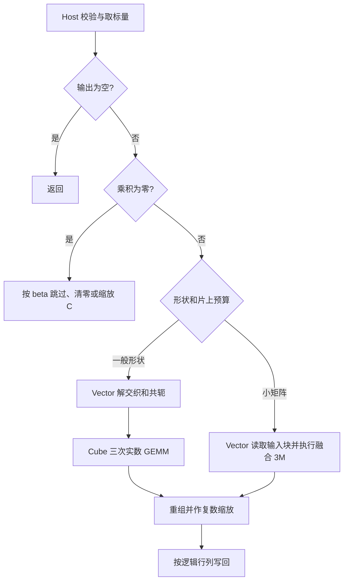

# aclblasCgemm3m 算子设计文档（Atlas A2/A3）

## 需求背景

信号处理中的复数线性变换可以表示为单精度复数矩阵乘。调用方通过同一个 BLAS 句柄绑定执行流，按列主序传入矩阵，期望在原缓冲区更新 C。ops-blas 已在公开头文件声明接口，arch35 提供实现，arch22 的普通复数 GEMM 将乘积分成四次实数 GEMM。本任务在 arch22 增加三乘法路径。设计依据为 [11 月社区任务与任务书下载入口](https://www.hiascend.com/activities/task-center/details/cae74cb900484862a2b43b24c0f7d9d3)、[ops-blas 源码](https://gitcode.com/cann/ops-blas/tree/55ef791b77f3677b45da3468b0a8b17941424f84/blas/gemm) 和 [cuBLAS 接口说明](https://docs.nvidia.com/cuda/cublas/index.html#cublascgemm3m)。任务书由官网 ZIP 发布，未标注可对应的 Git commit。

## 需求分析

```cpp
aclblasStatus_t aclblasCgemm3m(
    aclblasHandle_t handle, aclblasOperation_t transa, aclblasOperation_t transb,
    int m, int n, int k, const aclblasComplex* alpha,
    const aclblasComplex* A, int lda, const aclblasComplex* B, int ldb,
    const aclblasComplex* beta, aclblasComplex* C, int ldc);
```

计算 `C = alpha * op(A) * op(B) + beta * C`。Host 标量和 Device 矩阵元素均为两个相邻的 FP32，实部在前。N 保持矩阵，T 转置，C 转置且对虚部取反。逻辑形状依次为 m×k、k×n、m×n。下表给出物理分配形状；所有维数使用元素计数。

| 缓冲 | N | T/C | 前导维下限 |
| --- | --- | --- | --- |
| A | lda×k | lda×m | max(1, N 时 m、T/C 时 k) |
| B | ldb×n | ldb×k | max(1, N 时 k、T/C 时 n) |
| C | ldc×n | 同左 | max(1,m) |

支持运行时尺寸及前导维间隙。C 可写区域与 A/B 读区域须互不重叠；无 broadcast、批次或任意 stride。外部软件依赖为 CANN 运行时和 Ascend C，CPU 参考与 GTest 只在测试工程中使用。使用公开头文件的原有声明，在 `blas/gemm/arch22/` 实现，在 `test/gemm/cgemm3m/arch22/` 注册用例并更新 gemm 支持列表。

## 详细设计

### 算子分析

以下实虚平面均指已执行转置和共轭的逻辑矩阵。令
`P = Ar·Br`、`Q = Ai·Bi`、`S = (Ar+Ai)·(Br+Bi)`，则实部为 `P-Q`，虚部为 `(S-P)-Q`。每个输出有三条长度为 k 的实点积，主体计算量约为 6mnk 个浮点运算，拆包和末端组合分别与 mk+kn 和 mn 成正比。小矩阵容易受启动开销限制，大矩阵的主要开销是 GEMM 和平面搬运。复标量缩放在乘积重组后执行一次。

另一种融合式使用 `U=(Ar+Ai)·Br`、`V=Ar·(Bi-Br)`、`W=Ai·(Br+Bi)`，输出为 `(U-W,U+V)`。这一式少一次末端减法；其抵消发生在不同的中间量。实现和验证分别标记所走的分解，避免混用误差估计。标杆的可观察过程为“校验列主序操作数 → 应用 N/T/C → 计算复乘积 → 复标量乘加 → 更新逻辑 C”。Netlib 的 CGEMM 提供数学参考，cuBLAS 内部调度对调用方不可见。

### Host 与 tiling

1. 先检查 handle，再检查两个操作枚举、非负 m/n/k、三个前导维下限以及两个标量指针。对应返回 HANDLE_IS_NULLPTR、INVALID_ENUM 或 INVALID_VALUE。结构合法且 m 或 n 为零时直接返回 SUCCESS。
2. 对非空输出先验证 C。若 k=0 或 alpha 的两个分量均为零，A/B 可以为空。在此零乘积分支，beta=1 直接返回，beta=0 启动清零，其余启动复缩放。乘积路径检查 A、B 两个指针。读取 Host 标量值并随 launch 传递，返回后调用方可以复用标量存储。
3. 调度标志来自尺寸、前导维、转置、缩放及平台的 Core/片上容量。在小 tile 能放入 UB 且总乘加量较小时，按完整输出列或对齐的行段分给 Vector 核。大矩阵用 Vector 解交织、Cube 计算三个 FP32 平面乘积、Vector 重组。绑定同一条 stream，下游 kernel 按下发顺序依赖上游输出。
4. 令 `R`、`S` 为操作数物理行列数，实平面存储用 `ldp=round_up(R,16)`、容量 `ldp*S` 个 float。三平面的普通实现需要 `3*(sizeA+sizeB+sizeP)*4` 字节的中间区，另计实 GEMM 的 scratch 与分段累加缓冲。复用 handle 的 workspace，乘积、加法、向上对齐都做 64 位溢出检查；先核对总容量再切片。用户 workspace 不足或申请失败时返回相应状态。长 K 或空间受限时分段，K 首段初始化、后续段在同一输出块归约；末端仅加一次 beta*C。
5. 逻辑块总数为 `ceil(m/Bm)*ceil(n/Bn)`。取实际可用核数与块数的较小值，各核按 blockIdx 跨步领块。M/N/K 尾段分别以剩余行数、列数和深度为限。打包与写回都使用 64 位物理偏移；不对齐的最终写回按实际 C 地址的 32 B 传输块划分唯一写核。对首尾块及跨列的块只对逻辑有效子段作精确长度写入，保护 padding，beta=0 时无需读取旧值。

### Kernel 实现



- 输入的 N 地址为 `row + col*ld`，T/C 地址为 `col + row*ld`。解交织后在输入平面折入虚部符号，实数 GEMM 只需 N/T。Cube 路径可复用仓内 arch22 FP32 实 GEMM。严格精度路径保留 FP32 输入和累加，避免 HF32 截断；用长 K、大标量和近抵消输入核验中间累加误差。
- 小块以一段输出行作为并行维，沿 K 更新三个本地累加向量，尽量共用该列 B 的标量。块内沿连续维搬运，转置输入在片内整理。以一次处理 r 个复元素为例，四个实输入向量、三个累加、两个重组、两个旧 C 分量及暂存 t 个实向量占 `4*r*(11+t)` 字节，再加双缓冲和 DMA 对齐开销，以平台查询的 UB 上限约束 r。Cube 的实 GEMM 沿 M/N 切输出块，沿 K 流水取 A/B 面板；由后端 tiling 同时满足 L1 面板和 L0A/B/C 缓冲约束。
- 输出实部 `ar*x-ai*y`、虚部 `ar*y+ai*x`，其中 alpha=(ar,ai)、乘积=(x,y)。beta 非零时再加 beta 与旧 C 的复乘；恒等标量直接复制，零标量分支直接写零或忽略无效读，防止未初始化或 NaN 值污染结果。DMA 按有效字节数搬运，片内补零，对齐扩展部分仅在工作区中使用。流水重用缓冲前等待对应拷贝或计算事件完成。
- 三乘法的预加、累加与末端抵消均有舍入误差。开发时按分量记录误差及最坏坐标，比较 FP64 CPU 标量积。如果高动态范围或长 K 的误差超界，可缩短部分和并作补偿求和；对出现非有限中间项或严重抵消的块，用原输入按更高精度的分裂累加作纠正。在首次更新 C 前用原始 A/B 完成判定与重算，最后读取一次需要的旧 C。触发条件基于数值和形状，不依赖用例名、随机种子或 golden。

### 支持硬件与特性交叉

目标为 Atlas A2/A3 的 arch22，任务书规定 CANN 9.1.0。AIC 提供实数矩阵乘，AIV 负责 FP32 向量计算，GM、L1、L0 与 UB 分别承担设备工作区、输入面板、矩阵引擎片内块与向量块。不同型号的核数和可用存储在运行时查询。arch35 继续使用原实现，两架构分别编译同一 ABI。代码遵循 handle 的 stream 与 workspace 生命周期，不产生跨 handle 的可变缓存。接口异步提交，测试侧在读取结果前同步；异步执行错误与 Host 参数错误分别记录。

## 可维可测分析

- **功能与精度。** 加载任务附件的 1,000 个精度用例及独立空句柄用例，逐条核对返回码。检查九种转置、共轭符号、lda/ldb/ldc padding 哨兵、k=0、alpha=0 与空 A/B、beta=0 搭配 NaN 旧 C、非有限分量、长 K 与 4095³/4096³。冻结 golden 以 FP64 累加后收窄到 complex64，全矩阵实、虚部分开比较。Netlib BLAS 3.10.0 单精度 CGEMM 作独立对照，在报告中标明两种累加精度及差异。采用 `atol=rtol=2^-13`，每分量匹配率至少 0.99，最大绝对误差按 0.01 或对应 golden 的 32 ULP 判定，NaN 只与 NaN 匹配，Inf 只与同号 Inf 匹配。记录框架 MERE/MARE 输出及最坏位置。
- **性能。** 对全部 200 个 TC_PF 按完整参数键匹配 A100 基线。预置 Device 缓冲，每例预热 5 次，随后 10 次成功调用，用 aclrtEvent 提供辅助 avg_us。正式在 Atlas 800T A2（910B3）用 msprof op 采集同一调用涉及的所有 kernel，按调用归集 Task Duration、剔除预热再取算术平均。按最大单块逻辑字节数 max(8mk,8kn,8mn) 分为 ≤64 KiB、(64 KiB,2 MiB] 和 >2 MiB 三档，记录各档用例数与倍率。GPU 毫秒乘 1000 后比较微秒；逐例 `NPU_us ≤ 1.25 × GPU_us` 且可比用例平均倍率至少 0.8。保留时间线、实际设备和负载，A3 测量单列。缺样、重复键或执行失败单列原因。
- **复现与材料。** 从验收 commit 独立检出，记录环境、编译选项、随机种子、输入布局、golden 生成域和每例状态，留存 cases.json、冻结输入/golden、性能子集、facts 与原始输出；由日志和 profiler CSV 生成表格和要求的实虚部、双口径性能截图。任务书 §3.4 无独立内存指标，保留模板项并注明适用范围。精度、性能及文件完整性分别核验。

[任务讨论帖](https://gitcode.com/cann/ops-blas/discussions/93) · [FP32 混合容差标准](https://gitcode.com/cann/opbase/blob/28a1ce52ae856353589841226a0002af73314a6b/docs/zh/ops_precision_standard/mixed_tolerance_standard.md) · [Netlib CGEMM](https://www.netlib.org/blas/cgemm.f)
