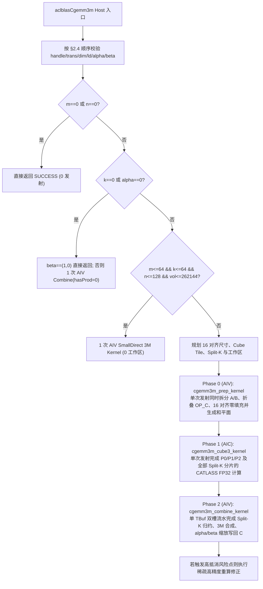

# aclblasCgemm3m 算子设计文档（Atlas A2/A3）

| 文档版本 | 日期 | 作者/团队 | 说明 |
| --- | --- | --- | --- |
| V1.0 | 2026-11-25 | nudt_wsy | 11月社区任务 `aclblasCgemm3m`（Atlas A2/A3，arch22）设计文档 |

> 目标代码目录：`ops-blas/blas/gemm/arch22/`；测试目录：`ops-blas/test/gemm/cgemm3m/arch22/`；公开接口声明复用 `ops-blas/include/cann_ops_blas.h`（L584）。本文仅设计 Atlas A2/A3（arch22）路径。

# 需求背景（required）

## 需求来源

本需求来源于 2026 年 11 月 CANN 社区任务「`aclblasCgemm3m` 算子开发（Atlas A2/A3）」，要求基于 `cann/ops-blas` 开源仓工程，使用 Ascend C 实现单精度复数（complex64）三乘法通用矩阵乘算子 `aclblasCgemm3m`，对标 cuBLAS `cublasCgemm3m` 与 Netlib `cgemm` 数学语义，补齐 Atlas A2/A3（arch22）实现与测试。

## 背景介绍

通用复数矩阵乘 `CGEMM` 是 BLAS Level 3 核心算子，计算：

$$C = \alpha \cdot op(A) \cdot op(B) + \beta \cdot C$$

传统复数矩阵乘（4M）将复数乘法拆为 4 次实数矩阵乘；Gauss 3M 算法将其等价改写为 3 次实数矩阵乘加线性组合，减少 25% 矩阵乘计算量。`ops-blas` 仓内已在 `blas/gemm/arch35/` 实现 Ascend 950PR（arch35）版本并在 `include/cann_ops_blas.h` 声明公开接口；本任务补齐 Atlas A2/A3（arch22）的工程实现与测试验证。

# 需求分析（required）

## 需求描述

### 函数原型

复用 `include/cann_ops_blas.h` 既有声明，不新增私有接口：

```cpp
aclblasStatus_t aclblasCgemm3m(
    aclblasHandle_t handle,
    aclblasOperation_t transa,
    aclblasOperation_t transb,
    int m, int n, int k,
    const aclblasComplex* alpha,
    const aclblasComplex* A, int lda,
    const aclblasComplex* B, int ldb,
    const aclblasComplex* beta,
    aclblasComplex* C, int ldc);
```

### 参数与存储语义

| 参数 | 方向 | 类型 | 布局/存储 | 合法约束与异常返回 |
| --- | --- | --- | --- | --- |
| `handle` | 输入 | `aclblasHandle_t` | Host 句柄（绑定 stream） | `nullptr` 返回 `ACLBLAS_STATUS_HANDLE_IS_NULLPTR` |
| `transa` | 属性 | `aclblasOperation_t` | `{N, T, C}` | 非法枚举返回 `ACLBLAS_STATUS_INVALID_ENUM` |
| `transb` | 属性 | `aclblasOperation_t` | `{N, T, C}` | 非法枚举返回 `ACLBLAS_STATUS_INVALID_ENUM` |
| `m, n, k` | 属性 | `int` | `op(A): m×k, op(B): k×n, C: m×n` | 任一 `< 0` 返回 `ACLBLAS_STATUS_INVALID_VALUE` |
| `alpha` | 输入 | `const aclblasComplex*` | Host 内存标量 | `nullptr` 返回 `ACLBLAS_STATUS_INVALID_VALUE` |
| `A` | 输入 | `const aclblasComplex*` | Device 列主序，`lda×(N?k:m)` | `m>0 && n>0 && k>0 && alpha!=0` 时为空返回 `ACLBLAS_STATUS_INVALID_VALUE` |
| `lda` | 属性 | `int` | 列主序前导维 | `< max(1, transa==N ? m : k)` 返回 `ACLBLAS_STATUS_INVALID_VALUE` |
| `B` | 输入 | `const aclblasComplex*` | Device 列主序，`ldb×(N?n:k)` | `m>0 && n>0 && k>0 && alpha!=0` 时为空返回 `ACLBLAS_STATUS_INVALID_VALUE` |
| `ldb` | 属性 | `int` | 列主序前导维 | `< max(1, transb==N ? k : n)` 返回 `ACLBLAS_STATUS_INVALID_VALUE` |
| `beta` | 输入 | `const aclblasComplex*` | Host 内存标量 | `nullptr` 返回 `ACLBLAS_STATUS_INVALID_VALUE` |
| `C` | 原地输出 | `aclblasComplex*` | Device 列主序，`ldc×n` | `m>0 && n>0` 时为空返回 `ACLBLAS_STATUS_INVALID_VALUE` |
| `ldc` | 属性 | `int` | 列主序前导维 | `< max(1, m)` 返回 `ACLBLAS_STATUS_INVALID_VALUE` |

## 需求拆解

1. **校验顺序与边界语义**：按 `handle` → `transa/transb` → `m/n/k` → `lda/ldb/ldc` → `alpha/beta` 顺序完成结构校验。`m == 0 || n == 0` 直接返回 `ACLBLAS_STATUS_SUCCESS` 且不读写 `A/B/C`；`k == 0 || alpha == (0,0)` 跳过乘加且不引用 `A/B`，其中 `beta == (1,0)` 不发射 kernel，`beta == (0,0)` 不读 `C` 旧值（包括 `C` 含 `NaN` 场景）。
2. **共轭与写保护**：`ACLBLAS_OP_C` 为共轭转置，`ACLBLAS_OP_T` 为非共轭转置；仅写回 `C` 的逻辑 `m×n` 区域，严格保护 `ldc` padding 区域不被改写。
3. **精度口径**：复数实部/虚部分别按 FLOAT32 分量与 `cblas_cgemm`（Netlib BLAS）比对：`atol = rtol = 2^-13`（约 `1.22e-4`），`matched_ratio >= 0.99`，`max_abs_error <= 1e-2` 或 `32 * ULP`。
4. **性能口径**：Atlas 800T A2（910B3）上，正式判据采用 `msprof op` 采集的完整 API kernel `Task Duration(us)`（预热 5 次 + 有效采样 10 次取算术平均），要求单 case 与平均性能均达到 cuBLAS `cublasCgemm3m`（A100 `gpu_ms`）的 0.8× 以上；GTest `aclrtEvent` `[PERF] avg_us` 作为辅助交叉验证。
5. **内存要求**：任务书 §3.4 明确标注“不涉及”。工作区不超过 `ACLBLAS_MAX_WORKSPACE_SIZE`（2 GiB），超限时返回 `ACLBLAS_STATUS_ALLOC_FAILED`。

# 详细设计（required）

## 算子分析

### 数学分解

记 $A = A_r + i A_i$、$B = B_r + i B_i$。对 `OP_C` 折叠共轭符号 $s_a, s_b \in \{+1, -1\}$（仅 `OP_C` 取 $-1$），令 $\tilde{A}_i = s_a A_i$、$\tilde{B}_i = s_b B_i$，并构造和平面 $A_s = A_r + \tilde{A}_i$、$B_s = B_r + \tilde{B}_i$。则：

$$P_0 = op_{nt}(A_r) \cdot op_{nt}(B_r), \quad P_1 = op_{nt}(\tilde{A}_i) \cdot op_{nt}(\tilde{B}_i), \quad P_2 = op_{nt}(A_s) \cdot op_{nt}(B_s)$$

$$\operatorname{Re}(op(A)op(B)) = P_0 - P_1, \quad \operatorname{Im}(op(A)op(B)) = P_2 - P_0 - P_1$$

$$C \leftarrow \alpha \cdot (\operatorname{Re} + i\operatorname{Im}) + \beta \cdot C$$

### 形态分组与瓶颈分析

| 形态 | 典型规模 | 主要瓶颈 | 规划路径 |
| --- | --- | --- | --- |
| 空输出 / 退化缩放 | `m=0/n=0`、`k=0`、`alpha=0` | Host 校验与零拷贝写回 | 0 发射或单 AIV 缩放路径 |
| 极小/小体量 | `1³ ~ 64³`（`m<=64, k<=64, n<=128, m*n*k<=262144`） | 多 kernel 发射开销 | 单 AIV 直算 3M 路径（0 工作区，1 次发射） |
| 细长与长 K 形态 | `64×64×4096`、`31×79×1368`、`4096×64×64`、`63×4095×63` | 输出 tile 少导致 AIC 核闲置、非 16 对齐维度触发慢速搬运、短列串行同步 | 16 对齐零填充 + 单发射 3 乘积 Cube + 自适应 Split-K + 列批处理 AIV Prep/Combine |
| 中大规整矩阵 | `128³ ~ 4096³`、`4095³` | Cube 算力利用率、L2 复用与 HBM 读写带宽 | 单发射 3 乘积 CATLASS FP32 Cube（禁 HF32、2D L2 Swizzle）+ 双槽 MTE2/MTE3 流水 AIV Prep/Combine |
| 大 K / 强抵消数值场景 | `GAUSS_NORM_0_1` 大 `k` 或大 `alpha` 下个别元素满足 `|P2 - P0 - P1| << |P0|+|P1|+|P2|` | 3M 减法放大 FP32 舍入误差导致极少数点超过 `32 * ULP` | 保持 3M 主路径不变，针对高抵消风险点补充稀疏四乘积/高精度重算修正 |

## 算子实现

### 总体架构与文件组织

在 `blas/gemm/arch22/` 新增 5 个聚焦文件，不触碰 `blas/gemm3m/`（实数 3M 接口）及 arch35 路径：

- `cgemm3m_tiling_data.h`：Prep、Cube3、Combine、SmallDirect 的 Host/Kernel 共享 Tiling 结构。
- `cgemm3m_kernel.h`：Kernel 发射函数声明。
- `cgemm3m_host.cpp`：`aclblasCgemm3m` 公共入口、参数校验、路径分派、Tile/Split-K 规划与工作区分配。
- `cgemm3m_kernel.cpp`：AIV 侧 `cgemm3m_prep_kernel`、`cgemm3m_combine_kernel`、`cgemm3m_small_direct_kernel`。
- `cgemm3m_cube_kernel.cpp`：AIC 侧基于仓内固定版本 CATLASS 的 `cgemm3m_cube3_kernel`。



### Host 侧设计

1. **对齐与工作区规划**：
   - 将计算维度向上对齐至 16：`mPad = Align16(m)`、`nPad = Align16(n)`、`kPad = Align16(k)`，使 CATLASS Cube 全程命中对齐搬运快路；填充区全部置零（`0 * 0 = 0` 不引入 `NaN` 污染），Combine 阶段仅读写逻辑 `m × n` 范围。
   - 打包前导维：`dim <= 128` 按 16 对齐（64B，避免细长矩阵翻倍膨胀），`dim > 128` 按 128 对齐（512B 突发对齐）。
   - 工作区总计 `3 * aPlane + 3 * bPlane + 3 * splitK * pPlane` 个 float。以 `4096³` 为例，`splitK = 1`，9 个 `4096×4096` 平面约 576 MiB，远低于 2 GiB 上限。
2. **Cube Tile 与自适应 Split-K 选路**：
   - 依据 CATLASS 行主序对偶关系 $C^T = B^T A^T$（`CATLASS_M = nPad`, `CATLASS_N = mPad`, `CATLASS_K = kPad`），按 `(mPad, nPad, aicCores)` 选择 5 档 L0C/L1 块型：`64×64`、`64×128`、`128×64`、`128×128`、`128×256`（`TK = 128`）。
   - 当 `3 * gridM * gridN < aicCores` 且 `kPad >= 256` 时，启用 Split-K（`kChunk` 按 32 对齐，上限 16 且受工作区约束），将三乘积与全部 K 分片统一放入单次 AIC 发射调度，充分利用全部 AIC 核心。
   - 当 `splitK == 1 && gridM >= 4 && gridN >= 4` 时开启 `swizzle = 4` 的 2D 分组遍历提升 L2 命中率。

### Kernel 侧设计

1. **Phase 0（`cgemm3m_prep_kernel`，AIV）**：
   - 单次发射统一调度 `A` 与 `B` 的有效列任务及 `<= 15` 列的零填充尾列任务；小行数场景按列批处理（`DataCopyPad` 2D 搬运 + `isPad=true` 精确零填充至 32B 边界），消除逐列同步。
   - 使用 `GatherMask`（模式 1/2）向量化拆分实/虚部，按 `conjA/conjB` 折叠 `OP_C` 负号，`Add` 生成和平面，双槽 Ping-Pong 重叠 `MTE2` 与 `MTE3`。
2. **Phase 1（`cgemm3m_cube3_kernel`，AIC）**：
   - 显式调用 `AscendC::SetHF32Mode(AscendC::HF32Mode::DISABLE)` 保证纯 FP32 累加。
   - 基于固定版本 CATLASS `MmadAtlasA2Pingpong<true>`，按 `(transB, transA)` 映射到 `RowMajor`/`ColumnMajor` 4 组特化模板，单次发射覆盖 `P0/P1/P2` 与全部 `splitK` 分片。
3. **Phase 2（`cgemm3m_combine_kernel`，AIV）**：
   - 全部片上缓冲收口于单个连续 `TBuf` 池（144 KiB <= 192 KiB），划分双槽 `p0/p1/p2/stage` 与共享向量暂存区，利用 `EVENT_ID0/1` 实现 MTE2/MTE3 流水重叠。
   - 使用 `CreateVecIndex` + 位移指令在 ~0.2 µs 内向量化构造交织索引表 `idxU`，替代标量循环。
   - `alpha = (1,0)` 走免乘快路；一般 `alpha/beta` 跳过零分量乘法，避免 `0 * Inf` 产生伪 `NaN`；`beta = (0,0)` 完全跳过 `C` 旧值读取；`Gather` 交织后通过 `DataCopyPad` 仅写回逻辑 `m × n` 区域。
4. **单发射小体量路径（`cgemm3m_small_direct_kernel`，AIV）**：
   - 针对 `m <= 64 && k <= 64 && n <= 128 && m*n*k <= 262144`，在单次 AIV 发射内将 `op(A)` 常驻 UB、按列分核加载 `op(B)` 并以向量 `Axpy` 执行 3M 乘加与 `alpha/beta` 写回，0 工作区、单次发射将极小规模耗时压至微秒级。

## 支持硬件

| 支持产品 | 支持情况 |
| --- | --- |
| Atlas A2 训练系列产品（如 Atlas 800T A2 / 910B3） | 支持（arch22） |
| Atlas A3 训练/推理系列产品 | 支持（arch22） |

## 算子约束限制

- 仅支持列主序带前导维布局（`lda/ldb/ldc`），不支持任意非连续视图与广播；
- `alpha/beta` 为 Host 内存指针，`A/B/C` 为 Device 内存指针，调用方须保证 `C` 可写区域与 `A/B` 不重叠；
- 工作区上限遵循仓内 `ACLBLAS_MAX_WORKSPACE_SIZE`（2 GiB）；
- 异步执行绑定 `handle->stream`，Host 读回前需显式同步 stream。

# 可维可测分析

## 精度标准与验证计划

- **测试工程**：在 `test/gemm/cgemm3m/arch22/` 新增 GTest 测试与 CSV，接入 `test/gemm/cgemm3m/CMakeLists.txt`（使 `arch22` 与 `arch35` 并列启用），执行 `bash build.sh --ops=cgemm3m --soc=ascend910b3`。
- **精度覆盖**：覆盖 1000 条精度用例（9 种 trans 组合、`0/1/2/3/5/7/16/31/32/33/63/64/65/.../4095/4096` 与 `4095³/4096³`、均匀 `RANDOM_NORM_5_5` 与高斯 `GAUSS_NORM_0_1`、零/交替/极端/Inf/NaN 填充、非紧凑 `lda/ldb/ldc` 哨兵写保护、条件空指针与负向返回码）及独立 `NullHandle`/`EmptyOutputPreservesSentinel` 单测。
- **判据**：实部/虚部分别与 Netlib `cblas_cgemm` 比对，满足 `atol = rtol = 2^-13`、`matched_ratio >= 0.99` 且 `max_abs_error <= 1e-2` 或 `32 * ULP`。

## 性能标准与验证计划

- **正式口径**：在 Atlas 800T A2（910B3）上使用 `msprof op` 采集 200 条 `TC_PF` 性能用例（预热 5 次 + 有效采样 10 次取算术平均），统计完整 API 所有参与计算 kernel 的 `Task Duration(us)` 之和，与 `gpu_baseline.csv` 的 A100 `gpu_ms` 做 kernel-to-kernel 对比，单 case 与平均倍率均要求 `>= 0.8`。
- **交叉验证**：GTest 同步输出 `aclrtEvent` 端到端 `[PERF] avg_us`，用于快速回归与趋势核对，不替代正式 `msprof op` 判据。
- **任务包 CSV 前导维说明**：任务附件 `gen_csv.py` 的 `PERF_CASES` 使用短名 `'N'/'T'/'C'` 导致 `rows_a/rows_b` 将 60 条非方阵 `TC_PF` 的 `lda/ldb` 算低于列主序下界；算子实现严格执行 §2.4 列主序前导维校验，测试 CSV 中将对应性能用例修正为合法紧凑列主序并在验收材料中说明基线键映射。

## 内存与兼容性分析

- **内存验收**：任务书 §3.4 明确标注不涉及；自验证报告按条款如实记录。
- **兼容性**：复用于 `include/cann_ops_blas.h` 既有公共签名，新增代码隔离在 `blas/gemm/arch22/` 与 `test/gemm/cgemm3m/arch22/`，不影响 arch35 实现与其他算子 ABI。
