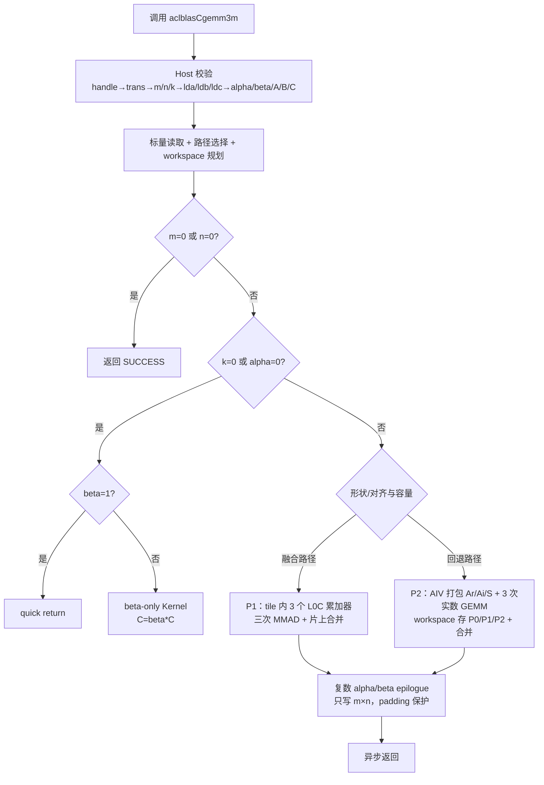

# aclblasCgemm3m（A2/A3）算子设计文档

> 范围说明：本 PR 仅提交设计文档，不含算子实现与测试代码。设计依据任务方《aclblasCgemm3m_AtlasA2_A3 任务书》与 `ops-blas @ 252d42d6` 源码；实现代码按 ops-blas 仓流程单独提交，文档不声称精度/性能已实测达标。

# 需求背景（required）

## 需求来源

- 任务：11 月社区任务-aclblasCgemm3m 算子开发（A2/A3），含税奖金 11445 元，最晚验收 2026-12-10。
- 依据：任务书 §2.1~§2.5（功能、3M 定义、接口、校验顺序）与 §3.2~§3.5（精度、性能、自验口径），配套 `test_cases/`（精度全量 1000 条、性能子集 200 条）。
- 目标仓：[cann/ops-blas](https://gitcode.com/cann/ops-blas)。实现代码入 `blas/gemm/arch22/`，测试代码入 `test/gemm/cgemm3m/arch22/`；公共声明已在 `include/cann_ops_blas.h` L584，无需修改。
- 硬件：Atlas A2/A3（arch22，DAV_2201）；CANN 9.1.0；精度 golden 由 Netlib CBLAS 3.10.0 `cblas_cgemm` 或 float64 累加参考生成。

## 背景介绍

### 算子功能与工程现状

`aclblasCgemm3m` 用 Gauss 3M 算法计算单精度复数通用矩阵乘：

```text
C := alpha * op(A) * op(B) + beta * C
```

- `alpha`、`beta` 为 COMPLEX64 标量；A、B、C 为 COMPLEX64 矩阵，列主序，按 `lda/ldb/ldc` 带 padding 访问。
- `transa/transb ∈ {N, T, C}`；复数域 `OP_C` 为共轭转置、`OP_T` 为转置，二者结果不同。
- op(A) 为 m×k，op(B) 为 k×n，C 为 m×n；只写 C 的逻辑 m×n，`ldc` padding 不写。
- 3M 用 3 次实数矩阵乘代替 1 次复数矩阵乘；中间 FP32 舍入与直接复数乘不同，结果与 `aclblasCgemm` 不保证逐位一致。

以 `ops-blas @ 252d42d6`（2026-11-25）为基线：

| 能力 | arch35（950PR） | arch22（A2/A3） | 本任务 |
|---|---|---|---|
| 公共声明 | `include/cann_ops_blas.h` L584 已声明 | 共用同一头文件 | **无需修改** |
| 3M 实现 | `blas/gemm/arch35/cgemm3m_host.cpp`：`LaunchComplexGemm(..., forceThreeProducts=true)`，含 unit batches / onchip batches 路径 | 无 | 新增 arch22 |
| 实数 GEMM 基础设施 | — | `blas/gemm/arch22/gemm_host.cpp`、`gemm_kernel.cpp/.h`：pack → Matmul → accumulate/epilogue，支持 padding/转置/多核切分/whole-grid 路径 | 复用 pack 与 Cube 调度 |
| 3M 分解参考 | `blas/gemm/arch35/cgemm3m_rounding_kernel.cpp` | — | 复用分解与舍入思想，不复制 SDK 不兼容代码 |
| 测试 | `test/gemm/cgemm3m/arch35/` | 无 arch22 注册 | 新建 `test/gemm/cgemm3m/arch22/` |
| 产品支持表 | `blas/gemm/README.md` 已列 | 未声明 | 补充 A2/A3 支持情况 |

> 注意：`blas/gemm3m/` 是实数 `aclblasSgemm3m`（3 个实数矩阵沿 K 拼接）的实现目录，与复数 `aclblasCgemm3m` 不是同一接口族，本任务不得放入该目录。

### 标杆核查

| 审核对象 | 结论 | 依据 |
|---|---|---|
| 原 TBE 算子源码 | 不适用 | handle 式 BLAS 接口，不涉及 ACLNN/TBE 迁移 |
| 算子信息库 JSON | 不适用 | 不注册 ACLNN 算子 |
| 可复用工程实现 | 适用 | arch22 `gemm` 的 pack/Matmul/epilogue/分核/padding 处理；arch35 `cgemm3m` 的 3M 路径选择与舍入处理 |
| 不可复用点 | 明确 | arch35 代码依赖 950 的 SIMT/UB 配置，不能直接搬到 arch22 |

### 现状差距

1. arch22 只有实数 GEMM 路径，没有复数 3M；需要新增 `aclblasCgemm3m` 入口与复数 3M kernel。
2. arch22 `gemm` 的 tiling 结构只含实数 `alpha/beta`、`transA/transB`；需要扩展 `is3m`、`conjA/conjB`、多乘积 workspace 偏移。
3. arch22 无 SIMT，不能照搬 arch35 的 deinterleave/rounding kernel；需用 AIV 打包 + Cube Matmul + AIV epilogue。
4. 9 种 trans 组合中 `OP_C`/`OP_T` 的共轭差异必须显式处理，不能只按转置标志复用。
5. `lda/ldb/ldc` padding、`beta=0` 不读旧 C、`k=0/alpha=0` 的 beta-only 路径都要在 arch22 适配层补齐。

# 需求分析（required）

## 接口定义

接口声明已存在于 `include/cann_ops_blas.h`（L584），本任务不新增/不修改声明：

```cpp
aclblasStatus_t aclblasCgemm3m(
    aclblasHandle_t handle,
    aclblasOperation_t transa,
    aclblasOperation_t transb,
    int m, int n, int k,
    const aclblasComplex* alpha,
    const aclblasComplex* A, int lda,
    const aclblasComplex* B, int ldb,
    const aclblasComplex* beta,
    aclblasComplex* C, int ldc);
```

返回值：`aclblasStatus_t`；成功 `SUCCESS`，非法 trans `INVALID_ENUM`，阶数/前导维/空指针非法 `INVALID_VALUE`，空句柄 `HANDLE_IS_NULLPTR`。

## 需求描述

在 CANN 9.1.0、Atlas A2/A3 上实现与 cuBLAS `cublasCgemm3m` 语义一致的 `aclblasCgemm3m`：9 种 trans 组合、复数 alpha/beta、`m/n/k ≥ 0`、`lda/ldb/ldc` padding、`beta=0` 不读旧 C、`k=0/alpha=0` 只做 beta 缩放；精度满足 COMPLEX64 混合容差，性能达到 GPU kernel 基线的 0.8 倍以上。

## 需求拆解

1. **功能**：`C = alpha·op(A)·op(B) + beta·C`；`OP_C` 共轭转置、`OP_T` 转置；只写 C 逻辑 m×n。
2. **数据类型**：alpha/beta/A/B/C 全部 COMPLEX64（实部/虚部各 FP32）；不支持其他 dtype。
3. **形状**：`m,n,k ≥ 0`；`lda` 按 transa 取下界，`ldb` 按 transb，`ldc≥max(1,m)`；用例覆盖 m/n/k 至 4096（含 4095³/4096³ 立方）。
4. **边界**：`m=0 || n=0` 合法 no-op；`k=0 || alpha=(0,0)` 只做 `C=beta·C`；`beta=0` 不读旧 C；padding 列保持原值。
5. **3M**：非融合 `P0=op(Ar)op(Br)`、`P1=op(Ai)op(Bi)`、`P2=op(Ar+Ai)op(Br+Bi)`，`real=P0−P1`、`imag=P2−P0−P1`；融合路径 `P0=op(Ar+Ai)op(Br)`、`P1=op(Ar)op(Bi−Br)`、`P2=op(Ai)op(Br+Bi)`，`real=P0−P2`、`imag=P0+P1`。
6. **校验**：按任务书 §2.5 顺序；非法枚举 `INVALID_ENUM`，其余结构参数非法 `INVALID_VALUE`，空句柄 `HANDLE_IS_NULLPTR`。
7. **精度**：实部/虚部分别按 FP32：`rtol=atol=2^-13`、`matched_ratio≥0.99`、`max_abs≤1e-2`；golden 为 `cblas_cgemm` 或 float64 累加后收窄。
8. **性能**：`msprof op` kernel `Task Duration`，warmup 5 + 10 次均值 ≤ GPU `gpu_ms`×1.25（≥0.8×）。
9. **交付**：设计文档 PR、arch22 实现、1000 条精度用例与 200 条性能用例自测报告、README 支持矩阵更新。

# 详细设计（required）

## 算子分析

### 数学公式

```text
C = alpha * op(A) * op(B) + beta * C
op(X) = X            (trans = N)
op(X) = X^T          (trans = T)
op(X) = conj(X^T)    (trans = C)
```

记 `Ar/Ai`、`Br/Bi` 为 A/B 的实部/虚部矩阵。非融合 3M：

```text
P0 = op(Ar)·op(Br)
P1 = op(Ai)·op(Bi)
P2 = op(Ar+Ai)·op(Br+Bi)
op(A)·op(B) = (P0 − P1) + i·(P2 − P0 − P1)
```

融合 3M（减少一次加法中间量，便于片上复用）：

```text
P0 = op(Ar+Ai)·op(Br)
P1 = op(Ar)·op(Bi−Br)
P2 = op(Ai)·op(Br+Bi)
op(A)·op(B) = (P0 − P2) + i·(P0 + P1)
```

两条分解代数等价，但中间项舍入不同；实现按形状与片上容量选择，不能把一条路径的误差分析套用到另一条。

共轭处理：`OP_C` 等价于“先把操作数虚部取负，再做转置”。因此打包阶段按 `(transpose, conj)` 生成实部/虚部矩阵：

| trans | conj | 送入实数 GEMM 的实部 | 送入实数 GEMM 的虚部 | 转置标志 |
|---|---|---|---|---|
| N | 否 | `Xr` | `Xi` | 0 |
| T | 否 | `Xr` | `Xi` | 1 |
| C | 是 | `Xr` | `−Xi` | 1 |

9 种组合由 `transa × transb` 的 `(transpose, conj)` 两两相乘得到，实数 GEMM 只看到 4 种转置组合，共轭差异全部收敛到打包符号。

列主序物理尺寸：

```text
A: lda × k (transa=N) 或 lda × m (transa=T/C)
B: ldb × n (transb=N) 或 ldb × k (transb=T/C)
C: ldc × n，只写逻辑 m×n
```

### 支持数据类型

| 参数 | 类型 | 位置 | 说明 |
|---|---|---|---|
| `handle` | 句柄 | Host | 携带 stream |
| `transa`、`transb`、`m`、`n`、`k`、`lda`、`ldb`、`ldc` | 标量/枚举 | Host | 见参数约束 |
| `alpha`、`beta` | COMPLEX64 | **Host** | ops-blas 约定 Host 指针，直接解引用 |
| `A`、`B` | COMPLEX64 | Device（只读） | 列主序带 padding |
| `C` | COMPLEX64 | Device（读写） | 列主序带 padding，原地覆写 |

### 支持形状

- `m,n,k ≥ 0`；任务书用例覆盖至 4096，包含 4095³/4096³ 立方。
- `lda/ldb/ldc` 下界按 trans 取 `max(1,·)`；大于下界时按 padding 处理。
- 3M 中间量用 `uint64` 计算，workspace 按 `ACLBLAS_MAX_WORKSPACE_SIZE`（2 GiB）校验。

## 算子实现

### 实现方案

#### 3.2.0 整体执行流程图



#### 3.2.1 Host 侧设计

**参数校验顺序（按任务书 §2.5）**：

| 顺序 | 检查 | 返回 |
|---|---|---|
| 1 | `handle == nullptr` | `HANDLE_IS_NULLPTR` |
| 2 | `transa/transb ∉ {N,T,C}` | `INVALID_ENUM` |
| 3 | `m<0 \|\| n<0 \|\| k<0` | `INVALID_VALUE` |
| 4 | `lda` 低于 transa 下界、`ldb` 低于 transb 下界、`ldc < max(1,m)` | `INVALID_VALUE` |
| 5 | `alpha == nullptr \|\| beta == nullptr` | `INVALID_VALUE` |
| 6 | `m==0 \|\| n==0`（结构参数已校验） | `SUCCESS`，不引用 A/B/C、不启动 |
| 7 | 非空输出时 `C == nullptr` | `INVALID_VALUE` |
| 8 | `k>0 && alpha≠0` 时 `A/B` 为空 | `INVALID_VALUE` |
| 9 | `k==0 \|\| alpha==(0,0)`：`beta=(1,0)` 返回，否则 beta-only | `SUCCESS` 或启动缩放 kernel |
| 10 | 主路径：workspace 规划 + 启动 | `SUCCESS`（异步） |

> `alpha/beta` 按 ops-blas 约定为 Host 指针，直接解引用；不接受 Device 指针（与任务书 §2.4 说明一致）。`m=0 || n=0` 只豁免 A/B/C 指针校验，不豁免 handle/trans/ld/标量校验。

**扩展后的 Tiling 字段（在 `GemmArch22Tiling` 基础上）**：

| 字段 | 含义 |
|---|---|
| `m,n,k`、`lda,ldb,ldc` | 逻辑规模与前导维 |
| `transA/transB` | 0=N，1=T（C 归一为 T） |
| `conjA/conjB` | 0/1，打包阶段虚部取负 |
| `is3m`、`path` | 3M 开关；1=融合，2=三趟 workspace，0=beta-only |
| `alphaReal/Imag`、`betaReal/Imag` | 复数标量 |
| `mBase/nBase/kBase` | Cube 基础块 |
| `mTiles/nTiles`、`cubeBlocks` | 输出 tile 网格与 AIC 核数 |
| `packAOffset/packBOffset` | 实/虚/和矩阵的 workspace 偏移 |
| `p0Offset/p1Offset/p2Offset` | 三趟路径的乘积偏移（融合路径为 0） |
| `accumOffset` | beta 累加/临时区偏移 |

**路径选择**：

| 路径 | 条件（建议初值） | 说明 |
|---|---|---|
| P1 融合 | `m%16==0 && n%16==0 && k%32==0`，tile 网格 ≥ 2，且 3 个 L0C 累加器可驻留 | tile 内 3 次 MMAD，L1 复用 Ar/Ai/S，性能优先 |
| P2 三趟 | 非对齐、小规模、L0C 不足或 workspace 受限 | 3 次实数 GEMM 写 workspace，AIV 合并；实现简单、覆盖全形状 |
| P0 beta-only | `k==0 \|\| alpha==0` 且 `beta≠(1,0)` | 只缩放 C，不引用 A/B |

**分核与 tile**：

- 输出按 `mBase×nBase` 网格切分；`jobs = mTiles×nTiles`；AIC 核数 `min(GetAicCoreCount(), jobs)`，每核连续 job 区间。
- P1 每 job 使用 3 个 FP32 L0C 累加器；建议 `mBase=128,nBase=64`（3×32 KiB=96 KiB）或 `64×64`（48 KiB），按实际 L0C 容量确认。
- P2 每个实数 GEMM 复用 arch22 现有 Matmul 调度与分核；三次乘积可用同一 job 网格串行下发。
- K 方向由 Matmul 内部迭代，`kBase=64` 起步；超大 K 不做 split-K，避免额外归约与 workspace。

**Workspace**：

| 路径 | 区域 | 大小（4096³ 估算） |
|---|---|---|
| P1 | `Ar/Ai`（A）、`Br/Bi`（B） | `2·(m·k + k·n)·4B` ≈ 268 MiB |
| P1 | `S` tile 在 L1 内即时生成 | 0（不落 GM） |
| P2 | `Ar/Ai/S`（A）、`Br/Bi/S`（B） | `3·(m·k + k·n)·4B` ≈ 402 MiB |
| P2 | `P0/P1/P2`（各 m×n FP32） | `3·m·n·4B` ≈ 201 MiB |
| 合计 | P2 最坏 | ≈ 603 MiB < 2 GiB |

- P1 的 `S = Ar+Ai` 在 L1/UB 内即时相加，不额外占 GM。
- workspace 通过 handle 的 workspace 机制申请；Host 预校验总字节数，失败返回 `INVALID_VALUE`/`ALLOC_FAILED`（与仓内现有约定一致）。

#### 3.2.2 Kernel 侧设计

**P1：融合 3M（性能主路径）**

1. **打包（AIV/MTE2）**：按 tile 读 A/B 交错复数，`DeInterleave` 拆分 `Ar/Ai`、`Br/Bi`；`conjA/conjB=1` 时对虚部取负；`lda/ldb` padding 不进入 tile。
2. **片上求和**：`S_A = Ar+Ai`、`S_B = Br+Bi` 在 UB/L1 内即时生成，供第三乘使用。
3. **三次 MMAD**：每个输出 tile 沿 K 迭代，使用 3 个 L0C 累加器（按非融合式）：
   ```text
   acc0 += op(Ar)·op(Br)
   acc1 += op(Ai)·op(Bi)
   acc2 += op(S_A)·op(S_B)
   ```
   或按融合式使用 `op(Ar+Ai)·op(Br)`、`op(Ar)·op(Bi−Br)`、`op(Ai)·op(Br+Bi)`；两条路径二选一，tiling 记录 `decompMode`，禁止在同一 tile 内混用。
4. **epilogue（AIV）**：从 L0C 读 3 个 tile：
   - 非融合：`Cr=acc0−acc1`、`Ci=acc2−acc0−acc1`；
   - 融合：`Cr=acc0−acc2`、`Ci=acc0+acc1`。
   再按复数 `C = alpha·(Cr+iCi) + beta·C_old` 写回；`beta=0` 不读旧 C，`beta=(1,0)` 直接加旧 C。
5. **写回**：只写逻辑 m×n，`ldc` padding 不写；`DataCopyPad` 处理尾块。

**P2：三趟实数 GEMM + 合并（回退路径）**

1. AIV 打包 `Ar/Ai/S_A`、`Br/Bi/S_B` 到 workspace，处理 trans/conj/padding。
2. 依次执行 3 个实数 GEMM：`P0=op(Ar)op(Br)`、`P1=op(Ai)op(Bi)`、`P2=op(S_A)op(S_B)`，结果写 workspace 的 FP32 区域。
3. AIV 合并 kernel：`Cr=P0−P1`、`Ci=P2−P0−P1`，应用 alpha/beta，按 uplo 无关的完整 m×n 写回（Cgemm 无三角限制），padding 不写。
4. 三次 GEMM 复用 arch22 现有 `sgemm_arch22_*` 调度；每次 GEMM 的 `lda/ldb` 用紧凑布局，padding 已在打包阶段消除。

**P0：beta-only**

- `k=0 || alpha=0` 且 `beta≠1`：AIV 对 C 的逻辑 m×n 做 `C=beta·C`，不引用 A/B；`beta=0` 不读旧 C。
- `beta=1` 或 `m/n=0` 在 Host 短路。

**padding 与 trans 专项**：

- `lda/ldb` 等于逻辑行数时可直接走 Matmul 视图；大于逻辑行数或 `OP_C` 需要虚部取负时，统一走 AIV 打包到紧凑布局，避免 Matmul 把 padding 当有效列。
- `OP_C` 的共轭只改虚部符号，不改变物理转置方式；打包后用标准转置标志送入实数 GEMM。
- 9 种组合必须逐一覆盖；`OP_C` 与 `OP_T` 的差异用非对称复数输入单独断言。

**alpha/beta epilogue**：

- 复数乘法展开为 4 个实数乘积分别舍入，再合并；不使用把整体收缩为 FMA 的写法。
- `alpha=(0,0)` 不进入 3M；`beta=0` 不读 C 旧值；`beta=(1,0)` 直接与旧值相加。
- 3M 的 `Cr/Ci` 加减顺序固定，不得改写为等价但舍入不同的形式。

**同步与流水**：

- pack（AIV）→ Matmul（Cube）→ epilogue（AIV）之间用 `SetFlag/WaitFlag` 或 `PipeBarrier` 保证顺序；L0C→UB 的 copy-out 完成后才能复用累加器。
- workspace tile 在每核内复用，复用前等上一 job epilogue 完成。
- Kernel 退出前保留全屏障，避免 MTE3 未排空导致偶发挂死。

#### 3.2.3 算子泛化设计

- **m/n/k=0**：Host 短路；`m=0 || n=0` 不引用 A/B/C。
- **k=0 / alpha=0**：只做 beta 缩放；A/B 可为空。
- **beta=0**：不读旧 C，旧值 NaN/Inf 不扩散。
- **trans 9 组合**：`(N/T/C)×(N/T/C)` 全覆盖；`OP_C` 通过虚部取负实现。
- **padding**：`lda/ldb/ldc` 大于下界时按 tile pack / 逻辑区域写回；padding 列保持原值。
- **大 K/大矩阵**：按 tile 流式，不要求整块驻留；4096³ 走 P1 优先，P2 作为回退。
- **特殊值**：Inf/NaN 按 IEEE 传播；`alpha=0` 且 A/B 为 NaN 不引用 A/B；`beta=0` 且 C 为 NaN 不读 C。

#### 3.2.4 3M 与转置专项

| 检查点 | 要求 | 反例 |
|---|---|---|
| 分解公式 | 非融合 `real=P0−P1`、`imag=P2−P0−P1`；融合 `real=P0−P2`、`imag=P0+P1` | 混用两套公式会导致实/虚部错位 |
| 共轭方向 | `OP_C` 只对虚部取负再做转置 | 只置转置标志会把共轭当普通转置 |
| 转置标志 | `OP_T`/`OP_C` 都使用转置读，差异仅在虚部符号 | 把 `OP_C` 当 `OP_N` 会读错矩阵 |
| padding | `lda/ldb` padding 不进入乘积；`ldc` padding 不写 | 把 padding 当有效列会污染结果 |
| beta=0 | 不读旧 C | 先读后乘会把 NaN 带入输出 |
| 舍入 | `Cr/Ci` 加减顺序固定，乘积分别舍入 | 合并成 FMA 会改变误差形态 |

### 数据检测

- 空 handle、非法 trans、m/n/k 负值、ld 低于下界、alpha/beta 空、C 空（m,n>0）、A/B 空（k>0 且 alpha≠0）：按上表返回。
- `m=0 || n=0` 不豁免结构参数校验；`k=0 || alpha=0` 时 A/B 可为空，C 在 m,n>0 时必须非空。
- workspace 超 2 GiB：`ALLOC_FAILED`；`m·k`、`k·n`、`m·n` 与字节数用 `uint64` 计算。
- `ldc` padding 列写入属实现缺陷，测试用哨兵值检查。

### 支持硬件

| 芯片版本 | 勾选 |
|---|---|
| Atlas A2 训练/推理系列 | √ |
| Atlas A3 训练/推理系列 | √ |
| Ascend 950PR/DT（arch35 既有） | 不改动 |

### 算子约束限制

- 不支持广播；C 原地覆写，C 与 A/B 不得重叠。
- `alpha/beta` 为 Host 指针，不支持 Device 指针（按任务书 ops-blas 约定）。
- 仅支持列主序带 padding 布局，不支持任意非连续 Tensor。
- 3M 两条分解路径二选一，同一 tile 内不得混用。
- 不做 split-K；超大 K 依赖 Matmul 内部 K 迭代。
- `ldc` padding 与非逻辑区域保持原值。

# 可维可测分析

## 精度标准/性能标准

| 验收标准 | 描述 | 标准来源 |
|---|---|---|
| 精度 | COMPLEX64 实部/虚部分别按 FP32：`rtol=atol=2^-13`，`matched_ratio≥0.99`，`max_abs≤1e-2`；golden 为 `cblas_cgemm` 或 float64 累加收窄 | 任务书 §3.2 |
| 性能 | `msprof op` kernel `Task Duration`，warmup 5 + 10 次均值 ≤ GPU `gpu_ms`×1.25（≥0.8×） | 任务书 §3.3 |
| 交叉验证 | `[PERF] avg_us` 事件计时仅作趋势，不作正式判据 | 任务书 §3.3 |

## 测试用例规划

新建 `test/gemm/cgemm3m/arch22/`，复用任务书 `test_cases/` 与 CSV 驱动：

| 类别 | 条数 | 覆盖点 |
|---|---|---|
| `basic` | 8 | 最小 NN、NT、TN、TT 冒烟 |
| `ex` | 650 | m/n/k 1..4096、方阵/长条、4095³/4096³ |
| `pf` | 200 | 性能子集（small/medium/large 分档） |
| `trans` | 36 | 9 种 trans 组合 × 4 类输入（实/虚/一般/极值） |
| `pad` | 40 | lda/ldb/ldc 下界、+1、+8、+64；padding 哨兵 |
| `alpha` | 24 | (0,0)、(1,0)、(0,1)、(-1,0)、±1e4、随机 |
| `beta` | 24 | (0,0)（不读旧 C）、(1,0)、随机、NaN 旧值 |
| `zero` | 12 | m/n/k=0、alpha=0、k=0 + beta≠1 |
| `neg` | 12 | 负 m/n/k、非法 trans、ld 低于下界 |
| `special` | 12 | Inf/NaN 传播、alpha=0 且 A/B 为 NaN、beta=0 且 C 为 NaN |
| `3M` | 4 | `TC_3M_*`：交替/极值填充、实虚抵消、OP_C 共轭差异 |

预期：约 1010 条 SUCCESS，其余按负向用例返回对应错误码；性能子集覆盖 9 种 trans 的主要组合与三档规模，`baseline` 判定键包含 alpha/beta。

## 兼容性分析

- 新增 arch22 实现，不改公共头与 arch35 行为。
- 更新 `blas/gemm/README.md` 的 A2/A3 支持情况与 CMake 构建目标。
- 复用 arch22 `gemm` 的 pack/Matmul/epilogue 调度时，保持实数 `aclblasSgemm` 现有行为不变，仅新增复数 3M 分支。
- 不修改 `blas/gemm3m/`（实数 `aclblasSgemm3m`）。

## 风险与降级预案

| 风险 | 影响 | 预案 |
|---|---|---|
| 3 个 L0C 累加器超容量 | 融合路径不可用 | 降 tile 到 64×64；仍不足走 P2 三趟 |
| P2 workspace 大（603 MiB） | 大矩阵申请失败 | Host 预校验 2 GiB；必要时分块复用 P0/P1/P2 或按 K 分段 |
| 9 种 trans/共轭组合实现分叉多 | 漏测/符号错 | 打包阶段统一收敛为 `(transpose, conj)`；36 条 trans 用例逐组合验证 |
| padding 处理错误 | 结果污染/越界 | 统一 pack 到紧凑布局；`ldc` 哨兵用例 |
| 3M 舍入与 golden 差异 | 误判精度失败 | 按阈值判定、不逐位比对；自测报告说明 3M 路径 |
| 融合路径性能不达 0.8× | 验收失败 | P1/P2 实测对比；优先 L1 复用、减少 pack 往返，调 `mBase/nBase/kBase` |
| 4096³ 超片上/workspace | 失败或性能差 | P1 分块流式；P2 三次 GEMM 复用同块 workspace；必要时限制用例走 P1 |

## 附录：修订记录

| 日期 | 版本 | 说明 |
|---|---|---|
| 2026-11-26 | v1.0 | 依据任务书与 `ops-blas @ 252d42d6` 完成设计；明确 arch22 融合/三趟双路径、9 种 trans/共轭收敛、padding 与 beta 语义 |
