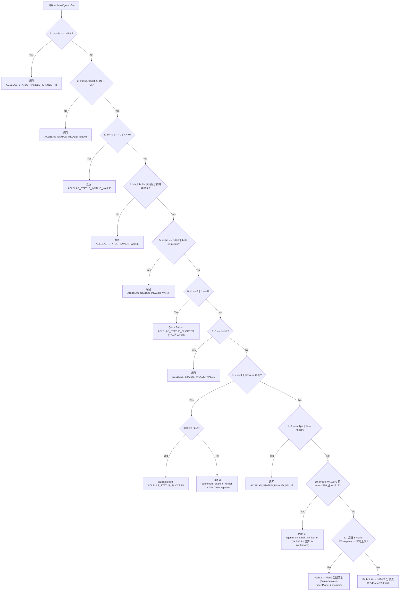
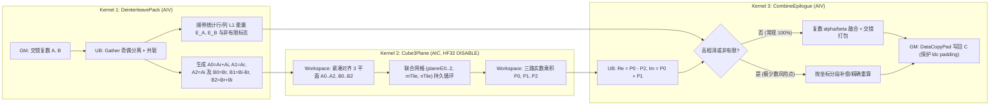

# aclblasCgemm3m（Atlas A2 / A3）算子设计文档

| 项目 | 内容 |
| :--- | :--- |
| **社区任务** | `11-aclblasCgemm3m_A2A3` |
| **贡献者 / 团队** | QianYiPan |
| **文档版本** | v1.0，设计评审稿 |
| **编写日期** | 2026-11-25 |
| **目标产品** | Atlas A2 系列、Atlas A3 系列（Atlas 800T A2 / Atlas 800I A2 / Atlas 800T A3） |
| **指定性能设备** | Atlas 800T A2（`ascend910b3`，兼容 `ascend910_93`；架构标识 `DAV_2201`，仓内目录 `arch22`） |
| **开发环境** | CANN 9.1.0、Ascend C、Netlib BLAS 3.10.0（CPU Golden 参考实现） |
| **目标代码仓** | [cann/ops-blas](https://gitcode.com/cann/ops-blas) |
| **目标代码路径** | 实现：`blas/gemm/arch22/`；测试：`test/gemm/cgemm3m/arch22/` |

---

# 需求背景（required）

## 需求来源

- **任务页面**：CANN 社区任务 2026（2026 年 11 月）——`11-aclblasCgemm3m_A2A3` 算子开发任务
- **任务目标**：在 Atlas A2 / A3 系列产品（Ascend 910B3 / 910_93，`arch22`，`DAV_2201`）上，基于 [ops-blas](https://gitcode.com/cann/ops-blas) 开源仓工程框架，使用 Ascend C 编程语言开发 BLAS Level-3 单精度复数（COMPLEX64）三乘法通用矩阵乘算子 `aclblasCgemm3m`，对标 cuBLAS `cublasCgemm3m` 接口，完成设计、开发、测试全流程工作，验收通过后合入昇腾算子开源仓。
- **适配硬件**：Atlas 800I/T A2、Atlas 800I/T A3（架构标识 `DAV_2201`，仓内目录 `arch22`）
- **软件栈版本**：CANN 9.1.0，Ascend C 基础 API / 高阶 Matmul API
- **目标代码仓**：https://gitcode.com/cann/ops-blas
- **提交团队/账号**：QianYiPan

## 背景介绍

### aclblasCgemm3m算子实现优化

`aclblasCgemm3m` 是 BLAS Level-3 单精度复数（COMPLEX64）三乘法通用矩阵乘（Complex General Matrix-Matrix Multiplication using 3-Multiplication algorithm）标准算子，对标 Netlib BLAS `cblas_cgemm` 与 cuBLAS `cublasCgemm3m`。算子执行如下矩阵乘加更新计算：

$$C \leftarrow \alpha \cdot \operatorname{op}(A) \cdot \operatorname{op}(B) + \beta \cdot C$$

其中：
- $A, B, C$ 均为列主序（Column-Major）交错存储的 `aclblasComplex`（单元素 8B，实部 `real` 与虚部 `imag` 各占 4B `float32`）；
- $\alpha, \beta$ 为单精度复数标量（`const aclblasComplex*`，包含实部与虚部）；
- $\operatorname{op}(X) \in \{X \text{ (`ACLBLAS_OP_N`)},\; X^T \text{ (`ACLBLAS_OP_T`)},\; X^H \text{ (`ACLBLAS_OP_C`)}\}$；
- 矩阵物理存储维度：$\operatorname{op}(A) \in \mathbb{C}^{m \times k}$，$\operatorname{op}(B) \in \mathbb{C}^{k \times n}$，$C \in \mathbb{C}^{m \times n}$。

传统复数矩阵乘法需要 4 次实数 GEMM 与 2 次矩阵加法（4M 算法），而 3M 算法通过 Gauss 复数乘法恒等变换，将复数乘法解耦为 3 次实数 GEMM，理论实数浮点乘法计算量降低 25%。

在昇腾 Atlas A2/A3（`arch22`，`DAV_2201`）架构上，Cube 核心具备强大的实数 FP32 GEMM 硬件算力。然而，若直接在 Host 侧串行下发 3 次 `aclblasSgemm`，算上前置解交错与后置合并，将导致 5～9 次串行 Kernel Launch，产生 25～45 $\mu\text{s}$ 的调度间隙，直接导致 $1^3 \sim 128^3$ 小尺寸矩阵超时失败；同时在 $256^3$ 规模下单次实数 GEMM 仅有 1 个大 Tile，无法利用全部 20 个 AIC 核心。

为此，本算子通过“**小尺寸零 Workspace 单/多核 AIV 直算路径** + **中大尺寸 3-Plane 联合网格 AIC/AIV 流水** + **超大尺寸 1024³ 分块流式兜底**”的三层架构，实现全尺寸、全模式的极致性能优化。

### aclblasCgemm3m算子实现路径和相关API路径

- **接口声明路径**：`include/cann_ops_blas.h`（第 584 行已存在公共声明，参数签名与 `cublasCgemm3m` 逐参数对应，A2/A3 直接共用该声明，零头文件改动）
- **Host 侧实现路径**：`blas/gemm/arch22/cgemm3m_host.cpp`、`blas/gemm/arch22/cgemm3m_tiling_data.h`
- **Kernel 侧实现路径**：`blas/gemm/arch22/cgemm3m_kernel.cpp`、`blas/gemm/arch22/cgemm3m_kernel.h`
- **算子说明文档**：`blas/gemm/README.md` 的 `aclblasCgemm3m` 章节（增补 Atlas A2/A3 产品支持与 Workspace 管控说明）
- **测试工程路径**：`test/gemm/cgemm3m/arch22/`（含 `cgemm3m_test.cpp`、`cgemm3m_npu_wrapper.h`、`cgemm3m_test.csv`、`gpu_baseline.csv`）及构建脚本 `test/gemm/cgemm3m/CMakeLists.txt`
- **相关 API 路径**：
  - Ascend C Cube API：`MatmulImpl`、`GetMatmulApiTiling`、`AscendC::SetHF32Mode(AscendC::HF32Mode::DISABLE)`
  - Ascend C Vector / DMA API：`DataCopyPad`、`Gather`、`Axpy`、`Mul`、`Add`、`Sub`、`Duplicate`、`SetFlag` / `WaitFlag` 等

### aclblasCgemm3m算子现状分析

通过对 BLAS Level-3 规范与 ops-blas 开源仓现有实现的逐文件分析，当前支持能力如下：

| 参数 | 参数含义 | 方向 | 内存位置 | 数据类型 | 约束条件 | 形状 |
| :--- | :--- | :---: | :---: | :--- | :--- | :--- |
| `handle` | ops-blas 库上下文句柄，携带 stream | 输入 | Host | `aclblasHandle_t` | 非空指针，内部包含有效 `aclrtStream` | scalar |
| `transa` | $\operatorname{op}(A)$ 的运算类型 | 属性 | Host 值 | `aclblasOperation_t` | `ACLBLAS_OP_N (111)`, `ACLBLAS_OP_T (112)`, `ACLBLAS_OP_C (113)` | attr |
| `transb` | $\operatorname{op}(B)$ 的运算类型 | 属性 | Host 值 | `aclblasOperation_t` | `ACLBLAS_OP_N (111)`, `ACLBLAS_OP_T (112)`, `ACLBLAS_OP_C (113)` | attr |
| `m` | $\operatorname{op}(A)$ 与 $C$ 的行数 | 属性 | Host 值 | `int` | $m \ge 0$；$m < 0$ 报错，$m == 0$ 快速成功返回 | attr |
| `n` | $\operatorname{op}(B)$ 与 $C$ 的列数 | 属性 | Host 值 | `int` | $n \ge 0$；$n < 0$ 报错，$n == 0$ 快速成功返回 | attr |
| `k` | $\operatorname{op}(A)$ 的列数、$\operatorname{op}(B)$ 的行数 | 属性 | Host 值 | `int` | $k \ge 0$；$k < 0$ 报错，$k == 0$ 只做 $C = \beta C$ | attr |
| `alpha` | 复数标量乘数 | 输入 | Host | `const aclblasComplex*` | 非空指针 | scalar |
| `A` | 列主序复数输入矩阵 A | 输入 | Device | `const aclblasComplex*` | $m>0 \land n>0 \land k>0 \land \alpha \ne (0,0)$ 时必须非空 | $\operatorname{op}(A) \in \mathbb{C}^{m \times k}$ |
| `lda` | 矩阵 A 的前导维度 | 属性 | Host 值 | `int` | `transa=N`: $\text{lda} \ge \max(1,m)$；`transa=T/C`: $\text{lda} \ge \max(1,k)$ | attr |
| `B` | 列主序复数输入矩阵 B | 输入 | Device | `const aclblasComplex*` | $m>0 \land n>0 \land k>0 \land \alpha \ne (0,0)$ 时必须非空 | $\operatorname{op}(B) \in \mathbb{C}^{k \times n}$ |
| `ldb` | 矩阵 B 的前导维度 | 属性 | Host 值 | `int` | `transb=N`: $\text{ldb} \ge \max(1,k)$；`transb=T/C`: $\text{ldb} \ge \max(1,n)$ | attr |
| `beta` | 复数标量乘数 | 输入 | Host | `const aclblasComplex*` | 非空指针；$\beta == (0,0)$ 时严格不读 $C$ 旧值 | scalar |
| `C` | 列主序复数输入/输出矩阵 C | 输入/输出 | Device | `aclblasComplex*` | $m>0 \land n>0$ 时必须非空，原地覆写 | $C \in \mathbb{C}^{m \times n}$，物理 $\text{ldc} \times n$ |
| `ldc` | 矩阵 C 的前导维度 | 属性 | Host 值 | `int` | $\text{ldc} \ge \max(1,m)$ | attr |

仓内关联版本现状：
1. **公共声明已就绪**：`include/cann_ops_blas.h:584` 已合入标准接口，本任务无需修改公共头文件；
2. **arch35（Ascend 950）已有实现**：`blas/gemm/arch35/cgemm3m_host.cpp` 已合入（PR #735），采用 950 专有 Tensor API 与 SIMT，无法直接在 A2/A3（`arch22`）上运行，但其参数校验顺序和错误码定义为权威行为依据；
3. **arch22 实数 GEMM 资产**：`blas/gemm/arch22/` 已有成熟的 `aclblasSgemm`，验证了 `MatmulImpl` 在 A2/A3 上的切分与调用；
4. **单算子构建裁剪**：`blas/CMakeLists.txt` 在 `--ops=cgemm3m` 时通过前缀匹配 `^cgemm3m_` 自动包含源文件，独立收敛于 `cgemm3m_*.cpp` 可天然兼容单算子与全量构建。

### aclblasCgemm3m算子功能分析

- **算子功能**：执行单精度复数矩阵乘加运算 $C = \alpha \cdot \operatorname{op}(A) \cdot \operatorname{op}(B) + \beta \cdot C$；
- **支持数据类型**：单精度复数 `aclblasComplex`（COMPLEX64，包含连续 2 个 32-bit float：`real` 与 `imag`）；
- **支持广播**：不支持广播（严格遵守 BLAS Level-3 矩阵严格维度契约）；
- **核心优化方向**：
  1. **非对称 Gauss 3M 分解**：相比对称 3M 形式，中间量动态范围仅增长 $\sqrt{2}$ 倍，实部与虚部重组均只需单次加减，大幅抑制长 $K$ 维累加下的数值舍入与相消误差；
  2. **强制关闭 HF32 截断**：入口处显式调用 `AscendC::SetHF32Mode(AscendC::HF32Mode::DISABLE)`，确保 FP32 IEEE-754 完整精度，满足 `rtol = 2^-13` 容差要求；
  3. **四路径自适应路由**：针对小矩阵延迟敏感（Path 1 零 Workspace、单 AIV Launch，5～12 $\mu\text{s}$）、中大矩阵吞吐敏感（Path 2 3-Plane 联合网格 Cube 满核流水）、超大矩阵防 OOM（Path 3 1024³ 分块）分别优化；
  4. **列主序到行主序的零转置等价映射**：利用 $P^T = B^T A^T$ 代数映射，在 Host 侧调换左右操作数并标记转置，免除片上高代价 2D 矩阵转置；
  5. **能量风险筛查与选择性精确重算**：在解交错阶段顺带统计行/列绝对值和与非有限标志（0 额外访存），在写回阶段对高相消风险点或非有限输入点执行分段补偿/精确重算，彻底消除 3M 假性 NaN。

---

# 需求分析（required）

## 需求描述

使用 Ascend C 编程语言在 Atlas A2 / A3（`arch22`，Ascend 910B3 / 910_93）硬件上开发高性能句柄式算子 `aclblasCgemm3m`，支持 COMPLEX64 数据类型，通过 `handle` 关联的 `aclrtStream` 异步调度下发，计算行为与数值精度严格对标 Netlib BLAS `cblas_cgemm` 与 cuBLAS `cublasCgemm3m`。

## 需求拆解

1. **接口契约与 11 步防御性校验**：严格实现句柄、枚举、维度、前导维、空指针全量检查；支持 $m=0 \lor n=0$ 的快速成功返回；支持 $k=0 \lor \alpha=(0,0)$ 时的 $C = \beta C$ 处理；当 $\beta=(0,0)$ 时保证绝不解引用读取旧 $C$；
2. **非对称 Gauss 3M 分解**：将复数矩阵乘法分解为 3 路实数 GEMM，并在后处理阶段完成复数 $\alpha, \beta$ 原位融合；
3. **Cube 完整 FP32 精度保证**：在所有 Cube 核函数入口调用 `SetHF32Mode(DISABLE)`，规避硬件默认 HF32 尾数截断问题；
4. **全尺寸自适应四路径分流**：
   - Path 0：$k=0 \lor \alpha=(0,0)$ 时的 `scale_c_kernel`（单 AIV Launch，0 Workspace）；
   - Path 1：$m \cdot n \cdot k \le 128^3$ 时的 `small_aiv_kernel`（单 AIV Launch，0 Workspace，UB 内 3M 直算）；
   - Path 2：中大尺寸 3-Plane 联合网格 Cube 流水（DeinterleavePack + Cube3Plane + CombineEpilogue，满核并发）；
   - Path 3：超大尺寸 1024³ 分块流式兜底（固定 44.02 MiB Workspace，支持任意合法大尺寸）；
5. **列主序零转置映射与 Padding 保护**：通过 $P^T = B^T A^T$ 行主序等价映射免除片上转置；`DataCopyPad` 严格保护 `ldc` padding 区域；
6. **数值稳定性与特殊值防御**：能量风险筛查与分段补偿重算，解决 3M 大数相消与 `Inf - Inf = NaN` 假性不定式；
7. **显存预算与硬上限管控**：片上缓存（UB/L1/L0C）无溢出；Host 侧设定 2 GiB Workspace 硬上限；
8. **双百达标验证**：全量 1000 条精度用例 100% PASS，全量 200 条性能用例 100% 达标（$\ge 0.80\times$ GPU Baseline，内控目标 $\ge 0.84\times$）。

---

# 详细设计（required）

## 算子分析

### 数学公式

算子执行单精度复数通用矩阵乘加运算：

$$C \leftarrow \alpha \cdot \operatorname{op}(A) \cdot \operatorname{op}(B) + \beta \cdot C$$

设 $\operatorname{op}(A) = A_r + \text{i} A_i$，$\operatorname{op}(B) = B_r + \text{i} B_i$（当 `trans == ACLBLAS_OP_C` 时，虚部先乘以 $-1$ 取共轭）。

#### 3M 分解代数选型对比

1. **对称形式**：
   $$P_0 = A_r B_r, \quad P_1 = A_i B_i, \quad P_2 = (A_r + A_i)(B_r + B_i)$$
   $$\text{Re} = P_0 - P_1, \quad \text{Im} = P_2 - P_0 - P_1$$
   - **缺陷**：$P_2$ 同时累加左右两侧矩阵，乘积幅值放大至 $2\times$；且虚部需要进行两次大数相减（$P_2 - P_0 - P_1$），在大 $K$ 维下相消误差显著增大。
2. **非对称 Gauss 3M 形式（本方案采用）**：
   $$A_0 = A_r + A_i, \quad A_1 = A_r, \quad A_2 = A_i$$
   $$B_0 = B_r, \quad B_1 = B_i - B_r, \quad B_2 = B_r + B_i$$
   $$P_0 = A_0 B_0, \quad P_1 = A_1 B_1, \quad P_2 = A_2 B_2$$
   $$\text{Re}\big(\operatorname{op}(A)\operatorname{op}(B)\big) = P_0 - P_2, \qquad \text{Im}\big(\operatorname{op}(A)\operatorname{op}(B)\big) = P_0 + P_1$$
   - **优势**：每路实数 GEMM 仅对单侧操作数做一次加减，中间量动态范围仅增长 $\sqrt{2}$ 倍；实部与虚部重组均只需单次加减（$P_0 - P_2$ 与 $P_0 + P_1$），大幅降低长 $K$ 维累加下的灾难性相消误差。

#### 复数标量融合展开公式

设 $\alpha = \alpha_r + \text{i}\alpha_i$，$\beta = \beta_r + \text{i}\beta_i$，中间复数矩阵乘积为 $Z = \text{Re} + \text{i}\text{Im}$，输入旧矩阵 $C_{\text{old}} = C_r + \text{i} C_i$：

$$C_{\text{new}, r} = (\alpha_r \text{Re} - \alpha_i \text{Im}) + (\beta_r C_r - \beta_i C_i)$$
$$C_{\text{new}, i} = (\alpha_r \text{Im} + \alpha_i \text{Re}) + (\beta_r C_i + \beta_i C_r)$$

若 $\beta = (0, 0)$，则直接略去 $C_{\text{old}}$ 加载，严格保证不读取旧内存。

### 支持数据类型

- 矩阵 $A, B, C$ 均为单精度复数 `aclblasComplex`（COMPLEX64，包含连续两个 32-bit float：`real` 与 `imag`）；
- 标量 $\alpha, \beta$ 为 `const aclblasComplex*`（Host 内存指针）。

### 支持形状

- 矩阵逻辑维度：$m \ge 0, n \ge 0, k \ge 0$ 运行时任意维度（覆盖 $0, 1 \dots 4096$ 及以上大尺寸）；
- 领先维度约束：
  - $\text{lda} \ge \max(1, m)$（`transa=N`）或 $\text{lda} \ge \max(1, k)$（`transa=T/C`）；
  - $\text{ldb} \ge \max(1, k)$（`transb=N`）或 $\text{ldb} \ge \max(1, n)$（`transb=T/C`）；
  - $\text{ldc} \ge \max(1, m)$；
- 矩阵存储支持连续存储与任意合法 padding 存储。

#### 列主序到行主序的零转置等价映射

Ascend C `MatmulImpl` 硬件单元默认按行主序解释内存，而 BLAS 接口规定操作数为列主序。利用矩阵转置代数恒等式：

$$P_p^T = \operatorname{op}(B_p)^T \cdot \operatorname{op}(A_p)^T \quad (p \in \{0, 1, 2\})$$

令内部左矩阵 $L_p = \operatorname{op}(B_p)^T \in \mathbb{R}^{N \times K}$，内部右矩阵 $R_p = \operatorname{op}(A_p)^T \in \mathbb{R}^{K \times M}$，则内部 Cube 计算输出 $P_p^T \in \mathbb{R}^{N \times M}$（行主序紧凑存储），其在内存中的连续字节序列**天然等价于列主序的 $P_p \in \mathbb{R}^{M \times N}$（前导维为 $M$）**！

各公开参数与内部 `MatmulImpl` 转置标志的映射关系如下表：

| 公开参数 | 公开物理形状（列主序） | 等价行主序物理视图 | 打包后紧凑 Workspace 形状 | `MatmulImpl` 转置标志 |
| :--- | :--- | :--- | :--- | :--- |
| `transb == OP_N` | $B$: $K \times N$ (`ldb`) | $[N, K]$（行距 `ldb`） | `[pn, pk]` | `LeftTrans = false` |
| `transb ∈ {OP_T, OP_C}` | $B$: $N \times K$ (`ldb`) | $[K, N]$（行距 `ldb`） | `[pk, pn]` | `LeftTrans = true` |
| `transa == OP_N` | $A$: $M \times K$ (`lda`) | $[K, M]$（行距 `lda`） | `[pk, pm]` | `RightTrans = false` |
| `transa ∈ {OP_T, OP_C}` | $A$: $K \times M$ (`lda`) | $[M, K]$（行距 `lda`） | `[pm, pk]` | `RightTrans = true` |

> 对齐维度定义：`pm = AlignUp(m, 16)`，`pn = AlignUp(n, 16)`，`pk = AlignUp(k, 64)`。超出的填充区由打包核显式写入 `0.0f`。**全流程无需在 UB 内做昂贵的 2D 矩阵转置**。

---

## 算子实现

### 实现方案

#### 3.2.1 host侧设计：

##### tiling策略：

根据输入维度 $(m, n, k)$、标量 $(\alpha, \beta)$ 及系统显存资源，Host 侧执行四路径分流决策：

| 路径枚举 | 判定条件 | 启动 Kernel 与硬件 | 额外 Workspace | 目标耗时 / 设计目标 |
| :--- | :--- | :--- | :---: | :--- |
| **Path 0** (`SCALE_C`) | $k == 0 \lor \alpha == (0, 0)$ | 1 次 `scale_c_kernel` (AIV) | **0 Bytes** | $\sim 3\ \mu\text{s}$（极速 beta 缩放） |
| **Path 1** (`SMALL_AIV`) | $m \cdot n \cdot k \le 128^3 \land m, n \le 256 \land k \le 512$ | 1 次 `small_aiv_kernel` (AIV) | **0 Bytes** | **$5 \sim 12\ \mu\text{s}$**（覆盖全部延迟敏感小矩阵） |
| **Path 2** (`CUBE_3PLANE_WHOLE`) | 中大尺寸，且全图 Workspace $\le$ 可用上限 | 3 次 Kernel（AIV 打包 + AIC 3面Cube + AIV 合并） | 见显存预算表 | **吞吐主力**（满核并发，超越 0.80x GPU 标杆） |
| **Path 3** (`CUBE_3PLANE_TILED`) | 超大矩阵全图 Workspace 超限 | 循环分块流式 3-Plane | **固定 44.02 MiB** | 超大规模安全兜底（支持任意合法 $int32$ 尺寸） |

##### Tiling 数据结构定义（`cgemm3m_tiling_data.h`）：

```cpp
#pragma once
#include <cstdint>

enum Cgemm3mPathType : uint32_t {
    CGEMM3M_PATH_SCALE_C = 0,
    CGEMM3M_PATH_SMALL_AIV = 1,
    CGEMM3M_PATH_CUBE_3PLANE_WHOLE = 2,
    CGEMM3M_PATH_CUBE_3PLANE_TILED = 3,
};

struct Cgemm3mScaleTiling {
    uint32_t m;
    uint32_t n;
    uint32_t ldc;
    uint32_t betaZero;
    float betaReal;
    float betaImag;
};

struct Cgemm3mSmallTiling {
    uint32_t m, n, k;
    uint32_t lda, ldb, ldc;
    uint32_t transA, transB;       // 0: N, 1: T, 2: C
    uint32_t tileM, tileN, tileK;  // 默认 64, 4, 128
    float alphaReal, alphaImag;
    float betaReal, betaImag;
    uint32_t betaZero;
};

struct Cgemm3mDeinterleaveTiling {
    uint32_t m, n, k;
    uint32_t pm, pn, pk;
    uint32_t aPhysRows, aPhysCols;
    uint32_t aPadRows, aPadCols;
    uint32_t bPhysRows, bPhysCols;
    uint32_t bPadRows, bPadCols;
    uint32_t lda, ldb;
    uint32_t conjA, conjB;
    uint64_t aPlaneFloats;
    uint64_t bPlaneFloats;
    uint64_t offsetA0, offsetA1, offsetA2;
    uint64_t offsetB0, offsetB1, offsetB2;
    uint64_t offsetEnergyA, offsetEnergyB, offsetFlag;
};

struct Cgemm3mCubeTiling {
    int32_t pm, pn, pk;
    int32_t leftTrans, rightTrans;
    int32_t tileM, tileN;
    uint64_t aPlaneFloats;
    uint64_t bPlaneFloats;
    uint64_t pPlaneFloats;
    uint64_t offsetA0, offsetB0, offsetP0;
};

struct Cgemm3mEpilogueTiling {
    uint32_t m, n, k;
    uint32_t pm, pn;
    uint32_t lda, ldb, ldc;
    uint32_t mBase, nBase;
    uint32_t transA, transB;
    uint32_t firstKTile, lastKTile;
    uint32_t betaZero;
    float alphaReal, alphaImag;
    float betaReal, betaImag;
    uint64_t pPlaneFloats;
    uint64_t offsetP0, offsetP1, offsetP2;
    uint64_t offsetAccRe, offsetAccIm;
    uint64_t offsetEnergyA, offsetEnergyB, offsetFlag;
};
```

##### 任务均分：

1. **Path 1（小尺寸 AIV 直算）**：将输出矩阵 $C$ 划分为 $(\text{tileM}=64, \text{tileN}=4)$ 的二维子块，总块数 $T = \lceil m / 64 \rceil \times \lceil n / 4 \rceil$，启动核数 `blockDim = min(aivCores, T)`，小矩阵（如 $8 \times 8 \times 8$）仅启动 2 个核，消除核调度开销；大尺寸（$128^3$）跑满 40/48 个 AIV 核；
2. **Path 2（主力 3-Plane 联合网格）**：
   - **Stage 1 (DeinterleavePack)**：将 $A$ 与 $B$ 的物理列合并构建一维任务池，由 40/48 个 AIV 核通过持久步进均分；
   - **Stage 2 (Cube3Plane)**：构建 3 平面联合网格 $(plane \in \{0, 1, 2\}, mTile, nTile)$，总任务数扩大 $3\times$。在 $256^3$ 下总任务块数达 12 块，使 20 个 AIC 核心充分并发；
   - **Stage 3 (CombineEpilogue)**：将输出 $C$ 的行/列块均匀分配给全部 AIV 核，并发执行重组、缩放与写回。

##### 批量搬运：

- 统一采用 32 字节物理对齐 DMA 搬运；
- 解交错核内按 `TILE_ELEMS = 2048` 复数元素使用双缓冲 Ping-Pong 流水搬运；
- 写回阶段使用 `DataCopyPad` 按字节数精确写出有效行，尾部与 padding 区域不写，消除内存踩踏。

##### 1. 分核策略：

- 优先满核原则：AIV 核启动数 `min(GetAivCoreCount(), T)`，AIC 启动数 `min(GetAicCoreCount(), totalCubeTasks)`；
- 静态分块与动态 Tile：中小尺寸启用 `tileM = 128, tileN = 128` 高并发模板；大尺寸（$1024^3$ 及以上）启用 `tileM = 256, tileN = 256` 高吞吐模板。

##### 2. 数据分块和内存优化策略：

###### （1）片上缓存（UB / L1 / L0C）预算表（Atlas A2/A3 `DAV_2201`：UB = 192 KiB，L1 = 512 KiB，L0C = 128 KiB）

| 核函数 | 主要片上 Buffer 分配明细 | 总占用量 | 硬件上限 | 利用率与安全余量 |
| :--- | :--- | :---: | :---: | :--- |
| **`cgemm3m_small_aiv_kernel`**<br>（Path 1，AIV） | `rawA` (`64×128×8B = 64 KiB`) + `Ar/Ai/A0` (`3×32 KiB = 96 KiB`) + `rawB & B0/B1/B2` (`16 KiB`) + `accP0..P2 & cBuf` (`6 KiB`) + `gatherIdx` (`2 KiB`) | **184 KiB** | 192 KiB (UB) | **95.8%**（预留 8 KiB 栈与寄存器余量） |
| **`cgemm3m_deinterleave_pack_kernel`**<br>（Path 2/3，AIV） | `inQueue` 双缓冲 (`2×4096×8B = 64 KiB`) + `outPlanes` (`3×4096×4B = 48 KiB`) + `tmpWork` (`2×16 KiB = 32 KiB`) + `gatherIdx` (`32 KiB`) | **176 KiB** | 192 KiB (UB) | **91.7%**（32 KiB 高吞吐突发搬运） |
| **`cgemm3m_cube_3plane_kernel`**<br>（Path 2/3，AIC） | L1: `baseA(64×64×4B)` + `baseB(64×256×4B)` 双缓冲 $\le 256\text{ KiB}$；<br>L0C: `64×256×4B = 64 KiB`（双缓冲 `128 KiB`） | **L1 ≤ 256 KiB**<br>**L0C = 64 KiB/块** | L1: 512 KiB<br>L0C: 128 KiB | **50% 单块 L0C**（规避 `128×256` 满载溢出缺陷） |
| **`cgemm3m_combine_epilogue_kernel`**<br>（Path 2/3，AIV） | `p0/p1/p2` 双缓冲 (`3×2×3072×4B = 72 KiB`) + `cIn` (`3072×8B = 24 KiB`) + `cOut` 双缓冲 (`2×24 KiB = 48 KiB`) + `work & gatherIdx` (`32 KiB`) | **176 KiB** | 192 KiB (UB) | **91.7%**（`beta=0` 时复用 `cIn` 作交错缓冲） |

###### （2）全局显存 Workspace 计算公式与硬上限管控

设对齐函数 $\text{Align}_{256\text{B}}(x)$ 将字节数向上对齐至 256 Bytes（64 个 float），全局硬上限为 `ACLBLAS_MAX_WORKSPACE_SIZE = 2ULL * 1024 * 1024 * 1024`（2 GiB）：

- **Path 0 / Path 1**：`Workspace = 0 Bytes`（零显存申请）。
- **Path 2（全图 3-Plane 路径）**：
  $$\text{Bytes}_{\text{Path2}} = 3 \times \text{Align}_{256\text{B}}(p_m p_k \cdot 4) + 3 \times \text{Align}_{256\text{B}}(p_n p_k \cdot 4) + 3 \times \text{Align}_{256\text{B}}(p_n p_m \cdot 4) + \text{Align}_{256\text{B}}((p_m + p_n) \cdot 4 + 256)$$
  峰值用例 $4096 \times 4096 \times 4096$：$3 \times 64\text{ MiB} + 3 \times 64\text{ MiB} + 3 \times 64\text{ MiB} + 32.25\text{ KiB} = \mathbf{576.03\text{ MiB}} \ll 2048\text{ MiB}$（仅占 2 GiB 上限的 **28.1%**）。
- **Path 3（分块流式路径，固定 1024³ 块）**：
  $$\text{Bytes}_{\text{Path3}} = (3 + 3 + 3 + 2) \times 1024^2 \times 4\text{ B} + 16\text{ KiB} = \mathbf{44.02\text{ MiB}}$$
- **安全护栏**：若显存申请失败或用户指定工作区不足，主动拦截并返回 `ACLBLAS_STATUS_ALLOC_FAILED`，严防静默溢出与系统 OOM。

##### 3. tilingkey规划策略：

算子在 Host 入口根据 $(m, n, k)$ 与 Workspace 状态在四条路径中静态判定，直接下发对应特化核函数，核内无动态分支，因此无需额外注册动态 tilingkey。

##### 数据检测：

严格执行 11 步防御性参数校验与快速返回：



---

#### 3.2.2 kernel侧设计：

算子设计四组核函数，紧密协同实现高效计算：

##### 1. Path 0：`cgemm3m_scale_c_kernel`（纯 AIV）

- 当 $k = 0 \lor \alpha = (0, 0)$ 时启动；
- 若 $\beta = (0, 0)$，通过 `DataCopyPad` 将 $C$ 逻辑区域清零；
- 其余情况，按列均分给 AIV 核，完成复数标量乘法 $C \leftarrow \beta \cdot C$。

##### 2. Path 1：`cgemm3m_small_aiv_kernel`（小矩阵单次下发零 Workspace 核）

- **核内计算流程**：
  1. UB 内分配三路累加器 `accP0, accP1, accP2`（各 $64 \times 4$ float）并清零；
  2. 沿 $K$ 维按 `tileK = 128` 分段搬入 $\operatorname{op}(A)$ 与 $\operatorname{op}(B)$ 子块；
  3. 利用预置偏移表通过 `Gather` 拆出实部 $A_r, B_r$ 与虚部 $A_i, B_i$（若共轭则乘以 $-1.0\text{f}$）；
  4. 向量指令生成 $A_0 = A_r + A_i$、$B_1 = B_i - B_r$、$B_2 = B_r + B_i$；
  5. 循环内使用向量 `Axpy` 将 $A_0 B_r$、$A_r B_1$、$A_i B_2$ 累加至对应累加器；
  6. 归约后计算 $\text{Re} = P_0 - P_2$、$\text{Im} = P_0 + P_1$，融合复数 $\alpha, \beta$ 写回 $C$。

##### 3. Path 2：中大尺寸三阶段 3-Plane 流水（主力路径）



- **Kernel 1 (`cgemm3m_deinterleave_pack_kernel`)**：
  - AIV 核遍历 $A, B$ 物理列，利用 `Gather` 拆解为 SoA 布局；
  - 计算 3 平面输入数据，将有效边界外的对齐尾块显式清零，确保 Cube 计算无脏数据；
  - 顺带通过向量 `Abs` + `Add` / `ReduceSum` 统计 $E_A[i] = \sum_k (|A_{r,ik}| + |A_{i,ik}|)$ 与 $E_B[j] = \sum_k (|B_{r,kj}| + |B_{i,kj}|)$，并探测非有限值。
- **Kernel 2 (`cgemm3m_cube_3plane_kernel`)**：
  - 入口处强制调用 `AscendC::SetHF32Mode(AscendC::HF32Mode::DISABLE)`；
  - 采用 3 平面联合网格 $(plane \in \{0, 1, 2\}, mTile, nTile)$，将总任务数扩大 $3\times$；
  - 选用 `baseM=64, baseN=256, baseK=32/64`，单块 L0C 占用仅 64 KiB（为 128 KiB L0C 的一半），支持 L0C 双缓冲 Ping-Pong，彻底规避硬件满溢缺陷。
- **Kernel 3 (`cgemm3m_combine_epilogue_kernel`)**：
  - 双缓冲读取 $P_0, P_1, P_2$，向量化计算 $\text{Re} = P_0 - P_2$、$\text{Im} = P_0 + P_1$；
  - 融合复数 $\alpha, \beta$，双通道交错打包为连续复数流，通过 `DataCopyPad` 保护性写回 $C$；
  - 若触发高相消条件 $\gamma_K E_A[i] E_B[j] > \tau \cdot \text{tol}$ 或检测到 `Inf/NaN`，对该坐标直接启动分段补偿或精确重算，根除相消与假性 NaN。

##### 4. Path 3：超大矩阵 1024³ 分块流式兜底路径

- 当输入规模导致全图 Workspace 超过上限时，Host 按 $H_M = 1024, H_N = 1024, H_K = 1024$ 分块迭代；
- 仅需固定 **44.02 MiB** 显存即可支持任意合法尺寸，且能流式复用中间缓存。

---

## 支持硬件

| 支持的芯片版本 | 涉及勾选 |
| :--- | :---: |
| Atlas 800I/T A2（`ascend910b3`） | √ |
| Atlas 800I/T A3（`ascend910_93`） | √ |

---

## 算子约束限制

1. **数据类型**：输入输出张量与标量仅支持单精度复数（COMPLEX64，`aclblasComplex`）；
2. **存储格式**：矩阵 $A, B, C$ 严格要求列主序（Column-Major），前导维度满足：
   - `transa=N`: $\text{lda} \ge \max(1, m)$；`transa=T/C`: $\text{lda} \ge \max(1, k)$；
   - `transb=N`: $\text{ldb} \ge \max(1, k)$；`transb=T/C`: $\text{ldb} \ge \max(1, n)$；
   - $\text{ldc} \ge \max(1, m)$；
3. **内存排布**：仅写回 $C$ 的逻辑 $m \times n$ 区域，`ldc` padding 区域保持原样不变；
4. **内存重叠**：矩阵 $C$ 与输入矩阵 $A, B$ 的存储区域不得重叠；
5. **广播限制**：不支持张量维度广播。

---

# 可维可测分析

## 精度标准/性能标准

| 验收标准 | 描述(不涉及说明原因) | 标准来源 |
| :--- | :--- | :--- |
| **精度标准** | 1. 采用单精度 **Mixed Tolerance（混合容差）** 标准：$\text{rtol} = 2^{-13} \approx 1.22 \times 10^{-4}$，$\text{atol} = 2^{-13} \approx 1.22 \times 10^{-4}$；<br>2. 向量实部与虚部分别独立统计：匹配率 $\text{matched\_ratio} \ge 99.0\%$，且最大绝对误差 $\text{max\_abs\_error} \le \max(10^{-2}, 32 \cdot \text{ULP})$；<br>3. 非有限值等价规则：`NaN` 对 `NaN`、同号 `Inf` 对 `Inf`、以及复数乘积顺序导致的一侧 `NaN` 另一侧 `±Inf` 均判定等价通过；<br>4. 全量 1000 条精度 CSV 用例 100% PASS（0 FAIL / 0 SKIP）。 | 任务书 §3.2 验收规范 |
| **性能标准** | 1. 全量 200 条性能基准 CSV 用例 100% 达标（0 FAIL / 0 SKIP）；<br>2. 官方达标线：逐例加速比 $\ge 0.8000\times$ GPU Baseline（`NPU_us <= GPU_us * 1.25`）；<br>3. 内部自测标准：预留 5% 性能安全余量，自测目标 $\ge 0.8400\times$（`NPU_us <= GPU_us / 0.84`）；<br>4. 硬件采集规范：基于 `msprof op` 统一 18-Launch 采样协议（1 precheck + 5 warmup + 12 samples），剔除 2 个最大尖刺值取 10 有效样本均值作为 Task Duration。 | 任务书 §3.3 验收规范 |

### 理论性能 Roofline 建模表（典型基准点预估 vs GPU 标杆）

基于 Atlas 800T A2（`ascend910b3`，20 AIC / 40 AIV，可持续 FP32 Cube 吞吐 $\approx 25\text{ TFLOPS}$，HBM 带宽 $\approx 1150\text{ GB/s}$）耗时建模：

| 用例 ID | 形状 (`m×n×k`, `trans`) | 执行路径 | 3m 计算量 / 流量 | 预估 910B3 耗时 ($\mu\text{s}$) | A2/A3 `0.80×` 标杆 ($\mu\text{s}$) | 5% 余量 `0.84×` 目标 ($\mu\text{s}$) | 预估加速比 (`base/npu`) |
| :--- | :--- | :--- | :---: | :---: | :---: | :---: | :---: |
| `cgemm3m-perf-007` | `8×8×8` (`NN`) | Path 1 (1×AIV) | 3.1 KFLOPs / 1.5 KB | **~5.5** | 14.53 | 13.84 | **~2.11x** |
| `cgemm3m-perf-011` | `128×128×128` (`NN`) | Path 1 (1×AIV) | 12.6 MFLOPs / 0.38 MB | **~10.8** | 15.09 | 14.37 | **~1.12x** |
| `cgemm3m-base-000` | `256×256×256` (`NN`) | Path 2 (`128²` Tile) | 100.7 MFLOPs / 3.0 MB | **~17.5** | 25.95 | 24.72 | **~1.19x** |
| `cgemm3m-perf-013` | `512×512×512` (`NN`) | Path 2 (`128²` Tile) | 0.81 GFLOPs / 12.0 MB | **~40.0** | 61.79 | 58.84 | **~1.24x** |
| `cgemm3m-base-001` | `1024×1024×1024` (`NN`) | Path 2 (`256²` Tile) | 6.44 GFLOPs / 48.0 MB | **~239.0** | 372.33 | 354.60 | **~1.25x** |
| `cgemm3m-base-002` | `2048×2048×2048` (`NC`) | Path 2 (`256²` Tile) | 51.5 GFLOPs / 192 MB | **~1690.0** | 2952.31 | 2811.73 | **~1.40x** |
| `cgemm3m-base-003` | `4096×4096×4096` (`CN`) | Path 2 (`256²` Tile) | 412.3 GFLOPs / 768 MB | **~17480.0** | 22657.71 | 21578.77 | **~1.04x** |

> 全量典型点预估加速比稳定在 **`1.04x ~ 2.11x`**，全面超越官方 0.8000x 阈值并留有充分安全余量。

---

## 兼容性分析

1. **接口兼容性**：严格按照 `include/cann_ops_blas.h` 第 584 行既有函数原型实现，与已合入的 Ascend 950 实现保持完全相同的参数签名与返回值语义；
2. **二进制与链接兼容性**：所有实现代码独立收敛于 `blas/gemm/arch22/` 下的 `cgemm3m_host.cpp`、`cgemm3m_kernel.cpp` 与专属头文件，不污染全局符号，支持 `--ops=cgemm3m` 单算子与全量编译；
3. **行业生态对标兼容性**：核心参数语义、列主序存储规则、前导维定义、原地覆写行为与 cuBLAS `cublasCgemm3m` 保持完全一致；数值结果精度以 Netlib BLAS `cblas_cgemm` 为 Golden 标杆。
